# Course contents

Read in chapter order. Consolidated lessons use **chapter.lesson** numbering, such as **1.1**. Original chapter.section.checkpoint numbers and URLs remain available for recovery and source comparison. The [daily plan](daily-plan.md) keeps stopping points within each lesson.

[Production source and coverage map](production-course-map.md) · **22 / 22 chapters consolidated; 111 reader-facing lessons on the current route**. All 1,361 old checkpoint IDs remain available; the final maintained-runtime comparison is a reference appendix.

[Progress and remaining work](roadmap.md) · [Visual review and known issues](visual-review.md). Existing lesson links and saved checkpoints remain valid.

Each chapter shows a recorded result from one linked checkpoint. **Current Chrome check** means that checkpoint’s source and browser checks match the recorded proof. **Recorded Chrome screenshot** means fresh acceptance is pending. **Native render** shows GPU output without proving browser interaction. These pictures do not establish that every lesson in a chapter works. These record counts do not require a fresh browser run for every retained checkpoint.

## 1 · Browser, Rust and the GPU

**Automated Chrome checks: 0 of 29 checkpoints current.** Other records remain historical or unverified; follow the [active validation queue](roadmap.md) and reuse matching proof.

**Critical browser-scene review: 0 of 29 checkpoints recorded.** A supporting image is a reference, not approval of the entire chapter.

**Critical visual review pending.** This recorded reference is not an accepted visual-quality result.

**Previous native render — fresh verification pending.** [1.4.1 · Make a choice change the picture](04-input.md).

### 1.1 · Rust and the first GPU frame

- [1.1 · Rust and the first GPU frame](consolidation/01-canvas.md)

### 1.2 · Browser presentation

- [1.2 · Browser presentation](consolidation/02-clear.md)

### 1.3 · Shaders and the command dock

- [1.3 · Shaders and the command dock](consolidation/03-triangle.md)

### 1.4 · Commands that change the view

- [1.4 · Commands that change the view](consolidation/04-input.md)

## 2 · Geometry, camera and selection

**Automated Chrome checks: 0 of 19 checkpoints current.** Other records remain historical or unverified; follow the [active validation queue](roadmap.md) and reuse matching proof.

**Critical browser-scene review: 0 of 19 checkpoints recorded.** A supporting image is a reference, not approval of the entire chapter.

**Critical visual review pending.** This recorded reference is not an accepted visual-quality result.

**Previous native render — fresh verification pending.** [2.12.1 · Walk around the model](16-orbit.md).

### 2.1 · Buffers that describe a shared mesh

- [2.1 · Buffers that describe a shared mesh](consolidation/05-vertices.md)

### 2.2 · Camera state and the world-to-clip transform

- [2.2 · Camera state and the world-to-clip transform](consolidation/07-uniforms.md)

### 2.3 · Depth, validated geometry and stable objects

- [2.3 · Depth, validated geometry and stable objects](consolidation/10-depth.md)

### 2.4 · Selection that agrees with the displayed view

- [2.4 · Selection that agrees with the displayed view](consolidation/12-identity.md)

### 2.5 · Document history and perspective rays

- [2.5 · Document history and perspective rays](consolidation/13a-history.md)

### 2.6 · Perspective picking and orbit navigation

- [2.6 · Perspective picking and orbit navigation](consolidation/15-perspective.md)

## 3 · Documents, editing and ownership

**Automated Chrome checks: 0 of 96 checkpoints current.** Other records remain historical or unverified; follow the [active validation queue](roadmap.md) and reuse matching proof.

**Critical browser-scene review: 0 of 96 checkpoints recorded.** A supporting image is a reference, not approval of the entire chapter.

**Critical visual review pending.** This recorded reference is not an accepted visual-quality result.

**Previous native render — fresh verification pending.** [3.16.45 · Prove failed restoration cannot partly commit](32gja-failures.md).

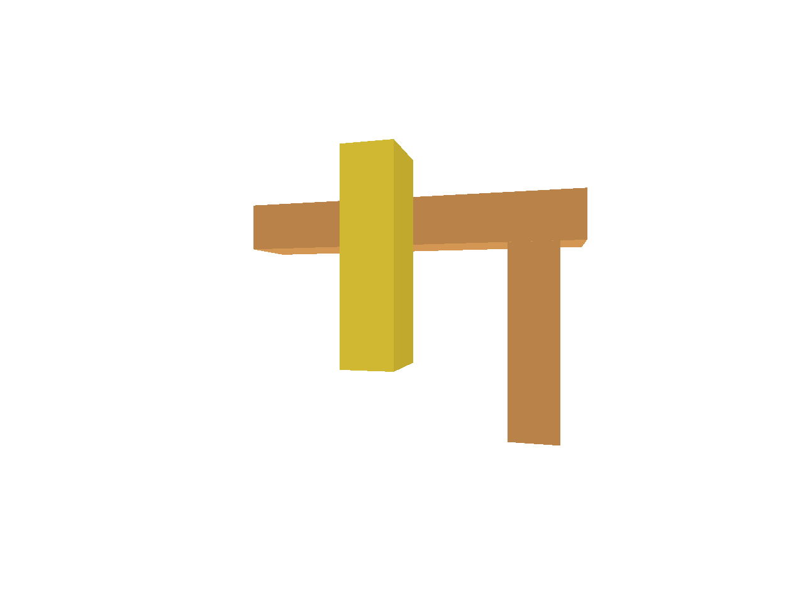

### 3.1 · Kernel geometry and a single editor owner

- [3.1 · Kernel geometry and a single editor owner](consolidation/17-solid.md)

### 3.2 · One drawing size and one captured gesture

- [3.2 · One drawing size and one captured gesture](consolidation/19a-viewport.md)

### 3.3 · Validated files, bounds and useful projections

- [3.3 · Validated files, bounds and useful projections](consolidation/22a-records.md)

### 3.4 · Local sources, world placement and display caches

- [3.4 · Local sources, world placement and display caches](consolidation/27-placement.md)

### 3.5 · Save, replace and asynchronous transaction results

- [3.5 · Save, replace and asynchronous transaction results](consolidation/29-identity.md)

### 3.6 · Shared GPU geometry and releasable source ownership

- [3.6 · Shared GPU geometry and releasable source ownership](consolidation/31-settings.md)

### 3.7 · Restore exact sources and replay the captured edit

- [3.7 · Restore exact sources and replay the captured edit](consolidation/32g-keys.md)

## 4 · Browser lifetime and recovery

**Automated Chrome checks: 0 of 40 checkpoints current.** Other records remain historical or unverified; follow the [active validation queue](roadmap.md) and reuse matching proof.

**Critical browser-scene review: 0 of 40 checkpoints recorded.** A supporting image is a reference, not approval of the entire chapter.

**Critical visual review pending.** This recorded reference is not an accepted visual-quality result.

**Previous native render — fresh verification pending.** [4.2.37 · Recover once at reduced canvas density](34geb-reload.md).

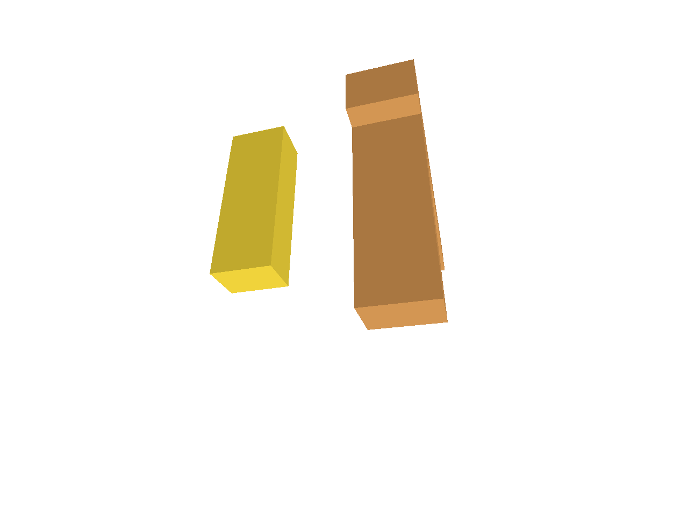

### 4.1 · Browser callbacks with a real lifetime

- [4.1 · Browser callbacks with a real lifetime](consolidation/33-owner.md)

### 4.2 · First failure and independent diagnostic reports

- [4.2 · First failure and independent diagnostic reports](consolidation/34-fault.md)

### 4.3 · Admit useful evidence and bound stored runs

- [4.3 · Admit useful evidence and bound stored runs](consolidation/34e-schema.md)

### 4.4 · Heartbeat suspension and revocable startup

- [4.4 · Heartbeat suspension and revocable startup](consolidation/34g-heartbeat.md)

### 4.5 · Measured phases and conservative GPU recovery

- [4.5 · Measured phases and conservative GPU recovery](consolidation/34gc-messages.md)

## 5 · Lines, points and curves

**Automated Chrome checks: 0 of 42 checkpoints current.** Other records remain historical or unverified; follow the [active validation queue](roadmap.md) and reuse matching proof.

**Critical browser-scene review: 0 of 42 checkpoints recorded.** A supporting image is a reference, not approval of the entire chapter.

**Critical visual review pending.** This recorded reference is not an accepted visual-quality result.

**Previous native render — fresh verification pending.** [5.7.8 · Inspect the ground grid through actual commands](41f-input.md).

### 5.1 · Original lines and a screen-space stroke lane

- [5.1 · Original lines and a screen-space stroke lane](consolidation/35-stroke.md)

### 5.2 · Joined paths and headed ends

- [5.2 · Joined paths and headed ends](consolidation/36-chain.md)

### 5.3 · Original point markers and curve control identities

- [5.3 · Original point markers and curve control identities](consolidation/37-point.md)

### 5.4 · NURBS source ownership and derived samples

- [5.4 · NURBS source ownership and derived samples](consolidation/38-layout.md)

### 5.5 · One visibility policy and shared surface depth

- [5.5 · One visibility policy and shared surface depth](consolidation/39-visible.md)

### 5.6 · Original mesh colours and large index buffers

- [5.6 · Original mesh colours and large index buffers](consolidation/40-colour.md)

### 5.7 · Normals, placement and a depth-correct construction grid

- [5.7 · Normals, placement and a depth-correct construction grid](consolidation/41-normals.md)

## 6 · Picking and selection

**Automated Chrome checks: 0 of 34 checkpoints current.** Other records remain historical or unverified; follow the [active validation queue](roadmap.md) and reuse matching proof.

**Critical browser-scene review: 0 of 34 checkpoints recorded.** A supporting image is a reference, not approval of the entire chapter.

**Critical visual review pending.** This recorded reference is not an accepted visual-quality result.

**Previous native render — fresh verification pending.** [6.4.5 · Collect multiple objects with Shift-click and commands](45c-input.md).

### 6.1 · A bounded integer picking pass

- [6.1 · A bounded integer picking pass](consolidation/42-window.md)

### 6.2 · Accept a hit only for its current view

- [6.2 · Accept a hit only for its current view](consolidation/43-ticket.md)

### 6.3 · Pick original faces, edges and controls

- [6.3 · Pick original faces, edges and controls](consolidation/44-topology.md)

### 6.4 · Ordered multi-selection and atomic edits

- [6.4 · Ordered multi-selection and atomic edits](consolidation/45-order.md)

## 7 · Drawing, snapping and transform tools

**Automated Chrome checks: 0 of 57 checkpoints current.** Other records remain historical or unverified; follow the [active validation queue](roadmap.md) and reuse matching proof.

**Critical browser-scene review: 0 of 57 checkpoints recorded.** A supporting image is a reference, not approval of the entire chapter.

**Critical visual review pending.** This recorded reference is not an accepted visual-quality result.

**Previous native render — fresh verification pending.** [7.6.34 · Verify complete handle editing and input](51zf-handles.md).

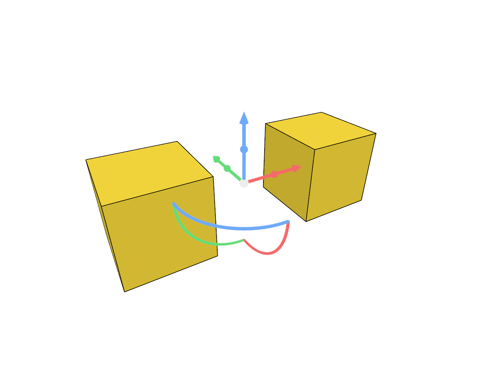

### 7.1 · Active tools own their command input

- [7.1 · Active tools own their command input](consolidation/46-tool-panel.md)

### 7.2 · Typed commands and host requests

- [7.2 · Typed commands and host requests](consolidation/47-registry.md)

### 7.3 · Construction-plane drafts and one final commit

- [7.3 · Construction-plane drafts and one final commit](consolidation/48-coordinates.md)

### 7.4 · Precise snapping with derived search caches

- [7.4 · Precise snapping with derived search caches](consolidation/49-settings.md)

### 7.5 · Temporary transforms with a fixed baseline

- [7.5 · Temporary transforms with a fixed baseline](consolidation/50-placements.md)

### 7.6 · Handles, numeric edits and source-part deformation

- [7.6 · Handles, numeric edits and source-part deformation](consolidation/51-handles.md)

## 8 · Hierarchy, layers and direct editing

**Automated Chrome checks: 0 of 53 checkpoints current.** Other records remain historical or unverified; follow the [active validation queue](roadmap.md) and reuse matching proof.

**Critical browser-scene review: 0 of 53 checkpoints recorded.** A supporting image is a reference, not approval of the entire chapter.

**Critical visual review pending.** This recorded reference is not an accepted visual-quality result.

**Previous native render — fresh verification pending.** [8.3.18 · Exercise current navigation selection and delayed answers](54p-navigation.md).

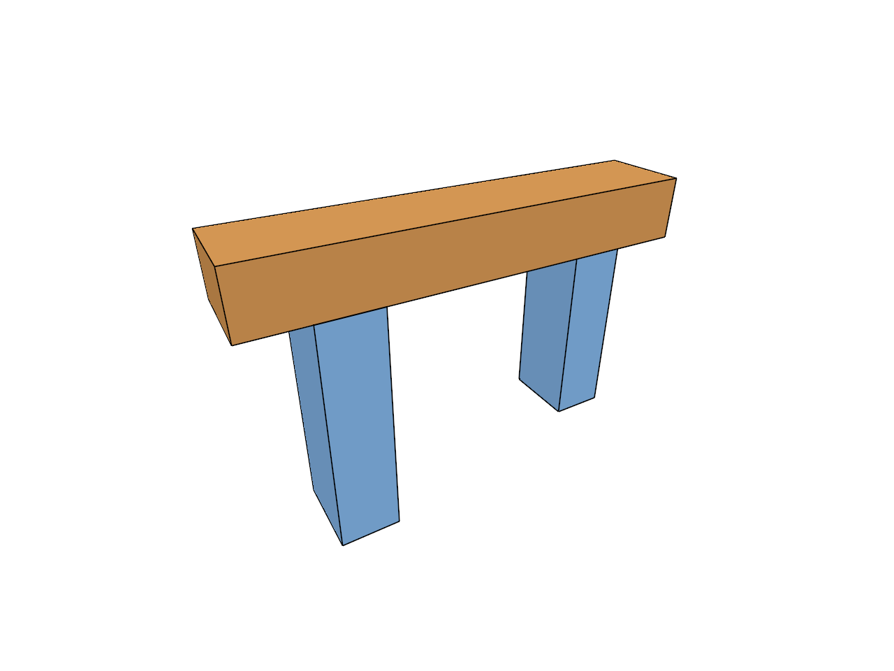

### 8.1 · Nested original sources and exact parent edits

- [8.1 · Nested original sources and exact parent edits](consolidation/52-tree.md)

### 8.2 · Tree presentation with explicit input ownership

- [8.2 · Tree presentation with explicit input ownership](consolidation/52g-rows.md)

### 8.3 · Layers, visibility and source-preserving properties

- [8.3 · Layers, visibility and source-preserving properties](consolidation/53-flags.md)

### 8.4 · Navigation, delayed picks and direct dragging

- [8.4 · Navigation, delayed picks and direct dragging](consolidation/54-camera.md)

## 9 · CAD surfaces and topology

**Automated Chrome checks: 0 of 26 checkpoints current.** Other records remain historical or unverified; follow the [active validation queue](roadmap.md) and reuse matching proof.

**Critical browser-scene review: 0 of 26 checkpoints recorded.** A supporting image is a reference, not approval of the entire chapter.

**Critical visual review pending.** This recorded reference is not an accepted visual-quality result.

**Previous native render — fresh verification pending.** [9.5.7 · Draw the original bore and prove its empty hole](59f-cad.md).

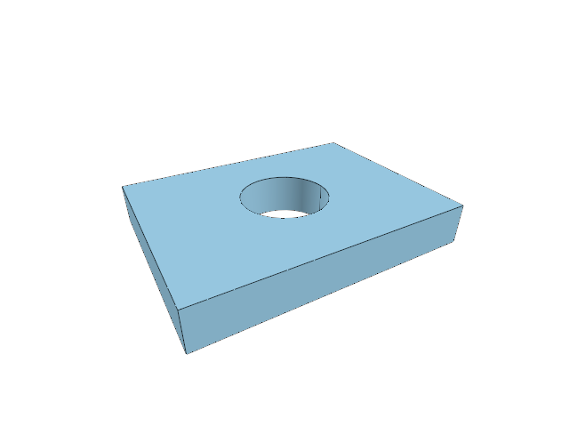

### 9.1 · Original surfaces, analytic normals and trim boundaries

- [9.1 · Original surfaces, analytic normals and trim boundaries](consolidation/55-validation.md)

### 9.2 · Shared CAD boundaries across incident faces

- [9.2 · Shared CAD boundaries across incident faces](consolidation/56-chains.md)

### 9.3 · Trimmed curved faces with real open holes

- [9.3 · Trimmed curved faces with real open holes](consolidation/57-parameters.md)

### 9.4 · Periodic seams and face-edge direction

- [9.4 · Periodic seams and face-edge direction](consolidation/58-uses.md)

### 9.5 · Oriented CAD solids, original picks and empty bores

- [9.5 · Oriented CAD solids, original picks and empty bores](consolidation/59-orientation.md)

## 10 · Text and labels

**Automated Chrome checks: 0 of 52 checkpoints current.** Other records remain historical or unverified; follow the [active validation queue](roadmap.md) and reuse matching proof.

**Critical browser-scene review: 0 of 52 checkpoints recorded.** A supporting image is a reference, not approval of the entire chapter.

**Critical visual review pending.** This recorded reference is not an accepted visual-quality result.

**Previous native render — fresh verification pending.** [10.3.37 · Create pick move and delete the original scene labels](62o-labels.md).

### 10.1 · Explicit fonts and source label placement

- [10.1 · Explicit fonts and source label placement](consolidation/60-fonts.md)

### 10.2 · Validated shaping and revision-based reuse

- [10.2 · Validated shaping and revision-based reuse](consolidation/60ba-validation.md)

### 10.3 · A shared glyph atlas and lazy text drawing

- [10.3 · A shared glyph atlas and lazy text drawing](consolidation/61-atlas.md)

### 10.4 · Original world labels, plates and integer picks

- [10.4 · Original world labels, plates and integer picks](consolidation/62-source.md)

## 11 · Outlines and point clouds

**Automated Chrome checks: 0 of 41 checkpoints current.** Other records remain historical or unverified; follow the [active validation queue](roadmap.md) and reuse matching proof.

**Critical browser-scene review: 0 of 41 checkpoints recorded.** A supporting image is a reference, not approval of the entire chapter.

**Critical visual review pending.** This recorded reference is not an accepted visual-quality result.

**Previous native render — fresh verification pending.** [11.3.6 · Validate original manifest text and source keys](65zb-validate-original-manifest-text-and-source-keys.md).

### 11.1 · Coverage-based screen-space outlines

- [11.1 · Coverage-based screen-space outlines](consolidation/63-radius.md)

### 11.2 · Validated original cloud columns and placed owners

- [11.2 · Validated original cloud columns and placed owners](consolidation/64-nodes.md)

### 11.3 · View-dependent LOD and cached point splats

- [11.3 · View-dependent LOD and cached point splats](consolidation/64f-projection.md)

### 11.4 · Original point identity and manifest source records

- [11.4 · Original point identity and manifest source records](consolidation/65-originals.md)

## 12 · Files and streaming

**Automated Chrome checks: 1 of 102 checkpoints current.** Other records remain historical or unverified; follow the [active validation queue](roadmap.md) and reuse matching proof.

**Critical browser-scene review: 1 of 102 checkpoints recorded.** A supporting image is a reference, not approval of the entire chapter.

**Critical browser-scene review accepted.** Actual Chrome reference: open CAD bore, separate NURBS roof and two dense planar point-cloud instances sharing one 2,000,064-point original. The asserted scene was critically inspected at DPR 1 and 2. The red/blue four-point native example is separate test data.

**Current Chrome capture — critically reviewed scene.** [12.3.31 · Connect current pages to the browser renderer](68ac-connect-current-pages-to-the-browser-renderer.md). Captured 2026-10-15.

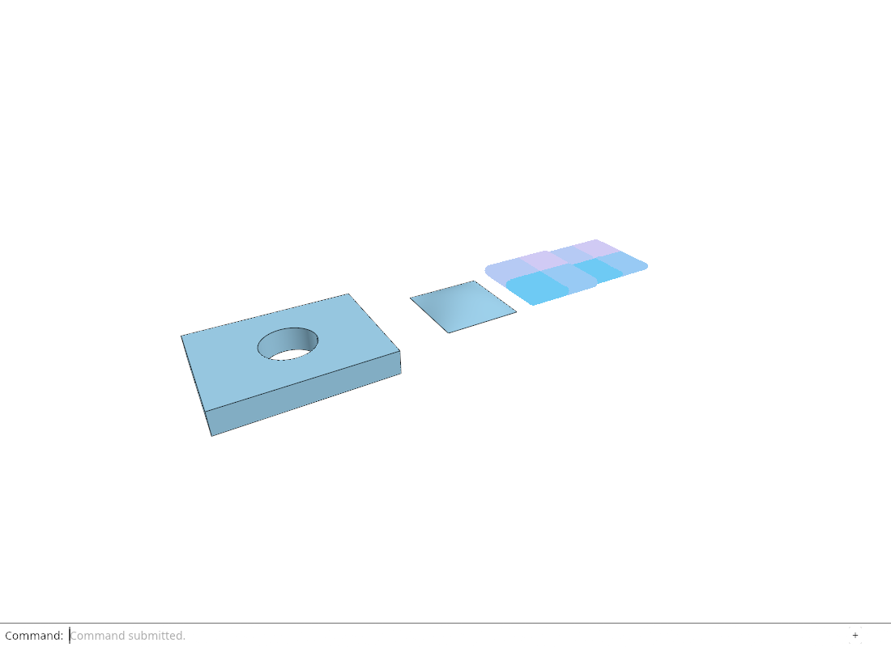

### 12.1 · Complete viewer files and published scene sources

- [12.1 · Complete viewer files and published scene sources](consolidation/66-read-scene-manifests.md)

### 12.2 · Locate original arrays without downloading their bodies

- [12.2 · Locate original arrays without downloading their bodies](consolidation/67-supply-checked-array-layout-readers.md)

### 12.3 · Bounded scheduling, exact replies and cancellation

- [12.3 · Bounded scheduling, exact replies and cancellation](consolidation/66za-own-original-range-read-permits.md)

### 12.4 · Charged residency and current streamed pages

- [12.4 · Charged residency and current streamed pages](consolidation/68-reserve-page-bytes-before-reading.md)

## 13 · Shared definitions and drawing sheets

**Automated Chrome checks: 0 of 30 checkpoints current.** Other records remain historical or unverified; follow the [active validation queue](roadmap.md) and reuse matching proof.

**Critical browser-scene review: 0 of 30 checkpoints recorded.** A supporting image is a reference, not approval of the entire chapter.

**Critical visual review pending.** This recorded reference is not an accepted visual-quality result.

**Previous native render — fresh verification pending.** [13.2.6 · Read original sheet metadata records](70za-read-original-sheet-metadata-records.md).

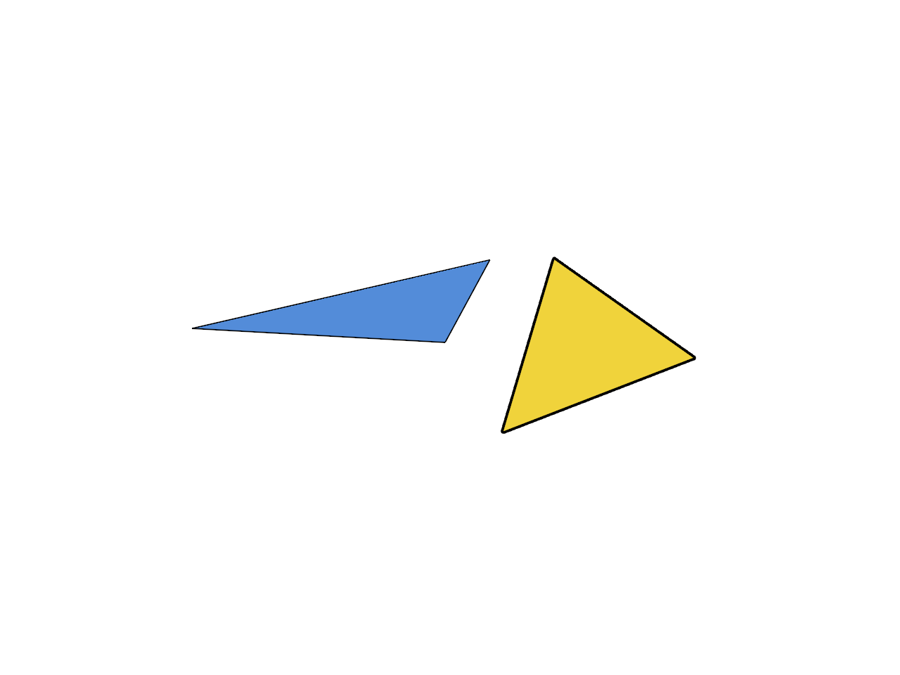

### 13.1 · Shared original definitions and independently placed instances

- [13.1 · Shared original definitions and independently placed instances](consolidation/69-validate-original-definition-references.md)

### 13.2 · Independent presentation and reusable CAD preparation

- [13.2 · Independent presentation and reusable CAD preparation](consolidation/69j-preserve-per-instance-original-colours.md)

### 13.3 · Feature ancestry and canonical local-to-world placement

- [13.3 · Feature ancestry and canonical local-to-world placement](consolidation/70-evaluate-source-ancestry-once-per-document.md)

### 13.4 · Original sheet entity metadata

- [13.4 · Original sheet entity metadata](consolidation/70za-read-original-sheet-metadata-records.md)

## 14 · Coordinates and geometry tools

**Automated Chrome checks: 0 of 118 checkpoints current.** Other records remain historical or unverified; follow the [active validation queue](roadmap.md) and reuse matching proof.

**Critical browser-scene review: 0 of 118 checkpoints recorded.** A supporting image is a reference, not approval of the entire chapter.

**Critical visual review pending.** This recorded reference is not an accepted visual-quality result.

**Previous native render — fresh verification pending.** [14.6.5 · Exercise exact curves and rational control edits](76d-exercise-exact-curves-and-rational-control-edits.md).

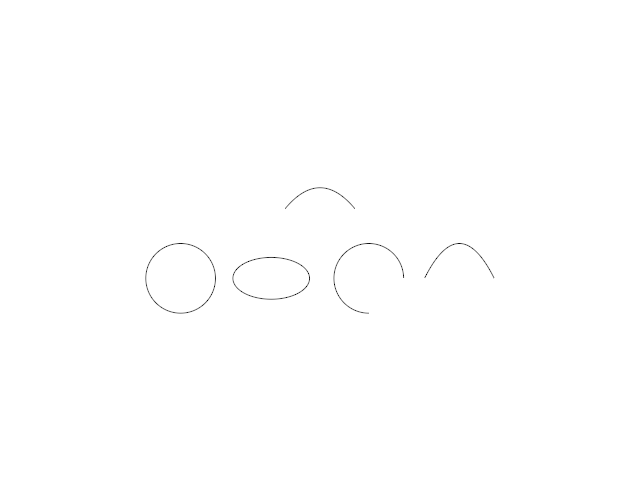

### 14.1 · Original drawings, entity queries and construction frames

- [14.1 · Original drawings, entity queries and construction frames](consolidation/71-read-original-sheet-entity-metadata.md)

### 14.2 · Precise coordinates and original drawing drafts

- [14.2 · Precise coordinates and original drawing drafts](consolidation/72-copy-current-construction-planes-and-coordinate-forms.md)

### 14.3 · Planar boundaries and checked solid foundations

- [14.3 · Planar boundaries and checked solid foundations](consolidation/73-construct-rectangles-and-polygons-in-plane-axes.md)

### 14.4 · Solid questions, previews and one original commit

- [14.4 · Solid questions, previews and one original commit](consolidation/74-copy-current-solid-geometry-and-question-definitions.md)

### 14.5 · Round solids and exact planar conics

- [14.5 · Round solids and exact planar conics](consolidation/75-reuse-current-round-solid-builders.md)

### 14.6 · Exact parabola recipes and editable freeform controls

- [14.6 · Exact parabola recipes and editable freeform controls](consolidation/76-copy-exact-planar-curve-definitions.md)

## 15 · Transforms and surface construction

**Automated Chrome checks: 0 of 81 checkpoints current.** Other records remain historical or unverified; follow the [active validation queue](roadmap.md) and reuse matching proof.

**Critical browser-scene review: 0 of 81 checkpoints recorded.** A supporting image is a reference, not approval of the entire chapter.

**Visual review: issue found.** The inherited network-surface image contains six original input curves and two surfaces; it does not show a complete NURBS isocurve display. The interior curves are faint and discontinuous. The current pixel check counts aggregate dark pixels and does not prove curve continuity or contrast. Visual quality is not accepted; a focused comparison and correction are required.

**Previous native render — fresh verification pending.** [15.4.6 · Read original projection planes](80za-read-original-projection-planes.md).

### 15.1 · Original transforms, part edits and solid recipes

- [15.1 · Original transforms, part edits and solid recipes](consolidation/77-copy-current-transformation-and-source-edit-algorithms.md)

### 15.2 · Profile collection and one surfacing transaction

- [15.2 · Profile collection and one surfacing transaction](consolidation/78-copy-current-curve-collection-and-surfacing-recipes.md)

### 15.3 · Lofts, rail sweeps and network foundations

- [15.3 · Lofts, rail sweeps and network foundations](consolidation/79-retain-current-loft-section-order-and-degree-options.md)

### 15.4 · Two-direction networks and corner patches

- [15.4 · Two-direction networks and corner patches](consolidation/80-build-a-surface-through-two-directions-of-original-curves.md)

## 16 · Geometry editing and measurement

**Automated Chrome checks: 0 of 132 checkpoints current.** Other records remain historical or unverified; follow the [active validation queue](roadmap.md) and reuse matching proof.

**Critical browser-scene review: 0 of 132 checkpoints recorded.** A supporting image is a reference, not approval of the entire chapter.

**Critical visual review pending.** This recorded reference is not an accepted visual-quality result.

**Previous native render — fresh verification pending.** [16.5.52 · Exercise current original commands together](85ay-exercise-current-original-commands-together.md).

### 16.1 · Projection, extension and stable edit targets

- [16.1 · Projection, extension and stable edit targets](consolidation/81-project-originals-through-the-current-plane-algorithms.md)

### 16.2 · Split original curves and joined faces

- [16.2 · Split original curves and joined faces](consolidation/82-divide-current-original-curve-families.md)

### 16.3 · Joined-face topology and exact surface measures

- [16.3 · Joined-face topology and exact surface measures](consolidation/83-split-original-faces-without-separating-the-solid.md)

### 16.4 · Measurements, temporary marks and retained CAD pieces

- [16.4 · Measurements, temporary marks and retained CAD pieces](consolidation/84-measure-original-curves-surfaces-and-closed-solids.md)

### 16.5 · Text, Plane, Trim and integrated editing commands

- [16.5 · Text, Plane, Trim and integrated editing commands](consolidation/85-copy-current-original-command-recipes.md)

## 17 · GPU visibility, clipping and sections

**Automated Chrome checks: 0 of 122 checkpoints current.** Other records remain historical or unverified; follow the [active validation queue](roadmap.md) and reuse matching proof.

**Critical browser-scene review: 0 of 122 checkpoints recorded.** A supporting image is a reference, not approval of the entire chapter.

**Critical visual review pending.** This recorded reference is not an accepted visual-quality result.

**Previous native render — fresh verification pending.** [17.3.32 · Exercise original sections bores and ink](88ad-exercise-original-sections-bores-and-ink.md).

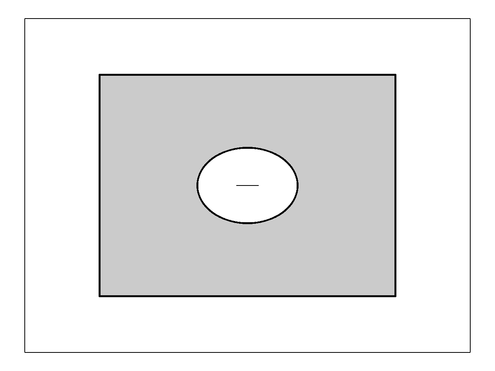

### 17.1 · Bounded projected triangles and tile lists

- [17.1 · Bounded projected triangles and tile lists](consolidation/86-copy-finite-tile-allocation-rules.md)

### 17.2 · Finite ink visibility and original colour/pick ownership

- [17.2 · Finite ink visibility and original colour/pick ownership](consolidation/86s-test-visibility-at-the-original-center-line.md)

### 17.3 · Original clipping half-spaces across drawing families

- [17.3 · Original clipping half-spaces across drawing families](consolidation/87-copy-current-original-plane-modes.md)

### 17.4 · Verified closed sections and exact cap picks

- [17.4 · Verified closed sections and exact cap picks](consolidation/88-copy-original-closedness-and-winding.md)

## 18 · Lighting, render quality and comparison

**Automated Chrome checks: 0 of 89 checkpoints current.** Other records remain historical or unverified; follow the [active validation queue](roadmap.md) and reuse matching proof.

**Critical browser-scene review: 0 of 89 checkpoints recorded.** A supporting image is a reference, not approval of the entire chapter.

**Critical visual review pending.** This recorded reference is not an accepted visual-quality result.

**Previous native render — fresh verification pending.** [18.7.7 · Prove cache invalidation and honest performance reports](95f-prove-cache-invalidation-and-honest-performance-reports.md).

### 18.1 · A retained depth and radius pyramid

- [18.1 · A retained depth and radius pyramid](consolidation/89-copy-density-scaled-depth-reduction.md)

### 18.2 · Original contact metadata and ambient light

- [18.2 · Original contact metadata and ambient light](consolidation/90-copy-maintained-original-contact-radius.md)

### 18.3 · Section-aware outlines and one presentation composite

- [18.3 · Section-aware outlines and one presentation composite](consolidation/91-include-visible-section-coverage.md)

### 18.4 · Original Wood Elements and portable source records

- [18.4 · Original Wood Elements and portable source records](consolidation/92-link-current-wood-element-builders.md)

### 18.5 · Glass, X-ray and shared visibility rules

- [18.5 · Glass, X-ray and shared visibility rules](consolidation/93-classify-original-solids-independently-of-clipping.md)

### 18.6 · Matched rendering comparisons from original sources

- [18.6 · Matched rendering comparisons from original sources](consolidation/94-declare-the-rendering-comparison-contract.md)

### 18.7 · Measured frame costs and dependency-aware cache reports

- [18.7 · Measured frame costs and dependency-aware cache reports](consolidation/95-record-comparable-large-scene-conditions.md)

## 19 · Integration and original ownership

**Automated Chrome checks: 0 of 34 checkpoints current.** Other records remain historical or unverified; follow the [active validation queue](roadmap.md) and reuse matching proof.

**Critical browser-scene review: 0 of 34 checkpoints recorded.** A supporting image is a reference, not approval of the entire chapter.

**Critical visual review pending.** This recorded reference is not an accepted visual-quality result.

**Previous native render — fresh verification pending.** [19.4.7 · Rebuild an edited Element without replacing its owner](96zg-rebuild-an-edited-element-without-replacing-its-owner.md).

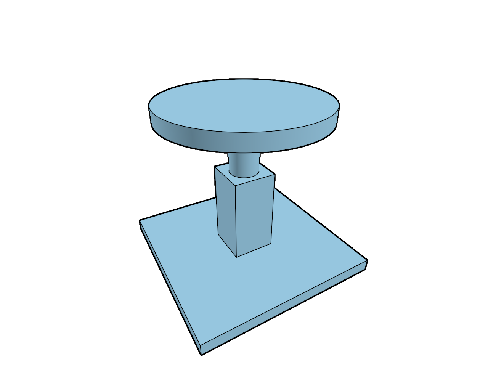

### 19.1 · Complete source metadata and the actual command contract

- [19.1 · Complete source metadata and the actual command contract](consolidation/96-retain-non-drawing-originals-and-validate-raw-planes.md)

### 19.2 · Original Element ancestry and derived feature trees

- [19.2 · Original Element ancestry and derived feature trees](consolidation/96i-separate-own-and-hosted-element-features.md)

### 19.3 · Original owners across selection, copying and display

- [19.3 · Original owners across selection, copying and display](consolidation/96s-resolve-feature-rows-to-original-element-owners.md)

### 19.4 · Family-aware original controls and source previews

- [19.4 · Family-aware original controls and source previews](consolidation/96za-address-original-controls-with-family-keys.md)

## 20 · Shared GPU rendering

**Automated Chrome checks: 11 of 95 checkpoints current.** Other records remain historical or unverified; follow the [active validation queue](roadmap.md) and reuse matching proof.

**Critical browser-scene review: 0 of 95 checkpoints recorded.** A supporting image is a reference, not approval of the entire chapter.

**Critical visual review pending.** This recorded reference is not an accepted visual-quality result.

**Current supporting native render — critical image review pending.** [20.12.5 · Retire empty arena ranges after tail trimming](96zzzzx-retire-empty-arena-ranges-after-tail-trimming.md).

### 20.1 · Shared surface geometry and finite visibility addresses

- [20.1 · Shared surface geometry and finite visibility addresses](consolidation/96zh-bind-the-shared-geometry-as-storage.md)

### 20.2 · Physical formats, shared section inputs and display defaults

- [20.2 · Physical formats, shared section inputs and display defaults](consolidation/96zzc-share-section-addresses-with-outlines-and-ambient.md)

### 20.3 · Shared arenas, object records and source preparation

- [20.3 · Shared arenas, object records and source preparation](consolidation/96zzg-grow-buffers-without-losing-rows.md)

### 20.4 · Slots, independent instance owners and stable record updates

- [20.4 · Slots, independent instance owners and stable record updates](consolidation/96zzu-separate-primitive-addresses-from-selection.md)

### 20.5 · Original picks, ambient metadata and cap consumers

- [20.5 · Original picks, ambient metadata and cap consumers](consolidation/96zzzs-allocate-stable-object-record-rows.md)

### 20.6 · Retained allocation, live lookup and safe reclamation

- [20.6 · Retained allocation, live lookup and safe reclamation](consolidation/96zzzzi-adapt-incremental-slots-to-pulled-draws.md)

## 21 · Precise camera and browser coordinates

**Automated Chrome checks: 30 of 30 checkpoints current.**

**Critical browser-scene review: 3 of 30 checkpoints recorded.** A supporting image is a reference, not approval of the entire chapter.

**Critical browser-scene review accepted.** Actual asserted projection scene: the original line endpoints visible in the cropped orthographic Box remain visible after the current perspective refit. Separate trusted-wheel and explicit logical-pixel/line/page/overflow controls pass at actual DPR 1, 2 and 3, including render cap 2 at DPR 3. Original geometry and exact repeated frames are retained.

**Current Chrome capture — critically reviewed scene.** [21.5.6 · Match wheel input and framed projection](96zzzzzzf-match-wheel-input-and-framed-projection.md). Captured 2026-10-15.

### 21.1 · Units and one precise render origin

- [21.1 · Units and one precise render origin](consolidation/96zzzzy-prepare-unit-aware-anchored-camera-space.md)

### 21.2 · Precise CPU queries and origin-stamped picks

- [21.2 · Precise CPU queries and origin-stamped picks](consolidation/96zzzzzj-project-cpu-queries-around-the-precise-target.md)

### 21.3 · Browser ownership of frame matrices and wakeups

- [21.3 · Browser ownership of frame matrices and wakeups](consolidation/96zzzzzq-prepare-one-shared-render-origin.md)

### 21.4 · Reversed depth and homogeneous near clipping

- [21.4 · Reversed depth and homogeneous near clipping](consolidation/96zzzzzt-share-depth-endpoints-and-comparisons.md)

### 21.5 · Physical camera, world grid and framed navigation

- [21.5 · Physical camera, world grid and framed navigation](consolidation/96zzzzzza-match-physical-camera-defaults-and-limits.md)

## 22 · Surface lighting, contact and display quality

**Automated Chrome checks: 37 of 38 checkpoints current.** Other records remain historical or unverified; follow the [active validation queue](roadmap.md) and reuse matching proof.

**Critical browser-scene review: 37 of 38 checkpoints recorded.** A supporting image is a reference, not approval of the entire chapter.

**Critical browser-scene review accepted.** Actual controlled single-sample contact regression fixture. Separately labelled actual Browser figures and independent first-frame GPU/command/query controls are required for the new presentation adapter. Whole-course feature review and later camera/grid fixes remain pending.

**Current Chrome capture — critically reviewed scene.** [22.6.4 · Apply semantic view controls](96zzzzzzzp-apply-semantic-view-controls.md). Captured 2026-10-17.

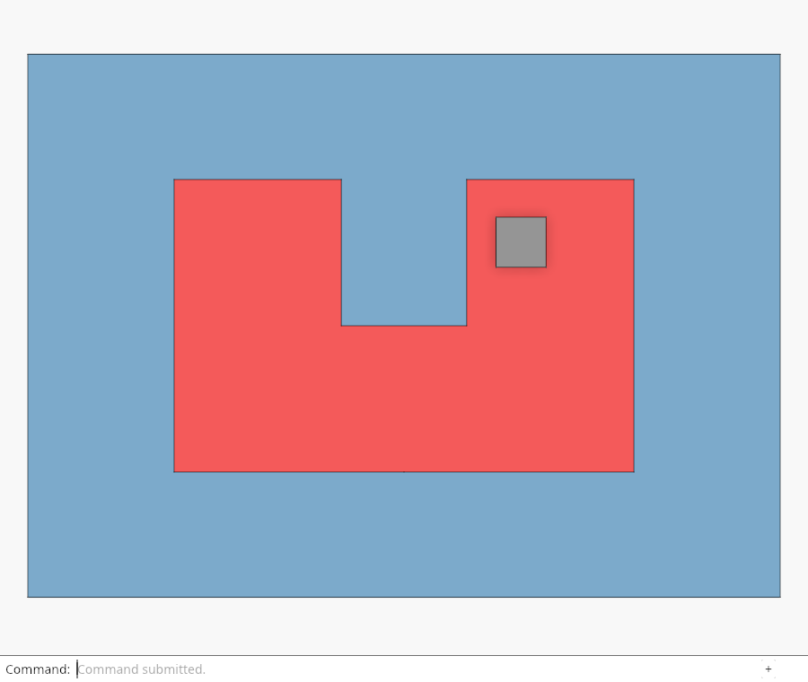

### 22.1 · Original surface colours and lighting controls

- [22.1 · Original surface colours and lighting controls](consolidation/96zzzzzzg-share-current-surface-lighting-and-camera-uniforms.md)

### 22.2 · Contact fills and original face queries

- [22.2 · Contact fills and original face queries](consolidation/96zzzzzzi-share-one-frame-across-color-and-ink.md)

### 22.3 · Original boundary pens, joins and vertex markers

- [22.3 · Original boundary pens, joins and vertex markers](consolidation/96zzzzzzn-respect-original-boundary-pens.md)

### 22.4 · Original ambient inputs and real pass ordering

- [22.4 · Original ambient inputs and real pass ordering](consolidation/96zzzzzzr-share-geometric-ambient-inputs.md)

### 22.5 · Coherent multisampling and frame-resource ownership

- [22.5 · Coherent multisampling and frame-resource ownership](consolidation/96zzzzzzu-keep-depth-and-address-samples-separate.md)

### 22.6 · Original display controls and remaining integration boundaries

- [22.6 · Original display controls and remaining integration boundaries](consolidation/96zzzzzzzm-retain-visible-instance-ranges.md)

## Reference comparison

[Compare with the maintained browser runtime](97-finish-with-the-maintained-browser-runtime.md). This comparison remains outside the learner coding route while implementation is unfinished.
