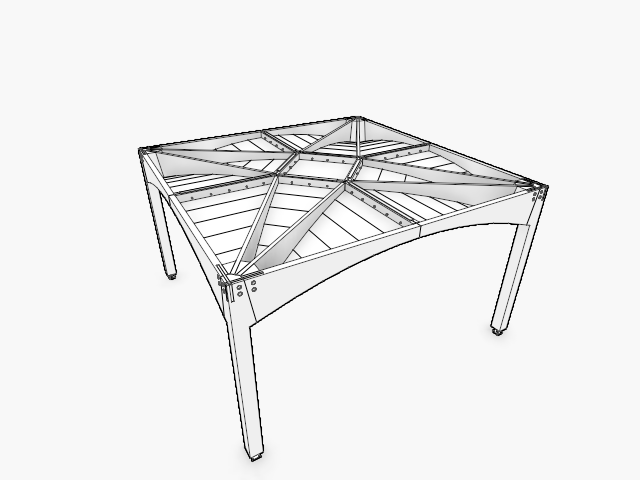
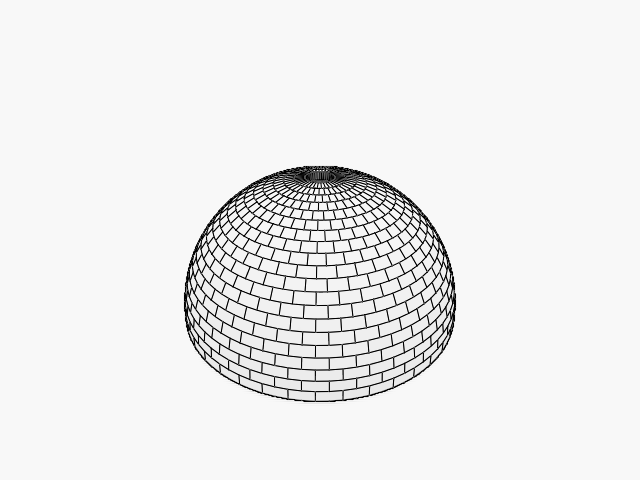

# Actual maintained native scene checks

The current maintained renderer loaded and drew the original comparison, both available floor files and the regenerated `templates_vault_4_dome.cpp` output. Each input file’s SHA-256 was unchanged after rendering. The [exact records](current-native-scenes.json) include source/output hashes, settings, camera/adapter diagnostics and actual logs.

The dome was generated by the local Wood C++ core at `04fef15e02eb37f14586a81f583043056d55a724` and the original example, changing only its scratch output path. It contains 800 voussoirs and 2,320 contacts. Its original collection also includes 800 planes, so the native renderer reports 1,600 object rows. Both available floor files contain 237 Elements. These file identities do not establish which exact file was loaded on the Lenovo. The [upstream check](latest-commit-audit.md) distinguishes this C++ baseline from the unchanged remote Rust dependency used by the viewer.

These are CPU Vulkan/Lavapipe frames at 640×480, with opacity1, lit faces, AO/outlines on, grid off and MSAA1. Eight fixed-quality frames include offscreen readback and cold initial work; `VIEWER_FRAMES_ORBIT=2` rotates by two mouse pixels before each timed frame. The native batch reports median96.0ms for the floor input,98.8ms for the floor output and122.8ms for the dome; first-frame maxima exceed two seconds. Those values are descriptive software-renderer telemetry, not a warmed browser benchmark or proof of improved Lenovo performance. Native pass timestamps put substantial cost in ink and tile visibility; investigate those owners with the [large-scene recipe](large-scenes.md).

Use [subject97](97-finish-with-the-maintained-browser-runtime.md) for the maintained browser destination. Browser gestures, two-density visual acceptance, release-after-Close and matched Lenovo Chrome/Firefox measurements remain separate checks. No reference pages have been retired.
