# Session Viewer WebGPU Course — 10-Section Student Notebook Outline

> **Course Redraft (Gemini Notebook Style for First-Year WebGPU Students)**  
> **Authoritative Production Source:** `session_viewer/src`  
> **Scope Preserved:** 10 Main Sections · 22 Existing Chapters · 111 Reader-Facing Consolidated Lessons · 1,361 Preserved Checkpoints (1,360 coding checkpoints + 1 reference comparison `97-finish-with-the-maintained-browser-runtime`) · Includes latest `src/shaders/matrix.wgsl` shader.

---

## How a First-Year Student Should Read This Course

Modern 3D CAD/CAE browser viewers cross **four languages/formats** on every frame. Keep this mental map beside you as you work through the 10 sections:

```mermaid
flowchart LR
  subgraph Browser["1. Browser (HTML / CSS / JS Events)"]
    Canvas["<canvas id='canvas'>\nPointer / Keyboard / Fetch"]
  end
  subgraph RustWasm["2. Rust compiled to WebAssembly (CPU Owner)"]
    Proto["session_proto (.pb)\nBinary Scene Decode"]
    Kernel["session_rust Kernel\nMesh / BRep / NURBS / Element"]
    Editor["Editor & Scene State\nf64 Floating Origin + Undo"]
    Arena["Shared GPU Arena Packer\n#[repr(C)] / bytemuck Bytes"]
  end
  subgraph WebGPU["3. WebGPU API (Command Queue)"]
    Buffers["Storage Arena + Uniforms\n+ Rg32Uint Pick Target"]
    Passes["Compute & Render Passes\n(1x / 4x MSAA, Reversed-Z)"]
  end
  subgraph WGSL["4. WGSL Shaders (GPU Cores)"]
    Compute["@compute Tile Visibility\nprojected_triangle / prefix_sum"]
    Vert["@vertex Pulling & Extrusion\nscene / ribbon / glyph / matrix"]
    Frag["@fragment Shading & Picking\ntriangle / ssao / outline"]
  end
  Canvas --> Proto --> Kernel --> Editor --> Arena --> Buffers --> Passes --> Compute --> Vert --> Frag --> Canvas
```



### Summary of the 10 Main Sections

| Section | Title | Absorbed Chapters | Lessons (`Old` → `New`) | Checkpoints | Endpoint Range | Section Notebook |
| ---: | :--- | :--- | :--- | ---: | :--- | :--- |
| **1** | **WebGPU Foundations, Shaders, and the Command Dock** | Ch 1 | 4 (`1.1`–`1.4` → `1.1`–`1.4`) | **29** | `01-canvas` → `04-input` | [Section 1 Guide](sections/section-01-webgpu-and-command-dock.md) |
| **2** | **3D Meshes, Camera Matrices, Depth, and Ray Picking** | Ch 2 | 6 (`2.1`–`2.6` → `2.1`–`2.6`) | **19** | `05-vertices` → `16-orbit` | [Section 2 Guide](sections/section-02-meshes-camera-depth-and-picking.md) |
| **3** | **Scene Documents, Transactions, and Browser GPU Lifetime** | Ch 3, 4 | 12 (`3.1`–`4.5` → `3.1`–`3.12`) | **136** | `17-solid` → `34geb-reload` | [Section 3 Guide](sections/section-03-documents-transactions-and-browser-lifetime.md) |
| **4** | **Screen-Space Ink, Point Markers, NURBS Curves, and GPU Integer Picking** | Ch 5, 6 | 11 (`5.1`–`6.4` → `4.1`–`4.11`) | **76** | `35-stroke` → `45c-input` | [Section 4 Guide](sections/section-04-ink-curves-and-gpu-integer-picking.md) |
| **5** | **Interactive Drawing, Snapping, Gumball Handles, and Scene Hierarchy** | Ch 7, 8 | 10 (`7.1`–`8.4` → `5.1`–`5.10`) | **110** | `46-tool-panel` → `54p-navigation` | [Section 5 Guide](sections/section-05-drawing-snapping-gumball-and-hierarchy.md) |
| **6** | **CAD B-Rep Topology, World Text Atlases, Outlines, and Point Clouds** | Ch 9, 10, 11 | 13 (`9.1`–`11.4` → `6.1`–`6.13`) | **119** | `55-validation` → `65zb-validate-original-manifest-text-and-source-keys` | [Section 6 Guide](sections/section-06-cad-surfaces-text-outlines-and-point-clouds.md) |
| **7** | **Out-of-Core HTTP Range Streaming, Shared Instances, and Drawing Sheets** | Ch 12, 13 | 8 (`12.1`–`13.4` → `7.1`–`7.8`) | **132** | `66-read-scene-manifests` → `70za-read-original-sheet-metadata-records` | [Section 7 Guide](sections/section-07-streaming-shared-instances-and-drawing-sheets.md) |
| **8** | **Precision Coordinate Frames, Solid Primitives, Surfacing, and CAD Editing** | Ch 14, 15, 16 | 15 (`14.1`–`16.5` → `8.1`–`8.15`) | **331** | `71-read-original-sheet-entity-metadata` → `85ay-exercise-current-original-commands-together` | [Section 8 Guide](sections/section-08-coordinates-primitives-surfacing-and-cad-editing.md) |
| **9** | **Compute Tile Visibility, Clipping Half-Spaces, Section Caps, and Ambient Occlusion** | Ch 17, 18 | 11 (`17.1`–`18.7` → `9.1`–`9.11`) | **211** | `86-copy-finite-tile-allocation-rules` → `95f-prove-cache-invalidation-and-honest-performance-reports` | [Section 9 Guide](sections/section-09-compute-visibility-clipping-sections-and-ao.md) |
| **10** | **Shared GPU Arenas, Floating-Origin Precision, Multisampling, and Production Parity** | Ch 19, 20, 21, 22 | 21 (`19.1`–`22.6` → `10.1`–`10.21`) | **198** | `96-retain-non-drawing-originals-and-validate-raw-planes` → `96zzzzzzzq-draw-original-cad-wire-curves` + `97` | [Section 10 Guide](sections/section-10-shared-gpu-precision-and-lighting.md) |
| **Total** | **Complete Session Viewer Course** | **22 Chapters** | **111 Lessons** | **1,361** | `01-canvas` → `97-finish-with-the-maintained-browser-runtime` | [Complete Coverage Map](old-to-new-coverage-map.md) |

---

## Section 1: WebGPU Foundations, Shaders, and the Command Dock

**Absorbs:** Ch 1: *Browser, Rust and the GPU* · **Lessons:** 4 (`1.1`–`1.4`) · **Checkpoints:** 29 (`01-canvas` → `04-input`) · **[Open Section 1 Notebook](sections/section-01-webgpu-and-command-dock.md)**

### 1. Learning Outcome

Connect Rust (compiled to WebAssembly) to an HTML `<canvas>`, initialize a WebGPU `Adapter`, `Device`, and `Queue`, record and submit `RenderPass` commands (`Clear` vs `Load`), compile your first WGSL `@vertex` and `@fragment` shaders into a `RenderPipeline`, and render an interactive `egui_wgpu` Command Dock with history and auto-completion over the 3D viewport.

### 2. Visual WebGPU Schematic (Black & White) & Language Bridge

<div class="webgpu-schematic" style="margin:1.1rem 0;padding:0.75rem;border:1.5px solid #111111;border-radius:10px;background:#ffffff;">
<svg viewBox="0 0 840 240" xmlns="http://www.w3.org/2000/svg" style="max-width:100%;height:auto;display:block;font-family:system-ui,-apple-system,Segoe UI,Roboto,sans-serif;">
  <defs>
    <marker id="arrow" viewBox="0 0 10 10" refX="8" refY="5" markerWidth="6" markerHeight="6" orient="auto-start-reverse">
      <path d="M 0 1 L 10 5 L 0 9 z" fill="#111111"/>
    </marker>
  </defs>
  <rect x="4" y="4" width="832" height="232" rx="8" fill="#ffffff" stroke="#111111" stroke-width="1.5"/>
  <text x="20" y="28" font-size="14" font-weight="700" fill="#111111">Chapter 1 WebGPU Architecture: Surface → CommandEncoder → Scene Pass (Clear) + UI Pass (Load)</text>
  <text x="20" y="46" font-size="11.5" fill="#111111">Why two passes share one GPU TextureView: Pass 1 clears & draws the 3D scene; Pass 2 loads existing pixels and overlays the Command Dock.</text>
  <line x1="16" y1="54" x2="824" y2="54" stroke="#111111" stroke-width="1"/>
  
    <!-- Box 1: HTML Canvas -->
    <rect x="18" y="68" width="160" height="145" rx="8" fill="#ffffff" stroke="#111111" stroke-width="1.5"/>
    <text x="98" y="88" text-anchor="middle" font-size="12" font-weight="700" fill="#111111">1. Browser (HTML/JS)</text>
    <text x="30" y="110" font-size="11" fill="#111111">• &lt;canvas id="canvas"&gt;</text>
    <text x="30" y="128" font-size="11" fill="#111111">• Pointer / Key Events</text>
    <text x="30" y="146" font-size="11" fill="#111111">• Surface TextureView</text>
    <text x="30" y="164" font-size="11" font-weight="600" fill="#111111">• frame.present()</text>
    <text x="30" y="192" font-size="10.5" fill="#111111">Format: Bgra8UnormSrgb</text>

    <line x1="178" y1="125" x2="208" y2="125" stroke="#111111" stroke-width="2" marker-end="url(#arrow)"/>

    <!-- Box 2: Rust CPU Owner -->
    <rect x="210" y="68" width="215" height="145" rx="8" fill="#ffffff" stroke="#111111" stroke-width="1.5"/>
    <text x="317" y="88" text-anchor="middle" font-size="12" font-weight="700" fill="#111111">2. Rust / WASM (CPU Owner)</text>
    <text x="222" y="108" font-size="11" fill="#111111">• Adapter.request_device().await</text>
    <text x="222" y="126" font-size="11" fill="#111111">• Panel::update(event) -&gt; Command</text>
    <text x="222" y="144" font-size="11" fill="#111111">• let mut enc = create_encoder()</text>
    <text x="222" y="162" font-size="11" font-weight="600" fill="#111111">• { let pass = enc.begin_...(); }</text>
    <text x="222" y="180" font-size="10.5" fill="#111111">  (Braces end &amp;mut borrow!)</text>
    <text x="222" y="198" font-size="11" font-weight="600" fill="#111111">• queue.submit([enc.finish()])</text>

    <line x1="425" y1="108" x2="458" y2="108" stroke="#111111" stroke-width="2" marker-end="url(#arrow)"/>
    <line x1="425" y1="172" x2="458" y2="172" stroke="#111111" stroke-width="2" marker-end="url(#arrow)"/>

    <!-- Box 3: GPU Pass 1 -->
    <rect x="460" y="68" width="360" height="68" rx="8" fill="#ffffff" stroke="#111111" stroke-width="1.5"/>
    <text x="472" y="86" font-size="11.5" font-weight="700" fill="#111111">3A. GPU RenderPass #1 — Scene (LoadOp::Clear)</text>
    <text x="472" y="104" font-size="11" fill="#111111">• @vertex fn vertex(@builtin(vertex_index) i: u32) -&gt; clip (-1..+1)</text>
    <text x="472" y="122" font-size="11" fill="#111111">• @fragment fn fragment() -&gt; @location(0) vec4f (Scene Triangle)</text>

    <!-- Box 4: GPU Pass 2 -->
    <rect x="460" y="145" width="360" height="68" rx="8" fill="#ffffff" stroke="#111111" stroke-width="1.5"/>
    <text x="472" y="163" font-size="11.5" font-weight="700" fill="#111111">3B. GPU RenderPass #2 — Command Dock (LoadOp::Load)</text>
    <text x="472" y="181" font-size="11" fill="#111111">• Keeps Pass #1 pixels! Uploads Noto Font Atlas glyph changes</text>
    <text x="472" y="199" font-size="11" fill="#111111">• egui_wgpu::Renderer draws Command: prompt + completions on top</text>
    
</svg>
</div>

```
+-----------------------+      +------------------------------------+      +----------------------------------+
|   Browser (HTML/JS)   |      |        Rust / WASM (CPU)           |      |        WebGPU / WGSL (GPU)       |
+-----------------------+      +------------------------------------+      +----------------------------------+
| <canvas id="canvas">  | ---> | wgpu::Instance -> Surface          |      |                                  |
| Keyboard / Pointer    | ---> | Adapter -> (Device, Queue)         |      |                                  |
| Events                |      |                                    |      |                                  |
|                       |      | 1. Scene Pass (LoadOp::Clear)      | ===> | @vertex fn vertex(index: u32)    |
|                       |      |    encoder.begin_render_pass(...)  |      |   -> clip-space (-1..+1) corners |
|                       |      |    set_pipeline(triangle_pipeline) |      | @fragment fn fragment()          |
|                       |      |    draw(0..3, 0..1)                |      |   -> sRGB target color           |
|                       |      |                                    |      |                                  |
|                       |      | 2. UI Pass (LoadOp::Load)          | ===> | egui_wgpu::Renderer              |
|                       |      |    Panel::update(event) -> Command |      |   Noto Font Atlas Texture        |
|                       | <=== |    queue.submit([encoder.finish()])| ===> |   Draws Command Dock over scene  |
|   frame.present()     |      +------------------------------------+      +----------------------------------+
```

| Language / Layer | Construct | Student Explanation |
| :--- | :--- | :--- |
| **HTML / CSS** | `<canvas id="canvas">` | Provides the browser drawing surface; CSS sets logical window size while Rust sets physical pixel buffer dimensions. |
| **Rust (WASM)** | `#[wasm_bindgen(start)]` / `.await` | Entry point called when WASM loads; `.await` yields to the browser while the GPU adapter and device initialize. |
| **Rust (Borrow)** | `{ let _pass = encoder.begin_render_pass(...); }` | Inner braces end the mutable borrow of `encoder` before `encoder.finish()` consumes it. |
| **WGSL (Shader)** | `@vertex` / `@fragment` / `@builtin(position)` | GPU entry points: `@vertex` outputs clip-space coordinates `vec4<f32>`; `@fragment` outputs pixel color `@location(0)`. |

### 3. Existing Chapters and Lessons Absorbed

| New Lesson | Old Lesson | Consolidated Lesson Title | Checkpoints | Checkpoint IDs (`first` .. `last`) | Lesson Page |
| :--- | :--- | :--- | ---: | :--- | :--- |
| `1.1` | `1.1` | Rust and the first GPU frame | 2 | `01-canvas` .. `01a-gpu` | [01-canvas.md](../consolidation/01-canvas.md) · [Redraft](lessons/01-canvas.md) |
| `1.2` | `1.2` | Browser presentation | 1 | `02-clear` .. `02-clear` | [02-clear.md](../consolidation/02-clear.md) · [Redraft](lessons/02-clear.md) |
| `1.3` | `1.3` | Shaders and the command dock | 25 | `03-triangle` .. `03d-input` | [03-triangle.md](../consolidation/03-triangle.md) · [Redraft](lessons/03-triangle.md) |
| `1.4` | `1.4` | Commands that change the view | 1 | `04-input` .. `04-input` | [04-input.md](../consolidation/04-input.md) · [Redraft](lessons/04-input.md) |

### 4. Rendering, Geometry, Interaction, and Runtime Features Covered

- **Rendering & Shaders:**
  - WebGPU surface configuration, device texture limits, and sRGB view formats (`config.format.add_srgb_suffix()`)
  - Single-pass background clear (`wgpu::LoadOp::Clear`) vs overlay UI preservation (`wgpu::LoadOp::Load`)
  - Clip-space triangle rasterization (`@builtin(vertex_index)` -> `@builtin(position) vec4<f32>`) and fragment color output (`@location(0)`)
  - Noto font glyph atlas uploads and `egui_wgpu::Renderer` triangle batching on the shared GPU device
- **Geometry & Data Representation:**
  - 2D Clip-Space coordinates (`x, y in [-1, 1]`) and 2D screen-space UI widget rectangles (`egui::Rect`)
- **Interaction & Selection:**
  - Command Dock (`src/command_dock/`): text input borrowing (`&mut String`), `VecDeque` history (200 entries), prefix auto-completion, Tab/Enter/Escape key routing, popup suggestion browsing, pointer capture, and wheel scroll consumption
  - First view command (`Background`) toggling clear color state between frames
- **Browser Runtime & Production Source Authority:**
  - WASM entry point (`#[wasm_bindgen(start)]`), async GPU initialization (`wasm_bindgen_futures::spawn_local`), uncaptured GPU error callbacks, and DOM status reporting
  - Production authority: `src/lib.rs`, `src/engine/gpu/device.rs`, `src/engine/gpu/present.rs`, `src/command_dock/mod.rs`, `src/command_dock/theme.rs`, `src/command_dock/view.rs`, `src/app/ui/command_line.rs`

### 5. Practical Exercises and Expected Visible Results

| Checkpoint | Practical Exercise | Expected Visible Result |
| :--- | :--- | :--- |
| `01a-gpu / 02-clear` | Change `wgpu::Color::WHITE` to `wgpu::Color { r: 0.9, g: 0.9, b: 0.9, a: 1.0 }` and remove the inner scope braces around `_pass`. | With braces removed, `rustc` reports a borrow-checker error on `encoder.finish()`. With braces restored and color set to `0.9`, the sRGB view renders a light-gray GPU frame. |
| `03-triangle / 03a-paint` | Move the top triangle vertex in `src/triangle.wgsl` from `(0.0, 0.6)` to `(0.4, 0.6)`, then temporarily change the UI pass from `LoadOp::Load` to `LoadOp::Clear(WHITE)`. | Moving the vertex shifts only the triangle tip right. Changing the UI pass to `Clear` erases the pink triangle beneath the `Command:` label, proving why overlay passes must use `Load`. |
| `03d-input / 04-input` | Type `he` in the Command Dock, press `Tab` to complete `Help`, press `Enter`, then run `Background` twice. | The dock expands history with the Help text; `Background` toggles the canvas behind the pink triangle from white to light gray and back. |

### 6. Verified Work vs. Remaining Implementation or Validation

- **Verified Work:**
  - [x] All 4 consolidated lessons (`1.1`–`1.4`) and all 29 checkpoints (`01-canvas`..`04-input`) are integrated and pass `checkpoints.test.ts`, snippet resolution, and strict Vite docs build.
  - [x] Shared `src/command_dock/{mod.rs, theme.rs, view.rs}` byte-for-byte correspondence verified across interactive lessons (`checkpoints.test.ts` line 225).
  - [x] Native frame generation (`01a-gpu`, `02-clear`, `03-triangle`, `04-input` roundtrip toggle) and software WebGPU WARP presentation probe pass.
- **Remaining Implementation or Validation:**
  - [ ] Early `triangle.wgsl` and `Background` are staged dependency exercises; final production backdrop/surface shaders are reconciled in Section 10.
  - [ ] Chapter-specific accepted visual review record and full 1,361-checkpoint release gate remain open pending final runtime freeze.

---

## Section 2: 3D Meshes, Camera Matrices, Depth, and Ray Picking

**Absorbs:** Ch 2: *Geometry, camera and selection* · **Lessons:** 6 (`2.1`–`2.6`) · **Checkpoints:** 19 (`05-vertices` → `16-orbit`) · **[Open Section 2 Notebook](sections/section-02-meshes-camera-depth-and-picking.md)**

### 1. Learning Outcome

Upload CPU vertex and index arrays into GPU buffers (`wgpu::Buffer`), bind a 4x4 camera `view_proj` uniform matrix (`@group(0) @binding(0)`), enable hardware Z-buffering (`Depth32Float`) so nearer surfaces occlude farther ones, cast 3D perspective viewing rays from mouse coordinates to pick nearest mesh triangles on the CPU, record Undo/Redo history, and orbit/pan/zoom the 3D camera.

### 2. Visual WebGPU Schematic (Black & White) & Language Bridge

<div class="webgpu-schematic" style="margin:1.1rem 0;padding:0.75rem;border:1.5px solid #111111;border-radius:10px;background:#ffffff;">
<svg viewBox="0 0 840 240" xmlns="http://www.w3.org/2000/svg" style="max-width:100%;height:auto;display:block;font-family:system-ui,-apple-system,Segoe UI,Roboto,sans-serif;">
  <defs>
    <marker id="arrow" viewBox="0 0 10 10" refX="8" refY="5" markerWidth="6" markerHeight="6" orient="auto-start-reverse">
      <path d="M 0 1 L 10 5 L 0 9 z" fill="#111111"/>
    </marker>
  </defs>
  <rect x="4" y="4" width="832" height="232" rx="8" fill="#ffffff" stroke="#111111" stroke-width="1.5"/>
  <text x="20" y="28" font-size="14" font-weight="700" fill="#111111">Chapter 2 WebGPU Pipeline: 3D Vertex/Index Buffers, Camera Uniform (mat4x4), Depth32Float & Ray Picking</text>
  <text x="20" y="46" font-size="11.5" fill="#111111">How 3D world coordinates project onto the 2D canvas with hardware Z-buffering—and how a 2D mouse click unprojects back into a 3D ray.</text>
  <line x1="16" y1="54" x2="824" y2="54" stroke="#111111" stroke-width="1"/>
  
    <!-- CPU Buffers -->
    <rect x="18" y="68" width="185" height="145" rx="8" fill="#ffffff" stroke="#111111" stroke-width="1.5"/>
    <text x="110" y="88" text-anchor="middle" font-size="12" font-weight="700" fill="#111111">1. Rust CPU Data (#[repr(C)])</text>
    <text x="28" y="108" font-size="11" fill="#111111">• vertices: Vec&lt;[f32; 3]&gt;</text>
    <text x="28" y="125" font-size="11" fill="#111111">• indices:  Vec&lt;u32&gt; (shared!)</text>
    <text x="28" y="142" font-size="11" fill="#111111">• camera.view_proj: [[f32;4];4]</text>
    <text x="28" y="162" font-size="10.5" font-weight="600" fill="#111111">bytemuck::cast_slice(&amp;data)</text>
    <text x="28" y="180" font-size="10.5" fill="#111111">• Undo / Redo Snapshot Stack</text>
    <text x="28" y="197" font-size="10.5" fill="#111111">• Orbit / Pan / Zoom Camera</text>

    <line x1="203" y1="115" x2="233" y2="115" stroke="#111111" stroke-width="2" marker-end="url(#arrow)"/>

    <!-- Vertex Shader -->
    <rect x="235" y="68" width="205" height="90" rx="8" fill="#ffffff" stroke="#111111" stroke-width="1.5"/>
    <text x="337" y="87" text-anchor="middle" font-size="11.5" font-weight="700" fill="#111111">2. @vertex Shader Stage</text>
    <text x="245" y="105" font-size="10.5" fill="#111111">@location(0) pos: vec3&lt;f32&gt;</text>
    <text x="245" y="122" font-size="10.5" fill="#111111">@group(0) @binding(0) view_proj</text>
    <text x="245" y="142" font-size="11" font-weight="700" fill="#111111">clip = view_proj * vec4(pos, 1.0)</text>

    <line x1="440" y1="115" x2="470" y2="115" stroke="#111111" stroke-width="2" marker-end="url(#arrow)"/>

    <!-- Raster + Depth32Float -->
    <rect x="472" y="68" width="185" height="90" rx="8" fill="#ffffff" stroke="#111111" stroke-width="1.5"/>
    <text x="564" y="87" text-anchor="middle" font-size="11.5" font-weight="700" fill="#111111">3. Depth32Float Z-Test</text>
    <text x="482" y="105" font-size="10.5" fill="#111111">NDC = clip.xyz / clip.w</text>
    <text x="482" y="122" font-size="10.5" font-weight="600" fill="#111111">if z_fragment &lt;= z_buffer[x,y]:</text>
    <text x="482" y="139" font-size="10.5" fill="#111111">  write pixel &amp; update z_buffer</text>

    <line x1="657" y1="115" x2="685" y2="115" stroke="#111111" stroke-width="2" marker-end="url(#arrow)"/>

    <!-- Screen & Reverse Ray Pick -->
    <rect x="687" y="68" width="133" height="145" rx="8" fill="#ffffff" stroke="#111111" stroke-width="1.5"/>
    <text x="753" y="87" text-anchor="middle" font-size="11.5" font-weight="700" fill="#111111">4. Canvas &amp; Pick</text>
    <text x="696" y="106" font-size="10.5" fill="#111111">• Nearer mesh</text>
    <text x="696" y="120" font-size="10.5" fill="#111111">  occludes rear</text>
    <text x="696" y="142" font-size="10.5" font-weight="600" fill="#111111">• Click (px, py):</text>
    <text x="696" y="157" font-size="10" fill="#111111">  inv_view_proj</text>
    <text x="696" y="172" font-size="10" fill="#111111">  -&gt; 3D Ray(O, D)</text>
    <text x="696" y="187" font-size="10" fill="#111111">  -&gt; min t hit ID!</text>

    <!-- Bottom Reverse Arrow for Ray Picking -->
    <rect x="235" y="168" width="422" height="45" rx="8" fill="#ffffff" stroke="#111111" stroke-width="1.5"/>
    <text x="446" y="187" text-anchor="middle" font-size="11" font-weight="600" fill="#111111">CPU Ray Picking (Inverse Path): Screen (px, py) → NDC (-1..+1) → inv(view_proj) → World Ray (O + t·D)</text>
    <text x="446" y="203" text-anchor="middle" font-size="10.5" fill="#111111">Tests every triangle via Möller–Trumbore; smallest positive t wins (matching hardware Depth32Float occlusion!)</text>
    
</svg>
</div>

```
+---------------------------------------------------------------------------------------------------+
|                        THE 3D COORDINATE & DEPTH PIPELINE (CPU -> GPU)                            |
+---------------------------------------------------------------------------------------------------+
  CPU Mesh (Rust)                 Uniform Buffer (@group(0) @binding(0))
  vertices: Vec<[f32; 3]> ----+   camera.view_proj: [[f32; 4]; 4]
  indices:  Vec<u32>      --+ |                 |
                            | |                 v
                            v v    +--------------------------------------------+
                      [Vertex Stage: clip_pos = view_proj * vec4(world_pos, 1.0)]
                                                |
                                   Perspective Divide (xyz / w)
                                                |
                                                v
                      [Rasterizer + Depth32Float Z-Buffer Test (z_new <= z_old)]
                                                |
                           +--------------------+--------------------+
                           | Pass: Write new z & fragment color      | Fail: Discard occluded pixel
                           v                                         v
                    [sRGB Canvas View]                          (Hidden Surface)
```

| Language / Layer | Construct | Student Explanation |
| :--- | :--- | :--- |
| **Rust (`#[repr(C)]`)** | `bytemuck::cast_slice(&vertices)` | Reinterprets typed Rust `f32` arrays as raw `&[u8]` bytes with guaranteed C memory layout for GPU upload. |
| **WGSL (Inputs)** | `@location(0) pos: vec3<f32>` | Reads 12 bytes (`Float32x3`) per vertex from slot 0 according to `VertexBufferLayout`. |
| **WGSL (Uniform)** | `@group(0) @binding(0) var<uniform> view: mat4x4<f32>;` | Reads the 64-byte column-major camera matrix shared by all vertices in the draw call. |
| **Math (Rays)** | `ray = unproject(ndc_x, ndc_y, inv_view_proj)` | Maps a 2D mouse click in CSS pixels back into a 3D world-space ray `(origin, dir)` for CPU triangle picking. |

### 3. Existing Chapters and Lessons Absorbed

| New Lesson | Old Lesson | Consolidated Lesson Title | Checkpoints | Checkpoint IDs (`first` .. `last`) | Lesson Page |
| :--- | :--- | :--- | ---: | :--- | :--- |
| `2.1` | `2.1` | Buffers that describe a shared mesh | 2 | `05-vertices` .. `06-indices` | [05-vertices.md](../consolidation/05-vertices.md) · [Redraft](lessons/05-vertices.md) |
| `2.2` | `2.2` | Camera state and the world-to-clip transform | 3 | `07-uniforms` .. `09-matrices` | [07-uniforms.md](../consolidation/07-uniforms.md) · [Redraft](lessons/07-uniforms.md) |
| `2.3` | `2.3` | Depth, validated geometry and stable objects | 4 | `10-depth` .. `11a-identity` | [10-depth.md](../consolidation/10-depth.md) · [Redraft](lessons/10-depth.md) |
| `2.4` | `2.4` | Selection that agrees with the displayed view | 4 | `12-identity` .. `13-picking` | [12-identity.md](../consolidation/12-identity.md) · [Redraft](lessons/12-identity.md) |
| `2.5` | `2.5` | Document history and perspective rays | 4 | `13a-history` .. `14b-ray` | [13a-history.md](../consolidation/13a-history.md) · [Redraft](lessons/13a-history.md) |
| `2.6` | `2.6` | Perspective picking and orbit navigation | 2 | `15-perspective` .. `16-orbit` | [15-perspective.md](../consolidation/15-perspective.md) · [Redraft](lessons/15-perspective.md) |

### 4. Rendering, Geometry, Interaction, and Runtime Features Covered

- **Rendering & Shaders:**
  - Vertex buffer layouts (`wgpu::VertexBufferLayout`, `array_stride`, `@location(0)`) and indexed drawing (`draw_indexed`, `IndexFormat::Uint32`)
  - Uniform buffers (`wgpu::BufferUsages::UNIFORM | COPY_DST`), bind group layouts, and `@group(0) @binding(0) var<uniform>`
  - Hardware depth attachment (`wgpu::TextureFormat::Depth32Float`, `CompareFunction::LessEqual`, `depth_write_enabled: true`)
  - Selected vs unselected object color uniforms and per-object draw calls
- **Geometry & Data Representation:**
  - Indexed 3D triangle meshes, shared corner vertices, and topological validation (rejecting out-of-bounds indices and degenerate/non-finite triangles)
  - Right-handed 3D coordinate transformations: `Local -> World -> View (Camera) -> Clip -> NDC -> Canvas Pixels`
  - Perspective vs Orthographic projection matrices and 3D viewing rays (`origin + t * direction`)
- **Interaction & Selection:**
  - Mouse click ray-casting against scene triangles (Möller–Trumbore ray-triangle intersection returning minimum positive `t`)
  - Document Undo / Redo command history stacks (`Vec<SceneSnapshot>`)
  - Interactive Orbit, Pan, and dolly Zoom camera navigation
- **Browser Runtime & Production Source Authority:**
  - Stable object `Identity` / IDs across scene edits and `queue.write_buffer` per-frame uniform updates without reallocating GPU buffers
  - Production authority: `src/camera.rs`, `src/app/walk/mesh.rs`, `src/engine/gpu/upload.rs`, `src/engine/pipelines/layouts.rs`

### 5. Practical Exercises and Expected Visible Results

| Checkpoint | Practical Exercise | Expected Visible Result |
| :--- | :--- | :--- |
| `06-indices` | Move shared vertex 0 from `[-0.6, 0.0]` to `[-0.9, 0.0]`, then change `draw_indexed(0..6, ...)` to `0..3`. | Moving vertex 0 stretches both triangles together without a seam. Drawing `0..3` renders only the lower triangle. |
| `11a-identity / 13-picking` | Click the overlap region where the front and back meshes intersect. | The depth buffer draws the nearer surface in front, and the ray picker selects that exact same nearer object ID. |
| `16-orbit` | Drag to orbit the camera around the two meshes, click to select the rear mesh once uncovered, then run `Undo` and `Redo`. | Orbiting updates `view_proj` smoothly; clicking selects the newly visible mesh; `Undo` restores the prior selection state. |

### 6. Verified Work vs. Remaining Implementation or Validation

- **Verified Work:**
  - [x] All 6 consolidated lessons (`2.1`–`2.6`) and 19 checkpoints (`05-vertices`..`16-orbit`) are integrated and verified in `checkpoints.test.ts` and the strict Vite docs build.
  - [x] Lockfile transitions (`15-perspective.lock`) and dependency checks pass.
- **Remaining Implementation or Validation:**
  - [ ] Chapter-specific accepted visual review image record (1 of 19 chapters awaiting fresh image inspection) and final 1,361-checkpoint release gate remain open.

---

## Section 3: Scene Documents, Transactions, and Browser GPU Lifetime

**Absorbs:** Ch 3: *Documents, editing and ownership* · Ch 4: *Browser lifetime and recovery* · **Lessons:** 12 (`3.1`–`4.5`) · **Checkpoints:** 136 (`17-solid` → `34geb-reload`) · **[Open Section 3 Notebook](sections/section-03-documents-transactions-and-browser-lifetime.md)**

### 1. Learning Outcome

Integrate the `session_rust` geometry kernel, manage a single `Editor` owner with high-DPI viewport resizing and pointer capture, decode/save `.pb` Protobuf scene files asynchronously with transactional rollback and source-ownership guards, and harden the browser runtime with `Rc`/`Drop` listener cleanup, structured GPU fault diagnostics, `pagehide`/heartbeat suspension, and conservative WebGPU device recovery.

### 2. Visual WebGPU Schematic (Black & White) & Language Bridge

<div class="webgpu-schematic" style="margin:1.1rem 0;padding:0.75rem;border:1.5px solid #111111;border-radius:10px;background:#ffffff;">
<svg viewBox="0 0 840 240" xmlns="http://www.w3.org/2000/svg" style="max-width:100%;height:auto;display:block;font-family:system-ui,-apple-system,Segoe UI,Roboto,sans-serif;">
  <defs>
    <marker id="arrow" viewBox="0 0 10 10" refX="8" refY="5" markerWidth="6" markerHeight="6" orient="auto-start-reverse">
      <path d="M 0 1 L 10 5 L 0 9 z" fill="#111111"/>
    </marker>
  </defs>
  <rect x="4" y="4" width="832" height="232" rx="8" fill="#ffffff" stroke="#111111" stroke-width="1.5"/>
  <text x="20" y="28" font-size="14" font-weight="700" fill="#111111">Chapter 3 Architecture: Transactional Protobuf (.pb) Decode, World Placements & Incremental GPU Sync</text>
  <text x="20" y="46" font-size="11.5" fill="#111111">Separating exact session_rust kernel geometry from GPU display buffers so view changes never re-upload unchanged meshes.</text>
  <line x1="16" y1="54" x2="824" y2="54" stroke="#111111" stroke-width="1"/>
  
    <rect x="18" y="68" width="185" height="145" rx="8" fill="#ffffff" stroke="#111111" stroke-width="1.5"/>
    <text x="110" y="88" text-anchor="middle" font-size="11.5" font-weight="700" fill="#111111">1. Async .pb File / URL I/O</text>
    <text x="28" y="108" font-size="10.5" fill="#111111">• Ticket #N (cancels #N-1)</text>
    <text x="28" y="126" font-size="10.5" fill="#111111">• Bounded Protobuf decode</text>
    <text x="28" y="144" font-size="10.5" font-weight="600" fill="#111111">• Topological validation</text>
    <text x="28" y="162" font-size="10.5" fill="#111111">• Corrupt file? Reject with</text>
    <text x="28" y="177" font-size="10.5" fill="#111111">  ZERO partial scene mutation</text>

    <line x1="203" y1="138" x2="233" y2="138" stroke="#111111" stroke-width="2" marker-end="url(#arrow)"/>

    <rect x="235" y="68" width="275" height="145" rx="8" fill="#ffffff" stroke="#111111" stroke-width="1.5"/>
    <text x="372" y="88" text-anchor="middle" font-size="11.5" font-weight="700" fill="#111111">2. Editor Owner (Browser-Independent)</text>
    <text x="247" y="108" font-size="10.5" fill="#111111">• Kernel Mesh (local-space f64 coordinates)</text>
    <text x="247" y="126" font-size="10.5" fill="#111111">• Placement 4x4 Matrix (world transform)</text>
    <text x="247" y="144" font-size="10.5" font-weight="600" fill="#111111">• Releasable Source Ownership:</text>
    <text x="247" y="160" font-size="10" fill="#111111">  Drop cold CPU source after GPU upload;</text>
    <text x="247" y="175" font-size="10" fill="#111111">  re-fetch exact SHA/revision on edit!</text>
    <text x="247" y="195" font-size="10.5" fill="#111111">• Emits Change { sync_scene, redraw }</text>

    <line x1="510" y1="115" x2="542" y2="115" stroke="#111111" stroke-width="2" marker-end="url(#arrow)"/>
    <line x1="510" y1="175" x2="542" y2="175" stroke="#111111" stroke-width="2" marker-end="url(#arrow)"/>

    <rect x="544" y="68" width="276" height="68" rx="8" fill="#ffffff" stroke="#111111" stroke-width="1.5"/>
    <text x="556" y="86" font-size="11" font-weight="700" fill="#111111">3A. Geometry Changed (sync_scene = true)</text>
    <text x="556" y="104" font-size="10.5" fill="#111111">• Upload changed mesh vertex/index buffers</text>
    <text x="556" y="120" font-size="10.5" fill="#111111">• Retain unchanged object GPU allocations</text>

    <rect x="544" y="145" width="276" height="68" rx="8" fill="#ffffff" stroke="#111111" stroke-width="1.5"/>
    <text x="556" y="163" font-size="11" font-weight="700" fill="#111111">3B. View / Camera Only (sync_scene = false)</text>
    <text x="556" y="181" font-size="10.5" fill="#111111">• queue.write_buffer(camera_uniform) ONLY</text>
    <text x="556" y="197" font-size="10.5" fill="#111111">• Zero geometry re-uploads during Orbit/Fit!</text>
    
</svg>
</div>

```
+---------------------------------------------------------------------------------------------------+
|                   ASYNC TRANSACTION & GPU LIFETIME ARCHITECTURE (CHAPTERS 3 & 4)                  |
+---------------------------------------------------------------------------------------------------+
  [File / URL .pb Bytes] 
         |  (Ticket #N created; cancels Ticket #N-1)
         v
  +------------------------------+      Rejects invalid Protobuf     +------------------------------+
  | Bounded Decode & Validation  | --------------------------------> | Keep Existing Document Intact|
  +------------------------------+      (Zero partial mutation)      +------------------------------+
         | Validated Scene
         v
  +------------------------------+      Release cold CPU bytes       +------------------------------+
  | Editor Owner (Document +     | <===============================> | Shared GPU Geometry Cache    |
  | Undo History + Placements)   |      Re-fetch exact revision      | (Retained Vertex/Index Buf)  |
  +------------------------------+      by SHA/Version on edit       +------------------------------+
         |
         v
  +-------------------------------------------------------------------------------------------------+
  | Browser Runtime Guard: Active Listeners (Drop-safe) | Heartbeat Suspend | GPU Fault -> Recover  |
  +-------------------------------------------------------------------------------------------------+
```

| Language / Layer | Construct | Student Explanation |
| :--- | :--- | :--- |
| **Rust (Smart Ptrs)** | `Rc<RefCell<Runtime>>` + `Closure::wrap` | Shares mutable application state safely with JS event callbacks in single-threaded WASM and drops closures cleanly on shutdown. |
| **Protobuf / Rust** | `Message::decode(bytes)?` | Deserializes binary `session_proto` records into validated `session_rust` geometry structs. |
| **Rust (Generations)** | `Ticket { id: u64, revision: u64 }` | Ensures an older slow async file/network fetch can never overwrite a newer scene state. |
| **WebGPU (Faults)** | `device.on_uncaptured_error(...)` | Captures validation/out-of-memory faults into a bounded schema-validated diagnostic report and triggers safe reload. |

### 3. Existing Chapters and Lessons Absorbed

| New Lesson | Old Lesson | Consolidated Lesson Title | Checkpoints | Checkpoint IDs (`first` .. `last`) | Lesson Page |
| :--- | :--- | :--- | ---: | :--- | :--- |
| `3.1` | `3.1` | Kernel geometry and a single editor owner | 5 | `17-solid` .. `19-actions` | [17-solid.md](../consolidation/17-solid.md) · [Redraft](lessons/17-solid.md) |
| `3.2` | `3.2` | One drawing size and one captured gesture | 8 | `19a-viewport` .. `22-shortcuts` | [19a-viewport.md](../consolidation/19a-viewport.md) · [Redraft](lessons/19a-viewport.md) |
| `3.3` | `3.3` | Validated files, bounds and useful projections | 14 | `22a-records` .. `26a-keys` | [22a-records.md](../consolidation/22a-records.md) · [Redraft](lessons/22a-records.md) |
| `3.4` | `3.4` | Local sources, world placement and display caches | 9 | `27-placement` .. `28c-ownership` | [27-placement.md](../consolidation/27-placement.md) · [Redraft](lessons/27-placement.md) |
| `3.5` | `3.5` | Save, replace and asynchronous transaction results | 11 | `29-identity` .. `30e-recovery` | [29-identity.md](../consolidation/29-identity.md) · [Redraft](lessons/29-identity.md) |
| `3.6` | `3.6` | Shared GPU geometry and releasable source ownership | 23 | `31-settings` .. `32fl-guards` | [31-settings.md](../consolidation/31-settings.md) · [Redraft](lessons/31-settings.md) |
| `3.7` | `3.7` | Restore exact sources and replay the captured edit | 26 | `32g-keys` .. `32gja-failures` | [32g-keys.md](../consolidation/32g-keys.md) · [Redraft](lessons/32g-keys.md) |
| `3.8` | `4.1` | Browser callbacks with a real lifetime | 3 | `33-owner` .. `33b-cache` | [33-owner.md](../consolidation/33-owner.md) · [Redraft](lessons/33-owner.md) |
| `3.9` | `4.2` | First failure and independent diagnostic reports | 6 | `34-fault` .. `34d-download` | [34-fault.md](../consolidation/34-fault.md) · [Redraft](lessons/34-fault.md) |
| `3.10` | `4.3` | Admit useful evidence and bound stored runs | 8 | `34e-schema` .. `34fc-retention` | [34e-schema.md](../consolidation/34e-schema.md) · [Redraft](lessons/34e-schema.md) |
| `3.11` | `4.4` | Heartbeat suspension and revocable startup | 8 | `34g-heartbeat` .. `34gbca-startup` | [34g-heartbeat.md](../consolidation/34g-heartbeat.md) · [Redraft](lessons/34g-heartbeat.md) |
| `3.12` | `4.5` | Measured phases and conservative GPU recovery | 15 | `34gc-messages` .. `34geb-reload` | [34gc-messages.md](../consolidation/34gc-messages.md) · [Redraft](lessons/34gc-messages.md) |

### 4. Rendering, Geometry, Interaction, and Runtime Features Covered

- **Rendering & Shaders:**
  - Surface directional/headlight Lambertian lighting (`dot(normal, light_dir)`)
  - Device-pixel-ratio (`DPR`) physical surface reconfiguration on window resize
  - Incremental GPU setting updates vs geometry cache reuse (updating view uniforms without re-uploading unchanging mesh buffers)
- **Geometry & Data Representation:**
  - Kernel `session_rust` solids (`Mesh`), axis-aligned scene bounding boxes (`Bounds`), and camera `Fit` / named projections (`Top`, `Front`, `Right`, `Perspective`, `Orthographic`)
  - Local-space source geometry vs 4x4 world placement matrices (`Model` transform)
  - Protobuf binary scene encoding/decoding (`session_proto`) with schema validation before allocation
- **Interaction & Selection:**
  - Pointer capture (`setPointerCapture`) so drags stay owned across window boundaries; normalized wheel delta units (line vs pixel scroll)
  - Keyboard shortcuts, asynchronous file Open/Save dialogs, and transactional tickets that cancel stale in-flight imports
- **Browser Runtime & Production Source Authority:**
  - Releasable CPU/GPU source ownership, fetch-on-demand source restoration, and replay of captured edits after source hydration
  - Browser callback lifetime ownership, bounded diagnostic event ring-buffer & JSON report download, `visibilitychange`/`pagehide` heartbeat suspension, and GPU device-lost recovery
  - Production authority: `src/state.rs`, `src/app/session_io.rs`, `src/app/decode.rs`, `src/app/fetch.rs`, `src/app/scene_release.rs`, `src/app/loader.rs`, `src/engine/gpu/device.rs`

### 5. Practical Exercises and Expected Visible Results

| Checkpoint | Practical Exercise | Expected Visible Result |
| :--- | :--- | :--- |
| `22-shortcuts / 26a-keys` | Import `sample-23.pb`, switch between `Top`, `Front`, and `Perspective` views, select one object, and run `Fit Selected`. | The camera frames only the selected object’s world bounding box while keeping the object above the Command Dock. |
| `30e-recovery / 32gja-failures` | Release cold CPU source geometry, trigger a move edit that requires the original source, and test importing a truncated `.pb` file. | The truncated `.pb` is rejected atomically without clearing the current scene; the edit fetches the exact version-matched source and replays the move. |
| `33b-cache / 34geb-reload` | Dispatch `pagehide` (`persisted: true`) and `pageshow` events in the browser console, then trigger a simulated GPU fault. | The runtime suspends timers on `pagehide`, resumes on `pageshow`, records a bounded diagnostic JSON report on GPU fault, and recovers the scene cleanly. |

### 6. Verified Work vs. Remaining Implementation or Validation

- **Verified Work:**
  - [x] All 12 consolidated lessons (`3.1`–`3.7`, `4.1`–`4.5`) and all 136 checkpoints (`17-solid`..`34geb-reload`) are integrated and pass `checkpoints.test.ts` and the strict Vite docs build.
  - [x] Current endpoint passes 5 file-read cases, document phases, atomic failed import, and one-reload recovery in browser checks (`current-state.json` line 35).
- **Remaining Implementation or Validation:**
  - [ ] Browser lifecycle acceptance and the 5 measured performance categories (cold load, input-to-frame, steady frame time, upload/allocation, idle) remain open in Stage B2.
  - [ ] Chapter-specific accepted visual review images for Chapters 3 and 4 remain open.

---

## Section 4: Screen-Space Ink, Point Markers, NURBS Curves, and GPU Integer Picking

**Absorbs:** Ch 5: *Lines, points and curves* · Ch 6: *Picking and selection* · **Lessons:** 11 (`5.1`–`6.4`) · **Checkpoints:** 76 (`35-stroke` → `45c-input`) · **[Open Section 4 Notebook](sections/section-04-ink-curves-and-gpu-integer-picking.md)**

### 1. Learning Outcome

Render crisp, constant-pixel-width 3D lines (`ribbon.wgsl`), joined polylines with miter/bevel joins and arrowheads (`vector.wgsl`), anti-aliased point discs (`glyph.wgsl`), evaluated NURBS curves with control cages, and a depth-correct construction grid (`grid.wgsl`), then implement a bounded offscreen `Rg32Uint` GPU integer picking pass that resolves sub-element faces, edges, and control points asynchronously.

### 2. Visual WebGPU Schematic (Black & White) & Language Bridge

<div class="webgpu-schematic" style="margin:1.1rem 0;padding:0.75rem;border:1.5px solid #111111;border-radius:10px;background:#ffffff;">
<svg viewBox="0 0 840 240" xmlns="http://www.w3.org/2000/svg" style="max-width:100%;height:auto;display:block;font-family:system-ui,-apple-system,Segoe UI,Roboto,sans-serif;">
  <defs>
    <marker id="arrow" viewBox="0 0 10 10" refX="8" refY="5" markerWidth="6" markerHeight="6" orient="auto-start-reverse">
      <path d="M 0 1 L 10 5 L 0 9 z" fill="#111111"/>
    </marker>
  </defs>
  <rect x="4" y="4" width="832" height="232" rx="8" fill="#ffffff" stroke="#111111" stroke-width="1.5"/>
  <text x="20" y="28" font-size="14" font-weight="700" fill="#111111">Chapter 5 WebGPU Shader Geometry: Screen-Space Ribbon Extrusion (ribbon.wgsl), Joins & Point Discs</text>
  <text x="20" y="46" font-size="11.5" fill="#111111">Why 1-pixel hardware GL_LINES fail in CAD—and how vertex shaders extrude 3D segments into crisp, constant-CSS-pixel screen quads.</text>
  <line x1="16" y1="54" x2="824" y2="54" stroke="#111111" stroke-width="1"/>
  
    <rect x="18" y="68" width="215" height="145" rx="8" fill="#ffffff" stroke="#111111" stroke-width="1.5"/>
    <text x="125" y="88" text-anchor="middle" font-size="11.5" font-weight="700" fill="#111111">1. Homogeneous Near-Clip</text>
    <text x="28" y="108" font-size="10.5" fill="#111111">• Input: 3D segment (A, B) + width</text>
    <text x="28" y="126" font-size="10.5" font-weight="600" fill="#111111">• Clip to w &gt; near BEFORE divide!</text>
    <text x="28" y="143" font-size="10" fill="#111111">  (If B is behind camera, dividing</text>
    <text x="28" y="158" font-size="10" fill="#111111">   xyz/w flips the line across screen!)</text>
    <text x="28" y="178" font-size="10.5" fill="#111111">• Project clipped A', B' to physical</text>
    <text x="28" y="193" font-size="10.5" fill="#111111">  viewport pixels: pA, pB</text>

    <line x1="233" y1="138" x2="263" y2="138" stroke="#111111" stroke-width="2" marker-end="url(#arrow)"/>

    <rect x="265" y="68" width="285" height="145" rx="8" fill="#ffffff" stroke="#111111" stroke-width="1.5"/>
    <text x="407" y="88" text-anchor="middle" font-size="11.5" font-weight="700" fill="#111111">2. Screen-Space Quad Extrusion (6 Verts)</text>
    <!-- Mini Visual of Extruded Line Quad -->
    <polygon points="292,120 432,100 438,130 298,150" fill="#ffffff" stroke="#111111" stroke-width="1.5"/>
    <line x1="295" y1="135" x2="435" y2="115" stroke="#111111" stroke-width="2" stroke-dasharray="4,3"/>
    <circle cx="295" cy="135" r="3.5" fill="#111111"/>
    <circle cx="435" cy="115" r="3.5" fill="#111111"/>
    <text x="282" y="168" font-size="10" fill="#111111">dir = normalize(pB - pA)</text>
    <text x="282" y="183" font-size="10" font-weight="600" fill="#111111">perp = vec2(-dir.y, dir.x) * (half_w + AA)</text>
    <text x="282" y="198" font-size="10" fill="#111111">vector.wgsl adds miter/bevel joins &amp; arrows</text>

    <line x1="550" y1="138" x2="580" y2="138" stroke="#111111" stroke-width="2" marker-end="url(#arrow)"/>

    <rect x="582" y="68" width="238" height="145" rx="8" fill="#ffffff" stroke="#111111" stroke-width="1.5"/>
    <text x="701" y="88" text-anchor="middle" font-size="11.5" font-weight="700" fill="#111111">3. Analytical AA &amp; Point Discs</text>
    <text x="594" y="108" font-size="10.5" fill="#111111">• ribbon.wgsl: smoothstep coverage</text>
    <text x="594" y="123" font-size="10.5" fill="#111111">  from signed edge distance</text>
    <text x="594" y="143" font-size="10.5" font-weight="600" fill="#111111">• glyph.wgsl (Point Markers):</text>
    <text x="594" y="158" font-size="10" fill="#111111">  Screen quad around 3D point; discard</text>
    <text x="594" y="173" font-size="10" fill="#111111">  outside radius r, feather 1px rim</text>
    <text x="594" y="193" font-size="10.5" fill="#111111">• NURBS: evaluate spans -&gt; polyline</text>
    
</svg>
</div>

```
+---------------------------------------------------------------------------------------------------+
|               SCREEN-SPACE RIBBON EXTRUSION & RG32UINT GPU PICKING (CHAPTERS 5 & 6)               |
+---------------------------------------------------------------------------------------------------+
  1. Screen-Space Line Quad Extrusion (ribbon.wgsl):
     3D Endpoints A, B --(Clip to Near Plane)--> Screen Pixels pA, pB
     perp = normalize(vec2(-(pB.y - pA.y), pB.x - pA.x)) * (pen_width_px * 0.5 + AA_margin)
     Extrude 4 quad corners (6 vertices/instance) -> Fragment computes smooth analytical alpha!

  2. Bounded Offscreen GPU Picking Pass (engine/gpu/pick.rs):
     Cursor (x, y) ---> Crop Scissor/Projection to small (2*R+1)x(2*R+1) Window
                             |
                             +---> Render Depth32Float + Rg32Uint [owner_id: u32, sub_id: u32]
                             |     (Priority: Foreground Point Glyphs > Mesh/Curve Ink > Faces)
                             v
                        copy_texture_to_buffer (256B aligned) ---> map_async ---> Resolve Target!
```

| Language / Layer | Construct | Student Explanation |
| :--- | :--- | :--- |
| **WGSL (Instancing)** | `@builtin(vertex_index) vid: u32, @builtin(instance_index) iid: u32` | Draws 6 vertices (2 triangles forming a screen-aligned quad) for each 3D line segment `iid` stored in a storage/vertex buffer. |
| **WGSL (Integer RT)** | `@fragment fn pick() -> @location(0) vec2<u32>` | Writes exact integer `[owner_id, sub_id]` into an `Rg32Uint` attachment (no blending; nearest depth wins). |
| **WebGPU (Readback)** | `COPY_BYTES_PER_ROW_ALIGNMENT = 256` | WebGPU requires `bytes_per_row` in `copy_texture_to_buffer` to be a multiple of 256 bytes. |
| **Rust (Async Pick)** | `slice.map_async(wgpu::MapMode::Read, ...)` | Requests non-blocking CPU access to the small pick staging buffer; resolved only if the camera view revision still matches. |

### 3. Existing Chapters and Lessons Absorbed

| New Lesson | Old Lesson | Consolidated Lesson Title | Checkpoints | Checkpoint IDs (`first` .. `last`) | Lesson Page |
| :--- | :--- | :--- | ---: | :--- | :--- |
| `4.1` | `5.1` | Original lines and a screen-space stroke lane | 7 | `35-stroke` .. `35d-input` | [35-stroke.md](../consolidation/35-stroke.md) · [Redraft](lessons/35-stroke.md) |
| `4.2` | `5.2` | Joined paths and headed ends | 10 | `36-chain` .. `36e-input` | [36-chain.md](../consolidation/36-chain.md) · [Redraft](lessons/36-chain.md) |
| `4.3` | `5.3` | Original point markers and curve control identities | 7 | `37-point` .. `37e-controls` | [37-point.md](../consolidation/37-point.md) · [Redraft](lessons/37-point.md) |
| `4.4` | `5.4` | NURBS source ownership and derived samples | 5 | `38-layout` .. `38d-input` | [38-layout.md](../consolidation/38-layout.md) · [Redraft](lessons/38-layout.md) |
| `4.5` | `5.5` | One visibility policy and shared surface depth | 2 | `39-visible` .. `39a-depth` | [39-visible.md](../consolidation/39-visible.md) · [Redraft](lessons/39-visible.md) |
| `4.6` | `5.6` | Original mesh colours and large index buffers | 3 | `40-colour` .. `40b-indices` | [40-colour.md](../consolidation/40-colour.md) · [Redraft](lessons/40-colour.md) |
| `4.7` | `5.7` | Normals, placement and a depth-correct construction grid | 8 | `41-normals` .. `41f-input` | [41-normals.md](../consolidation/41-normals.md) · [Redraft](lessons/41-normals.md) |
| `4.8` | `6.1` | A bounded integer picking pass | 12 | `42-window` .. `42k-input` | [42-window.md](../consolidation/42-window.md) · [Redraft](lessons/42-window.md) |
| `4.9` | `6.2` | Accept a hit only for its current view | 3 | `43-ticket` .. `43b-view` | [43-ticket.md](../consolidation/43-ticket.md) · [Redraft](lessons/43-ticket.md) |
| `4.10` | `6.3` | Pick original faces, edges and controls | 14 | `44-topology` .. `44l-input` | [44-topology.md](../consolidation/44-topology.md) · [Redraft](lessons/44-topology.md) |
| `4.11` | `6.4` | Ordered multi-selection and atomic edits | 5 | `45-order` .. `45c-input` | [45-order.md](../consolidation/45-order.md) · [Redraft](lessons/45-order.md) |

### 4. Rendering, Geometry, Interaction, and Runtime Features Covered

- **Rendering & Shaders:**
  - Screen-space quad extrusion for 3D line segments (`shaders/ribbon.wgsl`): homogenous near-plane clipping before perspective divide, pixel-space perpendicular expansion, and analytical edge coverage AA
  - Neighbour-linked polyline joins and headed vector arrows (`shaders/vector.wgsl`)
  - Physical-pixel point marker discs (`shaders/glyph.wgsl`), vertex normals visualization (`shaders/normals.wgsl`), and depth-tested construction grid (`shaders/grid.wgsl`)
  - Bounded cursor-window integer picking pass (`Rg32Uint` texture storing `[owner_id, sub_id]`, `PICK_RADIUS`, `PICK_HALO`, 256-byte row-aligned staging buffer readback)
- **Geometry & Data Representation:**
  - Kernel `Line`, `Polyline`, `Point`, and rational `NurbsCurve` evaluation (knot spans, degree, control points, and derived polyline samples)
  - 32-bit mesh index buffers (`Uint32`), per-vertex colors, face/edge topology tables, and construction-plane frames
- **Interaction & Selection:**
  - Sub-element GPU picking: distinguishing whole objects, individual mesh faces, topological edges, and NURBS control points (`src/pick_sources.rs`)
  - View-revision-stamped pick tickets (discarding late async GPU readbacks if the camera moved) and ordered multi-selection (`Shift+Click` cycling/batching)
- **Browser Runtime & Production Source Authority:**
  - Single-flight async buffer mapping (`buffer.map_async`) with latest-request coalescing
  - Production authority: `src/shaders/ribbon.wgsl`, `src/shaders/vector.wgsl`, `src/shaders/glyph.wgsl`, `src/shaders/grid.wgsl`, `src/engine/gpu/segments.rs`, `src/engine/gpu/pick.rs`, `src/app/walk/curves.rs`, `src/app/selection.rs`

### 5. Practical Exercises and Expected Visible Results

| Checkpoint | Practical Exercise | Expected Visible Result |
| :--- | :--- | :--- |
| `35d-input / 36e-input` | Create an `Example Line` and a multi-segment joined `Polyline` with an arrowhead, then zoom the camera in and out 10x. | The 3D endpoints move in perspective, while the stroke thickness stays a constant pixel width with clean joins and arrowhead. |
| `38d-input / 41f-input` | Display a `NurbsCurve` with its control points over the construction grid and orbit below the grid plane. | The NURBS curve and control markers occlude accurately against surfaces and the depth-correct construction grid. |
| `42k-input / 44l-input / 45c-input` | Hover and click a mesh face, a mesh edge, and a curve control point; then `Shift+Click` three objects in a specific order and move them. | The `Rg32Uint` pass highlights faces in yellow, edges as ink, and control points as discs; multi-selection preserves selection order and commits edits atomically. |

### 6. Verified Work vs. Remaining Implementation or Validation

- **Verified Work:**
  - [x] All 11 consolidated lessons (`5.1`–`5.7`, `6.1`–`6.4`) and 76 checkpoints (`35-stroke`..`45c-input`) are integrated and pass `checkpoints.test.ts` and the strict Vite docs build.
  - [x] Production ordinary-line `ribbon.wgsl` (`84016b80`): 8/8 unselected production/course pairs and 4/4 headed-line pairs (`vector.wgsl`) match with zero pixel differences on Windows WARP (`current-state.json` lines 34, 48).
  - [x] Production Point glyphs (`glyph.wgsl`): 8/8 full-frame pairs across DPR 1/2, samples 1/4, and selection match with zero changed RGBA pixels (`current-state.json` line 60).
  - [x] Windows construction grid: 2/2 maintained/course complete RGBA frames at 256/512px match with zero changed pixels (`current-state.json` line 69).
  - [x] Integer picking pass order corrected so foreground Point glyphs follow mesh-edge ink, matching color-pass order (`current-state.json` line 64).
- **Remaining Implementation or Validation:**
  - [ ] Historical recursive 44-byte stroke callback in `capture_journey.cjs` must be run against its own historical checkpoint rather than the final shared-buffer production endpoint (`current-state.json` line 35).
  - [ ] Optimized browser bundle acceptance for the full ink group and chapter-specific visual review records remain open.

---

## Section 5: Interactive Drawing, Snapping, Gumball Handles, and Scene Hierarchy

**Absorbs:** Ch 7: *Drawing, snapping and transform tools* · Ch 8: *Hierarchy, layers and direct editing* · **Lessons:** 10 (`7.1`–`8.4`) · **Checkpoints:** 110 (`46-tool-panel` → `54p-navigation`) · **[Open Section 5 Notebook](sections/section-05-drawing-snapping-gumball-and-hierarchy.md)**

### 1. Learning Outcome

Build modal interactive drawing tools that project cursor rays onto construction planes, accelerate vertex/midpoint/grid snapping with spatial hash caches, render and manipulate the 3D Gumball transform widget (`widget.wgsl`) for translation, rotation, scaling, and sub-object control-point deformation, and organize scenes into nested parent-child object hierarchies and styled layers with rectangle/touch selection.

### 2. Visual WebGPU Schematic (Black & White) & Language Bridge

<div class="webgpu-schematic" style="margin:1.1rem 0;padding:0.75rem;border:1.5px solid #111111;border-radius:10px;background:#ffffff;">
<svg viewBox="0 0 840 240" xmlns="http://www.w3.org/2000/svg" style="max-width:100%;height:auto;display:block;font-family:system-ui,-apple-system,Segoe UI,Roboto,sans-serif;">
  <defs>
    <marker id="arrow" viewBox="0 0 10 10" refX="8" refY="5" markerWidth="6" markerHeight="6" orient="auto-start-reverse">
      <path d="M 0 1 L 10 5 L 0 9 z" fill="#111111"/>
    </marker>
  </defs>
  <rect x="4" y="4" width="832" height="232" rx="8" fill="#ffffff" stroke="#111111" stroke-width="1.5"/>
  <text x="20" y="28" font-size="14" font-weight="700" fill="#111111">Chapter 7 Interactive CAD Manipulation: Construction-Plane Ray Hit, Snap Priority & 3D Gumball (widget.wgsl)</text>
  <text x="20" y="46" font-size="11.5" fill="#111111">How 2D mouse drags become exact 3D CAD coordinates via construction planes, geometric snapping, and constant-screen-size Gumball handles.</text>
  <line x1="16" y1="54" x2="824" y2="54" stroke="#111111" stroke-width="1"/>
  
    <rect x="18" y="68" width="240" height="145" rx="8" fill="#ffffff" stroke="#111111" stroke-width="1.5"/>
    <text x="138" y="88" text-anchor="middle" font-size="11.5" font-weight="700" fill="#111111">1. Construction Plane &amp; Snapping</text>
    <text x="28" y="108" font-size="10.5" fill="#111111">• Ray R(t) = O + t·D intersects Plane(P0, N):</text>
    <text x="28" y="124" font-size="10.5" font-weight="700" fill="#111111">  t = dot(P0 - O, N) / dot(D, N)</text>
    <text x="28" y="144" font-size="10.5" font-weight="600" fill="#111111">• Snap Priority within pixel radius:</text>
    <text x="28" y="160" font-size="10" fill="#111111">  1. Endpoint / Vertex   2. Midpoint</text>
    <text x="28" y="175" font-size="10" fill="#111111">  3. Curve Nearest       4. Grid Step</text>
    <text x="28" y="193" font-size="10" fill="#111111">• Typed "x,y,z" overrides cursor ray</text>

    <line x1="258" y1="138" x2="288" y2="138" stroke="#111111" stroke-width="2" marker-end="url(#arrow)"/>

    <rect x="290" y="68" width="250" height="145" rx="8" fill="#ffffff" stroke="#111111" stroke-width="1.5"/>
    <text x="415" y="88" text-anchor="middle" font-size="11.5" font-weight="700" fill="#111111">2. Tool State &amp; Preview Overlay</text>
    <text x="302" y="108" font-size="10.5" fill="#111111">• Active Tool (Line / Polyline / Point)</text>
    <text x="302" y="126" font-size="10.5" font-weight="600" fill="#111111">• Rubber-band preview buffer:</text>
    <text x="302" y="142" font-size="10" fill="#111111">  Updates every pointermove without</text>
    <text x="302" y="157" font-size="10" fill="#111111">  polluting Undo history stack</text>
    <text x="302" y="176" font-size="10.5" fill="#111111">• Enter / Final Click -&gt; 1 atomic Undo</text>
    <text x="302" y="192" font-size="10.5" fill="#111111">• Escape -&gt; cancel &amp; clear preview</text>

    <line x1="540" y1="138" x2="570" y2="138" stroke="#111111" stroke-width="2" marker-end="url(#arrow)"/>

    <rect x="572" y="68" width="248" height="145" rx="8" fill="#ffffff" stroke="#111111" stroke-width="1.5"/>
    <text x="696" y="88" text-anchor="middle" font-size="11.5" font-weight="700" fill="#111111">3. 3D Gumball Widget (widget.wgsl)</text>
    <text x="584" y="108" font-size="10.5" fill="#111111">• Placed at selection bounding center</text>
    <text x="584" y="126" font-size="10.5" font-weight="600" fill="#111111">• Scaled by camera distance w so</text>
    <text x="584" y="142" font-size="10.5" font-weight="600" fill="#111111">  handles stay constant pixel size!</text>
    <text x="584" y="160" font-size="10" fill="#111111">• Axis arrows (Translate X/Y/Z)</text>
    <text x="584" y="175" font-size="10" fill="#111111">• Arc rings (Rotate) + Boxes (Scale)</text>
    <text x="584" y="192" font-size="10" fill="#111111">• Picked via Rg32Uint widget sub_id</text>
    
</svg>
</div>

```
+---------------------------------------------------------------------------------------------------+
|              SNAPPING, GUMBALL DEFORMATION & HIERARCHY PIPELINE (CHAPTERS 7 & 8)                  |
+---------------------------------------------------------------------------------------------------+
  Pointer (x, y) ---> [Spatial Snap Cache (Grid / Vertex / Midpoint Bins)]
                             |
                             +---> Active Drawing Tool: Preview Draft Wire ---> Enter / Click Commit
                             |
                             +---> Gumball Widget (widget.wgsl):
                                   Grab Axis/Arc/Scale Handle (or Numeric Box Input)
                                          |
                                          +--> Whole Object? Update Preview Transform Matrix (O(1))
                                          +--> Sub-Part Control Point? Deform Local Cage + Rebuild!

  Scene Hierarchy & Layers:
  [Layer Flags (Visible, Locked, Color)] x [Parent Placement Matrix * Child Local Matrix] -> GPU!
```

| Language / Layer | Construct | Student Explanation |
| :--- | :--- | :--- |
| **Rust (Enums)** | `enum ActiveTool { Idle, DrawLine(Draft), Transform(GizmoState) }` | Encodes mutually exclusive modal editor states so an active tool owns keyboard and pointer input cleanly. |
| **WGSL (`widget.wgsl`)** | Screen-scaled handle vertices + `Rg32Uint` handle IDs | Keeps the 3D Gumball arrows a fixed pixel size regardless of camera zoom and identifies grabbed axes in the pick pass. |
| **Math (Transforms)** | `M_world = M_parent * M_local * M_preview` | Composes parent hierarchy placement, object placement, and temporary drag previews without mutating original vertices. |

### 3. Existing Chapters and Lessons Absorbed

| New Lesson | Old Lesson | Consolidated Lesson Title | Checkpoints | Checkpoint IDs (`first` .. `last`) | Lesson Page |
| :--- | :--- | :--- | ---: | :--- | :--- |
| `5.1` | `7.1` | Active tools own their command input | 1 | `46-tool-panel` .. `46-tool-panel` | [46-tool-panel.md](../consolidation/46-tool-panel.md) · [Redraft](lessons/46-tool-panel.md) |
| `5.2` | `7.2` | Typed commands and host requests | 4 | `47-registry` .. `47c-route` | [47-registry.md](../consolidation/47-registry.md) · [Redraft](lessons/47-registry.md) |
| `5.3` | `7.3` | Construction-plane drafts and one final commit | 5 | `48-coordinates` .. `48d-input` | [48-coordinates.md](../consolidation/48-coordinates.md) · [Redraft](lessons/48-coordinates.md) |
| `5.4` | `7.4` | Precise snapping with derived search caches | 8 | `49-settings` .. `49f-input` | [49-settings.md](../consolidation/49-settings.md) · [Redraft](lessons/49-settings.md) |
| `5.5` | `7.5` | Temporary transforms with a fixed baseline | 5 | `50-placements` .. `50d-ownership` | [50-placements.md](../consolidation/50-placements.md) · [Redraft](lessons/50-placements.md) |
| `5.6` | `7.6` | Handles, numeric edits and source-part deformation | 34 | `51-handles` .. `51zf-handles` | [51-handles.md](../consolidation/51-handles.md) · [Redraft](lessons/51-handles.md) |
| `5.7` | `8.1` | Nested original sources and exact parent edits | 7 | `52-tree` .. `52f-save` | [52-tree.md](../consolidation/52-tree.md) · [Redraft](lessons/52-tree.md) |
| `5.8` | `8.2` | Tree presentation with explicit input ownership | 5 | `52g-rows` .. `52k-tree` | [52g-rows.md](../consolidation/52g-rows.md) · [Redraft](lessons/52g-rows.md) |
| `5.9` | `8.3` | Layers, visibility and source-preserving properties | 23 | `53-flags` .. `53u-layers` | [53-flags.md](../consolidation/53-flags.md) · [Redraft](lessons/53-flags.md) |
| `5.10` | `8.4` | Navigation, delayed picks and direct dragging | 18 | `54-camera` .. `54p-navigation` | [54-camera.md](../consolidation/54-camera.md) · [Redraft](lessons/54-camera.md) |

### 4. Rendering, Geometry, Interaction, and Runtime Features Covered

- **Rendering & Shaders:**
  - 3D Gumball handle rendering (`shaders/widget.wgsl`) with constant screen-space scale, axis arrows, rotation arcs, scale boxes, and integer pick IDs
  - Live transform preview overlays (applying a temporary delta transform matrix without mutating stored source geometry until commit)
  - 2D screen-space selection rectangle overlay and hierarchical layer visibility/color flags
- **Geometry & Data Representation:**
  - Ray-plane intersection for construction-plane drawing and spatial hash bin indexing for O(1) screen/world snapping (`End`, `Mid`, `Center`, `Grid`)
  - Pivot-centered affine transformations (translation along axis/plane, axis-angle rotation, uniform/axis scaling) and control-point mesh/curve deformation (`src/app/deform.rs`)
- **Interaction & Selection:**
  - Modal tool state machine (`src/state/tool.rs`) owning command prompts, numeric input fields (`src/state/number_box.rs`), and click/drag commits
  - Nested source tree panel (`src/app/hierarchy.rs`) and Layer manager (`src/app/layers.rs`: New, Rename, Delete, Duplicate, Show/Hide, Color palette)
  - Unified mouse and touch navigation: delayed pick vs drag threshold, crossing vs window selection rectangles, and multi-touch pinch/orbit
- **Browser Runtime & Production Source Authority:**
  - Document-scoped hierarchy tree preservation across save/reload and shared dock layer-focus adapter (`53u-layers`)
  - Production authority: `src/shaders/widget.wgsl`, `src/app/gizmo.rs`, `src/app/snap.rs`, `src/app/deform.rs`, `src/app/hierarchy.rs`, `src/app/layers.rs`, `src/state/drag.rs`, `src/state/box_select.rs`

### 5. Practical Exercises and Expected Visible Results

| Checkpoint | Practical Exercise | Expected Visible Result |
| :--- | :--- | :--- |
| `48d-input / 49f-input` | Enable `Snap End` and `Snap Grid`, draw a polyline on the construction plane, and press `Escape` vs `Enter`. | The cursor snaps magnetized to grid intersections and existing endpoints; `Escape` cancels the draft cleanly while `Enter` commits one Undo transaction. |
| `51zf-handles` | Select a mesh or curve, drag the Gumball X-axis arrow, type an exact numeric distance in the on-screen number box, then select a single vertex/control point and drag it. | Dragging previews the move; typing a number commits that exact millimeter offset; dragging a sub-part deforms the local geometry smoothly. |
| `52k-tree / 53u-layers / 54p-navigation` | Expand the hierarchy tree, assign objects to a new colored Layer, toggle layer visibility, and drag a left-to-right vs right-to-left selection box. | Hiding a layer hides its instances without deleting sources; window vs crossing box selection selects enclosed vs touched objects. |

### 6. Verified Work vs. Remaining Implementation or Validation

- **Verified Work:**
  - [x] All 10 consolidated lessons (`7.1`–`7.6`, `8.1`–`8.4`) and 110 checkpoints (`46-tool-panel`..`54p-navigation`) are integrated and pass `checkpoints.test.ts` and the strict Vite docs build.
  - [x] `widget.wgsl` matches the production shader 100% after comment/whitespace normalization (`production-course-map.md` line 25).
  - [x] Shared dock and layer-focus adapter (`53u-layers`) verified across all subsequent checkpoints (`checkpoints.test.ts` line 225).
- **Remaining Implementation or Validation:**
  - [ ] Chapter-specific accepted visual review images for Chapters 7 and 8 and final 1,361-checkpoint release gate remain open.

---

## Section 6: CAD B-Rep Topology, World Text Atlases, Outlines, and Point Clouds

**Absorbs:** Ch 9: *CAD surfaces and topology* · Ch 10: *Text and labels* · Ch 11: *Outlines and point clouds* · **Lessons:** 13 (`9.1`–`11.4`) · **Checkpoints:** 119 (`55-validation` → `65zb-validate-original-manifest-text-and-source-keys`) · **[Open Section 6 Notebook](sections/section-06-cad-surfaces-text-outlines-and-point-clouds.md)**

### 1. Learning Outcome

Tessellate trimmed NURBS B-Rep surfaces with analytic normals, shared boundary edges, periodic seams, and real open holes/bores; shape and rasterize 2D/3D world text labels and nameplates via a lazy glyph coverage atlas (`text_plane.wgsl`, `text_plate.wgsl`); composite screen-space coverage outlines (`surface_outline.wgsl`); and render multi-million-point clouds with octree view-dependent LOD (`LodWalk`), integer-centered disc splats (`splat.wgsl`), and Eye-Dome Lighting (`splat_resolve.wgsl`).

### 2. Visual WebGPU Schematic (Black & White) & Language Bridge

<div class="webgpu-schematic" style="margin:1.1rem 0;padding:0.75rem;border:1.5px solid #111111;border-radius:10px;background:#ffffff;">
<svg viewBox="0 0 840 240" xmlns="http://www.w3.org/2000/svg" style="max-width:100%;height:auto;display:block;font-family:system-ui,-apple-system,Segoe UI,Roboto,sans-serif;">
  <defs>
    <marker id="arrow" viewBox="0 0 10 10" refX="8" refY="5" markerWidth="6" markerHeight="6" orient="auto-start-reverse">
      <path d="M 0 1 L 10 5 L 0 9 z" fill="#111111"/>
    </marker>
  </defs>
  <rect x="4" y="4" width="832" height="232" rx="8" fill="#ffffff" stroke="#111111" stroke-width="1.5"/>
  <text x="20" y="28" font-size="14" font-weight="700" fill="#111111">Chapter 9 CAD B-Rep Pipeline: Topological Loops/Trims, Crease Normals & Analytical Boundary Wires</text>
  <text x="20" y="46" font-size="11.5" fill="#111111">How exact Boundary Representations (B-Rep) combine shaded trimmed surface meshes with crisp analytical boundary & isoline curves.</text>
  <line x1="16" y1="54" x2="824" y2="54" stroke="#111111" stroke-width="1"/>
  
    <rect x="18" y="68" width="245" height="145" rx="8" fill="#ffffff" stroke="#111111" stroke-width="1.5"/>
    <text x="140" y="88" text-anchor="middle" font-size="11.5" font-weight="700" fill="#111111">1. B-Rep Topological Validation</text>
    <text x="28" y="108" font-size="10.5" fill="#111111">• Solid -&gt; Faces -&gt; Loops (Outer + Holes)</text>
    <text x="28" y="126" font-size="10.5" fill="#111111">• Trim curves in 2D (u, v) domain</text>
    <text x="28" y="144" font-size="10.5" font-weight="600" fill="#111111">• Validate orientation, loop closure,</text>
    <text x="28" y="160" font-size="10.5" font-weight="600" fill="#111111">  and manifold edge adjacency</text>
    <text x="28" y="180" font-size="10.5" fill="#111111">• Preserve exact NURBS surface source</text>

    <line x1="263" y1="112" x2="295" y2="112" stroke="#111111" stroke-width="2" marker-end="url(#arrow)"/>
    <line x1="263" y1="175" x2="295" y2="175" stroke="#111111" stroke-width="2" marker-end="url(#arrow)"/>

    <rect x="297" y="68" width="275" height="68" rx="8" fill="#ffffff" stroke="#111111" stroke-width="1.5"/>
    <text x="309" y="86" font-size="11" font-weight="700" fill="#111111">2A. Shaded Trimmed Faces (Surface Lane)</text>
    <text x="309" y="104" font-size="10.5" fill="#111111">• Tessellate within (u,v) trim loops</text>
    <text x="309" y="120" font-size="10.5" fill="#111111">• Smooth normals across G1; split at creases!</text>

    <rect x="297" y="145" width="275" height="68" rx="8" fill="#ffffff" stroke="#111111" stroke-width="1.5"/>
    <text x="309" y="163" font-size="11" font-weight="700" fill="#111111">2B. Boundary Wires &amp; Isolines (Ribbon Lane)</text>
    <text x="309" y="181" font-size="10.5" fill="#111111">• Extract 3D topological edges + UV isolines</text>
    <text x="309" y="197" font-size="10.5" fill="#111111">• Render via ribbon.wgsl with depth bias</text>

    <line x1="572" y1="138" x2="602" y2="138" stroke="#111111" stroke-width="2" marker-end="url(#arrow)"/>

    <rect x="604" y="68" width="216" height="145" rx="8" fill="#ffffff" stroke="#111111" stroke-width="1.5"/>
    <text x="712" y="88" text-anchor="middle" font-size="11.5" font-weight="700" fill="#111111">3. Unified B-Rep Sub-Picking</text>
    <text x="616" y="108" font-size="10.5" fill="#111111">• Every triangle &amp; wire carries</text>
    <text x="616" y="124" font-size="10.5" font-weight="600" fill="#111111">  [brep_owner_id, sub_id]</text>
    <text x="616" y="144" font-size="10" fill="#111111">• Click selects whole B-Rep solid</text>
    <text x="616" y="159" font-size="10" fill="#111111">  or drills into Face #i / Edge #j</text>
    <text x="616" y="178" font-size="10.5" fill="#111111">• Outlines &amp; Point Clouds (Sec 6)</text>
    <text x="616" y="193" font-size="10" fill="#111111">  share the same owner ID contract</text>
    
</svg>
</div>

```
+---------------------------------------------------------------------------------------------------+
|          B-REP TRIMMING, WORLD TEXT ATLASES & POINT-CLOUD EDL PIPELINE (CHAPTERS 9, 10, 11)       |
+---------------------------------------------------------------------------------------------------+
  1. Trimmed B-Rep Face (app/walk/brep.rs):
     2D Parameter Domain (u, v) + Outer Loop (CCW) + Inner Hole Loops (CW)
       ---> Constrained Delaunay / Grid Trim ---> Evaluate S(u,v) & Analytic Normal N(u,v) ---> GPU!

  2. Point Cloud Octree LOD & Eye-Dome Lighting (splat.wgsl -> splat_resolve.wgsl):
     Octree Nodes ---> LodWalk (refine while projected_spacing_px > cutoff; <2M draws all)
       ---> Splat Pass (splat.wgsl): Integer-centered disc (r = clamp(k*H/w, min, 8)), nearest depth
       ---> Resolve Pass (splat_resolve.wgsl):
            log_d = -log2(max(depth, 1e-7))
            EDL_shade = max(exp(-sum_pos_4_neighbors(log_d) * 75.0 * strength), 0.25)
            Outputs shaded RGBA + hardware depth + Rg32Uint Point Owner ID!
```

| Language / Layer | Construct | Student Explanation |
| :--- | :--- | :--- |
| **CAD Topology** | `EdgeUse { edge_index, reversed, pcurve_2d }` | Connects two adjacent curved faces along one shared 3D `Edge` while giving each face its own oriented `(u, v)` trim curve. |
| **WGSL (`splat.wgsl`)** | `let dist2 = dot(pixel_offset, pixel_offset); if dist2 > r2 { discard; }` | Turns each point quad into a crisp circular disc around an integer pixel center and discards corner fragments. |
| **WGSL (`splat_resolve`)** | `exp(-edl_sum * 75.0 * strength)` | Computes Eye-Dome Lighting from neighbor depth discontinuities so unlit point clouds show 3D surface relief. |
| **WGSL (`surface_outline`)** | Conservative mask dilation -> single composite | Detects silhouette and selection boundaries in screen space without duplicating 3D wire geometry. |

### 3. Existing Chapters and Lessons Absorbed

| New Lesson | Old Lesson | Consolidated Lesson Title | Checkpoints | Checkpoint IDs (`first` .. `last`) | Lesson Page |
| :--- | :--- | :--- | ---: | :--- | :--- |
| `6.1` | `9.1` | Original surfaces, analytic normals and trim boundaries | 11 | `55-validation` .. `55zc-follow-original-constrained-trim-labels` | [55-validation.md](../consolidation/55-validation.md) · [Redraft](lessons/55-validation.md) |
| `6.2` | `9.2` | Shared CAD boundaries across incident faces | 3 | `56-chains` .. `56b-boundaries` | [56-chains.md](../consolidation/56-chains.md) · [Redraft](lessons/56-chains.md) |
| `6.3` | `9.3` | Trimmed curved faces with real open holes | 2 | `57-parameters` .. `57a-trims` | [57-parameters.md](../consolidation/57-parameters.md) · [Redraft](lessons/57-parameters.md) |
| `6.4` | `9.4` | Periodic seams and face-edge direction | 3 | `58-uses` .. `58za-match-original-face-edge-directions` | [58-uses.md](../consolidation/58-uses.md) · [Redraft](lessons/58-uses.md) |
| `6.5` | `9.5` | Oriented CAD solids, original picks and empty bores | 7 | `59-orientation` .. `59f-cad` | [59-orientation.md](../consolidation/59-orientation.md) · [Redraft](lessons/59-orientation.md) |
| `6.6` | `10.1` | Explicit fonts and source label placement | 3 | `60-fonts` .. `60b-coverage` | [60-fonts.md](../consolidation/60-fonts.md) · [Redraft](lessons/60-fonts.md) |
| `6.7` | `10.2` | Validated shaping and revision-based reuse | 7 | `60ba-validation` .. `60g-text-shaping` | [60ba-validation.md](../consolidation/60ba-validation.md) · [Redraft](lessons/60ba-validation.md) |
| `6.8` | `10.3` | A shared glyph atlas and lazy text drawing | 5 | `61-atlas` .. `61d-glyphs` | [61-atlas.md](../consolidation/61-atlas.md) · [Redraft](lessons/61-atlas.md) |
| `6.9` | `10.4` | Original world labels, plates and integer picks | 37 | `62-source` .. `62o-labels` | [62-source.md](../consolidation/62-source.md) · [Redraft](lessons/62-source.md) |
| `6.10` | `11.1` | Coverage-based screen-space outlines | 10 | `63-radius` .. `63h-outline` | [63-radius.md](../consolidation/63-radius.md) · [Redraft](lessons/63-radius.md) |
| `6.11` | `11.2` | Validated original cloud columns and placed owners | 6 | `64-nodes` .. `64e-identity` | [64-nodes.md](../consolidation/64-nodes.md) · [Redraft](lessons/64-nodes.md) |
| `6.12` | `11.3` | View-dependent LOD and cached point splats | 19 | `64f-projection` .. `64t-clouds` | [64f-projection.md](../consolidation/64f-projection.md) · [Redraft](lessons/64f-projection.md) |
| `6.13` | `11.4` | Original point identity and manifest source records | 6 | `65-originals` .. `65zb-validate-original-manifest-text-and-source-keys` | [65-originals.md](../consolidation/65-originals.md) · [Redraft](lessons/65-originals.md) |

### 4. Rendering, Geometry, Interaction, and Runtime Features Covered

- **Rendering & Shaders:**
  - B-Rep face tessellation, constrained parameter-space `(u, v)` trimming loops, analytic surface normals, shared edge wires, and NURBS isolines (`src/app/walk/brep.rs`, `brep_edges.rs`)
  - Glyph shaping, bounded coverage texture atlases, 3D world-plane text quads (`shaders/text_plane.wgsl`), and screen-space nameplates (`shaders/text_plate.wgsl`)
  - Screen-space silhouette/selection outline dilation and compositing (`shaders/surface_outline.wgsl`)
  - Point-cloud octree LOD (`src/engine/gpu/lod.rs`), 160-byte `SplatRecord` packing, integer-centered disc rasterization (`shaders/splat.wgsl`), and 4-neighbor logarithmic depth Eye-Dome Lighting (`shaders/splat_resolve.wgsl`)
- **Geometry & Data Representation:**
  - B-Rep topological hierarchy: `Solid -> Shell -> Face (Surface + Outer/Inner Trim Loops) -> Loop -> EdgeUse ( Orientation + 2D pcurve) -> Edge -> Vertex`
  - Periodic surfaces (cylinders/cones/spheres) seam unwrapping and outward solid orientation
  - Point-cloud octree node bounds, spacing metadata, and 3D world-plane text anchor frames
- **Interaction & Selection:**
  - Picking individual B-Rep faces, shared edges, and 3D world labels / nameplates via the `Rg32Uint` integer pass
  - Point-cloud point picking (resolving compact GPU splat indices back to original manifest point IDs)
- **Browser Runtime & Production Source Authority:**
  - Revision-based text shaping & glyph atlas reuse (re-rasterizing only when camera scale crosses resolution buckets or text changes)
  - Production authority: `src/app/walk/brep.rs`, `src/app/walk/brep_edges.rs`, `src/engine/gpu/text.rs`, `src/engine/gpu/surface_outline.rs`, `src/engine/gpu/cloud.rs`, `src/engine/gpu/lod.rs`, `src/engine/gpu/splat.rs`, `src/shaders/{text_plane,text_plate,surface_outline,splat,splat_resolve}.wgsl`

### 5. Practical Exercises and Expected Visible Results

| Checkpoint | Practical Exercise | Expected Visible Result |
| :--- | :--- | :--- |
| `57a-trims / 59f-cad` | Load a B-Rep solid with a cylindrical bore hole, orbit to look straight through the bore, and click the inner cylindrical face vs the shared rim edge. | The inner hole is genuinely open (showing the background through the bore), and clicking selects the exact topological face or shared edge. |
| `61d-glyphs / 62o-labels` | Place 3D world text labels and overlay nameplates, zoom closely into a world label, and click a label to select its owner. | World text re-rasterizes at a sharper bounded atlas tier when zoomed and participates in `Rg32Uint` picking. |
| `63h-outline / 64t-clouds` | Open a point cloud, toggle EDL strength (`0.0` vs `0.25`), and zoom across LOD refinement thresholds. | EDL reveals crisp surface relief on dense point splats, and `LodWalk` refines octree nodes smoothly. |

### 6. Verified Work vs. Remaining Implementation or Validation

- **Verified Work:**
  - [x] All 13 consolidated lessons (`9.1`–`9.5`, `10.1`–`10.4`, `11.1`–`11.4`) and 119 checkpoints (`55-validation`..`65zb`) are integrated and pass `checkpoints.test.ts` and the strict Vite docs build.
  - [x] `surface_outline.wgsl` matches production 100% after comment/whitespace normalization.
  - [x] Point clouds: 8/8 DPR/sample/EDL matched scenarios pass, both 2M-point GPU tests pass, and 18/18 production/course LOD pairs on the 2,000,064-point cloud pass (`current-state.json` lines 47, 143–150).
  - [x] Shared cloud/Line occlusion guard passes the canonical regression and 12/12 focused production/course occlusion controls (`current-state.json` line 42).
- **Remaining Implementation or Validation:**
  - [ ] Independent browser/visual acceptance for CAD B-Rep holes, borders, NURBS isolines, and mirrored/nonuniform placements remains open in Stage B1.
  - [ ] Chapter-specific accepted visual review images for Chapters 9–11 remain open.

---

## Section 7: Out-of-Core HTTP Range Streaming, Shared Instances, and Drawing Sheets

**Absorbs:** Ch 12: *Files and streaming* · Ch 13: *Shared definitions and drawing sheets* · **Lessons:** 8 (`12.1`–`13.4`) · **Checkpoints:** 132 (`66-read-scene-manifests` → `70za-read-original-sheet-metadata-records`) · **[Open Section 7 Notebook](sections/section-07-streaming-shared-instances-and-drawing-sheets.md)**

### 1. Learning Outcome

Stream gigabyte-scale scene manifests and octree point clouds over HTTP `206 Partial Content` range requests without downloading full file bodies, enforce charged LRU memory residency budgets with coarse root pinning and generation-safe cancellation, render thousands of independently placed/colored CAD instances from a single shared definition (`69`), and stream/query 2D/3D architectural drawing sheets (`70za`).

### 2. Visual WebGPU Schematic (Black & White) & Language Bridge

<div class="webgpu-schematic" style="margin:1.1rem 0;padding:0.75rem;border:1.5px solid #111111;border-radius:10px;background:#ffffff;">
<svg viewBox="0 0 840 240" xmlns="http://www.w3.org/2000/svg" style="max-width:100%;height:auto;display:block;font-family:system-ui,-apple-system,Segoe UI,Roboto,sans-serif;">
  <defs>
    <marker id="arrow" viewBox="0 0 10 10" refX="8" refY="5" markerWidth="6" markerHeight="6" orient="auto-start-reverse">
      <path d="M 0 1 L 10 5 L 0 9 z" fill="#111111"/>
    </marker>
  </defs>
  <rect x="4" y="4" width="832" height="232" rx="8" fill="#ffffff" stroke="#111111" stroke-width="1.5"/>
  <text x="20" y="28" font-size="14" font-weight="700" fill="#111111">Section 7 WebGPU Streaming & Instancing: HTTP Range Requests, Shared Source Meshes & 2D Drawing Sheets</text>
  <text x="20" y="46" font-size="11.5" fill="#111111">How massive multi-gigabyte scenes stream out-of-core via HTTP 206 Partial Content and draw 1,000+ placements from 1 GPU buffer.</text>
  <line x1="16" y1="54" x2="824" y2="54" stroke="#111111" stroke-width="1"/>
  
    <rect x="18" y="68" width="245" height="145" rx="8" fill="#ffffff" stroke="#111111" stroke-width="1.5"/>
    <text x="140" y="88" text-anchor="middle" font-size="11.5" font-weight="700" fill="#111111">1. HTTP 206 Range Streaming (Ch 12)</text>
    <text x="28" y="108" font-size="10.5" fill="#111111">• Fetch compact Manifest + World Bounds</text>
    <text x="28" y="126" font-size="10.5" font-weight="600" fill="#111111">• Prioritize visible frustum chunks</text>
    <text x="28" y="144" font-size="10.5" fill="#111111">• Range: bytes=start-end (bounded memory)</text>
    <text x="28" y="162" font-size="10.5" fill="#111111">• Evict cold off-screen chunks under</text>
    <text x="28" y="178" font-size="10.5" fill="#111111">  memory budget without losing metadata</text>

    <line x1="263" y1="138" x2="293" y2="138" stroke="#111111" stroke-width="2" marker-end="url(#arrow)"/>

    <rect x="295" y="68" width="265" height="145" rx="8" fill="#ffffff" stroke="#111111" stroke-width="1.5"/>
    <text x="427" y="88" text-anchor="middle" font-size="11.5" font-weight="700" fill="#111111">2. GPU Hardware Instancing (Ch 13)</text>
    <text x="307" y="108" font-size="10.5" fill="#111111">• 1 Shared Definition Buffer (e.g. Bolt)</text>
    <text x="307" y="126" font-size="10.5" font-weight="600" fill="#111111">• N Instance Rows (@builtin(instance_index)):</text>
    <text x="307" y="142" font-size="10" fill="#111111">  Per-instance mat4x4 transform, tint,</text>
    <text x="307" y="157" font-size="10" fill="#111111">  and distinct instance_owner_id</text>
    <text x="307" y="176" font-size="10.5" fill="#111111">• draw_indexed(0..idx_cnt, 0, 0..N_inst)</text>

    <line x1="560" y1="138" x2="590" y2="138" stroke="#111111" stroke-width="2" marker-end="url(#arrow)"/>

    <rect x="592" y="68" width="228" height="145" rx="8" fill="#ffffff" stroke="#111111" stroke-width="1.5"/>
    <text x="706" y="88" text-anchor="middle" font-size="11.5" font-weight="700" fill="#111111">3. 2D Drawing Sheets &amp; Blocks</text>
    <text x="604" y="108" font-size="10.5" fill="#111111">• Paper-space Sheet frames &amp; title</text>
    <text x="604" y="124" font-size="10.5" fill="#111111">  blocks (SheetInit / SheetRows)</text>
    <text x="604" y="144" font-size="10.5" font-weight="600" fill="#111111">• Calibrated mm/inch pen widths</text>
    <text x="604" y="162" font-size="10.5" fill="#111111">• Switch smoothly between 3D Model</text>
    <text x="604" y="178" font-size="10.5" fill="#111111">  view and 2D Sheet layouts</text>
    
</svg>
</div>

```
+---------------------------------------------------------------------------------------------------+
|            HTTP 206 RANGE STREAMING, LRU RESIDENCY & SHARED INSTANCING (CHAPTERS 12 & 13)         |
+---------------------------------------------------------------------------------------------------+
  Remote .pb Source (HTTP Server)
    |
    +--> 1. Header Probe (Range: bytes=0-65535) ---> Locate Array Byte Offsets (Zero full download!)
    |
    +--> 2. Permit Queue (Max N in-flight HTTP 206 Range Reads, Revision-checked, Cancellable)
    |
    v
  +-----------------------------------------------------------------------------------------------+
  | Charged Page Residency Cache (Reserve bytes BEFORE read; Pin Coarse Octree Root; Evict LRU)   |
  +-----------------------------------------------------------------------------------------------+
    |
    v
  +-----------------------------------------------------------------------------------------------+
  | Shared Definition Table: 1 Geometry Upload  ===>  Instance[0] (Transform T0, Color C0, ID 101)|
  | (Mesh / B-Rep / Cloud / Drawing Sheet Page) ===>  Instance[1] (Transform T1, Color C1, ID 102)|
  +-----------------------------------------------------------------------------------------------+
```

| Language / Layer | Construct | Student Explanation |
| :--- | :--- | :--- |
| **HTTP / Fetch** | `Range: bytes=start-end` -> `206 Partial Content` | Fetches only the exact byte slice of an octree node or sheet column needed for the current camera view. |
| **Protobuf Wire** | Varint tag + length prefix scanner | Skips over multi-megabyte coordinate arrays by reading their byte range offsets without allocating their contents. |
| **Rust (Residency)** | `budget.reserve(bytes)?` -> LRU eviction | Guarantees resident + in-flight pages never exceed the memory cap; coarse root pages stay pinned so the scene is never blank. |
| **GPU Instancing** | Shared definition buffer + per-instance record | Draws N placed copies of a complex CAD component using 1 shared vertex/index allocation and N compact instance records. |

### 3. Existing Chapters and Lessons Absorbed

| New Lesson | Old Lesson | Consolidated Lesson Title | Checkpoints | Checkpoint IDs (`first` .. `last`) | Lesson Page |
| :--- | :--- | :--- | ---: | :--- | :--- |
| `7.1` | `12.1` | Complete viewer files and published scene sources | 44 | `66-read-scene-manifests` .. `66af-connect-browser-save-open-url-adoption` | [66-read-scene-manifests.md](../consolidation/66-read-scene-manifests.md) · [Redraft](lessons/66-read-scene-manifests.md) |
| `7.2` | `12.2` | Locate original arrays without downloading their bodies | 10 | `67-supply-checked-array-layout-readers` .. `67si-validate-complete-octrees-before-range-streaming` | [67-supply-checked-array-layout-readers.md](../consolidation/67-supply-checked-array-layout-readers.md) · [Redraft](lessons/67-supply-checked-array-layout-readers.md) |
| `7.3` | `12.3` | Bounded scheduling, exact replies and cancellation | 17 | `66za-own-original-range-read-permits` .. `67m-cancel-range-work-when-its-runtime-closes` | [66za-own-original-range-read-permits.md](../consolidation/66za-own-original-range-read-permits.md) · [Redraft](lessons/66za-own-original-range-read-permits.md) |
| `7.4` | `12.4` | Charged residency and current streamed pages | 31 | `68-reserve-page-bytes-before-reading` .. `68ac-connect-current-pages-to-the-browser-renderer` | [68-reserve-page-bytes-before-reading.md](../consolidation/68-reserve-page-bytes-before-reading.md) · [Redraft](lessons/68-reserve-page-bytes-before-reading.md) |
| `7.5` | `13.1` | Shared original definitions and independently placed instances | 9 | `69-validate-original-definition-references` .. `69i-check-sharing-precision-history-and-release` | [69-validate-original-definition-references.md](../consolidation/69-validate-original-definition-references.md) · [Redraft](lessons/69-validate-original-definition-references.md) |
| `7.6` | `13.2` | Independent presentation and reusable CAD preparation | 15 | `69j-preserve-per-instance-original-colours` .. `69af-exercise-independent-original-cad-reuse` | [69j-preserve-per-instance-original-colours.md](../consolidation/69j-preserve-per-instance-original-colours.md) · [Redraft](lessons/69j-preserve-per-instance-original-colours.md) |
| `7.7` | `13.3` | Feature ancestry and canonical local-to-world placement | 5 | `70-evaluate-source-ancestry-once-per-document` .. `70d-exercise-rotated-and-mirrored-original-references` | [70-evaluate-source-ancestry-once-per-document.md](../consolidation/70-evaluate-source-ancestry-once-per-document.md) · [Redraft](lessons/70-evaluate-source-ancestry-once-per-document.md) |
| `7.8` | `13.4` | Original sheet entity metadata | 1 | `70za-read-original-sheet-metadata-records` .. `70za-read-original-sheet-metadata-records` | [70za-read-original-sheet-metadata-records.md](../consolidation/70za-read-original-sheet-metadata-records.md) · [Redraft](lessons/70za-read-original-sheet-metadata-records.md) |

### 4. Rendering, Geometry, Interaction, and Runtime Features Covered

- **Rendering & Shaders:**
  - Out-of-core paged GPU buffers: pinning coarse octree root pages while streaming visible child pages into GPU storage
  - Shared CAD definition instancing: uploading each definition mesh/B-Rep once and drawing multiple world-placed instances with per-instance colors and integer pick IDs
  - Rigid-frame CAD preparation caching (replaying sampled tessellation into new rigid frames without re-evaluating identical NURBS geometry)
- **Geometry & Data Representation:**
  - Zero-body Protobuf wire-format scanning: locating array byte offsets and lengths (`67-supply-checked-array-layout-readers`) before fetching payload bytes
  - Hierarchical local-to-world matrix ancestry (`Parent * Local`) preserved without flattening on save/reload
  - Architectural drawing sheet records (`SheetInit`, `SheetFields`, `SheetRows`) and entity metadata tables
- **Interaction & Selection:**
  - Live URL scene watching, range-streamed point picking (mapping compact resident page offsets back to original manifest IDs), and independent instance selection/part-edit protection
- **Browser Runtime & Production Source Authority:**
  - Bounded HTTP `Range` request queue, permit semaphore, chunked body limits, stall timeouts, and LRU page eviction (`src/app/range_gate.rs`, `src/app/live.rs`)
  - Production authority: `src/app/manifest.rs`, `src/app/range_gate.rs`, `src/app/live.rs`, `src/app/live_revision.rs`, `src/app/scene_instances.rs`, `src/app/sheet_query.rs`

### 5. Practical Exercises and Expected Visible Results

| Checkpoint | Practical Exercise | Expected Visible Result |
| :--- | :--- | :--- |
| `67si / 68ac` | Open a ranged octree scene under a tight page budget, zoom into a detailed corner, then pan to another region and close the document mid-stream. | The coarse root stays visible immediately; fine pages stream in for the zoomed corner; panning evicts cold unpinned pages in LRU order; closing cancels in-flight range reads. |
| `69i / 69af / 70d` | Place three instances of a shared CAD definition with different colors and a mirrored/rotated parent frame, then attempt a part edit. | All three instances share one geometry preparation while picking and coloring independently; part edits protect shared definitions and save/reload preserves nested frames without flattening. |

### 6. Verified Work vs. Remaining Implementation or Validation

- **Verified Work:**
  - [x] All 8 consolidated lessons (`12.1`–`12.4`, `13.1`–`13.4`) and 132 checkpoints (`66-read-scene-manifests`..`70za`) are integrated and pass `checkpoints.test.ts` and the strict Vite docs build.
  - [x] Regenerated `course-instance-features.pb` and `course-metadata.pb` deterministic fixtures compiled and verified across two processes; native metadata-filter checks pass 7/7 (`current-state.json` lines 25, 28).
- **Remaining Implementation or Validation:**
  - [ ] Browser acceptance of regenerated `course-instance-features.pb` and `course-metadata.pb` fixtures remains open.
  - [ ] Chapter-specific accepted visual review images for Chapters 12 and 13 remain open.

---

## Section 8: Precision Coordinate Frames, Solid Primitives, Surfacing, and CAD Editing

**Absorbs:** Ch 14: *Coordinates and geometry tools* · Ch 15: *Transforms and surface construction* · Ch 16: *Geometry editing and measurement* · **Lessons:** 15 (`14.1`–`16.5`) · **Checkpoints:** 331 (`71-read-original-sheet-entity-metadata` → `85ay-exercise-current-original-commands-together`) · **[Open Section 8 Notebook](sections/section-08-coordinates-primitives-surfacing-and-cad-editing.md)**

### 1. Learning Outcome

Stream and query world-pen drawing sheets (`71`), parse relative/polar coordinates on held vs view construction planes (`72`), construct parametric 2D/3D primitives and exact rational conics (`73`–`76`), execute CAD surfacing recipes (`Extrude`, `Revolve`, `Loft`, `Sweep1`, `Sweep2`, `NetworkSrf` Gordon surfaces, and `Patch` corner surfaces in `77`–`80`), and perform non-destructive/atomic `Project`, `Extend`, `Split`, `Trim`, `Explode`, `Measure`, `Plane`, and `Lasso` operations (`81`–`85`).

### 2. Visual WebGPU Schematic (Black & White) & Language Bridge

<div class="webgpu-schematic" style="margin:1.1rem 0;padding:0.75rem;border:1.5px solid #111111;border-radius:10px;background:#ffffff;">
<svg viewBox="0 0 840 240" xmlns="http://www.w3.org/2000/svg" style="max-width:100%;height:auto;display:block;font-family:system-ui,-apple-system,Segoe UI,Roboto,sans-serif;">
  <defs>
    <marker id="arrow" viewBox="0 0 10 10" refX="8" refY="5" markerWidth="6" markerHeight="6" orient="auto-start-reverse">
      <path d="M 0 1 L 10 5 L 0 9 z" fill="#111111"/>
    </marker>
  </defs>
  <rect x="4" y="4" width="832" height="232" rx="8" fill="#ffffff" stroke="#111111" stroke-width="1.5"/>
  <text x="20" y="28" font-size="14" font-weight="700" fill="#111111">Section 8 Precision CAD Frames, Solid Primitives, Surfacing & Sub-Object Deformation (Chapters 14–16)</text>
  <text x="20" y="46" font-size="11.5" fill="#111111">How double-precision coordinate frames (Plane), parametric solids, Loft/Sweep/Extrude surfaces, and Gumball control edits work.</text>
  <line x1="16" y1="54" x2="824" y2="54" stroke="#111111" stroke-width="1"/>
  
    <rect x="18" y="68" width="245" height="145" rx="8" fill="#ffffff" stroke="#111111" stroke-width="1.5"/>
    <text x="140" y="88" text-anchor="middle" font-size="11.5" font-weight="700" fill="#111111">1. Orthonormal Frames (Ch 14)</text>
    <text x="28" y="108" font-size="10.5" fill="#111111">• Plane { origin: Vec3d, x, y, z }</text>
    <text x="28" y="126" font-size="10.5" font-weight="600" fill="#111111">• Rejects non-finite / collinear axes</text>
    <text x="28" y="144" font-size="10.5" fill="#111111">• Basis change: World &lt;-&gt; Local Plane</text>
    <text x="28" y="162" font-size="10.5" fill="#111111">• Exact Mirror, Rotate3D, Orient,</text>
    <text x="28" y="178" font-size="10.5" fill="#111111">  and Align frame transformations</text>

    <line x1="263" y1="138" x2="293" y2="138" stroke="#111111" stroke-width="2" marker-end="url(#arrow)"/>

    <rect x="295" y="68" width="265" height="145" rx="8" fill="#ffffff" stroke="#111111" stroke-width="1.5"/>
    <text x="427" y="88" text-anchor="middle" font-size="11.5" font-weight="700" fill="#111111">2. Solids &amp; Surfacing (Ch 15–16)</text>
    <text x="307" y="108" font-size="10.5" fill="#111111">• Parametric Box, Cylinder, Sphere, Cone</text>
    <text x="307" y="126" font-size="10.5" font-weight="600" fill="#111111">• Extrude, Revolve, Loft, Sweep, Planar</text>
    <text x="307" y="144" font-size="10.5" fill="#111111">• Curve Split, Trim, Extend, Join, Fillet</text>
    <text x="307" y="162" font-size="10.5" fill="#111111">• Every operation commits an atomic</text>
    <text x="307" y="178" font-size="10.5" fill="#111112">  session_rust kernel transaction</text>

    <line x1="560" y1="138" x2="590" y2="138" stroke="#111111" stroke-width="2" marker-end="url(#arrow)"/>

    <rect x="592" y="68" width="228" height="145" rx="8" fill="#ffffff" stroke="#111111" stroke-width="1.5"/>
    <text x="706" y="88" text-anchor="middle" font-size="11.5" font-weight="700" fill="#111111">3. Rational Control-Point Deform</text>
    <text x="604" y="108" font-size="10.5" fill="#111111">• Pick NURBS control point or vertex</text>
    <text x="604" y="126" font-size="10.5" font-weight="600" fill="#111111">• Preserve homogeneous weight w</text>
    <text x="604" y="142" font-size="10.5" font-weight="600" fill="#111111">  on rational curve control drags!</text>
    <text x="604" y="162" font-size="10.5" fill="#111111">• Rebuild derived GPU tessellation</text>
    <text x="604" y="178" font-size="10.5" fill="#111111">  in-place while keeping Object ID</text>
    
</svg>
</div>

```
+---------------------------------------------------------------------------------------------------+
|           CONSTRUCTION PLANES, CAD SURFACING & TOPOLOGICAL EDITING (CHAPTERS 14, 15, 16)          |
+---------------------------------------------------------------------------------------------------+
  Typed / Clicked Input ("@10,20", "15<45", "w0,0,5", or Ray Hit)
         |
         v
  [Construction Plane Frame (Origin O, Axes X, Y, Z)] ---> Draft Preview Wires (Unpickable Overlay)
         |
         +---> 1. Primitives & Conics (Ch 14): Box, Cylinder, Exact Rational NURBS Circle/Arc/Parabola
         |
         +---> 2. Surfacing Recipes (Ch 15):
         |        Ordered Profile Curves ---> [Extrude | Revolve | Loft | Sweep1/2 | Gordon Network]
         |                                 ---> Validated Closed/Open B-Rep or NURBS Surface!
         |
         +---> 3. Topological Editing & Metrology (Ch 16):
                  Target + Cutters ---> [Project | Extend | Split | Trim | Explode | Measure]
                                   ---> Atomic History Transaction (Preserves Sibling Provenance)
```

| Language / Layer | Construct | Student Explanation |
| :--- | :--- | :--- |
| **CAD Coords** | `w10,20,0` vs `@5,0,0` vs `10<30` | `w` forces absolute World coordinates; `@` measures relative to the last accepted point; `<` uses polar distance and angle in the active Construction Plane. |
| **Rational NURBS** | Homogeneous control point `(w*x, w*y, w*z, w)` | Represents circles, ellipses, and conic arcs with zero approximation error using non-uniform weights `w`. |
| **B-Rep Split/Trim** | Plane/Cutter intersection -> Face loop classification | Splits or trims B-Rep and mesh faces along cutting planes/curves while keeping retained topology tables valid. |

### 3. Existing Chapters and Lessons Absorbed

| New Lesson | Old Lesson | Consolidated Lesson Title | Checkpoints | Checkpoint IDs (`first` .. `last`) | Lesson Page |
| :--- | :--- | :--- | ---: | :--- | :--- |
| `8.1` | `14.1` | Original drawings, entity queries and construction frames | 42 | `71-read-original-sheet-entity-metadata` .. `71ze-resolve-original-relative-and-polar-coordinates` | [71-read-original-sheet-entity-metadata.md](../consolidation/71-read-original-sheet-entity-metadata.md) · [Redraft](lessons/71-read-original-sheet-entity-metadata.md) |
| `8.2` | `14.2` | Precise coordinates and original drawing drafts | 20 | `72-copy-current-construction-planes-and-coordinate-forms` .. `72s-exercise-current-drawing-tools-and-original-persistence` | [72-copy-current-construction-planes-and-coordinate-forms.md](../consolidation/72-copy-current-construction-planes-and-coordinate-forms.md) · [Redraft](lessons/72-copy-current-construction-planes-and-coordinate-forms.md) |
| `8.3` | `14.3` | Planar boundaries and checked solid foundations | 21 | `73-construct-rectangles-and-polygons-in-plane-axes` .. `73t-build-regular-kernel-polyhedra` | [73-construct-rectangles-and-polygons-in-plane-axes.md](../consolidation/73-construct-rectangles-and-polygons-in-plane-axes.md) · [Redraft](lessons/73-construct-rectangles-and-polygons-in-plane-axes.md) |
| `8.4` | `14.4` | Solid questions, previews and one original commit | 19 | `74-copy-current-solid-geometry-and-question-definitions` .. `74zb-build-original-cones-and-spheres` | [74-copy-current-solid-geometry-and-question-definitions.md](../consolidation/74-copy-current-solid-geometry-and-question-definitions.md) · [Redraft](lessons/74-copy-current-solid-geometry-and-question-definitions.md) |
| `8.5` | `14.5` | Round solids and exact planar conics | 11 | `75-reuse-current-round-solid-builders` .. `75zf-build-original-parabola-previews-and-sources` | [75-reuse-current-round-solid-builders.md](../consolidation/75-reuse-current-round-solid-builders.md) · [Redraft](lessons/75-reuse-current-round-solid-builders.md) |
| `8.6` | `14.6` | Exact parabola recipes and editable freeform controls | 5 | `76-copy-exact-planar-curve-definitions` .. `76d-exercise-exact-curves-and-rational-control-edits` | [76-copy-exact-planar-curve-definitions.md](../consolidation/76-copy-exact-planar-curve-definitions.md) · [Redraft](lessons/76-copy-exact-planar-curve-definitions.md) |
| `8.7` | `15.1` | Original transforms, part edits and solid recipes | 49 | `77-copy-current-transformation-and-source-edit-algorithms` .. `77zzo-revolve-original-profiles-around-an-axis` | [77-copy-current-transformation-and-source-edit-algorithms.md](../consolidation/77-copy-current-transformation-and-source-edit-algorithms.md) · [Redraft](lessons/77-copy-current-transformation-and-source-edit-algorithms.md) |
| `8.8` | `15.2` | Profile collection and one surfacing transaction | 14 | `78-copy-current-curve-collection-and-surfacing-recipes` .. `78m-exercise-profiles-exact-surfaces-and-one-undo-transaction` | [78-copy-current-curve-collection-and-surfacing-recipes.md](../consolidation/78-copy-current-curve-collection-and-surfacing-recipes.md) · [Redraft](lessons/78-copy-current-curve-collection-and-surfacing-recipes.md) |
| `8.9` | `15.3` | Lofts, rail sweeps and network foundations | 12 | `79-retain-current-loft-section-order-and-degree-options` .. `79zze-fit-the-original-gordon-surface` | [79-retain-current-loft-section-order-and-degree-options.md](../consolidation/79-retain-current-loft-section-order-and-degree-options.md) · [Redraft](lessons/79-retain-current-loft-section-order-and-degree-options.md) |
| `8.10` | `15.4` | Two-direction networks and corner patches | 6 | `80-build-a-surface-through-two-directions-of-original-curves` .. `80za-read-original-projection-planes` | [80-build-a-surface-through-two-directions-of-original-curves.md](../consolidation/80-build-a-surface-through-two-directions-of-original-curves.md) · [Redraft](lessons/80-build-a-surface-through-two-directions-of-original-curves.md) |
| `8.11` | `16.1` | Projection, extension and stable edit targets | 31 | `81-project-originals-through-the-current-plane-algorithms` .. `81za-validate-original-split-inputs-and-name-pieces` | [81-project-originals-through-the-current-plane-algorithms.md](../consolidation/81-project-originals-through-the-current-plane-algorithms.md) · [Redraft](lessons/81-project-originals-through-the-current-plane-algorithms.md) |
| `8.12` | `16.2` | Split original curves and joined faces | 8 | `82-divide-current-original-curve-families` .. `82g-exercise-curve-pieces-source-inheritance-and-one-step-undo` | [82-divide-current-original-curve-families.md](../consolidation/82-divide-current-original-curve-families.md) · [Redraft](lessons/82-divide-current-original-curve-families.md) |
| `8.13` | `16.3` | Joined-face topology and exact surface measures | 4 | `83-split-original-faces-without-separating-the-solid` .. `83ze-integrate-original-surface-area` | [83-split-original-faces-without-separating-the-solid.md](../consolidation/83-split-original-faces-without-separating-the-solid.md) · [Redraft](lessons/83-split-original-faces-without-separating-the-solid.md) |
| `8.14` | `16.4` | Measurements, temporary marks and retained CAD pieces | 37 | `84-measure-original-curves-surfaces-and-closed-solids` .. `84zod-explode-supported-original-families` | [84-measure-original-curves-surfaces-and-closed-solids.md](../consolidation/84-measure-original-curves-surfaces-and-closed-solids.md) · [Redraft](lessons/84-measure-original-curves-surfaces-and-closed-solids.md) |
| `8.15` | `16.5` | Text, Plane, Trim and integrated editing commands | 52 | `85-copy-current-original-command-recipes` .. `85ay-exercise-current-original-commands-together` | [85-copy-current-original-command-recipes.md](../consolidation/85-copy-current-original-command-recipes.md) · [Redraft](lessons/85-copy-current-original-command-recipes.md) |

### 4. Rendering, Geometry, Interaction, and Runtime Features Covered

- **Rendering & Shaders:**
  - Streamed drawing-sheet world pens (`71u`–`71ac`): projecting authored world-width pens through the current camera lens with matched color and `Rg32Uint` pick coverage
  - Temporary interactive wire previews for primitives, extrusions, lofts, extensions, trim cutters, dashed guides (`85g`), measurement chips (`84l`), and pixel-space lasso loops (`85o`)
  - Original `Plane` object display frame (`shaders/plane.wgsl`) with solid fill and border ink
- **Geometry & Data Representation:**
  - Relative (`@dx,dy,dz`), polar (`r<theta`), and explicit world (`wX,Y,Z`) coordinate parsers on orthonormal construction-plane frames (`src/app/cplane.rs`, `src/app/coords.rs`)
  - Planar & solid builders: `Rectangle`, `Polygon`, `Box`, `Pyramid`, `BlockWithHole`, regular `Polyhedra`, `Cylinder`, `Cone`, `Sphere`, `Torus`, `Capsule`, and exact rational NURBS `Circle`, `Ellipse`, `Arc`, `Parabola`
  - Surfacing & topology algorithms: `Extrude` (with planar caps), `Revolve`, `Loft` (section alignment & degree), `Sweep1`/`Sweep2` rail frames, two-direction `Gordon` curve network interpolation, and 4-corner Coons `Patch`
  - Geometric editing & metrology: curve/face `Project`, boundary-stopped `Extend`, `Split` (curve pieces & joined B-Rep faces), plane/cutter `Trim`, `Explode`, exact curve length, surface area integration, closed solid volume, and document-scoped `Group`/graph links
- **Interaction & Selection:**
  - Multi-step question/answer collector (`src/app/command/tool/`) with atomic typed batches, curve-gathering ordered picks, trim-part click previewing, and pixel-row indexed window/crossing/lasso selection
- **Browser Runtime & Production Source Authority:**
  - Guarded source-backed command replay during async loading and single-step Undo transactions for multi-output surfacing/splitting operations
  - Production authority: `src/app/cplane.rs`, `src/app/coords.rs`, `src/app/modeling.rs`, `src/app/edit.rs`, `src/app/splitting.rs`, `src/app/command/tool/{choices,cut,elements,gather,options}.rs`, `src/shaders/plane.wgsl`

### 5. Practical Exercises and Expected Visible Results

| Checkpoint | Practical Exercise | Expected Visible Result |
| :--- | :--- | :--- |
| `71ze / 72s / 76d` | Stream a drawing sheet and query a selected entity’s metadata; then set a custom Construction Plane, draw a closed polyline using `@` relative and `<` polar coordinates, and construct a 3-point exact rational `Arc` and `Parabola`. | Sheet pens scale accurately with the camera lens; relative/polar segments close into one transaction; rational curve control points preserve their exact conic weights under editing. |
| `77zzo / 78m / 79zze / 80za` | Pick two profile curves to `Loft`, sweep a profile along a rail (`Sweep1`), and build a surface from a two-direction curve network (`NetworkSrf`). | Preview wires update live during parameter entry; confirming commits the generated NURBS/B-Rep surface in a single Undo step. |
| `82g / 84zod / 85ay` | Use `Split` and `Trim` with a cutting plane on a solid, `Extend` a curve to a boundary, run `Measure` for length/area/volume, and select objects with a freehand `Lasso`. | Cut previews highlight removable parts before commit; `Measure` displays temporary unpickable chips outside Undo history; `Lasso` selects enclosed/crossed geometry. |

### 6. Verified Work vs. Remaining Implementation or Validation

- **Verified Work:**
  - [x] All 15 consolidated lessons (`14.1`–`14.6`, `15.1`–`15.4`, `16.1`–`16.5`) and 331 checkpoints (`71-read-original-sheet-entity-metadata`..`85ay`) are integrated and pass `checkpoints.test.ts` and the strict Vite docs build.
  - [x] Ordinary `Plane` solid-cover source/control/GPU focused native tests pass 4/4 (`current-state.json` line 53).
  - [x] Streamed-sheet ingress witness (`SheetInit`/`SheetFields`/`SheetRows`): first isolated production/course full-frame pair passed with zero RGBA differences (`current-state.json` line 75).
- **Remaining Implementation or Validation:**
  - [ ] Active heavy job `sheet-actual-ingress-pairs` (32 projection/placement/DPR/sample/selection pairs) and paired production solid/printed-fill `Plane` cases are in progress (`current-state.json` lines 53, 75, 102).
  - [ ] Chapter-specific accepted visual review images for Chapters 14–16 remain open.

---

## Section 9: Compute Tile Visibility, Clipping Half-Spaces, Section Caps, and Ambient Occlusion

**Absorbs:** Ch 17: *GPU visibility, clipping and sections* · Ch 18: *Lighting, render quality and comparison* · **Lessons:** 11 (`17.1`–`18.7`) · **Checkpoints:** 211 (`86-copy-finite-tile-allocation-rules` → `95f-prove-cache-invalidation-and-honest-performance-reports`) · **[Open Section 9 Notebook](sections/section-09-compute-visibility-clipping-sections-and-ao.md)**

### 1. Learning Outcome

Dispatch WebGPU `@compute` shaders (`project_triangles.wgsl`, `triangle_tiles.wgsl`, `scan_triangle_tiles.wgsl`) to build screen-space triangle tile lists for exact analytical hidden-line removal (`ink_visibility.wgsl`); clip all geometry families against up to 6 half-space planes (`clip.wgsl`) with winding-number closed-solid section caps and procedural hatching (`cap.wgsl`); build a 6-level depth/radius pyramid (`ambient_depth.wgsl`) for horizon-based Ground-Truth Ambient Occlusion (`ssao.wgsl`, `ambient_composite.wgsl`), `Arctic` mode, and `Glass`/`X-Ray` transparency; construct `wood` timber elements (`92`); and run matched production-vs-course rendering & performance comparisons (`94`–`95`).

### 2. Visual WebGPU Schematic (Black & White) & Language Bridge

<div class="webgpu-schematic" style="margin:1.1rem 0;padding:0.75rem;border:1.5px solid #111111;border-radius:10px;background:#ffffff;">
<svg viewBox="0 0 840 240" xmlns="http://www.w3.org/2000/svg" style="max-width:100%;height:auto;display:block;font-family:system-ui,-apple-system,Segoe UI,Roboto,sans-serif;">
  <defs>
    <marker id="arrow" viewBox="0 0 10 10" refX="8" refY="5" markerWidth="6" markerHeight="6" orient="auto-start-reverse">
      <path d="M 0 1 L 10 5 L 0 9 z" fill="#111111"/>
    </marker>
  </defs>
  <rect x="4" y="4" width="832" height="232" rx="8" fill="#ffffff" stroke="#111111" stroke-width="1.5"/>
  <text x="20" y="28" font-size="14" font-weight="700" fill="#111111">Section 9 Compute Tile Visibility, Clipping Half-Spaces, Winding Section Caps & Horizon GTAO (Ch 17–18)</text>
  <text x="20" y="46" font-size="11.5" fill="#111111">How @compute shaders bin triangles into screen tiles for hidden-line removal, clip solids with winding caps, and shade crevices.</text>
  <line x1="16" y1="54" x2="824" y2="54" stroke="#111111" stroke-width="1"/>
  
    <rect x="18" y="68" width="250" height="145" rx="8" fill="#ffffff" stroke="#111111" stroke-width="1.5"/>
    <text x="143" y="88" text-anchor="middle" font-size="11.5" font-weight="700" fill="#111111">1. @compute Tile Visibility (Ch 17)</text>
    <text x="28" y="108" font-size="10.5" fill="#111111">• projected_triangle.wgsl projects tris</text>
    <text x="28" y="126" font-size="10.5" font-weight="600" fill="#111111">• atomicAdd tile counts + prefix-sum CSR</text>
    <text x="28" y="144" font-size="10.5" fill="#111111">• ink_visibility.wgsl tests center-line</text>
    <text x="28" y="160" font-size="10.5" fill="#111111">  against covering triangles in tile</text>
    <text x="28" y="178" font-size="10.5" fill="#111111">• Hidden lines dashed/faded cleanly!</text>

    <line x1="268" y1="138" x2="298" y2="138" stroke="#111111" stroke-width="2" marker-end="url(#arrow)"/>

    <rect x="300" y="68" width="265" height="145" rx="8" fill="#ffffff" stroke="#111111" stroke-width="1.5"/>
    <text x="432" y="88" text-anchor="middle" font-size="11.5" font-weight="700" fill="#111111">2. Clipping &amp; Winding Caps (Ch 17)</text>
    <text x="312" y="108" font-size="10.5" fill="#111111">• Half-space: dot(pos_world, plane) &lt; 0</text>
    <text x="312" y="126" font-size="10.5" font-weight="600" fill="#111111">• Signed front/back crossing count</text>
    <text x="312" y="142" font-size="10" fill="#111111">  at clip plane depth (cap.wgsl):</text>
    <text x="312" y="158" font-size="10" fill="#111111">  Fills closed solid interiors while</text>
    <text x="312" y="173" font-size="10" fill="#111111">  leaving internal bores hollow!</text>
    <text x="312" y="191" font-size="10.5" fill="#111111">• Cap picks resolve to solid owner_id</text>

    <line x1="565" y1="138" x2="595" y2="138" stroke="#111111" stroke-width="2" marker-end="url(#arrow)"/>

    <rect x="597" y="68" width="223" height="145" rx="8" fill="#ffffff" stroke="#111111" stroke-width="1.5"/>
    <text x="708" y="88" text-anchor="middle" font-size="11.5" font-weight="700" fill="#111111">3. Horizon GTAO &amp; X-Ray (Ch 18)</text>
    <text x="609" y="108" font-size="10.5" fill="#111111">• ambient_depth.wgsl -&gt; 6-mip pyramid</text>
    <text x="609" y="126" font-size="10.5" font-weight="600" fill="#111111">• ssao.wgsl + bilateral blur +</text>
    <text x="609" y="142" font-size="10.5" font-weight="600" fill="#111111">  ambient_composite.wgsl (Arctic)</text>
    <text x="609" y="160" font-size="10" fill="#111111">• Glass / X-Ray translucent shells</text>
    <text x="609" y="175" font-size="10" fill="#111111">  allow picking interior Wood joints</text>
    
</svg>
</div>

```
+---------------------------------------------------------------------------------------------------+
|        COMPUTE TILE VISIBILITY, SECTION CAPS & AMBIENT OCCLUSION PIPELINE (CHAPTERS 17 & 18)      |
+---------------------------------------------------------------------------------------------------+
  1. Compute Tile Visibility (Ch 17):
     Shared Mesh Triangles ===[@compute: project_triangles.wgsl]===> Projected 2D Triangles
                           ===[@compute: triangle_tiles + scan ]===> Per-Tile Prefix-Sum Offsets & IDs
                           ===[@fragment: ink_visibility.wgsl  ]===> Exact Center-Line Ink Occlusion!

  2. Clipping & Closed Section Caps (clip.wgsl + cap.wgsl):
     Up to 6 Half-Spaces (dot(world_pos, plane.xyz) + plane.w < 0 -> discard)
       ---> Closed Solid Crossings (Front +1 / Back -1) ---> Non-zero Winding = Cap Fill + Hatch + Pick!

  3. Ground-Truth Ambient Occlusion & Transparency (Ch 18):
     Depth + Contact Radius ===[ambient_depth.wgsl]===> 6-Level Hi-Z Pyramid
                            ===[ssao.wgsl         ]===> Horizon Search + Bilateral Filter
                            ===[ambient_composite ]===> Multiply Black-Alpha Contact over Scene!
```

| Language / Layer | Construct | Student Explanation |
| :--- | :--- | :--- |
| **WGSL (`@compute`)** | `@compute @workgroup_size(64) fn main(@builtin(global_invocation_id) id: vec3<u32>)` | Runs general-purpose parallel GPU threads (outside vertex/fragment rasterization) to project triangles and prefix-sum tile counts. |
| **WGSL (Atomics)** | `atomicAdd(&tile_counts[tile_id], 1u)` | Safely increments shared GPU buffer counters when multiple triangles overlap the same screen tile concurrently. |
| **Math (Winding Cap)** | `signed_crossings != 0` at clip plane depth | Fills only the solid interior of a clipped B-Rep/mesh while leaving interior bores and open shells hollow. |
| **WGSL (`ssao.wgsl`)** | Multi-level depth pyramid horizon integration | Samples 6 mip levels of linear depth and per-object contact radius to shade crevices and ground contact. |

### 3. Existing Chapters and Lessons Absorbed

| New Lesson | Old Lesson | Consolidated Lesson Title | Checkpoints | Checkpoint IDs (`first` .. `last`) | Lesson Page |
| :--- | :--- | :--- | ---: | :--- | :--- |
| `9.1` | `17.1` | Bounded projected triangles and tile lists | 27 | `86-copy-finite-tile-allocation-rules` .. `86r-cache-projection-and-finish-current-reports` | [86-copy-finite-tile-allocation-rules.md](../consolidation/86-copy-finite-tile-allocation-rules.md) · [Redraft](lessons/86-copy-finite-tile-allocation-rules.md) |
| `9.2` | `17.2` | Finite ink visibility and original colour/pick ownership | 25 | `86s-test-visibility-at-the-original-center-line` .. `86aq-exercise-finite-color-and-original-picking` | [86s-test-visibility-at-the-original-center-line.md](../consolidation/86s-test-visibility-at-the-original-center-line.md) · [Redraft](lessons/86s-test-visibility-at-the-original-center-line.md) |
| `9.3` | `17.3` | Original clipping half-spaces across drawing families | 38 | `87-copy-current-original-plane-modes` .. `87ab-exercise-original-clipping-color-and-picking` | [87-copy-current-original-plane-modes.md](../consolidation/87-copy-current-original-plane-modes.md) · [Redraft](lessons/87-copy-current-original-plane-modes.md) |
| `9.4` | `17.4` | Verified closed sections and exact cap picks | 32 | `88-copy-original-closedness-and-winding` .. `88ad-exercise-original-sections-bores-and-ink` | [88-copy-original-closedness-and-winding.md](../consolidation/88-copy-original-closedness-and-winding.md) · [Redraft](lessons/88-copy-original-closedness-and-winding.md) |
| `9.5` | `18.1` | A retained depth and radius pyramid | 9 | `89-copy-density-scaled-depth-reduction` .. `89h-exercise-actual-depth-levels-and-cache-release` | [89-copy-density-scaled-depth-reduction.md](../consolidation/89-copy-density-scaled-depth-reduction.md) · [Redraft](lessons/89-copy-density-scaled-depth-reduction.md) |
| `9.6` | `18.2` | Original contact metadata and ambient light | 33 | `90-copy-maintained-original-contact-radius` .. `90v-exercise-actual-contacts-cache-and-source-ownership` | [90-copy-maintained-original-contact-radius.md](../consolidation/90-copy-maintained-original-contact-radius.md) · [Redraft](lessons/90-copy-maintained-original-contact-radius.md) |
| `9.7` | `18.3` | Section-aware outlines and one presentation composite | 10 | `91-include-visible-section-coverage` .. `91i-prove-actual-outlines-and-original-ownership` | [91-include-visible-section-coverage.md](../consolidation/91-include-visible-section-coverage.md) · [Redraft](lessons/91-include-visible-section-coverage.md) |
| `9.8` | `18.4` | Original Wood Elements and portable source records | 17 | `92-link-current-wood-element-builders` .. `92o-prove-element-recipes-source-history-and-archives` | [92-link-current-wood-element-builders.md](../consolidation/92-link-current-wood-element-builders.md) · [Redraft](lessons/92-link-current-wood-element-builders.md) |
| `9.9` | `18.5` | Glass, X-ray and shared visibility rules | 9 | `93-classify-original-solids-independently-of-clipping` .. `93h-prove-actual-glass-x-ray-and-source-ownership` | [93-classify-original-solids-independently-of-clipping.md](../consolidation/93-classify-original-solids-independently-of-clipping.md) · [Redraft](lessons/93-classify-original-solids-independently-of-clipping.md) |
| `9.10` | `18.6` | Matched rendering comparisons from original sources | 4 | `94-declare-the-rendering-comparison-contract` .. `94c-prove-the-original-comparison-and-inspect-differences` | [94-declare-the-rendering-comparison-contract.md](../consolidation/94-declare-the-rendering-comparison-contract.md) · [Redraft](lessons/94-declare-the-rendering-comparison-contract.md) |
| `9.11` | `18.7` | Measured frame costs and dependency-aware cache reports | 7 | `95-record-comparable-large-scene-conditions` .. `95f-prove-cache-invalidation-and-honest-performance-reports` | [95-record-comparable-large-scene-conditions.md](../consolidation/95-record-comparable-large-scene-conditions.md) · [Redraft](lessons/95-record-comparable-large-scene-conditions.md) |

### 4. Rendering, Geometry, Interaction, and Runtime Features Covered

- **Rendering & Shaders:**
  - GPU compute tile visibility pipeline: triangle projection & near-plane clipping (`project_triangles.wgsl`), per-tile triangle counting, workgroup prefix-sum scan (`scan_triangle_tiles.wgsl`), tile reference list filling (`triangle_tiles.wgsl`), and center-line ink occlusion (`ink_visibility.wgsl`)
  - 6-plane clipping uniform (`shaders/clip.wgsl`) applied consistently across meshes, instances, strokes, chains, markers, point clouds, drawing sheets, and text anchors
  - Closed-solid section caps (`shaders/cap.wgsl`): signed front/back crossing counts, bore/hole preservation, distance-faded procedural hatch filtering, and exact cap `Rg32Uint` picking
  - 6-level Hierarchical Z + radius pyramid (`shaders/ambient_depth.wgsl`), cosine-weighted horizon ambient occlusion with bilateral filtering (`shaders/ssao.wgsl`, `shaders/ambient_composite.wgsl`), section-aware outlines (`91`), and `Glass`/`X-Ray` opacity (`93`)
- **Geometry & Data Representation:**
  - Closed manifold solid verification and conservative plane-crossing bounding box culling (`88`)
  - `wood` timber joinery element builders (`Beam`, `Column`, `Plate`, and interaction feature hierarchies in `92`)
- **Interaction & Selection:**
  - `ClippingPlane` creation, reversal, and presentation toggles; picking section caps directly to select the cut solid; `Arctic`, `Glass`, and `X-Ray` display mode commands (where `X-Ray` faces are excluded from blocking picks behind them)
- **Browser Runtime & Production Source Authority:**
  - Demand-driven GPU tile pool growth via async readback reports, lazy section target allocation, and warmed frame-time / cache-invalidation benchmarking (`94`–`95`)
  - Production authority: `src/shaders/{project_triangles,triangle_tiles,scan_triangle_tiles,ink_visibility,clip,cap,ambient_depth,ssao,ambient_composite}.wgsl`, `src/engine/gpu/{tiles,clipping,cap,ssao,surface_outline}.rs`

### 5. Practical Exercises and Expected Visible Results

| Checkpoint | Practical Exercise | Expected Visible Result |
| :--- | :--- | :--- |
| `86r / 86aq` | Enable finite tile visibility on a dense mesh/CAD scene with wire edges and inspect occluded vs visible strokes. | Compute shaders bin triangles into screen tiles and `ink_visibility.wgsl` cleanly hides or fades behind-surface ink without z-fighting. |
| `87ab / 88ad` | Cut a bored CAD solid and a point cloud with a sloping `ClippingPlane`, click the hatched section cap, then orbit into the bore. | All families clip along the half-space; the closed solid displays a hatched cap with open bore holes; clicking the cap selects the solid owner. |
| `90v / 92o / 93h / 95f` | Switch between `Arctic`, `Glass`, and `X-Ray` modes on a `wood` timber element assembly, and pick an internal element through an `X-Ray` outer shell. | `Arctic` renders soft horizon contact shadows; `X-Ray` makes closed outer solids translucent and lets picks pass through to inner elements. |

### 6. Verified Work vs. Remaining Implementation or Validation

- **Verified Work:**
  - [x] All 11 consolidated lessons (`17.1`–`17.4`, `18.1`–`18.7`) and 211 checkpoints (`86-copy-finite-tile-allocation-rules`..`95f`) are integrated and pass `checkpoints.test.ts` and the strict Vite docs build.
  - [x] `projected_triangle.wgsl`, `ambient_depth.wgsl`, and `ambient_composite.wgsl` match production 100% after comment/whitespace normalization.
  - [x] Clipping & section ink: 7/7 focused native CPU/WARP tests pass (coplanar owner/full width, sloping section, placed/mirrored/far-rebased Line picks, camera near-cut, selection/rebase, mixed-family visibility, opacity; `current-state.json` line 34).
  - [x] Hidden-range GPU proof passes at 1x/4x without uploads or source changes (`current-state.json` line 54).
- **Remaining Implementation or Validation:**
  - [ ] Browser acceptance of `course-comparison.pb` and the 5 runtime performance measurement categories remain open.
  - [ ] Chapter-specific accepted visual review images for Chapters 17 and 18 remain open.

---

## Section 10: Shared GPU Arenas, Floating-Origin Precision, Multisampling, and Production Parity

**Absorbs:** Ch 19: *Integration and original ownership* · Ch 20: *Shared GPU rendering* · Ch 21: *Precise camera and browser coordinates* · Ch 22: *Surface lighting, contact and display quality* · **Lessons:** 21 (`19.1`–`22.6`) · **Checkpoints:** 198 (`96-retain-non-drawing-originals-and-validate-raw-planes` → `96zzzzzzzq-draw-original-cad-wire-curves` + `97-finish-with-the-maintained-browser-runtime`) · **[Open Section 10 Notebook](sections/section-10-shared-gpu-precision-and-lighting.md)**

### 1. Learning Outcome

Complete the production Session Viewer architecture: resolve hosted `Element` feature trees and family-aware control edits (`Ch 19`); replace per-object vertex buffers with one shared GPU storage arena, 8-byte draw slots, `ObjectRecord` tables (`slot_table.wgsl`), and vertex pulling (`Ch 20`); eliminate jitter at 10^12-unit coordinates via `f64` floating-origin camera anchoring and reversed-Z (`1.0 -> 0.0`) depth (`Ch 21`); and integrate production surface lighting, contact fills, boundary pens, 1x/4x MSAA sample coherence, semantic family visibility ranges, the **Matrix** procedural digit/cell shader (`matrix.wgsl`), coalesced frame scheduling, and live reload camera/grid preservation (`Ch 22` + Reference `97`).

### 2. Visual WebGPU Schematic (Black & White) & Language Bridge

<div class="webgpu-schematic" style="margin:1.1rem 0;padding:0.75rem;border:1.5px solid #111111;border-radius:10px;background:#ffffff;">
<svg viewBox="0 0 840 240" xmlns="http://www.w3.org/2000/svg" style="max-width:100%;height:auto;display:block;font-family:system-ui,-apple-system,Segoe UI,Roboto,sans-serif;">
  <defs>
    <marker id="arrow" viewBox="0 0 10 10" refX="8" refY="5" markerWidth="6" markerHeight="6" orient="auto-start-reverse">
      <path d="M 0 1 L 10 5 L 0 9 z" fill="#111111"/>
    </marker>
  </defs>
  <rect x="4" y="4" width="832" height="232" rx="8" fill="#ffffff" stroke="#111111" stroke-width="1.5"/>
  <text x="20" y="28" font-size="14" font-weight="700" fill="#111111">Section 10 Production Architecture: Shared GPU Storage Arena, f64 Floating Origin, Reversed-Z, 4x MSAA & Matrix Shader</text>
  <text x="20" y="46" font-size="11.5" fill="#111111">How the maintained viewer pulls vertices from one growable GPU arena, eliminates jitter at 10^12 units, and renders procedural Matrices.</text>
  <line x1="16" y1="54" x2="824" y2="54" stroke="#111111" stroke-width="1"/>
  
    <rect x="18" y="68" width="250" height="145" rx="8" fill="#ffffff" stroke="#111111" stroke-width="1.5"/>
    <text x="143" y="88" text-anchor="middle" font-size="11.5" font-weight="700" fill="#111111">1. Shared GPU Arena (Ch 19–20)</text>
    <text x="28" y="108" font-size="10.5" fill="#111111">• 1 Growable Storage Buffer Arena</text>
    <text x="28" y="126" font-size="10.5" font-weight="600" fill="#111111">• Vertex Pulling (@builtin(vertex_index))</text>
    <text x="28" y="144" font-size="10.5" fill="#111111">• 8-byte Draw Slots -&gt; ObjectRecord</text>
    <text x="28" y="162" font-size="10.5" fill="#111111">• slot_table.wgsl maps Rg32Uint</text>
    <text x="28" y="178" font-size="10.5" fill="#111111">  primitive IDs to Element/Face owners</text>
    <text x="28" y="194" font-size="10" fill="#111111">• Free-list span reuse after GPU lease</text>

    <line x1="268" y1="138" x2="298" y2="138" stroke="#111111" stroke-width="2" marker-end="url(#arrow)"/>

    <rect x="300" y="68" width="265" height="145" rx="8" fill="#ffffff" stroke="#111111" stroke-width="1.5"/>
    <text x="432" y="88" text-anchor="middle" font-size="11.5" font-weight="700" fill="#111111">2. f64 Floating Origin &amp; Reversed-Z (Ch 21)</text>
    <text x="312" y="108" font-size="10.5" font-weight="600" fill="#111111">• rel_f32 = (world_f64 - anchor_f64) as f32</text>
    <text x="312" y="125" font-size="10" fill="#111111">  Zero vertex/grid jitter even at 10^12 m!</text>
    <text x="312" y="144" font-size="10.5" font-weight="600" fill="#111111">• Reversed-Z Depth (GreaterEqual):</text>
    <text x="312" y="160" font-size="10" fill="#111111">  Near plane = 1.0, Far plane = 0.0</text>
    <text x="312" y="178" font-size="10.5" fill="#111111">• Held world base grid &amp; preserved</text>
    <text x="312" y="193" font-size="10.5" fill="#111111">  live camera during Session reload</text>

    <line x1="565" y1="138" x2="595" y2="138" stroke="#111111" stroke-width="2" marker-end="url(#arrow)"/>

    <rect x="597" y="68" width="223" height="145" rx="8" fill="#ffffff" stroke="#111111" stroke-width="1.5"/>
    <text x="708" y="88" text-anchor="middle" font-size="11.5" font-weight="700" fill="#111111">3. 4x MSAA &amp; Matrix Shader (Ch 22)</text>
    <text x="609" y="108" font-size="10.5" fill="#111111">• Coherent 1x/4x MSAA sample targets</text>
    <text x="609" y="126" font-size="10.5" font-weight="600" fill="#111111">• matrix.wgsl (16w header + 3w/cell):</text>
    <text x="609" y="142" font-size="10" fill="#111111">  Heatmap + procedural 3-decimal digits</text>
    <text x="609" y="157" font-size="10" fill="#111111">  (0 cell blank; plate-less title; yellow</text>
    <text x="609" y="172" font-size="10" fill="#111111">  selected border; Rg32Uint whole pick)</text>
    <text x="609" y="190" font-size="10" fill="#111111">• Coalesced single-flight frame scheduler</text>
    
</svg>
</div>

```
+---------------------------------------------------------------------------------------------------+
|      SHARED GPU ARENA, FLOATING-ORIGIN PRECISION & MATRIX SHADER (CHAPTERS 19, 20, 21 & 22)      |
+---------------------------------------------------------------------------------------------------+
  1. Double-Precision Floating Origin (Ch 21):
     World f64 (e.g. 10^12 + 0.125m) --(Subtract f64 Camera Anchor)--> Local f32 (0.125m) -> Zero Jitter!
     Depth Buffer: Reversed-Z [Near = 1.0  ======(GreaterEqual)======>  Far = 0.0]

  2. Bindless-Style Shared GPU Arena & Vertex Pulling (Ch 20):
     +-------------------------+     +------------------------+     +-------------------------------+
     | Draw Slot (8 Bytes)     | --> | ObjectRecord Table     | --> | Shared Vertex/Index Arena     |
     | [record_idx, flags/sub] |     | Transform, Color, Radii|     | Pulled via @builtin(vertex_id)|
     +-------------------------+     +------------------------+     +-------------------------------+
                   |
                   v
     [Primitive ID Texture (Rg32Uint)] + [slot_table.wgsl] ===> Exact Face / Ink / Cap / Matrix Pick!

  3. Matrix Procedural Shader (matrix.wgsl in 22.6) & Coalesced Frame Scheduler:
     [16-word Header + 3 words/cell] ---> Cell Color Ramp + Procedural 3-Decimal SDF/Segment Digits
                                          (Zero cells blank; plate-less world title; yellow select)
     Input Burst (Wheel/Drag) ---> Update State Immediately ---> Coalesce into 1 Single-Flight Frame!
```

| Language / Layer | Construct | Student Explanation |
| :--- | :--- | :--- |
| **WGSL (Vertex Pull)** | `@group(0) @binding(b) var<storage, read> arena_verts: array<u32>;` | Fetches packed vertex positions, normals, and colors directly from a single growable storage buffer using `@builtin(vertex_index)`. |
| **Rust/WGSL (`f64`->`f32`)** | `let rel: Vec3 = (world_f64 - anchor_f64).as_vec3();` | Subtracts the camera-area `f64` anchor on the CPU before converting to `f32`, preventing 32-bit float mantissa exhaustion far from `(0,0,0)`. |
| **WGSL (`matrix.wgsl`)** | 16-word header + 3 words/cell procedural digits | Renders matrix heatmaps and 3-decimal numeric digits procedurally inside the fragment shader with zero texture uploads per cell. |
| **Rust (`ink_ranges.rs`)** | Merged contiguous `Range<u32>` instance draws | Toggles point/line/edge/CAD-wire family visibility without rebuilding GPU buffers or invalidating original owner indices. |

### 3. Existing Chapters and Lessons Absorbed

| New Lesson | Old Lesson | Consolidated Lesson Title | Checkpoints | Checkpoint IDs (`first` .. `last`) | Lesson Page |
| :--- | :--- | :--- | ---: | :--- | :--- |
| `10.1` | `19.1` | Complete source metadata and the actual command contract | 9 | `96-retain-non-drawing-originals-and-validate-raw-planes` .. `96h-prove-current-source-grammar-and-explicit-differences` | [96-retain-non-drawing-originals-and-validate-raw-planes.md](../consolidation/96-retain-non-drawing-originals-and-validate-raw-planes.md) · [Redraft](lessons/96-retain-non-drawing-originals-and-validate-raw-planes.md) |
| `10.2` | `19.2` | Original Element ancestry and derived feature trees | 10 | `96i-separate-own-and-hosted-element-features` .. `96r-preserve-exact-command-completions` | [96i-separate-own-and-hosted-element-features.md](../consolidation/96i-separate-own-and-hosted-element-features.md) · [Redraft](lessons/96i-separate-own-and-hosted-element-features.md) |
| `10.3` | `19.3` | Original owners across selection, copying and display | 8 | `96s-resolve-feature-rows-to-original-element-owners` .. `96z-preserve-source-feature-visibility-and-pixel-styles` | [96s-resolve-feature-rows-to-original-element-owners.md](../consolidation/96s-resolve-feature-rows-to-original-element-owners.md) · [Redraft](lessons/96s-resolve-feature-rows-to-original-element-owners.md) |
| `10.4` | `19.4` | Family-aware original controls and source previews | 7 | `96za-address-original-controls-with-family-keys` .. `96zg-rebuild-an-edited-element-without-replacing-its-owner` | [96za-address-original-controls-with-family-keys.md](../consolidation/96za-address-original-controls-with-family-keys.md) · [Redraft](lessons/96za-address-original-controls-with-family-keys.md) |
| `10.5` | `20.1` | Shared surface geometry and finite visibility addresses | 21 | `96zh-bind-the-shared-geometry-as-storage` .. `96zzb-read-section-visibility-from-one-image` | [96zh-bind-the-shared-geometry-as-storage.md](../consolidation/96zh-bind-the-shared-geometry-as-storage.md) · [Redraft](lessons/96zh-bind-the-shared-geometry-as-storage.md) |
| `10.6` | `20.2` | Physical formats, shared section inputs and display defaults | 4 | `96zzc-share-section-addresses-with-outlines-and-ambient` .. `96zzf-start-with-current-browser-display-defaults` | [96zzc-share-section-addresses-with-outlines-and-ambient.md](../consolidation/96zzc-share-section-addresses-with-outlines-and-ambient.md) · [Redraft](lessons/96zzc-share-section-addresses-with-outlines-and-ambient.md) |
| `10.7` | `20.3` | Shared arenas, object records and source preparation | 14 | `96zzg-grow-buffers-without-losing-rows` .. `96zzt-share-the-current-selection-yellow` | [96zzg-grow-buffers-without-losing-rows.md](../consolidation/96zzg-grow-buffers-without-losing-rows.md) · [Redraft](lessons/96zzg-grow-buffers-without-losing-rows.md) |
| `10.8` | `20.4` | Slots, independent instance owners and stable record updates | 24 | `96zzu-separate-primitive-addresses-from-selection` .. `96zzzr-share-transparent-instance-records` | [96zzu-separate-primitive-addresses-from-selection.md](../consolidation/96zzu-separate-primitive-addresses-from-selection.md) · [Redraft](lessons/96zzu-separate-primitive-addresses-from-selection.md) |
| `10.9` | `20.5` | Original picks, ambient metadata and cap consumers | 16 | `96zzzs-allocate-stable-object-record-rows` .. `96zzzzh-pick-caps-through-shared-records` | [96zzzs-allocate-stable-object-record-rows.md](../consolidation/96zzzs-allocate-stable-object-record-rows.md) · [Redraft](lessons/96zzzs-allocate-stable-object-record-rows.md) |
| `10.10` | `20.6` | Retained allocation, live lookup and safe reclamation | 16 | `96zzzzi-adapt-incremental-slots-to-pulled-draws` .. `96zzzzx-retire-empty-arena-ranges-after-tail-trimming` | [96zzzzi-adapt-incremental-slots-to-pulled-draws.md](../consolidation/96zzzzi-adapt-incremental-slots-to-pulled-draws.md) · [Redraft](lessons/96zzzzi-adapt-incremental-slots-to-pulled-draws.md) |
| `10.11` | `21.1` | Units and one precise render origin | 11 | `96zzzzy-prepare-unit-aware-anchored-camera-space` .. `96zzzzzi-share-one-camera-and-measurement-unit` | [96zzzzy-prepare-unit-aware-anchored-camera-space.md](../consolidation/96zzzzy-prepare-unit-aware-anchored-camera-space.md) · [Redraft](lessons/96zzzzy-prepare-unit-aware-anchored-camera-space.md) |
| `10.12` | `21.2` | Precise CPU queries and origin-stamped picks | 7 | `96zzzzzj-project-cpu-queries-around-the-precise-target` .. `96zzzzzp-share-derived-inputs-for-origin-refresh` | [96zzzzzj-project-cpu-queries-around-the-precise-target.md](../consolidation/96zzzzzj-project-cpu-queries-around-the-precise-target.md) · [Redraft](lessons/96zzzzzj-project-cpu-queries-around-the-precise-target.md) |
| `10.13` | `21.3` | Browser ownership of frame matrices and wakeups | 3 | `96zzzzzq-prepare-one-shared-render-origin` .. `96zzzzzs-adopt-the-shared-origin-in-the-browser` | [96zzzzzq-prepare-one-shared-render-origin.md](../consolidation/96zzzzzq-prepare-one-shared-render-origin.md) · [Redraft](lessons/96zzzzzq-prepare-one-shared-render-origin.md) |
| `10.14` | `21.4` | Reversed depth and homogeneous near clipping | 3 | `96zzzzzt-share-depth-endpoints-and-comparisons` .. `96zzzzzz-use-reversed-depth-across-the-frame` | [96zzzzzt-share-depth-endpoints-and-comparisons.md](../consolidation/96zzzzzt-share-depth-endpoints-and-comparisons.md) · [Redraft](lessons/96zzzzzt-share-depth-endpoints-and-comparisons.md) |
| `10.15` | `21.5` | Physical camera, world grid and framed navigation | 6 | `96zzzzzza-match-physical-camera-defaults-and-limits` .. `96zzzzzzf-match-wheel-input-and-framed-projection` | [96zzzzzza-match-physical-camera-defaults-and-limits.md](../consolidation/96zzzzzza-match-physical-camera-defaults-and-limits.md) · [Redraft](lessons/96zzzzzza-match-physical-camera-defaults-and-limits.md) |
| `10.16` | `22.1` | Original surface colours and lighting controls | 2 | `96zzzzzzg-share-current-surface-lighting-and-camera-uniforms` .. `96zzzzzzh-connect-headlight-and-backface-controls` | [96zzzzzzg-share-current-surface-lighting-and-camera-uniforms.md](../consolidation/96zzzzzzg-share-current-surface-lighting-and-camera-uniforms.md) · [Redraft](lessons/96zzzzzzg-share-current-surface-lighting-and-camera-uniforms.md) |
| `10.17` | `22.2` | Contact fills and original face queries | 5 | `96zzzzzzi-share-one-frame-across-color-and-ink` .. `96zzzzzzm-query-original-faces-under-contact-overlays` | [96zzzzzzi-share-one-frame-across-color-and-ink.md](../consolidation/96zzzzzzi-share-one-frame-across-color-and-ink.md) · [Redraft](lessons/96zzzzzzi-share-one-frame-across-color-and-ink.md) |
| `10.18` | `22.3` | Original boundary pens, joins and vertex markers | 4 | `96zzzzzzn-respect-original-boundary-pens` .. `96zzzzzzq-taper-crowded-original-mesh-vertices` | [96zzzzzzn-respect-original-boundary-pens.md](../consolidation/96zzzzzzn-respect-original-boundary-pens.md) · [Redraft](lessons/96zzzzzzn-respect-original-boundary-pens.md) |
| `10.19` | `22.4` | Original ambient inputs and real pass ordering | 3 | `96zzzzzzr-share-geometric-ambient-inputs` .. `96zzzzzzt-keep-contact-ambient-inputs-on-originals` | [96zzzzzzr-share-geometric-ambient-inputs.md](../consolidation/96zzzzzzr-share-geometric-ambient-inputs.md) · [Redraft](lessons/96zzzzzzr-share-geometric-ambient-inputs.md) |
| `10.20` | `22.5` | Coherent multisampling and frame-resource ownership | 19 | `96zzzzzzu-keep-depth-and-address-samples-separate` .. `96zzzzzzzl-choose-bounded-frame-quality` | [96zzzzzzu-keep-depth-and-address-samples-separate.md](../consolidation/96zzzzzzu-keep-depth-and-address-samples-separate.md) · [Redraft](lessons/96zzzzzzu-keep-depth-and-address-samples-separate.md) |
| `10.21` | `22.6` | Original display controls and remaining integration boundaries | 5 | `96zzzzzzzm-retain-visible-instance-ranges` .. `96zzzzzzzq-draw-original-cad-wire-curves` | [96zzzzzzzm-retain-visible-instance-ranges.md](../consolidation/96zzzzzzzm-retain-visible-instance-ranges.md) · [Redraft](lessons/96zzzzzzzm-retain-visible-instance-ranges.md) |
| `10.ref` | `Ref` | Compare with the maintained browser runtime | 1 | `97-finish-with-the-maintained-browser-runtime` | [97-finish-with-the-maintained-browser-runtime.md](../97-finish-with-the-maintained-browser-runtime.md) |

### 4. Rendering, Geometry, Interaction, and Runtime Features Covered

- **Rendering & Shaders:**
  - Shared GPU storage arena (`engine/gpu/arena.rs`): packed position/normal/color storage buffers, vertex pulling (`scene.wgsl`, `triangle.wgsl`), 8-byte draw slots, `ObjectRecord` tables, and `Rg32Uint` primitive-to-slot lookup (`shaders/slot_table.wgsl`)
  - Reversed-Z (`CompareFunction::GreaterEqual`, clear `0.0`, near `1.0`) floating-point depth buffer and homogeneous near-plane ink clipping
  - Production surface lighting (`headlight` & `backface` controls), printed fills (read-only depth when a mesh has a single zero line width), contact polygon fills (`96zzzzzzj`) with joined outline walk, boundary pens/joins, and tapered mesh vertex dots (`shaders/sphere.wgsl`)
  - Coherent 1x/4x MSAA multisampling across color, depth, primitive IDs, section crossings, clouds, outlines, and ambient occlusion (`96zzzzzzu`..`96zzzzzzzl`)
  - Production **Matrix** renderer (`shaders/matrix.wgsl` in `22.6`): 16-word header + 3 words/cell storage packing, value color interpolation, procedural 3-decimal digit rendering (omitting digits on zero cells), whole-object `Rg32Uint` picking, yellow selected borders, and independent plate-less world title
- **Geometry & Data Representation:**
  - Own vs hosted `Element` feature trees (`96i`), family-aware control keys (`96za`), and free-list arena span reclamation after GPU lease completion (`96zzzzw`)
  - Double-precision (`f64`) world coordinates & camera target anchored to a throttled local render origin (`gpu_pos_f32 = (world_pos_f64 - anchor_f64) as f32`), preserving sub-millimeter precision even at `10^12` units from world zero
- **Interaction & Selection:**
  - Origin-stamped asynchronous GPU picks (automatically retrying with the latest cursor if a floating-origin rebase occurred while in flight)
  - Semantic family visibility controls (`show_points`, `show_lines`, `show_mesh_edges`, `markers`, `Attributes`, `Interactions`) filtering contiguous CPU instance ranges (`src/ink_ranges.rs`) without copying GPU buffers or shifting pick IDs
  - Reload camera & held base grid guarantee: live Session reload retains the latest camera pose (including user motion during loading), and the world base grid updates only on an explicit plane-changing construction command
- **Browser Runtime & Production Source Authority:**
  - Coalesced single-flight animation frame scheduling (bursts of input events update camera/state immediately and share one pending GPU presentation after queue completion)
  - Detachment of the maintained `session_viewer` crate from normal learner library dependencies (used only in dev/reference comparison `97-finish-with-the-maintained-browser-runtime`)
  - Production authority: `src/engine/gpu/{arena,objects,render,pass,targets,frame,view}.rs`, `src/engine/pipelines/mod.rs`, `src/shaders/{scene,triangle,slot_table,matrix,ribbon,vector,ink_visibility,sphere,grid}.wgsl`

### 5. Practical Exercises and Expected Visible Results

| Checkpoint | Practical Exercise | Expected Visible Result |
| :--- | :--- | :--- |
| `96zg / 96zzzzx` | Load `interaction-96p.pb`, select a hosted `Element` feature vs its parent owner, deform a family-keyed control point, and delete/re-add meshes to observe arena span reclamation. | Feature rows resolve to their original `Element` owner; control edits rebuild in place; deleted arena spans are reused after the last GPU lease completes. |
| `96zzzzzi / 96zzzzzz / 96zzzzzzf` | Translate a scene and construction grid to `10^12` world units plus a fractional offset, orbit closely, and return to the origin. | The fractional grid lines and geometry render with zero vertex jitter (`0` pixel difference between near, `10^12`, and return frames), and reversed-Z prevents far-plane z-fighting. |
| `96zzzzzzzl / 96zzzzzzzq / 97` | Render the original `Matrix` (`[-2, 1.2, 5; 0, 1.005, 5]`) at 1x and 4x MSAA, click to select the Matrix, toggle `Hide Lines` / `Show Lines`, and orbit while a live Session reload is in flight. | Non-zero Matrix cells display procedural 3-decimal digits while the `0` cell has no digit and the title has no background plate; selection turns Matrix borders yellow; reload keeps your live camera pose and held base grid. |

### 6. Verified Work vs. Remaining Implementation or Validation

- **Verified Work:**
  - [x] All 21 consolidated lessons (`19.1`–`19.4`, `20.1`–`20.6`, `21.1`–`21.5`, `22.1`–`22.6`) and all 198 checkpoints (197 coding checkpoints + reference comparison `97-finish-with-the-maintained-browser-runtime`) are integrated and pass `checkpoints.test.ts`, strict Vite docs build, and all 26 `check-consolidated-course.cjs` browser route/layout inspections (`current-state.json` lines 17–21).
  - [x] `slot_table.wgsl` matches production 100% after comment/whitespace normalization.
  - [x] Matrix shader (`matrix.wgsl` in `22.6`): all 5 new native Matrix tests + 2 normal-matrix tests + 3 compact-Matrix tests pass; all 4 unselected/selected 1x/4x native frames individually inspected (`current-state.json` lines 41, 52).
  - [x] Production Mesh parity: 8/8 full-frame production/course pairs across DPR 1/2, samples 1/4, and selection match with zero changed RGBA pixels (`current-state.json` line 61).
  - [x] Printed fills (3/3 tests), bounded contacts (all perimeter pixels & picks across projections/angles/mirrored placements/densities), and terminal fixture (51.7s) pass (`current-state.json` lines 57, 68, 71).
  - [x] Reload camera & held base grid: 4/4 course native regressions and 3/3 maintained CPU/GPU grid checks at `10^12` + fractional origin pass (`current-state.json` lines 58, 163).
  - [x] Scheduler & dependency detachment: 3/3 CPU frame-coalescing scheduler tests pass; normal native dependency tree excludes `session_viewer` (`current-state.json` lines 49–50).
  - [x] Full native suite: 1,055 PASS / 4 FAIL in complete run, and all 4 subsequently PASS in focused run `native-owner-sheet-focused.json` (`current-state.json` lines 76, 86).
- **Remaining Implementation or Validation:**
  - [ ] Clean final full-suite rerun of all 1,059 native tests from viewer root cwd after source freeze (`current-state.json` lines 86, 97).
  - [ ] Browser acceptance of `course-feature-pick.pb`, 4 route/live reload-grid browser combinations, 5 performance measurement categories, and the final `96zzzzzzzq` / `97` release gates (`current-state.json` lines 98–100).

---
