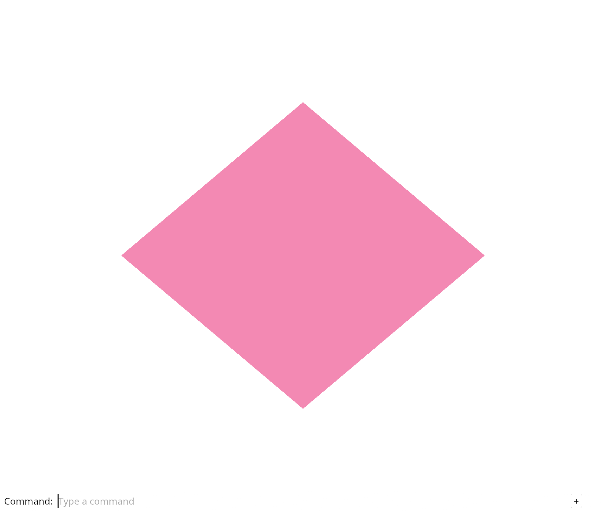

# 2.1 · Buffers that describe a shared mesh

**Section 2: 3D Meshes, Camera Matrices, Depth, and Ray Picking** · **Lesson 2.1** (Redraft `2.1`) · **2 checkpoints (`05-vertices` → `06-indices`)** · **Study time: 2–4 h**

> **What You Will Learn & Build:** Draw a rectangle from six positions stored in a GPU buffer. By the final checkpoint (`06-indices`), you will draw a diamond from four positions and six small index numbers.

## 1. Visual WebGPU Explanation & Architecture (Black & White Schematics)

<div class="webgpu-schematic" style="margin:1.1rem 0;padding:0.75rem;border:1.5px solid #111111;border-radius:10px;background:#ffffff;">
<svg width="840" height="256" viewBox="0 0 840 256" xmlns="http://www.w3.org/2000/svg" style="width:100%;max-width:840px;height:auto;display:block;margin:0 auto;font-family:system-ui,-apple-system,Segoe UI,Roboto,sans-serif;">
  <defs>
    <marker id="arrow" viewBox="0 0 10 10" refX="8" refY="5" markerWidth="6" markerHeight="6" orient="auto-start-reverse">
      <path d="M 0 1 L 10 5 L 0 9 z" fill="#111111"/>
    </marker>
    <marker id="arrow-hollow" viewBox="0 0 10 10" refX="8" refY="5" markerWidth="6" markerHeight="6" orient="auto-start-reverse">
      <path d="M 0 1 L 10 5 L 0 9 z" fill="#ffffff" stroke="#111111" stroke-width="1.5"/>
    </marker>
    <pattern id="hatch" width="6" height="6" patternTransform="rotate(45 0 0)" patternUnits="userSpaceOnUse">
      <line x1="0" y1="0" x2="0" y2="6" stroke="#111111" stroke-width="1"/>
    </pattern>
  </defs>
  <rect x="4" y="4" width="832" height="248" rx="8" fill="#ffffff" stroke="#111111" stroke-width="1.5"/>
  <text x="20" y="27" font-size="13.5" font-weight="700" fill="#111111">Chapter 2 Visual Explanation: Shared Index Mesh, 3D Camera Frustum, Depth32Float Z-Test & Ray Picking</text>
  <text x="20" y="45" font-size="11" fill="#111111">Left: 4 shared vertices + 6 indices = 2 triangles. Center: Depth32Float Z-buffer occlusion. Right: Unprojecting a 2D click into a 3D ray.</text>
  <line x1="16" y1="53" x2="824" y2="53" stroke="#111111" stroke-width="1"/>
  
    <!-- Panel A: Shared Vertex & Index Mesh -->
    <rect x="18" y="64" width="255" height="180" rx="8" fill="#ffffff" stroke="#111111" stroke-width="1.5"/>
    <text x="145" y="82" text-anchor="middle" font-size="11.5" font-weight="700" fill="#111111">A. Shared Vertex + Index Mesh</text>
    <!-- Diamond quad with shared diagonal v0-v2 -->
    <polygon points="145,96 205,140 145,184 85,140" fill="#ffffff" stroke="#111111" stroke-width="1.75"/>
    <line x1="85" y1="140" x2="205" y2="140" stroke="#111111" stroke-width="1.5" stroke-dasharray="4,3"/>
    <circle cx="145" cy="96" r="3.5" fill="#111111"/>
    <circle cx="205" cy="140" r="3.5" fill="#111111"/>
    <circle cx="145" cy="184" r="3.5" fill="#111111"/>
    <circle cx="85" cy="140" r="3.5" fill="#111111"/>
    <text x="145" y="91" text-anchor="middle" font-size="9.5" font-weight="700" fill="#111111">v1</text>
    <text x="216" y="143" font-size="9.5" font-weight="700" fill="#111111">v2</text>
    <text x="145" y="196" text-anchor="middle" font-size="9.5" font-weight="700" fill="#111111">v3</text>
    <text x="68" y="143" font-size="9.5" font-weight="700" fill="#111111">v0</text>
    <text x="145" y="126" text-anchor="middle" font-size="9.5" fill="#111111">Tri A: [0, 1, 2]</text>
    <text x="145" y="160" text-anchor="middle" font-size="9.5" fill="#111111">Tri B: [0, 2, 3]</text>
    <rect x="30" y="204" width="230" height="30" rx="5" fill="#ffffff" stroke="#111111" stroke-width="1"/>
    <text x="145" y="218" text-anchor="middle" font-size="9.5" font-weight="600" fill="#111111">4 Vertices (48 B) + 6 u32 Indices (24 B)</text>
    <text x="145" y="229" text-anchor="middle" font-size="9" fill="#111111">Shared edge (v0, v2) stored once in RAM/GPU</text>

    <line x1="273" y1="154" x2="295" y2="154" stroke="#111111" stroke-width="1.75" marker-end="url(#arrow)"/>

    <!-- Panel B: Camera Frustum & Depth32Float Z-Occlusion -->
    <rect x="297" y="64" width="255" height="180" rx="8" fill="#ffffff" stroke="#111111" stroke-width="1.5"/>
    <text x="424" y="82" text-anchor="middle" font-size="11.5" font-weight="700" fill="#111111">B. Depth32Float Z-Buffer Test</text>
    <!-- Back triangle (dashed / partially occluded) -->
    <polygon points="445,102 405,176 495,176" fill="#ffffff" stroke="#111111" stroke-width="1.5" stroke-dasharray="4,3"/>
    <text x="478" y="116" font-size="9.5" fill="#111111">Back (z = 0.7)</text>
    <!-- Front triangle (hatched, occluding back triangle) -->
    <polygon points="395,112 350,186 445,186" fill="url(#hatch)" stroke="#111111" stroke-width="2"/>
    <rect x="358" y="156" width="76" height="18" rx="3" fill="#ffffff" stroke="#111111" stroke-width="1"/>
    <text x="396" y="168" text-anchor="middle" font-size="9.5" font-weight="700" fill="#111111">Front (z = 0.3)</text>
    <rect x="310" y="204" width="228" height="30" rx="5" fill="#ffffff" stroke="#111111" stroke-width="1"/>
    <text x="424" y="218" text-anchor="middle" font-size="9.5" font-weight="600" fill="#111111">clip = view_proj * vec4(pos, 1.0)</text>
    <text x="424" y="229" text-anchor="middle" font-size="9" fill="#111111">z = 0.3 &lt; 0.7 wins DepthCompare::LessEqual</text>

    <line x1="552" y1="154" x2="574" y2="154" stroke="#111111" stroke-width="1.75" marker-end="url(#arrow)"/>

    <!-- Panel C: 3D Ray Picking (Unproject Click) -->
    <rect x="576" y="64" width="246" height="180" rx="8" fill="#ffffff" stroke="#111111" stroke-width="1.5"/>
    <text x="699" y="82" text-anchor="middle" font-size="11.5" font-weight="700" fill="#111111">C. 3D Ray Picking (Unproject)</text>
    <!-- Camera Eye on left, Near Plane, Ray hitting Front Triangle -->
    <circle cx="598" cy="148" r="4" fill="#111111"/>
    <text x="598" y="164" text-anchor="middle" font-size="9" font-weight="700" fill="#111111">Eye O</text>
    <!-- Near plane vertical bar -->
    <line x1="636" y1="100" x2="636" y2="192" stroke="#111111" stroke-width="1.5"/>
    <circle cx="636" cy="142" r="3.5" fill="#ffffff" stroke="#111111" stroke-width="1.5"/>
    <text x="636" y="96" text-anchor="middle" font-size="8.5" fill="#111111">Click (px,py)</text>
    <!-- Ray line -->
    <line x1="598" y1="148" x2="795" y2="118" stroke="#111111" stroke-width="1.75" marker-end="url(#arrow)"/>
    <!-- Hit triangle 1 (t1) and triangle 2 (t2) -->
    <line x1="696" y1="108" x2="710" y2="162" stroke="#111111" stroke-width="2.5"/>
    <circle cx="702" cy="132" r="4.5" fill="#111111"/>
    <text x="702" y="102" text-anchor="middle" font-size="9" font-weight="700" fill="#111111">Hit t1 (wins!)</text>
    <line x1="758" y1="102" x2="772" y2="156" stroke="#111111" stroke-width="1.5" stroke-dasharray="3,3"/>
    <circle cx="764" cy="123" r="3.5" fill="#ffffff" stroke="#111111" stroke-width="1.5"/>
    <text x="764" y="170" text-anchor="middle" font-size="8.5" fill="#111111">t2 &gt; t1</text>
    <rect x="588" y="204" width="222" height="30" rx="5" fill="#ffffff" stroke="#111111" stroke-width="1"/>
    <text x="699" y="218" text-anchor="middle" font-size="9.5" font-weight="600" fill="#111111">Ray(t) = O + t·D via inv(view_proj)</text>
    <text x="699" y="229" text-anchor="middle" font-size="9" fill="#111111">Smallest positive hit t selects front object</text>
    
</svg>
</div>

<div class="webgpu-schematic" style="margin:1.1rem 0;padding:0.75rem;border:1.5px solid #111111;border-radius:10px;background:#ffffff;">
<svg width="840" height="214" viewBox="0 0 840 214" xmlns="http://www.w3.org/2000/svg" style="width:100%;max-width:840px;height:auto;display:block;margin:0 auto;font-family:system-ui,-apple-system,Segoe UI,Roboto,sans-serif;">
  <defs>
    <marker id="arrow" viewBox="0 0 10 10" refX="8" refY="5" markerWidth="6" markerHeight="6" orient="auto-start-reverse">
      <path d="M 0 1 L 10 5 L 0 9 z" fill="#111111"/>
    </marker>
    <marker id="arrow-hollow" viewBox="0 0 10 10" refX="8" refY="5" markerWidth="6" markerHeight="6" orient="auto-start-reverse">
      <path d="M 0 1 L 10 5 L 0 9 z" fill="#ffffff" stroke="#111111" stroke-width="1.5"/>
    </marker>
    <pattern id="hatch" width="6" height="6" patternTransform="rotate(45 0 0)" patternUnits="userSpaceOnUse">
      <line x1="0" y1="0" x2="0" y2="6" stroke="#111111" stroke-width="1"/>
    </pattern>
  </defs>
  <rect x="4" y="4" width="832" height="206" rx="8" fill="#ffffff" stroke="#111111" stroke-width="1.5"/>
  <text x="20" y="27" font-size="13.5" font-weight="700" fill="#111111">Lesson 2.1 Pipeline Schematic: Buffers that describe a shared mesh</text>
  <text x="20" y="45" font-size="11" fill="#111111">Step-by-step data flow you implement in this lesson (2 Checkpoints: 05-vertices → 06-indices)</text>
  <line x1="16" y1="53" x2="824" y2="53" stroke="#111111" stroke-width="1"/>
  
    
    <rect x="18" y="66" width="143" height="82" rx="8" fill="#ffffff" stroke="#111111" stroke-width="1.5"/>
    <text x="89" y="84" text-anchor="middle" font-size="11" font-weight="700" fill="#111111">Stage 1</text>
    <line x1="28" y1="90" x2="151" y2="90" stroke="#111111" stroke-width="0.75"/>
    <text x="89" y="108" text-anchor="middle" font-size="11" fill="#111111">Rust positions</text>
    <line x1="161" y1="108" x2="181" y2="108" stroke="#111111" stroke-width="1.75" marker-end="url(#arrow)"/>

    <rect x="183" y="66" width="143" height="82" rx="8" fill="#ffffff" stroke="#111111" stroke-width="1.5"/>
    <text x="254" y="84" text-anchor="middle" font-size="11" font-weight="700" fill="#111111">Stage 2</text>
    <line x1="193" y1="90" x2="316" y2="90" stroke="#111111" stroke-width="0.75"/>
    <text x="254" y="108" text-anchor="middle" font-size="11" fill="#111111">bytes</text>
    <line x1="326" y1="108" x2="346" y2="108" stroke="#111111" stroke-width="1.75" marker-end="url(#arrow)"/>

    <rect x="348" y="66" width="143" height="82" rx="8" fill="#ffffff" stroke="#111111" stroke-width="1.5"/>
    <text x="419" y="84" text-anchor="middle" font-size="11" font-weight="700" fill="#111111">Stage 3</text>
    <line x1="358" y1="90" x2="481" y2="90" stroke="#111111" stroke-width="0.75"/>
    <text x="419" y="108" text-anchor="middle" font-size="11" fill="#111111">vertex layout</text>
    <line x1="491" y1="108" x2="511" y2="108" stroke="#111111" stroke-width="1.75" marker-end="url(#arrow)"/>

    <rect x="513" y="66" width="143" height="82" rx="8" fill="#ffffff" stroke="#111111" stroke-width="1.5"/>
    <text x="584" y="84" text-anchor="middle" font-size="11" font-weight="700" fill="#111111">Stage 4</text>
    <line x1="523" y1="90" x2="646" y2="90" stroke="#111111" stroke-width="0.75"/>
    <text x="584" y="108" text-anchor="middle" font-size="11" fill="#111111">shader location 0</text>
    <line x1="656" y1="108" x2="676" y2="108" stroke="#111111" stroke-width="1.75" marker-end="url(#arrow)"/>

    <rect x="678" y="66" width="143" height="82" rx="8" fill="#ffffff" stroke="#111111" stroke-width="1.5"/>
    <text x="749" y="84" text-anchor="middle" font-size="11" font-weight="700" fill="#111111">Stage 5</text>
    <line x1="688" y1="90" x2="811" y2="90" stroke="#111111" stroke-width="0.75"/>
    <text x="749" y="108" text-anchor="middle" font-size="11" fill="#111111">two triangles</text>
    
    <rect x="18" y="158" width="804" height="44" rx="8" fill="#ffffff" stroke="#111111" stroke-width="1.5"/>
    <text x="32" y="177" font-size="11" font-weight="700" fill="#111111">Files Modified in Lesson 2.1:</text>
    <text x="235" y="177" font-size="11" fill="#111111">src/triangle.wgsl  ·  src/renderer.rs  ·  src/browser.rs</text>
    <text x="32" y="194" font-size="10.5" fill="#111111">2 Checkpoints: 05-vertices → 06-indices — Verify at each checkpoint with: npm --prefix ../session_tests run course -- check &lt;ID&gt;</text>
  
</svg>
</div>

## 2. Language & Shader Bridge (`Rust` ↔ `WGSL` ↔ `WebGPU`)

Before writing code, review how the three layers in this chapter talk to each other:

| Layer | Construct | Plain-English Explanation for Students |
| :--- | :--- | :--- |
| **Rust (`bytemuck`)** | `#[repr(C)]` + `Pod` / `Zeroable` | Guarantees Rust structs (`Vertex`, `CameraUniform`) have exact C/GPU byte layout so `bytemuck::cast_slice` uploads raw bytes to `wgpu::Buffer` with zero copying. |
| **WGSL Shader** | `@group(0) @binding(0) var<uniform> view_proj: mat4x4<f32>` | Transforms 3D world vertices into 4D homogeneous clip coordinates (`view_proj * vec4<f32>(pos, 1.0)`). |
| **WebGPU / Math** | `Depth32Float` + Inverse Ray `inv(view_proj)` | Forward pass uses a 32-bit float Z-buffer (`LessEqual`) so nearer triangles occlude farther ones; clicking unprojects `(px, py)` back into a 3D ray to pick the closest hit `t`. |

**Authoritative production source (`session_viewer/src`):** `session_viewer/src`

## 3. Checkpoint Roadmap (Jump to Any Notebook Step)

| Step | Checkpoint | What You Build | Files Modified | Pipeline Trace |
| ---: | :--- | :--- | :--- | :--- |
| **1** | [`05-vertices`](#checkpoint-05-vertices) | Draw a rectangle from six positions stored in a GPU buffer. | `src/triangle.wgsl`, `src/renderer.rs`, `src/browser.rs` | `Rust positions → bytes → vertex buffer → vertex layout → shader location 0 → two triangles` |
| **2** | [`06-indices`](#checkpoint-06-indices) | Draw a diamond from four positions and six small index numbers. | `src/renderer.rs`, `src/browser.rs` | `Six indices → four shared positions → vertex shader → two joined triangles` |

---

## 4. Step-by-Step Coding Notebook (Concept + Implementation)

Work through each notebook cell below in order inside `workspace/journey`. Study the **Visual Step Trace**, read the **Concept Walkthrough** and **Self-Check Q&A**, then expand the **Implementation** block to type and verify the code.

<a id="checkpoint-05-vertices"></a>

### Step 1 of 2 · Let Rust supply the corners (`05-vertices`)

<div class="webgpu-schematic" style="margin:0.75rem 0;padding:0.5rem 0.65rem;border:1px solid #111111;border-radius:8px;background:#ffffff;">
<svg width="840" height="104" viewBox="0 0 840 104" xmlns="http://www.w3.org/2000/svg" style="width:100%;max-width:840px;height:auto;display:block;margin:0 auto;font-family:system-ui,-apple-system,Segoe UI,Roboto,sans-serif;">
  <defs>
    <marker id="arrow" viewBox="0 0 10 10" refX="8" refY="5" markerWidth="6" markerHeight="6" orient="auto-start-reverse">
      <path d="M 0 1 L 10 5 L 0 9 z" fill="#111111"/>
    </marker>
  </defs>
  <text x="18" y="24" font-size="11.5" font-weight="700" fill="#111111">Step 1/2 Visual Trace (05-vertices): Let Rust supply the corners</text>
  <text x="822" y="24" text-anchor="end" font-size="10.5" fill="#111111">Files: src/triangle.wgsl, src/renderer.rs, src/browser.rs</text>
  <line x1="18" y1="31" x2="822" y2="31" stroke="#111111" stroke-width="0.75"/>
  
    <rect x="18" y="42" width="146" height="52" rx="8" fill="#ffffff" stroke="#111111" stroke-width="1.5"/>
    <text x="91" y="66" text-anchor="middle" font-size="10.5" font-weight="500" fill="#111111">Rust positions</text>
    <line x1="164" y1="68" x2="180" y2="68" stroke="#111111" stroke-width="1.5" marker-end="url(#arrow)"/>

    <rect x="182" y="42" width="146" height="52" rx="8" fill="#ffffff" stroke="#111111" stroke-width="1.5"/>
    <text x="255" y="66" text-anchor="middle" font-size="10.5" font-weight="500" fill="#111111">bytes</text>
    <line x1="328" y1="68" x2="344" y2="68" stroke="#111111" stroke-width="1.5" marker-end="url(#arrow)"/>

    <rect x="346" y="42" width="146" height="52" rx="8" fill="#ffffff" stroke="#111111" stroke-width="1.5"/>
    <text x="419" y="66" text-anchor="middle" font-size="10.5" font-weight="500" fill="#111111">vertex layout</text>
    <line x1="492" y1="68" x2="508" y2="68" stroke="#111111" stroke-width="1.5" marker-end="url(#arrow)"/>

    <rect x="510" y="42" width="146" height="52" rx="8" fill="#ffffff" stroke="#111111" stroke-width="1.5"/>
    <text x="583" y="66" text-anchor="middle" font-size="10.5" font-weight="500" fill="#111111">shader location 0</text>
    <line x1="656" y1="68" x2="672" y2="68" stroke="#111111" stroke-width="1.5" marker-end="url(#arrow)"/>

    <rect x="674" y="42" width="146" height="52" rx="8" fill="#ffffff" stroke="#111111" stroke-width="1.5"/>
    <text x="747" y="66" text-anchor="middle" font-size="10.5" font-weight="700" fill="#111111">two triangles</text>
    
</svg>
</div>

- **Goal:** Draw a rectangle from six positions stored in a GPU buffer.
- **Data Flow Trace:** `Rust positions → bytes → vertex buffer → vertex layout → shader location 0 → two triangles`
- **Files You Touch:** `src/triangle.wgsl` (*Replace the shader. It now receives one position per invocation instead of looking up a hard-coded corner.*) · `src/renderer.rs` (*Define six positions and upload their vertex buffer.*) · `src/browser.rs` (*Report that the uploaded corners form a rectangle.*)

Move the corner positions out of WGSL and into a Rust vertex buffer. Six coordinate pairs draw two triangles forming a rectangle. Shared corners are duplicated here; the next lesson removes that duplication.

Describe the buffer layout explicitly: two `f32` values, eight bytes per vertex, matching shader `@location(0)`. Buffer slot and shader location are separate settings even though both are zero here.

`iter().flatten()` visits each coordinate, `flat_map` converts it to bytes, and `collect` owns the resulting byte vector. Importing the `DeviceExt` trait enables `create_buffer_init`. It creates and fills GPU storage; the temporary CPU byte vector can then be dropped.

> **Self-Check Question:** *Who owns the positions, and how does the shader know where each pair of numbers begins?*  
> **Answer:** Rust supplies the positions and uploads their bytes. The renderer retains the GPU buffer. Its vertex layout says that a vertex occupies eight bytes and location 0 contains two f32 values starting at byte zero. The shader reads that location; it no longer chooses corners from its own array.

- **What You Should See:** The GPU draws a rectangle from six buffered positions. Change one corner in the Rust vertex array, save, and check the changed outline. Restore it.
- **Hands-On Lab Experiment:** Predict which triangle changes if you move only the first position to [-0.9, -0.5]. Try it. The other occurrence of that corner stays put, opening a mismatch along the shared edge. Restore the value. This is the duplication that indices will remove.

<details>
<summary>Implementation 05-vertices: Let Rust supply the corners</summary>

Draw a rectangle from six positions stored in a GPU buffer.

Data flow: Rust positions → bytes → vertex buffer → vertex layout → shader location 0 → two triangles.

### 1. `src/triangle.wgsl`

Replace the shader. It now receives one position per invocation instead of looking up a hard-coded corner.

<details>
<summary>Locate the existing block</summary>

```wgsl
@vertex
fn vertex(@builtin(vertex_index) index: u32) -> @builtin(position) vec4<f32> {
    let corners = array<vec2<f32>, 3>(
        vec2<f32>(-0.6, -0.5),
        vec2<f32>(0.6, -0.5),
        vec2<f32>(0.0, 0.6),
    );
    return vec4<f32>(corners[index], 0.0, 1.0);
}

@fragment
fn fragment() -> @location(0) vec4<f32> {
    return vec4<f32>(0.9, 0.25, 0.45, 1.0);
}
```

</details>

Edit the existing block to match this code; keep unchanged lines:

```wgsl
--8<-- "journey/code/05-vertices-01.wgsl"
```

### 2. `src/renderer.rs`

Define six positions and upload their vertex buffer. Describe two f32 coordinates at each eight-byte vertex. Retain the uploaded vertex buffer in Renderer. Bind the vertex buffer and draw all six positions.

<details>
<summary>Locate the existing block</summary>

```rust
pub struct Renderer {
    pub device: wgpu::Device,
    pub queue: wgpu::Queue,
    pipeline: wgpu::RenderPipeline,
}

impl Renderer {
    pub fn new(device: wgpu::Device, queue: wgpu::Queue, format: wgpu::TextureFormat) -> Self {
        let shader = device.create_shader_module(wgpu::ShaderModuleDescriptor {
            label: Some("triangle"),
            source: wgpu::ShaderSource::Wgsl(include_str!("triangle.wgsl").into()),
        });
        let pipeline = device.create_render_pipeline(&wgpu::RenderPipelineDescriptor {
            label: Some("triangle"),
            layout: None,
            vertex: wgpu::VertexState {
                module: &shader,
                entry_point: Some("vertex"),
                compilation_options: Default::default(),
                buffers: &[],
            },
            fragment: Some(wgpu::FragmentState {
                module: &shader,
                entry_point: Some("fragment"),
                compilation_options: Default::default(),
                targets: &[Some(format.into())],
            }),
            primitive: Default::default(),
            depth_stencil: None,
            multisample: Default::default(),
            multiview_mask: None,
            cache: None,
        });
        Self { device, queue, pipeline }
    }

    pub fn draw(&self, view: &wgpu::TextureView, background: &crate::background::Background) {
        let [r, g, b] = background.rgb();
        let mut encoder = self.device.create_command_encoder(&Default::default());
        {
            // The pass borrows the encoder. This scope ends that borrow before finish takes it.
            let mut pass = encoder.begin_render_pass(&wgpu::RenderPassDescriptor {
                label: Some("canvas"),
                color_attachments: &[Some(wgpu::RenderPassColorAttachment {
                    view,
                    depth_slice: None,
                    resolve_target: None,
                    ops: wgpu::Operations {
                        load: wgpu::LoadOp::Clear(wgpu::Color {
                            r, g, b, a: 1.0,
                        }),
                        store: wgpu::StoreOp::Store,
                    },
                })],
                ..Default::default()
            });
            pass.set_pipeline(&self.pipeline);
            pass.draw(0..3, 0..1);
        }
        self.queue.submit([encoder.finish()]);
    }
}
```

</details>

Edit the existing block to match this code; keep unchanged lines:

```rust
use wgpu::util::DeviceExt;

const POSITIONS: [[f32; 2]; 6] = [
    [-0.6, -0.5], [0.6, -0.5], [0.6, 0.6],
    [-0.6, -0.5], [0.6, 0.6], [-0.6, 0.6],
];

pub struct Renderer {
    pub device: wgpu::Device,
    pub queue: wgpu::Queue,
    pipeline: wgpu::RenderPipeline,
    vertices: wgpu::Buffer,
}

impl Renderer {
    pub fn new(device: wgpu::Device, queue: wgpu::Queue, format: wgpu::TextureFormat) -> Self {
        let bytes: Vec<u8> = POSITIONS.iter().flatten()
            .flat_map(|value| value.to_ne_bytes()).collect();
        let vertices = device.create_buffer_init(&wgpu::util::BufferInitDescriptor {
            label: Some("rectangle positions"),
            contents: &bytes,
            usage: wgpu::BufferUsages::VERTEX,
        });
        let shader = device.create_shader_module(wgpu::ShaderModuleDescriptor {
            label: Some("triangle"),
            source: wgpu::ShaderSource::Wgsl(include_str!("triangle.wgsl").into()),
        });
        let pipeline = device.create_render_pipeline(&wgpu::RenderPipelineDescriptor {
            label: Some("triangle"),
            layout: None,
            vertex: wgpu::VertexState {
                module: &shader,
                entry_point: Some("vertex"),
                compilation_options: Default::default(),
                buffers: &[wgpu::VertexBufferLayout {
                    array_stride: 8,
                    step_mode: wgpu::VertexStepMode::Vertex,
                    attributes: &wgpu::vertex_attr_array![0 => Float32x2],
                }],
            },
            fragment: Some(wgpu::FragmentState {
                module: &shader,
                entry_point: Some("fragment"),
                compilation_options: Default::default(),
                targets: &[Some(format.into())],
            }),
            primitive: Default::default(),
            depth_stencil: None,
            multisample: Default::default(),
            multiview_mask: None,
            cache: None,
        });
        Self { device, queue, pipeline, vertices }
    }

    pub fn draw(&self, view: &wgpu::TextureView, background: &crate::background::Background) {
        let [r, g, b] = background.rgb();
        let mut encoder = self.device.create_command_encoder(&Default::default());
        {
            // The pass borrows the encoder. This scope ends that borrow before finish takes it.
            let mut pass = encoder.begin_render_pass(&wgpu::RenderPassDescriptor {
                label: Some("canvas"),
                color_attachments: &[Some(wgpu::RenderPassColorAttachment {
                    view,
                    depth_slice: None,
                    resolve_target: None,
                    ops: wgpu::Operations {
                        load: wgpu::LoadOp::Clear(wgpu::Color {
                            r, g, b, a: 1.0,
                        }),
                        store: wgpu::StoreOp::Store,
                    },
                })],
                ..Default::default()
            });
            pass.set_pipeline(&self.pipeline);
            pass.set_vertex_buffer(0, self.vertices.slice(..));
            pass.draw(0..POSITIONS.len() as u32, 0..1);
        }
        self.queue.submit([encoder.finish()]);
    }
}
```

<details>
<summary>Optional patch references</summary>

Use these original edit fragments when comparing a saved checkpoint. Apply the complete blocks above.

```text
--8<-- "journey/code/05-vertices-fullscreen-2.rs"
```

```text
--8<-- "journey/code/05-vertices-fullscreen-3.rs"
```

```text
--8<-- "journey/code/05-vertices-fullscreen-4.rs"
```

```text
--8<-- "journey/code/05-vertices-fullscreen-5.rs"
```

</details>

### 3. `src/browser.rs`

Report that the uploaded corners form a rectangle.

<details>
<summary>Locate the existing block</summary>

```rust
    )?;
    // The page has one listener for its lifetime; JavaScript must retain the Rust callback.
    click.forget();
    report("Change the background. The triangle keeps its shape and colour.");
    Ok(())
}
```

</details>

Edit the existing block to match this code; keep unchanged lines:

```rust
--8<-- "journey/code/05-vertices-window-1.rs"
```

</details>

<a id="checkpoint-06-indices"></a>

### Step 2 of 2 · Share a corner between triangles (`06-indices`)

<div class="webgpu-schematic" style="margin:0.75rem 0;padding:0.5rem 0.65rem;border:1px solid #111111;border-radius:8px;background:#ffffff;">
<svg width="840" height="104" viewBox="0 0 840 104" xmlns="http://www.w3.org/2000/svg" style="width:100%;max-width:840px;height:auto;display:block;margin:0 auto;font-family:system-ui,-apple-system,Segoe UI,Roboto,sans-serif;">
  <defs>
    <marker id="arrow" viewBox="0 0 10 10" refX="8" refY="5" markerWidth="6" markerHeight="6" orient="auto-start-reverse">
      <path d="M 0 1 L 10 5 L 0 9 z" fill="#111111"/>
    </marker>
  </defs>
  <text x="18" y="24" font-size="11.5" font-weight="700" fill="#111111">Step 2/2 Visual Trace (06-indices): Share a corner between triangles</text>
  <text x="822" y="24" text-anchor="end" font-size="10.5" fill="#111111">Files: src/renderer.rs, src/browser.rs</text>
  <line x1="18" y1="31" x2="822" y2="31" stroke="#111111" stroke-width="0.75"/>
  
    <rect x="18" y="42" width="187" height="52" rx="8" fill="#ffffff" stroke="#111111" stroke-width="1.5"/>
    <text x="111" y="66" text-anchor="middle" font-size="10.5" font-weight="500" fill="#111111">Six indices</text>
    <line x1="205" y1="68" x2="221" y2="68" stroke="#111111" stroke-width="1.5" marker-end="url(#arrow)"/>

    <rect x="223" y="42" width="187" height="52" rx="8" fill="#ffffff" stroke="#111111" stroke-width="1.5"/>
    <text x="316" y="66" text-anchor="middle" font-size="10.5" font-weight="500" fill="#111111">four shared positions</text>
    <line x1="410" y1="68" x2="426" y2="68" stroke="#111111" stroke-width="1.5" marker-end="url(#arrow)"/>

    <rect x="428" y="42" width="187" height="52" rx="8" fill="#ffffff" stroke="#111111" stroke-width="1.5"/>
    <text x="521" y="66" text-anchor="middle" font-size="10.5" font-weight="500" fill="#111111">vertex shader</text>
    <line x1="615" y1="68" x2="631" y2="68" stroke="#111111" stroke-width="1.5" marker-end="url(#arrow)"/>

    <rect x="633" y="42" width="187" height="52" rx="8" fill="#ffffff" stroke="#111111" stroke-width="1.5"/>
    <text x="726" y="66" text-anchor="middle" font-size="10.5" font-weight="700" fill="#111111">two joined triangles</text>
    
</svg>
</div>

- **Goal:** Draw a diamond from four positions and six small index numbers.
- **Data Flow Trace:** `Six indices → four shared positions → vertex shader → two joined triangles`
- **Files You Touch:** `src/renderer.rs` (*Define four diamond corners and six indices; retain an index buffer.*) · `src/browser.rs` (*Report that four shared corners form two triangles.*)

Store four corner positions and connect them with indices: `0, 1, 2` and `0, 2, 3`. The two triangles now share corners 0 and 2.

The vertex buffer answers where a corner is; the index buffer answers which corners form a triangle. Changing a shared position changes both triangles.

These indices are `u16`, so bind the index buffer as `Uint16`. Each index occupies two bytes; each position still occupies eight. `draw_indexed` chooses index entries, adds its base-vertex value, then draws the requested instances. The shader keeps its previous input layout.

> **Self-Check Question:** *Why do we draw six indices when there are only four positions?*  
> **Answer:** Each triangle needs three corner references. The first triangle reads positions 0, 1 and 2; the second reads 0, 2 and 3. Positions 0 and 2 are shared. Six index entries describe two triangles while only four coordinate pairs are stored.

- **What You Should See:** A diamond is drawn from four vertices. Follow the six indices into those vertices: they must describe two triangles that share the middle edge.
- **Hands-On Lab Experiment:** Move position 0 from [-0.6, 0.0] to [-0.9, 0.0]. Predict which triangles change. Both should move their left corner together, leaving no crack. Then restore the coordinate and temporarily draw only 0..3 indices: only the lower triangle should remain. Restore 0..6 before comparing.

<details>
<summary>Implementation 06-indices: Share a corner between triangles</summary>

Draw a diamond from four positions and six small index numbers.

Data flow: Six indices → four shared positions → vertex shader → two joined triangles.

### 1. `src/renderer.rs`

Define four diamond corners and six indices; retain an index buffer. Upload the indices as native-endian u16 bytes. Retain the index buffer in Renderer. Bind the u16 index buffer and draw its six entries.

Edit these blocks from bottom to top. Keep the surrounding lines unchanged.

<details>
<summary>Locate this block</summary>

```rust
            });
            pass.set_pipeline(&self.pipeline);
            pass.set_vertex_buffer(0, self.vertices.slice(..));
            pass.draw(0..POSITIONS.len() as u32, 0..1);
        }
        self.queue.submit([encoder.finish()]);
    }
```

</details>

Replace it with:

```rust
            });
            pass.set_pipeline(&self.pipeline);
            pass.set_vertex_buffer(0, self.vertices.slice(..));
            pass.set_index_buffer(self.indices.slice(..), wgpu::IndexFormat::Uint16);
            pass.draw_indexed(0..INDICES.len() as u32, 0, 0..1);
        }
        self.queue.submit([encoder.finish()]);
    }
```

<details>
<summary>Locate this block</summary>

```rust
            multiview_mask: None,
            cache: None,
        });
        Self { device, queue, pipeline, vertices }
    }

    pub fn draw(&self, view: &wgpu::TextureView, background: &crate::background::Background) {
```

</details>

Replace it with:

```rust
            multiview_mask: None,
            cache: None,
        });
        Self { device, queue, pipeline, vertices, indices }
    }

    pub fn draw(&self, view: &wgpu::TextureView, background: &crate::background::Background) {
```

<details>
<summary>Locate this block</summary>

```rust
            contents: &bytes,
            usage: wgpu::BufferUsages::VERTEX,
        });
        let shader = device.create_shader_module(wgpu::ShaderModuleDescriptor {
            label: Some("triangle"),
            source: wgpu::ShaderSource::Wgsl(include_str!("triangle.wgsl").into()),
```

</details>

Replace it with:

```rust
            contents: &bytes,
            usage: wgpu::BufferUsages::VERTEX,
        });
        let bytes: Vec<u8> = INDICES.iter().flat_map(|index| index.to_ne_bytes()).collect();
        let indices = device.create_buffer_init(&wgpu::util::BufferInitDescriptor {
            label: Some("diamond indices"),
            contents: &bytes,
            usage: wgpu::BufferUsages::INDEX,
        });
        let shader = device.create_shader_module(wgpu::ShaderModuleDescriptor {
            label: Some("triangle"),
            source: wgpu::ShaderSource::Wgsl(include_str!("triangle.wgsl").into()),
```

<details>
<summary>Locate this block</summary>

```rust
use wgpu::util::DeviceExt;

const POSITIONS: [[f32; 2]; 6] = [
    [-0.6, -0.5], [0.6, -0.5], [0.6, 0.6],
    [-0.6, -0.5], [0.6, 0.6], [-0.6, 0.6],
];

pub struct Renderer {
    pub device: wgpu::Device,
    pub queue: wgpu::Queue,
    pipeline: wgpu::RenderPipeline,
    vertices: wgpu::Buffer,
}

impl Renderer {
```

</details>

Replace it with:

```rust
use wgpu::util::DeviceExt;

const POSITIONS: [[f32; 2]; 4] = [
    [-0.6, 0.0], [0.0, -0.6], [0.6, 0.0], [0.0, 0.6],
];
const INDICES: [u16; 6] = [0, 1, 2, 0, 2, 3];

pub struct Renderer {
    pub device: wgpu::Device,
    pub queue: wgpu::Queue,
    pipeline: wgpu::RenderPipeline,
    vertices: wgpu::Buffer,
    indices: wgpu::Buffer,
}

impl Renderer {
```

<details>
<summary>Complete updated block reference</summary>

```rust
use wgpu::util::DeviceExt;

const POSITIONS: [[f32; 2]; 4] = [
    [-0.6, 0.0], [0.0, -0.6], [0.6, 0.0], [0.0, 0.6],
];
const INDICES: [u16; 6] = [0, 1, 2, 0, 2, 3];

pub struct Renderer {
    pub device: wgpu::Device,
    pub queue: wgpu::Queue,
    pipeline: wgpu::RenderPipeline,
    vertices: wgpu::Buffer,
    indices: wgpu::Buffer,
}

impl Renderer {
    pub fn new(device: wgpu::Device, queue: wgpu::Queue, format: wgpu::TextureFormat) -> Self {
        let bytes: Vec<u8> = POSITIONS.iter().flatten()
            .flat_map(|value| value.to_ne_bytes()).collect();
        let vertices = device.create_buffer_init(&wgpu::util::BufferInitDescriptor {
            label: Some("rectangle positions"),
            contents: &bytes,
            usage: wgpu::BufferUsages::VERTEX,
        });
        let bytes: Vec<u8> = INDICES.iter().flat_map(|index| index.to_ne_bytes()).collect();
        let indices = device.create_buffer_init(&wgpu::util::BufferInitDescriptor {
            label: Some("diamond indices"),
            contents: &bytes,
            usage: wgpu::BufferUsages::INDEX,
        });
        let shader = device.create_shader_module(wgpu::ShaderModuleDescriptor {
            label: Some("triangle"),
            source: wgpu::ShaderSource::Wgsl(include_str!("triangle.wgsl").into()),
        });
        let pipeline = device.create_render_pipeline(&wgpu::RenderPipelineDescriptor {
            label: Some("triangle"),
            layout: None,
            vertex: wgpu::VertexState {
                module: &shader,
                entry_point: Some("vertex"),
                compilation_options: Default::default(),
                buffers: &[wgpu::VertexBufferLayout {
                    array_stride: 8,
                    step_mode: wgpu::VertexStepMode::Vertex,
                    attributes: &wgpu::vertex_attr_array![0 => Float32x2],
                }],
            },
            fragment: Some(wgpu::FragmentState {
                module: &shader,
                entry_point: Some("fragment"),
                compilation_options: Default::default(),
                targets: &[Some(format.into())],
            }),
            primitive: Default::default(),
            depth_stencil: None,
            multisample: Default::default(),
            multiview_mask: None,
            cache: None,
        });
        Self { device, queue, pipeline, vertices, indices }
    }

    pub fn draw(&self, view: &wgpu::TextureView, background: &crate::background::Background) {
        let [r, g, b] = background.rgb();
        let mut encoder = self.device.create_command_encoder(&Default::default());
        {
            // The pass borrows the encoder. This scope ends that borrow before finish takes it.
            let mut pass = encoder.begin_render_pass(&wgpu::RenderPassDescriptor {
                label: Some("canvas"),
                color_attachments: &[Some(wgpu::RenderPassColorAttachment {
                    view,
                    depth_slice: None,
                    resolve_target: None,
                    ops: wgpu::Operations {
                        load: wgpu::LoadOp::Clear(wgpu::Color {
                            r, g, b, a: 1.0,
                        }),
                        store: wgpu::StoreOp::Store,
                    },
                })],
                ..Default::default()
            });
            pass.set_pipeline(&self.pipeline);
            pass.set_vertex_buffer(0, self.vertices.slice(..));
            pass.set_index_buffer(self.indices.slice(..), wgpu::IndexFormat::Uint16);
            pass.draw_indexed(0..INDICES.len() as u32, 0, 0..1);
        }
        self.queue.submit([encoder.finish()]);
    }
}
```

</details>

<details>
<summary>Optional patch references</summary>

Use these original edit fragments when comparing a saved checkpoint. Apply the complete blocks above.

```text
--8<-- "journey/code/06-indices-fullscreen-2.rs"
```

```text
--8<-- "journey/code/06-indices-fullscreen-3.rs"
```

```text
--8<-- "journey/code/06-indices-fullscreen-4.rs"
```

```text
--8<-- "journey/code/06-indices-fullscreen-5.rs"
```

</details>

### 2. `src/browser.rs`

Report that four shared corners form two triangles.

<details>
<summary>Locate the existing block</summary>

```rust
    )?;
    // The page has one listener for its lifetime; JavaScript must retain the Rust callback.
    click.forget();
    report("Six uploaded corners make one rectangle.");
    Ok(())
}
```

</details>

Edit the existing block to match this code; keep unchanged lines:

```rust
--8<-- "journey/code/06-indices-window-1.rs"
```

</details>

---

## 5. Build, Verify, and Save Your Checkpoint

Run these commands from `session_viewer` to install dependencies, verify your typed code against the checkpoint, and save your progress:

```sh
npm --prefix ../session_tests run course -- dependencies 06-indices
npm --prefix ../session_tests run course -- check 06-indices
npm --prefix ../session_tests run course -- save 06-indices
cd workspace/journey
cargo build --lib --locked --target wasm32-unknown-unknown -j1
CARGO_BUILD_JOBS=1 trunk serve --port 8780
```

Open `http://127.0.0.1:8780/` in your browser. Use [checkpoint recovery](../../recovery.md) to save or restore any checkpoint ID.

## 6. Lesson Summary & Expected Visual Result



A diamond is drawn from four vertices. Follow the six indices into those vertices: they must describe two triangles that share the middle edge.

- **Final Lesson Experiment:** Move position 0 from [-0.6, 0.0] to [-0.9, 0.0]. Predict which triangles change. Both should move their left corner together, leaving no crack. Then restore the coordinate and temporarily draw only 0..3 indices: only the lower triangle should remain. Restore 0..6 before comparing.

Continue with [Camera state and the world-to-clip transform](../../consolidation/07-uniforms.md).
