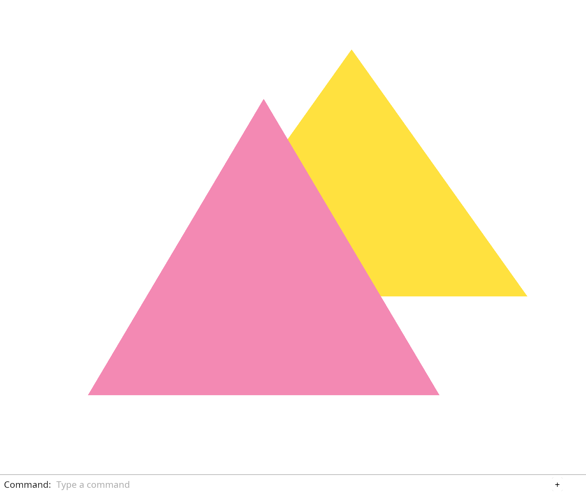

# 2.4 · Selection that agrees with the displayed view

**Goal:** Click a visible triangle to select its stable object ID, including after camera movement. · **Steps:** 4 · **Source:** `src/camera.rs` · `src/engine/gpu/render.rs` · `src/shaders/scene.wgsl`

<div class="webgpu-schematic" style="width:100%;margin:6px auto;">
<svg xmlns="http://www.w3.org/2000/svg" width="1120" height="188" viewBox="0 0 1120 188" style="width:100%;max-width:100%;height:auto;display:block;margin:0 auto;" role="img">
  <defs>
    <marker id="arr" viewBox="0 0 10 10" refX="8" refY="5" markerWidth="6" markerHeight="6" orient="auto">
      <path d="M 0 1 L 9 5 L 0 9 z" fill="#111111"/>
    </marker>
    <marker id="arrR" viewBox="0 0 10 10" refX="8" refY="5" markerWidth="6" markerHeight="6" orient="auto">
      <path d="M 0 1 L 9 5 L 0 9 z" fill="#dc2626"/>
    </marker>
    <marker id="arrG" viewBox="0 0 10 10" refX="8" refY="5" markerWidth="6" markerHeight="6" orient="auto">
      <path d="M 0 1 L 9 5 L 0 9 z" fill="#16a34a"/>
    </marker>
    <marker id="arrB" viewBox="0 0 10 10" refX="8" refY="5" markerWidth="6" markerHeight="6" orient="auto">
      <path d="M 0 1 L 9 5 L 0 9 z" fill="#2563eb"/>
    </marker>
  </defs>
  <rect x="2" y="2" width="1116" height="184" rx="10" fill="#ffffff" stroke="#111111" stroke-width="2"/>
  <rect x="14" y="12" width="344" height="164" rx="8" fill="#ffffff" stroke="#111111" stroke-width="1.5"/>
  <text paint-order="stroke fill" stroke="#ffffff" stroke-width="5" stroke-linejoin="round" x="186" y="30" text-anchor="middle" font-family="monospace" font-size="10.5" font-weight="700" fill="#111111">Cursor (x_px, y_px) -&gt; NDC (-1..+1)</text>
  <rect x="68" y="48" width="236" height="110" fill="#f8fafc" stroke="#111111" stroke-width="1.5"/>
  <line x1="68" y1="103" x2="304" y2="103" stroke="#94a3b8" stroke-width="1" stroke-dasharray="3 3"/>
  <line x1="186" y1="48" x2="186" y2="158" stroke="#94a3b8" stroke-width="1" stroke-dasharray="3 3"/>
  <circle cx="222" cy="82" r="6" fill="#facc15" stroke="#111111" stroke-width="1.75"/>
  <line x1="212" y1="82" x2="232" y2="82" stroke="#111111" stroke-width="1.5"/>
  <line x1="222" y1="72" x2="222" y2="92" stroke="#111111" stroke-width="1.5"/>
  <text paint-order="stroke fill" stroke="#ffffff" stroke-width="5" stroke-linejoin="round" x="222" y="66" text-anchor="middle" font-family="monospace" font-size="9.5" font-weight="700" fill="#111111">(ndc_x, ndc_y)</text>
  <line x1="358" y1="94" x2="384" y2="94" stroke="#111111" stroke-width="2" marker-end="url(#arr)"/>
  <rect x="388" y="12" width="344" height="164" rx="8" fill="#ffffff" stroke="#111111" stroke-width="1.5"/>
  <text paint-order="stroke fill" stroke="#ffffff" stroke-width="5" stroke-linejoin="round" x="560" y="30" text-anchor="middle" font-family="monospace" font-size="10.5" font-weight="700" fill="#111111">inv(M_vp): Near-&gt;Far Ray ∩ Triangle</text>
  <circle cx="432" cy="128" r="4.5" fill="#111111"/><text paint-order="stroke fill" stroke="#ffffff" stroke-width="5" stroke-linejoin="round" x="432" y="146" text-anchor="middle" font-family="monospace" font-size="9" font-weight="700" fill="#111111">p_near</text>
  <line x1="432" y1="128" x2="684" y2="66" stroke="#dc2626" stroke-width="2" marker-end="url(#arrR)"/>
  <polygon points="548,52 606,146 508,136" fill="#dbeafe" stroke="#111111" stroke-width="1.75"/>
  <circle cx="556" cy="97" r="5.5" fill="#facc15" stroke="#111111" stroke-width="1.75"/>
  <text paint-order="stroke fill" stroke="#ffffff" stroke-width="5" stroke-linejoin="round" x="556" y="84" text-anchor="middle" font-family="monospace" font-size="9.5" font-weight="700" fill="#111111">hit (u,v,t_min)</text>
  <line x1="732" y1="94" x2="758" y2="94" stroke="#111111" stroke-width="2" marker-end="url(#arr)"/>
  <rect x="762" y="12" width="344" height="164" rx="8" fill="#ffffff" stroke="#111111" stroke-width="1.75"/>
  <text paint-order="stroke fill" stroke="#ffffff" stroke-width="5" stroke-linejoin="round" x="934" y="30" text-anchor="middle" font-family="monospace" font-size="10.5" font-weight="700" fill="#111111">Selected Object Highlight in Viewer</text>
  <rect x="814" y="44" width="240" height="118" rx="4" fill="#ffffff" stroke="#111111" stroke-width="2"/>
  <polygon points="888,68 948,144 844,144" fill="#cbd5e1" stroke="#111111" stroke-width="1.5"/>
  <polygon points="956,56 1022,144 908,144" fill="#fef08a" stroke="#111111" stroke-width="2.5"/>
  <circle cx="964" cy="108" r="4.5" fill="#dc2626"/>
</svg>
</div>

## <a id="checkpoint-12-identity"></a>1. Display selection by object identity

<div class="webgpu-schematic" style="width:100%;margin:6px auto;">
<svg xmlns="http://www.w3.org/2000/svg" width="1120" height="188" viewBox="0 0 1120 188" style="width:100%;max-width:100%;height:auto;display:block;margin:0 auto;" role="img">
  <defs>
    <marker id="arr" viewBox="0 0 10 10" refX="8" refY="5" markerWidth="6" markerHeight="6" orient="auto">
      <path d="M 0 1 L 9 5 L 0 9 z" fill="#111111"/>
    </marker>
    <marker id="arrR" viewBox="0 0 10 10" refX="8" refY="5" markerWidth="6" markerHeight="6" orient="auto">
      <path d="M 0 1 L 9 5 L 0 9 z" fill="#dc2626"/>
    </marker>
    <marker id="arrG" viewBox="0 0 10 10" refX="8" refY="5" markerWidth="6" markerHeight="6" orient="auto">
      <path d="M 0 1 L 9 5 L 0 9 z" fill="#16a34a"/>
    </marker>
    <marker id="arrB" viewBox="0 0 10 10" refX="8" refY="5" markerWidth="6" markerHeight="6" orient="auto">
      <path d="M 0 1 L 9 5 L 0 9 z" fill="#2563eb"/>
    </marker>
  </defs>
  <rect x="2" y="2" width="1116" height="184" rx="10" fill="#ffffff" stroke="#111111" stroke-width="2"/>
  <rect x="14" y="12" width="344" height="164" rx="8" fill="#ffffff" stroke="#111111" stroke-width="1.5"/>
  <text paint-order="stroke fill" stroke="#ffffff" stroke-width="5" stroke-linejoin="round" x="186" y="30" text-anchor="middle" font-family="monospace" font-size="10.5" font-weight="700" fill="#111111">CPU RAM: #[repr(C)] Structs -&gt; bytemuck::cast_slice</text>
  <rect x="46" y="54" width="280" height="44" fill="#f8fafc" stroke="#111111" stroke-width="1.75"/>
  <rect x="52" y="60" width="64" height="32" fill="#dbeafe" stroke="#2563eb" stroke-width="1.5"/>
  <text paint-order="stroke fill" stroke="#ffffff" stroke-width="5" stroke-linejoin="round" x="84" y="80" text-anchor="middle" font-family="monospace" font-size="9.5" font-weight="700" fill="#111111">v0: 24B</text>
  <rect x="122" y="60" width="64" height="32" fill="#dbeafe" stroke="#2563eb" stroke-width="1.5"/>
  <text paint-order="stroke fill" stroke="#ffffff" stroke-width="5" stroke-linejoin="round" x="154" y="80" text-anchor="middle" font-family="monospace" font-size="9.5" font-weight="700" fill="#111111">v1: 24B</text>
  <rect x="192" y="60" width="64" height="32" fill="#dbeafe" stroke="#2563eb" stroke-width="1.5"/>
  <text paint-order="stroke fill" stroke="#ffffff" stroke-width="5" stroke-linejoin="round" x="224" y="80" text-anchor="middle" font-family="monospace" font-size="9.5" font-weight="700" fill="#111111">v2: 24B</text>
  <text paint-order="stroke fill" stroke="#ffffff" stroke-width="5" stroke-linejoin="round" x="290" y="80" text-anchor="middle" font-family="monospace" font-size="10" font-weight="700" fill="#111111">...</text>
  <rect x="66" y="112" width="240" height="34" rx="4" fill="#fef08a" stroke="#111111" stroke-width="1.5"/>
  <text paint-order="stroke fill" stroke="#ffffff" stroke-width="5" stroke-linejoin="round" x="186" y="133" text-anchor="middle" font-family="monospace" font-size="9.5" font-weight="700" fill="#111111">&amp;[u8] Contiguous Byte Slice</text>
  <line x1="358" y1="94" x2="384" y2="94" stroke="#111111" stroke-width="2" marker-end="url(#arr)"/>
  <rect x="388" y="12" width="344" height="164" rx="8" fill="#ffffff" stroke="#111111" stroke-width="1.5"/>
  <text paint-order="stroke fill" stroke="#ffffff" stroke-width="5" stroke-linejoin="round" x="560" y="30" text-anchor="middle" font-family="monospace" font-size="10.5" font-weight="700" fill="#111111">CPU -&gt; GPU DMA: queue.write_buffer(buf, 0, bytes)</text>
  <rect x="424" y="54" width="272" height="92" rx="6" fill="#dcfce7" stroke="#16a34a" stroke-width="1.75"/>
  <line x1="448" y1="84" x2="672" y2="84" stroke="#16a34a" stroke-width="3" marker-end="url(#arrG)"/>
  <text paint-order="stroke fill" stroke="#ffffff" stroke-width="5" stroke-linejoin="round" x="560" y="74" text-anchor="middle" font-family="monospace" font-size="10" font-weight="700" fill="#111111">create_buffer_init / write_buffer</text>
  <text paint-order="stroke fill" stroke="#ffffff" stroke-width="5" stroke-linejoin="round" x="560" y="112" text-anchor="middle" font-family="monospace" font-size="9.5" font-weight="700" fill="#16a34a">VERTEX | INDEX | COPY_DST</text>
  <text paint-order="stroke fill" stroke="#ffffff" stroke-width="5" stroke-linejoin="round" x="560" y="132" text-anchor="middle" font-family="monospace" font-size="9" fill="#111111">array_stride = size_of::&lt;Vertex&gt;()</text>
  <line x1="732" y1="94" x2="758" y2="94" stroke="#111111" stroke-width="2" marker-end="url(#arr)"/>
  <rect x="762" y="12" width="344" height="164" rx="8" fill="#ffffff" stroke="#111111" stroke-width="1.75"/>
  <text paint-order="stroke fill" stroke="#ffffff" stroke-width="5" stroke-linejoin="round" x="934" y="30" text-anchor="middle" font-family="monospace" font-size="10.5" font-weight="700" fill="#111111">GPU VRAM Buffer -&gt; @vertex Input Locations</text>
  <rect x="806" y="44" width="256" height="118" rx="4" fill="#ffffff" stroke="#111111" stroke-width="2"/>
  <rect x="822" y="56" width="224" height="40" rx="4" fill="#dbeafe" stroke="#2563eb" stroke-width="1.5"/>
  <text paint-order="stroke fill" stroke="#ffffff" stroke-width="5" stroke-linejoin="round" x="934" y="80" text-anchor="middle" font-family="monospace" font-size="9.5" font-weight="700" fill="#111111">@location(0) pos: vec3&lt;f32&gt;</text>
  <rect x="822" y="106" width="224" height="40" rx="4" fill="#fce7f3" stroke="#db2777" stroke-width="1.5"/>
  <text paint-order="stroke fill" stroke="#ffffff" stroke-width="5" stroke-linejoin="round" x="934" y="130" text-anchor="middle" font-family="monospace" font-size="9.5" font-weight="700" fill="#111111">@location(1) color: vec3&lt;f32&gt;</text>
</svg>
</div>

Select and delete objects using stable identities, then highlight the selected object.

### 1. `src/gpu_mesh.rs`

Let the uploaded representation know whether to show selection. Apply the yellow tint to an upload copy. Never overwrite the CPU mesh’s original colour.

**Locate this existing block:**

```rust
impl GpuMesh {
    pub fn upload(device: &wgpu::Device, mesh: &Mesh) -> Self {
        let bytes: Vec<u8> = mesh
            .vertices()
            .iter()
            .flatten()
            .flat_map(|value| value.to_ne_bytes())
            .collect();
        let vertices = device.create_buffer_init(&wgpu::util::BufferInitDescriptor {
```

Edit the existing block to match this code; keep unchanged lines:

```rust
impl GpuMesh {
    pub fn upload(device: &wgpu::Device, mesh: &Mesh, selected: bool) -> Self {
        let mut bytes = Vec::with_capacity(mesh.vertices().len() * 24);
        for vertex in mesh.vertices() {
            let mut display = *vertex;
            if selected {
                display[3..].copy_from_slice(&[1.0, 0.75, 0.05]);
            }
            for value in display {
                bytes.extend_from_slice(&value.to_ne_bytes());
            }
        }
        let vertices = device.create_buffer_init(&wgpu::util::BufferInitDescriptor {
```

### 2. `src/renderer.rs`

Import ObjectId at the renderer boundary. Upload each scene object without selection highlighting initially. Highlight the uploaded object whose stable ID matches the selection.

Edit these blocks from bottom to top. Keep the surrounding lines unchanged.

**Locate this block:**

```rust
        }
    }

    pub fn set_scene(&mut self, scene: &Scene) {
        self.meshes = scene
            .objects()
            .iter()
            .map(|object| GpuMesh::upload(&self.device, &object.mesh))
            .collect();
```

Replace it with:

```rust
        }
    }

    pub fn set_scene(&mut self, scene: &Scene, selected: Option<ObjectId>) {
        self.meshes = scene
            .objects()
            .iter()
            .map(|object| {
                GpuMesh::upload(
                    &self.device,
                    &object.mesh,
                    selected == Some(object.id),
                )
            })
            .collect();
```

**Locate this block:**

```rust
        let meshes = scene
            .objects()
            .iter()
            .map(|object| GpuMesh::upload(&device, &object.mesh))
            .collect();
        let shader = device.create_shader_module(wgpu::ShaderModuleDescriptor {
            label: Some("triangle"),
```

Replace it with:

```rust
        let meshes = scene
            .objects()
            .iter()
            .map(|object| GpuMesh::upload(&device, &object.mesh, false))
            .collect();
        let shader = device.create_shader_module(wgpu::ShaderModuleDescriptor {
            label: Some("triangle"),
```

**Locate this block:**

```rust
use crate::{gpu_mesh::GpuMesh, scene::Scene};

pub struct Renderer {
    pub device: wgpu::Device,
```

Replace it with:

```rust
use crate::{
    gpu_mesh::GpuMesh,
    scene::{ObjectId, Scene},
};

pub struct Renderer {
    pub device: wgpu::Device,
```

### 3. `src/browser.rs`

Add Select Next and Delete to the vocabulary. Start without a selected object. Preserve valid selection, cycle by identity, and delete the selected object. Report that selection follows object identity.

Edit these blocks from bottom to top. Keep the surrounding lines unchanged.

**Locate this block:**

```rust
    )?;
    // The page has one listener for its lifetime; JavaScript must retain the Rust callback.
    click.forget();
    report("Scene data owns the meshes; the renderer displays them.");
    Ok(())
```

Replace it with:

```rust
    )?;
    // The page has one listener for its lifetime; JavaScript must retain the Rust callback.
    click.forget();
    report("Selection follows object identity, even when rows move.");
    Ok(())
```

**Locate this block:**

```rust
                match line.as_str() {
                    "example triangle" => {
                        scene.toggle_extra();
                        renderer.set_scene(&scene);
                    }
                    "background" => background.toggle(),
                    "zoom in" => camera.zoom(2.0),
```

Replace it with:

```rust
                match line.as_str() {
                    "example triangle" => {
                        scene.toggle_extra();
                        selected = selected.filter(|id| scene.contains(*id));
                        renderer.set_scene(&scene, selected);
                    }
                    "select next" => {
                        selected = scene.next(selected);
                        renderer.set_scene(&scene, selected);
                    }
                    "delete" => {
                        if let Some(id) = selected.take() {
                            scene.remove(id);
                            renderer.set_scene(&scene, selected);
                        }
                    }
                    "background" => background.toggle(),
                    "zoom in" => camera.zoom(2.0),
```

**Locate this block:**

```rust
        ],
    );
    panel.update(None, &canvas)?;
    let mut background = Background::default();
    let mut camera = Camera::default();
    present(
```

Replace it with:

```rust
        ],
    );
    panel.update(None, &canvas)?;
    let mut selected = None;
    let mut background = Background::default();
    let mut camera = Camera::default();
    present(
```

**Locate this block:**

```rust
            "Example Triangle",
            "Background",
            "Zoom In",
            "Zoom Out",
```

Replace it with:

```rust
            "Example Triangle",
            "Select Next",
            "Delete",
            "Background",
            "Zoom In",
            "Zoom Out",
```

## <a id="checkpoint-12a-coordinates"></a>2. Convert screen positions back to the scene

Undo the camera transform before querying CPU geometry.

### 1. `src/camera.rs`

Add the inverse conversion for our flat camera. Rust’s sin_cos returns the sine and cosine as a pair. Check that pan, zoom and rotation preserve the coordinate round trip.

**Locate this existing block:**

```rust
    }

    pub fn uniform(&self) -> [f32; 16] {
        let a = self.scale * self.angle.cos();
        let b = self.scale * self.angle.sin();
        let [x, y] = self.center;
        // WGSL matrices are uploaded column by column.
        [
            a,
            -b,
            0.0,
            0.0,
            b,
            a,
            0.0,
            0.0,
            0.0,
            0.0,
            1.0,
            0.0,
            -a * x - b * y,
            b * x - a * y,
            0.0,
            1.0,
        ]
    }
```

Edit the existing block to match this code; keep unchanged lines:

```rust
    }

    pub fn world_from_screen(&self, point: [f32; 2]) -> [f32; 2] {
        let x = point[0] / self.scale;
        let y = point[1] / self.scale;
        let (sin, cos) = self.angle.sin_cos();
        [
            self.center[0] + x * cos - y * sin,
            self.center[1] + x * sin + y * cos,
        ]
    }

    pub fn uniform(&self) -> [f32; 16] {
        let a = self.scale * self.angle.cos();
        let b = self.scale * self.angle.sin();
        let [x, y] = self.center;
        // WGSL matrices are uploaded column by column.
        [
            a,
            -b,
            0.0,
            0.0,
            b,
            a,
            0.0,
            0.0,
            0.0,
            0.0,
            1.0,
            0.0,
            -a * x - b * y,
            b * x - a * y,
            0.0,
            1.0,
        ]
    }
}

#[cfg(test)]
mod coordinate_tests {
    use super::Camera;

    #[test]
    fn moving_the_view_preserves_the_coordinate_round_trip() {
        let mut camera = Camera::default();
        camera.pan(0.1, -0.2);
        camera.zoom(0.5);
        camera.rotate(0.7);
        let world = [0.4, 0.0];
        let matrix = camera.uniform();
        let screen = [
            matrix[0] * world[0] + matrix[4] * world[1] + matrix[12],
            matrix[1] * world[0] + matrix[5] * world[1] + matrix[13],
        ];
        let restored = camera.world_from_screen(screen);
        assert!((restored[0] - world[0]).abs() < 1.0e-6);
        assert!((restored[1] - world[1]).abs() < 1.0e-6);
    }
```

## <a id="checkpoint-12b-picking"></a>3. Find the nearest triangle at a scene point

Query triangle coverage and depth without changing the scene.

### 1. `src/picking.rs`

Create the CPU query and tests. It reads scene data and returns identity without changing selection or GPU resources.

Create the file and type:

```rust
use crate::scene::{ObjectId, Scene};

pub fn pick(scene: &Scene, point: [f32; 2]) -> Option<ObjectId> {
    let mut nearest = 1.0;
    let mut hit = None;
    for object in scene.objects() {
        let vertices = object.mesh.vertices();
        for triangle in object.mesh.indices().chunks_exact(3) {
            let a = vertices[triangle[0] as usize];
            let b = vertices[triangle[1] as usize];
            let c = vertices[triangle[2] as usize];
            if let Some(depth) = triangle_depth(point, a, b, c) {
                if depth >= 0.0 && depth < nearest {
                    nearest = depth;
                    hit = Some(object.id);
                }
            }
        }
    }
    hit
}

fn triangle_depth(p: [f32; 2], a: [f32; 6], b: [f32; 6], c: [f32; 6]) -> Option<f32> {
    let cross = |u: [f32; 2], v: [f32; 2]| u[0] * v[1] - u[1] * v[0];
    let ab = [b[0] - a[0], b[1] - a[1]];
    let ac = [c[0] - a[0], c[1] - a[1]];
    let ap = [p[0] - a[0], p[1] - a[1]];
    let area = cross(ab, ac);
    if area.abs() < 1.0e-8 {
        return None;
    }
    let u = cross(ap, ac) / area;
    let v = cross(ab, ap) / area;
    if u >= 0.0 && v >= 0.0 && u + v <= 1.0 {
        Some((1.0 - u - v) * a[2] + u * b[2] + v * c[2])
    } else {
        None
    }
}

#[cfg(test)]
mod tests {
    use super::*;
    use crate::camera::Camera;

    #[test]
    fn overlap_chooses_the_visible_object_and_deletion_reveals_the_next() {
        let mut scene = Scene::demo();
        let near = scene.objects()[0].id;
        let far = scene.objects()[1].id;
        assert_eq!(pick(&scene, [0.0, 0.0]), Some(near));
        assert_eq!(pick(&scene, [0.4, 0.0]), Some(far));
        scene.remove(near);
        assert_eq!(pick(&scene, [0.0, 0.0]), Some(far));
        assert_eq!(pick(&scene, [-0.9, -0.9]), None);
    }

    #[test]
    fn picking_follows_a_panned_zoomed_and_rotated_camera() {
        let scene = Scene::demo();
        let mut camera = Camera::default();
        camera.pan(0.1, -0.2);
        camera.zoom(0.5);
        camera.rotate(0.7);
        let world = [0.4, 0.0];
        let m = camera.uniform();
        let screen = [
            m[0] * world[0] + m[4] * world[1] + m[12],
            m[1] * world[0] + m[5] * world[1] + m[13],
        ];
        let restored = camera.world_from_screen(screen);
        assert!((restored[0] - world[0]).abs() < 1.0e-6);
        assert!((restored[1] - world[1]).abs() < 1.0e-6);
        assert_eq!(
            pick(&scene, restored),
            Some(scene.objects()[1].id)
        );
    }

    #[test]
    fn an_edge_on_or_invalid_triangle_cannot_be_picked() {
        assert_eq!(
            triangle_depth([0.0, 0.0], [0.0; 6], [0.0; 6], [0.0; 6]),
            None
        );
        assert_eq!(pick(&Scene::demo(), [f32::NAN, 0.0]), None);
    }
}
```

### 2. `src/lib.rs`

Register the query module.

**Locate this existing block:**

```rust
pub mod mesh;
pub mod renderer;
```

Edit the existing block to match this code; keep unchanged lines:

```rust
pub mod mesh;
pub mod picking;
pub mod renderer;
```

## <a id="checkpoint-13-picking"></a>4. Select the visible object with a mouse click

### 1. `src/browser.rs`

Convert an unconsumed canvas click into a picking request. Listen for canvas clicks. Report the visible selection result.

Edit these blocks from bottom to top. Keep the surrounding lines unchanged.

**Locate this block:**

```rust
    )?;
    // The page has one listener for its lifetime; JavaScript must retain the Rust callback.
    click.forget();
    report("Selection follows object identity, even when rows move.");
    Ok(())
```

Replace it with:

```rust
    )?;
    // The page has one listener for its lifetime; JavaScript must retain the Rust callback.
    click.forget();
    report("Click a triangle; the visible object is selected.");
    Ok(())
```

**Locate this block:**

```rust
        "keydown",
        "keyup",
        "blur",
    ] {
        canvas
            .add_event_listener_with_callback(name, click.as_ref().unchecked_ref())?;
```

Replace it with:

```rust
        "keydown",
        "keyup",
        "blur",
        "click",
    ] {
        canvas
            .add_event_listener_with_callback(name, click.as_ref().unchecked_ref())?;
```

**Locate this block:**

```rust
            };

            if let Some(line) = line {
                match line.as_str() {
                    "example triangle" => {
                        scene.toggle_extra();
                        selected = selected.filter(|id| scene.contains(*id));
```

Replace it with:

```rust
            };

            let line = line.or_else(|| {
                let mouse = event.dyn_ref::<web_sys::MouseEvent>()?;
                (event.type_() == "click"
                    && !panel.consumed
                    && mouse
                        .target()
                        .and_then(|target| target.dyn_into::<web_sys::Element>().ok())
                        .is_some_and(|target| target.id() == "canvas"))
                .then(|| "canvas".into())
            });
            if let Some(line) = line {
                match line.as_str() {
                    "canvas" => {
                        let Some(event) = event.dyn_ref::<web_sys::MouseEvent>() else {
                            return;
                        };
                        let rect = input_canvas.get_bounding_client_rect();
                        if rect.width() <= 0.0 || rect.height() <= 0.0 {
                            return;
                        }
                        let screen = [
                            (2.0 * (event.client_x() as f64 - rect.left())
                                / rect.width()
                                - 1.0) as f32,
                            (1.0 - 2.0 * (event.client_y() as f64 - rect.top())
                                / rect.height()) as f32,
                        ];
                        selected = crate::picking::pick(
                            &scene,
                            camera.world_from_screen(screen),
                        );
                        renderer.set_scene(&scene, selected);
                    }
                    "example triangle" => {
                        scene.toggle_extra();
                        selected = selected.filter(|id| scene.contains(*id));
```

## Build & Run



```sh
cd workspace/journey
cargo build --lib --locked --target wasm32-unknown-unknown -j1
CARGO_BUILD_JOBS=1 trunk serve --port 8780
cd ../..
npm --prefix ../session_tests run course -- check 2.4
npm --prefix ../session_tests run course -- save 2.4
```

Continue with [2.5 · Document history and perspective rays](../../consolidation/13a-history.md).
