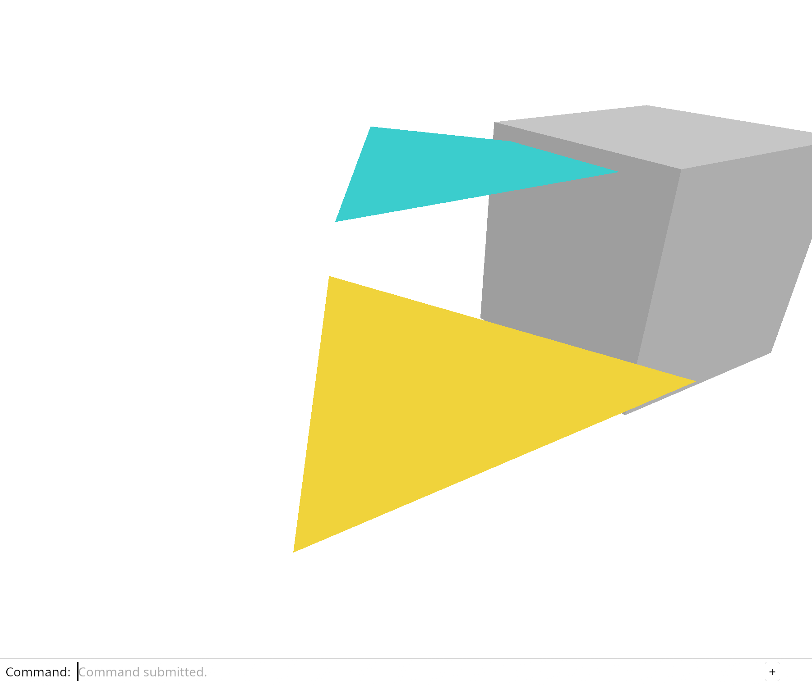

# 3.3 · Validated files, bounds and useful projections

**Goal:** Let canvas F fit the selection and platform shortcuts run Undo or Redo through existing actions. · **Steps:** 14 · **Source:** `src/app/decode.rs` · `src/app/loader.rs` · `src/state.rs`

<div class="webgpu-schematic" style="width:100%;margin:6px auto;">
<svg xmlns="http://www.w3.org/2000/svg" width="1120" height="188" viewBox="0 0 1120 188" style="width:100%;max-width:100%;height:auto;display:block;margin:0 auto;" role="img">
  <defs>
    <marker id="arr" viewBox="0 0 10 10" refX="8" refY="5" markerWidth="6" markerHeight="6" orient="auto">
      <path d="M 0 1 L 9 5 L 0 9 z" fill="#111111"/>
    </marker>
    <marker id="arrR" viewBox="0 0 10 10" refX="8" refY="5" markerWidth="6" markerHeight="6" orient="auto">
      <path d="M 0 1 L 9 5 L 0 9 z" fill="#dc2626"/>
    </marker>
    <marker id="arrG" viewBox="0 0 10 10" refX="8" refY="5" markerWidth="6" markerHeight="6" orient="auto">
      <path d="M 0 1 L 9 5 L 0 9 z" fill="#16a34a"/>
    </marker>
    <marker id="arrB" viewBox="0 0 10 10" refX="8" refY="5" markerWidth="6" markerHeight="6" orient="auto">
      <path d="M 0 1 L 9 5 L 0 9 z" fill="#2563eb"/>
    </marker>
  </defs>
  <rect x="2" y="2" width="1116" height="184" rx="10" fill="#ffffff" stroke="#111111" stroke-width="2"/>
  <rect x="14" y="12" width="344" height="164" rx="8" fill="#ffffff" stroke="#111111" stroke-width="1.5"/>
  <text paint-order="stroke fill" stroke="#ffffff" stroke-width="5" stroke-linejoin="round" x="186" y="30" text-anchor="middle" font-family="monospace" font-size="10.5" font-weight="700" fill="#111111">DOM Resize / Visibility Events</text>
  <rect x="64" y="54" width="108" height="72" rx="4" fill="#f8fafc" stroke="#111111" stroke-width="1.5" stroke-dasharray="3 3"/>
  <rect x="64" y="54" width="224" height="98" rx="4" fill="none" stroke="#2563eb" stroke-width="2"/>
  <line x1="172" y1="90" x2="276" y2="90" stroke="#2563eb" stroke-width="2" marker-end="url(#arrB)"/>
  <text paint-order="stroke fill" stroke="#ffffff" stroke-width="5" stroke-linejoin="round" x="224" y="140" text-anchor="middle" font-family="monospace" font-size="9.5" font-weight="700" fill="#111111">Resize (W, H, DPR)</text>
  <line x1="358" y1="94" x2="384" y2="94" stroke="#111111" stroke-width="2" marker-end="url(#arr)"/>
  <rect x="388" y="12" width="344" height="164" rx="8" fill="#ffffff" stroke="#111111" stroke-width="1.5"/>
  <text paint-order="stroke fill" stroke="#ffffff" stroke-width="5" stroke-linejoin="round" x="560" y="30" text-anchor="middle" font-family="monospace" font-size="10.5" font-weight="700" fill="#111111">Matched Color + Depth32Float Attachments</text>
  <rect x="444" y="56" width="104" height="84" rx="4" fill="#dbeafe" stroke="#111111" stroke-width="1.75"/>
  <text paint-order="stroke fill" stroke="#ffffff" stroke-width="5" stroke-linejoin="round" x="496" y="102" text-anchor="middle" font-family="monospace" font-size="9.5" font-weight="700" fill="#111111">Surface</text>
  <rect x="572" y="56" width="104" height="84" rx="4" fill="#fef9c3" stroke="#111111" stroke-width="1.75"/>
  <text paint-order="stroke fill" stroke="#ffffff" stroke-width="5" stroke-linejoin="round" x="624" y="102" text-anchor="middle" font-family="monospace" font-size="9.5" font-weight="700" fill="#111111">Depth32</text>
  <text paint-order="stroke fill" stroke="#ffffff" stroke-width="5" stroke-linejoin="round" x="560" y="156" text-anchor="middle" font-family="monospace" font-size="9.5" font-weight="700" fill="#111111">aspect = W / H</text>
  <line x1="732" y1="94" x2="758" y2="94" stroke="#111111" stroke-width="2" marker-end="url(#arr)"/>
  <rect x="762" y="12" width="344" height="164" rx="8" fill="#ffffff" stroke="#111111" stroke-width="1.75"/>
  <text paint-order="stroke fill" stroke="#ffffff" stroke-width="5" stroke-linejoin="round" x="934" y="30" text-anchor="middle" font-family="monospace" font-size="10.5" font-weight="700" fill="#111111">Unstretched Aspect-Correct View</text>
  <rect x="802" y="44" width="264" height="118" rx="4" fill="#ffffff" stroke="#111111" stroke-width="2"/>
  <polygon points="934,58 994,84 934,110 874,84" fill="#93c5fd" stroke="#111111" stroke-width="1.75"/>
  <polygon points="874,84 934,110 934,150 874,124" fill="#60a5fa" stroke="#111111" stroke-width="1.75"/>
  <polygon points="934,110 994,84 994,124 934,150" fill="#2563eb" stroke="#111111" stroke-width="1.75"/>
</svg>
</div>

## <a id="checkpoint-22a-records"></a>1. Validate a raw mesh record

Run the state checks. A valid box passes; non-finite coordinates and missing vertex references are rejected.

### 1. `Cargo.toml`

Add fixed protobuf and browser byte-reading dependencies for the import sequence.

**Locate this existing block:**

```toml
wasm-bindgen = "=0.2.128"
web-sys = { version = "=0.3.105", features = ["Window", "Document", "Element", "HtmlCanvasElement", "EventTarget", "AddEventListenerOptions", "Event", "MouseEvent", "PointerEvent", "DomRect", "KeyboardEvent", "WheelEvent", "AddEventListenerOptions", "HtmlElement", "FocusOptions"] }
console_error_panic_hook = "=0.1.7"
wasm-bindgen-futures = "=0.4.78"
```

Edit the existing block to match this code; keep unchanged lines:

```toml
wasm-bindgen = "=0.2.128"
web-sys = { version = "=0.3.105", features = ["Window", "Document", "Element", "HtmlCanvasElement", "EventTarget", "AddEventListenerOptions", "Event", "MouseEvent", "PointerEvent", "DomRect", "KeyboardEvent", "WheelEvent", "AddEventListenerOptions", "HtmlElement", "HtmlInputElement", "File", "FileList", "Blob", "CustomEvent", "CustomEventInit", "FocusOptions"] }
console_error_panic_hook = "=0.1.7"
prost = "=0.14.4"
js-sys = "=0.3.105"
wasm-bindgen-futures = "=0.4.78"
```

### 2. `src/document.rs`

Reject unsupported mesh records before kernel construction; check finite coordinates and referenced vertex keys.

Create the file and type:

```rust
use crate::mesh::Mesh;
use session_rust::{Session, proto};
use std::rc::Rc;

pub const MAX_BYTES: usize = 4 * 1024 * 1024;

#[derive(Clone)]
pub struct Source {
    pub document: Rc<Session>,
    pub guid: String,
}

pub struct Loaded {
    pub document: Rc<Session>,
    pub meshes: Vec<(String, Mesh)>,
}

pub fn validate_mesh(mesh: &proto::Mesh) -> Result<(), &'static str> {
    if mesh.vertices.len() > 10_000
        || mesh.faces.is_empty()
        || mesh.faces.len() > 10_000
    {
        return Err("A mesh needs faces and at most 10,000 vertices and faces");
    }
    if mesh.color_mode != 0 {
        return Err("Per-face and per-vertex colours arrive later");
    }
    for (&key, vertex) in &mesh.vertices {
        if key > u32::MAX as u64
            || [vertex.x, vertex.y, vertex.z]
                .iter()
                .any(|v| !v.is_finite())
        {
            return Err("Invalid vertex key or coordinate");
        }
    }
    for (&key, face) in &mesh.faces {
        if key > u32::MAX as u64
            || !(3..=4).contains(&face.vertices.len())
            || !face.holes.is_empty()
            || face
                .vertices
                .iter()
                .any(|key| !mesh.vertices.contains_key(key))
        {
            return Err(
                "This checkpoint needs triangles or quads with existing vertices and no holes",
            );
        }
    }
    for (key, triangles) in &mesh.triangulation {
        if !mesh.faces.contains_key(key)
            || triangles.vertices.len() % 3 != 0
            || triangles
                .vertices
                .iter()
                .any(|key| !mesh.vertices.contains_key(key))
        {
            return Err("Invalid stored triangulation");
        }
    }
    Ok(())
}

#[cfg(test)]
mod record_checks {
    use super::validate_mesh;

    #[test]
    fn raw_mesh_records_are_checked_before_construction() {
        let mut record = session_rust::Mesh::create_box(1.0, 1.0, 1.0).to_proto();
        assert!(validate_mesh(&record).is_ok());
        record
            .vertices
            .values_mut()
            .next()
            .unwrap()
            .x = f64::NAN;
        assert!(validate_mesh(&record).is_err());
        record
            .vertices
            .values_mut()
            .for_each(|vertex| vertex.x = 0.0);
        record
            .faces
            .values_mut()
            .next()
            .unwrap()
            .vertices[0] = u64::MAX;
        assert!(validate_mesh(&record).is_err());
    }
}
```

### 3. `src/lib.rs`

Register the raw-record validator.

**Locate this existing block:**

```rust
pub mod camera;
pub mod editor;
```

Edit the existing block to match this code; keep unchanged lines:

```rust
pub mod camera;
pub mod document;
pub mod editor;
```

## <a id="checkpoint-22b-session"></a>2. Validate session identity and build a sample file

Validate a real Session and its source identities before browser import.

### 1. `src/document.rs`

Import the GUID set used by session validation. Check supported geometry, unique GUIDs and one flat tree row per mesh.

**Locate this existing block:**

```rust
use session_rust::{Session, proto};
use std::rc::Rc;

pub const MAX_BYTES: usize = 4 * 1024 * 1024;

#[derive(Clone)]
pub struct Source {
    pub document: Rc<Session>,
    pub guid: String,
}

pub struct Loaded {
    pub document: Rc<Session>,
    pub meshes: Vec<(String, Mesh)>,
}
```

Edit the existing block to match this code; keep unchanged lines:

```rust
use session_rust::{Session, proto};
use std::{collections::HashSet, rc::Rc};

pub const MAX_BYTES: usize = 4 * 1024 * 1024;

#[derive(Clone)]
pub struct Source {
    pub document: Rc<Session>,
    pub guid: String,
}

pub struct Loaded {
    pub document: Rc<Session>,
    pub meshes: Vec<(String, Mesh)>,
}

pub fn validate(message: &proto::Session) -> Result<(), &'static str> {
    let objects = message
        .objects
        .as_ref()
        .ok_or("Session has no objects")?;
    if !message.xforms.is_empty()
        || message.definitions.is_some()
        || !message.interactions.is_empty()
    {
        return Err(
            "Placements, definitions and interactions arrive in later checkpoints",
        );
    }
    let other = objects.points.len()
        + objects.lines.len()
        + objects.planes.len()
        + objects.bboxes.len()
        + objects.polylines.len()
        + objects.pointclouds.len()
        + objects.nurbscurves.len()
        + objects.nurbssurfaces.len()
        + objects.breps.len()
        + objects.elements.len()
        + objects.components.len()
        + objects.sheets.len()
        + objects.instances.len();
    if other != 0 || objects.meshes.is_empty() || objects.meshes.len() > 64 {
        return Err("This checkpoint accepts 1–64 meshes and no other geometry types");
    }
    let mut guids = HashSet::new();
    for mesh in &objects.meshes {
        if mesh.guid.is_empty() || !guids.insert(mesh.guid.as_str()) {
            return Err("Every mesh needs a distinct source GUID");
        }
        validate_mesh(mesh)?;
    }
    if let Some(root) = message
        .tree
        .as_ref()
        .and_then(|tree| tree.root.as_ref())
    {
        let names: HashSet<_> = root
            .children
            .iter()
            .map(|node| node.name.as_str())
            .collect();
        if names != guids
            || root.children.len() != guids.len()
            || root
                .children
                .iter()
                .any(|node| !node.children.is_empty())
        {
            return Err("This checkpoint needs one flat tree row per mesh");
        }
    }
    Ok(())
}
```

### 2. `src/specimen.rs`

Build a small three-piece frame with the real kernel. This is our file specimen, not a second renderer or a new file format.

Create the file and type:

```rust
pub fn bytes() -> Vec<u8> {
    use session_rust::{Color, Mesh, Session, Xform};
    let mut session = Session::new("Three-piece frame");
    for (name, size, centre) in [
        (
            "Left post",
            [0.25, 0.35, 1.0],
            [-0.65, 0.0, 0.5],
        ),
        (
            "Right post",
            [0.25, 0.35, 1.0],
            [0.65, 0.0, 0.5],
        ),
        (
            "Top beam",
            [1.8, 0.35, 0.25],
            [0.0, 0.0, 1.125],
        ),
    ] {
        let mut mesh = Mesh::create_box(size[0], size[1], size[2]);
        mesh.name = name.to_owned();
        mesh.transform(&Xform::translation(
            centre[0], centre[1], centre[2],
        ));
        mesh.set_objectcolor(Color::new(0.75, 0.35, 0.1, 1.0));
        assert!(session.add_mesh(mesh, None).is_some());
    }
    session.pb_dumps()
}
```

### 3. `examples/sample.rs`

Supply this optional course-author fixture generator; browser exercises use the linked data files or recorded comparison.

Create the file and type:

```rust
fn main() -> std::io::Result<()> {
    std::fs::write(
        "sample.pb",
        viewer_journey::specimen::bytes(),
    )
}
```

### 4. `src/lib.rs`

Register the specimen builder.

**Locate this existing block:**

```rust
pub mod scene;
pub mod viewport;
```

Edit the existing block to match this code; keep unchanged lines:

```rust
pub mod scene;
pub mod specimen;
pub mod viewport;
```

### 5. `src/document.rs`

Check that the specimen passes validation and duplicate source GUIDs are rejected.

**Locate this existing block:**

```rust
    }
}
```

Edit the existing block to match this code; keep unchanged lines:

```rust
    }
}

#[cfg(test)]
mod session_checks {
    use prost::Message;

    #[test]
    fn the_specimen_has_distinct_meshes_and_flat_rows() {
        let mut record =
            session_rust::proto::Session::decode(crate::specimen::bytes().as_slice())
                .unwrap();
        assert!(super::validate(&record).is_ok());
        let meshes = &mut record.objects.as_mut().unwrap().meshes;
        meshes[1].guid = meshes[0].guid.clone();
        assert!(super::validate(&record).is_err());
    }
}
```

## <a id="checkpoint-22c-decode"></a>3. Decode and prepare the whole import

Run the state checks. Invalid bytes, oversized data and unsupported records are refused before scene insertion.

### 1. `src/document.rs`

Import the protobuf decoding trait. Decode bounded bytes and prepare every display mesh before returning a Loaded document. Keep mesh validation private to the completed loader. Replace the preparation-only record check with the complete loader checks. Replace the preparation-only session check with byte-level loader checks.

Replace the entire file with:

```rust
use crate::mesh::Mesh;
use prost::Message;
use session_rust::{Session, proto};
use std::{collections::HashSet, rc::Rc};

pub const MAX_BYTES: usize = 4 * 1024 * 1024;

#[derive(Clone)]
pub struct Source {
    pub document: Rc<Session>,
    pub guid: String,
}

pub struct Loaded {
    pub document: Rc<Session>,
    pub meshes: Vec<(String, Mesh)>,
}

pub fn load(bytes: &[u8]) -> Result<Loaded, &'static str> {
    if bytes.len() > MAX_BYTES {
        return Err("This checkpoint accepts files up to 4 MiB");
    }
    let message =
        proto::Session::decode(bytes).map_err(|_| "Invalid session protobuf")?;
    validate(&message)?;
    let document =
        Rc::new(Session::from_proto(message).map_err(|_| "Cannot construct session")?);
    let mut meshes = Vec::new();
    for mesh in document.objects.meshes.iter() {
        meshes.push((
            mesh.guid().to_owned(),
            Mesh::from_kernel(mesh)?,
        ));
    }
    Ok(Loaded { document, meshes })
}

fn validate(message: &proto::Session) -> Result<(), &'static str> {
    let objects = message
        .objects
        .as_ref()
        .ok_or("Session has no objects")?;
    if !message.xforms.is_empty()
        || message.definitions.is_some()
        || !message.interactions.is_empty()
    {
        return Err(
            "Placements, definitions and interactions arrive in later checkpoints",
        );
    }
    let other = objects.points.len()
        + objects.lines.len()
        + objects.planes.len()
        + objects.bboxes.len()
        + objects.polylines.len()
        + objects.pointclouds.len()
        + objects.nurbscurves.len()
        + objects.nurbssurfaces.len()
        + objects.breps.len()
        + objects.elements.len()
        + objects.components.len()
        + objects.sheets.len()
        + objects.instances.len();
    if other != 0 || objects.meshes.is_empty() || objects.meshes.len() > 64 {
        return Err("This checkpoint accepts 1–64 meshes and no other geometry types");
    }
    let mut guids = HashSet::new();
    for mesh in &objects.meshes {
        if mesh.guid.is_empty() || !guids.insert(mesh.guid.as_str()) {
            return Err("Every mesh needs a distinct source GUID");
        }
        validate_mesh(mesh)?;
    }
    if let Some(root) = message
        .tree
        .as_ref()
        .and_then(|tree| tree.root.as_ref())
    {
        let names: HashSet<_> = root
            .children
            .iter()
            .map(|node| node.name.as_str())
            .collect();
        if names != guids
            || root.children.len() != guids.len()
            || root
                .children
                .iter()
                .any(|node| !node.children.is_empty())
        {
            return Err("This checkpoint needs one flat tree row per mesh");
        }
    }
    Ok(())
}

fn validate_mesh(mesh: &proto::Mesh) -> Result<(), &'static str> {
    if mesh.vertices.len() > 10_000
        || mesh.faces.is_empty()
        || mesh.faces.len() > 10_000
    {
        return Err("A mesh needs faces and at most 10,000 vertices and faces");
    }
    if mesh.color_mode != 0 {
        return Err("Per-face and per-vertex colours arrive later");
    }
    for (&key, vertex) in &mesh.vertices {
        if key > u32::MAX as u64
            || [vertex.x, vertex.y, vertex.z]
                .iter()
                .any(|v| !v.is_finite())
        {
            return Err("Invalid vertex key or coordinate");
        }
    }
    for (&key, face) in &mesh.faces {
        if key > u32::MAX as u64
            || !(3..=4).contains(&face.vertices.len())
            || !face.holes.is_empty()
            || face
                .vertices
                .iter()
                .any(|key| !mesh.vertices.contains_key(key))
        {
            return Err(
                "This checkpoint needs triangles or quads with existing vertices and no holes",
            );
        }
    }
    for (key, triangles) in &mesh.triangulation {
        if !mesh.faces.contains_key(key)
            || triangles.vertices.len() % 3 != 0
            || triangles
                .vertices
                .iter()
                .any(|key| !mesh.vertices.contains_key(key))
        {
            return Err("Invalid stored triangulation");
        }
    }
    Ok(())
}
```

### 2. `src/document_tests.rs`

Optional authoring fixture. Reject malformed bytes, oversize files and unsupported records before construction.

Create the file and type:

```rust
use crate::{document, specimen};
use prost::Message;
use session_rust::proto;

#[test]
fn malformed_and_unsupported_records_are_refused_before_construction() {
    assert!(document::load(&[]).is_err());
    assert!(document::load(&vec![0; document::MAX_BYTES + 1]).is_err());
    let original = proto::Session::decode(specimen::bytes().as_slice()).unwrap();
    for case in 0..6 {
        let mut message = original.clone();
        let meshes = &mut message.objects.as_mut().unwrap().meshes;
        match case {
            0 => {
                meshes[0]
                    .vertices
                    .values_mut()
                    .next()
                    .unwrap()
                    .x = f64::NAN;
            }
            1 => {
                meshes[0]
                    .faces
                    .values_mut()
                    .next()
                    .unwrap()
                    .vertices[0] = u64::MAX;
            }
            2 => {
                meshes[1].guid = meshes[0].guid.clone();
            }
            3 => {
                meshes[0].color_mode = 1;
            }
            4 => {
                message
                    .xforms
                    .push(proto::XformEntry::default());
            }
            _ => {
                message
                    .objects
                    .as_mut()
                    .unwrap()
                    .points
                    .push(proto::Point::default());
            }
        }
        assert!(
            document::load(&message.encode_to_vec()).is_err(),
            "case {case}"
        );
    }
}
```

### 3. `src/lib.rs`

Register the byte-level loader checks.

**Locate this existing block:**

```rust
pub mod document;
pub mod editor;
```

Edit the existing block to match this code; keep unchanged lines:

```rust
pub mod document;
#[cfg(test)]
mod document_tests;
pub mod editor;
```

## <a id="checkpoint-22d-import"></a>4. Commit an import as one undoable action

Run the state checks. One Undo removes the whole file; Redo restores its IDs and shared source; a failed import preserves selection and redo.

### 1. `src/scene.rs`

An imported display object remembers the document and source GUID it came from. Demo objects have no source document. Keep the existing insertion path for demo objects. All imported rows share one retained source session. History will wrap this entire insertion in one transaction.

Edit these blocks from bottom to top. Keep the surrounding lines unchanged.

**Locate this block:**

```rust
        self.objects.push(Object {
            id,
            mesh: Rc::new(mesh),
        });
        Ok(id)
    }
```

Replace it with:

```rust
        self.objects.push(Object {
            id,
            mesh: Rc::new(mesh),
            source: None,
        });
        Ok(id)
    }

    pub fn import(
        &mut self,
        loaded: crate::document::Loaded,
    ) -> Result<(), &'static str> {
        for (guid, mesh) in loaded.meshes {
            self.insert(mesh)?;
            self.objects.last_mut().unwrap().source = Some(crate::document::Source {
                document: Rc::clone(&loaded.document),
                guid,
            });
        }
        Ok(())
    }
```

**Locate this block:**

```rust
    pub mesh: Rc<Mesh>,
}

#[derive(Clone)]
```

Replace it with:

```rust
    pub mesh: Rc<Mesh>,
    pub source: Option<crate::document::Source>,
}

#[derive(Clone)]
```

### 2. `src/editor.rs`

Make file import an ordinary document action. Prepare first, commit second. A decode or mesh error cannot clear redo or leave half an import in the scene.

**Locate this existing block:**

```rust
    Pick([f32; 2]),
    AddBox,
    ToggleExtra,
    SelectNext,
    Delete,
    Undo,
    Redo,
    Background,
    Zoom(f32),
    Pan(f32, f32),
    Orbit(f64, f64),
    Isometric,
    ResetView,
}

#[derive(Debug, PartialEq, Eq)]
pub enum Change {
    View,
    Scene,
}

pub struct Editor {
    pub scene: Scene,
    pub selected: Option<ObjectId>,
    pub camera: Camera,
    pub background: Background,
    history: History,
}

impl Default for Editor {
    fn default() -> Self {
        Self {
            scene: Scene::demo(),
            selected: None,
            camera: Camera::default(),
            background: Background::default(),
            history: History::default(),
        }
    }
}

impl Editor {
    pub fn apply(&mut self, action: Action) -> Result<Change, &'static str> {
        match action {
            Action::Pick(screen) => {
                self.selected = self
                    .camera
                    .ray(screen)
                    .and_then(|ray| crate::picking::pick(&self.scene, &ray));
            }
```

Edit the existing block to match this code; keep unchanged lines:

```rust
    Pick([f32; 2]),
    Import(Vec<u8>),
    AddBox,
    ToggleExtra,
    SelectNext,
    Delete,
    Undo,
    Redo,
    Background,
    Zoom(f32),
    Pan(f32, f32),
    Orbit(f64, f64),
    Isometric,
    ResetView,
}

#[derive(Debug, PartialEq, Eq)]
pub enum Change {
    View,
    Scene,
}

pub struct Editor {
    pub scene: Scene,
    pub selected: Option<ObjectId>,
    pub camera: Camera,
    pub background: Background,
    history: History,
}

impl Default for Editor {
    fn default() -> Self {
        Self {
            scene: Scene::demo(),
            selected: None,
            camera: Camera::default(),
            background: Background::default(),
            history: History::default(),
        }
    }
}

impl Editor {
    pub fn apply(&mut self, action: Action) -> Result<Change, &'static str> {
        match action {
            Action::Pick(screen) => {
                self.selected = self
                    .camera
                    .ray(screen)
                    .and_then(|ray| crate::picking::pick(&self.scene, &ray));
            }
            Action::Import(bytes) => {
                let loaded = crate::document::load(&bytes)?;
                self.history
                    .try_edit(&mut self.scene, |scene| scene.import(loaded))?;
            }
```

### 3. `src/document_tests.rs`

Optional authoring fixture. Import editor actions and shared-owner comparison for transaction checks. Optional authoring fixture. Check whole-file Undo/Redo, failed import and repeated source identities.

**Locate this existing block:**

```rust
use crate::{document, specimen};
use prost::Message;
use session_rust::proto;

#[test]
```

Edit the existing block to match this code; keep unchanged lines:

```rust
use crate::{
    document,
    editor::{Action, Editor},
    specimen,
};
use prost::Message;
use session_rust::proto;
use std::rc::Rc;

#[test]
fn import_retains_source_and_undo_removes_the_whole_file() {
    let mut editor = Editor::default();
    editor
        .apply(Action::Import(specimen::bytes()))
        .unwrap();
    assert_eq!(editor.scene.objects().len(), 5);
    let source = editor.scene.objects()[2]
        .source
        .as_ref()
        .unwrap();
    let document = Rc::clone(&source.document);
    let guid = source.guid.clone();
    let id = editor.scene.objects()[2].id;
    assert_eq!(document.name, "Three-piece frame");
    assert!(
        document
            .objects
            .meshes
            .iter()
            .any(|mesh| mesh.guid() == guid)
    );
    editor.apply(Action::Undo).unwrap();
    assert_eq!(editor.scene.objects().len(), 2);
    editor.apply(Action::Redo).unwrap();
    let restored = &editor.scene.objects()[2];
    assert_eq!(restored.id, id);
    assert!(Rc::ptr_eq(
        &restored.source.as_ref().unwrap().document,
        &document
    ));
}

#[test]
fn a_failed_import_leaves_selection_and_redo_intact() {
    let mut editor = Editor::default();
    editor.apply(Action::AddBox).unwrap();
    editor.apply(Action::Undo).unwrap();
    editor.apply(Action::SelectNext).unwrap();
    let selected = editor.selected;
    assert!(
        editor
            .apply(Action::Import(vec![255]))
            .is_err()
    );
    assert_eq!(editor.scene.objects().len(), 2);
    assert_eq!(editor.selected, selected);
    editor.apply(Action::Redo).unwrap();
    assert_eq!(editor.scene.objects().len(), 3);
}

#[test]
fn repeated_imports_keep_distinct_viewer_ids_and_original_source_guids() {
    let bytes = specimen::bytes();
    let mut editor = Editor::default();
    editor
        .apply(Action::Import(bytes.clone()))
        .unwrap();
    editor.apply(Action::Import(bytes)).unwrap();
    let objects = editor.scene.objects();
    assert_ne!(objects[2].id, objects[5].id);
    assert_eq!(
        objects[2].source.as_ref().unwrap().guid,
        objects[5].source.as_ref().unwrap().guid
    );
    assert!(!Rc::ptr_eq(
        &objects[2].source.as_ref().unwrap().document,
        &objects[5].source.as_ref().unwrap().document
    ));
}

#[test]
```

## <a id="checkpoint-22e-file-reader"></a>5. Prepare asynchronous file delivery

Build and run the checkpoint. The current scene and commands remain available; file selection is connected next.

### 1. `src/file_input.rs`

Read file bytes asynchronously; reject stale request numbers and return completion to the editor callback.

Create the file and type:

```rust
use std::{cell::Cell, rc::Rc};
use wasm_bindgen::{JsCast, JsValue};

pub fn choose(event: &web_sys::Event, request: Rc<Cell<u64>>) {
    let Some(input) = event.target().and_then(|target| {
        target
            .dyn_into::<web_sys::HtmlInputElement>()
            .ok()
    }) else {
        return;
    };
    if input.id() != "open" {
        return;
    }
    let Some(file) = input.files().and_then(|files| files.get(0)) else {
        return;
    };
    input.set_value("");
    let id = request.get() + 1;
    request.set(id);
    if file.size() > crate::document::MAX_BYTES as f64 {
        super::browser::report("This checkpoint accepts files up to 4 MiB");
        return;
    }
    super::browser::report("Reading the selected file…");
    wasm_bindgen_futures::spawn_local(async move {
        let result = wasm_bindgen_futures::JsFuture::from(file.array_buffer()).await;
        if request.get() != id {
            return;
        }
        let result = result.and_then(deliver);
        if let Err(error) = result {
            super::browser::report(&format!("Cannot read file: {error:?}"));
        }
    });
}

fn deliver(buffer: JsValue) -> Result<(), JsValue> {
    let detail = web_sys::CustomEventInit::new();
    detail.set_detail(&js_sys::Uint8Array::new(&buffer));
    let event = web_sys::CustomEvent::new_with_event_init_dict("viewer-file", &detail)?;
    web_sys::window()
        .ok_or("No browser window")?
        .dispatch_event(&event)?;
    Ok(())
}

pub fn bytes(event: &web_sys::Event) -> Option<Vec<u8>> {
    let event = event.dyn_ref::<web_sys::CustomEvent>()?;
    let array = event
        .detail()
        .dyn_into::<js_sys::Uint8Array>()
        .ok()?;
    if array.length() as usize > crate::document::MAX_BYTES {
        return None;
    }
    Some(array.to_vec())
}
```

### 2. `index.html`

Keep the HTML page small. Feature input belongs to the command dock drawn inside the canvas.

**Locate this existing block:**

```html
  <canvas id="canvas" tabindex="0" width="640" height="480" aria-label="Viewer drawing"></canvas>
</body>
```

Edit the existing block to match this code; keep unchanged lines:

```html
  <canvas id="canvas" tabindex="0" width="640" height="480" aria-label="Viewer drawing"></canvas>
  <input id="open" type="file" accept=".pb" hidden>
</body>
```

### 3. `src/lib.rs`

Expose the complete file-reader component while preparing its browser integration.

**Locate this existing block:**

```rust
pub mod editor;
pub mod gesture;
```

Edit the existing block to match this code; keep unchanged lines:

```rust
pub mod editor;
#[cfg(target_arch = "wasm32")]
pub mod file_input;
pub mod gesture;
```

## <a id="checkpoint-23-import"></a>6. Open a file through the command line

<div class="webgpu-schematic" style="width:100%;margin:6px auto;">
<svg xmlns="http://www.w3.org/2000/svg" width="1120" height="188" viewBox="0 0 1120 188" style="width:100%;max-width:100%;height:auto;display:block;margin:0 auto;" role="img">
  <defs>
    <marker id="arr" viewBox="0 0 10 10" refX="8" refY="5" markerWidth="6" markerHeight="6" orient="auto">
      <path d="M 0 1 L 9 5 L 0 9 z" fill="#111111"/>
    </marker>
    <marker id="arrR" viewBox="0 0 10 10" refX="8" refY="5" markerWidth="6" markerHeight="6" orient="auto">
      <path d="M 0 1 L 9 5 L 0 9 z" fill="#dc2626"/>
    </marker>
    <marker id="arrG" viewBox="0 0 10 10" refX="8" refY="5" markerWidth="6" markerHeight="6" orient="auto">
      <path d="M 0 1 L 9 5 L 0 9 z" fill="#16a34a"/>
    </marker>
    <marker id="arrB" viewBox="0 0 10 10" refX="8" refY="5" markerWidth="6" markerHeight="6" orient="auto">
      <path d="M 0 1 L 9 5 L 0 9 z" fill="#2563eb"/>
    </marker>
  </defs>
  <rect x="2" y="2" width="1116" height="184" rx="10" fill="#ffffff" stroke="#111111" stroke-width="2"/>
  <rect x="14" y="12" width="344" height="164" rx="8" fill="#ffffff" stroke="#111111" stroke-width="1.5"/>
  <text paint-order="stroke fill" stroke="#ffffff" stroke-width="5" stroke-linejoin="round" x="186" y="30" text-anchor="middle" font-family="monospace" font-size="10.5" font-weight="700" fill="#111111">Kernel Box + Face Normals N</text>
  <polygon points="186,52 256,82 186,112 116,82" fill="#f8fafc" stroke="#111111" stroke-width="1.75"/>
  <polygon points="116,82 186,112 186,160 116,130" fill="#e2e8f0" stroke="#111111" stroke-width="1.75"/>
  <polygon points="186,112 256,82 256,130 186,160" fill="#cbd5e1" stroke="#111111" stroke-width="1.75"/>
  <line x1="186" y1="82" x2="186" y2="38" stroke="#2563eb" stroke-width="2" marker-end="url(#arrB)"/>
  <line x1="222" y1="120" x2="268" y2="140" stroke="#dc2626" stroke-width="2" marker-end="url(#arrR)"/>
  <line x1="150" y1="120" x2="104" y2="140" stroke="#16a34a" stroke-width="2" marker-end="url(#arrG)"/>
  <line x1="358" y1="94" x2="384" y2="94" stroke="#111111" stroke-width="2" marker-end="url(#arr)"/>
  <rect x="388" y="12" width="344" height="164" rx="8" fill="#ffffff" stroke="#111111" stroke-width="1.5"/>
  <text paint-order="stroke fill" stroke="#ffffff" stroke-width="5" stroke-linejoin="round" x="560" y="30" text-anchor="middle" font-family="monospace" font-size="10.5" font-weight="700" fill="#111111">@fragment: max(dot(N, L), 0.0)</text>
  <line x1="470" y1="134" x2="650" y2="134" stroke="#111111" stroke-width="2"/>
  <line x1="560" y1="134" x2="560" y2="54" stroke="#2563eb" stroke-width="2.25" marker-end="url(#arrB)"/>
  <text paint-order="stroke fill" stroke="#ffffff" stroke-width="5" stroke-linejoin="round" x="546" y="60" font-family="monospace" font-size="10" font-weight="700" fill="#2563eb">N</text>
  <line x1="560" y1="134" x2="628" y2="66" stroke="#f59e0b" stroke-width="2.25" marker-end="url(#arr)"/>
  <text paint-order="stroke fill" stroke="#ffffff" stroke-width="5" stroke-linejoin="round" x="640" y="68" font-family="monospace" font-size="10" font-weight="700" fill="#d97706">L</text>
  <path d="M 560 98 A 36 36 0 0 1 585 109" fill="none" stroke="#111111" stroke-width="1.5"/>
  <text paint-order="stroke fill" stroke="#ffffff" stroke-width="5" stroke-linejoin="round" x="582" y="94" font-family="monospace" font-size="9.5" font-weight="700" fill="#111111">θ</text>
  <text paint-order="stroke fill" stroke="#ffffff" stroke-width="5" stroke-linejoin="round" x="560" y="156" text-anchor="middle" font-family="monospace" font-size="9.5" font-weight="700" fill="#111111">lit = base * (amb + diff * cos θ)</text>
  <line x1="732" y1="94" x2="758" y2="94" stroke="#111111" stroke-width="2" marker-end="url(#arr)"/>
  <rect x="762" y="12" width="344" height="164" rx="8" fill="#ffffff" stroke="#111111" stroke-width="1.75"/>
  <text paint-order="stroke fill" stroke="#ffffff" stroke-width="5" stroke-linejoin="round" x="934" y="30" text-anchor="middle" font-family="monospace" font-size="10.5" font-weight="700" fill="#111111">Shaded 3D Solid in Viewer</text>
  <rect x="814" y="44" width="240" height="118" rx="4" fill="#ffffff" stroke="#111111" stroke-width="2"/>
  <polygon points="934,54 1004,82 934,110 864,82" fill="#93c5fd" stroke="#111111" stroke-width="1.75"/>
  <polygon points="864,82 934,110 934,154 864,126" fill="#60a5fa" stroke="#111111" stroke-width="1.75"/>
  <polygon points="934,110 1004,82 1004,126 934,154" fill="#2563eb" stroke="#111111" stroke-width="1.75"/>
</svg>
</div>

Import a real mesh-session file, keep its source identity, and undo the whole import as one action.

### 1. `src/lib.rs`

Keep the reader internal now that the browser callback owns file delivery.

**Locate this existing block:**

```rust
#[cfg(target_arch = "wasm32")]
pub mod file_input;
pub mod gesture;
```

Edit the existing block to match this code; keep unchanged lines:

```rust
#[cfg(target_arch = "wasm32")]
mod file_input;
pub mod gesture;
```

### 2. `src/browser.rs`

Add Open to the vocabulary. Own a shared request number for asynchronous file reads. Route file selection and completion events through the editor; Open activates the hidden file picker. Report successful import as one undoable edit. Register file selection and byte-completion events.

**Locate this existing block:**

```rust
            "Help",
            "Example Box",
            "Example Triangle",
            "Select Next",
            "Delete",
            "Undo",
            "Redo",
            "Background",
            "Zoom In",
            "Zoom Out",
            "Pan Left",
            "Pan Right",
            "Orbit Right",
            "Orbit Up",
            "View Isometric",
            "View Reset",
        ],
    );
    panel.update(None, &canvas)?;
    if resize(
        &window,
        &canvas,
        &surface,
        &mut config,
        &mut renderer,
        &mut editor,
    ) {
        panel.update(None, &canvas)?;
        present(
            &surface,
            &renderer,
            &editor.background,
            &editor.camera.uniform(),
            &mut panel,
        )?;
    }
    let input_canvas = canvas.clone();
    let browser_window = window.clone();
    let pointer_canvas = canvas.clone();
    let mut gesture = Gesture::default();
    let update =
        Closure::<dyn FnMut(web_sys::Event)>::new(move |event: web_sys::Event| {
            let line = match panel.update(Some(&event), &input_canvas) {
                Ok(line) => line,
                Err(error) => {
                    report(&format!("Cannot read command: {error:?}"));
                    return;
                }
            };
            let action = if let Some(line) = line {
                let action = match line.as_str() {
                    "example box" => Action::AddBox,
                    "example triangle" => Action::ToggleExtra,
                    "select next" => Action::SelectNext,
                    "delete" => Action::Delete,
                    "undo" => Action::Undo,
                    "redo" => Action::Redo,
                    "background" => Action::Background,
                    "zoom in" => Action::Zoom(2.0),
                    "zoom out" => Action::Zoom(0.5),
                    "pan left" => Action::Pan(-0.25, 0.0),
                    "pan right" => Action::Pan(0.25, 0.0),
                    "orbit right" => Action::Orbit(std::f64::consts::FRAC_PI_4, 0.0),
                    "orbit up" => Action::Orbit(0.0, std::f64::consts::FRAC_PI_6),
                    "view isometric" => Action::Isometric,
                    "view reset" => Action::ResetView,
                    _ => return,
                };
                Some(action)
            } else if !panel.consumed {
                navigation_action(&event, &pointer_canvas, &mut gesture)
            } else {
                None
            };
            if let Some(action) = action {
                match editor.apply(action) {
                    Ok(Change::Scene) => {
                        renderer.set_scene(&editor.scene, editor.selected)
                    }
                    Ok(Change::View) => {}
                    Err(error) => {
                        report(error);
                        return;
                    }
                }
            }
            if resize(
                &browser_window,
                &pointer_canvas,
                &surface,
                &mut config,
                &mut renderer,
                &mut editor,
            ) {
                if let Err(error) = panel.update(None, &input_canvas) {
                    report(&format!(
                        "Cannot lay out commands: {error:?}"
                    ));
                    return;
                }
                if let Err(error) = present(
                    &surface,
                    &renderer,
                    &editor.background,
                    &editor.camera.uniform(),
                    &mut panel,
                ) {
                    report(&format!("Cannot redraw: {error:?}"));
                }
            }
        });
    for name in [
        "pointerdown",
        "pointermove",
        "pointerup",
        "pointercancel",
        "lostpointercapture",
        "contextmenu",
        "keydown",
        "keyup",
        "blur",
    ] {
        canvas
            .add_event_listener_with_callback(name, update.as_ref().unchecked_ref())?;
    }
    let options = web_sys::AddEventListenerOptions::new();
    options.set_passive(false);
    canvas.add_event_listener_with_callback_and_add_event_listener_options(
        "wheel",
        update.as_ref().unchecked_ref(),
        &options,
    )?;
    window
        .add_event_listener_with_callback("resize", update.as_ref().unchecked_ref())?;
    window.add_event_listener_with_callback("blur", update.as_ref().unchecked_ref())?;
    // Both event sources retain this one callback for the lifetime of the page.
```

Edit the existing block to match this code; keep unchanged lines:

```rust
            "Help",
            "Open",
            "Example Box",
            "Example Triangle",
            "Select Next",
            "Delete",
            "Undo",
            "Redo",
            "Background",
            "Zoom In",
            "Zoom Out",
            "Pan Left",
            "Pan Right",
            "Orbit Right",
            "Orbit Up",
            "View Isometric",
            "View Reset",
        ],
    );
    panel.update(None, &canvas)?;
    if resize(
        &window,
        &canvas,
        &surface,
        &mut config,
        &mut renderer,
        &mut editor,
    ) {
        panel.update(None, &canvas)?;
        present(
            &surface,
            &renderer,
            &editor.background,
            &editor.camera.uniform(),
            &mut panel,
        )?;
    }
    let input_canvas = canvas.clone();
    let browser_window = window.clone();
    let pointer_canvas = canvas.clone();
    let mut gesture = Gesture::default();
    let request = std::rc::Rc::new(std::cell::Cell::new(0));
    let update =
        Closure::<dyn FnMut(web_sys::Event)>::new(move |event: web_sys::Event| {
            let line = match panel.update(Some(&event), &input_canvas) {
                Ok(line) => line,
                Err(error) => {
                    report(&format!("Cannot read command: {error:?}"));
                    return;
                }
            };
            let action = if event.type_() == "change" {
                crate::file_input::choose(&event, std::rc::Rc::clone(&request));
                None
            } else if event.type_() == "viewer-file" {
                crate::file_input::bytes(&event).map(Action::Import)
            } else if let Some(line) = line {
                if line == "open" {
                    if let Some(input) = web_sys::window()
                        .and_then(|window| window.document())
                        .and_then(|document| document.get_element_by_id("open"))
                        .and_then(|element| {
                            element
                                .dyn_into::<web_sys::HtmlInputElement>()
                                .ok()
                        })
                    {
                        input.click();
                    }
                    None
                } else {
                    let action = match line.as_str() {
                        "example box" => Action::AddBox,
                        "example triangle" => Action::ToggleExtra,
                        "select next" => Action::SelectNext,
                        "delete" => Action::Delete,
                        "undo" => Action::Undo,
                        "redo" => Action::Redo,
                        "background" => Action::Background,
                        "zoom in" => Action::Zoom(2.0),
                        "zoom out" => Action::Zoom(0.5),
                        "pan left" => Action::Pan(-0.25, 0.0),
                        "pan right" => Action::Pan(0.25, 0.0),
                        "orbit right" => {
                            Action::Orbit(std::f64::consts::FRAC_PI_4, 0.0)
                        }
                        "orbit up" => Action::Orbit(0.0, std::f64::consts::FRAC_PI_6),
                        "view isometric" => Action::Isometric,
                        "view reset" => Action::ResetView,
                        _ => return,
                    };
                    Some(action)
                }
            } else if !panel.consumed {
                navigation_action(&event, &pointer_canvas, &mut gesture)
            } else {
                None
            };
            if let Some(action) = action {
                match editor.apply(action) {
                    Ok(Change::Scene) => {
                        renderer.set_scene(&editor.scene, editor.selected)
                    }
                    Ok(Change::View) => {}
                    Err(error) => {
                        report(error);
                        return;
                    }
                }
            }
            if event.type_() == "viewer-file" {
                report("File imported. Undo removes the entire import.");
            }
            if resize(
                &browser_window,
                &pointer_canvas,
                &surface,
                &mut config,
                &mut renderer,
                &mut editor,
            ) {
                if let Err(error) = panel.update(None, &input_canvas) {
                    report(&format!(
                        "Cannot lay out commands: {error:?}"
                    ));
                    return;
                }
                if let Err(error) = present(
                    &surface,
                    &renderer,
                    &editor.background,
                    &editor.camera.uniform(),
                    &mut panel,
                ) {
                    report(&format!("Cannot redraw: {error:?}"));
                }
            }
        });
    for name in [
        "pointerdown",
        "pointermove",
        "pointerup",
        "pointercancel",
        "lostpointercapture",
        "contextmenu",
        "keydown",
        "keyup",
        "blur",
    ] {
        canvas
            .add_event_listener_with_callback(name, update.as_ref().unchecked_ref())?;
    }
    let options = web_sys::AddEventListenerOptions::new();
    options.set_passive(false);
    canvas.add_event_listener_with_callback_and_add_event_listener_options(
        "wheel",
        update.as_ref().unchecked_ref(),
        &options,
    )?;
    window
        .add_event_listener_with_callback("resize", update.as_ref().unchecked_ref())?;
    window.add_event_listener_with_callback("blur", update.as_ref().unchecked_ref())?;
    document
        .add_event_listener_with_callback("change", update.as_ref().unchecked_ref())?;
    window.add_event_listener_with_callback(
        "viewer-file",
        update.as_ref().unchecked_ref(),
    )?;
    // Both event sources retain this one callback for the lifetime of the page.
```

## <a id="checkpoint-23a-bounds"></a>7. Measure the displayed scene bounds

<div class="webgpu-schematic" style="width:100%;margin:6px auto;">
<svg xmlns="http://www.w3.org/2000/svg" width="1120" height="188" viewBox="0 0 1120 188" style="width:100%;max-width:100%;height:auto;display:block;margin:0 auto;" role="img">
  <defs>
    <marker id="arr" viewBox="0 0 10 10" refX="8" refY="5" markerWidth="6" markerHeight="6" orient="auto">
      <path d="M 0 1 L 9 5 L 0 9 z" fill="#111111"/>
    </marker>
    <marker id="arrR" viewBox="0 0 10 10" refX="8" refY="5" markerWidth="6" markerHeight="6" orient="auto">
      <path d="M 0 1 L 9 5 L 0 9 z" fill="#dc2626"/>
    </marker>
    <marker id="arrG" viewBox="0 0 10 10" refX="8" refY="5" markerWidth="6" markerHeight="6" orient="auto">
      <path d="M 0 1 L 9 5 L 0 9 z" fill="#16a34a"/>
    </marker>
    <marker id="arrB" viewBox="0 0 10 10" refX="8" refY="5" markerWidth="6" markerHeight="6" orient="auto">
      <path d="M 0 1 L 9 5 L 0 9 z" fill="#2563eb"/>
    </marker>
  </defs>
  <rect x="2" y="2" width="1116" height="184" rx="10" fill="#ffffff" stroke="#111111" stroke-width="2"/>
  <rect x="14" y="12" width="344" height="164" rx="8" fill="#ffffff" stroke="#111111" stroke-width="1.5"/>
  <text paint-order="stroke fill" stroke="#ffffff" stroke-width="5" stroke-linejoin="round" x="186" y="30" text-anchor="middle" font-family="monospace" font-size="10.5" font-weight="700" fill="#111111">Curve Quadrature ∑ w_i ||C'(t_i)|| &amp; Surface Patch dA = ||Su×Sv||</text>
  <path d="M 56 138 Q 112 52 176 126" fill="none" stroke="#dc2626" stroke-width="2.5"/>
  <circle cx="84" cy="98" r="4" fill="#fef08a" stroke="#111111" stroke-width="1.5"/>
  <circle cx="116" cy="84" r="4" fill="#fef08a" stroke="#111111" stroke-width="1.5"/>
  <circle cx="148" cy="98" r="4" fill="#fef08a" stroke="#111111" stroke-width="1.5"/>
  <polygon points="196,136 226,74 288,74 258,136" fill="#dbeafe" stroke="#111111" stroke-width="1.75"/>
  <line x1="226" y1="105" x2="268" y2="105" stroke="#2563eb" stroke-width="2" marker-end="url(#arrB)"/>
  <line x1="226" y1="105" x2="242" y2="74" stroke="#16a34a" stroke-width="2" marker-end="url(#arrG)"/>
  <line x1="358" y1="94" x2="384" y2="94" stroke="#111111" stroke-width="2" marker-end="url(#arr)"/>
  <rect x="388" y="12" width="344" height="164" rx="8" fill="#ffffff" stroke="#111111" stroke-width="1.5"/>
  <text paint-order="stroke fill" stroke="#ffffff" stroke-width="5" stroke-linejoin="round" x="560" y="30" text-anchor="middle" font-family="monospace" font-size="10.5" font-weight="700" fill="#111111">Divergence Volume: V = (1/6) ∑ det(v0, v1, v2) &amp; Centroid C_g</text>
  <circle cx="448" cy="138" r="4.5" fill="#111111"/>
  <text paint-order="stroke fill" stroke="#ffffff" stroke-width="5" stroke-linejoin="round" x="448" y="154" text-anchor="middle" font-family="monospace" font-size="9" font-weight="700" fill="#111111">Origin O</text>
  <polygon points="448,138 556,58 656,92" fill="#dbeafe" fill-opacity="0.55" stroke="#2563eb" stroke-width="1.5" stroke-dasharray="4 3"/>
  <polygon points="556,58 656,92 596,142" fill="#93c5fd" stroke="#111111" stroke-width="2"/>
  <circle cx="576" cy="104" r="5" fill="#fef08a" stroke="#dc2626" stroke-width="2"/>
  <line x1="732" y1="94" x2="758" y2="94" stroke="#111111" stroke-width="2" marker-end="url(#arr)"/>
  <rect x="762" y="12" width="344" height="164" rx="8" fill="#ffffff" stroke="#111111" stroke-width="1.75"/>
  <text paint-order="stroke fill" stroke="#ffffff" stroke-width="5" stroke-linejoin="round" x="934" y="30" text-anchor="middle" font-family="monospace" font-size="10.5" font-weight="700" fill="#111111">Exact Length, Area, Volume &amp; Centroid Marker</text>
  <rect x="806" y="44" width="256" height="118" rx="4" fill="#ffffff" stroke="#111111" stroke-width="2"/>
  <polygon points="846,136 894,64 988,64 940,136" fill="#dbeafe" stroke="#111111" stroke-width="2"/>
  <circle cx="917" cy="100" r="6" fill="#fef08a" stroke="#dc2626" stroke-width="2.2"/>
  <text paint-order="stroke fill" stroke="#ffffff" stroke-width="5" stroke-linejoin="round" x="1016" y="96" text-anchor="middle" font-family="monospace" font-size="9.5" font-weight="700" fill="#111111">C_g</text>
</svg>
</div>

Run the state checks. Known corners give the expected centre and radius; a scene with no objects has no bounds.

### 1. `src/bounds.rs`

Store coordinate minima/maxima; compute the centre and enclosing-sphere radius from them.

Create the file and type:

```rust
pub struct Bounds {
    pub min: [f64; 3],
    pub max: [f64; 3],
}

impl Bounds {
    pub fn point(point: [f64; 3]) -> Self {
        Self {
            min: point,
            max: point,
        }
    }

    pub fn include(&mut self, point: [f64; 3]) {
        for i in 0..3 {
            self.min[i] = self.min[i].min(point[i]);
            self.max[i] = self.max[i].max(point[i]);
        }
    }

    pub fn centre(&self) -> [f64; 3] {
        std::array::from_fn(|i| (self.min[i] + self.max[i]) * 0.5)
    }

    pub fn radius(&self) -> f64 {
        let half =
            std::array::from_fn::<_, 3, _>(|i| (self.max[i] - self.min[i]) * 0.5);
        (half[0] * half[0] + half[1] * half[1] + half[2] * half[2]).sqrt()
    }
}
```

### 2. `src/scene.rs`

Accumulate displayed vertices into f64 bounds; return None for an empty scene.

**Locate this existing block:**

```rust
    }

    pub fn objects(&self) -> &[Object] {
```

Edit the existing block to match this code; keep unchanged lines:

```rust
    }

    pub fn bounds(&self) -> Option<crate::bounds::Bounds> {
        let mut bounds: Option<crate::bounds::Bounds> = None;
        for object in &self.objects {
            for vertex in object.mesh.vertices() {
                let point = [
                    vertex[0] as f64,
                    vertex[1] as f64,
                    vertex[2] as f64,
                ];
                match &mut bounds {
                    Some(bounds) => bounds.include(point),
                    None => bounds = Some(crate::bounds::Bounds::point(point)),
                }
            }
        }
        bounds
    }

    pub fn objects(&self) -> &[Object] {
```

### 3. `src/lib.rs`

Register the bounds module beside Camera.

**Locate this existing block:**

```rust
pub mod background;
#[cfg(target_arch = "wasm32")]
```

Edit the existing block to match this code; keep unchanged lines:

```rust
pub mod background;
pub mod bounds;
#[cfg(target_arch = "wasm32")]
```

### 4. `src/fit_tests.rs`

Optional authoring fixture. Check measured bounds and the empty-scene result.

Create the file and type:

```rust
use crate::bounds::Bounds;

#[test]
fn bounds_measure_vertices_and_define_the_empty_case() {
    let mut bounds = Bounds::point([-2.0, 1.0, 0.0]);
    bounds.include([2.0, 3.0, 2.0]);
    assert_eq!(bounds.centre(), [0.0, 2.0, 1.0]);
    assert!((bounds.radius() - 6.0_f64.sqrt()).abs() < 1.0e-12);
    let mut scene = crate::scene::Scene::demo();
    assert!(scene.bounds().is_some());
    while let Some(id) = scene.next(None) {
        scene.remove(id);
    }
    assert!(scene.bounds().is_none());
}
```

### 5. `src/lib.rs`

Register the native Fit tests.

**Locate this existing block:**

```rust
mod file_input;
pub mod gesture;
```

Edit the existing block to match this code; keep unchanged lines:

```rust
mod file_input;
#[cfg(test)]
mod fit_tests;
pub mod gesture;
```

## <a id="checkpoint-23b-fit-camera"></a>8. Fit the camera around the bounds

Run the state checks. Every corner remains inside the view across scales and aspect ratios, and fitting preserves orientation.

### 1. `src/camera.rs`

Keep the fitted scene scale with the camera. Distance says where the eye is; radius says how large the scene is. The original small demonstration scene starts with a one-unit radius. Fit will measure the real bounds. Fit the enclosing sphere through the smaller half-angle: distance = radius × 1.1 / sin(angle). Scale zoom limits with scene radius to prevent a jump after fitting a large model. Scale near and far clipping planes with camera distance and scene radius.

**Locate this existing block:**

```rust
    pub distance: f64,
    pub orientation: Quaternion,
    pub aspect: f64,
}

impl Default for Camera {
    fn default() -> Self {
        Self {
            target: [0.0; 3],
            distance: 3.0,
            orientation: Quaternion::from_axis_angle(
                Vector::x_axis(),
                -std::f64::consts::FRAC_PI_2,
            ),
            aspect: 640.0 / 480.0,
        }
    }
}

impl Camera {
    pub fn pan(&mut self, dx: f32, dy: f32) {
        let right = self
            .orientation
            .rotate_vector(Vector::x_axis());
        let up = self
            .orientation
            .rotate_vector(Vector::z_axis());
        for i in 0..3 {
            self.target[i] += dx as f64 * right[i] + dy as f64 * up[i];
        }
    }

    pub fn zoom(&mut self, factor: f32) {
        if factor.is_finite() && factor > 0.0 {
            self.distance = (self.distance / factor as f64).clamp(0.2, 50.0);
        }
    }

    pub fn rotate(&mut self, radians: f32) {
        self.orbit(radians as f64, 0.0);
    }

    pub fn orbit(&mut self, yaw: f64, pitch: f64) {
        let right = self
            .orientation
            .rotate_vector(Vector::x_axis());
        let turn = Quaternion::from_axis_angle(Vector::z_axis(), yaw);
        let tilt = Quaternion::from_axis_angle(right, pitch);
        self.orientation = (turn * (tilt * self.orientation.duplicate())).normalized();
    }

    pub fn isometric(&mut self) {
        let turn = Quaternion::from_axis_angle(
            Vector::z_axis(),
            -std::f64::consts::FRAC_PI_6,
        );
        let right = turn.rotate_vector(Vector::x_axis());
        let tilt = Quaternion::from_axis_angle(right, -std::f64::consts::FRAC_PI_6);
        self.orientation = (tilt * turn).normalized();
    }

    pub fn view_projection(&self) -> Xform {
        let forward = self
            .orientation
            .rotate_vector(Vector::y_axis());
        let up = self
            .orientation
            .rotate_vector(Vector::z_axis());
        let target = Point::new(
            self.target[0],
            self.target[1],
            self.target[2],
        );
        let eye = Point::new(
            self.target[0] - forward[0] * self.distance,
            self.target[1] - forward[1] * self.distance,
            self.target[2] - forward[2] * self.distance,
        );
        let view = Xform::look_at_right_handed(&eye, &target, &up);
        let projection = Xform::perspective(
            60.0_f64.to_radians(),
            self.aspect,
            0.01,
            100.0,
        );
        projection * view
```

Edit the existing block to match this code; keep unchanged lines:

```rust
    pub distance: f64,
    pub radius: f64,
    pub orientation: Quaternion,
    pub aspect: f64,
}

impl Default for Camera {
    fn default() -> Self {
        Self {
            target: [0.0; 3],
            distance: 3.0,
            radius: 1.0,
            orientation: Quaternion::from_axis_angle(
                Vector::x_axis(),
                -std::f64::consts::FRAC_PI_2,
            ),
            aspect: 640.0 / 480.0,
        }
    }
}

impl Camera {
    pub fn fit(&mut self, bounds: &crate::bounds::Bounds) {
        let half_y = 30.0_f64.to_radians();
        let half_x = (self.aspect * half_y.tan()).atan();
        let radius = bounds.radius();
        self.radius = if radius > 0.0 {
            radius
        } else {
            1.0
        };
        self.target = bounds.centre();
        self.distance = self.radius * 1.1 / half_x.min(half_y).sin();
    }

    pub fn pan(&mut self, dx: f32, dy: f32) {
        let right = self
            .orientation
            .rotate_vector(Vector::x_axis());
        let up = self
            .orientation
            .rotate_vector(Vector::z_axis());
        for i in 0..3 {
            self.target[i] += dx as f64 * right[i] + dy as f64 * up[i];
        }
    }

    pub fn zoom(&mut self, factor: f32) {
        if factor.is_finite() && factor > 0.0 {
            self.distance = (self.distance / factor as f64)
                .clamp(self.radius * 0.2, self.radius * 50.0);
        }
    }

    pub fn rotate(&mut self, radians: f32) {
        self.orbit(radians as f64, 0.0);
    }

    pub fn orbit(&mut self, yaw: f64, pitch: f64) {
        let right = self
            .orientation
            .rotate_vector(Vector::x_axis());
        let turn = Quaternion::from_axis_angle(Vector::z_axis(), yaw);
        let tilt = Quaternion::from_axis_angle(right, pitch);
        self.orientation = (turn * (tilt * self.orientation.duplicate())).normalized();
    }

    pub fn isometric(&mut self) {
        let turn = Quaternion::from_axis_angle(
            Vector::z_axis(),
            -std::f64::consts::FRAC_PI_6,
        );
        let right = turn.rotate_vector(Vector::x_axis());
        let tilt = Quaternion::from_axis_angle(right, -std::f64::consts::FRAC_PI_6);
        self.orientation = (tilt * turn).normalized();
    }

    pub fn view_projection(&self) -> Xform {
        let forward = self
            .orientation
            .rotate_vector(Vector::y_axis());
        let up = self
            .orientation
            .rotate_vector(Vector::z_axis());
        let target = Point::new(
            self.target[0],
            self.target[1],
            self.target[2],
        );
        let eye = Point::new(
            self.target[0] - forward[0] * self.distance,
            self.target[1] - forward[1] * self.distance,
            self.target[2] - forward[2] * self.distance,
        );
        let view = Xform::look_at_right_handed(&eye, &target, &up);
        let near = self.distance * NEAR_FRACTION;
        let far = (self.distance * 10.0).max(self.distance + self.radius * 2.0);
        let projection =
            Xform::perspective(60.0_f64.to_radians(), self.aspect, near, far);
        projection * view
```

### 2. `src/fit_tests.rs`

Optional authoring fixture. Check projected corners, preserved orientation and zoom after fitting.

Replace the entire file with:

```rust
use crate::{bounds::Bounds, camera::Camera};
use session_rust::Point;

#[test]
fn fitted_corners_survive_scale_orientation_and_aspect_changes() {
    for scale in [0.001, 1.0, 10_000.0] {
        let mut bounds = Bounds::point([10.0 * scale, -4.0 * scale, 2.0 * scale]);
        bounds.include([14.0 * scale, 2.0 * scale, 3.0 * scale]);
        for aspect in [0.25, 1.0, 4.0] {
            let mut camera = Camera {
                aspect,
                ..Camera::default()
            };
            camera.isometric();
            let forward = camera
                .orientation
                .rotate_vector(session_rust::Vector::y_axis());
            camera.fit(&bounds);
            assert_eq!(camera.target, bounds.centre());
            let after = camera
                .orientation
                .rotate_vector(session_rust::Vector::y_axis());
            for i in 0..3 {
                assert!((forward[i] - after[i]).abs() < 1.0e-12);
            }
            for x in [bounds.min[0], bounds.max[0]] {
                for y in [bounds.min[1], bounds.max[1]] {
                    for z in [bounds.min[2], bounds.max[2]] {
                        let point = camera
                            .view_projection()
                            .transform_point(&Point::new(x, y, z));
                        assert!(point[0].abs() < 1.0 && point[1].abs() < 1.0);
                        assert!((0.0..1.0).contains(&point[2]));
                    }
                }
            }
            let distance = camera.distance;
            camera.zoom(1.01);
            assert!(
                (camera.distance - distance / 1.01_f32 as f64).abs()
                    < distance * 1.0e-10
            );
        }
    }
}
```

### 3. `src/camera.rs`

Keep the current near fraction independent of scene radius. Supply geometric near-cut or f32 depth-resolution checks in original millimetre coordinates.

Edit these blocks from bottom to top. Keep the surrounding lines unchanged.

**Locate this block:**

```rust
        assert!(offset.magnitude() < ray.max_distance);
        assert!(camera.ray([f32::NAN, 0.0]).is_none());
    }
```

Replace it with:

```rust
        assert!(offset.magnitude() < ray.max_distance);
        assert!(camera.ray([f32::NAN, 0.0]).is_none());
    }
}

#[cfg(test)]
mod near_range_tests {
    use super::*;
    #[test]
    fn large_scene_radius_does_not_cut_geometry_just_ahead_of_the_eye() {
        for distance in [0.001, 1., 1000.] {
            let mut camera = Camera::default();
            camera.distance = distance;
            camera.radius = distance * 100000.;
            let forward = camera
                .orientation
                .rotate_vector(Vector::y_axis());
            let point = |gap: f64| {
                Point::new(
                    camera.target[0] + forward[0] * (gap - distance),
                    camera.target[1] + forward[1] * (gap - distance),
                    camera.target[2] + forward[2] * (gap - distance),
                )
            };
            let matrix = camera.view_projection();
            let inside = matrix.transform_point(&point(distance * NEAR_FRACTION * 2.));
            let cut = matrix.transform_point(&point(distance * NEAR_FRACTION * 0.5));
            assert!(
                (0.0..1.0).contains(&inside[2]),
                "near geometry remains in view: {inside:?}"
            );
            assert!(
                cut[2] < 0.,
                "the near plane still cuts ahead of the eye"
            );
        }
    }
```

**Locate this block:**

```rust
use session_rust::{Point, Quaternion, Vector, Xform};

pub struct Ray {
    pub origin: Point,
    pub direction: Vector,
```

Replace it with:

```rust
use session_rust::{Point, Quaternion, Vector, Xform};

pub const NEAR_FRACTION: f64 = 1.0e-4;

pub struct Ray {
    pub origin: Point,
    pub direction: Vector,
```

## <a id="checkpoint-24-fit"></a>9. Run Fit through the command line

Frame all current objects without rotating them or changing the document.

### 1. `src/editor.rs`

Fit is an explicit action, like Isometric. Import still changes the document; Fit only changes how you look at it. Fit only when scene bounds exist; preserve document history and mesh uploads.

Edit these blocks from bottom to top. Keep the surrounding lines unchanged.

**Locate this block:**

```rust
                    Action::Pan(dx, dy) => self.camera.pan(dx, dy),
                    Action::Orbit(yaw, pitch) => self.camera.orbit(yaw, pitch),
                    Action::Isometric => self.camera.isometric(),
                    Action::ResetView => {
```

Replace it with:

```rust
                    Action::Pan(dx, dy) => self.camera.pan(dx, dy),
                    Action::Orbit(yaw, pitch) => self.camera.orbit(yaw, pitch),
                    Action::Isometric => self.camera.isometric(),
                    Action::Fit => {
                        if let Some(bounds) = self.scene.bounds() {
                            self.camera.fit(&bounds);
                        }
                    }
                    Action::ResetView => {
```

**Locate this block:**

```rust
    ResetView,
}

#[derive(Debug, PartialEq, Eq)]
```

Replace it with:

```rust
    ResetView,
    Fit,
}

#[derive(Debug, PartialEq, Eq)]
```

### 2. `src/browser.rs`

Add Fit to the vocabulary. Route Fit through the editor action.

Edit these blocks from bottom to top. Keep the surrounding lines unchanged.

**Locate this block:**

```rust
                        }
                        "orbit up" => Action::Orbit(0.0, std::f64::consts::FRAC_PI_6),
                        "view isometric" => Action::Isometric,
                        "view reset" => Action::ResetView,
```

Replace it with:

```rust
                        }
                        "orbit up" => Action::Orbit(0.0, std::f64::consts::FRAC_PI_6),
                        "view isometric" => Action::Isometric,
                        "fit" => Action::Fit,
                        "view reset" => Action::ResetView,
```

**Locate this block:**

```rust
            "View Isometric",
            "View Reset",
        ],
    );
```

Replace it with:

```rust
            "View Isometric",
            "Fit",
            "View Reset",
        ],
    );
```

### 3. `src/fit_tests.rs`

Optional authoring fixture. Import editor actions for fitting and document-history checks. Optional authoring fixture. Check imported bounds, selection, history and empty or single-point scenes.

Replace the entire file with:

```rust
use crate::{
    bounds::Bounds,
    camera::Camera,
    editor::{Action, Change, Editor},
};
use session_rust::Point;

#[test]
fn fitted_corners_survive_scale_orientation_and_aspect_changes() {
    for scale in [0.001, 1.0, 10_000.0] {
        let mut bounds = Bounds::point([10.0 * scale, -4.0 * scale, 2.0 * scale]);
        bounds.include([14.0 * scale, 2.0 * scale, 3.0 * scale]);
        for aspect in [0.25, 1.0, 4.0] {
            let mut camera = Camera {
                aspect,
                ..Camera::default()
            };
            camera.isometric();
            let forward = camera
                .orientation
                .rotate_vector(session_rust::Vector::y_axis());
            camera.fit(&bounds);
            assert_eq!(camera.target, bounds.centre());
            let after = camera
                .orientation
                .rotate_vector(session_rust::Vector::y_axis());
            for i in 0..3 {
                assert!((forward[i] - after[i]).abs() < 1.0e-12);
            }
            for x in [bounds.min[0], bounds.max[0]] {
                for y in [bounds.min[1], bounds.max[1]] {
                    for z in [bounds.min[2], bounds.max[2]] {
                        let point = camera
                            .view_projection()
                            .transform_point(&Point::new(x, y, z));
                        assert!(point[0].abs() < 1.0 && point[1].abs() < 1.0);
                        assert!((0.0..1.0).contains(&point[2]));
                    }
                }
            }
            let distance = camera.distance;
            camera.zoom(1.01);
            assert!(
                (camera.distance - distance / 1.01_f32 as f64).abs()
                    < distance * 1.0e-10
            );
        }
    }
}

#[test]
fn fit_uses_imported_vertices_without_changing_selection_or_history() {
    let mut editor = Editor::default();
    editor
        .apply(Action::Import(crate::specimen::bytes()))
        .unwrap();
    editor.apply(Action::SelectNext).unwrap();
    let selected = editor.selected;
    assert_eq!(
        editor.apply(Action::Fit).unwrap(),
        Change::View
    );
    let bounds = editor.scene.bounds().unwrap();
    assert!(bounds.max[2] >= 1.25);
    let target = editor.camera.target;
    assert_eq!(selected, editor.selected);
    editor.apply(Action::Undo).unwrap();
    assert_eq!(editor.scene.objects().len(), 2);
    assert_eq!(editor.camera.target, target);
    editor.apply(Action::Redo).unwrap();
    assert_eq!(editor.scene.objects().len(), 5);
}

#[test]
fn empty_scene_and_single_point_have_defined_fit_behaviour() {
    let mut editor = Editor::default();
    while let Some(id) = editor.scene.next(None) {
        assert!(editor.scene.remove(id));
    }
    assert!(editor.scene.bounds().is_none());
    let before = editor.camera.uniform();
    editor.apply(Action::Fit).unwrap();
    assert_eq!(before, editor.camera.uniform());
    editor
        .camera
        .fit(&Bounds::point([7.0, 8.0, 9.0]));
    let screen = editor
        .camera
        .view_projection()
        .transform_point(&Point::new(7.0, 8.0, 9.0));
    assert!(screen[0].abs() < 1.0e-9 && screen[1].abs() < 1.0e-9);
    assert!((0.0..1.0).contains(&screen[2]));
}
```

## <a id="checkpoint-24a-projection"></a>10. Build perspective and orthographic camera matrices

<div class="webgpu-schematic" style="width:100%;margin:6px auto;">
<svg xmlns="http://www.w3.org/2000/svg" width="1120" height="188" viewBox="0 0 1120 188" style="width:100%;max-width:100%;height:auto;display:block;margin:0 auto;" role="img">
  <defs>
    <marker id="arr" viewBox="0 0 10 10" refX="8" refY="5" markerWidth="6" markerHeight="6" orient="auto">
      <path d="M 0 1 L 9 5 L 0 9 z" fill="#111111"/>
    </marker>
    <marker id="arrR" viewBox="0 0 10 10" refX="8" refY="5" markerWidth="6" markerHeight="6" orient="auto">
      <path d="M 0 1 L 9 5 L 0 9 z" fill="#dc2626"/>
    </marker>
    <marker id="arrG" viewBox="0 0 10 10" refX="8" refY="5" markerWidth="6" markerHeight="6" orient="auto">
      <path d="M 0 1 L 9 5 L 0 9 z" fill="#16a34a"/>
    </marker>
    <marker id="arrB" viewBox="0 0 10 10" refX="8" refY="5" markerWidth="6" markerHeight="6" orient="auto">
      <path d="M 0 1 L 9 5 L 0 9 z" fill="#2563eb"/>
    </marker>
  </defs>
  <rect x="2" y="2" width="1116" height="184" rx="10" fill="#ffffff" stroke="#111111" stroke-width="2"/>
  <rect x="14" y="12" width="344" height="164" rx="8" fill="#ffffff" stroke="#111111" stroke-width="1.5"/>
  <text paint-order="stroke fill" stroke="#ffffff" stroke-width="5" stroke-linejoin="round" x="186" y="30" text-anchor="middle" font-family="monospace" font-size="10.5" font-weight="700" fill="#111111">Perspective Frustum (w = -z_eye) vs Ortho Box (w = 1)</text>
  <circle cx="58" cy="102" r="4.5" fill="#111111"/>
  <polygon points="58,102 158,52 158,152" fill="#fef9c3" fill-opacity="0.45" stroke="#111111" stroke-width="1.5" stroke-dasharray="4 3"/>
  <rect x="184" y="56" width="102" height="92" fill="#dbeafe" fill-opacity="0.45" stroke="#2563eb" stroke-width="1.75"/>
  <line x1="184" y1="78" x2="286" y2="78" stroke="#2563eb" stroke-width="1.2" marker-end="url(#arrB)"/>
  <line x1="184" y1="126" x2="286" y2="126" stroke="#2563eb" stroke-width="1.2" marker-end="url(#arrB)"/>
  <line x1="358" y1="94" x2="384" y2="94" stroke="#111111" stroke-width="2" marker-end="url(#arr)"/>
  <rect x="388" y="12" width="344" height="164" rx="8" fill="#ffffff" stroke="#111111" stroke-width="1.5"/>
  <text paint-order="stroke fill" stroke="#ffffff" stroke-width="5" stroke-linejoin="round" x="560" y="30" text-anchor="middle" font-family="monospace" font-size="10.5" font-weight="700" fill="#111111">Foreshortening x_ndc = x/(z*tan(fov/2)) vs Parallel x/s</text>
  <polygon points="432,140 468,62 544,82 518,140" fill="#fce7f3" stroke="#db2777" stroke-width="1.75"/>
  <rect x="582" y="66" width="96" height="72" fill="#dbeafe" stroke="#2563eb" stroke-width="1.75"/>
  <line x1="582" y1="66" x2="678" y2="66" stroke="#16a34a" stroke-width="2"/>
  <line x1="582" y1="138" x2="678" y2="138" stroke="#16a34a" stroke-width="2"/>
  <line x1="732" y1="94" x2="758" y2="94" stroke="#111111" stroke-width="2" marker-end="url(#arr)"/>
  <rect x="762" y="12" width="344" height="164" rx="8" fill="#ffffff" stroke="#111111" stroke-width="1.75"/>
  <text paint-order="stroke fill" stroke="#ffffff" stroke-width="5" stroke-linejoin="round" x="934" y="30" text-anchor="middle" font-family="monospace" font-size="10.5" font-weight="700" fill="#111111">True-Scale Parallel CAD Elevation View</text>
  <rect x="806" y="44" width="256" height="118" rx="4" fill="#ffffff" stroke="#111111" stroke-width="2"/>
  <rect x="844" y="62" width="82" height="82" fill="#dbeafe" stroke="#111111" stroke-width="2"/>
  <line x1="844" y1="103" x2="926" y2="103" stroke="#2563eb" stroke-width="1.5"/>
  <text paint-order="stroke fill" stroke="#ffffff" stroke-width="5" stroke-linejoin="round" x="992" y="106" text-anchor="middle" font-family="monospace" font-size="10" font-weight="700" fill="#111111">Top / Front</text>
</svg>
</div>

Run the state checks. Switching preserves target-plane scale; orthographic size ignores depth and its pick rays are parallel.

### 1. `src/camera.rs`

Name the projection choices with an enum; derive copying and equality for this small value. Projection belongs to the view, alongside its orientation and size. It is not a property of an object. Start with the perspective view you already know. Reset view will restore this default too. Use the shared angle so fitting and drawing cannot quietly use different fields of view. Choose the projection matrix; match orthographic size at the target plane and retain visible depth in 0–1.

Edit these blocks from bottom to top. Keep the surrounding lines unchanged.

**Locate this block:**

```rust
        let view = Xform::look_at_right_handed(&eye, &target, &up);
        let near = self.distance * NEAR_FRACTION;
        let far = (self.distance * 10.0).max(self.distance + self.radius * 2.0);
        let projection =
            Xform::perspective(60.0_f64.to_radians(), self.aspect, near, far);
        projection * view
```

Replace it with:

```rust
        let view = Xform::look_at_right_handed(&eye, &target, &up);
        let near = self.distance * NEAR_FRACTION;
        let far = (self.distance * 10.0).max(self.distance + self.radius * 2.0);
        let projection = match self.projection {
            Projection::Perspective => {
                Xform::perspective(2.0 * HALF_FOV, self.aspect, near, far)
            }
            Projection::Orthographic => {
                let h = self.distance * HALF_FOV.tan();
                let w = h * self.aspect;
                let depth_range = (self.distance + 2.0 * self.radius).max(1.0e-6);
                Xform::orthographic(-w, w, -h, h, -depth_range, depth_range)
            }
        };
        projection * view
```

**Locate this block:**

```rust
                -std::f64::consts::FRAC_PI_2,
            ),
            aspect: 640.0 / 480.0,
        }
    }
}

impl Camera {
    pub fn fit(&mut self, bounds: &crate::bounds::Bounds) {
        let half_y = 30.0_f64.to_radians();
        let half_x = (self.aspect * half_y.tan()).atan();
        let radius = bounds.radius();
        self.radius = if radius > 0.0 {
```

Replace it with:

```rust
                -std::f64::consts::FRAC_PI_2,
            ),
            aspect: 640.0 / 480.0,
            projection: Projection::Perspective,
        }
    }
}

impl Camera {
    pub fn fit(&mut self, bounds: &crate::bounds::Bounds) {
        let half_y = HALF_FOV;
        let half_x = (self.aspect * half_y.tan()).atan();
        let radius = bounds.radius();
        self.radius = if radius > 0.0 {
```

**Locate this block:**

```rust
    pub radius: f64,
    pub orientation: Quaternion,
    pub aspect: f64,
}

impl Default for Camera {
```

Replace it with:

```rust
    pub radius: f64,
    pub orientation: Quaternion,
    pub aspect: f64,
    pub projection: Projection,
}

impl Default for Camera {
```

**Locate this block:**

```rust
pub const NEAR_FRACTION: f64 = 1.0e-4;

pub struct Ray {
    pub origin: Point,
    pub direction: Vector,
```

Replace it with:

```rust
pub const NEAR_FRACTION: f64 = 1.0e-4;

const HALF_FOV: f64 = std::f64::consts::FRAC_PI_6;

#[derive(Clone, Copy, Debug, PartialEq, Eq)]
pub enum Projection {
    Perspective,
    Orthographic,
}

pub struct Ray {
    pub origin: Point,
    pub direction: Vector,
```

### 2. `src/projection_tests.rs`

Optional authoring fixture. Check target-plane scale, depth-independent size and parallel picking rays.

Create the file and type:

```rust
use crate::camera::{Camera, Projection};
use session_rust::{Point, Vector};

#[test]
fn switching_projection_preserves_scale_on_the_target_plane() {
    let mut camera = Camera::default();
    camera.pan(0.3, -0.2);
    camera.isometric();
    let right = camera
        .orientation
        .rotate_vector(Vector::x_axis());
    let up = camera
        .orientation
        .rotate_vector(Vector::z_axis());
    let point = Point::new(
        camera.target[0] + right[0] * 0.4 + up[0] * 0.2,
        camera.target[1] + right[1] * 0.4 + up[1] * 0.2,
        camera.target[2] + right[2] * 0.4 + up[2] * 0.2,
    );
    let before = camera
        .view_projection()
        .transform_point(&point);
    camera.projection = Projection::Orthographic;
    let after = camera
        .view_projection()
        .transform_point(&point);
    for i in 0..2 {
        assert!((before[i] - after[i]).abs() < 1.0e-12);
    }
}

#[test]
fn orthographic_size_ignores_depth_and_its_pick_rays_are_parallel() {
    let mut camera = Camera {
        projection: Projection::Orthographic,
        ..Camera::default()
    };
    let a = camera
        .view_projection()
        .transform_point(&Point::new(0.4, 0.0, 0.0));
    let b = camera
        .view_projection()
        .transform_point(&Point::new(0.4, 0.0, 0.75));
    assert!((a[0] - b[0]).abs() < 1.0e-12);
    let left = camera.ray([-0.5, 0.0]).unwrap();
    let right = camera.ray([0.5, 0.0]).unwrap();
    assert!((&right.origin - &left.origin).magnitude() > 1.0);
    assert!(
        left.direction
            .cross(&right.direction)
            .magnitude()
            < 1.0e-12
    );
    camera.projection = Projection::Perspective;
    let a = camera
        .view_projection()
        .transform_point(&Point::new(0.4, 0.0, 0.0));
    let b = camera
        .view_projection()
        .transform_point(&Point::new(0.4, 0.0, 0.75));
    assert!(b[0] > a[0]);
    assert!(
        camera
            .ray([-0.5, 0.0])
            .unwrap()
            .direction
            .cross(&camera.ray([0.5, 0.0]).unwrap().direction)
            .magnitude()
            > 0.1
    );
}
```

### 3. `src/lib.rs`

Register the new checks without changing the production browser entry point.

**Locate this existing block:**

```rust
pub mod picking;
pub mod renderer;
```

Edit the existing block to match this code; keep unchanged lines:

```rust
pub mod picking;
#[cfg(test)]
mod projection_tests;
pub mod renderer;
```

### 4. `src/camera.rs`

Supply geometric near-cut or f32 depth-resolution checks in original millimetre coordinates.

**Locate this existing block:**

```rust
            );
        }
    }
}
```

Edit the existing block to match this code; keep unchanged lines:

```rust
            );
        }
    }
}

#[cfg(test)]
mod orthographic_range_tests {
    use super::*;
    #[test]
    fn orthographic_depth_retains_four_millimetres_at_a_distant_camera() {
        let mut camera = Camera::default();
        camera.projection = Projection::Orthographic;
        camera.distance = 1_000_000.;
        camera.radius = 1000.;
        let forward = camera
            .orientation
            .rotate_vector(Vector::y_axis());
        let center = Point::new(
            camera.target[0],
            camera.target[1],
            camera.target[2],
        );
        let behind = &center + &(forward * 4.);
        let matrix = camera.view_projection();
        let a = matrix.transform_point(&center);
        let b = matrix.transform_point(&behind);
        assert!((0.0..1.0).contains(&a[2]) && (0.0..1.0).contains(&b[2]));
        let front = a[2] as f32;
        let rear = b[2] as f32;
        assert!(
            (front - rear).abs() > rear.abs() * 1.9073486e-6,
            "four millimetres exceed the ink visibility tolerance"
        );
    }
}
```

## <a id="checkpoint-24b-projection-actions"></a>11. Fit and change projection through the editor

Run the state checks. Orthographic fitting contains every corner in tall and wide views; close picking and document Undo keep the chosen view coherent.

### 1. `src/camera.rs`

Fit the sphere through a perspective half-angle or the smaller orthographic half-extent.

**Locate this existing block:**

```rust
        self.target = bounds.centre();
        self.distance = self.radius * 1.1 / half_x.min(half_y).sin();
    }
```

Edit the existing block to match this code; keep unchanged lines:

```rust
        self.target = bounds.centre();
        let opening = match self.projection {
            Projection::Perspective => half_x.min(half_y).sin(),
            Projection::Orthographic => half_y.tan() * self.aspect.min(1.0),
        };
        self.distance = self.radius * 1.1 / opening;
    }
```

### 2. `src/editor.rs`

Carry the requested projection in Action for the named view commands. Change projection without moving the camera or creating a document history entry.

Edit these blocks from bottom to top. Keep the surrounding lines unchanged.

**Locate this block:**

```rust
                    Action::Pan(dx, dy) => self.camera.pan(dx, dy),
                    Action::Orbit(yaw, pitch) => self.camera.orbit(yaw, pitch),
                    Action::Isometric => self.camera.isometric(),
                    Action::Fit => {
```

Replace it with:

```rust
                    Action::Pan(dx, dy) => self.camera.pan(dx, dy),
                    Action::Orbit(yaw, pitch) => self.camera.orbit(yaw, pitch),
                    Action::Isometric => self.camera.isometric(),
                    Action::Projection(mode) => self.camera.projection = mode,
                    Action::Fit => {
```

**Locate this block:**

```rust
    Fit,
}

#[derive(Debug, PartialEq, Eq)]
```

Replace it with:

```rust
    Fit,
    Projection(crate::camera::Projection),
}

#[derive(Debug, PartialEq, Eq)]
```

### 3. `src/projection_tests.rs`

Optional authoring fixture. Import bounds and editor actions for fitting, selection and history checks. Optional authoring fixture. Check orthographic fitting, close selection, view history and reset.

Edit these blocks from bottom to top. Keep the surrounding lines unchanged.

**Locate this block:**

```rust
            .magnitude()
            > 0.1
    );
```

Replace it with:

```rust
            .magnitude()
            > 0.1
    );
}

#[test]
fn an_orthographic_fit_contains_every_corner_in_tall_and_wide_views() {
    let mut bounds = Bounds::point([-3.0, -1.0, -0.5]);
    bounds.include([2.0, 4.0, 1.0]);
    for aspect in [0.25, 1.0, 4.0] {
        let mut camera = Camera {
            projection: Projection::Orthographic,
            aspect,
            ..Camera::default()
        };
        camera.isometric();
        camera.fit(&bounds);
        for x in [bounds.min[0], bounds.max[0]] {
            for y in [bounds.min[1], bounds.max[1]] {
                for z in [bounds.min[2], bounds.max[2]] {
                    let point = camera
                        .view_projection()
                        .transform_point(&Point::new(x, y, z));
                    assert!(point[0].abs() < 1.0 && point[1].abs() < 1.0);
                    assert!((0.0..1.0).contains(&point[2]));
                }
            }
        }
    }
}

#[test]
fn close_orthographic_picking_sees_geometry_behind_the_eye() {
    let mut editor = Editor::default();
    let before = editor.camera.uniform();
    assert_eq!(
        editor
            .apply(Action::Projection(Projection::Orthographic))
            .unwrap(),
        Change::View
    );
    editor
        .apply(Action::Projection(Projection::Perspective))
        .unwrap();
    assert_eq!(editor.camera.uniform(), before);
    editor
        .apply(Action::Projection(Projection::Orthographic))
        .unwrap();
    editor.apply(Action::Zoom(100.0)).unwrap();
    assert!(editor.camera.distance < 0.75);
    editor
        .apply(Action::Pick([0.0, 0.0]))
        .unwrap();
    assert_eq!(
        editor.selected,
        Some(editor.scene.objects()[1].id)
    );
    editor.apply(Action::AddBox).unwrap();
    editor
        .apply(Action::Projection(Projection::Perspective))
        .unwrap();
    editor.apply(Action::Undo).unwrap();
    assert_eq!(editor.scene.objects().len(), 2);
    assert_eq!(
        editor.camera.projection,
        Projection::Perspective
    );
    editor
        .apply(Action::Projection(Projection::Orthographic))
        .unwrap();
    editor.apply(Action::ResetView).unwrap();
    assert_eq!(
        editor.camera.projection,
        Projection::Perspective
    );
```

**Locate this block:**

```rust
use crate::camera::{Camera, Projection};
use session_rust::{Point, Vector};

#[test]
```

Replace it with:

```rust
use crate::{
    bounds::Bounds,
    camera::{Camera, Projection},
    editor::{Action, Change, Editor},
};
use session_rust::{Point, Vector};

#[test]
```

## <a id="checkpoint-25-projection"></a>12. Run the named projection commands

Switch between perspective and orthographic views while keeping fitting, zoom and picking coherent.

### 1. `src/browser.rs`

Add the two named projection commands. Map each projection command to its enum value. Refresh the reported projection after applying an action. Expose the current projection on the canvas for inspection.

Edit these blocks from bottom to top. Keep the surrounding lines unchanged.

**Locate this block:**

```rust
    );
    Ok(())
}
```

Replace it with:

```rust
    );
    Ok(())
}

fn show_projection(camera: &crate::camera::Camera) -> Result<(), JsValue> {
    let document = web_sys::window()
        .and_then(|window| window.document())
        .ok_or("No document")?;
    let canvas = document
        .get_element_by_id("canvas")
        .ok_or("Missing canvas")?;
    canvas.set_attribute(
        "data-projection",
        &format!("{:?}", camera.projection),
    )
}
```

**Locate this block:**

```rust
                    }
                }
            }
            if event.type_() == "viewer-file" {
                report("File imported. Undo removes the entire import.");
            }
```

Replace it with:

```rust
                    }
                }
            }
            if let Err(error) = show_projection(&editor.camera) {
                report(&format!(
                    "Cannot report projection: {error:?}"
                ));
                return;
            }
            if event.type_() == "viewer-file" {
                report("File imported. Undo removes the entire import.");
            }
```

**Locate this block:**

```rust
                        }
                        "orbit up" => Action::Orbit(0.0, std::f64::consts::FRAC_PI_6),
                        "view isometric" => Action::Isometric,
                        "fit" => Action::Fit,
                        "view reset" => Action::ResetView,
                        _ => return,
```

Replace it with:

```rust
                        }
                        "orbit up" => Action::Orbit(0.0, std::f64::consts::FRAC_PI_6),
                        "view isometric" => Action::Isometric,
                        "view perspective" => {
                            Action::Projection(crate::camera::Projection::Perspective)
                        }
                        "view orthographic" => {
                            Action::Projection(crate::camera::Projection::Orthographic)
                        }
                        "fit" => Action::Fit,
                        "view reset" => Action::ResetView,
                        _ => return,
```

**Locate this block:**

```rust
            "View Isometric",
            "Fit",
            "View Reset",
        ],
```

Replace it with:

```rust
            "View Isometric",
            "View Perspective",
            "View Orthographic",
            "Fit",
            "View Reset",
        ],
```

## <a id="checkpoint-26-selected"></a>13. Frame one object without changing its size

Run Fit Selected while keeping geometry, selection and document history unchanged.

### 1. `src/scene.rs`

Find one stable ID and collect only its displayed vertices. An absent ID or empty mesh returns None.

**Locate this existing block:**

```rust
    }

    pub fn objects(&self) -> &[Object] {
```

Edit the existing block to match this code; keep unchanged lines:

```rust
    }

    pub fn selected_bounds(&self, id: ObjectId) -> Option<crate::bounds::Bounds> {
        let object = self
            .objects
            .iter()
            .find(|object| object.id == id)?;
        let mut vertices = object.mesh.vertices().iter();
        let first = vertices.next()?;
        let mut bounds = crate::bounds::Bounds::point([
            first[0] as f64,
            first[1] as f64,
            first[2] as f64,
        ]);
        for vertex in vertices {
            bounds.include([
                vertex[0] as f64,
                vertex[1] as f64,
                vertex[2] as f64,
            ]);
        }
        Some(bounds)
    }

    pub fn objects(&self) -> &[Object] {
```

### 2. `src/editor.rs`

Name a separate action for fitting the selection. Borrow the selected ID, ask Scene for its bounds, and reuse Camera::fit. Neither the mesh nor document history changes.

Edit these blocks from bottom to top. Keep the surrounding lines unchanged.

**Locate this block:**

```rust
                    Action::Fit => {
                        if let Some(bounds) = self.scene.bounds() {
                            self.camera.fit(&bounds);
```

Replace it with:

```rust
                    Action::Fit => {
                        if let Some(bounds) = self.scene.bounds() {
                            self.camera.fit(&bounds);
                        }
                    }
                    Action::FitSelected => {
                        if let Some(bounds) = self
                            .selected
                            .and_then(|id| self.scene.selected_bounds(id))
                        {
                            self.camera.fit(&bounds);
```

**Locate this block:**

```rust
    Fit,
    Projection(crate::camera::Projection),
}
```

Replace it with:

```rust
    Fit,
    FitSelected,
    Projection(crate::camera::Projection),
}
```

### 3. `src/browser.rs`

Expose Fit Selected in the existing command vocabulary. Translate the named command into the new action.

Edit these blocks from bottom to top. Keep the surrounding lines unchanged.

**Locate this block:**

```rust
                            Action::Projection(crate::camera::Projection::Orthographic)
                        }
                        "fit" => Action::Fit,
                        "view reset" => Action::ResetView,
```

Replace it with:

```rust
                            Action::Projection(crate::camera::Projection::Orthographic)
                        }
                        "fit" => Action::Fit,
                        "fit selected" => Action::FitSelected,
                        "view reset" => Action::ResetView,
```

**Locate this block:**

```rust
            "Fit",
            "View Reset",
        ],
    );
```

Replace it with:

```rust
            "Fit",
            "Fit Selected",
            "View Reset",
        ],
    );
```

### 4. `src/lib.rs`

Register the focused state checks.

**Locate this existing block:**

```rust
pub mod scene;
pub mod specimen;
```

Edit the existing block to match this code; keep unchanged lines:

```rust
pub mod scene;
#[cfg(test)]
mod selected_fit_tests;
pub mod specimen;
```

### 5. `src/selected_fit_tests.rs`

Optional authoring fixture. Check both projection modes, selection, shared mesh identity, history and the empty-selection case.

Create the file and type:

```rust
use crate::{
    camera::Projection,
    editor::{Action, Change, Editor},
};

#[test]
fn selected_fit_changes_only_the_camera() {
    for mode in [
        Projection::Perspective,
        Projection::Orthographic,
    ] {
        let mut editor = Editor::default();
        editor.camera.projection = mode;
        editor.apply(Action::AddBox).unwrap();
        editor.apply(Action::SelectNext).unwrap();
        let id = editor.selected.unwrap();
        let mesh = editor.scene.objects()[0].mesh.clone();
        let bounds = editor.scene.selected_bounds(id).unwrap();
        assert_eq!(
            editor.apply(Action::FitSelected).unwrap(),
            Change::View
        );
        assert_eq!(editor.camera.target, bounds.centre());
        assert_eq!(editor.selected, Some(id));
        assert!(std::rc::Rc::ptr_eq(
            &mesh,
            &editor.scene.objects()[0].mesh
        ));
        editor.apply(Action::Undo).unwrap();
        assert_eq!(editor.scene.objects().len(), 2);
        assert_eq!(editor.camera.target, bounds.centre());
    }
}

#[test]
fn no_selection_leaves_the_view_alone() {
    let mut editor = Editor::default();
    let before = editor.camera.uniform();
    editor.apply(Action::FitSelected).unwrap();
    assert_eq!(editor.camera.uniform(), before);
}
```

## <a id="checkpoint-26a-keys"></a>14. Fit and step history from the keyboard

### 1. `src/shortcuts.rs`

Classify canvas Fit and available history keys without owning browser or document state.

Create the file and type:

```rust
#[derive(Clone, Copy, Debug, PartialEq, Eq)]
pub enum Shortcut {
    Undo,
    Redo,
    Fit,
}

impl Shortcut {
    pub fn command(self) -> &'static str {
        match self {
            Self::Undo => "Undo",
            Self::Redo => "Redo",
            Self::Fit => "Fit",
        }
    }
}

pub fn key(
    text: &str,
    command: bool,
    shift: bool,
    alt: bool,
    composing: bool,
    focused: bool,
    text_empty: bool,
) -> Option<Shortcut> {
    if alt || composing {
        return None;
    }
    if command {
        if focused && !text_empty {
            return None;
        }
        match text.to_ascii_lowercase().as_str() {
            "z" if shift => Some(Shortcut::Redo),
            "z" => Some(Shortcut::Undo),
            "y" => Some(Shortcut::Redo),
            _ => None,
        }
    } else if !focused && text.eq_ignore_ascii_case("f") {
        Some(Shortcut::Fit)
    } else {
        None
    }
}
```

### 2. `src/panel.rs`

Use current text focus and content to decide shortcut ownership.

**Locate this existing block:**

```rust
    }

    pub fn key(&mut self, event: &web_sys::KeyboardEvent) -> bool {
```

Edit the existing block to match this code; keep unchanged lines:

```rust
    }

    pub fn shortcut(
        &self,
        event: &web_sys::KeyboardEvent,
    ) -> Option<crate::shortcuts::Shortcut> {
        if event.type_() != "keydown" || event.repeat() {
            return None;
        }
        crate::shortcuts::key(
            &event.key(),
            event.ctrl_key() || event.meta_key(),
            event.shift_key(),
            event.alt_key(),
            event.is_composing(),
            self.context.egui_wants_keyboard_input(),
            self.model.command.is_empty(),
        )
    }

    pub fn key(&mut self, event: &web_sys::KeyboardEvent) -> bool {
```

### 3. `src/browser.rs`

Echo an accepted shortcut through the same command route before the panel consumes typing. Make canvas F fit the selection when present; otherwise fit the whole scene.

**Locate this existing block:**

```rust
        Closure::<dyn FnMut(web_sys::Event)>::new(move |event: web_sys::Event| {
            let line = match panel.update(Some(&event), &input_canvas) {
                Ok(line) => line,
                Err(error) => {
                    report(&format!("Cannot read command: {error:?}"));
                    return;
                }
            };
            let action = if event.type_() == "change" {
                crate::file_input::choose(&event, std::rc::Rc::clone(&request));
                None
            } else if event.type_() == "viewer-file" {
                crate::file_input::bytes(&event).map(Action::Import)
            } else if let Some(line) = line {
                if line == "open" {
                    if let Some(input) = web_sys::window()
                        .and_then(|window| window.document())
                        .and_then(|document| document.get_element_by_id("open"))
                        .and_then(|element| {
                            element
                                .dyn_into::<web_sys::HtmlInputElement>()
                                .ok()
                        })
                    {
                        input.click();
                    }
                    None
                } else {
                    let action = match line.as_str() {
                        "example box" => Action::AddBox,
                        "example triangle" => Action::ToggleExtra,
                        "select next" => Action::SelectNext,
                        "delete" => Action::Delete,
                        "undo" => Action::Undo,
                        "redo" => Action::Redo,
                        "background" => Action::Background,
                        "zoom in" => Action::Zoom(2.0),
                        "zoom out" => Action::Zoom(0.5),
                        "pan left" => Action::Pan(-0.25, 0.0),
                        "pan right" => Action::Pan(0.25, 0.0),
                        "orbit right" => {
                            Action::Orbit(std::f64::consts::FRAC_PI_4, 0.0)
                        }
                        "orbit up" => Action::Orbit(0.0, std::f64::consts::FRAC_PI_6),
                        "view isometric" => Action::Isometric,
                        "view perspective" => {
                            Action::Projection(crate::camera::Projection::Perspective)
                        }
                        "view orthographic" => {
                            Action::Projection(crate::camera::Projection::Orthographic)
                        }
                        "fit" => Action::Fit,
                        "fit selected" => Action::FitSelected,
```

Edit the existing block to match this code; keep unchanged lines:

```rust
        Closure::<dyn FnMut(web_sys::Event)>::new(move |event: web_sys::Event| {
            let shortcut = event
                .dyn_ref::<web_sys::KeyboardEvent>()
                .and_then(|key| panel.shortcut(key));
            let line = if let Some(shortcut) = shortcut {
                event.prevent_default();
                panel.answer(shortcut.command(), "");
                Some(shortcut.command().to_ascii_lowercase())
            } else {
                match panel.update(Some(&event), &input_canvas) {
                    Ok(line) => line,
                    Err(error) => {
                        report(&format!("Cannot read command: {error:?}"));
                        return;
                    }
                }
            };

            let action = if event.type_() == "change" {
                crate::file_input::choose(&event, std::rc::Rc::clone(&request));
                None
            } else if event.type_() == "viewer-file" {
                crate::file_input::bytes(&event).map(Action::Import)
            } else if let Some(line) = line {
                if line == "open" {
                    if let Some(input) = web_sys::window()
                        .and_then(|window| window.document())
                        .and_then(|document| document.get_element_by_id("open"))
                        .and_then(|element| {
                            element
                                .dyn_into::<web_sys::HtmlInputElement>()
                                .ok()
                        })
                    {
                        input.click();
                    }
                    None
                } else {
                    let action = match line.as_str() {
                        "example box" => Action::AddBox,
                        "example triangle" => Action::ToggleExtra,
                        "select next" => Action::SelectNext,
                        "delete" => Action::Delete,
                        "undo" => Action::Undo,
                        "redo" => Action::Redo,
                        "background" => Action::Background,
                        "zoom in" => Action::Zoom(2.0),
                        "zoom out" => Action::Zoom(0.5),
                        "pan left" => Action::Pan(-0.25, 0.0),
                        "pan right" => Action::Pan(0.25, 0.0),
                        "orbit right" => {
                            Action::Orbit(std::f64::consts::FRAC_PI_4, 0.0)
                        }
                        "orbit up" => Action::Orbit(0.0, std::f64::consts::FRAC_PI_6),
                        "view isometric" => Action::Isometric,
                        "view perspective" => {
                            Action::Projection(crate::camera::Projection::Perspective)
                        }
                        "view orthographic" => {
                            Action::Projection(crate::camera::Projection::Orthographic)
                        }
                        "fit" if shortcut.is_some() && editor.selected.is_some() => {
                            Action::FitSelected
                        }
                        "fit" => Action::Fit,

                        "fit selected" => Action::FitSelected,
```

### 4. `src/lib.rs`

Register the shared shortcut policy.

**Locate this existing block:**

```rust
pub mod bounds;
#[cfg(target_arch = "wasm32")]
mod browser;
pub mod camera;
pub mod document;
#[cfg(test)]
mod document_tests;
pub mod editor;
#[cfg(target_arch = "wasm32")]
mod file_input;
#[cfg(test)]
mod fit_tests;
pub mod gesture;
#[cfg(test)]
mod gesture_tests;
pub mod gpu_mesh;
pub mod history;
pub mod mesh;
pub mod navigation;
#[cfg(test)]
mod navigation_tests;
pub mod picking;
#[cfg(test)]
mod projection_tests;
pub mod renderer;
pub mod scene;
#[cfg(test)]
mod selected_fit_tests;
pub mod specimen;
pub mod viewport;

use wasm_bindgen::prelude::*;
```

Edit the existing block to match this code; keep unchanged lines:

```rust
pub mod bounds;
pub mod camera;
pub mod editor;
pub mod gesture;
pub mod history;
pub mod mesh;
pub mod navigation;
pub mod picking;
pub mod scene;
pub mod shortcuts;
pub mod viewport;

#[cfg(target_arch = "wasm32")]
mod browser;
pub mod document;
#[cfg(test)]
mod document_tests;
#[cfg(target_arch = "wasm32")]
mod file_input;
#[cfg(test)]
mod fit_tests;
#[cfg(test)]
mod gesture_tests;
pub mod gpu_mesh;
#[cfg(test)]
mod navigation_tests;
#[cfg(test)]
mod projection_tests;
pub mod renderer;
#[cfg(test)]
mod selected_fit_tests;
pub mod specimen;

use wasm_bindgen::prelude::*;
```

### 5. `src/shortcuts_tests.rs`

Copy the modifier and text-ownership checks.

Create the file and type:

```rust
use crate::shortcuts::{Shortcut, key};

#[test]
fn history_keys_respect_text_ownership_and_modifiers() {
    assert_eq!(
        key("z", true, false, false, false, false, true),
        Some(Shortcut::Undo)
    );
    assert_eq!(
        key("Z", true, true, false, false, true, true),
        Some(Shortcut::Redo)
    );
    assert_eq!(
        key("y", true, false, false, false, false, false),
        Some(Shortcut::Redo)
    );
    assert_eq!(
        key("z", true, false, false, false, true, false),
        None
    );
    assert_eq!(
        key("z", false, false, false, false, false, true),
        None
    );
    assert_eq!(
        key("z", true, false, true, false, false, true),
        None
    );
    assert_eq!(
        key("z", true, false, false, true, false, true),
        None
    );
}

#[test]
fn f_fits_only_when_the_canvas_owns_the_letter() {
    assert_eq!(
        key("f", false, false, false, false, false, true),
        Some(Shortcut::Fit)
    );
    assert_eq!(
        key("F", false, true, false, false, false, true),
        Some(Shortcut::Fit)
    );
    assert_eq!(
        key("f", false, false, false, false, true, true),
        None
    );
    assert_eq!(
        key("f", true, false, false, false, false, true),
        None
    );
    assert_eq!(
        key("h", false, false, false, false, false, true),
        None
    );
    assert_eq!(
        key("s", false, false, false, false, false, true),
        None
    );
}
```

### 6. `src/lib.rs`

Register the native checks.

**Locate this existing block:**

```rust
pub mod mesh;
pub mod navigation;
pub mod picking;
pub mod scene;
pub mod shortcuts;
pub mod viewport;

#[cfg(target_arch = "wasm32")]
```

Edit the existing block to match this code; keep unchanged lines:

```rust
pub mod mesh;
pub mod picking;
pub mod scene;
pub mod shortcuts;
#[cfg(test)]
mod shortcuts_tests;
pub mod viewport;

pub mod navigation;

#[cfg(target_arch = "wasm32")]
```

## Build & Run



```sh
npm --prefix ../session_tests run course -- dependencies 3.3
cd workspace/journey
REGEN_PROTO=0 cargo build --lib --locked --target wasm32-unknown-unknown -j1
REGEN_PROTO=0 CARGO_BUILD_JOBS=1 trunk serve --port 8780
cd ../..
npm --prefix ../session_tests run course -- check 3.3
npm --prefix ../session_tests run course -- save 3.3
```

Continue with [3.4 · Local sources, world placement and display caches](../../consolidation/27-placement.md).
