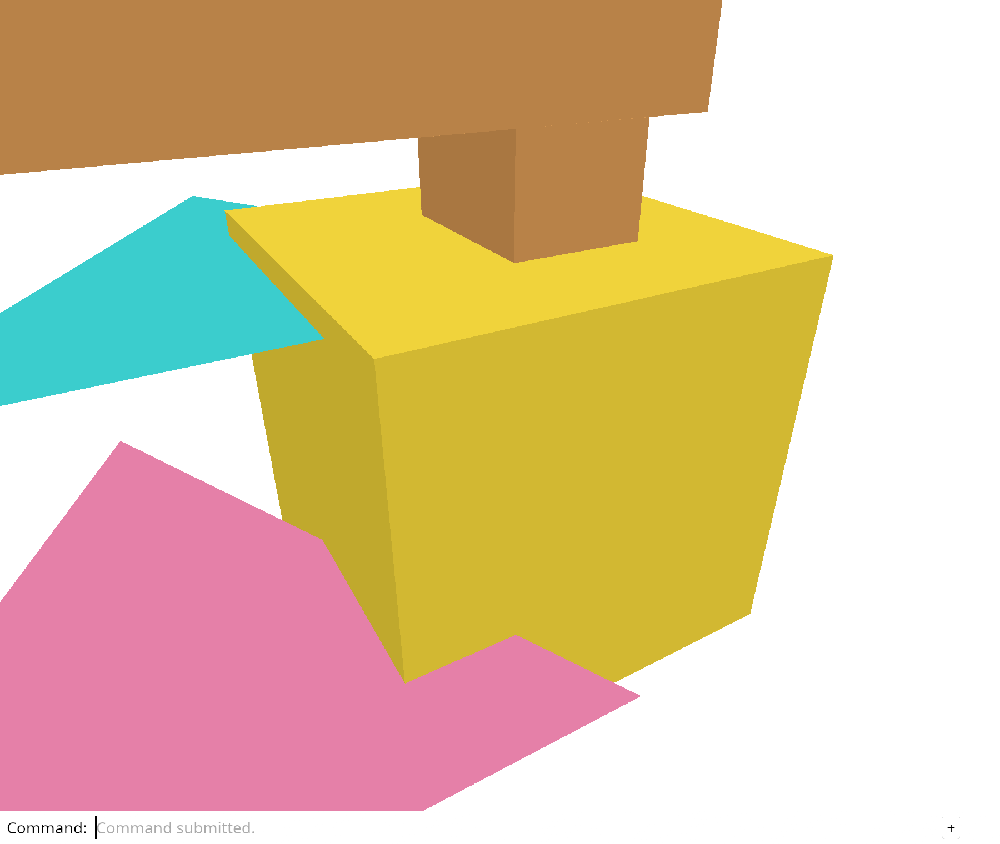

# 3.4 · Local sources, world placement and display caches

**Goal:** Connect local source geometry, display caches, provenance and document history. · **Steps:** 9 · **Source:** `src/app/decode.rs,src/app/loader.rs,src/state.rs`

<div class="webgpu-schematic" style="width:100%;margin:6px auto;">
<svg xmlns="http://www.w3.org/2000/svg" width="1120" height="200" viewBox="0 0 1120 200" style="width:100%;max-width:100%;height:auto;display:block;margin:0 auto;" role="img">
  <defs>
    <marker id="arr" viewBox="0 0 10 10" refX="8" refY="5" markerWidth="6" markerHeight="6" orient="auto">
      <path d="M 0 1 L 9 5 L 0 9 z" fill="#111111"/>
    </marker>
    <marker id="arrR" viewBox="0 0 10 10" refX="8" refY="5" markerWidth="6" markerHeight="6" orient="auto">
      <path d="M 0 1 L 9 5 L 0 9 z" fill="#dc2626"/>
    </marker>
    <marker id="arrG" viewBox="0 0 10 10" refX="8" refY="5" markerWidth="6" markerHeight="6" orient="auto">
      <path d="M 0 1 L 9 5 L 0 9 z" fill="#16a34a"/>
    </marker>
    <marker id="arrB" viewBox="0 0 10 10" refX="8" refY="5" markerWidth="6" markerHeight="6" orient="auto">
      <path d="M 0 1 L 9 5 L 0 9 z" fill="#2563eb"/>
    </marker>
  </defs>
  <rect x="2" y="2" width="1116" height="196" rx="10" fill="#ffffff" stroke="#111111" stroke-width="2"/>
  <rect x="16" y="14" width="248" height="172" rx="8" fill="#ffffff" stroke="#111111" stroke-width="1.75"/>
  <text paint-order="stroke fill" stroke="#ffffff" stroke-width="5" stroke-linejoin="round" x="140" y="34" text-anchor="middle" font-family="monospace" font-size="11.5" font-weight="700" fill="#111111">1. Lesson 3.4 Code</text>
  <rect x="34" y="48" width="212" height="24" rx="4" fill="#ffffff" stroke="#111111" stroke-width="1.25"/>
  <text paint-order="stroke fill" stroke="#ffffff" stroke-width="5" stroke-linejoin="round" x="140" y="64" text-anchor="middle" font-family="monospace" font-size="10" font-weight="700" fill="#111111">src/scene.rs</text>
  <rect x="34" y="78" width="212" height="24" rx="4" fill="#ffffff" stroke="#111111" stroke-width="1.5"/>
  <text paint-order="stroke fill" stroke="#ffffff" stroke-width="5" stroke-linejoin="round" x="140" y="94" text-anchor="middle" font-family="monospace" font-size="10" font-weight="700" fill="#111111">src/lib.rs</text>
  <rect x="34" y="108" width="212" height="24" rx="4" fill="#ffffff" stroke="#111111" stroke-width="1.25"/>
  <text paint-order="stroke fill" stroke="#ffffff" stroke-width="5" stroke-linejoin="round" x="140" y="124" text-anchor="middle" font-family="monospace" font-size="10" font-weight="700" fill="#111111">src/placement_tests.rs</text>
  <text paint-order="stroke fill" stroke="#ffffff" stroke-width="5" stroke-linejoin="round" x="140" y="172" text-anchor="middle" font-family="monospace" font-size="9.5" fill="#111111">9 Coding Steps</text>
  <line x1="264" y1="100" x2="292" y2="100" stroke="#111111" stroke-width="2" marker-end="url(#arr)"/>
  <rect x="296" y="14" width="248" height="172" rx="8" fill="#ffffff" stroke="#111111" stroke-width="1.75"/>
  <text paint-order="stroke fill" stroke="#ffffff" stroke-width="5" stroke-linejoin="round" x="420" y="34" text-anchor="middle" font-family="monospace" font-size="11.5" font-weight="700" fill="#111111">2. session_viewer/src</text>
  <rect x="314" y="48" width="212" height="26" rx="4" fill="#ffffff" stroke="#111111" stroke-width="1.5"/>
  <text paint-order="stroke fill" stroke="#ffffff" stroke-width="5" stroke-linejoin="round" x="420" y="65" text-anchor="middle" font-family="monospace" font-size="10" font-weight="700" fill="#111111">src/app/decode.rs</text>
  <rect x="314" y="80" width="212" height="26" rx="4" fill="#ffffff" stroke="#111111" stroke-width="1.5"/>
  <text paint-order="stroke fill" stroke="#ffffff" stroke-width="5" stroke-linejoin="round" x="420" y="97" text-anchor="middle" font-family="monospace" font-size="10" font-weight="700" fill="#111111">src/app/loader.rs</text>
  <rect x="314" y="112" width="212" height="24" rx="4" fill="#ffffff" stroke="#111111" stroke-width="1.5"/>
  <text paint-order="stroke fill" stroke="#ffffff" stroke-width="5" stroke-linejoin="round" x="420" y="128" text-anchor="middle" font-family="monospace" font-size="9.5" font-weight="700" fill="#111111">✓ cargo check (wasm32)</text>
  <text paint-order="stroke fill" stroke="#ffffff" stroke-width="5" stroke-linejoin="round" x="420" y="172" text-anchor="middle" font-family="sans-serif" font-size="10" fill="#111111">Give each object a placem…</text>
  <line x1="544" y1="100" x2="572" y2="100" stroke="#111111" stroke-width="2" marker-end="url(#arr)"/>
  <rect x="576" y="14" width="248" height="172" rx="8" fill="#ffffff" stroke="#111111" stroke-width="1.75"/>
  <text paint-order="stroke fill" stroke="#ffffff" stroke-width="5" stroke-linejoin="round" x="700" y="34" text-anchor="middle" font-family="monospace" font-size="11.5" font-weight="700" fill="#111111">3. Placed Kernel Mesh (.pb)</text>
  <rect x="598" y="62" width="66" height="56" rx="5" fill="#ffffff" stroke="#111111" stroke-width="1.75"/>
  <text paint-order="stroke fill" stroke="#ffffff" stroke-width="5" stroke-linejoin="round" x="631" y="88" text-anchor="middle" font-family="monospace" font-size="10" font-weight="700" fill="#111111">.pb</text>
  <text paint-order="stroke fill" stroke="#ffffff" stroke-width="5" stroke-linejoin="round" x="631" y="104" text-anchor="middle" font-family="monospace" font-size="9" fill="#111111">Decode</text>
  <line x1="664" y1="90" x2="704" y2="90" stroke="#111111" stroke-width="1.75" marker-end="url(#arr)"/>
  <polygon points="716,128 760,54 804,128" fill="#ffffff" stroke="#111111" stroke-width="2"/>
  <line x1="716" y1="128" x2="760" y2="100" stroke="#111111" stroke-width="1.25" stroke-dasharray="3 3"/>
  <line x1="804" y1="128" x2="760" y2="100" stroke="#111111" stroke-width="1.25" stroke-dasharray="3 3"/>
  <line x1="760" y1="54" x2="760" y2="100" stroke="#111111" stroke-width="1.25" stroke-dasharray="3 3"/>
  <text paint-order="stroke fill" stroke="#ffffff" stroke-width="5" stroke-linejoin="round" x="700" y="172" text-anchor="middle" font-family="monospace" font-size="9.5" fill="#111111">Local sources, world placem…</text>
  <line x1="824" y1="100" x2="852" y2="100" stroke="#111111" stroke-width="2" marker-end="url(#arr)"/>
  <rect x="856" y="14" width="248" height="172" rx="8" fill="#ffffff" stroke="#111111" stroke-width="1.75"/>
  <text paint-order="stroke fill" stroke="#ffffff" stroke-width="5" stroke-linejoin="round" x="980" y="34" text-anchor="middle" font-family="monospace" font-size="11.5" font-weight="700" fill="#111111">4. Incremental GPU Sync</text>
  <rect x="876" y="52" width="196" height="40" rx="5" fill="#ffffff" stroke="#111111" stroke-width="1.5"/>
  <text paint-order="stroke fill" stroke="#ffffff" stroke-width="5" stroke-linejoin="round" x="974" y="70" text-anchor="middle" font-family="monospace" font-size="10" font-weight="700" fill="#111111">sync_scene = false</text>
  <text paint-order="stroke fill" stroke="#ffffff" stroke-width="5" stroke-linejoin="round" x="974" y="84" text-anchor="middle" font-family="sans-serif" font-size="9.5" fill="#111111">Orbit: 64B Camera Only</text>
  <rect x="876" y="102" width="196" height="40" rx="5" fill="#ffffff" stroke="#111111" stroke-width="2"/>
  <text paint-order="stroke fill" stroke="#ffffff" stroke-width="5" stroke-linejoin="round" x="974" y="120" text-anchor="middle" font-family="monospace" font-size="10" font-weight="700" fill="#111111">sync_scene = true</text>
  <text paint-order="stroke fill" stroke="#ffffff" stroke-width="5" stroke-linejoin="round" x="974" y="134" text-anchor="middle" font-family="sans-serif" font-size="9.5" fill="#111111">Edit: Upload Dirty Buffers</text>
  <text paint-order="stroke fill" stroke="#ffffff" stroke-width="5" stroke-linejoin="round" x="980" y="172" text-anchor="middle" font-family="sans-serif" font-size="10" font-weight="700" fill="#111111">Prove source ownership su…</text>
</svg>
</div>

## <a id="checkpoint-27-placement"></a>1. Give each object a placement

<div class="webgpu-schematic" style="width:100%;margin:6px auto;">
<svg xmlns="http://www.w3.org/2000/svg" width="1120" height="72" viewBox="0 0 1120 72" style="width:100%;max-width:100%;height:auto;display:block;margin:0 auto;" role="img">
  <defs>
    <marker id="arr" viewBox="0 0 10 10" refX="8" refY="5" markerWidth="6" markerHeight="6" orient="auto">
      <path d="M 0 1 L 9 5 L 0 9 z" fill="#111111"/>
    </marker>
    <marker id="arrR" viewBox="0 0 10 10" refX="8" refY="5" markerWidth="6" markerHeight="6" orient="auto">
      <path d="M 0 1 L 9 5 L 0 9 z" fill="#dc2626"/>
    </marker>
    <marker id="arrG" viewBox="0 0 10 10" refX="8" refY="5" markerWidth="6" markerHeight="6" orient="auto">
      <path d="M 0 1 L 9 5 L 0 9 z" fill="#16a34a"/>
    </marker>
    <marker id="arrB" viewBox="0 0 10 10" refX="8" refY="5" markerWidth="6" markerHeight="6" orient="auto">
      <path d="M 0 1 L 9 5 L 0 9 z" fill="#2563eb"/>
    </marker>
  </defs>
  <rect x="2" y="2" width="1116" height="68" rx="10" fill="#ffffff" stroke="#111111" stroke-width="2"/>
  <rect x="14" y="10" width="252" height="52" rx="6" fill="#ffffff" stroke="#111111" stroke-width="1.5"/>
  <text paint-order="stroke fill" stroke="#ffffff" stroke-width="5" stroke-linejoin="round" x="140" y="30" text-anchor="middle" font-family="monospace" font-size="10.5" font-weight="700" fill="#111111">Step 1 of 9</text>
  <text paint-order="stroke fill" stroke="#ffffff" stroke-width="5" stroke-linejoin="round" x="140" y="48" text-anchor="middle" font-family="monospace" font-size="9.5" fill="#111111">src/scene.rs, src/lib.rs</text>
  <line x1="266" y1="36" x2="292" y2="36" stroke="#111111" stroke-width="1.75" marker-end="url(#arr)"/>
  <rect x="296" y="10" width="252" height="52" rx="6" fill="#ffffff" stroke="#111111" stroke-width="1.5"/>
  <text paint-order="stroke fill" stroke="#ffffff" stroke-width="5" stroke-linejoin="round" x="422" y="30" text-anchor="middle" font-family="monospace" font-size="10" font-weight="700" fill="#111111">1. CPU / Rust Input</text>
  <text paint-order="stroke fill" stroke="#ffffff" stroke-width="5" stroke-linejoin="round" x="422" y="48" text-anchor="middle" font-family="sans-serif" font-size="9.5" fill="#111111">Local vertex</text>
  <line x1="548" y1="36" x2="574" y2="36" stroke="#111111" stroke-width="1.75" marker-end="url(#arr)"/>
  <rect x="578" y="10" width="252" height="52" rx="6" fill="#ffffff" stroke="#111111" stroke-width="1.5"/>
  <text paint-order="stroke fill" stroke="#ffffff" stroke-width="5" stroke-linejoin="round" x="704" y="30" text-anchor="middle" font-family="monospace" font-size="10" font-weight="700" fill="#111111">2. WebGPU / WGSL</text>
  <text paint-order="stroke fill" stroke="#ffffff" stroke-width="5" stroke-linejoin="round" x="704" y="48" text-anchor="middle" font-family="sans-serif" font-size="9.5" fill="#111111">placement matrix</text>
  <line x1="830" y1="36" x2="856" y2="36" stroke="#111111" stroke-width="1.75" marker-end="url(#arr)"/>
  <rect x="860" y="10" width="246" height="52" rx="6" fill="#ffffff" stroke="#111111" stroke-width="1.75"/>
  <text paint-order="stroke fill" stroke="#ffffff" stroke-width="5" stroke-linejoin="round" x="983" y="30" text-anchor="middle" font-family="monospace" font-size="10" font-weight="700" fill="#111111">3. -&gt; src/app/decode.rs</text>
  <text paint-order="stroke fill" stroke="#ffffff" stroke-width="5" stroke-linejoin="round" x="983" y="48" text-anchor="middle" font-family="sans-serif" font-size="9.5" fill="#111111">world point</text>
</svg>
</div>

**What this code does:** Keep local mesh coordinates and an independent object placement.

### 1. `src/scene.rs`

Store one placement beside the shared local mesh. Transform position only; return world coordinates without changing the mesh. Identity preserves the behavior of all existing objects. Check the placement before mutating the object found by its stable ID.

Edit these blocks from bottom to top. Keep the surrounding lines unchanged.

**Locate this block:**

```rust
            });
        }
        Ok(())
```

Replace it with:

```rust
            });
        }
        Ok(())
    }

    pub fn place(
        &mut self,
        id: ObjectId,
        model: session_rust::Xform,
    ) -> Result<(), &'static str> {
        if !model.m.iter().all(|v| v.is_finite())
            || [
                model.m[3],
                model.m[7],
                model.m[11],
                model.m[15],
            ] != [0.0, 0.0, 0.0, 1.0]
        {
            return Err("Placement must be finite and affine");
        }
        let object = self
            .objects
            .iter_mut()
            .find(|o| o.id == id)
            .ok_or("Object not found")?;
        object.model = model;
        Ok(())
```

**Locate this block:**

```rust
        self.objects.push(Object {
            id,
            mesh: Rc::new(mesh),
            source: None,
        });
        Ok(id)
```

Replace it with:

```rust
        self.objects.push(Object {
            id,
            mesh: Rc::new(mesh),
            model: session_rust::Xform::identity(),
            source: None,
        });
        Ok(id)
```

**Locate this block:**

```rust
    pub mesh: Rc<Mesh>,
    pub source: Option<crate::document::Source>,
}

#[derive(Clone)]
pub struct Scene {
    objects: Vec<Object>,
```

Replace it with:

```rust
    pub mesh: Rc<Mesh>,
    pub model: session_rust::Xform,
    pub source: Option<crate::document::Source>,
}

impl Object {
    pub fn world_point(&self, vertex: [f32; 6]) -> [f64; 3] {
        let local = session_rust::Point::new(
            vertex[0] as f64,
            vertex[1] as f64,
            vertex[2] as f64,
        );
        let world = self.model.transform_point(&local);
        [world[0], world[1], world[2]]
    }
}

#[derive(Clone)]
pub struct Scene {
    objects: Vec<Object>,
```

### 2. `src/lib.rs`

Register the placement checks.

**Locate this existing block:**

```rust
#[cfg(test)]
mod projection_tests;
```

Edit the existing block to match this code; keep unchanged lines:

```rust
#[cfg(test)]
mod placement_tests;
#[cfg(test)]
mod projection_tests;
```

### 3. `src/placement_tests.rs`

Optional authoring fixture. Prove mesh identity and local coordinates survive placement, and failed updates leave it unchanged.

Create the file and type:

```rust
use crate::scene::Scene;
use session_rust::Xform;

#[test]
fn placement_keeps_the_shared_local_mesh() {
    let mut scene = Scene::demo();
    let object = &scene.objects()[0];
    let id = object.id;
    let mesh = object.mesh.clone();
    let local = mesh.vertices()[0];
    scene
        .place(id, Xform::translation(2.0, -1.0, 0.5))
        .unwrap();
    let object = &scene.objects()[0];
    assert!(std::rc::Rc::ptr_eq(&mesh, &object.mesh));
    assert_eq!(object.mesh.vertices()[0], local);
    assert_eq!(
        object.world_point(local),
        [
            local[0] as f64 + 2.0,
            local[1] as f64 - 1.0,
            local[2] as f64 + 0.5
        ]
    );
}

#[test]
fn failed_placement_changes_nothing() {
    let mut scene = Scene::demo();
    let id = scene.objects()[0].id;
    let before = scene.objects()[0].model.m;
    assert!(
        scene
            .place(id, Xform::translation(f64::NAN, 0.0, 0.0))
            .is_err()
    );
    let mut projective = Xform::identity();
    projective.m[3] = 0.1;
    assert!(scene.place(id, projective).is_err());
    assert_eq!(scene.objects()[0].model.m, before);
    scene.remove(id);
    assert!(scene.place(id, Xform::identity()).is_err());
}
```

## <a id="checkpoint-27a-world"></a>2. Ask geometry questions in world coordinates

<div class="webgpu-schematic" style="width:100%;margin:6px auto;">
<svg xmlns="http://www.w3.org/2000/svg" width="1120" height="72" viewBox="0 0 1120 72" style="width:100%;max-width:100%;height:auto;display:block;margin:0 auto;" role="img">
  <defs>
    <marker id="arr" viewBox="0 0 10 10" refX="8" refY="5" markerWidth="6" markerHeight="6" orient="auto">
      <path d="M 0 1 L 9 5 L 0 9 z" fill="#111111"/>
    </marker>
    <marker id="arrR" viewBox="0 0 10 10" refX="8" refY="5" markerWidth="6" markerHeight="6" orient="auto">
      <path d="M 0 1 L 9 5 L 0 9 z" fill="#dc2626"/>
    </marker>
    <marker id="arrG" viewBox="0 0 10 10" refX="8" refY="5" markerWidth="6" markerHeight="6" orient="auto">
      <path d="M 0 1 L 9 5 L 0 9 z" fill="#16a34a"/>
    </marker>
    <marker id="arrB" viewBox="0 0 10 10" refX="8" refY="5" markerWidth="6" markerHeight="6" orient="auto">
      <path d="M 0 1 L 9 5 L 0 9 z" fill="#2563eb"/>
    </marker>
  </defs>
  <rect x="2" y="2" width="1116" height="68" rx="10" fill="#ffffff" stroke="#111111" stroke-width="2"/>
  <rect x="14" y="10" width="252" height="52" rx="6" fill="#ffffff" stroke="#111111" stroke-width="1.5"/>
  <text paint-order="stroke fill" stroke="#ffffff" stroke-width="5" stroke-linejoin="round" x="140" y="30" text-anchor="middle" font-family="monospace" font-size="10.5" font-weight="700" fill="#111111">Step 2 of 9</text>
  <text paint-order="stroke fill" stroke="#ffffff" stroke-width="5" stroke-linejoin="round" x="140" y="48" text-anchor="middle" font-family="monospace" font-size="9.5" fill="#111111">src/scene.rs, src/picking.rs</text>
  <line x1="266" y1="36" x2="292" y2="36" stroke="#111111" stroke-width="1.75" marker-end="url(#arr)"/>
  <rect x="296" y="10" width="252" height="52" rx="6" fill="#ffffff" stroke="#111111" stroke-width="1.5"/>
  <text paint-order="stroke fill" stroke="#ffffff" stroke-width="5" stroke-linejoin="round" x="422" y="30" text-anchor="middle" font-family="monospace" font-size="10" font-weight="700" fill="#111111">1. CPU / Rust Input</text>
  <text paint-order="stroke fill" stroke="#ffffff" stroke-width="5" stroke-linejoin="round" x="422" y="48" text-anchor="middle" font-family="sans-serif" font-size="9.5" fill="#111111">Object placement</text>
  <line x1="548" y1="36" x2="574" y2="36" stroke="#111111" stroke-width="1.75" marker-end="url(#arr)"/>
  <rect x="578" y="10" width="252" height="52" rx="6" fill="#ffffff" stroke="#111111" stroke-width="1.5"/>
  <text paint-order="stroke fill" stroke="#ffffff" stroke-width="5" stroke-linejoin="round" x="704" y="30" text-anchor="middle" font-family="monospace" font-size="10" font-weight="700" fill="#111111">2. WebGPU / WGSL</text>
  <text paint-order="stroke fill" stroke="#ffffff" stroke-width="5" stroke-linejoin="round" x="704" y="48" text-anchor="middle" font-family="sans-serif" font-size="9.5" fill="#111111">world vertices</text>
  <line x1="830" y1="36" x2="856" y2="36" stroke="#111111" stroke-width="1.75" marker-end="url(#arr)"/>
  <rect x="860" y="10" width="246" height="52" rx="6" fill="#fef9c3" stroke="#111111" stroke-width="1.75"/>
  <text paint-order="stroke fill" stroke="#ffffff" stroke-width="5" stroke-linejoin="round" x="983" y="30" text-anchor="middle" font-family="monospace" font-size="10" font-weight="700" fill="#111111">3. -&gt; src/app/decode.rs</text>
  <text paint-order="stroke fill" stroke="#ffffff" stroke-width="5" stroke-linejoin="round" x="983" y="48" text-anchor="middle" font-family="sans-serif" font-size="9.5" fill="#111111">bounds or ray/triangle qu…</text>
</svg>
</div>

**What this code does:** Use placement for scene bounds, selected bounds and ray picking.

### 1. `src/scene.rs`

Whole-scene bounds include placed points. Use the same placed coordinates for fitting the selected object.

**Locate this existing block:**

```rust
            for vertex in object.mesh.vertices() {
                let point = [
                    vertex[0] as f64,
                    vertex[1] as f64,
                    vertex[2] as f64,
                ];
                match &mut bounds {
                    Some(bounds) => bounds.include(point),
                    None => bounds = Some(crate::bounds::Bounds::point(point)),
                }
            }
        }
        bounds
    }

    pub fn selected_bounds(&self, id: ObjectId) -> Option<crate::bounds::Bounds> {
        let object = self
            .objects
            .iter()
            .find(|object| object.id == id)?;
        let mut vertices = object.mesh.vertices().iter();
        let first = vertices.next()?;
        let mut bounds = crate::bounds::Bounds::point([
            first[0] as f64,
            first[1] as f64,
            first[2] as f64,
        ]);
        for vertex in vertices {
            bounds.include([
                vertex[0] as f64,
                vertex[1] as f64,
                vertex[2] as f64,
            ]);
        }
```

Edit the existing block to match this code; keep unchanged lines:

```rust
            for vertex in object.mesh.vertices() {
                let point = object.world_point(*vertex);
                match &mut bounds {
                    Some(bounds) => bounds.include(point),
                    None => bounds = Some(crate::bounds::Bounds::point(point)),
                }
            }
        }
        bounds
    }

    pub fn selected_bounds(&self, id: ObjectId) -> Option<crate::bounds::Bounds> {
        let object = self
            .objects
            .iter()
            .find(|object| object.id == id)?;
        let mut vertices = object.mesh.vertices().iter();
        let first = vertices.next()?;
        let mut bounds = crate::bounds::Bounds::point(object.world_point(*first));
        for vertex in vertices {
            bounds.include(object.world_point(*vertex));
        }
```

### 2. `src/picking.rs`

Ask whether the world ray hits the placed triangle. Compute differences in the double-precision coordinates supplied by placement. Build the triangle origin from the same world point.

**Locate this existing block:**

```rust
        for triangle in object.mesh.indices().chunks_exact(3) {
            let a = vertices[triangle[0] as usize];
            let b = vertices[triangle[1] as usize];
            let c = vertices[triangle[2] as usize];
            if let Some(distance) = triangle_distance(ray, a, b, c) {
                if distance >= 0.0 && distance < nearest {
                    nearest = distance;
                    hit = Some(object.id);
                }
            }
        }
    }
    hit
}

fn triangle_distance(ray: &Ray, a: [f32; 6], b: [f32; 6], c: [f32; 6]) -> Option<f64> {
    let edge1 = Vector::new(
        (b[0] - a[0]) as f64,
        (b[1] - a[1]) as f64,
        (b[2] - a[2]) as f64,
    );
    let edge2 = Vector::new(
        (c[0] - a[0]) as f64,
        (c[1] - a[1]) as f64,
        (c[2] - a[2]) as f64,
    );
    let p = ray.direction.cross(&edge2);
    let determinant = edge1.dot(&p);
    if determinant.abs() < 1.0e-10 {
        return None;
    }
    let origin = &ray.origin - &Point::new(a[0] as f64, a[1] as f64, a[2] as f64);
    let u = origin.dot(&p) / determinant;
```

Edit the existing block to match this code; keep unchanged lines:

```rust
        for triangle in object.mesh.indices().chunks_exact(3) {
            let a = object.world_point(vertices[triangle[0] as usize]);
            let b = object.world_point(vertices[triangle[1] as usize]);
            let c = object.world_point(vertices[triangle[2] as usize]);
            if let Some(distance) = triangle_distance(ray, a, b, c) {
                if distance >= 0.0 && distance < nearest {
                    nearest = distance;
                    hit = Some(object.id);
                }
            }
        }
    }
    hit
}

fn triangle_distance(ray: &Ray, a: [f64; 3], b: [f64; 3], c: [f64; 3]) -> Option<f64> {
    let edge1 = Vector::new(b[0] - a[0], b[1] - a[1], b[2] - a[2]);
    let edge2 = Vector::new(c[0] - a[0], c[1] - a[1], c[2] - a[2]);
    let p = ray.direction.cross(&edge2);
    let determinant = edge1.dot(&p);
    if determinant.abs() < 1.0e-10 {
        return None;
    }
    let origin = &ray.origin - &Point::new(a[0], a[1], a[2]);
    let u = origin.dot(&p) / determinant;
```

### 3. `src/placement_tests.rs`

Optional authoring fixture. Connect placement, both bounds and camera-ray picking in one state check.

**Locate this existing block:**

```rust
#[test]
fn placement_keeps_the_shared_local_mesh() {
```

Edit the existing block to match this code; keep unchanged lines:

```rust
#[test]
fn bounds_and_picking_follow_the_placed_triangle() {
    let mut scene = Scene::demo();
    let id = scene.objects()[0].id;
    let before = scene.selected_bounds(id).unwrap();
    scene
        .place(id, Xform::translation(2.0, -1.0, 0.5))
        .unwrap();
    let bounds = scene.selected_bounds(id).unwrap();
    for i in 0..3 {
        assert!((bounds.min[i] - before.min[i] - [2.0, -1.0, 0.5][i]).abs() < 1e-12);
        assert!((bounds.max[i] - before.max[i] - [2.0, -1.0, 0.5][i]).abs() < 1e-12);
    }
    let object = &scene.objects()[0];
    let mut centre = [0.0; 3];
    for v in object.mesh.vertices() {
        let world = object.world_point(*v);
        for i in 0..3 {
            centre[i] += world[i] / 3.0;
        }
    }
    let mut camera = crate::camera::Camera::default();
    camera.fit(&bounds);
    let point = session_rust::Point::new(centre[0], centre[1], centre[2]);
    let screen = camera
        .view_projection()
        .transform_point(&point);
    let ray = camera
        .ray([screen[0] as f32, screen[1] as f32])
        .unwrap();
    assert_eq!(crate::picking::pick(&scene, &ray), Some(id));
    let all = scene.bounds().unwrap();
    assert!(all.max[0] >= bounds.max[0] && all.min[1] <= bounds.min[1]);
}

#[test]
fn placement_keeps_the_shared_local_mesh() {
```

## <a id="checkpoint-27b-model"></a>3. Apply object placement on the GPU

<div class="webgpu-schematic" style="width:100%;margin:6px auto;">
<svg xmlns="http://www.w3.org/2000/svg" width="1120" height="72" viewBox="0 0 1120 72" style="width:100%;max-width:100%;height:auto;display:block;margin:0 auto;" role="img">
  <defs>
    <marker id="arr" viewBox="0 0 10 10" refX="8" refY="5" markerWidth="6" markerHeight="6" orient="auto">
      <path d="M 0 1 L 9 5 L 0 9 z" fill="#111111"/>
    </marker>
    <marker id="arrR" viewBox="0 0 10 10" refX="8" refY="5" markerWidth="6" markerHeight="6" orient="auto">
      <path d="M 0 1 L 9 5 L 0 9 z" fill="#dc2626"/>
    </marker>
    <marker id="arrG" viewBox="0 0 10 10" refX="8" refY="5" markerWidth="6" markerHeight="6" orient="auto">
      <path d="M 0 1 L 9 5 L 0 9 z" fill="#16a34a"/>
    </marker>
    <marker id="arrB" viewBox="0 0 10 10" refX="8" refY="5" markerWidth="6" markerHeight="6" orient="auto">
      <path d="M 0 1 L 9 5 L 0 9 z" fill="#2563eb"/>
    </marker>
  </defs>
  <rect x="2" y="2" width="1116" height="68" rx="10" fill="#ffffff" stroke="#111111" stroke-width="2"/>
  <rect x="14" y="10" width="252" height="52" rx="6" fill="#ffffff" stroke="#111111" stroke-width="1.5"/>
  <text paint-order="stroke fill" stroke="#ffffff" stroke-width="5" stroke-linejoin="round" x="140" y="30" text-anchor="middle" font-family="monospace" font-size="10.5" font-weight="700" fill="#111111">Step 3 of 9</text>
  <text paint-order="stroke fill" stroke="#ffffff" stroke-width="5" stroke-linejoin="round" x="140" y="48" text-anchor="middle" font-family="monospace" font-size="9.5" fill="#111111">src/triangle.wgsl, src/gpu_…</text>
  <line x1="266" y1="36" x2="292" y2="36" stroke="#111111" stroke-width="1.75" marker-end="url(#arr)"/>
  <rect x="296" y="10" width="252" height="52" rx="6" fill="#ffffff" stroke="#111111" stroke-width="1.5"/>
  <text paint-order="stroke fill" stroke="#ffffff" stroke-width="5" stroke-linejoin="round" x="422" y="30" text-anchor="middle" font-family="monospace" font-size="10" font-weight="700" fill="#111111">1. CPU / Rust Input</text>
  <text paint-order="stroke fill" stroke="#ffffff" stroke-width="5" stroke-linejoin="round" x="422" y="48" text-anchor="middle" font-family="sans-serif" font-size="9.5" fill="#111111">Local vertex</text>
  <line x1="548" y1="36" x2="574" y2="36" stroke="#111111" stroke-width="1.75" marker-end="url(#arr)"/>
  <rect x="578" y="10" width="252" height="52" rx="6" fill="#ffffff" stroke="#111111" stroke-width="1.5"/>
  <text paint-order="stroke fill" stroke="#ffffff" stroke-width="5" stroke-linejoin="round" x="704" y="30" text-anchor="middle" font-family="monospace" font-size="10" font-weight="700" fill="#111111">2. WebGPU / WGSL</text>
  <text paint-order="stroke fill" stroke="#ffffff" stroke-width="5" stroke-linejoin="round" x="704" y="48" text-anchor="middle" font-family="sans-serif" font-size="9.5" fill="#111111">world point</text>
  <line x1="830" y1="36" x2="856" y2="36" stroke="#111111" stroke-width="1.75" marker-end="url(#arr)"/>
  <rect x="860" y="10" width="246" height="52" rx="6" fill="#ffffff" stroke="#111111" stroke-width="1.75"/>
  <text paint-order="stroke fill" stroke="#ffffff" stroke-width="5" stroke-linejoin="round" x="983" y="30" text-anchor="middle" font-family="monospace" font-size="10" font-weight="700" fill="#111111">3. -&gt; src/app/decode.rs</text>
  <text paint-order="stroke fill" stroke="#ffffff" stroke-width="5" stroke-linejoin="round" x="983" y="48" text-anchor="middle" font-family="sans-serif" font-size="9.5" fill="#111111">clip position</text>
</svg>
</div>

**What this code does:** Send a separate model matrix for each draw while retaining local vertex buffers.

### 1. `src/triangle.wgsl`

Keep camera and object placement in separate uniform groups. Place the vertex before projecting it; use world position for lighting.

**Locate this existing block:**

```wgsl
@group(0) @binding(0) var<uniform> transform: mat4x4<f32>;

struct VertexOutput {
    @builtin(position) position: vec4<f32>,
    @location(0) colour: vec3<f32>,
    @location(1) world: vec3<f32>,
}

@vertex
fn vertex(@location(0) position: vec3<f32>, @location(1) colour: vec3<f32>) -> VertexOutput {
    var output: VertexOutput;
    output.position = transform * vec4<f32>(position, 1.0);
    output.colour = colour;
    output.world = position;
    return output;
```

Edit the existing block to match this code; keep unchanged lines:

```wgsl
@group(0) @binding(0) var<uniform> transform: mat4x4<f32>;
@group(1) @binding(0) var<uniform> model: mat4x4<f32>;

struct VertexOutput {
    @builtin(position) position: vec4<f32>,
    @location(0) colour: vec3<f32>,
    @location(1) world: vec3<f32>,
}

@vertex
fn vertex(@location(0) position: vec3<f32>, @location(1) colour: vec3<f32>) -> VertexOutput {
    var output: VertexOutput;
    let world = model * vec4<f32>(position, 1.0);
    output.position = transform * world;
    output.colour = colour;
    output.world = world.xyz;
    return output;
```

### 2. `src/gpu_mesh.rs`

Upload an object’s mesh and placement together. Retain the object bind group alongside its vertex/index buffers. Borrow local mesh coordinates and the model from the same Object. Encode the model’s column-major values and bind the uniform buffer. Choose this object’s placement before its indexed draw.

**Locate this existing block:**

```rust
use crate::mesh::Mesh;
use wgpu::util::DeviceExt;

pub struct GpuMesh {
    vertices: wgpu::Buffer,
    indices: wgpu::Buffer,
    index_count: u32,
}

impl GpuMesh {
    pub fn upload(device: &wgpu::Device, mesh: &Mesh, selected: bool) -> Self {
        let mut bytes = Vec::with_capacity(mesh.vertices().len() * 24);
        for vertex in mesh.vertices() {
            let mut display = *vertex;
            if selected {
                display[3..].copy_from_slice(&[1.0, 0.75, 0.05]);
            }
            for value in display {
                bytes.extend_from_slice(&value.to_ne_bytes());
            }
        }
        let vertices = device.create_buffer_init(&wgpu::util::BufferInitDescriptor {
            label: Some("mesh vertices"),
            contents: &bytes,
            usage: wgpu::BufferUsages::VERTEX,
        });
        let bytes: Vec<u8> = mesh
            .indices()
            .iter()
            .flat_map(|index| index.to_ne_bytes())
            .collect();
        let indices = device.create_buffer_init(&wgpu::util::BufferInitDescriptor {
            label: Some("mesh indices"),
            contents: &bytes,
            usage: wgpu::BufferUsages::INDEX,
        });
        Self {
            vertices,
            indices,
            index_count: mesh.indices().len() as u32,
        }
    }

    pub fn draw(&self, pass: &mut wgpu::RenderPass<'_>) {
        pass.set_vertex_buffer(0, self.vertices.slice(..));
```

Edit the existing block to match this code; keep unchanged lines:

```rust
use crate::scene::Object;
use wgpu::util::DeviceExt;

pub struct GpuMesh {
    vertices: wgpu::Buffer,
    indices: wgpu::Buffer,
    index_count: u32,
    model_group: wgpu::BindGroup,
}

impl GpuMesh {
    pub fn upload(
        device: &wgpu::Device,
        layout: &wgpu::BindGroupLayout,
        object: &Object,
        selected: bool,
    ) -> Self {
        let mesh = &object.mesh;
        let mut bytes = Vec::with_capacity(mesh.vertices().len() * 24);
        for vertex in mesh.vertices() {
            let mut display = *vertex;
            if selected {
                display[3..].copy_from_slice(&[1.0, 0.75, 0.05]);
            }
            for value in display {
                bytes.extend_from_slice(&value.to_ne_bytes());
            }
        }
        let vertices = device.create_buffer_init(&wgpu::util::BufferInitDescriptor {
            label: Some("mesh vertices"),
            contents: &bytes,
            usage: wgpu::BufferUsages::VERTEX,
        });
        let bytes: Vec<u8> = mesh
            .indices()
            .iter()
            .flat_map(|index| index.to_ne_bytes())
            .collect();
        let indices = device.create_buffer_init(&wgpu::util::BufferInitDescriptor {
            label: Some("mesh indices"),
            contents: &bytes,
            usage: wgpu::BufferUsages::INDEX,
        });
        let bytes: Vec<u8> = object
            .model
            .m
            .iter()
            .flat_map(|value| (*value as f32).to_ne_bytes())
            .collect();
        let model = device.create_buffer_init(&wgpu::util::BufferInitDescriptor {
            label: Some("object placement"),
            contents: &bytes,
            usage: wgpu::BufferUsages::UNIFORM,
        });
        let model_group = device.create_bind_group(&wgpu::BindGroupDescriptor {
            label: Some("object placement"),
            layout,
            entries: &[wgpu::BindGroupEntry {
                binding: 0,
                resource: model.as_entire_binding(),
            }],
        });
        Self {
            vertices,
            indices,
            model_group,
            index_count: mesh.indices().len() as u32,
        }
    }

    pub fn draw(&self, pass: &mut wgpu::RenderPass<'_>) {
        pass.set_bind_group(1, &self.model_group, &[]);
        pass.set_vertex_buffer(0, self.vertices.slice(..));
```

### 3. `src/renderer.rs`

Remove the upload that ran before the pipeline layout was available. Upload objects using the model layout inferred from the shader. Include each placement when a scene update rebuilds the current uploads.

Edit these blocks from bottom to top. Keep the surrounding lines unchanged.

**Locate this block:**

```rust
    }

    pub fn set_scene(&mut self, scene: &Scene, selected: Option<ObjectId>) {
        self.meshes = scene
            .objects()
            .iter()
            .map(|object| {
                GpuMesh::upload(
                    &self.device,
                    &object.mesh,
                    selected == Some(object.id),
```

Replace it with:

```rust
    }

    pub fn set_scene(&mut self, scene: &Scene, selected: Option<ObjectId>) {
        let layout = self.pipeline.get_bind_group_layout(1);
        self.meshes = scene
            .objects()
            .iter()
            .map(|object| {
                GpuMesh::upload(
                    &self.device,
                    &layout,
                    object,
                    selected == Some(object.id),
```

**Locate this block:**

```rust
            multiview_mask: None,
            cache: None,
        });
        let uniform = device.create_buffer(&wgpu::BufferDescriptor {
            label: Some("view transform"),
            size: 64,
```

Replace it with:

```rust
            multiview_mask: None,
            cache: None,
        });
        let layout = pipeline.get_bind_group_layout(1);
        let meshes = scene
            .objects()
            .iter()
            .map(|object| GpuMesh::upload(&device, &layout, object, false))
            .collect();
        let uniform = device.create_buffer(&wgpu::BufferDescriptor {
            label: Some("view transform"),
            size: 64,
```

**Locate this block:**

```rust
    ) -> Self {
        let meshes = scene
            .objects()
            .iter()
            .map(|object| GpuMesh::upload(&device, &object.mesh, false))
            .collect();
        let shader = device.create_shader_module(wgpu::ShaderModuleDescriptor {
            label: Some("triangle"),
            source: wgpu::ShaderSource::Wgsl(include_str!("triangle.wgsl").into()),
```

Replace it with:

```rust
    ) -> Self {
        let shader = device.create_shader_module(wgpu::ShaderModuleDescriptor {
            label: Some("triangle"),
            source: wgpu::ShaderSource::Wgsl(include_str!("triangle.wgsl").into()),
```

### 4. `src/scene.rs`

Keep the generated box centred in its local coordinates. Assign its world placement after inserting the local mesh.

**Locate this existing block:**

```rust
        let mut source = session_rust::Mesh::create_box(0.8, 0.8, 0.8);
        source.transform(&session_rust::Xform::translation(
            0.9, 0.0, 0.4,
        ));
        source.set_objectcolor(session_rust::Color::new(
            0.65, 0.65, 0.65, 1.0,
        ));
        self.insert(Mesh::from_kernel(&source)?)
    }
```

Edit the existing block to match this code; keep unchanged lines:

```rust
        let mut source = session_rust::Mesh::create_box(0.8, 0.8, 0.8);
        source.set_objectcolor(session_rust::Color::new(
            0.65, 0.65, 0.65, 1.0,
        ));
        let id = self.insert(Mesh::from_kernel(&source)?)?;
        self.place(
            id,
            session_rust::Xform::translation(0.9, 0.0, 0.4),
        )?;
        Ok(id)
    }
```

## <a id="checkpoint-27c-move"></a>4. Move a placed object with a typed offset

<div class="webgpu-schematic" style="width:100%;margin:6px auto;">
<svg xmlns="http://www.w3.org/2000/svg" width="1120" height="72" viewBox="0 0 1120 72" style="width:100%;max-width:100%;height:auto;display:block;margin:0 auto;" role="img">
  <defs>
    <marker id="arr" viewBox="0 0 10 10" refX="8" refY="5" markerWidth="6" markerHeight="6" orient="auto">
      <path d="M 0 1 L 9 5 L 0 9 z" fill="#111111"/>
    </marker>
    <marker id="arrR" viewBox="0 0 10 10" refX="8" refY="5" markerWidth="6" markerHeight="6" orient="auto">
      <path d="M 0 1 L 9 5 L 0 9 z" fill="#dc2626"/>
    </marker>
    <marker id="arrG" viewBox="0 0 10 10" refX="8" refY="5" markerWidth="6" markerHeight="6" orient="auto">
      <path d="M 0 1 L 9 5 L 0 9 z" fill="#16a34a"/>
    </marker>
    <marker id="arrB" viewBox="0 0 10 10" refX="8" refY="5" markerWidth="6" markerHeight="6" orient="auto">
      <path d="M 0 1 L 9 5 L 0 9 z" fill="#2563eb"/>
    </marker>
  </defs>
  <rect x="2" y="2" width="1116" height="68" rx="10" fill="#ffffff" stroke="#111111" stroke-width="2"/>
  <rect x="14" y="10" width="252" height="52" rx="6" fill="#ffffff" stroke="#111111" stroke-width="1.5"/>
  <text paint-order="stroke fill" stroke="#ffffff" stroke-width="5" stroke-linejoin="round" x="140" y="30" text-anchor="middle" font-family="monospace" font-size="10.5" font-weight="700" fill="#111111">Step 4 of 9</text>
  <text paint-order="stroke fill" stroke="#ffffff" stroke-width="5" stroke-linejoin="round" x="140" y="48" text-anchor="middle" font-family="monospace" font-size="9.5" fill="#111111">src/lib.rs, src/offset.rs</text>
  <line x1="266" y1="36" x2="292" y2="36" stroke="#111111" stroke-width="1.75" marker-end="url(#arr)"/>
  <rect x="296" y="10" width="252" height="52" rx="6" fill="#ffffff" stroke="#111111" stroke-width="1.5"/>
  <text paint-order="stroke fill" stroke="#ffffff" stroke-width="5" stroke-linejoin="round" x="422" y="30" text-anchor="middle" font-family="monospace" font-size="10" font-weight="700" fill="#111111">1. CPU / Rust Input</text>
  <text paint-order="stroke fill" stroke="#ffffff" stroke-width="5" stroke-linejoin="round" x="422" y="48" text-anchor="middle" font-family="sans-serif" font-size="9.5" fill="#111111">Move x,y,z</text>
  <line x1="548" y1="36" x2="574" y2="36" stroke="#111111" stroke-width="1.75" marker-end="url(#arr)"/>
  <rect x="578" y="10" width="252" height="52" rx="6" fill="#ffffff" stroke="#111111" stroke-width="1.5"/>
  <text paint-order="stroke fill" stroke="#ffffff" stroke-width="5" stroke-linejoin="round" x="704" y="30" text-anchor="middle" font-family="monospace" font-size="10" font-weight="700" fill="#111111">2. WebGPU / WGSL</text>
  <text paint-order="stroke fill" stroke="#ffffff" stroke-width="5" stroke-linejoin="round" x="704" y="48" text-anchor="middle" font-family="sans-serif" font-size="9.5" fill="#111111">history transaction</text>
  <line x1="830" y1="36" x2="856" y2="36" stroke="#111111" stroke-width="1.75" marker-end="url(#arr)"/>
  <rect x="860" y="10" width="246" height="52" rx="6" fill="#fef9c3" stroke="#111111" stroke-width="1.75"/>
  <text paint-order="stroke fill" stroke="#ffffff" stroke-width="5" stroke-linejoin="round" x="983" y="30" text-anchor="middle" font-family="monospace" font-size="10" font-weight="700" fill="#111111">3. -&gt; src/app/decode.rs</text>
  <text paint-order="stroke fill" stroke="#ffffff" stroke-width="5" stroke-linejoin="round" x="983" y="48" text-anchor="middle" font-family="sans-serif" font-size="9.5" fill="#111111">GPU upload</text>
</svg>
</div>

**What this code does:** Translate selected geometry through the existing command and history route.

### 1. `src/lib.rs`

Register the small numeric parser.

**Locate this existing block:**

```rust
pub mod mesh;
pub mod picking;
```

Edit the existing block to match this code; keep unchanged lines:

```rust
pub mod mesh;
pub mod offset;
pub mod picking;
```

### 2. `src/offset.rs`

Validate a complete numeric offset before it reaches the document.

Create the file and type:

```rust
pub fn parse(line: &str) -> Result<[f64; 3], &'static str> {
    let mut words = line.split_whitespace();
    if !words
        .next()
        .is_some_and(|word| word.eq_ignore_ascii_case("Move"))
    {
        return Err("Expected Move x,y,z");
    }
    let rest = words.collect::<Vec<_>>().join(" ");
    let parts: Vec<_> = rest.split(',').collect();
    if parts.len() != 3 {
        return Err("Move needs three coordinates: x,y,z");
    }
    let mut values = [0.0; 3];
    for (value, text) in values.iter_mut().zip(parts) {
        *value = text
            .trim()
            .parse::<f64>()
            .map_err(|_| "Move coordinates must be numbers")?;
        if !value.is_finite() {
            return Err("Move coordinates must be finite");
        }
    }
    Ok(values)
}
```

### 3. `src/editor.rs`

Carry the offset as data in the existing Action enum. Move along world axes and commit one placement change through document history.

Edit these blocks from bottom to top. Keep the surrounding lines unchanged.

**Locate this block:**

```rust
                    .try_edit(&mut self.scene, |scene| {
                        scene.add_box().map(|_| ())
                    })?;
```

Replace it with:

```rust
                    .try_edit(&mut self.scene, |scene| {
                        scene.add_box().map(|_| ())
                    })?;
            }
            Action::Translate(offset) => {
                let id = self
                    .selected
                    .ok_or("Select an object before Move")?;
                if offset.iter().all(|&v| v == 0.0) {
                    return Ok(Change::View);
                }
                let object = self
                    .scene
                    .objects()
                    .iter()
                    .find(|o| o.id == id)
                    .ok_or("Object not found")?;
                let shift =
                    session_rust::Xform::translation(offset[0], offset[1], offset[2]);
                let model = &shift * &object.model;
                self.history
                    .try_edit(&mut self.scene, |scene| {
                        scene.place(id, model)
                    })?;
```

**Locate this block:**

```rust
    AddBox,
    ToggleExtra,
    SelectNext,
    Delete,
```

Replace it with:

```rust
    AddBox,
    Translate([f64; 3]),
    ToggleExtra,
    SelectNext,
    Delete,
```

### 4. `src/browser.rs`

Offer the named command in the dock vocabulary.

**Locate this existing block:**

```rust
            "Fit Selected",
            "View Reset",
```

Edit the existing block to match this code; keep unchanged lines:

```rust
            "Fit Selected",
            "Move",
            "View Reset",
```

### 5. `src/panel.rs`

Recognize Move followed by arguments; the parser validates those arguments. Replace the latest command’s answer without recording the line twice.

**Locate this existing block:**

```rust
    }

    pub fn update(
        &mut self,
        event: Option<&web_sys::Event>,
        canvas: &web_sys::HtmlCanvasElement,
    ) -> Result<Option<String>, wasm_bindgen::JsValue> {
        use wasm_bindgen::JsCast;
        let rect = canvas.get_bounding_client_rect();
        self.screen.size_in_pixels = [canvas.width(), canvas.height()];
        self.screen.pixels_per_point = canvas.width() as f32 / rect.width() as f32;
        self.consumed = false;
        if let Some(event) = event {
            if let Some(key) = event.dyn_ref::<web_sys::KeyboardEvent>() {
                self.consumed = self.key(key);
            }
            if let Some(pointer) = event.dyn_ref::<web_sys::PointerEvent>() {
                self.consumed = self.pointer(pointer, canvas);
                if event.type_() == "pointerdown" {
                    let options = web_sys::FocusOptions::new();
                    options.set_prevent_scroll(true);
                    canvas.focus_with_options(&options)?;
                    event.prevent_default();
                }
            }
            if let Some(wheel) = event.dyn_ref::<web_sys::WheelEvent>() {
                self.consumed = self.wheel(wheel, canvas);
            }
        }
        let line = self.prepare();
        canvas.set_attribute("data-command-ui", &self.inspect())?;
        let Some(line) = line else {
            return Ok(None);
        };
        if line == "Escape" {
            return Ok(None);
        }
        if line.eq_ignore_ascii_case("Help") {
            self.answer(&line, &self.commands.0.join(" · "));
            return Ok(None);
        }
        if !self
            .commands
            .0
            .iter()
            .any(|name| name.eq_ignore_ascii_case(&line))
        {
            self.answer(&line, "Unknown command. Type Help.");
```

Edit the existing block to match this code; keep unchanged lines:

```rust
    }

    pub fn result(&mut self, message: &str) {
        self.model.status = message.into();
        if let Some(last) = self.model.history.back_mut()
            && let Some(at) = last.find('\n')
        {
            last.truncate(at + 1);
            last.push_str(message);
        }
    }

    pub fn update(
        &mut self,
        event: Option<&web_sys::Event>,
        canvas: &web_sys::HtmlCanvasElement,
    ) -> Result<Option<String>, wasm_bindgen::JsValue> {
        use wasm_bindgen::JsCast;
        let rect = canvas.get_bounding_client_rect();
        self.screen.size_in_pixels = [canvas.width(), canvas.height()];
        self.screen.pixels_per_point = canvas.width() as f32 / rect.width() as f32;
        self.consumed = false;
        if let Some(event) = event {
            if let Some(key) = event.dyn_ref::<web_sys::KeyboardEvent>() {
                self.consumed = self.key(key);
            }
            if let Some(pointer) = event.dyn_ref::<web_sys::PointerEvent>() {
                self.consumed = self.pointer(pointer, canvas);
                if event.type_() == "pointerdown" {
                    let options = web_sys::FocusOptions::new();
                    options.set_prevent_scroll(true);
                    canvas.focus_with_options(&options)?;
                    event.prevent_default();
                }
            }
            if let Some(wheel) = event.dyn_ref::<web_sys::WheelEvent>() {
                self.consumed = self.wheel(wheel, canvas);
            }
        }
        let line = self.prepare();
        canvas.set_attribute("data-command-ui", &self.inspect())?;
        let Some(line) = line else {
            return Ok(None);
        };
        if line == "Escape" {
            return Ok(None);
        }
        if line.eq_ignore_ascii_case("Help") {
            self.answer(&line, &self.commands.0.join(" · "));
            return Ok(None);
        }
        if !self.commands.0.iter().any(|name| {
            name.eq_ignore_ascii_case(&line)
                || (*name == "Move"
                    && line
                        .to_ascii_lowercase()
                        .starts_with("move "))
        }) {
            self.answer(&line, "Unknown command. Type Help.");
```

### 6. `src/browser.rs`

A valid offset becomes an Action; a parse error becomes a dock answer and still redraws. Display editing failures in the command dock and continue to its normal redraw.

**Locate this existing block:**

```rust
                    None
                } else {
                    let action = match line.as_str() {
                        "example box" => Action::AddBox,
                        "example triangle" => Action::ToggleExtra,
                        "select next" => Action::SelectNext,
                        "delete" => Action::Delete,
                        "undo" => Action::Undo,
                        "redo" => Action::Redo,
                        "background" => Action::Background,
                        "zoom in" => Action::Zoom(2.0),
                        "zoom out" => Action::Zoom(0.5),
                        "pan left" => Action::Pan(-0.25, 0.0),
                        "pan right" => Action::Pan(0.25, 0.0),
                        "orbit right" => {
                            Action::Orbit(std::f64::consts::FRAC_PI_4, 0.0)
                        }
                        "orbit up" => Action::Orbit(0.0, std::f64::consts::FRAC_PI_6),
                        "view isometric" => Action::Isometric,
                        "view perspective" => {
                            Action::Projection(crate::camera::Projection::Perspective)
                        }
                        "view orthographic" => {
                            Action::Projection(crate::camera::Projection::Orthographic)
                        }
                        "fit" if shortcut.is_some() && editor.selected.is_some() => {
                            Action::FitSelected
                        }
                        "fit" => Action::Fit,

                        "fit selected" => Action::FitSelected,
                        "view reset" => Action::ResetView,
                        _ => return,
                    };
                    Some(action)
                }
            } else if !panel.consumed {
                navigation_action(&event, &pointer_canvas, &mut gesture)
            } else {
                None
            };
            if let Some(action) = action {
                match editor.apply(action) {
                    Ok(Change::Scene) => {
                        renderer.set_scene(&editor.scene, editor.selected)
                    }
                    Ok(Change::View) => {}
                    Err(error) => {
                        report(error);
                        return;
                    }
```

Edit the existing block to match this code; keep unchanged lines:

```rust
                    None
                } else if line == "move" || line.starts_with("move ") {
                    match crate::offset::parse(&line) {
                        Ok(offset) => Some(Action::Translate(offset)),
                        Err(error) => {
                            panel.result(error);
                            None
                        }
                    }
                } else {
                    let action = match line.as_str() {
                        "example box" => Action::AddBox,
                        "example triangle" => Action::ToggleExtra,
                        "select next" => Action::SelectNext,
                        "delete" => Action::Delete,
                        "undo" => Action::Undo,
                        "redo" => Action::Redo,
                        "background" => Action::Background,
                        "zoom in" => Action::Zoom(2.0),
                        "zoom out" => Action::Zoom(0.5),
                        "pan left" => Action::Pan(-0.25, 0.0),
                        "pan right" => Action::Pan(0.25, 0.0),
                        "orbit right" => {
                            Action::Orbit(std::f64::consts::FRAC_PI_4, 0.0)
                        }
                        "orbit up" => Action::Orbit(0.0, std::f64::consts::FRAC_PI_6),
                        "view isometric" => Action::Isometric,
                        "view perspective" => {
                            Action::Projection(crate::camera::Projection::Perspective)
                        }
                        "view orthographic" => {
                            Action::Projection(crate::camera::Projection::Orthographic)
                        }
                        "fit" if shortcut.is_some() && editor.selected.is_some() => {
                            Action::FitSelected
                        }
                        "fit" => Action::Fit,

                        "fit selected" => Action::FitSelected,
                        "view reset" => Action::ResetView,
                        _ => return,
                    };
                    Some(action)
                }
            } else if !panel.consumed {
                navigation_action(&event, &pointer_canvas, &mut gesture)
            } else {
                None
            };
            if let Some(action) = action {
                match editor.apply(action) {
                    Ok(Change::Scene) => {
                        renderer.set_scene(&editor.scene, editor.selected)
                    }
                    Ok(Change::View) => {}
                    Err(error) => {
                        report(error);
                        panel.result(error);
                    }
```

## <a id="checkpoint-27d-history"></a>5. Prove placement and history agree

<div class="webgpu-schematic" style="width:100%;margin:6px auto;">
<svg xmlns="http://www.w3.org/2000/svg" width="1120" height="72" viewBox="0 0 1120 72" style="width:100%;max-width:100%;height:auto;display:block;margin:0 auto;" role="img">
  <defs>
    <marker id="arr" viewBox="0 0 10 10" refX="8" refY="5" markerWidth="6" markerHeight="6" orient="auto">
      <path d="M 0 1 L 9 5 L 0 9 z" fill="#111111"/>
    </marker>
    <marker id="arrR" viewBox="0 0 10 10" refX="8" refY="5" markerWidth="6" markerHeight="6" orient="auto">
      <path d="M 0 1 L 9 5 L 0 9 z" fill="#dc2626"/>
    </marker>
    <marker id="arrG" viewBox="0 0 10 10" refX="8" refY="5" markerWidth="6" markerHeight="6" orient="auto">
      <path d="M 0 1 L 9 5 L 0 9 z" fill="#16a34a"/>
    </marker>
    <marker id="arrB" viewBox="0 0 10 10" refX="8" refY="5" markerWidth="6" markerHeight="6" orient="auto">
      <path d="M 0 1 L 9 5 L 0 9 z" fill="#2563eb"/>
    </marker>
  </defs>
  <rect x="2" y="2" width="1116" height="68" rx="10" fill="#ffffff" stroke="#111111" stroke-width="2"/>
  <rect x="14" y="10" width="252" height="52" rx="6" fill="#ffffff" stroke="#111111" stroke-width="1.5"/>
  <text paint-order="stroke fill" stroke="#ffffff" stroke-width="5" stroke-linejoin="round" x="140" y="30" text-anchor="middle" font-family="monospace" font-size="10.5" font-weight="700" fill="#111111">Step 5 of 9</text>
  <text paint-order="stroke fill" stroke="#ffffff" stroke-width="5" stroke-linejoin="round" x="140" y="48" text-anchor="middle" font-family="monospace" font-size="9.5" fill="#111111">src/lib.rs, src/move_tests.…</text>
  <line x1="266" y1="36" x2="292" y2="36" stroke="#111111" stroke-width="1.75" marker-end="url(#arr)"/>
  <rect x="296" y="10" width="252" height="52" rx="6" fill="#ffffff" stroke="#111111" stroke-width="1.5"/>
  <text paint-order="stroke fill" stroke="#ffffff" stroke-width="5" stroke-linejoin="round" x="422" y="30" text-anchor="middle" font-family="monospace" font-size="10" font-weight="700" fill="#111111">1. CPU / Rust Input</text>
  <text paint-order="stroke fill" stroke="#ffffff" stroke-width="5" stroke-linejoin="round" x="422" y="48" text-anchor="middle" font-family="sans-serif" font-size="9.5" fill="#111111">Parsed offset</text>
  <line x1="548" y1="36" x2="574" y2="36" stroke="#111111" stroke-width="1.75" marker-end="url(#arr)"/>
  <rect x="578" y="10" width="252" height="52" rx="6" fill="#ffffff" stroke="#111111" stroke-width="1.5"/>
  <text paint-order="stroke fill" stroke="#ffffff" stroke-width="5" stroke-linejoin="round" x="704" y="30" text-anchor="middle" font-family="monospace" font-size="10" font-weight="700" fill="#111111">2. WebGPU / WGSL</text>
  <text paint-order="stroke fill" stroke="#ffffff" stroke-width="5" stroke-linejoin="round" x="704" y="48" text-anchor="middle" font-family="sans-serif" font-size="9.5" fill="#111111">shared mesh</text>
  <line x1="830" y1="36" x2="856" y2="36" stroke="#111111" stroke-width="1.75" marker-end="url(#arr)"/>
  <rect x="860" y="10" width="246" height="52" rx="6" fill="#ffffff" stroke="#111111" stroke-width="1.75"/>
  <text paint-order="stroke fill" stroke="#ffffff" stroke-width="5" stroke-linejoin="round" x="983" y="30" text-anchor="middle" font-family="monospace" font-size="10" font-weight="700" fill="#111111">3. -&gt; src/app/decode.rs</text>
  <text paint-order="stroke fill" stroke="#ffffff" stroke-width="5" stroke-linejoin="round" x="983" y="48" text-anchor="middle" font-family="sans-serif" font-size="9.5" fill="#111111">identical placement</text>
</svg>
</div>

**What this code does:** Check that Move changes world placement, preserves local geometry, and remains one reversible transaction.

### 1. `src/lib.rs`

Register the direct Move and history checks.

**Locate this existing block:**

```rust
#[cfg(test)]
mod navigation_tests;
```

Edit the existing block to match this code; keep unchanged lines:

```rust
#[cfg(test)]
mod move_tests;
#[cfg(test)]
mod navigation_tests;
```

### 2. `src/move_tests.rs`

Optional authoring fixture. Verify grammar, world-axis composition, shared geometry, failure/no-op history and selection.

Create the file and type:

```rust
use crate::{
    editor::{Action, Change, Editor},
    offset,
};
use session_rust::Xform;

#[test]
fn offsets_require_three_finite_numbers() {
    assert_eq!(
        offset::parse("Move 1, -2, 3e-2").unwrap(),
        [1.0, -2.0, 0.03]
    );
    for text in [
        "Move",
        "Move 1,2",
        "Move 1,,2",
        "Move 1 2,3,4",
        "Move 1,2,3,4",
        "Move NaN,0,0",
        "Move inf,0,0",
        "Other 1,2,3",
    ] {
        assert!(offset::parse(text).is_err(), "{text}");
    }
}

#[test]
fn world_move_keeps_local_mesh_and_history() {
    let mut editor = Editor::default();
    editor.apply(Action::SelectNext).unwrap();
    let id = editor.selected.unwrap();
    let mut initial = Xform::identity();
    initial.m[0] = 2.0;
    let initial_values = initial.m;
    editor.scene.place(id, initial).unwrap();
    let mesh = editor.scene.objects()[0].mesh.clone();
    let vertex = mesh.vertices()[0];
    let before = editor.scene.objects()[0].world_point(vertex);
    let camera = editor.camera.uniform();
    assert_eq!(
        editor
            .apply(Action::Translate([3.0, -2.0, 1.0]))
            .unwrap(),
        Change::Scene
    );
    let object = &editor.scene.objects()[0];
    let moved = object.model.m;
    let after = object.world_point(vertex);
    assert_eq!(
        after,
        [
            before[0] + 3.0,
            before[1] - 2.0,
            before[2] + 1.0
        ]
    );
    assert_eq!(object.mesh.vertices()[0], vertex);
    assert!(std::rc::Rc::ptr_eq(&mesh, &object.mesh));
    editor.apply(Action::Undo).unwrap();
    assert_eq!(
        editor.scene.objects()[0].model.m,
        initial_values
    );
    assert!(
        editor
            .apply(Action::Translate([f64::NAN, 0.0, 0.0]))
            .is_err()
    );
    editor
        .apply(Action::Translate([0.0; 3]))
        .unwrap();
    editor.apply(Action::Redo).unwrap();
    assert_eq!(editor.scene.objects()[0].model.m, moved);
    assert_eq!(editor.camera.uniform(), camera);
    assert_eq!(editor.selected, Some(id));
    editor.apply(Action::Undo).unwrap();
    assert_eq!(
        editor.scene.objects()[0].model.m,
        initial_values
    );
}

#[test]
fn no_selection_cannot_move_an_arbitrary_object() {
    let mut editor = Editor::default();
    let before = editor.scene.objects()[0].model.m;
    assert!(
        editor
            .apply(Action::Translate([1.0, 0.0, 0.0]))
            .is_err()
    );
    assert_eq!(editor.scene.objects()[0].model.m, before);
}
```

## <a id="checkpoint-28-record"></a>6. Prepare a display from an owned source mesh

<div class="webgpu-schematic" style="width:100%;margin:6px auto;">
<svg xmlns="http://www.w3.org/2000/svg" width="1120" height="72" viewBox="0 0 1120 72" style="width:100%;max-width:100%;height:auto;display:block;margin:0 auto;" role="img">
  <defs>
    <marker id="arr" viewBox="0 0 10 10" refX="8" refY="5" markerWidth="6" markerHeight="6" orient="auto">
      <path d="M 0 1 L 9 5 L 0 9 z" fill="#111111"/>
    </marker>
    <marker id="arrR" viewBox="0 0 10 10" refX="8" refY="5" markerWidth="6" markerHeight="6" orient="auto">
      <path d="M 0 1 L 9 5 L 0 9 z" fill="#dc2626"/>
    </marker>
    <marker id="arrG" viewBox="0 0 10 10" refX="8" refY="5" markerWidth="6" markerHeight="6" orient="auto">
      <path d="M 0 1 L 9 5 L 0 9 z" fill="#16a34a"/>
    </marker>
    <marker id="arrB" viewBox="0 0 10 10" refX="8" refY="5" markerWidth="6" markerHeight="6" orient="auto">
      <path d="M 0 1 L 9 5 L 0 9 z" fill="#2563eb"/>
    </marker>
  </defs>
  <rect x="2" y="2" width="1116" height="68" rx="10" fill="#ffffff" stroke="#111111" stroke-width="2"/>
  <rect x="14" y="10" width="252" height="52" rx="6" fill="#ffffff" stroke="#111111" stroke-width="1.5"/>
  <text paint-order="stroke fill" stroke="#ffffff" stroke-width="5" stroke-linejoin="round" x="140" y="30" text-anchor="middle" font-family="monospace" font-size="10.5" font-weight="700" fill="#111111">Step 6 of 9</text>
  <text paint-order="stroke fill" stroke="#ffffff" stroke-width="5" stroke-linejoin="round" x="140" y="48" text-anchor="middle" font-family="monospace" font-size="9.5" fill="#111111">src/prepared.rs, src/lib.rs</text>
  <line x1="266" y1="36" x2="292" y2="36" stroke="#111111" stroke-width="1.75" marker-end="url(#arr)"/>
  <rect x="296" y="10" width="252" height="52" rx="6" fill="#ffffff" stroke="#111111" stroke-width="1.5"/>
  <text paint-order="stroke fill" stroke="#ffffff" stroke-width="5" stroke-linejoin="round" x="422" y="30" text-anchor="middle" font-family="monospace" font-size="10" font-weight="700" fill="#111111">1. CPU / Rust Input</text>
  <text paint-order="stroke fill" stroke="#ffffff" stroke-width="5" stroke-linejoin="round" x="422" y="48" text-anchor="middle" font-family="sans-serif" font-size="9.5" fill="#111111">Kernel mesh</text>
  <line x1="548" y1="36" x2="574" y2="36" stroke="#111111" stroke-width="1.75" marker-end="url(#arr)"/>
  <rect x="578" y="10" width="252" height="52" rx="6" fill="#ffffff" stroke="#111111" stroke-width="1.5"/>
  <text paint-order="stroke fill" stroke="#ffffff" stroke-width="5" stroke-linejoin="round" x="704" y="30" text-anchor="middle" font-family="monospace" font-size="10" font-weight="700" fill="#111111">2. WebGPU / WGSL</text>
  <text paint-order="stroke fill" stroke="#ffffff" stroke-width="5" stroke-linejoin="round" x="704" y="48" text-anchor="middle" font-family="sans-serif" font-size="9.5" fill="#111111">PreparedMesh</text>
  <line x1="830" y1="36" x2="856" y2="36" stroke="#111111" stroke-width="1.75" marker-end="url(#arr)"/>
  <rect x="860" y="10" width="246" height="52" rx="6" fill="#ffffff" stroke="#111111" stroke-width="1.75"/>
  <text paint-order="stroke fill" stroke="#ffffff" stroke-width="5" stroke-linejoin="round" x="983" y="30" text-anchor="middle" font-family="monospace" font-size="10" font-weight="700" fill="#111111">3. -&gt; src/app/decode.rs</text>
  <text paint-order="stroke fill" stroke="#ffffff" stroke-width="5" stroke-linejoin="round" x="983" y="48" text-anchor="middle" font-family="sans-serif" font-size="9.5" fill="#111111">shared source geometry pl…</text>
</svg>
</div>

**What this code does:** Give source geometry a shared owner and prepare its display before committing an object.

### 1. `src/prepared.rs`

Create the transit owner. Keep original kernel data beside the display prepared from it.

Create the file and type:

```rust
use crate::{document::Source, mesh::Mesh};
use std::rc::Rc;

pub struct PreparedMesh {
    pub geometry: Rc<session_rust::Mesh>,
    pub display: Mesh,
    pub source: Option<Source>,
}

impl PreparedMesh {
    pub fn new(geometry: session_rust::Mesh) -> Result<Self, &'static str> {
        Self::from_shared(Rc::new(geometry))
    }

    pub fn from_shared(geometry: Rc<session_rust::Mesh>) -> Result<Self, &'static str> {
        // The kernel creates a GUID lazily; establish identity before sharing.
        let _ = geometry.guid();
        let display = Mesh::from_kernel(&geometry)?;
        Ok(Self {
            geometry,
            display,
            source: None,
        })
    }
}
```

### 2. `src/lib.rs`

Expose the preparation boundary without changing the running browser adapter.

**Locate this existing block:**

```rust
pub mod picking;
pub mod scene;
```

Edit the existing block to match this code; keep unchanged lines:

```rust
pub mod picking;
pub mod prepared;
pub mod scene;
```

### 3. `src/prepared_tests.rs`

Optional authoring fixture. Compare original doubles with the display, and retain name, flags and GUID through preparation.

Create the file and type:

```rust
use crate::prepared::PreparedMesh;
use session_rust::{Mesh, Point};
use std::rc::Rc;

#[test]
fn preparation_keeps_source_precision_attributes_and_identity() {
    let x = 100000000.125;
    let mut geometry = Mesh::from_vertices_and_faces(
        vec![
            Point::new(x, 0.0, 0.0),
            Point::new(x + 16.0, 0.0, 0.0),
            Point::new(x, 16.0, 0.0),
        ],
        vec![vec![0, 1, 2]],
    );
    geometry.name = "Precision specimen".into();
    geometry.is_visible = false;
    geometry.is_locked = true;
    let guid = geometry.guid().to_owned();
    let prepared = PreparedMesh::new(geometry).unwrap();
    assert_eq!(
        prepared.geometry.vertex_point(0).unwrap()[0],
        x
    );
    let rounded = x as f32 as f64;
    assert_ne!(rounded, x);
    assert!(
        prepared
            .display
            .vertices()
            .iter()
            .any(|v| v[0] as f64 == rounded)
    );
    assert_eq!(prepared.geometry.name, "Precision specimen");
    assert!(!prepared.geometry.is_visible && prepared.geometry.is_locked);
    assert_eq!(prepared.geometry.guid(), guid);
    let shared = Rc::clone(&prepared.geometry);
    assert!(Rc::ptr_eq(&shared, &prepared.geometry));
    assert!(prepared.source.is_none());
}

#[test]
fn float_overflow_refuses_preparation() {
    let geometry = Mesh::from_vertices_and_faces(
        vec![
            Point::new(f64::MAX, 0.0, 0.0),
            Point::new(f64::MAX, 1.0, 0.0),
            Point::new(f64::MAX, 0.0, 1.0),
        ],
        vec![vec![0, 1, 2]],
    );
    assert!(PreparedMesh::new(geometry).is_err());
}
```

### 4. `src/lib.rs`

Compile the source checks in the native test build.

**Locate this existing block:**

```rust
#[cfg(test)]
mod projection_tests;
```

Edit the existing block to match this code; keep unchanged lines:

```rust
#[cfg(test)]
mod prepared_tests;
#[cfg(test)]
mod projection_tests;
```

## <a id="checkpoint-28a-imported"></a>7. Retain the imported mesh behind each row

<div class="webgpu-schematic" style="width:100%;margin:6px auto;">
<svg xmlns="http://www.w3.org/2000/svg" width="1120" height="72" viewBox="0 0 1120 72" style="width:100%;max-width:100%;height:auto;display:block;margin:0 auto;" role="img">
  <defs>
    <marker id="arr" viewBox="0 0 10 10" refX="8" refY="5" markerWidth="6" markerHeight="6" orient="auto">
      <path d="M 0 1 L 9 5 L 0 9 z" fill="#111111"/>
    </marker>
    <marker id="arrR" viewBox="0 0 10 10" refX="8" refY="5" markerWidth="6" markerHeight="6" orient="auto">
      <path d="M 0 1 L 9 5 L 0 9 z" fill="#dc2626"/>
    </marker>
    <marker id="arrG" viewBox="0 0 10 10" refX="8" refY="5" markerWidth="6" markerHeight="6" orient="auto">
      <path d="M 0 1 L 9 5 L 0 9 z" fill="#16a34a"/>
    </marker>
    <marker id="arrB" viewBox="0 0 10 10" refX="8" refY="5" markerWidth="6" markerHeight="6" orient="auto">
      <path d="M 0 1 L 9 5 L 0 9 z" fill="#2563eb"/>
    </marker>
  </defs>
  <rect x="2" y="2" width="1116" height="68" rx="10" fill="#ffffff" stroke="#111111" stroke-width="2"/>
  <rect x="14" y="10" width="252" height="52" rx="6" fill="#ffffff" stroke="#111111" stroke-width="1.5"/>
  <text paint-order="stroke fill" stroke="#ffffff" stroke-width="5" stroke-linejoin="round" x="140" y="30" text-anchor="middle" font-family="monospace" font-size="10.5" font-weight="700" fill="#111111">Step 7 of 9</text>
  <text paint-order="stroke fill" stroke="#ffffff" stroke-width="5" stroke-linejoin="round" x="140" y="48" text-anchor="middle" font-family="monospace" font-size="9.5" fill="#111111">src/document.rs, src/scene.…</text>
  <line x1="266" y1="36" x2="292" y2="36" stroke="#111111" stroke-width="1.75" marker-end="url(#arr)"/>
  <rect x="296" y="10" width="252" height="52" rx="6" fill="#ffffff" stroke="#111111" stroke-width="1.5"/>
  <text paint-order="stroke fill" stroke="#ffffff" stroke-width="5" stroke-linejoin="round" x="422" y="30" text-anchor="middle" font-family="monospace" font-size="10" font-weight="700" fill="#111111">1. CPU / Rust Input</text>
  <text paint-order="stroke fill" stroke="#ffffff" stroke-width="5" stroke-linejoin="round" x="422" y="48" text-anchor="middle" font-family="sans-serif" font-size="9.5" fill="#111111">Decoded session</text>
  <line x1="548" y1="36" x2="574" y2="36" stroke="#111111" stroke-width="1.75" marker-end="url(#arr)"/>
  <rect x="578" y="10" width="252" height="52" rx="6" fill="#ffffff" stroke="#111111" stroke-width="1.5"/>
  <text paint-order="stroke fill" stroke="#ffffff" stroke-width="5" stroke-linejoin="round" x="704" y="30" text-anchor="middle" font-family="monospace" font-size="10" font-weight="700" fill="#111111">2. WebGPU / WGSL</text>
  <text paint-order="stroke fill" stroke="#ffffff" stroke-width="5" stroke-linejoin="round" x="704" y="48" text-anchor="middle" font-family="sans-serif" font-size="9.5" fill="#111111">Object source geometry</text>
  <line x1="830" y1="36" x2="856" y2="36" stroke="#111111" stroke-width="1.75" marker-end="url(#arr)"/>
  <rect x="860" y="10" width="246" height="52" rx="6" fill="#ffffff" stroke="#111111" stroke-width="1.75"/>
  <text paint-order="stroke fill" stroke="#ffffff" stroke-width="5" stroke-linejoin="round" x="983" y="30" text-anchor="middle" font-family="monospace" font-size="10" font-weight="700" fill="#111111">3. -&gt; src/app/decode.rs</text>
  <text paint-order="stroke fill" stroke="#ffffff" stroke-width="5" stroke-linejoin="round" x="983" y="48" text-anchor="middle" font-family="sans-serif" font-size="9.5" fill="#111111">history snapshot</text>
</svg>
</div>

**What this code does:** Insert imported source geometry and its prepared display together.

### 1. `src/document.rs`

Load source/display pairs rather than display arrays alone. Retain the prepared geometry alongside its display. Share the session’s existing kernel mesh owner, then attach retained file provenance.

**Locate this existing block:**

```rust
use crate::mesh::Mesh;
use prost::Message;
use session_rust::{Session, proto};
use std::{collections::HashSet, rc::Rc};

pub const MAX_BYTES: usize = 4 * 1024 * 1024;

#[derive(Clone)]
pub struct Source {
    pub document: Rc<Session>,
    pub guid: String,
}

pub struct Loaded {
    pub document: Rc<Session>,
    pub meshes: Vec<(String, Mesh)>,
}

pub fn load(bytes: &[u8]) -> Result<Loaded, &'static str> {
    if bytes.len() > MAX_BYTES {
        return Err("This checkpoint accepts files up to 4 MiB");
    }
    let message =
        proto::Session::decode(bytes).map_err(|_| "Invalid session protobuf")?;
    validate(&message)?;
    let document =
        Rc::new(Session::from_proto(message).map_err(|_| "Cannot construct session")?);
    let mut meshes = Vec::new();
    for mesh in document.objects.meshes.iter() {
        meshes.push((
            mesh.guid().to_owned(),
            Mesh::from_kernel(mesh)?,
        ));
    }
```

Edit the existing block to match this code; keep unchanged lines:

```rust
use crate::prepared::PreparedMesh;
use prost::Message;
use session_rust::{Session, proto};
use std::{collections::HashSet, rc::Rc};

pub const MAX_BYTES: usize = 4 * 1024 * 1024;

#[derive(Clone)]
pub struct Source {
    pub document: Rc<Session>,
    pub guid: String,
}

pub struct Loaded {
    pub document: Rc<Session>,
    pub meshes: Vec<PreparedMesh>,
}

pub fn load(bytes: &[u8]) -> Result<Loaded, &'static str> {
    if bytes.len() > MAX_BYTES {
        return Err("This checkpoint accepts files up to 4 MiB");
    }
    let message =
        proto::Session::decode(bytes).map_err(|_| "Invalid session protobuf")?;
    validate(&message)?;
    let document =
        Rc::new(Session::from_proto(message).map_err(|_| "Cannot construct session")?);
    let mut meshes = Vec::new();
    for mesh in document.objects.meshes.iter() {
        let mut prepared = PreparedMesh::from_shared(Rc::clone(mesh))?;
        prepared.source = Some(Source {
            document: Rc::clone(&document),
            guid: mesh.guid().to_owned(),
        });
        meshes.push(prepared);
    }
```

### 2. `src/scene.rs`

During migration, distinguish rows with source geometry from older demo rows. Keep the existing insertion path while imported rows begin retaining source geometry. Keep each prepared display and source on the same stable object record.

Edit these blocks from bottom to top. Keep the surrounding lines unchanged.

**Locate this block:**

```rust
        &mut self,
        loaded: crate::document::Loaded,
    ) -> Result<(), &'static str> {
        for (guid, mesh) in loaded.meshes {
            self.insert(mesh)?;
            self.objects.last_mut().unwrap().source = Some(crate::document::Source {
                document: Rc::clone(&loaded.document),
                guid,
            });
        }
```

Replace it with:

```rust
        &mut self,
        loaded: crate::document::Loaded,
    ) -> Result<(), &'static str> {
        for prepared in loaded.meshes {
            self.insert(prepared.display)?;
            let object = self.objects.last_mut().unwrap();
            object.geometry = Some(prepared.geometry);
            object.source = prepared.source;
        }
```

**Locate this block:**

```rust
        self.objects.push(Object {
            id,
            mesh: Rc::new(mesh),
            model: session_rust::Xform::identity(),
            source: None,
        });
```

Replace it with:

```rust
        self.objects.push(Object {
            id,
            mesh: Rc::new(mesh),
            geometry: None,
            model: session_rust::Xform::identity(),
            source: None,
        });
```

**Locate this block:**

```rust
    pub mesh: Rc<Mesh>,
    pub model: session_rust::Xform,
    pub source: Option<crate::document::Source>,
}
```

Replace it with:

```rust
    pub mesh: Rc<Mesh>,
    pub geometry: Option<Rc<session_rust::Mesh>>,
    pub model: session_rust::Xform,
    pub source: Option<crate::document::Source>,
}
```

### 3. `src/imported_source_tests.rs`

Optional authoring fixture. Prove import shares the session’s existing source allocation even when earlier display rows disappear.

Create the file and type:

```rust
use crate::{
    editor::{Action, Editor},
    specimen,
};
use std::rc::Rc;

#[test]
fn import_shares_the_retained_sessions_source_allocation() {
    let mut editor = Editor::default();
    editor
        .apply(Action::Import(specimen::bytes()))
        .unwrap();
    let imported = editor.scene.objects()[2].clone();
    let geometry = Rc::clone(imported.geometry.as_ref().unwrap());
    let source = imported.source.as_ref().unwrap();
    assert!(
        source
            .document
            .objects
            .meshes
            .iter()
            .any(|m| Rc::ptr_eq(m, &geometry))
    );
    let first = editor.scene.objects()[0].id;
    let second = editor.scene.objects()[1].id;
    editor.scene.remove(first);
    editor.scene.remove(second);
    let moved_row = &editor.scene.objects()[0];
    assert_eq!(moved_row.id, imported.id);
    assert!(Rc::ptr_eq(
        moved_row.geometry.as_ref().unwrap(),
        &geometry
    ));
}
```

### 4. `src/lib.rs`

Run the source allocation check at this intermediate checkpoint.

**Locate this existing block:**

```rust
#[cfg(test)]
mod move_tests;
```

Edit the existing block to match this code; keep unchanged lines:

```rust
#[cfg(test)]
mod imported_source_tests;
#[cfg(test)]
mod move_tests;
```

## <a id="checkpoint-28b-generated"></a>8. Give generated objects the same source owner

<div class="webgpu-schematic" style="width:100%;margin:6px auto;">
<svg xmlns="http://www.w3.org/2000/svg" width="1120" height="72" viewBox="0 0 1120 72" style="width:100%;max-width:100%;height:auto;display:block;margin:0 auto;" role="img">
  <defs>
    <marker id="arr" viewBox="0 0 10 10" refX="8" refY="5" markerWidth="6" markerHeight="6" orient="auto">
      <path d="M 0 1 L 9 5 L 0 9 z" fill="#111111"/>
    </marker>
    <marker id="arrR" viewBox="0 0 10 10" refX="8" refY="5" markerWidth="6" markerHeight="6" orient="auto">
      <path d="M 0 1 L 9 5 L 0 9 z" fill="#dc2626"/>
    </marker>
    <marker id="arrG" viewBox="0 0 10 10" refX="8" refY="5" markerWidth="6" markerHeight="6" orient="auto">
      <path d="M 0 1 L 9 5 L 0 9 z" fill="#16a34a"/>
    </marker>
    <marker id="arrB" viewBox="0 0 10 10" refX="8" refY="5" markerWidth="6" markerHeight="6" orient="auto">
      <path d="M 0 1 L 9 5 L 0 9 z" fill="#2563eb"/>
    </marker>
  </defs>
  <rect x="2" y="2" width="1116" height="68" rx="10" fill="#ffffff" stroke="#111111" stroke-width="2"/>
  <rect x="14" y="10" width="252" height="52" rx="6" fill="#ffffff" stroke="#111111" stroke-width="1.5"/>
  <text paint-order="stroke fill" stroke="#ffffff" stroke-width="5" stroke-linejoin="round" x="140" y="30" text-anchor="middle" font-family="monospace" font-size="10.5" font-weight="700" fill="#111111">Step 8 of 9</text>
  <text paint-order="stroke fill" stroke="#ffffff" stroke-width="5" stroke-linejoin="round" x="140" y="48" text-anchor="middle" font-family="monospace" font-size="9.5" fill="#111111">src/prepared.rs, src/scene.…</text>
  <line x1="266" y1="36" x2="292" y2="36" stroke="#111111" stroke-width="1.75" marker-end="url(#arr)"/>
  <rect x="296" y="10" width="252" height="52" rx="6" fill="#ffffff" stroke="#111111" stroke-width="1.5"/>
  <text paint-order="stroke fill" stroke="#ffffff" stroke-width="5" stroke-linejoin="round" x="422" y="30" text-anchor="middle" font-family="monospace" font-size="10" font-weight="700" fill="#111111">1. CPU / Rust Input</text>
  <text paint-order="stroke fill" stroke="#ffffff" stroke-width="5" stroke-linejoin="round" x="422" y="48" text-anchor="middle" font-family="sans-serif" font-size="9.5" fill="#111111">Kernel triangle or box</text>
  <line x1="548" y1="36" x2="574" y2="36" stroke="#111111" stroke-width="1.75" marker-end="url(#arr)"/>
  <rect x="578" y="10" width="252" height="52" rx="6" fill="#ffffff" stroke="#111111" stroke-width="1.5"/>
  <text paint-order="stroke fill" stroke="#ffffff" stroke-width="5" stroke-linejoin="round" x="704" y="30" text-anchor="middle" font-family="monospace" font-size="10" font-weight="700" fill="#111111">2. WebGPU / WGSL</text>
  <text paint-order="stroke fill" stroke="#ffffff" stroke-width="5" stroke-linejoin="round" x="704" y="48" text-anchor="middle" font-family="sans-serif" font-size="9.5" fill="#111111">source-owning Object</text>
  <line x1="830" y1="36" x2="856" y2="36" stroke="#111111" stroke-width="1.75" marker-end="url(#arr)"/>
  <rect x="860" y="10" width="246" height="52" rx="6" fill="#ffffff" stroke="#111111" stroke-width="1.75"/>
  <text paint-order="stroke fill" stroke="#ffffff" stroke-width="5" stroke-linejoin="round" x="983" y="30" text-anchor="middle" font-family="monospace" font-size="10" font-weight="700" fill="#111111">3. -&gt; src/app/decode.rs</text>
  <text paint-order="stroke fill" stroke="#ffffff" stroke-width="5" stroke-linejoin="round" x="983" y="48" text-anchor="middle" font-family="sans-serif" font-size="9.5" fill="#111111">derived display</text>
</svg>
</div>

**What this code does:** Build demo triangles and Example Box from kernel geometry; derive all displays on insertion.

### 1. `src/prepared.rs`

Create demo source geometry before deriving the drawing representation.

**Locate this existing block:**

```rust
impl PreparedMesh {
    pub fn new(geometry: session_rust::Mesh) -> Result<Self, &'static str> {
```

Edit the existing block to match this code; keep unchanged lines:

```rust
impl PreparedMesh {
    pub fn triangle(
        points: [[f64; 3]; 3],
        colour: [f32; 3],
    ) -> Result<Self, &'static str> {
        let vertices = points
            .into_iter()
            .map(|p| session_rust::Point::new(p[0], p[1], p[2]))
            .collect();
        let mut geometry =
            session_rust::Mesh::from_vertices_and_faces(vertices, vec![vec![0, 1, 2]]);
        geometry.set_objectcolor(session_rust::Color::new(
            colour[0], colour[1], colour[2], 1.0,
        ));
        Self::new(geometry)
    }

    pub fn new(geometry: session_rust::Mesh) -> Result<Self, &'static str> {
```

### 2. `src/scene.rs`

All insertion callers now supply prepared source geometry. Every current object has source geometry; only imported-file provenance stays optional. Describe the same two triangles as source points and an object colour. Consume one prepared value into one source-owning document record. Import uses the same complete record insertion as generated geometry. Retain the kernel box instead of keeping only its display. Keep source geometry for the optional triangle too.

**Locate this existing block:**

```rust
use crate::mesh::Mesh;
use std::rc::Rc;

#[derive(Clone, Copy, Debug, PartialEq, Eq)]
pub struct ObjectId(u32);

#[derive(Clone)]
pub struct Object {
    pub id: ObjectId,
    pub mesh: Rc<Mesh>,
    pub geometry: Option<Rc<session_rust::Mesh>>,
    pub model: session_rust::Xform,
    pub source: Option<crate::document::Source>,
}

impl Object {
    pub fn world_point(&self, vertex: [f32; 6]) -> [f64; 3] {
        let local = session_rust::Point::new(
            vertex[0] as f64,
            vertex[1] as f64,
            vertex[2] as f64,
        );
        let world = self.model.transform_point(&local);
        [world[0], world[1], world[2]]
    }
}

#[derive(Clone)]
pub struct Scene {
    objects: Vec<Object>,
    next_id: u32,
    extra: Option<ObjectId>,
}

impl Scene {
    pub fn demo() -> Self {
        let pink = Mesh::new(
            vec![
                [-0.7, -0.6, 0.25, 0.9, 0.25, 0.45],
                [0.5, -0.6, 0.25, 0.9, 0.25, 0.45],
                [-0.1, 0.6, 0.25, 0.9, 0.25, 0.45],
            ],
            vec![0, 1, 2],
        )
        .expect("Valid pink triangle");
        let turquoise = Mesh::new(
            vec![
                [-0.4, -0.2, 0.75, 0.05, 0.7, 0.7],
                [0.8, -0.2, 0.75, 0.05, 0.7, 0.7],
                [0.2, 0.8, 0.75, 0.05, 0.7, 0.7],
            ],
            vec![0, 1, 2],
        )
        .expect("Valid turquoise triangle");
        let mut scene = Self {
            objects: Vec::new(),
            next_id: 1,
            extra: None,
        };
        scene.insert(pink).expect("ID available");
        scene
            .insert(turquoise)
            .expect("ID available");
        scene
    }

    pub fn restore(&mut self, mut saved: Self) {
        saved.next_id = saved.next_id.max(self.next_id);
        *self = saved;
    }

    pub fn bounds(&self) -> Option<crate::bounds::Bounds> {
        let mut bounds: Option<crate::bounds::Bounds> = None;
        for object in &self.objects {
            for vertex in object.mesh.vertices() {
                let point = object.world_point(*vertex);
                match &mut bounds {
                    Some(bounds) => bounds.include(point),
                    None => bounds = Some(crate::bounds::Bounds::point(point)),
                }
            }
        }
        bounds
    }

    pub fn selected_bounds(&self, id: ObjectId) -> Option<crate::bounds::Bounds> {
        let object = self
            .objects
            .iter()
            .find(|object| object.id == id)?;
        let mut vertices = object.mesh.vertices().iter();
        let first = vertices.next()?;
        let mut bounds = crate::bounds::Bounds::point(object.world_point(*first));
        for vertex in vertices {
            bounds.include(object.world_point(*vertex));
        }
        Some(bounds)
    }

    pub fn objects(&self) -> &[Object] {
        &self.objects
    }

    pub fn insert(&mut self, mesh: Mesh) -> Result<ObjectId, &'static str> {
        let next = self
            .next_id
            .checked_add(1)
            .ok_or("Object IDs exhausted")?;
        let id = ObjectId(self.next_id);
        self.next_id = next;
        self.objects.push(Object {
            id,
            mesh: Rc::new(mesh),
            geometry: None,
            model: session_rust::Xform::identity(),
            source: None,
        });
        Ok(id)
    }

    pub fn import(
        &mut self,
        loaded: crate::document::Loaded,
    ) -> Result<(), &'static str> {
        for prepared in loaded.meshes {
            self.insert(prepared.display)?;
            let object = self.objects.last_mut().unwrap();
            object.geometry = Some(prepared.geometry);
            object.source = prepared.source;
        }
        Ok(())
    }

    pub fn place(
        &mut self,
        id: ObjectId,
        model: session_rust::Xform,
    ) -> Result<(), &'static str> {
        if !model.m.iter().all(|v| v.is_finite())
            || [
                model.m[3],
                model.m[7],
                model.m[11],
                model.m[15],
            ] != [0.0, 0.0, 0.0, 1.0]
        {
            return Err("Placement must be finite and affine");
        }
        let object = self
            .objects
            .iter_mut()
            .find(|o| o.id == id)
            .ok_or("Object not found")?;
        object.model = model;
        Ok(())
    }

    pub fn remove(&mut self, id: ObjectId) -> bool {
        let Some(index) = self
            .objects
            .iter()
            .position(|object| object.id == id)
        else {
            return false;
        };
        self.objects.remove(index);
        if self.extra == Some(id) {
            self.extra = None;
        }
        true
    }

    pub fn contains(&self, id: ObjectId) -> bool {
        self.objects
            .iter()
            .any(|object| object.id == id)
    }

    pub fn next(&self, current: Option<ObjectId>) -> Option<ObjectId> {
        if self.objects.is_empty() {
            return None;
        }
        let index = self
            .objects
            .iter()
            .position(|object| Some(object.id) == current)
            .map_or(0, |index| index + 1);
        Some(self.objects[index % self.objects.len()].id)
    }

    pub fn add_box(&mut self) -> Result<ObjectId, &'static str> {
        let mut source = session_rust::Mesh::create_box(0.8, 0.8, 0.8);
        source.set_objectcolor(session_rust::Color::new(
            0.65, 0.65, 0.65, 1.0,
        ));
        let id = self.insert(Mesh::from_kernel(&source)?)?;
        self.place(
            id,
            session_rust::Xform::translation(0.9, 0.0, 0.4),
        )?;
        Ok(id)
    }

    pub fn toggle_extra(&mut self) {
        if let Some(id) = self.extra.take() {
            self.remove(id);
        } else {
            let extra = Mesh::new(
                vec![
                    [-0.9, 0.3, 0.5, 0.2, 0.8, 0.3],
                    [-0.4, 0.3, 0.5, 0.2, 0.8, 0.3],
                    [-0.65, 0.9, 0.5, 0.2, 0.8, 0.3],
                ],
                vec![0, 1, 2],
            )
```

Edit the existing block to match this code; keep unchanged lines:

```rust
use crate::{mesh::Mesh, prepared::PreparedMesh};
use std::rc::Rc;

#[derive(Clone, Copy, Debug, PartialEq, Eq)]
pub struct ObjectId(u32);

#[derive(Clone)]
pub struct Object {
    pub id: ObjectId,
    pub mesh: Rc<Mesh>,
    pub geometry: Rc<session_rust::Mesh>,
    pub model: session_rust::Xform,
    pub source: Option<crate::document::Source>,
}

impl Object {
    pub fn world_point(&self, vertex: [f32; 6]) -> [f64; 3] {
        let local = session_rust::Point::new(
            vertex[0] as f64,
            vertex[1] as f64,
            vertex[2] as f64,
        );
        let world = self.model.transform_point(&local);
        [world[0], world[1], world[2]]
    }
}

#[derive(Clone)]
pub struct Scene {
    objects: Vec<Object>,
    next_id: u32,
    extra: Option<ObjectId>,
}

impl Scene {
    pub fn demo() -> Self {
        let pink = PreparedMesh::triangle(
            [
                [-0.7, -0.6, 0.25],
                [0.5, -0.6, 0.25],
                [-0.1, 0.6, 0.25],
            ],
            [0.9, 0.25, 0.45],
        )
        .expect("Valid pink triangle");
        let turquoise = PreparedMesh::triangle(
            [
                [-0.4, -0.2, 0.75],
                [0.8, -0.2, 0.75],
                [0.2, 0.8, 0.75],
            ],
            [0.05, 0.7, 0.7],
        )
        .expect("Valid turquoise triangle");
        let mut scene = Self {
            objects: Vec::new(),
            next_id: 1,
            extra: None,
        };
        scene.insert(pink).expect("ID available");
        scene
            .insert(turquoise)
            .expect("ID available");
        scene
    }

    pub fn restore(&mut self, mut saved: Self) {
        saved.next_id = saved.next_id.max(self.next_id);
        *self = saved;
    }

    pub fn bounds(&self) -> Option<crate::bounds::Bounds> {
        let mut bounds: Option<crate::bounds::Bounds> = None;
        for object in &self.objects {
            for vertex in object.mesh.vertices() {
                let point = object.world_point(*vertex);
                match &mut bounds {
                    Some(bounds) => bounds.include(point),
                    None => bounds = Some(crate::bounds::Bounds::point(point)),
                }
            }
        }
        bounds
    }

    pub fn selected_bounds(&self, id: ObjectId) -> Option<crate::bounds::Bounds> {
        let object = self
            .objects
            .iter()
            .find(|object| object.id == id)?;
        let mut vertices = object.mesh.vertices().iter();
        let first = vertices.next()?;
        let mut bounds = crate::bounds::Bounds::point(object.world_point(*first));
        for vertex in vertices {
            bounds.include(object.world_point(*vertex));
        }
        Some(bounds)
    }

    pub fn objects(&self) -> &[Object] {
        &self.objects
    }

    pub fn insert(&mut self, prepared: PreparedMesh) -> Result<ObjectId, &'static str> {
        let next = self
            .next_id
            .checked_add(1)
            .ok_or("Object IDs exhausted")?;
        let id = ObjectId(self.next_id);
        self.next_id = next;
        self.objects.push(Object {
            id,
            mesh: Rc::new(prepared.display),
            geometry: prepared.geometry,
            model: session_rust::Xform::identity(),
            source: prepared.source,
        });
        Ok(id)
    }

    pub fn import(
        &mut self,
        loaded: crate::document::Loaded,
    ) -> Result<(), &'static str> {
        for prepared in loaded.meshes {
            self.insert(prepared)?;
        }
        Ok(())
    }

    pub fn place(
        &mut self,
        id: ObjectId,
        model: session_rust::Xform,
    ) -> Result<(), &'static str> {
        if !model.m.iter().all(|v| v.is_finite())
            || [
                model.m[3],
                model.m[7],
                model.m[11],
                model.m[15],
            ] != [0.0, 0.0, 0.0, 1.0]
        {
            return Err("Placement must be finite and affine");
        }
        let object = self
            .objects
            .iter_mut()
            .find(|o| o.id == id)
            .ok_or("Object not found")?;
        object.model = model;
        Ok(())
    }

    pub fn remove(&mut self, id: ObjectId) -> bool {
        let Some(index) = self
            .objects
            .iter()
            .position(|object| object.id == id)
        else {
            return false;
        };
        self.objects.remove(index);
        if self.extra == Some(id) {
            self.extra = None;
        }
        true
    }

    pub fn contains(&self, id: ObjectId) -> bool {
        self.objects
            .iter()
            .any(|object| object.id == id)
    }

    pub fn next(&self, current: Option<ObjectId>) -> Option<ObjectId> {
        if self.objects.is_empty() {
            return None;
        }
        let index = self
            .objects
            .iter()
            .position(|object| Some(object.id) == current)
            .map_or(0, |index| index + 1);
        Some(self.objects[index % self.objects.len()].id)
    }

    pub fn add_box(&mut self) -> Result<ObjectId, &'static str> {
        let mut source = session_rust::Mesh::create_box(0.8, 0.8, 0.8);
        source.set_objectcolor(session_rust::Color::new(
            0.65, 0.65, 0.65, 1.0,
        ));
        let id = self.insert(PreparedMesh::new(source)?)?;
        self.place(
            id,
            session_rust::Xform::translation(0.9, 0.0, 0.4),
        )?;
        Ok(id)
    }

    pub fn toggle_extra(&mut self) {
        if let Some(id) = self.extra.take() {
            self.remove(id);
        } else {
            let extra = PreparedMesh::triangle(
                [
                    [-0.9, 0.3, 0.5],
                    [-0.4, 0.3, 0.5],
                    [-0.65, 0.9, 0.5],
                ],
                [0.2, 0.8, 0.3],
            )
```

### 3. `src/imported_source_tests.rs`

Optional authoring fixture. The source is now required, so remove the temporary Option unwrap in the check. Optional authoring fixture. Compare the required shared owner after its display row changes.

**Locate this existing block:**

```rust
    let imported = editor.scene.objects()[2].clone();
    let geometry = Rc::clone(imported.geometry.as_ref().unwrap());
    let source = imported.source.as_ref().unwrap();
    assert!(
        source
            .document
            .objects
            .meshes
            .iter()
            .any(|m| Rc::ptr_eq(m, &geometry))
    );
    let first = editor.scene.objects()[0].id;
    let second = editor.scene.objects()[1].id;
    editor.scene.remove(first);
    editor.scene.remove(second);
    let moved_row = &editor.scene.objects()[0];
    assert_eq!(moved_row.id, imported.id);
    assert!(Rc::ptr_eq(
        moved_row.geometry.as_ref().unwrap(),
        &geometry
    ));
}
```

Edit the existing block to match this code; keep unchanged lines:

```rust
    let imported = editor.scene.objects()[2].clone();
    let geometry = Rc::clone(&imported.geometry);
    let source = imported.source.as_ref().unwrap();
    assert!(
        source
            .document
            .objects
            .meshes
            .iter()
            .any(|m| Rc::ptr_eq(m, &geometry))
    );
    let first = editor.scene.objects()[0].id;
    let second = editor.scene.objects()[1].id;
    editor.scene.remove(first);
    editor.scene.remove(second);
    let moved_row = &editor.scene.objects()[0];
    assert_eq!(moved_row.id, imported.id);
    assert!(Rc::ptr_eq(&moved_row.geometry, &geometry));
}
```

## <a id="checkpoint-28c-ownership"></a>9. Prove source ownership survives editing

<div class="webgpu-schematic" style="width:100%;margin:6px auto;">
<svg xmlns="http://www.w3.org/2000/svg" width="1120" height="72" viewBox="0 0 1120 72" style="width:100%;max-width:100%;height:auto;display:block;margin:0 auto;" role="img">
  <defs>
    <marker id="arr" viewBox="0 0 10 10" refX="8" refY="5" markerWidth="6" markerHeight="6" orient="auto">
      <path d="M 0 1 L 9 5 L 0 9 z" fill="#111111"/>
    </marker>
    <marker id="arrR" viewBox="0 0 10 10" refX="8" refY="5" markerWidth="6" markerHeight="6" orient="auto">
      <path d="M 0 1 L 9 5 L 0 9 z" fill="#dc2626"/>
    </marker>
    <marker id="arrG" viewBox="0 0 10 10" refX="8" refY="5" markerWidth="6" markerHeight="6" orient="auto">
      <path d="M 0 1 L 9 5 L 0 9 z" fill="#16a34a"/>
    </marker>
    <marker id="arrB" viewBox="0 0 10 10" refX="8" refY="5" markerWidth="6" markerHeight="6" orient="auto">
      <path d="M 0 1 L 9 5 L 0 9 z" fill="#2563eb"/>
    </marker>
  </defs>
  <rect x="2" y="2" width="1116" height="68" rx="10" fill="#ffffff" stroke="#111111" stroke-width="2"/>
  <rect x="14" y="10" width="252" height="52" rx="6" fill="#ffffff" stroke="#111111" stroke-width="1.5"/>
  <text paint-order="stroke fill" stroke="#ffffff" stroke-width="5" stroke-linejoin="round" x="140" y="30" text-anchor="middle" font-family="monospace" font-size="10.5" font-weight="700" fill="#111111">Step 9 of 9</text>
  <text paint-order="stroke fill" stroke="#ffffff" stroke-width="5" stroke-linejoin="round" x="140" y="48" text-anchor="middle" font-family="monospace" font-size="9.5" fill="#111111">src/source_tests.rs, src/li…</text>
  <line x1="266" y1="36" x2="292" y2="36" stroke="#111111" stroke-width="1.75" marker-end="url(#arr)"/>
  <rect x="296" y="10" width="252" height="52" rx="6" fill="#ffffff" stroke="#111111" stroke-width="1.5"/>
  <text paint-order="stroke fill" stroke="#ffffff" stroke-width="5" stroke-linejoin="round" x="422" y="30" text-anchor="middle" font-family="monospace" font-size="10" font-weight="700" fill="#111111">1. CPU / Rust Input</text>
  <text paint-order="stroke fill" stroke="#ffffff" stroke-width="5" stroke-linejoin="round" x="422" y="48" text-anchor="middle" font-family="sans-serif" font-size="9.5" fill="#111111">Source mesh plus placement</text>
  <line x1="548" y1="36" x2="574" y2="36" stroke="#111111" stroke-width="1.75" marker-end="url(#arr)"/>
  <rect x="578" y="10" width="252" height="52" rx="6" fill="#ffffff" stroke="#111111" stroke-width="1.5"/>
  <text paint-order="stroke fill" stroke="#ffffff" stroke-width="5" stroke-linejoin="round" x="704" y="30" text-anchor="middle" font-family="monospace" font-size="10" font-weight="700" fill="#111111">2. WebGPU / WGSL</text>
  <text paint-order="stroke fill" stroke="#ffffff" stroke-width="5" stroke-linejoin="round" x="704" y="48" text-anchor="middle" font-family="sans-serif" font-size="9.5" fill="#111111">Undo/Redo</text>
  <line x1="830" y1="36" x2="856" y2="36" stroke="#111111" stroke-width="1.75" marker-end="url(#arr)"/>
  <rect x="860" y="10" width="246" height="52" rx="6" fill="#ffffff" stroke="#111111" stroke-width="1.75"/>
  <text paint-order="stroke fill" stroke="#ffffff" stroke-width="5" stroke-linejoin="round" x="983" y="30" text-anchor="middle" font-family="monospace" font-size="10" font-weight="700" fill="#111111">3. -&gt; src/app/decode.rs</text>
  <text paint-order="stroke fill" stroke="#ffffff" stroke-width="5" stroke-linejoin="round" x="983" y="48" text-anchor="middle" font-family="sans-serif" font-size="9.5" fill="#111111">same source allocation an…</text>
</svg>
</div>

**What this code does:** Connect local source geometry, display caches, provenance and document history.

### 1. `src/source_tests.rs`

Optional authoring fixture. Check source and display allocations, original vertices, placement history and retained file provenance.

Create the file and type:

```rust
use crate::{
    editor::{Action, Editor},
    specimen,
};
use std::rc::Rc;

#[test]
fn generated_source_and_display_survive_move_and_history() {
    let mut editor = Editor::default();
    editor.apply(Action::AddBox).unwrap();
    for _ in 0..3 {
        editor.apply(Action::SelectNext).unwrap();
    }
    let object = &editor.scene.objects()[2];
    let geometry = Rc::clone(&object.geometry);
    let display = Rc::clone(&object.mesh);
    let point = geometry.vertex_point(0).unwrap();
    let guid = geometry.guid().to_owned();
    let before = object.model.m;
    editor
        .apply(Action::Translate([2.0, -1.0, 0.5]))
        .unwrap();
    let moved = editor.scene.objects()[2].model.m;
    editor.apply(Action::Undo).unwrap();
    assert_eq!(editor.scene.objects()[2].model.m, before);
    editor.apply(Action::Redo).unwrap();
    let restored = &editor.scene.objects()[2];
    assert_eq!(restored.model.m, moved);
    assert!(Rc::ptr_eq(&geometry, &restored.geometry));
    assert!(Rc::ptr_eq(&display, &restored.mesh));
    assert_eq!(
        restored.geometry.vertex_point(0).unwrap(),
        point
    );
    assert_eq!(restored.geometry.guid(), guid);
    assert!(restored.source.is_none());
}

#[test]
fn imported_source_survives_a_change_of_display_row() {
    let mut editor = Editor::default();
    editor
        .apply(Action::Import(specimen::bytes()))
        .unwrap();
    let imported = editor.scene.objects()[2].clone();
    let first = editor.scene.objects()[0].id;
    let second = editor.scene.objects()[1].id;
    editor.scene.remove(first);
    editor.scene.remove(second);
    let current = &editor.scene.objects()[0];
    assert_eq!(current.id, imported.id);
    assert!(Rc::ptr_eq(
        &current.geometry,
        &imported.geometry
    ));
    let source = current.source.as_ref().unwrap();
    assert_eq!(current.geometry.guid(), source.guid);
    assert!(
        source
            .document
            .objects
            .meshes
            .iter()
            .any(|m| m.guid() == source.guid)
    );
    assert!(Rc::ptr_eq(
        &source.document,
        &imported.source.as_ref().unwrap().document
    ));
}
```

### 2. `src/lib.rs`

Compile the connected ownership checks with the current scene.

**Locate this existing block:**

```rust
mod selected_fit_tests;
pub mod specimen;
```

Edit the existing block to match this code; keep unchanged lines:

```rust
mod selected_fit_tests;
#[cfg(test)]
mod source_tests;
pub mod specimen;
```

## Build & Run



```sh
cd workspace/journey
REGEN_PROTO=0 cargo build --lib --locked --target wasm32-unknown-unknown -j1
REGEN_PROTO=0 CARGO_BUILD_JOBS=1 trunk serve --port 8780
cd ../..
npm --prefix ../session_tests run course -- check 3.4
npm --prefix ../session_tests run course -- save 3.4
```

Continue with [3.5 · Save, replace and asynchronous transaction results](../../consolidation/29-identity.md).
