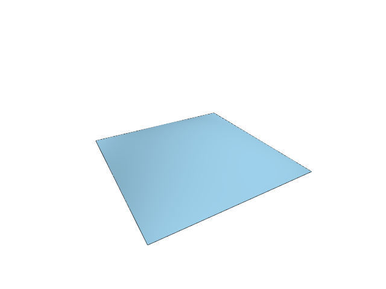

# 9.1 · Original surfaces, analytic normals and trim boundaries

**Goal:** Read ordered edge-use and interval labels from mesh vertices. · **Steps:** 11 · **Source:** [app/walk/brep.rs](../../../../src/app/walk/brep.rs) · [app/walk/brep_edges.rs](../../../../src/app/walk/brep_edges.rs) · [app/walk/brep_orient.rs](../../../../src/app/walk/brep_orient.rs) · [app/walk/brep_shapes.rs](../../../../src/app/walk/brep_shapes.rs) · [engine/gpu/faces.rs](../../../../src/engine/gpu/faces.rs) (`src/app/walk/brep_shapes.rs,src/app/walk/brep_orient.rs,src/shaders/normals.wgsl`)

<div class="webgpu-schematic" style="width:100%;margin:6px auto;">
<svg xmlns="http://www.w3.org/2000/svg" width="1120" height="200" viewBox="0 0 1120 200" style="width:100%;max-width:100%;height:auto;display:block;margin:0 auto;" role="img">
  <defs>
    <marker id="arr" viewBox="0 0 10 10" refX="8" refY="5" markerWidth="6" markerHeight="6" orient="auto">
      <path d="M 0 1 L 9 5 L 0 9 z" fill="#111111"/>
    </marker>
    <marker id="arrR" viewBox="0 0 10 10" refX="8" refY="5" markerWidth="6" markerHeight="6" orient="auto">
      <path d="M 0 1 L 9 5 L 0 9 z" fill="#dc2626"/>
    </marker>
    <marker id="arrG" viewBox="0 0 10 10" refX="8" refY="5" markerWidth="6" markerHeight="6" orient="auto">
      <path d="M 0 1 L 9 5 L 0 9 z" fill="#16a34a"/>
    </marker>
    <marker id="arrB" viewBox="0 0 10 10" refX="8" refY="5" markerWidth="6" markerHeight="6" orient="auto">
      <path d="M 0 1 L 9 5 L 0 9 z" fill="#2563eb"/>
    </marker>
  </defs>
  <rect x="2" y="2" width="1116" height="196" rx="10" fill="#ffffff" stroke="#111111" stroke-width="2"/>
  <rect x="16" y="14" width="248" height="172" rx="8" fill="#ffffff" stroke="#111111" stroke-width="1.75"/>
  <text paint-order="stroke fill" stroke="#ffffff" stroke-width="5" stroke-linejoin="round" x="140" y="34" text-anchor="middle" font-family="monospace" font-size="11.5" font-weight="700" fill="#111111">1. Lesson 9.1 Code</text>
  <rect x="34" y="48" width="212" height="24" rx="4" fill="#ffffff" stroke="#111111" stroke-width="1.25"/>
  <text paint-order="stroke fill" stroke="#ffffff" stroke-width="5" stroke-linejoin="round" x="140" y="64" text-anchor="middle" font-family="monospace" font-size="10" font-weight="700" fill="#111111">src/surface.rs</text>
  <rect x="34" y="78" width="212" height="24" rx="4" fill="#ffffff" stroke="#111111" stroke-width="1.5"/>
  <text paint-order="stroke fill" stroke="#ffffff" stroke-width="5" stroke-linejoin="round" x="140" y="94" text-anchor="middle" font-family="monospace" font-size="10" font-weight="700" fill="#111111">src/lib.rs</text>
  <rect x="34" y="108" width="212" height="24" rx="4" fill="#ffffff" stroke="#111111" stroke-width="1.25"/>
  <text paint-order="stroke fill" stroke="#ffffff" stroke-width="5" stroke-linejoin="round" x="140" y="124" text-anchor="middle" font-family="monospace" font-size="10" font-weight="700" fill="#111111">src/scene.rs</text>
  <text paint-order="stroke fill" stroke="#ffffff" stroke-width="5" stroke-linejoin="round" x="140" y="172" text-anchor="middle" font-family="monospace" font-size="9.5" fill="#111111">11 Coding Steps</text>
  <line x1="264" y1="100" x2="292" y2="100" stroke="#111111" stroke-width="2" marker-end="url(#arr)"/>
  <rect x="296" y="14" width="248" height="172" rx="8" fill="#ffffff" stroke="#111111" stroke-width="1.75"/>
  <text paint-order="stroke fill" stroke="#ffffff" stroke-width="5" stroke-linejoin="round" x="420" y="34" text-anchor="middle" font-family="monospace" font-size="11.5" font-weight="700" fill="#111111">2. session_viewer/src</text>
  <rect x="314" y="48" width="212" height="26" rx="4" fill="#ffffff" stroke="#111111" stroke-width="1.5"/>
  <text paint-order="stroke fill" stroke="#ffffff" stroke-width="5" stroke-linejoin="round" x="420" y="65" text-anchor="middle" font-family="monospace" font-size="10" font-weight="700" fill="#111111">src/app/walk/brep_shapes.…</text>
  <rect x="314" y="80" width="212" height="26" rx="4" fill="#ffffff" stroke="#111111" stroke-width="1.5"/>
  <text paint-order="stroke fill" stroke="#ffffff" stroke-width="5" stroke-linejoin="round" x="420" y="97" text-anchor="middle" font-family="monospace" font-size="10" font-weight="700" fill="#111111">src/app/walk/brep_orient.…</text>
  <rect x="314" y="112" width="212" height="24" rx="4" fill="#ffffff" stroke="#111111" stroke-width="1.5"/>
  <text paint-order="stroke fill" stroke="#ffffff" stroke-width="5" stroke-linejoin="round" x="420" y="128" text-anchor="middle" font-family="monospace" font-size="9.5" font-weight="700" fill="#111111">✓ cargo check (wasm32)</text>
  <text paint-order="stroke fill" stroke="#ffffff" stroke-width="5" stroke-linejoin="round" x="420" y="172" text-anchor="middle" font-family="sans-serif" font-size="10" fill="#111111">Validate surface control…</text>
  <line x1="544" y1="100" x2="572" y2="100" stroke="#111111" stroke-width="2" marker-end="url(#arr)"/>
  <rect x="576" y="14" width="248" height="172" rx="8" fill="#ffffff" stroke="#111111" stroke-width="1.75"/>
  <text paint-order="stroke fill" stroke="#ffffff" stroke-width="5" stroke-linejoin="round" x="700" y="34" text-anchor="middle" font-family="monospace" font-size="11.5" font-weight="700" fill="#111111">3. Trimmed B-Rep (u,v)</text>
  <rect x="620" y="52" width="160" height="88" rx="6" fill="#dbeafe" stroke="#111111" stroke-width="2"/>
  <circle cx="700" cy="96" r="24" fill="#ffffff" stroke="#111111" stroke-width="2"/>
  <text paint-order="stroke fill" stroke="#ffffff" stroke-width="5" stroke-linejoin="round" x="700" y="100" text-anchor="middle" font-family="monospace" font-size="9.5" font-weight="700" fill="#111111">Hole</text>
  <text paint-order="stroke fill" stroke="#ffffff" stroke-width="5" stroke-linejoin="round" x="700" y="172" text-anchor="middle" font-family="monospace" font-size="9.5" fill="#111111">Original surfaces, analytic…</text>
  <line x1="824" y1="100" x2="852" y2="100" stroke="#111111" stroke-width="2" marker-end="url(#arr)"/>
  <rect x="856" y="14" width="248" height="172" rx="8" fill="#ffffff" stroke="#111111" stroke-width="1.75"/>
  <text paint-order="stroke fill" stroke="#ffffff" stroke-width="5" stroke-linejoin="round" x="980" y="34" text-anchor="middle" font-family="monospace" font-size="11.5" font-weight="700" fill="#111111">4. Crease Split Normals</text>
  <polyline points="894,136 974,90 1054,136" fill="none" stroke="#111111" stroke-width="2.5"/>
  <circle cx="974" cy="90" r="4.5" fill="#111111"/>
  <line x1="974" y1="90" x2="942" y2="52" stroke="#2563eb" stroke-width="2.25" marker-end="url(#arrB)"/>
  <line x1="974" y1="90" x2="1006" y2="52" stroke="#dc2626" stroke-width="2.25" marker-end="url(#arrR)"/>
  <text paint-order="stroke fill" stroke="#ffffff" stroke-width="5" stroke-linejoin="round" x="924" y="56" font-family="monospace" font-size="10" font-weight="700" fill="#2563eb">N1</text>
  <text paint-order="stroke fill" stroke="#ffffff" stroke-width="5" stroke-linejoin="round" x="1012" y="56" font-family="monospace" font-size="10" font-weight="700" fill="#dc2626">N2</text>
  <text paint-order="stroke fill" stroke="#ffffff" stroke-width="5" stroke-linejoin="round" x="980" y="172" text-anchor="middle" font-family="sans-serif" font-size="10" font-weight="700" fill="#111111">Follow constrained trim l…</text>
</svg>
</div>

## <a id="checkpoint-55-validation"></a>1. Validate surface control storage

<div class="webgpu-schematic" style="width:100%;margin:6px auto;">
<svg xmlns="http://www.w3.org/2000/svg" width="1120" height="72" viewBox="0 0 1120 72" style="width:100%;max-width:100%;height:auto;display:block;margin:0 auto;" role="img">
  <defs>
    <marker id="arr" viewBox="0 0 10 10" refX="8" refY="5" markerWidth="6" markerHeight="6" orient="auto">
      <path d="M 0 1 L 9 5 L 0 9 z" fill="#111111"/>
    </marker>
    <marker id="arrR" viewBox="0 0 10 10" refX="8" refY="5" markerWidth="6" markerHeight="6" orient="auto">
      <path d="M 0 1 L 9 5 L 0 9 z" fill="#dc2626"/>
    </marker>
    <marker id="arrG" viewBox="0 0 10 10" refX="8" refY="5" markerWidth="6" markerHeight="6" orient="auto">
      <path d="M 0 1 L 9 5 L 0 9 z" fill="#16a34a"/>
    </marker>
    <marker id="arrB" viewBox="0 0 10 10" refX="8" refY="5" markerWidth="6" markerHeight="6" orient="auto">
      <path d="M 0 1 L 9 5 L 0 9 z" fill="#2563eb"/>
    </marker>
  </defs>
  <rect x="2" y="2" width="1116" height="68" rx="10" fill="#ffffff" stroke="#111111" stroke-width="2"/>
  <rect x="14" y="10" width="252" height="52" rx="6" fill="#ffffff" stroke="#111111" stroke-width="1.5"/>
  <text paint-order="stroke fill" stroke="#ffffff" stroke-width="5" stroke-linejoin="round" x="140" y="30" text-anchor="middle" font-family="monospace" font-size="10.5" font-weight="700" fill="#111111">Step 1 of 11</text>
  <text paint-order="stroke fill" stroke="#ffffff" stroke-width="5" stroke-linejoin="round" x="140" y="48" text-anchor="middle" font-family="monospace" font-size="9.5" fill="#111111">src/surface.rs, src/lib.rs</text>
  <line x1="266" y1="36" x2="292" y2="36" stroke="#111111" stroke-width="1.75" marker-end="url(#arr)"/>
  <rect x="296" y="10" width="252" height="52" rx="6" fill="#ffffff" stroke="#111111" stroke-width="1.5"/>
  <text paint-order="stroke fill" stroke="#ffffff" stroke-width="5" stroke-linejoin="round" x="422" y="30" text-anchor="middle" font-family="monospace" font-size="10" font-weight="700" fill="#111111">1. CPU / Rust Input</text>
  <text paint-order="stroke fill" stroke="#ffffff" stroke-width="5" stroke-linejoin="round" x="422" y="48" text-anchor="middle" font-family="sans-serif" font-size="9.5" fill="#111111">original NURBS</text>
  <line x1="548" y1="36" x2="574" y2="36" stroke="#111111" stroke-width="1.75" marker-end="url(#arr)"/>
  <rect x="578" y="10" width="252" height="52" rx="6" fill="#ffffff" stroke="#111111" stroke-width="1.5"/>
  <text paint-order="stroke fill" stroke="#ffffff" stroke-width="5" stroke-linejoin="round" x="704" y="30" text-anchor="middle" font-family="monospace" font-size="10" font-weight="700" fill="#111111">2. WebGPU / WGSL</text>
  <text paint-order="stroke fill" stroke="#ffffff" stroke-width="5" stroke-linejoin="round" x="704" y="48" text-anchor="middle" font-family="sans-serif" font-size="9.5" fill="#111111">weights and knots</text>
  <line x1="830" y1="36" x2="856" y2="36" stroke="#111111" stroke-width="1.75" marker-end="url(#arr)"/>
  <rect x="860" y="10" width="246" height="52" rx="6" fill="#ffffff" stroke="#111111" stroke-width="1.75"/>
  <text paint-order="stroke fill" stroke="#ffffff" stroke-width="5" stroke-linejoin="round" x="983" y="30" text-anchor="middle" font-family="monospace" font-size="10" font-weight="700" fill="#111111">3. -&gt; src/app/walk/brep_s…</text>
  <text paint-order="stroke fill" stroke="#ffffff" stroke-width="5" stroke-linejoin="round" x="983" y="48" text-anchor="middle" font-family="sans-serif" font-size="9.5" fill="#111111">finite domains</text>
</svg>
</div>

**What this code does:** Validate original surface control storage.

### 1. `src/surface.rs`

Validate the original NURBS layout, parameter domains and bounded display input.

Create the file and type:

```rust
--8<-- "journey/code/55-validation-01.rs"
```

### 2. `src/lib.rs`

Register the source component.

**Locate this existing block:**

```rust
#[cfg(test)]
mod shortcut_focus_tests;
```

After that block, type:

```rust
--8<-- "journey/code/55-validation-02.rs" skip=39
```

## <a id="checkpoint-55a-grid"></a>2. Keep UV coordinates beside world samples

<div class="webgpu-schematic" style="width:100%;margin:6px auto;">
<svg xmlns="http://www.w3.org/2000/svg" width="1120" height="72" viewBox="0 0 1120 72" style="width:100%;max-width:100%;height:auto;display:block;margin:0 auto;" role="img">
  <defs>
    <marker id="arr" viewBox="0 0 10 10" refX="8" refY="5" markerWidth="6" markerHeight="6" orient="auto">
      <path d="M 0 1 L 9 5 L 0 9 z" fill="#111111"/>
    </marker>
    <marker id="arrR" viewBox="0 0 10 10" refX="8" refY="5" markerWidth="6" markerHeight="6" orient="auto">
      <path d="M 0 1 L 9 5 L 0 9 z" fill="#dc2626"/>
    </marker>
    <marker id="arrG" viewBox="0 0 10 10" refX="8" refY="5" markerWidth="6" markerHeight="6" orient="auto">
      <path d="M 0 1 L 9 5 L 0 9 z" fill="#16a34a"/>
    </marker>
    <marker id="arrB" viewBox="0 0 10 10" refX="8" refY="5" markerWidth="6" markerHeight="6" orient="auto">
      <path d="M 0 1 L 9 5 L 0 9 z" fill="#2563eb"/>
    </marker>
  </defs>
  <rect x="2" y="2" width="1116" height="68" rx="10" fill="#ffffff" stroke="#111111" stroke-width="2"/>
  <rect x="14" y="10" width="252" height="52" rx="6" fill="#ffffff" stroke="#111111" stroke-width="1.5"/>
  <text paint-order="stroke fill" stroke="#ffffff" stroke-width="5" stroke-linejoin="round" x="140" y="30" text-anchor="middle" font-family="monospace" font-size="10.5" font-weight="700" fill="#111111">Step 2 of 11</text>
  <text paint-order="stroke fill" stroke="#ffffff" stroke-width="5" stroke-linejoin="round" x="140" y="48" text-anchor="middle" font-family="monospace" font-size="9.5" fill="#111111">src/surface.rs</text>
  <line x1="266" y1="36" x2="292" y2="36" stroke="#111111" stroke-width="1.75" marker-end="url(#arr)"/>
  <rect x="296" y="10" width="252" height="52" rx="6" fill="#ffffff" stroke="#111111" stroke-width="1.5"/>
  <text paint-order="stroke fill" stroke="#ffffff" stroke-width="5" stroke-linejoin="round" x="422" y="30" text-anchor="middle" font-family="monospace" font-size="10" font-weight="700" fill="#111111">1. CPU / Rust Input</text>
  <text paint-order="stroke fill" stroke="#ffffff" stroke-width="5" stroke-linejoin="round" x="422" y="48" text-anchor="middle" font-family="sans-serif" font-size="9.5" fill="#111111">parameter domain</text>
  <line x1="548" y1="36" x2="574" y2="36" stroke="#111111" stroke-width="1.75" marker-end="url(#arr)"/>
  <rect x="578" y="10" width="252" height="52" rx="6" fill="#ffffff" stroke="#111111" stroke-width="1.5"/>
  <text paint-order="stroke fill" stroke="#ffffff" stroke-width="5" stroke-linejoin="round" x="704" y="30" text-anchor="middle" font-family="monospace" font-size="10" font-weight="700" fill="#111111">2. WebGPU / WGSL</text>
  <text paint-order="stroke fill" stroke="#ffffff" stroke-width="5" stroke-linejoin="round" x="704" y="48" text-anchor="middle" font-family="sans-serif" font-size="9.5" fill="#111111">f64 point and normal</text>
  <line x1="830" y1="36" x2="856" y2="36" stroke="#111111" stroke-width="1.75" marker-end="url(#arr)"/>
  <rect x="860" y="10" width="246" height="52" rx="6" fill="#ffffff" stroke="#111111" stroke-width="1.75"/>
  <text paint-order="stroke fill" stroke="#ffffff" stroke-width="5" stroke-linejoin="round" x="983" y="30" text-anchor="middle" font-family="monospace" font-size="10" font-weight="700" fill="#111111">3. -&gt; src/app/walk/brep_s…</text>
  <text paint-order="stroke fill" stroke="#ffffff" stroke-width="5" stroke-linejoin="round" x="983" y="48" text-anchor="middle" font-family="sans-serif" font-size="9.5" fill="#111111">grid and original borders</text>
</svg>
</div>

**What this code does:** Keep UV coordinates beside original world samples.

### 1. `src/surface.rs`

Build the current 16–96-step UV grid and open domain border segment ranges.

**Locate this existing block:**

```rust
    }
    Ok(domains)
}
```

After that block, type:

```rust
--8<-- "journey/code/55a-grid-01.rs" skip=3
```

## <a id="checkpoint-55b-normals"></a>3. Use analytic normals and finite singular-point fallbacks

<div class="webgpu-schematic" style="width:100%;margin:6px auto;">
<svg xmlns="http://www.w3.org/2000/svg" width="1120" height="72" viewBox="0 0 1120 72" style="width:100%;max-width:100%;height:auto;display:block;margin:0 auto;" role="img">
  <defs>
    <marker id="arr" viewBox="0 0 10 10" refX="8" refY="5" markerWidth="6" markerHeight="6" orient="auto">
      <path d="M 0 1 L 9 5 L 0 9 z" fill="#111111"/>
    </marker>
    <marker id="arrR" viewBox="0 0 10 10" refX="8" refY="5" markerWidth="6" markerHeight="6" orient="auto">
      <path d="M 0 1 L 9 5 L 0 9 z" fill="#dc2626"/>
    </marker>
    <marker id="arrG" viewBox="0 0 10 10" refX="8" refY="5" markerWidth="6" markerHeight="6" orient="auto">
      <path d="M 0 1 L 9 5 L 0 9 z" fill="#16a34a"/>
    </marker>
    <marker id="arrB" viewBox="0 0 10 10" refX="8" refY="5" markerWidth="6" markerHeight="6" orient="auto">
      <path d="M 0 1 L 9 5 L 0 9 z" fill="#2563eb"/>
    </marker>
  </defs>
  <rect x="2" y="2" width="1116" height="68" rx="10" fill="#ffffff" stroke="#111111" stroke-width="2"/>
  <rect x="14" y="10" width="252" height="52" rx="6" fill="#ffffff" stroke="#111111" stroke-width="1.5"/>
  <text paint-order="stroke fill" stroke="#ffffff" stroke-width="5" stroke-linejoin="round" x="140" y="30" text-anchor="middle" font-family="monospace" font-size="10.5" font-weight="700" fill="#111111">Step 3 of 11</text>
  <text paint-order="stroke fill" stroke="#ffffff" stroke-width="5" stroke-linejoin="round" x="140" y="48" text-anchor="middle" font-family="monospace" font-size="9.5" fill="#111111">src/surface.rs</text>
  <line x1="266" y1="36" x2="292" y2="36" stroke="#111111" stroke-width="1.75" marker-end="url(#arr)"/>
  <rect x="296" y="10" width="252" height="52" rx="6" fill="#ffffff" stroke="#111111" stroke-width="1.5"/>
  <text paint-order="stroke fill" stroke="#ffffff" stroke-width="5" stroke-linejoin="round" x="422" y="30" text-anchor="middle" font-family="monospace" font-size="10" font-weight="700" fill="#111111">1. CPU / Rust Input</text>
  <text paint-order="stroke fill" stroke="#ffffff" stroke-width="5" stroke-linejoin="round" x="422" y="48" text-anchor="middle" font-family="sans-serif" font-size="9.5" fill="#111111">analytic normal</text>
  <line x1="548" y1="36" x2="574" y2="36" stroke="#111111" stroke-width="1.75" marker-end="url(#arr)"/>
  <rect x="578" y="10" width="252" height="52" rx="6" fill="#ffffff" stroke="#111111" stroke-width="1.5"/>
  <text paint-order="stroke fill" stroke="#ffffff" stroke-width="5" stroke-linejoin="round" x="704" y="30" text-anchor="middle" font-family="monospace" font-size="10" font-weight="700" fill="#111111">2. WebGPU / WGSL</text>
  <text paint-order="stroke fill" stroke="#ffffff" stroke-width="5" stroke-linejoin="round" x="704" y="48" text-anchor="middle" font-family="sans-serif" font-size="9.5" fill="#111111">neighbouring cell fallback</text>
  <line x1="830" y1="36" x2="856" y2="36" stroke="#111111" stroke-width="1.75" marker-end="url(#arr)"/>
  <rect x="860" y="10" width="246" height="52" rx="6" fill="#ffffff" stroke="#111111" stroke-width="1.75"/>
  <text paint-order="stroke fill" stroke="#ffffff" stroke-width="5" stroke-linejoin="round" x="983" y="30" text-anchor="middle" font-family="monospace" font-size="10" font-weight="700" fill="#111111">3. -&gt; src/app/walk/brep_s…</text>
  <text paint-order="stroke fill" stroke="#ffffff" stroke-width="5" stroke-linejoin="round" x="983" y="48" text-anchor="middle" font-family="sans-serif" font-size="9.5" fill="#111111">display normal</text>
</svg>
</div>

**What this code does:** Use analytic normals and finite singular-point fallbacks.

### 1. `src/surface.rs`

Normalise analytic normals and safely handle singular sample positions.

**Locate this existing block:**

```rust
    }

}
```

Edit the existing block to match this code; keep unchanged lines:

```rust
--8<-- "journey/code/55b-normals-01.rs"
```

## <a id="checkpoint-55c-display"></a>4. Prepare derived surface display without losing its source

<div class="webgpu-schematic" style="width:100%;margin:6px auto;">
<svg xmlns="http://www.w3.org/2000/svg" width="1120" height="72" viewBox="0 0 1120 72" style="width:100%;max-width:100%;height:auto;display:block;margin:0 auto;" role="img">
  <defs>
    <marker id="arr" viewBox="0 0 10 10" refX="8" refY="5" markerWidth="6" markerHeight="6" orient="auto">
      <path d="M 0 1 L 9 5 L 0 9 z" fill="#111111"/>
    </marker>
    <marker id="arrR" viewBox="0 0 10 10" refX="8" refY="5" markerWidth="6" markerHeight="6" orient="auto">
      <path d="M 0 1 L 9 5 L 0 9 z" fill="#dc2626"/>
    </marker>
    <marker id="arrG" viewBox="0 0 10 10" refX="8" refY="5" markerWidth="6" markerHeight="6" orient="auto">
      <path d="M 0 1 L 9 5 L 0 9 z" fill="#16a34a"/>
    </marker>
    <marker id="arrB" viewBox="0 0 10 10" refX="8" refY="5" markerWidth="6" markerHeight="6" orient="auto">
      <path d="M 0 1 L 9 5 L 0 9 z" fill="#2563eb"/>
    </marker>
  </defs>
  <rect x="2" y="2" width="1116" height="68" rx="10" fill="#ffffff" stroke="#111111" stroke-width="2"/>
  <rect x="14" y="10" width="252" height="52" rx="6" fill="#ffffff" stroke="#111111" stroke-width="1.5"/>
  <text paint-order="stroke fill" stroke="#ffffff" stroke-width="5" stroke-linejoin="round" x="140" y="30" text-anchor="middle" font-family="monospace" font-size="10.5" font-weight="700" fill="#111111">Step 4 of 11</text>
  <text paint-order="stroke fill" stroke="#ffffff" stroke-width="5" stroke-linejoin="round" x="140" y="48" text-anchor="middle" font-family="monospace" font-size="9.5" fill="#111111">src/surface.rs</text>
  <line x1="266" y1="36" x2="292" y2="36" stroke="#111111" stroke-width="1.75" marker-end="url(#arr)"/>
  <rect x="296" y="10" width="252" height="52" rx="6" fill="#ffffff" stroke="#111111" stroke-width="1.5"/>
  <text paint-order="stroke fill" stroke="#ffffff" stroke-width="5" stroke-linejoin="round" x="422" y="30" text-anchor="middle" font-family="monospace" font-size="10" font-weight="700" fill="#111111">1. CPU / Rust Input</text>
  <text paint-order="stroke fill" stroke="#ffffff" stroke-width="5" stroke-linejoin="round" x="422" y="48" text-anchor="middle" font-family="sans-serif" font-size="9.5" fill="#111111">shared original NURBS</text>
  <line x1="548" y1="36" x2="574" y2="36" stroke="#111111" stroke-width="1.75" marker-end="url(#arr)"/>
  <rect x="578" y="10" width="252" height="52" rx="6" fill="#ffffff" stroke="#111111" stroke-width="1.5"/>
  <text paint-order="stroke fill" stroke="#ffffff" stroke-width="5" stroke-linejoin="round" x="704" y="30" text-anchor="middle" font-family="monospace" font-size="10" font-weight="700" fill="#111111">2. WebGPU / WGSL</text>
  <text paint-order="stroke fill" stroke="#ffffff" stroke-width="5" stroke-linejoin="round" x="704" y="48" text-anchor="middle" font-family="sans-serif" font-size="9.5" fill="#111111">derived mesh display</text>
  <line x1="830" y1="36" x2="856" y2="36" stroke="#111111" stroke-width="1.75" marker-end="url(#arr)"/>
  <rect x="860" y="10" width="246" height="52" rx="6" fill="#ffffff" stroke="#111111" stroke-width="1.75"/>
  <text paint-order="stroke fill" stroke="#ffffff" stroke-width="5" stroke-linejoin="round" x="983" y="30" text-anchor="middle" font-family="monospace" font-size="10" font-weight="700" fill="#111111">3. -&gt; src/app/walk/brep_s…</text>
  <text paint-order="stroke fill" stroke="#ffffff" stroke-width="5" stroke-linejoin="round" x="983" y="48" text-anchor="middle" font-family="sans-serif" font-size="9.5" fill="#111111">one face and four borders</text>
</svg>
</div>

**What this code does:** Prepare derived surface display without losing its source.

### 1. `src/surface.rs`

Keep the original surface and its UV cache beside the derived display; provide the parametric-roof example.

**Locate this existing block:**

```rust
    }
}
```

After that block, type:

```rust
--8<-- "journey/code/55c-display-01.rs" skip=9
```

## <a id="checkpoint-55d-source-row"></a>5. Attach surface ownership to existing scene rows

<div class="webgpu-schematic" style="width:100%;margin:6px auto;">
<svg xmlns="http://www.w3.org/2000/svg" width="1120" height="72" viewBox="0 0 1120 72" style="width:100%;max-width:100%;height:auto;display:block;margin:0 auto;" role="img">
  <defs>
    <marker id="arr" viewBox="0 0 10 10" refX="8" refY="5" markerWidth="6" markerHeight="6" orient="auto">
      <path d="M 0 1 L 9 5 L 0 9 z" fill="#111111"/>
    </marker>
    <marker id="arrR" viewBox="0 0 10 10" refX="8" refY="5" markerWidth="6" markerHeight="6" orient="auto">
      <path d="M 0 1 L 9 5 L 0 9 z" fill="#dc2626"/>
    </marker>
    <marker id="arrG" viewBox="0 0 10 10" refX="8" refY="5" markerWidth="6" markerHeight="6" orient="auto">
      <path d="M 0 1 L 9 5 L 0 9 z" fill="#16a34a"/>
    </marker>
    <marker id="arrB" viewBox="0 0 10 10" refX="8" refY="5" markerWidth="6" markerHeight="6" orient="auto">
      <path d="M 0 1 L 9 5 L 0 9 z" fill="#2563eb"/>
    </marker>
  </defs>
  <rect x="2" y="2" width="1116" height="68" rx="10" fill="#ffffff" stroke="#111111" stroke-width="2"/>
  <rect x="14" y="10" width="252" height="52" rx="6" fill="#ffffff" stroke="#111111" stroke-width="1.5"/>
  <text paint-order="stroke fill" stroke="#ffffff" stroke-width="5" stroke-linejoin="round" x="140" y="30" text-anchor="middle" font-family="monospace" font-size="10.5" font-weight="700" fill="#111111">Step 5 of 11</text>
  <text paint-order="stroke fill" stroke="#ffffff" stroke-width="5" stroke-linejoin="round" x="140" y="48" text-anchor="middle" font-family="monospace" font-size="9.5" fill="#111111">src/scene.rs, src/document.…</text>
  <line x1="266" y1="36" x2="292" y2="36" stroke="#111111" stroke-width="1.75" marker-end="url(#arr)"/>
  <rect x="296" y="10" width="252" height="52" rx="6" fill="#ffffff" stroke="#111111" stroke-width="1.5"/>
  <text paint-order="stroke fill" stroke="#ffffff" stroke-width="5" stroke-linejoin="round" x="422" y="30" text-anchor="middle" font-family="monospace" font-size="10" font-weight="700" fill="#111111">1. CPU / Rust Input</text>
  <text paint-order="stroke fill" stroke="#ffffff" stroke-width="5" stroke-linejoin="round" x="422" y="48" text-anchor="middle" font-family="sans-serif" font-size="9.5" fill="#111111">original surface owner</text>
  <line x1="548" y1="36" x2="574" y2="36" stroke="#111111" stroke-width="1.75" marker-end="url(#arr)"/>
  <rect x="578" y="10" width="252" height="52" rx="6" fill="#ffffff" stroke="#111111" stroke-width="1.5"/>
  <text paint-order="stroke fill" stroke="#ffffff" stroke-width="5" stroke-linejoin="round" x="704" y="30" text-anchor="middle" font-family="monospace" font-size="10" font-weight="700" fill="#111111">2. WebGPU / WGSL</text>
  <text paint-order="stroke fill" stroke="#ffffff" stroke-width="5" stroke-linejoin="round" x="704" y="48" text-anchor="middle" font-family="sans-serif" font-size="9.5" fill="#111111">current layer</text>
  <line x1="830" y1="36" x2="856" y2="36" stroke="#111111" stroke-width="1.75" marker-end="url(#arr)"/>
  <rect x="860" y="10" width="246" height="52" rx="6" fill="#ffffff" stroke="#111111" stroke-width="1.75"/>
  <text paint-order="stroke fill" stroke="#ffffff" stroke-width="5" stroke-linejoin="round" x="983" y="30" text-anchor="middle" font-family="monospace" font-size="10" font-weight="700" fill="#111111">3. -&gt; src/app/walk/brep_s…</text>
  <text paint-order="stroke fill" stroke="#ffffff" stroke-width="5" stroke-linejoin="round" x="983" y="48" text-anchor="middle" font-family="sans-serif" font-size="9.5" fill="#111111">shared placement history</text>
</svg>
</div>

**What this code does:** Attach original surface ownership to existing scene rows.

### 1. `src/scene.rs`

Attach and share original NURBS ownership while preventing proxy saving or premature CAD deformation.

Edit these blocks from bottom to top. Keep the surrounding lines unchanged.

**Locate this block:**

```rust
        let model=self.placement(target.owner).ok_or("Part owner is missing")?;
        let local=&(&model.inverse().ok_or("Part placement cannot be inverted")?*delta)*&model;
        if let Some(row)=self.objects.iter_mut().find(|r|r.id==target.owner) {
            let mut source=(**row.geometry().ok_or("Reload editable sources before editing a part")?).clone();
            for key in crate::part_preview::keys(&source,target.part)? {
                let point=local.transform_point(&source.vertex_point(key).ok_or("Missing source vertex")?);
```

Replace it with:

```rust
        let model=self.placement(target.owner).ok_or("Part owner is missing")?;
        let local=&(&model.inverse().ok_or("Part placement cannot be inverted")?*delta)*&model;
        if let Some(row)=self.objects.iter_mut().find(|r|r.id==target.owner) {
            if row.surface.is_some() {return Err("CAD surface part editing connects after source parameter mapping");}
            let mut source=(**row.geometry().ok_or("Reload editable sources before editing a part")?).clone();
            for key in crate::part_preview::keys(&source,target.part)? {
                let point=local.transform_point(&source.vertex_point(key).ok_or("Missing source vertex")?);
```

**Locate this block:**

```rust
        let generated=prepared.source.is_none();
        let editable = crate::edit_source::EditSource::Loaded { geometry: prepared.geometry, source: prepared.source };
        let label=metadata.name.clone();let node_guid=guid.clone();
        self.objects.push(Object { id, guid, metadata, mesh: Rc::new(prepared.display), model: prepared.model, editable });
        if generated {crate::layer_edit::attach_generated(self,id,node_guid,label)?;}
        Ok(id)
    }

    pub(crate) fn copy_row(&mut self,id:ObjectId,all:bool)->Result<ObjectId,&'static str> {
        if self.objects.iter().any(|row|row.id==id&&row.geometry().is_none()) {return Err("Reload editable sources before copying");}
        if !self.contains(id) {return Err("Object is gone");}
```

Replace it with:

```rust
        let generated=prepared.source.is_none();
        let editable = crate::edit_source::EditSource::Loaded { geometry: prepared.geometry, source: prepared.source };
        let label=metadata.name.clone();let node_guid=guid.clone();
        self.objects.push(Object {surface:None, id, guid, metadata, mesh: Rc::new(prepared.display), model: prepared.model, editable });
        if generated {crate::layer_edit::attach_generated(self,id,node_guid,label)?;}
        Ok(id)
    }

    pub fn insert_surface(&mut self,source:Rc<session_rust::NurbsSurface>)->Result<ObjectId,&'static str> {
        let prepared=Rc::new(crate::surface::Prepared::new(source)?);let mesh=prepared.mesh()?;let id=self.insert(mesh)?;
        self.objects.iter_mut().find(|row|row.id==id).unwrap().surface=Some(prepared);Ok(id)
    }

    pub(crate) fn copy_row(&mut self,id:ObjectId,all:bool)->Result<ObjectId,&'static str> {
        if self.objects.iter().any(|row|row.id==id&&row.geometry().is_none()) {return Err("Reload editable sources before copying");}
        if !self.contains(id) {return Err("Object is gone");}
```

**Locate this block:**

```rust

#[derive(Clone)]
pub struct Object {
    pub id: ObjectId,
    pub guid: String,
    pub metadata: Rc<crate::row_metadata::RowMetadata>,
```

Replace it with:

```rust

#[derive(Clone)]
pub struct Object {
    pub surface:Option<Rc<crate::surface::Prepared>>,
    pub id: ObjectId,
    pub guid: String,
    pub metadata: Rc<crate::row_metadata::RowMetadata>,
```

### 2. `src/document.rs`

Attach and share original NURBS ownership while preventing proxy saving or premature CAD deformation.

**Locate this existing block:**

```rust

pub fn snapshot(scene: &crate::scene::Scene) -> Result<Vec<u8>, &'static str> {
    if !scene.points().is_empty() { return Err("This checkpoint cannot save point objects yet"); }
    if !scene.lines().is_empty() || !scene.paths().is_empty() { return Err("This checkpoint cannot save line objects yet"); }
```

Edit the existing block to match this code; keep unchanged lines:

```rust
--8<-- "journey/code/55d-source-row-04.rs"
```

### 3. `src/part_preview.rs`

Attach and share original NURBS ownership while preventing proxy saving or premature CAD deformation.

**Locate this existing block:**

```rust
    let model=scene.placement(target.owner).ok_or("Part owner is missing")?;
    let points=if let Some(row)=scene.objects().iter().find(|r|r.id==target.owner) {
        let mesh=row.geometry().ok_or("Reload editable sources before editing a part")?;
        keys(mesh,target.part)?.into_iter().map(|key|mesh.vertex_point(key).ok_or("Missing source vertex")).collect::<Result<Vec<_>,_>>()?
```

Edit the existing block to match this code; keep unchanged lines:

```rust
--8<-- "journey/code/55d-source-row-05.rs"
```

## <a id="checkpoint-55e-identities"></a>6. Resolve surface face and domain edges

<div class="webgpu-schematic" style="width:100%;margin:6px auto;">
<svg xmlns="http://www.w3.org/2000/svg" width="1120" height="72" viewBox="0 0 1120 72" style="width:100%;max-width:100%;height:auto;display:block;margin:0 auto;" role="img">
  <defs>
    <marker id="arr" viewBox="0 0 10 10" refX="8" refY="5" markerWidth="6" markerHeight="6" orient="auto">
      <path d="M 0 1 L 9 5 L 0 9 z" fill="#111111"/>
    </marker>
    <marker id="arrR" viewBox="0 0 10 10" refX="8" refY="5" markerWidth="6" markerHeight="6" orient="auto">
      <path d="M 0 1 L 9 5 L 0 9 z" fill="#dc2626"/>
    </marker>
    <marker id="arrG" viewBox="0 0 10 10" refX="8" refY="5" markerWidth="6" markerHeight="6" orient="auto">
      <path d="M 0 1 L 9 5 L 0 9 z" fill="#16a34a"/>
    </marker>
    <marker id="arrB" viewBox="0 0 10 10" refX="8" refY="5" markerWidth="6" markerHeight="6" orient="auto">
      <path d="M 0 1 L 9 5 L 0 9 z" fill="#2563eb"/>
    </marker>
  </defs>
  <rect x="2" y="2" width="1116" height="68" rx="10" fill="#ffffff" stroke="#111111" stroke-width="2"/>
  <rect x="14" y="10" width="252" height="52" rx="6" fill="#ffffff" stroke="#111111" stroke-width="1.5"/>
  <text paint-order="stroke fill" stroke="#ffffff" stroke-width="5" stroke-linejoin="round" x="140" y="30" text-anchor="middle" font-family="monospace" font-size="10.5" font-weight="700" fill="#111111">Step 6 of 11</text>
  <text paint-order="stroke fill" stroke="#ffffff" stroke-width="5" stroke-linejoin="round" x="140" y="48" text-anchor="middle" font-family="monospace" font-size="9.5" fill="#111111">src/pick_sources.rs, src/se…</text>
  <line x1="266" y1="36" x2="292" y2="36" stroke="#111111" stroke-width="1.75" marker-end="url(#arr)"/>
  <rect x="296" y="10" width="252" height="52" rx="6" fill="#ffffff" stroke="#111111" stroke-width="1.5"/>
  <text paint-order="stroke fill" stroke="#ffffff" stroke-width="5" stroke-linejoin="round" x="422" y="30" text-anchor="middle" font-family="monospace" font-size="10" font-weight="700" fill="#111111">1. CPU / Rust Input</text>
  <text paint-order="stroke fill" stroke="#ffffff" stroke-width="5" stroke-linejoin="round" x="422" y="48" text-anchor="middle" font-family="sans-serif" font-size="9.5" fill="#111111">display segment</text>
  <line x1="548" y1="36" x2="574" y2="36" stroke="#111111" stroke-width="1.75" marker-end="url(#arr)"/>
  <rect x="578" y="10" width="252" height="52" rx="6" fill="#ffffff" stroke="#111111" stroke-width="1.5"/>
  <text paint-order="stroke fill" stroke="#ffffff" stroke-width="5" stroke-linejoin="round" x="704" y="30" text-anchor="middle" font-family="monospace" font-size="10" font-weight="700" fill="#111111">2. WebGPU / WGSL</text>
  <text paint-order="stroke fill" stroke="#ffffff" stroke-width="5" stroke-linejoin="round" x="704" y="48" text-anchor="middle" font-family="sans-serif" font-size="9.5" fill="#111111">original domain edge</text>
  <line x1="830" y1="36" x2="856" y2="36" stroke="#111111" stroke-width="1.75" marker-end="url(#arr)"/>
  <rect x="860" y="10" width="246" height="52" rx="6" fill="#ffffff" stroke="#111111" stroke-width="1.75"/>
  <text paint-order="stroke fill" stroke="#ffffff" stroke-width="5" stroke-linejoin="round" x="983" y="30" text-anchor="middle" font-family="monospace" font-size="10" font-weight="700" fill="#111111">3. -&gt; src/app/walk/brep_s…</text>
  <text paint-order="stroke fill" stroke="#ffffff" stroke-width="5" stroke-linejoin="round" x="983" y="48" text-anchor="middle" font-family="sans-serif" font-size="9.5" fill="#111111">complete border highlight</text>
</svg>
</div>

**What this code does:** Resolve original surface face and domain edges.

### 1. `src/pick_sources.rs`

Resolve and highlight one original CAD face and four domain edges without exposing interior grid lines.

Edit these blocks from bottom to top. Keep the surrounding lines unchanged.

**Locate this block:**

```rust
        for row in scene.objects().iter().filter(|row| scene.visible(row.id)) {
            sources.mesh_bases.push((row.id, u32::try_from(sources.faces.len()).map_err(|_| "Too many source faces")?));
            for &key in &row.mesh.parts.faces { append(&mut sources.faces, Kind::Face, Target { owner: row.id, part: Part::Face(key) })?; }
            for (&(a, b), ends) in row.mesh.parts.edges.iter().zip(&row.mesh.parts.endpoints) {
                let ids = append(&mut sources.edges, Kind::Edge, Target { owner: row.id, part: Part::MeshEdge(a, b) })?;
                let ends = ends.map(|p| row.model.transform_point(&session_rust::Point::new(p[0], p[1], p[2])).to_f32());
                sources.mesh_ink.push(crate::stroke::Stroke { start: ends[0], end: ends[1], colour: scene.view.edges.get(&row.id).map_or([0.,0.,0.,1.],|rgb|[rgb[0] as f32/255.,rgb[1] as f32/255.,rgb[2] as f32/255.,1.]), width: 1. });
                sources.mesh_ids.push(id(row.id, ids[1]));
```

Replace it with:

```rust
        for row in scene.objects().iter().filter(|row| scene.visible(row.id)) {
            sources.mesh_bases.push((row.id, u32::try_from(sources.faces.len()).map_err(|_| "Too many source faces")?));
            for &key in &row.mesh.parts.faces { append(&mut sources.faces, Kind::Face, Target { owner: row.id, part: Part::Face(key) })?; }
            let mut surface_edges=row.surface.as_ref().map(|surface|surface.edge_ids());
            for (&(a, b), ends) in row.mesh.parts.edges.iter().zip(&row.mesh.parts.endpoints) {
                let part=surface_edges.as_mut().and_then(|edges|edges.next()).map_or(Part::MeshEdge(a,b),Part::SurfaceEdge);
                let ids = append(&mut sources.edges, Kind::Edge, Target { owner: row.id, part })?;
                let ends = ends.map(|p| row.model.transform_point(&session_rust::Point::new(p[0], p[1], p[2])).to_f32());
                sources.mesh_ink.push(crate::stroke::Stroke { start: ends[0], end: ends[1], colour: scene.view.edges.get(&row.id).map_or([0.,0.,0.,1.],|rgb|[rgb[0] as f32/255.,rgb[1] as f32/255.,rgb[2] as f32/255.,1.]), width: 1. });
                sources.mesh_ids.push(id(row.id, ids[1]));
```

**Locate this block:**

```rust
use crate::{scene::{ObjectId, Scene}, sub_id::{self, Kind}};

#[derive(Clone, Copy, Debug, PartialEq, Eq)]
pub enum Part { Object, Face(usize), MeshEdge(usize, usize), PathEdge(usize), Curve, Control(usize) }

#[derive(Clone, Copy, Debug, PartialEq, Eq)]
pub struct Target { pub owner: ObjectId, pub part: Part }
```

Replace it with:

```rust
use crate::{scene::{ObjectId, Scene}, sub_id::{self, Kind}};

#[derive(Clone, Copy, Debug, PartialEq, Eq)]
pub enum Part { Object, Face(usize), SurfaceEdge(usize), MeshEdge(usize, usize), PathEdge(usize), Curve, Control(usize) }

#[derive(Clone, Copy, Debug, PartialEq, Eq)]
pub struct Target { pub owner: ObjectId, pub part: Part }
```

### 2. `src/selection.rs`

Resolve and highlight one original CAD face and four domain edges without exposing interior grid lines.

Replace the entire file with:

```rust
use crate::{pick_sources::{Part, Target}, scene::Scene};

impl Target {
    pub fn valid(self, scene: &Scene) -> bool {
        if scene.pick_id(self.owner.value()).is_none() { return false; }
        match self.part {
            Part::Object => true,
            Part::Face(key) => scene.objects().iter().any(|r| r.id == self.owner && r.mesh.parts.faces.contains(&key)),
            Part::SurfaceEdge(edge)=>scene.objects().iter().any(|r|r.id==self.owner&&r.surface.as_ref().is_some_and(|s|s.grid.boundaries.iter().any(|b|b.edge==edge))),
            Part::MeshEdge(a, b) => scene.objects().iter().any(|r| r.id == self.owner && r.mesh.parts.edges.contains(&(a, b))),
            Part::PathEdge(index) => scene.paths().iter().any(|r| r.id == self.owner && matches!(&r.prepared.source,
                crate::chain::Source::Polyline(line) if line.get_points().windows(2).nth(index).is_some_and(|pair| pair[0].to_f32() != pair[1].to_f32()))),
            Part::Curve => scene.lines().iter().any(|r| r.id == self.owner) || scene.paths().iter().any(|r| r.id == self.owner && !matches!(r.prepared.source, crate::chain::Source::Polyline(_))),
            Part::Control(index) => scene.paths().iter().any(|r| r.id == self.owner && r.controls_visible && matches!(&r.prepared.source,
                crate::chain::Source::Curve(curve, _) if crate::controls::Control::new(std::rc::Rc::clone(curve), index).is_ok())),
        }
    }

    pub fn describe(self) -> String {
        match self.part {
            Part::Object => format!("Object {}", self.owner.value()),
            Part::Face(key) => format!("Object {} · source face {key}", self.owner.value()),
            Part::SurfaceEdge(edge)=>format!("Object {} · surface domain edge {edge}",self.owner.value()),
            Part::MeshEdge(a, b) => format!("Object {} · source edge {a}–{b}", self.owner.value()),
            Part::PathEdge(index) => format!("Object {} · source segment {index}", self.owner.value()),
            Part::Curve => format!("Object {} · original curve", self.owner.value()),
            Part::Control(index) => format!("Object {} · original control {index}", self.owner.value()),
        }
    }
}
```

### 3. `src/highlight.rs`

Resolve and highlight one original CAD face and four domain edges without exposing interior grid lines.

**Locate this existing block:**

```rust
                let mut object = row.clone(); object.mesh = Rc::new(display);
                self.mesh = Some(GpuMesh::upload(device, layout, &object, true));
            }
            Part::MeshEdge(a, b) => {
```

Edit the existing block to match this code; keep unchanged lines:

```rust
--8<-- "journey/code/55e-identities-05.rs"
```

## <a id="checkpoint-55f-ownership"></a>7. Account for shared source and UV cache owners

<div class="webgpu-schematic" style="width:100%;margin:6px auto;">
<svg xmlns="http://www.w3.org/2000/svg" width="1120" height="72" viewBox="0 0 1120 72" style="width:100%;max-width:100%;height:auto;display:block;margin:0 auto;" role="img">
  <defs>
    <marker id="arr" viewBox="0 0 10 10" refX="8" refY="5" markerWidth="6" markerHeight="6" orient="auto">
      <path d="M 0 1 L 9 5 L 0 9 z" fill="#111111"/>
    </marker>
    <marker id="arrR" viewBox="0 0 10 10" refX="8" refY="5" markerWidth="6" markerHeight="6" orient="auto">
      <path d="M 0 1 L 9 5 L 0 9 z" fill="#dc2626"/>
    </marker>
    <marker id="arrG" viewBox="0 0 10 10" refX="8" refY="5" markerWidth="6" markerHeight="6" orient="auto">
      <path d="M 0 1 L 9 5 L 0 9 z" fill="#16a34a"/>
    </marker>
    <marker id="arrB" viewBox="0 0 10 10" refX="8" refY="5" markerWidth="6" markerHeight="6" orient="auto">
      <path d="M 0 1 L 9 5 L 0 9 z" fill="#2563eb"/>
    </marker>
  </defs>
  <rect x="2" y="2" width="1116" height="68" rx="10" fill="#ffffff" stroke="#111111" stroke-width="2"/>
  <rect x="14" y="10" width="252" height="52" rx="6" fill="#ffffff" stroke="#111111" stroke-width="1.5"/>
  <text paint-order="stroke fill" stroke="#ffffff" stroke-width="5" stroke-linejoin="round" x="140" y="30" text-anchor="middle" font-family="monospace" font-size="10.5" font-weight="700" fill="#111111">Step 7 of 11</text>
  <text paint-order="stroke fill" stroke="#ffffff" stroke-width="5" stroke-linejoin="round" x="140" y="48" text-anchor="middle" font-family="monospace" font-size="9.5" fill="#111111">src/memory.rs, src/browser.…</text>
  <line x1="266" y1="36" x2="292" y2="36" stroke="#111111" stroke-width="1.75" marker-end="url(#arr)"/>
  <rect x="296" y="10" width="252" height="52" rx="6" fill="#ffffff" stroke="#111111" stroke-width="1.5"/>
  <text paint-order="stroke fill" stroke="#ffffff" stroke-width="5" stroke-linejoin="round" x="422" y="30" text-anchor="middle" font-family="monospace" font-size="10" font-weight="700" fill="#111111">1. CPU / Rust Input</text>
  <text paint-order="stroke fill" stroke="#ffffff" stroke-width="5" stroke-linejoin="round" x="422" y="48" text-anchor="middle" font-family="sans-serif" font-size="9.5" fill="#111111">live and history rows</text>
  <line x1="548" y1="36" x2="574" y2="36" stroke="#111111" stroke-width="1.75" marker-end="url(#arr)"/>
  <rect x="578" y="10" width="252" height="52" rx="6" fill="#ffffff" stroke="#111111" stroke-width="1.5"/>
  <text paint-order="stroke fill" stroke="#ffffff" stroke-width="5" stroke-linejoin="round" x="704" y="30" text-anchor="middle" font-family="monospace" font-size="10" font-weight="700" fill="#111111">2. WebGPU / WGSL</text>
  <text paint-order="stroke fill" stroke="#ffffff" stroke-width="5" stroke-linejoin="round" x="704" y="48" text-anchor="middle" font-family="sans-serif" font-size="9.5" fill="#111111">cached UV allocations</text>
  <line x1="830" y1="36" x2="856" y2="36" stroke="#111111" stroke-width="1.75" marker-end="url(#arr)"/>
  <rect x="860" y="10" width="246" height="52" rx="6" fill="#ffffff" stroke="#111111" stroke-width="1.75"/>
  <text paint-order="stroke fill" stroke="#ffffff" stroke-width="5" stroke-linejoin="round" x="983" y="30" text-anchor="middle" font-family="monospace" font-size="10" font-weight="700" fill="#111111">3. -&gt; src/app/walk/brep_s…</text>
  <text paint-order="stroke fill" stroke="#ffffff" stroke-width="5" stroke-linejoin="round" x="983" y="48" text-anchor="middle" font-family="sans-serif" font-size="9.5" fill="#111111">inspectable diagnostics</text>
</svg>
</div>

**What this code does:** Account for shared source and UV cache owners.

### 1. `src/memory.rs`

Count source control/metadata bytes and cached UV/triangle/boundary allocations by unique owner.

**Locate this existing block:**

```rust
    }
}
```

After that block, type:

```rust
--8<-- "journey/code/55f-ownership-01.rs" skip=8
```

### 2. `src/browser.rs`

Expose actual surface source, grid, face and edge identities and unique-owner accounting.

**Locate this existing block:**

```rust
    canvas.set_attribute("data-pick-gpu", &serde_json::to_string(&renderer.pick_usage()).unwrap())?;
    canvas.set_attribute("data-point-gpu", &serde_json::to_string(&renderer.point_usage()).unwrap())?;
    canvas.set_attribute("data-curve-cpu", &serde_json::to_string(&crate::memory::curves(editor.presentation_scenes())).unwrap())?;
    canvas.set_attribute("data-control-count", &editor.scene.control_markers().len().to_string())?;
```

Edit the existing block to match this code; keep unchanged lines:

```rust
--8<-- "journey/code/55f-ownership-02.rs"
```

## <a id="checkpoint-55g-surface"></a>8. Draw and pick the parametric roof

<div class="webgpu-schematic" style="width:100%;margin:6px auto;">
<svg xmlns="http://www.w3.org/2000/svg" width="1120" height="72" viewBox="0 0 1120 72" style="width:100%;max-width:100%;height:auto;display:block;margin:0 auto;" role="img">
  <defs>
    <marker id="arr" viewBox="0 0 10 10" refX="8" refY="5" markerWidth="6" markerHeight="6" orient="auto">
      <path d="M 0 1 L 9 5 L 0 9 z" fill="#111111"/>
    </marker>
    <marker id="arrR" viewBox="0 0 10 10" refX="8" refY="5" markerWidth="6" markerHeight="6" orient="auto">
      <path d="M 0 1 L 9 5 L 0 9 z" fill="#dc2626"/>
    </marker>
    <marker id="arrG" viewBox="0 0 10 10" refX="8" refY="5" markerWidth="6" markerHeight="6" orient="auto">
      <path d="M 0 1 L 9 5 L 0 9 z" fill="#16a34a"/>
    </marker>
    <marker id="arrB" viewBox="0 0 10 10" refX="8" refY="5" markerWidth="6" markerHeight="6" orient="auto">
      <path d="M 0 1 L 9 5 L 0 9 z" fill="#2563eb"/>
    </marker>
  </defs>
  <rect x="2" y="2" width="1116" height="68" rx="10" fill="#ffffff" stroke="#111111" stroke-width="2"/>
  <rect x="14" y="10" width="252" height="52" rx="6" fill="#ffffff" stroke="#111111" stroke-width="1.5"/>
  <text paint-order="stroke fill" stroke="#ffffff" stroke-width="5" stroke-linejoin="round" x="140" y="30" text-anchor="middle" font-family="monospace" font-size="10.5" font-weight="700" fill="#111111">Step 8 of 11</text>
  <text paint-order="stroke fill" stroke="#ffffff" stroke-width="5" stroke-linejoin="round" x="140" y="48" text-anchor="middle" font-family="monospace" font-size="9.5" fill="#111111">src/editor.rs, src/commands…</text>
  <line x1="266" y1="36" x2="292" y2="36" stroke="#111111" stroke-width="1.75" marker-end="url(#arr)"/>
  <rect x="296" y="10" width="252" height="52" rx="6" fill="#ffffff" stroke="#111111" stroke-width="1.5"/>
  <text paint-order="stroke fill" stroke="#ffffff" stroke-width="5" stroke-linejoin="round" x="422" y="30" text-anchor="middle" font-family="monospace" font-size="10" font-weight="700" fill="#111111">1. CPU / Rust Input</text>
  <text paint-order="stroke fill" stroke="#ffffff" stroke-width="5" stroke-linejoin="round" x="422" y="48" text-anchor="middle" font-family="sans-serif" font-size="9.5" fill="#111111">Example Surface</text>
  <line x1="548" y1="36" x2="574" y2="36" stroke="#111111" stroke-width="1.75" marker-end="url(#arr)"/>
  <rect x="578" y="10" width="252" height="52" rx="6" fill="#ffffff" stroke="#111111" stroke-width="1.5"/>
  <text paint-order="stroke fill" stroke="#ffffff" stroke-width="5" stroke-linejoin="round" x="704" y="30" text-anchor="middle" font-family="monospace" font-size="10" font-weight="700" fill="#111111">2. WebGPU / WGSL</text>
  <text paint-order="stroke fill" stroke="#ffffff" stroke-width="5" stroke-linejoin="round" x="704" y="48" text-anchor="middle" font-family="sans-serif" font-size="9.5" fill="#111111">analytic-normal drawing</text>
  <line x1="830" y1="36" x2="856" y2="36" stroke="#111111" stroke-width="1.75" marker-end="url(#arr)"/>
  <rect x="860" y="10" width="246" height="52" rx="6" fill="#fef9c3" stroke="#111111" stroke-width="1.75"/>
  <text paint-order="stroke fill" stroke="#ffffff" stroke-width="5" stroke-linejoin="round" x="983" y="30" text-anchor="middle" font-family="monospace" font-size="10" font-weight="700" fill="#111111">3. -&gt; src/app/walk/brep_s…</text>
  <text paint-order="stroke fill" stroke="#ffffff" stroke-width="5" stroke-linejoin="round" x="983" y="48" text-anchor="middle" font-family="sans-serif" font-size="9.5" fill="#111111">one Undo</text>
</svg>
</div>

**What this code does:** Draw and pick the original parametric roof.

### 1. `src/editor.rs`

Create the parametric roof through the existing checked document transaction.

Edit these blocks from bottom to top. Keep the surrounding lines unchanged.

**Locate this block:**

```rust
                self.history.clear();
                self.objects.clear(); self.selected = None;
            }
            Action::AddNested=>{let loaded=crate::document::load(&crate::tree_specimen::nested(true))?;self.history.try_edit(&mut self.scene,|scene|scene.import(loaded))?;},
            Action::Replace(bytes) => {
                let loaded = crate::document::load(&bytes)?;
```

Replace it with:

```rust
                self.history.clear();
                self.objects.clear(); self.selected = None;
            }
            Action::AddSurface=>{let source=std::rc::Rc::new(crate::surface::example());self.history.try_edit(&mut self.scene,|scene|scene.insert_surface(source).map(|_|()))?;},
            Action::AddNested=>{let loaded=crate::document::load(&crate::tree_specimen::nested(true))?;self.history.try_edit(&mut self.scene,|scene|scene.import(loaded))?;},
            Action::Replace(bytes) => {
                let loaded = crate::document::load(&bytes)?;
```

**Locate this block:**

```rust
    Show,
    AddBox,
    AddNested,
    AddLine,
    AddPoint,
    AddCurve,
```

Replace it with:

```rust
    Show,
    AddBox,
    AddNested,
    AddSurface,
    AddLine,
    AddPoint,
    AddCurve,
```

### 2. `src/commands.rs`

Create the parametric roof through the existing checked document transaction.

**Locate this existing block:**

```rust
    ("Show",||Action::Show),
    ("Example Box", || Action::AddBox),
    ("Example Nested",||Action::AddNested),
    ("Example Line", || Action::AddLine),
```

Edit the existing block to match this code; keep unchanged lines:

```rust
--8<-- "journey/code/55g-surface-03.rs"
```

**Supplied validation fixture:**

Copy this supplied authoring fixture once. Continue with the browser build below; the course does not require running native tests.

### 3. `src/surface_tests.rs`

Copy malformed-input, exact UV/normal/boundary, rational, storage layout, source lifetime and placement-history checks.

Copy this supplied file:

```text
--8<-- "journey/code/55g-surface-04.rs"
```

**Supplied validation fixture:**

Copy this supplied authoring fixture once. Continue with the browser build below; the course does not require running native tests.

### 4. `src/lib.rs`

Register the source component.

**Locate this existing block:**

```text

pub mod surface;
```

After that block, append this supplied code:

```text
--8<-- "journey/code/55g-surface-05.rs" skip=18
```

**Supplied validation fixture:**

Copy this supplied authoring fixture once. Continue with the browser build below; the course does not require running native tests.

### 5. `src/pick_gpu_tests.rs`

Copy actual one-face and four-original-domain-edge GPU readbacks with unchanged source and geometry allocations.

**Locate this existing block:**

```text
    renderer.set_scene(&e.scene,e.selected);assert_eq!(&renderer.stats()[..2],&gpu[..2]);e.apply(Action::Undo).unwrap();assert_eq!(e.scene.placement(id).unwrap().m,original);
}
```

After that block, append this supplied code:

```text
--8<-- "journey/code/55g-surface-06.rs" skip=177
```

## <a id="checkpoint-55za-read-original-edge-use-samples"></a>9. Read edge-use samples

<div class="webgpu-schematic" style="width:100%;margin:6px auto;">
<svg xmlns="http://www.w3.org/2000/svg" width="1120" height="72" viewBox="0 0 1120 72" style="width:100%;max-width:100%;height:auto;display:block;margin:0 auto;" role="img">
  <defs>
    <marker id="arr" viewBox="0 0 10 10" refX="8" refY="5" markerWidth="6" markerHeight="6" orient="auto">
      <path d="M 0 1 L 9 5 L 0 9 z" fill="#111111"/>
    </marker>
    <marker id="arrR" viewBox="0 0 10 10" refX="8" refY="5" markerWidth="6" markerHeight="6" orient="auto">
      <path d="M 0 1 L 9 5 L 0 9 z" fill="#dc2626"/>
    </marker>
    <marker id="arrG" viewBox="0 0 10 10" refX="8" refY="5" markerWidth="6" markerHeight="6" orient="auto">
      <path d="M 0 1 L 9 5 L 0 9 z" fill="#16a34a"/>
    </marker>
    <marker id="arrB" viewBox="0 0 10 10" refX="8" refY="5" markerWidth="6" markerHeight="6" orient="auto">
      <path d="M 0 1 L 9 5 L 0 9 z" fill="#2563eb"/>
    </marker>
  </defs>
  <rect x="2" y="2" width="1116" height="68" rx="10" fill="#ffffff" stroke="#111111" stroke-width="2"/>
  <rect x="14" y="10" width="252" height="52" rx="6" fill="#ffffff" stroke="#111111" stroke-width="1.5"/>
  <text paint-order="stroke fill" stroke="#ffffff" stroke-width="5" stroke-linejoin="round" x="140" y="30" text-anchor="middle" font-family="monospace" font-size="10.5" font-weight="700" fill="#111111">Step 9 of 11</text>
  <text paint-order="stroke fill" stroke="#ffffff" stroke-width="5" stroke-linejoin="round" x="140" y="48" text-anchor="middle" font-family="monospace" font-size="9.5" fill="#111111">src/cad_edges.rs, src/lib.rs</text>
  <line x1="266" y1="36" x2="292" y2="36" stroke="#111111" stroke-width="1.75" marker-end="url(#arr)"/>
  <rect x="296" y="10" width="252" height="52" rx="6" fill="#ffffff" stroke="#111111" stroke-width="1.5"/>
  <text paint-order="stroke fill" stroke="#ffffff" stroke-width="5" stroke-linejoin="round" x="422" y="30" text-anchor="middle" font-family="monospace" font-size="10" font-weight="700" fill="#111111">1. CPU / Rust Input</text>
  <text paint-order="stroke fill" stroke="#ffffff" stroke-width="5" stroke-linejoin="round" x="422" y="48" text-anchor="middle" font-family="sans-serif" font-size="9.5" fill="#111111">original edge use</text>
  <line x1="548" y1="36" x2="574" y2="36" stroke="#111111" stroke-width="1.75" marker-end="url(#arr)"/>
  <rect x="578" y="10" width="252" height="52" rx="6" fill="#ffffff" stroke="#111111" stroke-width="1.5"/>
  <text paint-order="stroke fill" stroke="#ffffff" stroke-width="5" stroke-linejoin="round" x="704" y="30" text-anchor="middle" font-family="monospace" font-size="10" font-weight="700" fill="#111111">2. WebGPU / WGSL</text>
  <text paint-order="stroke fill" stroke="#ffffff" stroke-width="5" stroke-linejoin="round" x="704" y="48" text-anchor="middle" font-family="sans-serif" font-size="9.5" fill="#111111">face-mesh samples</text>
  <line x1="830" y1="36" x2="856" y2="36" stroke="#111111" stroke-width="1.75" marker-end="url(#arr)"/>
  <rect x="860" y="10" width="246" height="52" rx="6" fill="#ffffff" stroke="#111111" stroke-width="1.75"/>
  <text paint-order="stroke fill" stroke="#ffffff" stroke-width="5" stroke-linejoin="round" x="983" y="30" text-anchor="middle" font-family="monospace" font-size="10" font-weight="700" fill="#111111">3. -&gt; src/app/walk/brep_s…</text>
  <text paint-order="stroke fill" stroke="#ffffff" stroke-width="5" stroke-linejoin="round" x="983" y="48" text-anchor="middle" font-family="sans-serif" font-size="9.5" fill="#111111">ordered CAD boundary chain</text>
</svg>
</div>

**What this code does:** Write edge-use and chain records, parameter ordering and exact linear pcurve endpoints.

### 1. `src/cad_edges.rs`

Type the whole original helpers introduced today.

Create the file and type:

```rust
--8<-- "journey/code/55za-read-original-edge-use-samples-1.rs"
```

### 2. `src/lib.rs`

Register the original CAD edge records and lookup helpers.

**Locate this existing block:**

```rust
#[cfg(test)]
mod surface_tests;
```

After that block, type:

```rust
--8<-- "journey/code/55za-read-original-edge-use-samples-2.rs" skip=32
```

## <a id="checkpoint-55zb-follow-original-isoparametric-boundaries"></a>10. Follow isoparametric boundaries

<div class="webgpu-schematic" style="width:100%;margin:6px auto;">
<svg xmlns="http://www.w3.org/2000/svg" width="1120" height="72" viewBox="0 0 1120 72" style="width:100%;max-width:100%;height:auto;display:block;margin:0 auto;" role="img">
  <defs>
    <marker id="arr" viewBox="0 0 10 10" refX="8" refY="5" markerWidth="6" markerHeight="6" orient="auto">
      <path d="M 0 1 L 9 5 L 0 9 z" fill="#111111"/>
    </marker>
    <marker id="arrR" viewBox="0 0 10 10" refX="8" refY="5" markerWidth="6" markerHeight="6" orient="auto">
      <path d="M 0 1 L 9 5 L 0 9 z" fill="#dc2626"/>
    </marker>
    <marker id="arrG" viewBox="0 0 10 10" refX="8" refY="5" markerWidth="6" markerHeight="6" orient="auto">
      <path d="M 0 1 L 9 5 L 0 9 z" fill="#16a34a"/>
    </marker>
    <marker id="arrB" viewBox="0 0 10 10" refX="8" refY="5" markerWidth="6" markerHeight="6" orient="auto">
      <path d="M 0 1 L 9 5 L 0 9 z" fill="#2563eb"/>
    </marker>
  </defs>
  <rect x="2" y="2" width="1116" height="68" rx="10" fill="#ffffff" stroke="#111111" stroke-width="2"/>
  <rect x="14" y="10" width="252" height="52" rx="6" fill="#ffffff" stroke="#111111" stroke-width="1.5"/>
  <text paint-order="stroke fill" stroke="#ffffff" stroke-width="5" stroke-linejoin="round" x="140" y="30" text-anchor="middle" font-family="monospace" font-size="10.5" font-weight="700" fill="#111111">Step 10 of 11</text>
  <text paint-order="stroke fill" stroke="#ffffff" stroke-width="5" stroke-linejoin="round" x="140" y="48" text-anchor="middle" font-family="monospace" font-size="9.5" fill="#111111">src/cad_edges.rs</text>
  <line x1="266" y1="36" x2="292" y2="36" stroke="#111111" stroke-width="1.75" marker-end="url(#arr)"/>
  <rect x="296" y="10" width="252" height="52" rx="6" fill="#ffffff" stroke="#111111" stroke-width="1.5"/>
  <text paint-order="stroke fill" stroke="#ffffff" stroke-width="5" stroke-linejoin="round" x="422" y="30" text-anchor="middle" font-family="monospace" font-size="10" font-weight="700" fill="#111111">1. CPU / Rust Input</text>
  <text paint-order="stroke fill" stroke="#ffffff" stroke-width="5" stroke-linejoin="round" x="422" y="48" text-anchor="middle" font-family="sans-serif" font-size="9.5" fill="#111111">original edge use</text>
  <line x1="548" y1="36" x2="574" y2="36" stroke="#111111" stroke-width="1.75" marker-end="url(#arr)"/>
  <rect x="578" y="10" width="252" height="52" rx="6" fill="#ffffff" stroke="#111111" stroke-width="1.5"/>
  <text paint-order="stroke fill" stroke="#ffffff" stroke-width="5" stroke-linejoin="round" x="704" y="30" text-anchor="middle" font-family="monospace" font-size="10" font-weight="700" fill="#111111">2. WebGPU / WGSL</text>
  <text paint-order="stroke fill" stroke="#ffffff" stroke-width="5" stroke-linejoin="round" x="704" y="48" text-anchor="middle" font-family="sans-serif" font-size="9.5" fill="#111111">face-mesh samples</text>
  <line x1="830" y1="36" x2="856" y2="36" stroke="#111111" stroke-width="1.75" marker-end="url(#arr)"/>
  <rect x="860" y="10" width="246" height="52" rx="6" fill="#ffffff" stroke="#111111" stroke-width="1.75"/>
  <text paint-order="stroke fill" stroke="#ffffff" stroke-width="5" stroke-linejoin="round" x="983" y="30" text-anchor="middle" font-family="monospace" font-size="10" font-weight="700" fill="#111111">3. -&gt; src/app/walk/brep_s…</text>
  <text paint-order="stroke fill" stroke="#ffffff" stroke-width="5" stroke-linejoin="round" x="983" y="48" text-anchor="middle" font-family="sans-serif" font-size="9.5" fill="#111111">ordered CAD boundary chain</text>
</svg>
</div>

**What this code does:** Follow an exact constant-u or constant-v boundary through the existing face mesh.

### 1. `src/cad_edges.rs`

Extend this original owner with today’s complete helper.

**Locate this existing block:**

```rust
        }

        if match best {
            Some((bd, _)) => d < bd,
            None => true,
        } {
            best = Some((d, v));
        }
    }

    Some(best?.1)
}
```

After that block, type:

```rust
pub fn iso_chain(b: &BRep, fm: &Mesh, eu: &EdgeUse) -> Option<Vec<usize>> {
    let e = b.m_edges.get(eu.edge)?;

    if e.degenerated {
        return None;
    }

    let (p0, p1) = pcurve_ends(b, eu)?;

    if !p0.into_iter().chain(p1).all(f64::is_finite) || (p0[0] != p1[0] && p0[1] != p1[1]) {
        return None;
    }

    let fixed = if (p1[0] - p0[0]).abs() <= (p1[1] - p0[1]).abs() {
        0
    } else {
        1
    };
    let (fixed_name, free_name) = if fixed == 0 { ("u", "v") } else { ("v", "u") };
    let vals = sample_values(fm, fixed_name);

    if vals.is_empty() {
        return None;
    }

    let face = b.m_faces.get(eu.face)?;
    let srf = b.m_surfaces.get(face.surface_index as usize)?;
    let wrap = if srf.is_closed(fixed) {
        srf.domain(fixed)
    } else {
        None
    };
    let at = nearest_sample(&vals, p0[fixed], wrap)?;
    let wrapped_start = match wrap {
        Some((start, end)) => p0[fixed] - (end - start) == at,
        None => false,
    };

    if at != p0[fixed] && !wrapped_start {
        return None;
    }

    let mut on_line: Vec<(f64, usize)> = Vec::new();

    for (&key, vd) in fm.vertex.iter() {
        let (Some(&f), Some(&t)) = (vd.attributes.get(fixed_name), vd.attributes.get(free_name))
        else {
            continue;
        };
        let lo = p0[1 - fixed].min(p1[1 - fixed]);
        let hi = p0[1 - fixed].max(p1[1 - fixed]);

        if f == at && t >= lo && t <= hi {
            on_line.push((t, key));
        }
    }

    if on_line.len() < 2 {
        return None;
    }

    on_line.sort_unstable_by(parameter_order);
    let mut keys = Vec::with_capacity(on_line.len());

    for (_, key) in on_line {
        keys.push(key);
    }

    if e.start_vertex == e.end_vertex {
        keys.push(keys[0]);
    }

    Some(keys)
}
```

## <a id="checkpoint-55zc-follow-original-constrained-trim-labels"></a>11. Follow constrained trim labels

<div class="webgpu-schematic" style="width:100%;margin:6px auto;">
<svg xmlns="http://www.w3.org/2000/svg" width="1120" height="72" viewBox="0 0 1120 72" style="width:100%;max-width:100%;height:auto;display:block;margin:0 auto;" role="img">
  <defs>
    <marker id="arr" viewBox="0 0 10 10" refX="8" refY="5" markerWidth="6" markerHeight="6" orient="auto">
      <path d="M 0 1 L 9 5 L 0 9 z" fill="#111111"/>
    </marker>
    <marker id="arrR" viewBox="0 0 10 10" refX="8" refY="5" markerWidth="6" markerHeight="6" orient="auto">
      <path d="M 0 1 L 9 5 L 0 9 z" fill="#dc2626"/>
    </marker>
    <marker id="arrG" viewBox="0 0 10 10" refX="8" refY="5" markerWidth="6" markerHeight="6" orient="auto">
      <path d="M 0 1 L 9 5 L 0 9 z" fill="#16a34a"/>
    </marker>
    <marker id="arrB" viewBox="0 0 10 10" refX="8" refY="5" markerWidth="6" markerHeight="6" orient="auto">
      <path d="M 0 1 L 9 5 L 0 9 z" fill="#2563eb"/>
    </marker>
  </defs>
  <rect x="2" y="2" width="1116" height="68" rx="10" fill="#ffffff" stroke="#111111" stroke-width="2"/>
  <rect x="14" y="10" width="252" height="52" rx="6" fill="#ffffff" stroke="#111111" stroke-width="1.5"/>
  <text paint-order="stroke fill" stroke="#ffffff" stroke-width="5" stroke-linejoin="round" x="140" y="30" text-anchor="middle" font-family="monospace" font-size="10.5" font-weight="700" fill="#111111">Step 11 of 11</text>
  <text paint-order="stroke fill" stroke="#ffffff" stroke-width="5" stroke-linejoin="round" x="140" y="48" text-anchor="middle" font-family="monospace" font-size="9.5" fill="#111111">src/cad_edges.rs</text>
  <line x1="266" y1="36" x2="292" y2="36" stroke="#111111" stroke-width="1.75" marker-end="url(#arr)"/>
  <rect x="296" y="10" width="252" height="52" rx="6" fill="#ffffff" stroke="#111111" stroke-width="1.5"/>
  <text paint-order="stroke fill" stroke="#ffffff" stroke-width="5" stroke-linejoin="round" x="422" y="30" text-anchor="middle" font-family="monospace" font-size="10" font-weight="700" fill="#111111">1. CPU / Rust Input</text>
  <text paint-order="stroke fill" stroke="#ffffff" stroke-width="5" stroke-linejoin="round" x="422" y="48" text-anchor="middle" font-family="sans-serif" font-size="9.5" fill="#111111">original edge use</text>
  <line x1="548" y1="36" x2="574" y2="36" stroke="#111111" stroke-width="1.75" marker-end="url(#arr)"/>
  <rect x="578" y="10" width="252" height="52" rx="6" fill="#ffffff" stroke="#111111" stroke-width="1.5"/>
  <text paint-order="stroke fill" stroke="#ffffff" stroke-width="5" stroke-linejoin="round" x="704" y="30" text-anchor="middle" font-family="monospace" font-size="10" font-weight="700" fill="#111111">2. WebGPU / WGSL</text>
  <text paint-order="stroke fill" stroke="#ffffff" stroke-width="5" stroke-linejoin="round" x="704" y="48" text-anchor="middle" font-family="sans-serif" font-size="9.5" fill="#111111">face-mesh samples</text>
  <line x1="830" y1="36" x2="856" y2="36" stroke="#111111" stroke-width="1.75" marker-end="url(#arr)"/>
  <rect x="860" y="10" width="246" height="52" rx="6" fill="#ffffff" stroke="#111111" stroke-width="1.75"/>
  <text paint-order="stroke fill" stroke="#ffffff" stroke-width="5" stroke-linejoin="round" x="983" y="30" text-anchor="middle" font-family="monospace" font-size="10" font-weight="700" fill="#111111">3. -&gt; src/app/walk/brep_s…</text>
  <text paint-order="stroke fill" stroke="#ffffff" stroke-width="5" stroke-linejoin="round" x="983" y="48" text-anchor="middle" font-family="sans-serif" font-size="9.5" fill="#111111">ordered CAD boundary chain</text>
</svg>
</div>

**What this code does:** Read ordered edge-use and interval labels from mesh vertices.

### 1. `src/cad_edges.rs`

Extend this original owner with today’s complete helper.

**Locate this existing block:**

```rust
    if e.start_vertex == e.end_vertex {
        keys.push(keys[0]);
    }

    Some(keys)
}

pub struct EdgeChain {
    pub edge: usize,
    pub face: usize,
    pub keys: Vec<usize>,
    pub other: Option<usize>,
}
```

After that block, type:

```rust
fn constrained_chain(fm: &Mesh, edge: usize) -> Option<Vec<usize>> {
    let prefix = format!("brep_edge/{edge}/");
    let mut uses =
        std::collections::BTreeMap::<usize, std::collections::BTreeMap<usize, usize>>::new();

    for (&key, vertex) in &fm.vertex {
        for name in vertex.attributes.keys() {
            let Some(suffix) = name.strip_prefix(&prefix) else {
                continue;
            };
            let Some((use_id, sample)) = suffix.split_once('/') else {
                continue;
            };
            let (Ok(use_id), Ok(sample)) = (use_id.parse::<usize>(), sample.parse::<usize>())
            else {
                continue;
            };
            let value = uses.entry(use_id).or_default().entry(sample).or_insert(key);
            *value = (*value).min(key);
        }
    }

    for (&use_id, samples) in &uses {
        if samples.len() < 2 {
            continue;
        }

        let mut keys = Vec::with_capacity(samples.len());

        for (expected, (&sample, &key)) in samples.iter().enumerate() {
            if expected != sample {
                return None;
            }

            keys.push(key);
        }

        let interval_prefix = format!("brep_edge_interval/{edge}/{use_id}/");
        let mut ordered = Vec::with_capacity(keys.len());

        for (sample, key) in keys.into_iter().enumerate() {
            ordered.push((sample as f64, key));
        }

        for (&key, vertex) in &fm.vertex {
            for name in vertex.attributes.keys() {
                if let Some(sample) = name
                    .strip_prefix(&interval_prefix)
                    .and_then(parse_sample_index)
                    && let Some(&t) = vertex.attributes.get(name)
                    && sample + 1 < samples.len()
                    && t.is_finite()
                    && t > 0.0
                    && t < 1.0
                {
                    ordered.push((sample as f64 + t, key));
                }
            }
        }

        ordered.sort_unstable_by(total_parameter_order);
        ordered.dedup_by(same_parameter);
        let mut keys = Vec::with_capacity(ordered.len());

        for (_, key) in ordered {
            keys.push(key);
        }

        return Some(keys);
    }

    None
}
```

## Build & Run



```sh
cd workspace/journey
REGEN_PROTO=0 cargo build --lib --locked --target wasm32-unknown-unknown -j1
REGEN_PROTO=0 CARGO_BUILD_JOBS=1 trunk serve --port 8780
cd ../..
npm --prefix ../session_tests run course -- check 9.1
npm --prefix ../session_tests run course -- save 9.1
```

Continue with [9.2 · Shared CAD boundaries across incident faces](../../consolidation/56-chains.md).
