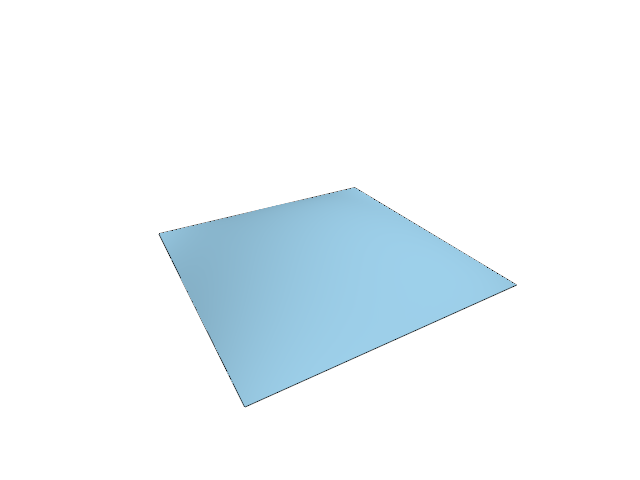

# 9.2 · Shared CAD boundaries across incident faces

**Section 6: CAD B-Rep Topology, World Text Atlases, Outlines, and Point Clouds** · **Checkpoints:** `56-chains` → `56b-boundaries` (3 steps) · **Production `session_viewer/src` target:** [app/walk/brep.rs](../../../../src/app/walk/brep.rs) · [app/walk/brep_edges.rs](../../../../src/app/walk/brep_edges.rs) · [app/walk/brep_orient.rs](../../../../src/app/walk/brep_orient.rs) · [app/walk/brep_shapes.rs](../../../../src/app/walk/brep_shapes.rs) · [engine/gpu/faces.rs](../../../../src/engine/gpu/faces.rs) (`src/app/walk/brep_shapes.rs,src/app/walk/brep_orient.rs,src/shaders/normals.wgsl`) · **Goal:** Prove straight and circular shared boundaries.

<div class="webgpu-schematic" style="width:100%;margin:8px auto;">
<svg xmlns="http://www.w3.org/2000/svg" width="1120" height="200" viewBox="0 0 1120 200" style="width:100%;max-width:100%;height:auto;display:block;margin:0 auto;" role="img">
  <defs>
    <marker id="arr" viewBox="0 0 10 10" refX="8" refY="5" markerWidth="6" markerHeight="6" orient="auto">
      <path d="M 0 1 L 9 5 L 0 9 z" fill="#111111"/>
    </marker>
    <marker id="arrR" viewBox="0 0 10 10" refX="8" refY="5" markerWidth="6" markerHeight="6" orient="auto">
      <path d="M 0 1 L 9 5 L 0 9 z" fill="#dc2626"/>
    </marker>
    <marker id="arrG" viewBox="0 0 10 10" refX="8" refY="5" markerWidth="6" markerHeight="6" orient="auto">
      <path d="M 0 1 L 9 5 L 0 9 z" fill="#16a34a"/>
    </marker>
    <marker id="arrB" viewBox="0 0 10 10" refX="8" refY="5" markerWidth="6" markerHeight="6" orient="auto">
      <path d="M 0 1 L 9 5 L 0 9 z" fill="#2563eb"/>
    </marker>
    <pattern id="hatch" width="6" height="6" patternTransform="rotate(45 0 0)" patternUnits="userSpaceOnUse">
      <line x1="0" y1="0" x2="0" y2="6" stroke="#111111" stroke-width="1"/>
    </pattern>
    <pattern id="dots" width="8" height="8" patternUnits="userSpaceOnUse">
      <circle cx="2" cy="2" r="1" fill="#111111"/>
    </pattern>
  </defs>
  <rect x="2" y="2" width="1116" height="196" rx="10" fill="#ffffff" stroke="#111111" stroke-width="2"/>
  <rect x="16" y="14" width="248" height="172" rx="8" fill="#ffffff" stroke="#111111" stroke-width="1.75"/>
  <text x="140" y="34" text-anchor="middle" font-family="monospace" font-size="11.5" font-weight="700" fill="#111111">1. Lesson 9.2 Code</text>
  <rect x="34" y="48" width="212" height="24" rx="4" fill="#ffffff" stroke="#111111" stroke-width="1.25"/>
  <text x="140" y="64" text-anchor="middle" font-family="monospace" font-size="10" font-weight="700" fill="#111111">src/cad_edges.rs</text>
  <rect x="34" y="78" width="212" height="24" rx="4" fill="url(#hatch)" stroke="#111111" stroke-width="1.25"/>
  <text x="140" y="94" text-anchor="middle" font-family="monospace" font-size="10" font-weight="700" fill="#111111">src/cad_boundary.rs</text>
  <rect x="34" y="108" width="212" height="24" rx="4" fill="#ffffff" stroke="#111111" stroke-width="1.25"/>
  <text x="140" y="124" text-anchor="middle" font-family="monospace" font-size="10" font-weight="700" fill="#111111">src/lib.rs</text>
  <text x="140" y="172" text-anchor="middle" font-family="monospace" font-size="9.5" fill="#111111">56-chains -&gt; 56b-boundaries</text>
  <line x1="264" y1="100" x2="292" y2="100" stroke="#111111" stroke-width="2" marker-end="url(#arr)"/>
  <rect x="296" y="14" width="248" height="172" rx="8" fill="#ffffff" stroke="#111111" stroke-width="1.75"/>
  <text x="420" y="34" text-anchor="middle" font-family="monospace" font-size="11.5" font-weight="700" fill="#111111">2. session_viewer/src</text>
  <rect x="314" y="48" width="212" height="26" rx="4" fill="url(#dots)" stroke="#111111" stroke-width="1.5"/>
  <text x="420" y="65" text-anchor="middle" font-family="monospace" font-size="10" font-weight="700" fill="#111111">src/app/walk/brep_shapes.…</text>
  <rect x="314" y="80" width="212" height="26" rx="4" fill="#ffffff" stroke="#111111" stroke-width="1.5"/>
  <text x="420" y="97" text-anchor="middle" font-family="monospace" font-size="10" font-weight="700" fill="#111111">src/app/walk/brep_orient.…</text>
  <rect x="314" y="112" width="212" height="24" rx="4" fill="url(#hatch)" stroke="#111111" stroke-width="1.25"/>
  <text x="420" y="128" text-anchor="middle" font-family="monospace" font-size="9.5" font-weight="700" fill="#111111">✓ cargo check (wasm32)</text>
  <text x="420" y="172" text-anchor="middle" font-family="sans-serif" font-size="10" fill="#111111">Connect original CAD edge…</text>
  <line x1="544" y1="100" x2="572" y2="100" stroke="#111111" stroke-width="2" marker-end="url(#arr)"/>
  <rect x="576" y="14" width="248" height="172" rx="8" fill="#ffffff" stroke="#111111" stroke-width="1.75"/>
  <text x="700" y="34" text-anchor="middle" font-family="monospace" font-size="11.5" font-weight="700" fill="#111111">3. Trimmed B-Rep (u,v)</text>
  <rect x="620" y="52" width="160" height="88" rx="6" fill="#dbeafe" stroke="#111111" stroke-width="2"/>
  <circle cx="700" cy="96" r="24" fill="#ffffff" stroke="#111111" stroke-width="2"/>
  <text x="700" y="100" text-anchor="middle" font-family="monospace" font-size="9.5" font-weight="700" fill="#111111">Hole</text>
  <text x="700" y="172" text-anchor="middle" font-family="monospace" font-size="9.5" fill="#111111">Shared CAD boundaries acros…</text>
  <line x1="824" y1="100" x2="852" y2="100" stroke="#111111" stroke-width="2" marker-end="url(#arr)"/>
  <rect x="856" y="14" width="248" height="172" rx="8" fill="#ffffff" stroke="#111111" stroke-width="1.75"/>
  <text x="980" y="34" text-anchor="middle" font-family="monospace" font-size="11.5" font-weight="700" fill="#111111">4. Crease Split Normals</text>
  <polyline points="894,136 974,90 1054,136" fill="none" stroke="#111111" stroke-width="2.5"/>
  <circle cx="974" cy="90" r="4.5" fill="#111111"/>
  <line x1="974" y1="90" x2="942" y2="52" stroke="#2563eb" stroke-width="2.25" marker-end="url(#arrB)"/>
  <line x1="974" y1="90" x2="1006" y2="52" stroke="#dc2626" stroke-width="2.25" marker-end="url(#arrR)"/>
  <text x="924" y="56" font-family="monospace" font-size="10" font-weight="700" fill="#2563eb">N1</text>
  <text x="1012" y="56" font-family="monospace" font-size="10" font-weight="700" fill="#dc2626">N2</text>
  <text x="980" y="172" text-anchor="middle" font-family="sans-serif" font-size="10" font-weight="700" fill="#111111">Prove straight and circul…</text>
</svg>
</div>

## <a id="checkpoint-56-chains"></a>Step 1 of 3 · Connect original CAD edge chains (`56-chains`)

<div class="webgpu-schematic" style="width:100%;margin:8px auto;">
<svg xmlns="http://www.w3.org/2000/svg" width="1120" height="76" viewBox="0 0 1120 76" style="width:100%;max-width:100%;height:auto;display:block;margin:0 auto;" role="img">
  <defs>
    <marker id="arr" viewBox="0 0 10 10" refX="8" refY="5" markerWidth="6" markerHeight="6" orient="auto">
      <path d="M 0 1 L 9 5 L 0 9 z" fill="#111111"/>
    </marker>
    <marker id="arrR" viewBox="0 0 10 10" refX="8" refY="5" markerWidth="6" markerHeight="6" orient="auto">
      <path d="M 0 1 L 9 5 L 0 9 z" fill="#dc2626"/>
    </marker>
    <marker id="arrG" viewBox="0 0 10 10" refX="8" refY="5" markerWidth="6" markerHeight="6" orient="auto">
      <path d="M 0 1 L 9 5 L 0 9 z" fill="#16a34a"/>
    </marker>
    <marker id="arrB" viewBox="0 0 10 10" refX="8" refY="5" markerWidth="6" markerHeight="6" orient="auto">
      <path d="M 0 1 L 9 5 L 0 9 z" fill="#2563eb"/>
    </marker>
    <pattern id="hatch" width="6" height="6" patternTransform="rotate(45 0 0)" patternUnits="userSpaceOnUse">
      <line x1="0" y1="0" x2="0" y2="6" stroke="#111111" stroke-width="1"/>
    </pattern>
    <pattern id="dots" width="8" height="8" patternUnits="userSpaceOnUse">
      <circle cx="2" cy="2" r="1" fill="#111111"/>
    </pattern>
  </defs>
  <rect x="2" y="2" width="1116" height="72" rx="10" fill="#ffffff" stroke="#111111" stroke-width="2"/>
  <rect x="14" y="12" width="252" height="52" rx="6" fill="#ffffff" stroke="#111111" stroke-width="1.5"/>
  <text x="140" y="32" text-anchor="middle" font-family="monospace" font-size="10.5" font-weight="700" fill="#111111">Step 1/3: 56-chains</text>
  <text x="140" y="50" text-anchor="middle" font-family="monospace" font-size="9.5" fill="#111111">src/cad_edges.rs</text>
  <line x1="266" y1="38" x2="292" y2="38" stroke="#111111" stroke-width="1.75" marker-end="url(#arr)"/>
  <rect x="296" y="12" width="252" height="52" rx="6" fill="url(#dots)" stroke="#111111" stroke-width="1.5"/>
  <text x="422" y="32" text-anchor="middle" font-family="monospace" font-size="10" font-weight="700" fill="#111111">1. CPU / Rust Input</text>
  <text x="422" y="50" text-anchor="middle" font-family="sans-serif" font-size="9.5" fill="#111111">original edge use</text>
  <line x1="548" y1="38" x2="574" y2="38" stroke="#111111" stroke-width="1.75" marker-end="url(#arr)"/>
  <rect x="578" y="12" width="252" height="52" rx="6" fill="url(#hatch)" stroke="#111111" stroke-width="1.5"/>
  <text x="704" y="32" text-anchor="middle" font-family="monospace" font-size="10" font-weight="700" fill="#111111">2. WebGPU / WGSL</text>
  <text x="704" y="50" text-anchor="middle" font-family="sans-serif" font-size="9.5" fill="#111111">face-mesh samples</text>
  <line x1="830" y1="38" x2="856" y2="38" stroke="#111111" stroke-width="1.75" marker-end="url(#arr)"/>
  <rect x="860" y="12" width="246" height="52" rx="6" fill="#ffffff" stroke="#111111" stroke-width="1.75"/>
  <text x="983" y="32" text-anchor="middle" font-family="monospace" font-size="10" font-weight="700" fill="#111111">3. -&gt; src/app/walk/brep_s…</text>
  <text x="983" y="50" text-anchor="middle" font-family="sans-serif" font-size="9.5" font-weight="700" fill="#111111">ordered CAD boundary chain</text>
</svg>
</div>

Reuse constrained-label and isoparametric lookup for each original edge. Skip degenerated edges and retain the owner face, ordered mesh keys and other incident face.

> **Check:** *Why use the actual face mesh for a boundary?* — The boundary must coincide with the triangles already meshed on its surface while retaining original CAD edge identity.

### 1. `src/cad_edges.rs`

Extend this original owner with today’s complete helper.

After that block, type:

```rust
pub fn edge_chains(b: &BRep, fms: &[Mesh]) -> Vec<Option<EdgeChain>> {
    let mut out = Vec::with_capacity(b.m_edges.len());

    for (ei, e) in b.m_edges.iter().enumerate() {
        if e.degenerated {
            out.push(None);
            continue;
        }

        let uses = b.edge_faces(ei);
        let mut found: Option<EdgeChain> = None;

        for (k, u) in uses.iter().enumerate() {
            let eu = EdgeUse {
                edge: ei,
                face: u.index as usize,
                orientation: u.orientation,
            };
            let keys = match constrained_chain(&fms[eu.face], ei) {
                Some(keys) => keys,
                None => match iso_chain(b, &fms[eu.face], &eu) {
                    Some(keys) => keys,
                    None => continue,
                },
            };
            let mut other = None;

            for (j, candidate) in uses.iter().enumerate() {
                if j != k && candidate.index as usize != eu.face {
                    other = Some(candidate.index as usize);
                    break;
                }
            }

            found = Some(EdgeChain {
                edge: ei,
                face: eu.face,
                keys,
                other,
            });
            break;
        }

        out.push(found);
    }

    out
}
```

**Result after `56-chains`:** The boundary lookup helpers are assembled for original BRep chains. The existing drawing remains available.

## <a id="checkpoint-56a-shared"></a>Step 2 of 3 · Mesh incident faces with shared boundary constraints (`56a-shared`)

<div class="webgpu-schematic" style="width:100%;margin:8px auto;">
<svg xmlns="http://www.w3.org/2000/svg" width="1120" height="76" viewBox="0 0 1120 76" style="width:100%;max-width:100%;height:auto;display:block;margin:0 auto;" role="img">
  <defs>
    <marker id="arr" viewBox="0 0 10 10" refX="8" refY="5" markerWidth="6" markerHeight="6" orient="auto">
      <path d="M 0 1 L 9 5 L 0 9 z" fill="#111111"/>
    </marker>
    <marker id="arrR" viewBox="0 0 10 10" refX="8" refY="5" markerWidth="6" markerHeight="6" orient="auto">
      <path d="M 0 1 L 9 5 L 0 9 z" fill="#dc2626"/>
    </marker>
    <marker id="arrG" viewBox="0 0 10 10" refX="8" refY="5" markerWidth="6" markerHeight="6" orient="auto">
      <path d="M 0 1 L 9 5 L 0 9 z" fill="#16a34a"/>
    </marker>
    <marker id="arrB" viewBox="0 0 10 10" refX="8" refY="5" markerWidth="6" markerHeight="6" orient="auto">
      <path d="M 0 1 L 9 5 L 0 9 z" fill="#2563eb"/>
    </marker>
    <pattern id="hatch" width="6" height="6" patternTransform="rotate(45 0 0)" patternUnits="userSpaceOnUse">
      <line x1="0" y1="0" x2="0" y2="6" stroke="#111111" stroke-width="1"/>
    </pattern>
    <pattern id="dots" width="8" height="8" patternUnits="userSpaceOnUse">
      <circle cx="2" cy="2" r="1" fill="#111111"/>
    </pattern>
  </defs>
  <rect x="2" y="2" width="1116" height="72" rx="10" fill="#ffffff" stroke="#111111" stroke-width="2"/>
  <rect x="14" y="12" width="252" height="52" rx="6" fill="#ffffff" stroke="#111111" stroke-width="1.5"/>
  <text x="140" y="32" text-anchor="middle" font-family="monospace" font-size="10.5" font-weight="700" fill="#111111">Step 2/3: 56a-shared</text>
  <text x="140" y="50" text-anchor="middle" font-family="monospace" font-size="9.5" fill="#111111">src/cad_boundary.rs, src/li…</text>
  <line x1="266" y1="38" x2="292" y2="38" stroke="#111111" stroke-width="1.75" marker-end="url(#arr)"/>
  <rect x="296" y="12" width="252" height="52" rx="6" fill="url(#dots)" stroke="#111111" stroke-width="1.5"/>
  <text x="422" y="32" text-anchor="middle" font-family="monospace" font-size="10" font-weight="700" fill="#111111">1. CPU / Rust Input</text>
  <text x="422" y="50" text-anchor="middle" font-family="sans-serif" font-size="9.5" fill="#111111">validated BRep</text>
  <line x1="548" y1="38" x2="574" y2="38" stroke="#111111" stroke-width="1.75" marker-end="url(#arr)"/>
  <rect x="578" y="12" width="252" height="52" rx="6" fill="url(#hatch)" stroke="#111111" stroke-width="1.5"/>
  <text x="704" y="32" text-anchor="middle" font-family="monospace" font-size="10" font-weight="700" fill="#111111">2. WebGPU / WGSL</text>
  <text x="704" y="50" text-anchor="middle" font-family="sans-serif" font-size="9.5" fill="#111111">face meshes</text>
  <line x1="830" y1="38" x2="856" y2="38" stroke="#111111" stroke-width="1.75" marker-end="url(#arr)"/>
  <rect x="860" y="12" width="246" height="52" rx="6" fill="#ffffff" stroke="#111111" stroke-width="1.75"/>
  <text x="983" y="32" text-anchor="middle" font-family="monospace" font-size="10" font-weight="700" fill="#111111">3. -&gt; src/app/walk/brep_s…</text>
  <text x="983" y="50" text-anchor="middle" font-family="sans-serif" font-size="9.5" font-weight="700" fill="#111111">source-owned edge chains</text>
</svg>
</div>

Validate topology and surface control storage, then ask the kernel for all face meshes together at the current five-degree and 0.001 chord quality. Retain original source ownership beside their coherent chains.

> **Check:** *Does sharing a boundary require sharing normals across its two faces?* — No. Incident faces agree on boundary positions while retaining their own normals. A sharp corner keeps its shading discontinuity, and a curved cap and wall meet without a gap.

### 1. `src/cad_boundary.rs`

Validate references and retain one source-owned preparation of all incident face meshes.

Create the file and type:

```rust
--8<-- "journey/code/56a-shared-01.rs"
```

### 2. `src/lib.rs`

Register the source component.

After that block, type:

```rust
--8<-- "journey/code/56a-shared-02.rs" skip=20
```

## <a id="checkpoint-56b-boundaries"></a>Step 3 of 3 · Prove straight and circular shared boundaries (`56b-boundaries`)

<div class="webgpu-schematic" style="width:100%;margin:8px auto;">
<svg xmlns="http://www.w3.org/2000/svg" width="1120" height="76" viewBox="0 0 1120 76" style="width:100%;max-width:100%;height:auto;display:block;margin:0 auto;" role="img">
  <defs>
    <marker id="arr" viewBox="0 0 10 10" refX="8" refY="5" markerWidth="6" markerHeight="6" orient="auto">
      <path d="M 0 1 L 9 5 L 0 9 z" fill="#111111"/>
    </marker>
    <marker id="arrR" viewBox="0 0 10 10" refX="8" refY="5" markerWidth="6" markerHeight="6" orient="auto">
      <path d="M 0 1 L 9 5 L 0 9 z" fill="#dc2626"/>
    </marker>
    <marker id="arrG" viewBox="0 0 10 10" refX="8" refY="5" markerWidth="6" markerHeight="6" orient="auto">
      <path d="M 0 1 L 9 5 L 0 9 z" fill="#16a34a"/>
    </marker>
    <marker id="arrB" viewBox="0 0 10 10" refX="8" refY="5" markerWidth="6" markerHeight="6" orient="auto">
      <path d="M 0 1 L 9 5 L 0 9 z" fill="#2563eb"/>
    </marker>
    <pattern id="hatch" width="6" height="6" patternTransform="rotate(45 0 0)" patternUnits="userSpaceOnUse">
      <line x1="0" y1="0" x2="0" y2="6" stroke="#111111" stroke-width="1"/>
    </pattern>
    <pattern id="dots" width="8" height="8" patternUnits="userSpaceOnUse">
      <circle cx="2" cy="2" r="1" fill="#111111"/>
    </pattern>
  </defs>
  <rect x="2" y="2" width="1116" height="72" rx="10" fill="#ffffff" stroke="#111111" stroke-width="2"/>
  <rect x="14" y="12" width="252" height="52" rx="6" fill="#ffffff" stroke="#111111" stroke-width="1.5"/>
  <text x="140" y="32" text-anchor="middle" font-family="monospace" font-size="10.5" font-weight="700" fill="#111111">Step 3/3: 56b-boundaries</text>
  <text x="140" y="50" text-anchor="middle" font-family="monospace" font-size="9.5" fill="#111111">src/cad_boundary_tests.rs,…</text>
  <line x1="266" y1="38" x2="292" y2="38" stroke="#111111" stroke-width="1.75" marker-end="url(#arr)"/>
  <rect x="296" y="12" width="252" height="52" rx="6" fill="url(#dots)" stroke="#111111" stroke-width="1.5"/>
  <text x="422" y="32" text-anchor="middle" font-family="monospace" font-size="10" font-weight="700" fill="#111111">1. CPU / Rust Input</text>
  <text x="422" y="50" text-anchor="middle" font-family="sans-serif" font-size="9.5" fill="#111111">shared boundary chain</text>
  <line x1="548" y1="38" x2="574" y2="38" stroke="#111111" stroke-width="1.75" marker-end="url(#arr)"/>
  <rect x="578" y="12" width="252" height="52" rx="6" fill="url(#hatch)" stroke="#111111" stroke-width="1.5"/>
  <text x="704" y="32" text-anchor="middle" font-family="monospace" font-size="10" font-weight="700" fill="#111111">2. WebGPU / WGSL</text>
  <text x="704" y="50" text-anchor="middle" font-family="sans-serif" font-size="9.5" fill="#111111">unchanged source</text>
  <line x1="830" y1="38" x2="856" y2="38" stroke="#111111" stroke-width="1.75" marker-end="url(#arr)"/>
  <rect x="860" y="12" width="246" height="52" rx="6" fill="#ffffff" stroke="#111111" stroke-width="1.75"/>
  <text x="983" y="32" text-anchor="middle" font-family="monospace" font-size="10" font-weight="700" fill="#111111">3. -&gt; src/app/walk/brep_s…</text>
  <text x="983" y="50" text-anchor="middle" font-family="sans-serif" font-size="9.5" font-weight="700" fill="#111111">released owner</text>
</svg>
</div>

Copy checks that compare boundary positions against both incident faces, preserve original BRep serialization and verify that preparation releases its source owner.

> **Check:** *What must remain unchanged when display quality changes?* — The original BRep, its face and edge topology, control values and source identity remain unchanged. Mesh vertex keys and display samples belong to the derived preparation.

**Supplied validation fixture:**

Copy this supplied authoring fixture once. Continue with the browser build below; the course does not require running native tests.

### 1. `src/cad_boundary_tests.rs`

Copy independent incident-face position, source ownership and malformed-input checks.

Copy this supplied file:

```text
--8<-- "journey/code/56b-boundaries-01.rs"
```

**Supplied validation fixture:**

Copy this supplied authoring fixture once. Continue with the browser build below; the course does not require running native tests.

### 2. `src/lib.rs`

Register the source component.

After that block, append this supplied code:

```text
--8<-- "journey/code/56b-boundaries-02.rs" skip=23
```

## Build, Verify & Visual Result



```sh
cd workspace/journey
REGEN_PROTO=0 cargo build --lib --locked --target wasm32-unknown-unknown -j1
REGEN_PROTO=0 CARGO_BUILD_JOBS=1 trunk serve --port 8780
cd ../..
npm --prefix ../session_tests run course -- check 9.2
npm --prefix ../session_tests run course -- save 9.2
```

Open `http://127.0.0.1:8780/` to inspect the live WebGPU canvas, or use [checkpoint recovery](../../recovery.md).

Continue with [9.3 · Trimmed curved faces with real open holes](../../consolidation/57-parameters.md).
