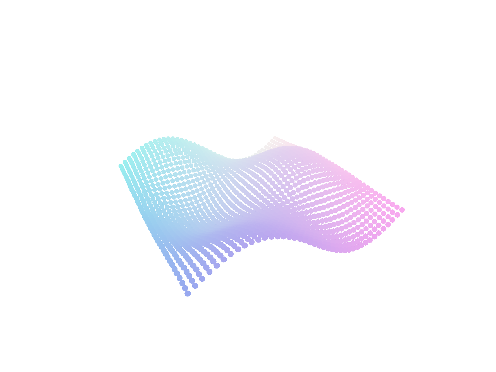

# 11.3 · View-dependent LOD and cached point splats

**Steps:** 19 · **Source:** [engine/gpu/surface_outline.rs](../../../../src/engine/gpu/surface_outline.rs) · [engine/gpu/cloud.rs](../../../../src/engine/gpu/cloud.rs) · [engine/gpu/lod.rs](../../../../src/engine/gpu/lod.rs) · [engine/gpu/splat.rs](../../../../src/engine/gpu/splat.rs)

<div class="webgpu-schematic" style="width:100%;margin:6px auto;">
<svg xmlns="http://www.w3.org/2000/svg" width="1120" height="188" viewBox="0 0 1120 188" style="width:100%;max-width:100%;height:auto;display:block;margin:0 auto;" role="img">
  <defs>
    <marker id="arr" viewBox="0 0 10 10" refX="8" refY="5" markerWidth="6" markerHeight="6" orient="auto">
      <path d="M 0 1 L 9 5 L 0 9 z" fill="#111111"/>
    </marker>
    <marker id="arrR" viewBox="0 0 10 10" refX="8" refY="5" markerWidth="6" markerHeight="6" orient="auto">
      <path d="M 0 1 L 9 5 L 0 9 z" fill="#dc2626"/>
    </marker>
    <marker id="arrG" viewBox="0 0 10 10" refX="8" refY="5" markerWidth="6" markerHeight="6" orient="auto">
      <path d="M 0 1 L 9 5 L 0 9 z" fill="#16a34a"/>
    </marker>
    <marker id="arrB" viewBox="0 0 10 10" refX="8" refY="5" markerWidth="6" markerHeight="6" orient="auto">
      <path d="M 0 1 L 9 5 L 0 9 z" fill="#2563eb"/>
    </marker>
  </defs>
  <rect x="2" y="2" width="1116" height="184" rx="10" fill="#ffffff" stroke="#111111" stroke-width="2"/>
  <rect x="14" y="12" width="344" height="164" rx="8" fill="#ffffff" stroke="#111111" stroke-width="1.5"/>
  <text paint-order="stroke fill" stroke="#ffffff" stroke-width="5" stroke-linejoin="round" x="186" y="30" text-anchor="middle" font-family="monospace" font-size="10.5" font-weight="700" fill="#111111">3×3 Neighborhood: ID_center != ID_neighbor or Δz &gt; τ</text>
  <rect x="86" y="50" width="168" height="104" fill="#ffffff" stroke="#111111" stroke-width="1.5"/>
  <line x1="142" y1="50" x2="142" y2="154" stroke="#111111" stroke-width="1"/>
  <line x1="198" y1="50" x2="198" y2="154" stroke="#111111" stroke-width="1"/>
  <line x1="86" y1="85" x2="254" y2="85" stroke="#111111" stroke-width="1"/>
  <line x1="86" y1="120" x2="254" y2="120" stroke="#111111" stroke-width="1"/>
  <rect x="142" y="85" width="56" height="35" fill="#dbeafe" stroke="#2563eb" stroke-width="2"/>
  <text paint-order="stroke fill" stroke="#ffffff" stroke-width="5" stroke-linejoin="round" x="170" y="106" text-anchor="middle" font-family="monospace" font-size="9.5" font-weight="700" fill="#111111">id=4</text>
  <text paint-order="stroke fill" stroke="#ffffff" stroke-width="5" stroke-linejoin="round" x="114" y="72" text-anchor="middle" font-family="monospace" font-size="9.5" fill="#64748b">id=0</text>
  <text paint-order="stroke fill" stroke="#ffffff" stroke-width="5" stroke-linejoin="round" x="226" y="142" text-anchor="middle" font-family="monospace" font-size="9.5" fill="#111111">id=4</text>
  <line x1="358" y1="94" x2="384" y2="94" stroke="#111111" stroke-width="2" marker-end="url(#arr)"/>
  <rect x="388" y="12" width="344" height="164" rx="8" fill="#ffffff" stroke="#111111" stroke-width="1.5"/>
  <text paint-order="stroke fill" stroke="#ffffff" stroke-width="5" stroke-linejoin="round" x="560" y="30" text-anchor="middle" font-family="monospace" font-size="10.5" font-weight="700" fill="#111111">Point Cloud Quad Splat: r_px = clamp(size / w, r_min, r_max)</text>
  <circle cx="484" cy="96" r="24" fill="#dbeafe" stroke="#2563eb" stroke-width="2"/>
  <circle cx="546" cy="84" r="18" fill="#bbf7d0" stroke="#16a34a" stroke-width="2"/>
  <circle cx="524" cy="128" r="20" fill="#fef08a" stroke="#d97706" stroke-width="2"/>
  <circle cx="626" cy="104" r="30" fill="#fee2e2" stroke="#dc2626" stroke-width="2"/>
  <line x1="626" y1="104" x2="656" y2="104" stroke="#111111" stroke-width="1.5"/>
  <text paint-order="stroke fill" stroke="#ffffff" stroke-width="5" stroke-linejoin="round" x="641" y="96" text-anchor="middle" font-family="monospace" font-size="9.5" font-weight="700" fill="#111111">r</text>
  <line x1="732" y1="94" x2="758" y2="94" stroke="#111111" stroke-width="2" marker-end="url(#arr)"/>
  <rect x="762" y="12" width="344" height="164" rx="8" fill="#ffffff" stroke="#111111" stroke-width="1.75"/>
  <text paint-order="stroke fill" stroke="#ffffff" stroke-width="5" stroke-linejoin="round" x="934" y="30" text-anchor="middle" font-family="monospace" font-size="10.5" font-weight="700" fill="#111111">Silhouette Outlines + Dense Splat Cloud</text>
  <rect x="806" y="44" width="256" height="118" rx="4" fill="#ffffff" stroke="#111111" stroke-width="2"/>
  <polygon points="838,142 888,64 938,142" fill="#dbeafe" stroke="#dc2626" stroke-width="3.5"/>
  <circle cx="978" cy="84" r="8" fill="#2563eb"/>
  <circle cx="998" cy="76" r="7" fill="#16a34a"/>
  <circle cx="1016" cy="94" r="8" fill="#d97706"/>
  <circle cx="988" cy="108" r="9" fill="#dc2626"/>
  <circle cx="1012" cy="122" r="7" fill="#2563eb"/>
</svg>
</div>

## <a id="checkpoint-64f-projection"></a>1. Measure point spacing in the current projection

<div class="webgpu-schematic" style="width:100%;margin:6px auto;">
<svg xmlns="http://www.w3.org/2000/svg" width="1120" height="188" viewBox="0 0 1120 188" style="width:100%;max-width:100%;height:auto;display:block;margin:0 auto;" role="img">
  <defs>
    <marker id="arr" viewBox="0 0 10 10" refX="8" refY="5" markerWidth="6" markerHeight="6" orient="auto">
      <path d="M 0 1 L 9 5 L 0 9 z" fill="#111111"/>
    </marker>
    <marker id="arrR" viewBox="0 0 10 10" refX="8" refY="5" markerWidth="6" markerHeight="6" orient="auto">
      <path d="M 0 1 L 9 5 L 0 9 z" fill="#dc2626"/>
    </marker>
    <marker id="arrG" viewBox="0 0 10 10" refX="8" refY="5" markerWidth="6" markerHeight="6" orient="auto">
      <path d="M 0 1 L 9 5 L 0 9 z" fill="#16a34a"/>
    </marker>
    <marker id="arrB" viewBox="0 0 10 10" refX="8" refY="5" markerWidth="6" markerHeight="6" orient="auto">
      <path d="M 0 1 L 9 5 L 0 9 z" fill="#2563eb"/>
    </marker>
  </defs>
  <rect x="2" y="2" width="1116" height="184" rx="10" fill="#ffffff" stroke="#111111" stroke-width="2"/>
  <rect x="14" y="12" width="344" height="164" rx="8" fill="#ffffff" stroke="#111111" stroke-width="1.5"/>
  <text paint-order="stroke fill" stroke="#ffffff" stroke-width="5" stroke-linejoin="round" x="186" y="30" text-anchor="middle" font-family="monospace" font-size="10.5" font-weight="700" fill="#111111">Curve Quadrature ∑ w_i ||C'(t_i)|| &amp; Surface Patch dA = ||Su×Sv||</text>
  <path d="M 56 138 Q 112 52 176 126" fill="none" stroke="#dc2626" stroke-width="2.5"/>
  <circle cx="84" cy="98" r="4" fill="#fef08a" stroke="#111111" stroke-width="1.5"/>
  <circle cx="116" cy="84" r="4" fill="#fef08a" stroke="#111111" stroke-width="1.5"/>
  <circle cx="148" cy="98" r="4" fill="#fef08a" stroke="#111111" stroke-width="1.5"/>
  <polygon points="196,136 226,74 288,74 258,136" fill="#dbeafe" stroke="#111111" stroke-width="1.75"/>
  <line x1="226" y1="105" x2="268" y2="105" stroke="#2563eb" stroke-width="2" marker-end="url(#arrB)"/>
  <line x1="226" y1="105" x2="242" y2="74" stroke="#16a34a" stroke-width="2" marker-end="url(#arrG)"/>
  <line x1="358" y1="94" x2="384" y2="94" stroke="#111111" stroke-width="2" marker-end="url(#arr)"/>
  <rect x="388" y="12" width="344" height="164" rx="8" fill="#ffffff" stroke="#111111" stroke-width="1.5"/>
  <text paint-order="stroke fill" stroke="#ffffff" stroke-width="5" stroke-linejoin="round" x="560" y="30" text-anchor="middle" font-family="monospace" font-size="10.5" font-weight="700" fill="#111111">Divergence Volume: V = (1/6) ∑ det(v0, v1, v2) &amp; Centroid C_g</text>
  <circle cx="448" cy="138" r="4.5" fill="#111111"/>
  <text paint-order="stroke fill" stroke="#ffffff" stroke-width="5" stroke-linejoin="round" x="448" y="154" text-anchor="middle" font-family="monospace" font-size="9" font-weight="700" fill="#111111">Origin O</text>
  <polygon points="448,138 556,58 656,92" fill="#dbeafe" fill-opacity="0.55" stroke="#2563eb" stroke-width="1.5" stroke-dasharray="4 3"/>
  <polygon points="556,58 656,92 596,142" fill="#93c5fd" stroke="#111111" stroke-width="2"/>
  <circle cx="576" cy="104" r="5" fill="#fef08a" stroke="#dc2626" stroke-width="2"/>
  <line x1="732" y1="94" x2="758" y2="94" stroke="#111111" stroke-width="2" marker-end="url(#arr)"/>
  <rect x="762" y="12" width="344" height="164" rx="8" fill="#ffffff" stroke="#111111" stroke-width="1.75"/>
  <text paint-order="stroke fill" stroke="#ffffff" stroke-width="5" stroke-linejoin="round" x="934" y="30" text-anchor="middle" font-family="monospace" font-size="10.5" font-weight="700" fill="#111111">Exact Length, Area, Volume &amp; Centroid Marker</text>
  <rect x="806" y="44" width="256" height="118" rx="4" fill="#ffffff" stroke="#111111" stroke-width="2"/>
  <polygon points="846,136 894,64 988,64 940,136" fill="#dbeafe" stroke="#111111" stroke-width="2"/>
  <circle cx="917" cy="100" r="6" fill="#fef08a" stroke="#dc2626" stroke-width="2.2"/>
  <text paint-order="stroke fill" stroke="#ffffff" stroke-width="5" stroke-linejoin="round" x="1016" y="96" text-anchor="middle" font-family="monospace" font-size="9.5" font-weight="700" fill="#111111">C_g</text>
</svg>
</div>

### 1. `src/cloud_lod.rs`

Create the file and type:

```rust
use crate::cloud::{Cloud, LodNode};
use session_rust::Xform;

const LOD_MIN_POINTS: u32 = 2_000_000;

pub struct Range {
    pub first: u32,   // first point in the cloud
    pub count: u32,   // points in the run
    pub spacing: f32, // distance between points
    pub tile: bool,   // true = an octree node, not the whole cloud
}

struct Visit {
    first: u32,    // first point in the cloud
    count: u32,    // points in the node
    spacing: f32,  // finest spacing found in or below it
    parent: usize, // index of the parent visit
}

pub struct Projection<'a> {
    pub eye: [f32; 3],        // camera position
    pub ortho_h: f32,         // ortho half-height, world mm; 0 = perspective
    pub height_px: u32,       // viewport height, px
    pub lod_px: f32,          // split a node while its spacing is wider than this
    pub nodes: &'a [LodNode], // every cloud's octree nodes
}

#[derive(Default)]
pub struct LodWalk {
    pub ranges: Vec<Range>,     // result: the runs to draw
    stack: Vec<(usize, usize)>, // nodes still to visit, with parent
    visits: Vec<Visit>,         // nodes visited
}

fn projected_spacing(
    p: &Projection,
    node: &LodNode,
    model: &[f32; 16],
    scale: f64,
) -> f64 {
    let world = node.spacing as f64 * scale * 0.001;
    let c = node.center;
    let wx = (model[0] * c[0] + model[4] * c[1] + model[8] * c[2] + model[12]) as f64;
    let wy = (model[1] * c[0] + model[5] * c[1] + model[9] * c[2] + model[13]) as f64;
    let wz = (model[2] * c[0] + model[6] * c[1] + model[10] * c[2] + model[14]) as f64;
    let e = p.eye;
    let dist = ((wx - e[0] as f64).powi(2)
        + (wy - e[1] as f64).powi(2)
        + (wz - e[2] as f64).powi(2))
    .sqrt()
    .max(1.0e-6)
        * 0.001;
    let frac = if p.ortho_h > 0.0 {
        world / (2.0 * p.ortho_h as f64 * 0.001)
    } else {
        world * 1.7320508 * 0.5 / dist
    };
    frac * p.height_px as f64
}

pub fn radius_factor(r: &Range, px: f32, scale: f64, ortho_h: f32) -> f32 {
    let mut world_r =
        (r.spacing as f64).max(1.0e-9) * scale * 0.001 * (px as f64) / 6.0;

    if r.tile {
        world_r = world_r.max(r.spacing as f64 * scale * 0.001 * 0.5);
    }

    let k = if ortho_h > 0.0 {
        world_r / (2.0 * ortho_h as f64 * 0.001)
    } else {
        world_r * 1.7320508 * 0.5
    };
    k as f32
}
```

### 2. `src/lib.rs`

**Locate this existing block:**

```rust
mod outline_math_tests;

pub mod cloud;
```

Edit the existing block to match this code; keep unchanged lines:

```rust
mod outline_math_tests;

pub mod cloud;

pub mod cloud_lod;
```

## <a id="checkpoint-64g-detail"></a>2. Walk only detail whose screen spacing needs refinement

### 1. `src/cloud_lod.rs`

**Locate this existing block:**

```rust
}

fn projected_spacing(
```

Edit the existing block to match this code; keep unchanged lines:

```rust
}

impl LodWalk {
    pub fn select(&mut self, p: &Projection, c: &Cloud, model: &[f32; 16]) {
        self.ranges.clear();

        if c.node_count == 0 || p.lod_px <= 0.0 || c.resident < LOD_MIN_POINTS {
            self.ranges.push(Range {
                first: 0,
                count: c.resident,
                spacing: c.spacing,
                tile: false,
            });
            return;
        }

        let base = c.node_first as usize;
        let scale = Xform::from_matrix(model.map(f64::from)).uniform_scale();
        self.stack.clear();
        self.visits.clear();
        self.stack.push((0, usize::MAX));

        while let Some((n, parent)) = self.stack.pop() {
            let Some(node) = p.nodes.get(base + n) else {
                continue;
            };

            if node.first >= c.resident {
                continue;
            }

            let count = node.count.min(c.resident - node.first);
            let slot = self.visits.len();
            self.visits.push(Visit {
                first: node.first,
                count,
                spacing: node.spacing,
                parent,
            });

            if projected_spacing(p, node, model, scale) > p.lod_px as f64 {
                for &child in &node.children {
                    if child >= 0 {
                        self.stack.push((child as usize, slot));
                    }
                }
            }
        }

        for i in (0..self.visits.len()).rev() {
            let (fine, parent) = (self.visits[i].spacing, self.visits[i].parent);

            if parent != usize::MAX && fine < self.visits[parent].spacing {
                self.visits[parent].spacing = fine;
            }
        }

        for v in &self.visits {
            if v.count > 0 {
                self.ranges.push(Range {
                    first: v.first,
                    count: v.count,
                    spacing: v.spacing,
                    tile: true,
                });
            }
        }
    }
}

fn projected_spacing(
```

### 2. `src/cloud_tests.rs`

Create the file and type:

```rust
use crate::cloud::{Cloud, LodNode, Prepared};
use session_rust::{PointCloud, Xform};
use std::rc::Rc;

fn source() -> PointCloud {
    let coords = (0..121)
        .flat_map(|i| {
            [
                (i % 11) as f64 * 0.1,
                (i / 11) as f64 * 0.1,
                0.5,
            ]
        })
        .collect();
    PointCloud::from_coords(coords, vec![], vec![])
}
#[test]
fn cloud_lod_preparation_keeps_original_coordinates_ids_and_source_lifetime() {
    let mut source = source();
    let original = source
        .coords()
        .chunks_exact(3)
        .map(|p| [p[0], p[1], p[2]])
        .collect::<Vec<_>>();
    source.build_lod(0.25, 8);
    let source = Rc::new(source);
    let _ = source.guid();
    let before = source.to_proto();
    let prepared = Prepared::new(source.clone()).unwrap();
    assert!(!prepared.nodes.is_empty());
    for (i, id) in source.point_ids().iter().enumerate() {
        assert_eq!(
            &source.coords()[i * 3..i * 3 + 3],
            &original[*id as usize]
        );
    }
    assert_eq!(source.to_proto(), before);
    assert_eq!(prepared.bounds.min, [0., 0., 0.5]);
    assert_eq!(prepared.bounds.max, [1., 1., 0.5]);
    let weak = Rc::downgrade(&source);
    drop(source);
    assert!(weak.upgrade().is_some());
    drop(prepared);
    assert!(weak.upgrade().is_none());
}
#[test]
fn cloud_rejects_malformed_octree_columns_repeated_owners_and_source_ids() {
    let mut source = source();
    source.build_lod(0.25, 8);
    let baseline = source.to_proto();
    assert!(baseline.lod_size.len() > 1);
    let mut bad = baseline.clone();
    bad.lod_children.pop();
    assert!(Prepared::new(Rc::new(PointCloud::from_proto(bad))).is_err());
    let mut bad = baseline.clone();
    bad.lod_children[0] = 0;
    assert!(Prepared::new(Rc::new(PointCloud::from_proto(bad))).is_err());
    let mut bad = baseline.clone();
    bad.lod_first[1] = bad.lod_first[0];
    bad.lod_count[1] = 1;
    assert!(Prepared::new(Rc::new(PointCloud::from_proto(bad))).is_err());
    let mut bad = baseline.clone();
    bad.point_ids[1] = bad.point_ids[0];
    assert!(Prepared::new(Rc::new(PointCloud::from_proto(bad))).is_err());
    let mut bad = baseline.clone();
    bad.lod_min[0] += 100.;
    assert!(Prepared::new(Rc::new(PointCloud::from_proto(bad))).is_err());
    let mut bad = baseline;
    bad.coords[0] = f64::NAN;
    assert!(Prepared::new(Rc::new(PointCloud::from_proto(bad))).is_err());
}
#[test]
fn current_cloud_lod_walk_obeys_screen_spacing_small_clouds_and_resident_prefixes() {
    use crate::cloud_lod::{LodWalk, Projection};
    let nodes = [
        LodNode {
            center: [0.; 3],
            size: 1.,
            spacing: 1.,
            first: 0,
            count: 1,
            children: [1, -1, -1, -1, -1, -1, -1, -1],
        },
        LodNode {
            center: [0.; 3],
            size: 0.5,
            spacing: 0.1,
            first: 1,
            count: 9,
            children: [-1; 8],
        },
    ];
    let mut walk = LodWalk::default();
    let mut cloud = Cloud {
        spacing: 1.,
        node_first: 0,
        node_count: 2,
        resident: 2_000_000,
    };
    let mut view = Projection {
        eye: [0., 0., 3.],
        ortho_h: 100.,
        height_px: 200,
        lod_px: 2.,
        nodes: &nodes,
    };
    let model = Xform::identity().to_f32();
    walk.select(&view, &cloud, &model);
    assert_eq!(
        walk.ranges
            .iter()
            .map(|r| (r.first, r.count))
            .collect::<Vec<_>>(),
        [(0, 1)]
    );
    view.ortho_h = 1.;
    walk.select(&view, &cloud, &model);
    assert_eq!(
        walk.ranges
            .iter()
            .map(|r| (r.first, r.count))
            .collect::<Vec<_>>(),
        [(0, 1), (1, 9)]
    );
    assert!(
        walk.ranges
            .iter()
            .all(|r| r.spacing == 0.1 && r.tile)
    );
    cloud.resident = 7;
    walk.select(&view, &cloud, &model);
    assert_eq!(
        (
            walk.ranges[0].first,
            walk.ranges[0].count,
            walk.ranges[0].tile
        ),
        (0, 7, false)
    );
    cloud.resident = 2_000_000;
    view.lod_px = 0.;
    walk.select(&view, &cloud, &model);
    assert_eq!(walk.ranges[0].count, 2_000_000);
}
#[test]
fn current_cloud_radius_factor_keeps_tile_spacing_and_object_scale() {
    use crate::cloud_lod::{Range, radius_factor};
    let run = Range {
        first: 0,
        count: 7,
        spacing: 12.,
        tile: false,
    };
    let tile = Range {
        tile: true,
        ..run
    };
    assert!((radius_factor(&run, 6., 2., 100.) - 0.12).abs() < 1e-6);
    assert!((radius_factor(&tile, 1., 2., 100.) - 0.06).abs() < 1e-6);
    assert!(radius_factor(&run, 6., 2., 0.) > radius_factor(&run, 6., 1., 0.));
}
#[test]
fn cloud_row_copy_layers_placement_delete_undo_and_close_share_one_precise_source() {
    use crate::editor::{Action, Editor};
    let mut editor = Editor::default();
    editor.apply(Action::Close).unwrap();
    let source = Rc::new(source());
    let id = editor
        .scene
        .insert_cloud(Prepared::new(source.clone()).unwrap())
        .unwrap();
    let weak = Rc::downgrade(&source);
    drop(source);
    editor
        .apply(Action::Picked(Some(id)))
        .unwrap();
    let original = editor.scene.clouds()[0]
        .prepared
        .source
        .coords()
        .to_vec();
    let mut history = crate::history::History::default();
    history
        .try_edit(&mut editor.scene, |scene| {
            scene.translate(id, [1_000_000_000.125, 0., 0.])
        })
        .unwrap();
    assert_eq!(
        editor.scene.clouds()[0].model.m[12],
        1_000_000_000.125
    );
    history.undo(&mut editor.scene);
    assert_eq!(editor.scene.clouds()[0].model.m[12], 0.);
    history.redo(&mut editor.scene);
    let copy = editor.scene.copy_row(id, false).unwrap();
    assert_ne!(copy, id);
    assert!(Rc::ptr_eq(
        &editor.scene.clouds()[0].prepared.source,
        &editor.scene.clouds()[1].prepared.source
    ));
    assert_eq!(
        editor.scene.clouds()[0]
            .prepared
            .source
            .coords(),
        original
    );
    assert!(crate::document::snapshot(&editor.scene).is_err());
    editor.apply(Action::SelectAll).unwrap();
    assert_eq!(editor.selected_objects().len(), 2);
    editor.apply(Action::Delete).unwrap();
    assert!(editor.scene.clouds().is_empty());
    editor.apply(Action::Undo).unwrap();
    assert_eq!(editor.scene.clouds().len(), 2);
    editor.apply(Action::Close).unwrap();
    drop(history);
    assert!(weak.upgrade().is_none());
}
```

### 3. `src/lib.rs`

**Locate this existing block:**

```rust
pub mod cloud;

pub mod cloud_lod;
```

Edit the existing block to match this code; keep unchanged lines:

```rust
pub mod cloud;

pub mod cloud_lod;

#[cfg(test)]
mod cloud_tests;
```

## <a id="checkpoint-64h-shaders"></a>3. Declare point-cloud records and decode source normals

<div class="webgpu-schematic" style="width:100%;margin:6px auto;">
<svg xmlns="http://www.w3.org/2000/svg" width="1120" height="188" viewBox="0 0 1120 188" style="width:100%;max-width:100%;height:auto;display:block;margin:0 auto;" role="img">
  <defs>
    <marker id="arr" viewBox="0 0 10 10" refX="8" refY="5" markerWidth="6" markerHeight="6" orient="auto">
      <path d="M 0 1 L 9 5 L 0 9 z" fill="#111111"/>
    </marker>
    <marker id="arrR" viewBox="0 0 10 10" refX="8" refY="5" markerWidth="6" markerHeight="6" orient="auto">
      <path d="M 0 1 L 9 5 L 0 9 z" fill="#dc2626"/>
    </marker>
    <marker id="arrG" viewBox="0 0 10 10" refX="8" refY="5" markerWidth="6" markerHeight="6" orient="auto">
      <path d="M 0 1 L 9 5 L 0 9 z" fill="#16a34a"/>
    </marker>
    <marker id="arrB" viewBox="0 0 10 10" refX="8" refY="5" markerWidth="6" markerHeight="6" orient="auto">
      <path d="M 0 1 L 9 5 L 0 9 z" fill="#2563eb"/>
    </marker>
  </defs>
  <rect x="2" y="2" width="1116" height="184" rx="10" fill="#ffffff" stroke="#111111" stroke-width="2"/>
  <rect x="14" y="12" width="344" height="164" rx="8" fill="#ffffff" stroke="#111111" stroke-width="1.5"/>
  <text paint-order="stroke fill" stroke="#ffffff" stroke-width="5" stroke-linejoin="round" x="186" y="30" text-anchor="middle" font-family="monospace" font-size="10.5" font-weight="700" fill="#111111">CPU RAM: #[repr(C)] Structs -&gt; bytemuck::cast_slice</text>
  <rect x="46" y="54" width="280" height="44" fill="#f8fafc" stroke="#111111" stroke-width="1.75"/>
  <rect x="52" y="60" width="64" height="32" fill="#dbeafe" stroke="#2563eb" stroke-width="1.5"/>
  <text paint-order="stroke fill" stroke="#ffffff" stroke-width="5" stroke-linejoin="round" x="84" y="80" text-anchor="middle" font-family="monospace" font-size="9.5" font-weight="700" fill="#111111">v0: 24B</text>
  <rect x="122" y="60" width="64" height="32" fill="#dbeafe" stroke="#2563eb" stroke-width="1.5"/>
  <text paint-order="stroke fill" stroke="#ffffff" stroke-width="5" stroke-linejoin="round" x="154" y="80" text-anchor="middle" font-family="monospace" font-size="9.5" font-weight="700" fill="#111111">v1: 24B</text>
  <rect x="192" y="60" width="64" height="32" fill="#dbeafe" stroke="#2563eb" stroke-width="1.5"/>
  <text paint-order="stroke fill" stroke="#ffffff" stroke-width="5" stroke-linejoin="round" x="224" y="80" text-anchor="middle" font-family="monospace" font-size="9.5" font-weight="700" fill="#111111">v2: 24B</text>
  <text paint-order="stroke fill" stroke="#ffffff" stroke-width="5" stroke-linejoin="round" x="290" y="80" text-anchor="middle" font-family="monospace" font-size="10" font-weight="700" fill="#111111">...</text>
  <rect x="66" y="112" width="240" height="34" rx="4" fill="#fef08a" stroke="#111111" stroke-width="1.5"/>
  <text paint-order="stroke fill" stroke="#ffffff" stroke-width="5" stroke-linejoin="round" x="186" y="133" text-anchor="middle" font-family="monospace" font-size="9.5" font-weight="700" fill="#111111">&amp;[u8] Contiguous Byte Slice</text>
  <line x1="358" y1="94" x2="384" y2="94" stroke="#111111" stroke-width="2" marker-end="url(#arr)"/>
  <rect x="388" y="12" width="344" height="164" rx="8" fill="#ffffff" stroke="#111111" stroke-width="1.5"/>
  <text paint-order="stroke fill" stroke="#ffffff" stroke-width="5" stroke-linejoin="round" x="560" y="30" text-anchor="middle" font-family="monospace" font-size="10.5" font-weight="700" fill="#111111">CPU -&gt; GPU DMA: queue.write_buffer(buf, 0, bytes)</text>
  <rect x="424" y="54" width="272" height="92" rx="6" fill="#dcfce7" stroke="#16a34a" stroke-width="1.75"/>
  <line x1="448" y1="84" x2="672" y2="84" stroke="#16a34a" stroke-width="3" marker-end="url(#arrG)"/>
  <text paint-order="stroke fill" stroke="#ffffff" stroke-width="5" stroke-linejoin="round" x="560" y="74" text-anchor="middle" font-family="monospace" font-size="10" font-weight="700" fill="#111111">create_buffer_init / write_buffer</text>
  <text paint-order="stroke fill" stroke="#ffffff" stroke-width="5" stroke-linejoin="round" x="560" y="112" text-anchor="middle" font-family="monospace" font-size="9.5" font-weight="700" fill="#16a34a">VERTEX | INDEX | COPY_DST</text>
  <text paint-order="stroke fill" stroke="#ffffff" stroke-width="5" stroke-linejoin="round" x="560" y="132" text-anchor="middle" font-family="monospace" font-size="9" fill="#111111">array_stride = size_of::&lt;Vertex&gt;()</text>
  <line x1="732" y1="94" x2="758" y2="94" stroke="#111111" stroke-width="2" marker-end="url(#arr)"/>
  <rect x="762" y="12" width="344" height="164" rx="8" fill="#ffffff" stroke="#111111" stroke-width="1.75"/>
  <text paint-order="stroke fill" stroke="#ffffff" stroke-width="5" stroke-linejoin="round" x="934" y="30" text-anchor="middle" font-family="monospace" font-size="10.5" font-weight="700" fill="#111111">GPU VRAM Buffer -&gt; @vertex Input Locations</text>
  <rect x="806" y="44" width="256" height="118" rx="4" fill="#ffffff" stroke="#111111" stroke-width="2"/>
  <rect x="822" y="56" width="224" height="40" rx="4" fill="#dbeafe" stroke="#2563eb" stroke-width="1.5"/>
  <text paint-order="stroke fill" stroke="#ffffff" stroke-width="5" stroke-linejoin="round" x="934" y="80" text-anchor="middle" font-family="monospace" font-size="9.5" font-weight="700" fill="#111111">@location(0) pos: vec3&lt;f32&gt;</text>
  <rect x="822" y="106" width="224" height="40" rx="4" fill="#fce7f3" stroke="#db2777" stroke-width="1.5"/>
  <text paint-order="stroke fill" stroke="#ffffff" stroke-width="5" stroke-linejoin="round" x="934" y="130" text-anchor="middle" font-family="monospace" font-size="9.5" font-weight="700" fill="#111111">@location(1) color: vec3&lt;f32&gt;</text>
</svg>
</div>

### 1. `src/cloud_points.wgsl`

Create the file and type:

```wgsl
struct CloudUniform {
    size: f32,
    vp_w: f32,
    vp_h: f32,
    edl: f32,
    _pad0: f32,
    _pad1: f32,
    origin: vec2<f32>,
    frame: vec2<f32>,
};

@group(0) @binding(0) var<uniform> cloud: CloudUniform;

const REC_WORDS: u32 = 40u;
const NO_NORMALS: u32 = 0xffffffffu;
@group(1) @binding(0) var<storage, read> table: array<u32>;
@group(1) @binding(1) var<storage, read> positions: array<f32>;
@group(1) @binding(2) var<storage, read> colors: array<u32>;
@group(1) @binding(3) var<storage, read> normals: array<u32>;

struct Splat {
    px: vec2<i32>,
    r: f32,
    z: f32,
    color: u32,
    row: u32,
    instance: u32,
    ok: bool,
};

fn transform_normal(model: mat3x3<f32>, normal: vec3<f32>) -> vec3<f32> {
    let x = model[0];
    let y = model[1];
    let z = model[2];
    let det = dot(x, cross(y, z));
    let scale = length(x) * length(y) * length(z);

    if (scale == 0.0 || abs(det) <= scale * 1e-12 || dot(normal, normal) == 0.0) {
        return vec3<f32>(0.0);
    }

    let transformed = mat3x3<f32>(cross(y, z), cross(z, x), cross(x, y)) * normal * sign(det);

    if (dot(transformed, transformed) == 0.0) {
        return vec3<f32>(0.0);
    }

    return normalize(transformed);
}
fn face_normal(model: mat4x4<f32>, normal: vec3<f32>) -> vec3<f32> {
    return transform_normal(mat3x3<f32>(model[0].xyz, model[1].xyz, model[2].xyz), normal);
}
fn oct16_decode(p: u32) -> vec3<f32> {
    let e = vec2<f32>(f32(i32(p << 24u) >> 24u) / 127.0, f32(i32(p << 16u) >> 24u) / 127.0);
    var n = vec3<f32>(e, 1.0 - abs(e.x) - abs(e.y));

    if (n.z < 0.0) {
        let s = vec2<f32>(select(1.0, -1.0, n.x < 0.0), select(1.0, -1.0, n.y < 0.0));
        n = vec3<f32>((1.0 - abs(n.y)) * s.x, (1.0 - abs(n.x)) * s.y, n.z);
    }

    return normalize(n);
}
fn oct32_decode(p: u32) -> vec3<f32> {
    if (p == 0x80008000u) {
        return vec3<f32>(0.0);
    }

    let e = unpack2x16snorm(p);
    var n = vec3<f32>(e, 1.0 - abs(e.x) - abs(e.y));

    if (n.z < 0.0) {
        let s = vec2<f32>(select(1.0, -1.0, n.x < 0.0), select(1.0, -1.0, n.y < 0.0));
        n = vec3<f32>((1.0 - abs(n.y)) * s.x, (1.0 - abs(n.x)) * s.y, n.z);
    }

    return normalize(n);
}
```

## <a id="checkpoint-64ha-project-original-cloud-rows-to-bounded-point-splats"></a>4. Project cloud rows to bounded point splats

### 1. `src/cloud_points.wgsl`

**Locate this existing block:**

```wgsl
    let e = unpack2x16snorm(p);
    var n = vec3<f32>(e, 1.0 - abs(e.x) - abs(e.y));

    if (n.z < 0.0) {
        let s = vec2<f32>(select(1.0, -1.0, n.x < 0.0), select(1.0, -1.0, n.y < 0.0));
        n = vec3<f32>((1.0 - abs(n.y)) * s.x, (1.0 - abs(n.x)) * s.y, n.z);
    }

    return normalize(n);
}
```

Edit the existing block to match this code; keep unchanged lines:

```wgsl
    let e = unpack2x16snorm(p);
    var n = vec3<f32>(e, 1.0 - abs(e.x) - abs(e.y));

    if (n.z < 0.0) {
        let s = vec2<f32>(select(1.0, -1.0, n.x < 0.0), select(1.0, -1.0, n.y < 0.0));
        n = vec3<f32>((1.0 - abs(n.y)) * s.x, (1.0 - abs(n.x)) * s.y, n.z);
    }

    return normalize(n);
}

fn rec_f(base: u32, w: u32) -> f32 {
    return bitcast<f32>(table[base + w]);
}
fn record_of(gid: u32) -> u32 {
    let n = table[0];
    var lo = 0u;
    var hi = n;

    while (hi - lo > 1u) {
        let mid = (lo + hi) / 2u;

        if (table[4u + mid * REC_WORDS + 22u] <= gid) {
            lo = mid;
        } else {
            hi = mid;
        }
    }

    return lo;
}
fn project(gid: u32) -> Splat {
    var s: Splat;
    s.ok = false;

    if (gid >= table[1]) {
        return s;
    }

    let base = 4u + record_of(gid) * REC_WORDS;
    let offset = gid - table[base + 22u];
    let i = table[base + 20u] + offset;
    let m = mat4x4<f32>(
        vec4<f32>(rec_f(base, 0u), rec_f(base, 1u), rec_f(base, 2u), rec_f(base, 3u)),
        vec4<f32>(rec_f(base, 4u), rec_f(base, 5u), rec_f(base, 6u), rec_f(base, 7u)),
        vec4<f32>(rec_f(base, 8u), rec_f(base, 9u), rec_f(base, 10u), rec_f(base, 11u)),
        vec4<f32>(rec_f(base, 12u), rec_f(base, 13u), rec_f(base, 14u), rec_f(base, 15u)),
    );
    s.row = i;
    s.instance = table[base + 37u];
    let point = vec3<f32>(positions[i * 3u], positions[i * 3u + 1u], positions[i * 3u + 2u]);

    let clip = m * vec4<f32>(point, 1.0);

    if (clip.w <= 0.0) {
        return s;
    }

    let ndc = clip.xyz / clip.w;

    if (ndc.z < 0.0 || ndc.z > 1.0) {
        return s;
    }

    let r_min = rec_f(base, 19u);
    s.r = clamp(bitcast<f32>(table[base + 23u]) * cloud.frame.y / clip.w, r_min, 8.0);
    let x = (ndc.x * 0.5 + 0.5) * cloud.frame.x - cloud.origin.x;
    let y = (0.5 - ndc.y * 0.5) * cloud.frame.y - cloud.origin.y;

    if (x < -s.r || y < -s.r || x >= cloud.vp_w + s.r || y >= cloud.vp_h + s.r) {
        return s;
    }

    s.px = vec2<i32>(i32(x), i32(y));
    s.z = ndc.z;

    let tint = vec4<f32>(rec_f(base, 16u), rec_f(base, 17u), rec_f(base, 18u), 1.0);
    var rgba = unpack4x8unorm(colors[i]) * tint;

    if ((table[base + 38u] & 256u) != 0u) {
        rgba = vec4<f32>(tint.rgb, rgba.a);
    }

    let nrm_first = table[base + 36u];

    if (nrm_first != NO_NORMALS) {
        let packed_n = normals[nrm_first + offset];
        let rot = mat3x3<f32>(
            vec3<f32>(rec_f(base, 24u), rec_f(base, 25u), rec_f(base, 26u)),
            vec3<f32>(rec_f(base, 28u), rec_f(base, 29u), rec_f(base, 30u)),
            vec3<f32>(rec_f(base, 32u), rec_f(base, 33u), rec_f(base, 34u)),
        );
        let nw = transform_normal(rot, oct16_decode(packed_n));
        let light = normalize(vec3<f32>(0.4, 0.4, 0.8));
        let lambert = 0.25 + 0.75 * abs(dot(nw, light));
        rgba = vec4<f32>(rgba.rgb * lambert, rgba.a);
    }

    if ((table[base + 38u] & 1u) != 0u || table[base + 39u] == i + 1u) {
        rgba = vec4<f32>(1.0, 1.0, 0.0, 1.0);
    }

    s.color = pack4x8unorm(rgba);
    s.ok = true;
    return s;
}
```

## <a id="checkpoint-64hb-rasterize-source-point-discs-with-integer-ownership"></a>5. Rasterize source point discs with integer ownership

### 1. `src/cloud_points.wgsl`

**Locate this existing block:**

```wgsl
    return s;
}
```

Edit the existing block to match this code; keep unchanged lines:

```wgsl
    return s;
}

struct PointOut {
    @builtin(position) pos: vec4<f32>,
    @location(0) @interpolate(flat) center: vec2<i32>,
    @location(1) @interpolate(flat) rr: f32,
    @location(2) @interpolate(flat) color: vec4<f32>,
    @location(3) @interpolate(flat) row: u32,
    @location(4) @interpolate(flat) instance: u32,
};
@vertex
fn vs_point(@builtin(vertex_index) vid: u32) -> PointOut {
    var o: PointOut;
    let s = project(vid / 6u);

    if (!s.ok) {
        o.pos = vec4<f32>(3.0, 3.0, 0.5, 1.0);
        return o;
    }

    let ir = i32(ceil(s.r - 0.5));
    let corner_rr = 2.0 * f32(ir * ir) - 0.001;
    let lo = vec2<f32>(f32(s.px.x - ir), f32(s.px.y - ir));
    let hi = vec2<f32>(f32(s.px.x + ir + 1), f32(s.px.y + ir + 1));
    let c = vid % 6u;
    let right = c == 1u || c == 4u || c == 5u;
    let bottom = c == 2u || c == 3u || c == 5u;
    let p = vec2<f32>(select(lo.x, hi.x, right), select(lo.y, hi.y, bottom));
    o.pos = vec4<f32>(p.x / cloud.vp_w * 2.0 - 1.0, 1.0 - p.y / cloud.vp_h * 2.0, s.z, 1.0);
    o.center = s.px;
    o.rr = select(s.r * s.r, min(s.r * s.r, corner_rr), ir >= 1);
    o.color = unpack4x8unorm(s.color);
    o.row = s.row;
    o.instance = s.instance;
    return o;
}
fn outside(in: PointOut) -> bool {
    let q = vec2<i32>(floor(in.pos.xy));
    let d = q - in.center;
    return f32(d.x * d.x + d.y * d.y) > in.rr;
}
struct PointPixel {@location(0) color:vec4<f32>,@location(1) owner:vec2<u32>}
@fragment fn fs_point(in:PointOut)->PointPixel {
    if (outside(in)) {discard;}
    return PointPixel(in.color,vec2<u32>(in.instance+1u,in.row+1u));
}
```

## <a id="checkpoint-64hc-encode-original-cloud-normals-and-resolve-point-targets"></a>6. Encode cloud normals and resolve point targets

### 1. `src/cloud_normals.rs`

Create the file and type:

```rust
fn sign_not_zero(v: f64) -> f64 {
    if v < 0.0 {
        -1.0
    } else {
        1.0
    }
}

fn quant_snorm8(v: f64) -> u32 {
    (((v.clamp(-1.0, 1.0) * 127.0).round() as i32) as u32) & 0xff
}

pub fn oct16(n: &[f64; 3]) -> Option<u32> {
    let l = n[0].abs() + n[1].abs() + n[2].abs();

    if l.partial_cmp(&0.0) != Some(std::cmp::Ordering::Greater) {
        return None;
    }

    let (mut x, mut y) = (n[0] / l, n[1] / l);

    if n[2] < 0.0 {
        let (ax, ay) = (x.abs(), y.abs());
        (x, y) = (
            (1.0 - ay) * sign_not_zero(x),
            (1.0 - ax) * sign_not_zero(y),
        );
    }

    Some(quant_snorm8(x) | quant_snorm8(y) << 8)
}
```

### 2. `src/lib.rs`

**Locate this existing block:**

```rust
#[cfg(test)]
mod cloud_tests;
```

Edit the existing block to match this code; keep unchanged lines:

```rust
#[cfg(test)]
mod cloud_tests;

pub mod cloud_normals;
```

### 3. `src/cloud_resolve.wgsl`

Create the file and type:

```wgsl
@group(0) @binding(0) var sdepth:texture_depth_2d;
@group(0) @binding(1) var scolor:texture_2d<f32>;
@group(0) @binding(2) var sids:texture_2d<u32>;
struct Window {origin:vec2<u32>,mode:u32,padding:u32}
@group(1) @binding(0) var<uniform> window:Window;
@vertex fn vertex(@builtin(vertex_index) i:u32)->@builtin(position) vec4<f32> {
    let xy=vec2<f32>(f32((i<<1u)&2u),f32(i&2u));return vec4<f32>(xy*2.0-1.0,0.0,1.0);
}
struct Pixel {@location(0) color:vec4<f32>,@builtin(frag_depth) depth:f32}
@fragment fn color(@builtin(position) p:vec4<f32>)->Pixel {
    let q=vec2<i32>(p.xy);let d=textureLoad(sdepth,q,0);if (d>=1.0) {discard;}
    return Pixel(textureLoad(scolor,q,0),d);
}
struct Pick {@location(0) owner:vec2<u32>,@builtin(frag_depth) depth:f32}
@fragment fn pick(@builtin(position) p:vec4<f32>)->Pick {
    let q=vec2<i32>(p.xy)+vec2<i32>(window.origin);let d=textureLoad(sdepth,q,0);if (d>=1.0) {discard;}
    let ids=textureLoad(sids,q,0).xy;
    return Pick(select(vec2<u32>(0u),vec2<u32>(ids.x,0u),window.mode==0u),d);
}
```

## <a id="checkpoint-64hd-check-cloud-shaders-on-the-actual-browser-device"></a>7. Check cloud shaders on the actual browser device

### 1. `src/shader_check.rs`

Create the file and type:

```rust
pub fn check(device: &wgpu::Device, source: String, label: &'static str) {
    let module = device.create_shader_module(wgpu::ShaderModuleDescriptor {
        label: Some(label),
        source: wgpu::ShaderSource::Wgsl(source.into()),
    });
    #[cfg(target_arch = "wasm32")]
    wasm_bindgen_futures::spawn_local(async move {
        let info = module.get_compilation_info().await;
        let errors = info
            .messages
            .iter()
            .filter(|m| m.message_type == wgpu::CompilationMessageType::Error)
            .count();
        for message in info.messages {
            let text = format!(
                "{label}: {:?} {:?}: {}",
                message.message_type, message.location, message.message
            );
            if message.message_type == wgpu::CompilationMessageType::Error {
                web_sys::console::error_1(&text.into());
            } else {
                web_sys::console::log_1(&text.into());
            }
        }
        web_sys::console::log_1(&format!("{label}: {errors} shader errors").into());
    });
    #[cfg(not(target_arch = "wasm32"))]
    drop(module);
}
```

### 2. `src/lib.rs`

**Locate this existing block:**

```rust
mod cloud_tests;

pub mod cloud_normals;
```

Edit the existing block to match this code; keep unchanged lines:

```rust
mod cloud_tests;

pub mod cloud_normals;
mod shader_check;
```

### 3. `Cargo.toml`

**Locate this existing block:**

```toml
wasm-bindgen = "=0.2.128"
web-sys = { version = "=0.3.105", features = ["Window", "Document", "Element", "HtmlCanvasElement", "EventTarget", "AddEventListenerOptions", "PageTransitionEvent", "ErrorEvent", "PromiseRejectionEvent", "Location", "History", "UrlSearchParams", "Navigator", "Storage", "Performance", "PerformanceResourceTiming", "PerformanceEntry", "Event", "MouseEvent", "PointerEvent", "DomRect", "KeyboardEvent", "WheelEvent", "AddEventListenerOptions", "HtmlElement", "HtmlInputElement", "File", "FileList", "Blob", "CustomEvent", "CustomEventInit", "FocusOptions", "Url", "HtmlAnchorElement", "AbortController", "AbortSignal", "RequestInit", "Response", "Headers", "ReadableStream", "ReadableStreamDefaultReader"] }
console_error_panic_hook = "=0.1.7"
```

Edit the existing block to match this code; keep unchanged lines:

```toml
wasm-bindgen = "=0.2.128"
web-sys = { version = "=0.3.105", features = ["console", "Window", "Document", "Element", "HtmlCanvasElement", "EventTarget", "AddEventListenerOptions", "PageTransitionEvent", "ErrorEvent", "PromiseRejectionEvent", "Location", "History", "UrlSearchParams", "Navigator", "Storage", "Performance", "PerformanceResourceTiming", "PerformanceEntry", "Event", "MouseEvent", "PointerEvent", "DomRect", "KeyboardEvent", "WheelEvent", "AddEventListenerOptions", "HtmlElement", "HtmlInputElement", "File", "FileList", "Blob", "CustomEvent", "CustomEventInit", "FocusOptions", "Url", "HtmlAnchorElement", "AbortController", "AbortSignal", "RequestInit", "Response", "Headers", "ReadableStream", "ReadableStreamDefaultReader"] }
console_error_panic_hook = "=0.1.7"
```

### 4. `src/renderer.rs`

**Locate this existing block:**

```rust
    ) -> Self {
        let shader = device.create_shader_module(wgpu::ShaderModuleDescriptor {
```

Edit the existing block to match this code; keep unchanged lines:

```rust
    ) -> Self {
        crate::shader_check::check(
            &device,
            include_str!("cloud_points.wgsl").into(),
            "Cloud points",
        );
        crate::shader_check::check(
            &device,
            include_str!("cloud_resolve.wgsl").into(),
            "Cloud resolve",
        );
        let shader = device.create_shader_module(wgpu::ShaderModuleDescriptor {
```

### 5. `src/cloud_shader_contract.rs`

Create the file and type:

```rust
#[test]
fn completed_cloud_modules_have_valid_vertex_and_fragment_interfaces() {
    use wgpu::naga;
    for source in [
        include_str!("cloud_points.wgsl"),
        include_str!("cloud_resolve.wgsl"),
    ] {
        let module = naga::front::wgsl::parse_str(source)
            .unwrap_or_else(|error| panic!("{}", error.emit_to_string(source)));
        naga::valid::Validator::new(
            naga::valid::ValidationFlags::all(),
            naga::valid::Capabilities::all(),
        )
        .validate(&module)
        .unwrap();
        assert!(
            module
                .entry_points
                .iter()
                .any(|entry| entry.stage == naga::ShaderStage::Vertex)
        );
        assert!(
            module
                .entry_points
                .iter()
                .any(|entry| entry.stage == naga::ShaderStage::Fragment)
        );
    }
}
```

### 6. `src/lib.rs`

**Locate this existing block:**

```rust
pub mod cloud_normals;
mod shader_check;
```

Edit the existing block to match this code; keep unchanged lines:

```rust
pub mod cloud_normals;
#[cfg(test)]
mod cloud_shader_contract;
mod shader_check;
```

## <a id="checkpoint-64i-columns"></a>8. Upload point columns once per shared source

### 1. `src/cloud_gpu.rs`

Create the file and type:

```rust
use crate::{
    cloud::Row,
    cloud_lod::{LodWalk, Projection},
    text_gpu_support::{GpuCtx, resource_group},
};
use std::{collections::HashMap, rc::Rc};
use wgpu::util::DeviceExt;
const MAX_RECORDS: usize = 4096;

#[derive(Clone, Copy)]
pub struct View {
    pub eye: [f32; 3],
    pub ortho_h: f32,
    pub lod_px: f32,
}
impl Default for View {
    fn default() -> Self {
        Self {
            eye: [0., 0., 3.],
            ortho_h: 0.,
            lod_px: 2.,
        }
    }
}
impl View {
    pub fn camera(camera: &crate::camera::Camera) -> Self {
        let forward = camera
            .orientation
            .rotate_vector(session_rust::Vector::y_axis());
        Self {
            eye: std::array::from_fn(|i| {
                (camera.target[i] - forward[i] * camera.distance) as f32
            }),
            ortho_h: if camera.projection == crate::camera::Projection::Orthographic {
                (camera.distance * std::f64::consts::FRAC_PI_6.tan()) as f32
            } else {
                0.
            },
            lod_px: 2.,
        }
    }
}
struct Columns {
    positions: wgpu::Buffer,
    colors: wgpu::Buffer,
    normals: wgpu::Buffer,
    has_normals: bool,
}
impl Columns {
    fn new(ctx: &GpuCtx, row: &Row) -> Result<Self, &'static str> {
        let source = &row.prepared.source;
        let count = source.len();
        let limit = ctx
            .device
            .limits()
            .max_storage_buffer_binding_size as usize;
        if count
            .checked_mul(12)
            .is_none_or(|n| n > limit)
        {
            return Err("Cloud positions exceed this device's storage binding limit");
        }
        let positions = source
            .coords()
            .iter()
            .flat_map(|v| (*v as f32).to_ne_bytes())
            .collect::<Vec<_>>();
        let colors = (0..count)
            .map(|i| {
                if source.colors().is_empty() {
                    0xff00_0000
                } else {
                    let c = &source.colors()[i * 4..i * 4 + 4];
                    (c[0] as u32)
                        | (c[1] as u32) << 8
                        | (c[2] as u32) << 16
                        | (c[3] as u32) << 24
                }
            })
            .flat_map(u32::to_ne_bytes)
            .collect::<Vec<_>>();
        let has_normals = !source.normals().is_empty();
        let normals = source
            .normals()
            .chunks_exact(3)
            .map(|n| crate::cloud_normals::oct16(&[n[0], n[1], n[2]]).unwrap_or(0))
            .flat_map(u32::to_ne_bytes)
            .collect::<Vec<_>>();
        Ok(Self {
            positions: buffer(
                &ctx.device,
                "original cloud positions",
                &positions,
            ),
            colors: buffer(&ctx.device, "original cloud colors", &colors),
            normals: buffer(
                &ctx.device,
                "original cloud normals",
                &normals,
            ),
            has_normals,
        })
    }
    fn bytes(&self) -> u64 {
        self.positions.size() + self.colors.size() + self.normals.size()
    }
}
fn buffer(device: &wgpu::Device, label: &str, bytes: &[u8]) -> wgpu::Buffer {
    device.create_buffer_init(&wgpu::util::BufferInitDescriptor {
        label: Some(label),
        contents: if bytes.is_empty() {
            &[0; 4]
        } else {
            bytes
        },
        usage: wgpu::BufferUsages::STORAGE,
    })
}
```

### 2. `src/lib.rs`

**Locate this existing block:**

```rust
pub mod cloud_normals;
#[cfg(test)]
```

Edit the existing block to match this code; keep unchanged lines:

```rust
pub mod cloud_normals;

pub mod cloud_gpu;
#[cfg(test)]
```

## <a id="checkpoint-64j-targets"></a>9. Own the cached cloud images and frame identity

### 1. `src/cloud_gpu.rs`

**Locate this existing block:**

```rust
    })
}
```

Edit the existing block to match this code; keep unchanged lines:

```rust
    })
}
struct Draw {
    row: Row,
    columns: Rc<Columns>,
    records: wgpu::Buffer,
    group: wgpu::BindGroup,
    visible: bool,
    pickable: bool,
    selected: bool,
    color: Option<[u8; 3]>,
    total: u32,
}
struct Image {
    texture: wgpu::Texture,
    view: wgpu::TextureView,
    bytes: u64,
}
impl Image {
    fn new(
        device: &wgpu::Device,
        size: [u32; 2],
        format: wgpu::TextureFormat,
        bytes: u64,
    ) -> Self {
        let texture = device.create_texture(&wgpu::TextureDescriptor {
            label: Some("cached cloud image"),
            size: wgpu::Extent3d {
                width: size[0],
                height: size[1],
                depth_or_array_layers: 1,
            },
            mip_level_count: 1,
            sample_count: 1,
            dimension: wgpu::TextureDimension::D2,
            format,
            usage: wgpu::TextureUsages::RENDER_ATTACHMENT
                | wgpu::TextureUsages::TEXTURE_BINDING,
            view_formats: &[],
        });
        let view = texture.create_view(&Default::default());
        Self {
            texture,
            view,
            bytes: bytes * size[0] as u64 * size[1] as u64,
        }
    }
}
impl Drop for Image {
    fn drop(&mut self) {
        self.texture.destroy();
    }
}
struct Targets {
    color: Image,
    depth: Image,
    ids: Image,
    size: [u32; 2],
    group: wgpu::BindGroup,
}
#[derive(PartialEq)]
struct Key {
    transform: [f32; 16],
    size: [u32; 2],
    density: u32,
    eye: [u32; 3],
    ortho: u32,
    lod: u32,
    revision: u64,
}

pub struct Lane {
    point: wgpu::RenderPipeline,
    resolve: wgpu::RenderPipeline,
    pick: wgpu::RenderPipeline,
    settings: wgpu::Buffer,
    settings_group: wgpu::BindGroup,
    columns_layout: wgpu::BindGroupLayout,
    image_layout: wgpu::BindGroupLayout,
    window: wgpu::Buffer,
    window_group: wgpu::BindGroup,
    draws: Vec<Draw>,
    targets: Option<Targets>,
    key: Option<Key>,
    revision: u64,
    pub uploads: u64,
    pub preparations: u64,
    pub skips: u64,
    pub total: u64,
}
impl Lane {}
struct Layouts {
    uniform: wgpu::BindGroupLayout,
    window: wgpu::BindGroupLayout,
    columns: wgpu::BindGroupLayout,
    image: wgpu::BindGroupLayout,
}
```

## <a id="checkpoint-64k-layouts"></a>10. Bind source storage and cached pixels explicitly

### 1. `src/cloud_gpu.rs`

**Locate this existing block:**

```rust
impl Lane {}
struct Layouts {
    uniform: wgpu::BindGroupLayout,
    window: wgpu::BindGroupLayout,
    columns: wgpu::BindGroupLayout,
    image: wgpu::BindGroupLayout,
}
```

Edit the existing block to match this code; keep unchanged lines:

```rust
impl Lane {}
fn pipeline(
    device: &wgpu::Device,
    shader: &wgpu::ShaderModule,
    groups: &[&wgpu::BindGroupLayout],
    vertex: &str,
    fragment: &str,
    formats: &[wgpu::TextureFormat],
) -> wgpu::RenderPipeline {
    let layout = device.create_pipeline_layout(&wgpu::PipelineLayoutDescriptor {
        label: Some(fragment),
        bind_group_layouts: &groups
            .iter()
            .map(|g| Some(*g))
            .collect::<Vec<_>>(),
        immediate_size: 0,
    });
    device.create_render_pipeline(&wgpu::RenderPipelineDescriptor {
        label: Some(fragment),
        layout: Some(&layout),
        vertex: wgpu::VertexState {
            module: shader,
            entry_point: Some(vertex),
            buffers: &[],
            compilation_options: Default::default(),
        },
        fragment: Some(wgpu::FragmentState {
            module: shader,
            entry_point: Some(fragment),
            targets: &formats
                .iter()
                .copied()
                .map(|format| Some(format.into()))
                .collect::<Vec<_>>(),
            compilation_options: Default::default(),
        }),
        primitive: Default::default(),
        depth_stencil: Some(wgpu::DepthStencilState {
            format: crate::depth::FORMAT,
            depth_write_enabled: Some(true),
            depth_compare: Some(wgpu::CompareFunction::LessEqual),
            stencil: Default::default(),
            bias: Default::default(),
        }),
        multisample: Default::default(),
        multiview_mask: None,
        cache: None,
    })
}
struct Layouts {
    uniform: wgpu::BindGroupLayout,
    window: wgpu::BindGroupLayout,
    columns: wgpu::BindGroupLayout,
    image: wgpu::BindGroupLayout,
}

fn layouts(ctx: &GpuCtx) -> Layouts {
    let uniform = crate::gpu_layout::uniform(&ctx.device, 48);
    let window_layout = crate::gpu_layout::uniform(&ctx.device, 16);
    let storage = |binding| wgpu::BindGroupLayoutEntry {
        binding,
        visibility: wgpu::ShaderStages::VERTEX,
        ty: wgpu::BindingType::Buffer {
            ty: wgpu::BufferBindingType::Storage { read_only: true },
            has_dynamic_offset: false,
            min_binding_size: None,
        },
        count: None,
    };
    let columns_layout =
        ctx.device
            .create_bind_group_layout(&wgpu::BindGroupLayoutDescriptor {
                label: Some("cloud source columns and bounded records"),
                entries: &[
                    storage(0),
                    storage(1),
                    storage(2),
                    storage(3),
                ],
            });
    let texture = |binding, sample_type| {
        crate::text_gpu_support::texture_entry(
            binding,
            wgpu::ShaderStages::FRAGMENT,
            sample_type,
            false,
        )
    };
    let image_layout =
        ctx.device
            .create_bind_group_layout(&wgpu::BindGroupLayoutDescriptor {
                label: Some("cached cloud images"),
                entries: &[
                    texture(0, wgpu::TextureSampleType::Depth),
                    texture(
                        1,
                        wgpu::TextureSampleType::Float {
                            filterable: false,
                        },
                    ),
                    texture(2, wgpu::TextureSampleType::Uint),
                ],
            });
    Layouts {
        uniform,
        window: window_layout,
        columns: columns_layout,
        image: image_layout,
    }
}
```

## <a id="checkpoint-64l-pipelines"></a>11. Create a lazy cloud lane with reusable pipelines

<div class="webgpu-schematic" style="width:100%;margin:6px auto;">
<svg xmlns="http://www.w3.org/2000/svg" width="1120" height="188" viewBox="0 0 1120 188" style="width:100%;max-width:100%;height:auto;display:block;margin:0 auto;" role="img">
  <defs>
    <marker id="arr" viewBox="0 0 10 10" refX="8" refY="5" markerWidth="6" markerHeight="6" orient="auto">
      <path d="M 0 1 L 9 5 L 0 9 z" fill="#111111"/>
    </marker>
    <marker id="arrR" viewBox="0 0 10 10" refX="8" refY="5" markerWidth="6" markerHeight="6" orient="auto">
      <path d="M 0 1 L 9 5 L 0 9 z" fill="#dc2626"/>
    </marker>
    <marker id="arrG" viewBox="0 0 10 10" refX="8" refY="5" markerWidth="6" markerHeight="6" orient="auto">
      <path d="M 0 1 L 9 5 L 0 9 z" fill="#16a34a"/>
    </marker>
    <marker id="arrB" viewBox="0 0 10 10" refX="8" refY="5" markerWidth="6" markerHeight="6" orient="auto">
      <path d="M 0 1 L 9 5 L 0 9 z" fill="#2563eb"/>
    </marker>
  </defs>
  <rect x="2" y="2" width="1116" height="184" rx="10" fill="#ffffff" stroke="#111111" stroke-width="2"/>
  <rect x="14" y="12" width="344" height="164" rx="8" fill="#ffffff" stroke="#111111" stroke-width="1.5"/>
  <text paint-order="stroke fill" stroke="#ffffff" stroke-width="5" stroke-linejoin="round" x="186" y="30" text-anchor="middle" font-family="monospace" font-size="10.5" font-weight="700" fill="#111111">CPU Camera / View Uniform (16-Byte Aligned)</text>
  <rect x="52" y="48" width="268" height="106" rx="6" fill="#f8fafc" stroke="#111111" stroke-width="1.75"/>
  <rect x="66" y="58" width="240" height="38" fill="#dbeafe" stroke="#2563eb" stroke-width="1.5"/>
  <text paint-order="stroke fill" stroke="#ffffff" stroke-width="5" stroke-linejoin="round" x="186" y="81" text-anchor="middle" font-family="monospace" font-size="9.5" font-weight="700" fill="#111111">view_proj: [[f32; 4]; 4] (64B)</text>
  <rect x="66" y="104" width="240" height="36" fill="#fef08a" stroke="#d97706" stroke-width="1.5"/>
  <text paint-order="stroke fill" stroke="#ffffff" stroke-width="5" stroke-linejoin="round" x="186" y="126" text-anchor="middle" font-family="monospace" font-size="9.5" font-weight="700" fill="#111111">eye_pos / viewport_px (16B)</text>
  <line x1="358" y1="94" x2="384" y2="94" stroke="#111111" stroke-width="2" marker-end="url(#arr)"/>
  <rect x="388" y="12" width="344" height="164" rx="8" fill="#ffffff" stroke="#111111" stroke-width="1.5"/>
  <text paint-order="stroke fill" stroke="#ffffff" stroke-width="5" stroke-linejoin="round" x="560" y="30" text-anchor="middle" font-family="monospace" font-size="10.5" font-weight="700" fill="#111111">queue.write_buffer -&gt; wgpu::BindGroup (@group(0))</text>
  <rect x="424" y="50" width="272" height="102" rx="6" fill="#ffffff" stroke="#111111" stroke-width="1.75"/>
  <rect x="442" y="64" width="236" height="32" rx="4" fill="#dcfce7" stroke="#16a34a" stroke-width="1.5"/>
  <text paint-order="stroke fill" stroke="#ffffff" stroke-width="5" stroke-linejoin="round" x="560" y="84" text-anchor="middle" font-family="monospace" font-size="9.5" font-weight="700" fill="#111111">BufferUsages::UNIFORM | COPY_DST</text>
  <rect x="442" y="106" width="236" height="32" rx="4" fill="#dbeafe" stroke="#2563eb" stroke-width="1.5"/>
  <text paint-order="stroke fill" stroke="#ffffff" stroke-width="5" stroke-linejoin="round" x="560" y="126" text-anchor="middle" font-family="monospace" font-size="9.5" font-weight="700" fill="#2563eb">pass.set_bind_group(0, &amp;bg, &amp;[])</text>
  <line x1="732" y1="94" x2="758" y2="94" stroke="#111111" stroke-width="2" marker-end="url(#arr)"/>
  <rect x="762" y="12" width="344" height="164" rx="8" fill="#ffffff" stroke="#111111" stroke-width="1.75"/>
  <text paint-order="stroke fill" stroke="#ffffff" stroke-width="5" stroke-linejoin="round" x="934" y="30" text-anchor="middle" font-family="monospace" font-size="10.5" font-weight="700" fill="#111111">GPU Shader Uniform Read: var&lt;uniform&gt;</text>
  <rect x="806" y="44" width="256" height="118" rx="4" fill="#ffffff" stroke="#111111" stroke-width="2"/>
  <text paint-order="stroke fill" stroke="#ffffff" stroke-width="5" stroke-linejoin="round" x="934" y="76" text-anchor="middle" font-family="monospace" font-size="9.5" font-weight="700" fill="#2563eb">@group(0) @binding(0)</text>
  <text paint-order="stroke fill" stroke="#ffffff" stroke-width="5" stroke-linejoin="round" x="934" y="98" text-anchor="middle" font-family="monospace" font-size="9.5" font-weight="700" fill="#111111">var&lt;uniform&gt; u: Uniforms;</text>
  <rect x="828" y="114" width="212" height="32" rx="4" fill="#dcfce7" stroke="#16a34a" stroke-width="1.5"/>
  <text paint-order="stroke fill" stroke="#ffffff" stroke-width="5" stroke-linejoin="round" x="934" y="134" text-anchor="middle" font-family="monospace" font-size="9.5" font-weight="700" fill="#111111">u.view_proj * vec4(p, 1.0)</text>
</svg>
</div>

### 1. `src/cloud_gpu.rs`

Edit these blocks from bottom to top. Keep the surrounding lines unchanged.

**Locate this block:**

```rust
        image: image_layout,
    }
}
```

Replace it with:

```rust
        image: image_layout,
    }
}
fn pipelines(
    ctx: &GpuCtx,
    format: wgpu::TextureFormat,
    layouts: &Layouts,
) -> [wgpu::RenderPipeline; 3] {
    let shader = ctx
        .device
        .create_shader_module(wgpu::ShaderModuleDescriptor {
            label: Some("current production cloud discs"),
            source: wgpu::ShaderSource::Wgsl(include_str!("cloud_points.wgsl").into()),
        });
    let resolver = ctx
        .device
        .create_shader_module(wgpu::ShaderModuleDescriptor {
            label: Some("forward-depth cloud resolve"),
            source: wgpu::ShaderSource::Wgsl(include_str!("cloud_resolve.wgsl").into()),
        });
    let point = pipeline(
        &ctx.device,
        &shader,
        &[&layouts.uniform, &layouts.columns],
        "vs_point",
        "fs_point",
        &[
            wgpu::TextureFormat::Rgba8Unorm,
            wgpu::TextureFormat::Rg32Uint,
        ],
    );
    let resolve = pipeline(
        &ctx.device,
        &resolver,
        &[&layouts.image, &layouts.window],
        "vertex",
        "color",
        &[format],
    );
    let pick = pipeline(
        &ctx.device,
        &resolver,
        &[&layouts.image, &layouts.window],
        "vertex",
        "pick",
        &[wgpu::TextureFormat::Rg32Uint],
    );
    [point, resolve, pick]
}
pub fn radius_factor(
    range: &crate::cloud_lod::Range,
    px: f32,
    scale: f64,
    ortho_h: f32,
) -> f32 {
    crate::cloud_lod::radius_factor(range, px, scale, ortho_h)
        * if ortho_h > 0. {
            1.
        } else {
            1000.
        }
}
```

**Locate this block:**

```rust
}
impl Lane {}
fn pipeline(
    device: &wgpu::Device,
    shader: &wgpu::ShaderModule,
```

Replace it with:

```rust
}
impl Lane {
    pub fn new(ctx: &GpuCtx, format: wgpu::TextureFormat) -> Self {
        let layouts = layouts(ctx);
        let make_buffer = |label, size| {
            ctx.device
                .create_buffer(&wgpu::BufferDescriptor {
                    label: Some(label),
                    size,
                    usage: wgpu::BufferUsages::UNIFORM | wgpu::BufferUsages::COPY_DST,
                    mapped_at_creation: false,
                })
        };
        let settings = make_buffer("cloud frame settings", 48);
        let settings_group = resource_group(
            ctx,
            &layouts.uniform,
            "cloud frame settings",
            [(0, settings.as_entire_binding())],
        );
        let window = make_buffer("cloud pick origin", 16);
        let window_group = resource_group(
            ctx,
            &layouts.window,
            "cloud pick origin",
            [(0, window.as_entire_binding())],
        );
        let [point, resolve, pick] = pipelines(ctx, format, &layouts);
        Self {
            point,
            resolve,
            pick,
            settings,
            settings_group,
            columns_layout: layouts.columns,
            image_layout: layouts.image,
            window,
            window_group,
            draws: Vec::new(),
            targets: None,
            key: None,
            revision: 0,
            uploads: 0,
            preparations: 0,
            skips: 0,
            total: 0,
        }
    }
}
fn pipeline(
    device: &wgpu::Device,
    shader: &wgpu::ShaderModule,
```

## <a id="checkpoint-64m-cache"></a>12. Share column uploads across placed cloud rows

### 1. `src/cloud_gpu.rs`

**Locate this existing block:**

```rust
        }
    }
}
fn pipeline(
```

Edit the existing block to match this code; keep unchanged lines:

```rust
        }
    }
    pub fn set_scene(
        &mut self,
        ctx: &GpuCtx,
        scene: &crate::scene::Scene,
        selected: &[crate::scene::ObjectId],
    ) -> Result<(), &'static str> {
        let mut cache: HashMap<usize, Rc<Columns>> = self
            .draws
            .iter()
            .map(|d| {
                (
                    Rc::as_ptr(&d.row.prepared.source) as usize,
                    d.columns.clone(),
                )
            })
            .collect();
        let mut old = std::mem::take(&mut self.draws);
        let mut draws = Vec::with_capacity(scene.clouds().len());
        for row in scene.clouds() {
            let address = Rc::as_ptr(&row.prepared.source) as usize;
            let columns = if let Some(columns) = cache.get(&address) {
                columns.clone()
            } else {
                let columns = Rc::new(Columns::new(ctx, row)?);
                self.uploads += 1;
                cache.insert(address, columns.clone());
                columns
            };
            let (records, group) = if let Some(i) = old
                .iter()
                .position(|d| d.row.id == row.id && Rc::ptr_eq(&d.columns, &columns))
            {
                let d = old.swap_remove(i);
                (d.records, d.group)
            } else {
                let records = ctx
                    .device
                    .create_buffer(&wgpu::BufferDescriptor {
                        label: Some("bounded cloud draw records"),
                        size: 16,
                        usage: wgpu::BufferUsages::STORAGE
                            | wgpu::BufferUsages::COPY_DST,
                        mapped_at_creation: false,
                    });
                let group = resource_group(
                    ctx,
                    &self.columns_layout,
                    "cloud source and records",
                    [
                        (0, records.as_entire_binding()),
                        (1, columns.positions.as_entire_binding()),
                        (2, columns.colors.as_entire_binding()),
                        (3, columns.normals.as_entire_binding()),
                    ],
                );
                (records, group)
            };
            draws.push(Draw {
                row: row.clone(),
                columns,
                records,
                group,
                visible: scene.visible(row.id),
                pickable: scene.pick_id(row.id.value()).is_some(),
                selected: selected.contains(&row.id),
                color: scene.view.faces.get(&row.id).copied(),
                total: 0,
            });
        }
        self.draws = draws;
        self.revision = self.revision.wrapping_add(1);
        self.key = None;
        Ok(())
    }
    pub fn usage(&self) -> [u64; 5] {
        let mut seen = std::collections::HashSet::new();
        let columns = self
            .draws
            .iter()
            .filter(|d| seen.insert(Rc::as_ptr(&d.columns)))
            .map(|d| d.columns.bytes())
            .sum::<u64>();
        let targets = self.targets.as_ref().map_or(0, |t| {
            t.color.bytes + t.depth.bytes + t.ids.bytes
        });
        [
            self.total,
            columns
                + self
                    .draws
                    .iter()
                    .map(|d| d.records.size())
                    .sum::<u64>()
                + targets
                + self.settings.size()
                + self.window.size(),
            self.uploads,
            self.preparations,
            self.skips,
        ]
    }
}
fn pipeline(
```

## <a id="checkpoint-64n-records"></a>13. Encode each source run in the exact 160-byte layout

<div class="webgpu-schematic" style="width:100%;margin:6px auto;">
<svg xmlns="http://www.w3.org/2000/svg" width="1120" height="188" viewBox="0 0 1120 188" style="width:100%;max-width:100%;height:auto;display:block;margin:0 auto;" role="img">
  <defs>
    <marker id="arr" viewBox="0 0 10 10" refX="8" refY="5" markerWidth="6" markerHeight="6" orient="auto">
      <path d="M 0 1 L 9 5 L 0 9 z" fill="#111111"/>
    </marker>
    <marker id="arrR" viewBox="0 0 10 10" refX="8" refY="5" markerWidth="6" markerHeight="6" orient="auto">
      <path d="M 0 1 L 9 5 L 0 9 z" fill="#dc2626"/>
    </marker>
    <marker id="arrG" viewBox="0 0 10 10" refX="8" refY="5" markerWidth="6" markerHeight="6" orient="auto">
      <path d="M 0 1 L 9 5 L 0 9 z" fill="#16a34a"/>
    </marker>
    <marker id="arrB" viewBox="0 0 10 10" refX="8" refY="5" markerWidth="6" markerHeight="6" orient="auto">
      <path d="M 0 1 L 9 5 L 0 9 z" fill="#2563eb"/>
    </marker>
  </defs>
  <rect x="2" y="2" width="1116" height="184" rx="10" fill="#ffffff" stroke="#111111" stroke-width="2"/>
  <rect x="14" y="12" width="344" height="164" rx="8" fill="#ffffff" stroke="#111111" stroke-width="1.5"/>
  <text paint-order="stroke fill" stroke="#ffffff" stroke-width="5" stroke-linejoin="round" x="186" y="30" text-anchor="middle" font-family="monospace" font-size="10.5" font-weight="700" fill="#111111">CPU CommandEncoder Records GPU Commands</text>
  <rect x="54" y="50" width="264" height="102" rx="6" fill="#f8fafc" stroke="#111111" stroke-width="1.75"/>
  <text paint-order="stroke fill" stroke="#ffffff" stroke-width="5" stroke-linejoin="round" x="186" y="76" text-anchor="middle" font-family="monospace" font-size="10" font-weight="700" fill="#111111">wgpu::CommandEncoder</text>
  <text paint-order="stroke fill" stroke="#ffffff" stroke-width="5" stroke-linejoin="round" x="186" y="100" text-anchor="middle" font-family="monospace" font-size="9.5" fill="#2563eb">1. begin_render_pass (3D Scene)</text>
  <text paint-order="stroke fill" stroke="#ffffff" stroke-width="5" stroke-linejoin="round" x="186" y="122" text-anchor="middle" font-family="monospace" font-size="9.5" fill="#16a34a">2. begin_render_pass (Overlay/UI)</text>
  <text paint-order="stroke fill" stroke="#ffffff" stroke-width="5" stroke-linejoin="round" x="186" y="142" text-anchor="middle" font-family="monospace" font-size="9.5" font-weight="700" fill="#dc2626">3. encoder.finish()</text>
  <line x1="358" y1="94" x2="384" y2="94" stroke="#111111" stroke-width="2" marker-end="url(#arr)"/>
  <rect x="388" y="12" width="344" height="164" rx="8" fill="#ffffff" stroke="#111111" stroke-width="1.5"/>
  <text paint-order="stroke fill" stroke="#ffffff" stroke-width="5" stroke-linejoin="round" x="560" y="30" text-anchor="middle" font-family="monospace" font-size="10.5" font-weight="700" fill="#111111">Pass 1 (LoadOp::Clear) -&gt; Pass 2 (LoadOp::Load)</text>
  <rect x="416" y="52" width="128" height="96" rx="4" fill="#dbeafe" stroke="#2563eb" stroke-width="1.75"/>
  <text paint-order="stroke fill" stroke="#ffffff" stroke-width="5" stroke-linejoin="round" x="480" y="76" text-anchor="middle" font-family="monospace" font-size="9.5" font-weight="700" fill="#111111">Pass 1: Clear</text>
  <polygon points="452,132 480,88 508,132" fill="#93c5fd" stroke="#111111" stroke-width="1.5"/>
  <line x1="544" y1="100" x2="572" y2="100" stroke="#111111" stroke-width="2" marker-end="url(#arr)"/>
  <rect x="576" y="52" width="128" height="96" rx="4" fill="#dcfce7" stroke="#16a34a" stroke-width="1.75"/>
  <text paint-order="stroke fill" stroke="#ffffff" stroke-width="5" stroke-linejoin="round" x="640" y="76" text-anchor="middle" font-family="monospace" font-size="9.5" font-weight="700" fill="#111111">Pass 2: Load</text>
  <polygon points="612,126 640,86 668,126" fill="#93c5fd" stroke="#111111" stroke-width="1.5"/>
  <rect x="590" y="130" width="100" height="12" fill="#fef08a" stroke="#111111" stroke-width="1"/>
  <line x1="732" y1="94" x2="758" y2="94" stroke="#111111" stroke-width="2" marker-end="url(#arr)"/>
  <rect x="762" y="12" width="344" height="164" rx="8" fill="#ffffff" stroke="#111111" stroke-width="1.75"/>
  <text paint-order="stroke fill" stroke="#ffffff" stroke-width="5" stroke-linejoin="round" x="934" y="30" text-anchor="middle" font-family="monospace" font-size="10.5" font-weight="700" fill="#111111">queue.submit([cmd_buf]) -&gt; GPU Execution</text>
  <rect x="806" y="44" width="256" height="118" rx="4" fill="#ffffff" stroke="#111111" stroke-width="2"/>
  <polygon points="884,132 934,58 984,132" fill="#93c5fd" stroke="#111111" stroke-width="2"/>
  <rect x="822" y="136" width="224" height="18" rx="3" fill="#f1f5f9" stroke="#111111" stroke-width="1.5"/>
  <text paint-order="stroke fill" stroke="#ffffff" stroke-width="5" stroke-linejoin="round" x="934" y="149" text-anchor="middle" font-family="monospace" font-size="9.5" font-weight="700" fill="#111111">Composited Frame Ready</text>
</svg>
</div>

### 1. `src/cloud_gpu.rs`

Edit these blocks from bottom to top. Keep the surrounding lines unchanged.

**Locate this block:**

```rust
    );
    [point, resolve, pick]
}
```

Replace it with:

```rust
    );
    [point, resolve, pick]
}
fn record_bytes(
    draw: &Draw,
    transform: [f32; 16],
    density: f32,
    view: View,
    ranges: &[crate::cloud_lod::Range],
) -> Result<(Vec<u8>, u32), &'static str> {
    let row = &draw.row;
    let source = &row.prepared.source;
    let model = row.model.to_f32();
    let scale = row.model.uniform_scale();
    let mut total = 0u32;
    let m = (&session_rust::Xform::from_matrix(transform.map(f64::from)) * &row.model)
        .to_f32();
    let rot = [
        model[0], model[1], model[2], model[12], model[4], model[5], model[6],
        model[13], model[8], model[9], model[10], model[14],
    ];
    let rgb = draw
        .color
        .map_or([1., 1., 1.], |c| c.map(|v| v as f32 / 255.));
    let px = source.point_size as f32;
    let flags = u32::from(draw.selected)
        | if draw.color.is_some() {
            256
        } else {
            0
        };
    let instance = if draw.pickable {
        row.id.value() - 1
    } else {
        u32::MAX
    };
    let mut bytes = vec![0; 16];
    for range in ranges {
        let cumulative = total;
        total = total
            .checked_add(range.count)
            .filter(|n| *n <= u32::MAX / 6)
            .ok_or("Cloud vertex count exceeds the draw limit")?;
        let words = m
            .map(f32::to_bits)
            .into_iter()
            .chain([
                rgb[0].to_bits(),
                rgb[1].to_bits(),
                rgb[2].to_bits(),
                (px * density * 0.5).max(0.5).to_bits(),
            ])
            .chain([
                range.first,
                range.count,
                cumulative,
                radius_factor(range, px, scale, view.ortho_h).to_bits(),
            ])
            .chain(rot.map(f32::to_bits))
            .chain([
                if draw.columns.has_normals {
                    range.first
                } else {
                    u32::MAX
                },
                instance,
                flags,
                0,
            ]);
        bytes.extend(words.flat_map(u32::to_ne_bytes));
    }
    bytes[..4].copy_from_slice(&(ranges.len() as u32).to_ne_bytes());
    bytes[4..8].copy_from_slice(&total.to_ne_bytes());
    Ok((bytes, total))
}
```

**Locate this block:**

```rust
    }
    pub fn usage(&self) -> [u64; 5] {
        let mut seen = std::collections::HashSet::new();
        let columns = self
```

Replace it with:

```rust
    }
    pub fn failed(&mut self) {
        self.targets = None;
        self.key = None;
        self.total = 0;
    }
    pub fn draw(&self, pass: &mut wgpu::RenderPass<'_>) {
        let Some(t) = &self.targets else {
            return;
        };
        pass.set_pipeline(&self.resolve);
        pass.set_bind_group(0, &t.group, &[]);
        pass.set_bind_group(1, &self.window_group, &[]);
        pass.draw(0..3, 0..1);
    }
    pub fn pick(
        &self,
        ctx: &GpuCtx,
        pass: &mut wgpu::RenderPass<'_>,
        window: crate::pick_window::Window,
        mode: crate::pick_sources::Mode,
    ) {
        let Some(t) = &self.targets else {
            return;
        };
        let words = [
            window.draw[0],
            window.draw[1],
            mode as u32,
            0,
        ];
        ctx.queue.write_buffer(
            &self.window,
            0,
            &words
                .into_iter()
                .flat_map(u32::to_ne_bytes)
                .collect::<Vec<_>>(),
        );
        pass.set_pipeline(&self.pick);
        pass.set_bind_group(0, &t.group, &[]);
        pass.set_bind_group(1, &self.window_group, &[]);
        pass.draw(0..3, 0..1);
    }
    pub fn usage(&self) -> [u64; 5] {
        let mut seen = std::collections::HashSet::new();
        let columns = self
```

## <a id="checkpoint-64o-runs"></a>14. Keep one shared record budget for the whole view

### 1. `src/cloud_gpu.rs`

**Locate this existing block:**

```rust
    }
    pub fn failed(&mut self) {
```

Edit the existing block to match this code; keep unchanged lines:

```rust
    }
    fn records(
        &mut self,
        ctx: &GpuCtx,
        transform: [f32; 16],
        size: [u32; 2],
        density: f32,
        view: View,
    ) -> Result<(), &'static str> {
        let mut total = 0u64;
        let mut records_used = 0usize;
        let mut walk = LodWalk::default();
        for draw in &mut self.draws {
            draw.total = 0;
            if !draw.visible {
                continue;
            }
            let row = &draw.row;
            let model = row.model.to_f32();
            let projection = Projection {
                eye: view.eye,
                ortho_h: view.ortho_h,
                height_px: size[1],
                lod_px: view.lod_px,
                nodes: &row.prepared.nodes,
            };
            walk.select(
                &projection,
                &row.prepared.descriptor(),
                &model,
            );
            records_used += walk.ranges.len();
            if records_used > MAX_RECORDS {
                return Err("Cloud view exceeds the 4096-record budget");
            }
            let (bytes, count) =
                record_bytes(draw, transform, density, view, &walk.ranges)?;
            draw.total = count;
            if bytes.len() as u64 > draw.records.size() {
                let capacity = walk
                    .ranges
                    .len()
                    .next_power_of_two()
                    .min(MAX_RECORDS);
                draw.records = ctx
                    .device
                    .create_buffer(&wgpu::BufferDescriptor {
                        label: Some("bounded cloud draw records"),
                        size: 16 + 160 * capacity as u64,
                        usage: wgpu::BufferUsages::STORAGE
                            | wgpu::BufferUsages::COPY_DST,
                        mapped_at_creation: false,
                    });
                draw.group = resource_group(
                    ctx,
                    &self.columns_layout,
                    "cloud source and records",
                    [
                        (0, draw.records.as_entire_binding()),
                        (1, draw.columns.positions.as_entire_binding()),
                        (2, draw.columns.colors.as_entire_binding()),
                        (3, draw.columns.normals.as_entire_binding()),
                    ],
                );
            }
            ctx.queue
                .write_buffer(&draw.records, 0, &bytes);
            total += draw.total as u64;
        }
        self.total = total;
        Ok(())
    }
    pub fn failed(&mut self) {
```

## <a id="checkpoint-64p-frame"></a>15. Cache the nearest point frame until its inputs change

### 1. `src/cloud_gpu.rs`

Edit these blocks from bottom to top. Keep the surrounding lines unchanged.

**Locate this block:**

```rust
    bytes[4..8].copy_from_slice(&total.to_ne_bytes());
    Ok((bytes, total))
}
pub fn radius_factor(
```

Replace it with:

```rust
    bytes[4..8].copy_from_slice(&total.to_ne_bytes());
    Ok((bytes, total))
}

pub fn radius_factor(
```

**Locate this block:**

```rust
    );
    [point, resolve, pick]
}
fn record_bytes(
    draw: &Draw,
    transform: [f32; 16],
```

Replace it with:

```rust
    );
    [point, resolve, pick]
}

fn record_bytes(
    draw: &Draw,
    transform: [f32; 16],
```

**Locate this block:**

```rust
        cache: None,
    })
}
struct Layouts {
    uniform: wgpu::BindGroupLayout,
    window: wgpu::BindGroupLayout,
    columns: wgpu::BindGroupLayout,
    image: wgpu::BindGroupLayout,
}

fn layouts(ctx: &GpuCtx) -> Layouts {
    let uniform = crate::gpu_layout::uniform(&ctx.device, 48);
    let window_layout = crate::gpu_layout::uniform(&ctx.device, 16);
```

Replace it with:

```rust
        cache: None,
    })
}

struct Layouts {
    uniform: wgpu::BindGroupLayout,
    window: wgpu::BindGroupLayout,
    columns: wgpu::BindGroupLayout,
    image: wgpu::BindGroupLayout,
}
fn layouts(ctx: &GpuCtx) -> Layouts {
    let uniform = crate::gpu_layout::uniform(&ctx.device, 48);
    let window_layout = crate::gpu_layout::uniform(&ctx.device, 16);
```

**Locate this block:**

```rust
    }
    pub fn failed(&mut self) {
        self.targets = None;
        self.key = None;
```

Replace it with:

```rust
    }
    fn render_points(&self, ctx: &GpuCtx, size: [u32; 2]) {
        let settings = [
            1.,
            size[0] as f32,
            size[1] as f32,
            0.,
            0.,
            0.,
            0.,
            0.,
            size[0] as f32,
            size[1] as f32,
            0.,
            0.,
        ];
        ctx.queue.write_buffer(
            &self.settings,
            0,
            &settings
                .into_iter()
                .flat_map(f32::to_ne_bytes)
                .collect::<Vec<_>>(),
        );
        let t = self.targets.as_ref().unwrap();
        let mut encoder = ctx
            .device
            .create_command_encoder(&Default::default());
        {
            let color = |view| {
                Some(wgpu::RenderPassColorAttachment {
                    view,
                    depth_slice: None,
                    resolve_target: None,
                    ops: wgpu::Operations {
                        load: wgpu::LoadOp::Clear(wgpu::Color::TRANSPARENT),
                        store: wgpu::StoreOp::Store,
                    },
                })
            };
            let mut pass = encoder.begin_render_pass(&wgpu::RenderPassDescriptor {
                label: Some("cached original cloud discs"),
                color_attachments: &[color(&t.color.view), color(&t.ids.view)],
                depth_stencil_attachment: Some(
                    wgpu::RenderPassDepthStencilAttachment {
                        view: &t.depth.view,
                        depth_ops: Some(wgpu::Operations {
                            load: wgpu::LoadOp::Clear(1.),
                            store: wgpu::StoreOp::Store,
                        }),
                        stencil_ops: None,
                    },
                ),
                ..Default::default()
            });
            pass.set_pipeline(&self.point);
            pass.set_bind_group(0, &self.settings_group, &[]);
            for draw in &self.draws {
                if draw.total > 0 {
                    pass.set_bind_group(1, &draw.group, &[]);
                    pass.draw(0..6 * draw.total, 0..1);
                }
            }
        }
        ctx.queue.submit([encoder.finish()]);
    }
    pub fn prepare(
        &mut self,
        ctx: &GpuCtx,
        transform: [f32; 16],
        size: [u32; 2],
        density: f32,
        view: View,
    ) -> Result<(), &'static str> {
        let key = Key {
            transform,
            size,
            density: density.to_bits(),
            eye: view.eye.map(f32::to_bits),
            ortho: view.ortho_h.to_bits(),
            lod: view.lod_px.to_bits(),
            revision: self.revision,
        };
        if self.key.as_ref() == Some(&key) {
            self.skips += 1;
            return Ok(());
        }
        self.records(ctx, transform, size, density, view)?;
        if self
            .targets
            .as_ref()
            .is_none_or(|t| t.size != size)
        {
            let color = Image::new(
                &ctx.device,
                size,
                wgpu::TextureFormat::Rgba8Unorm,
                4,
            );
            let depth = Image::new(&ctx.device, size, crate::depth::FORMAT, 4);
            let ids = Image::new(
                &ctx.device,
                size,
                wgpu::TextureFormat::Rg32Uint,
                8,
            );
            let group = resource_group(
                ctx,
                &self.image_layout,
                "cached cloud pixels",
                [
                    (
                        0,
                        wgpu::BindingResource::TextureView(&depth.view),
                    ),
                    (
                        1,
                        wgpu::BindingResource::TextureView(&color.view),
                    ),
                    (
                        2,
                        wgpu::BindingResource::TextureView(&ids.view),
                    ),
                ],
            );
            self.targets = Some(Targets {
                color,
                depth,
                ids,
                size,
                group,
            });
        }
        self.render_points(ctx, size);
        self.key = Some(key);
        self.preparations += 1;
        Ok(())
    }
    pub fn failed(&mut self) {
        self.targets = None;
        self.key = None;
```

## <a id="checkpoint-64q-owner"></a>16. Create and release the cloud renderer only when needed

### 1. `src/renderer.rs`

Edit these blocks from bottom to top. Keep the surrounding lines unchanged.

**Locate this block:**

```rust
        self.set_text(vec![crate::text_example::label()])
    }

    pub fn outline_usage(&self) -> [u64; 4] {
```

Replace it with:

```rust
        self.set_text(vec![crate::text_example::label()])
    }

    pub fn cloud_camera(&self, camera: &crate::camera::Camera) {
        self.cloud_view
            .set(crate::cloud_gpu::View::camera(camera));
    }
    pub fn cloud_usage(&self) -> [u64; 5] {
        self.clouds
            .borrow()
            .as_ref()
            .map_or([0; 5], |lane| lane.usage())
    }
    pub fn cloud_error(&self) -> Option<String> {
        self.cloud_error.borrow().clone()
    }
    fn set_clouds(
        &self,
        scene: &Scene,
        selected: &[ObjectId],
    ) -> Result<(), &'static str> {
        if scene.clouds().is_empty() {
            self.clouds.borrow_mut().take();
            self.cloud_error.borrow_mut().take();
            return Ok(());
        }
        let mut owner = self.clouds.borrow_mut();
        let lane = owner.get_or_insert_with(|| {
            crate::cloud_gpu::Lane::new(&self.text_context(), self.format)
        });
        lane.set_scene(&self.text_context(), scene, selected)
    }
    pub fn outline_usage(&self) -> [u64; 4] {
```

**Locate this block:**

```rust
        if !self.meshes.iter().any(GpuMesh::selected) {
            self.outline.borrow_mut().take();
        }
        if !ids.is_empty() {
            self.highlight
                .objects(&self.device, scene, ids)?;
```

Replace it with:

```rust
        if !self.meshes.iter().any(GpuMesh::selected) {
            self.outline.borrow_mut().take();
        }
        self.set_clouds(scene, ids)?;
        if !ids.is_empty() {
            self.highlight
                .objects(&self.device, scene, ids)?;
```

**Locate this block:**

```rust
        if !self.meshes.iter().any(GpuMesh::selected) {
            self.outline.borrow_mut().take();
        }
        if let Err(error) = self.set_scene_text(scene, selected.as_slice()) {
            *self.text_error.borrow_mut() = Some(error.to_string());
        }
```

Replace it with:

```rust
        if !self.meshes.iter().any(GpuMesh::selected) {
            self.outline.borrow_mut().take();
        }
        if let Err(error) = self.set_clouds(scene, selected.as_slice()) {
            *self.cloud_error.borrow_mut() = Some(error.to_string());
        }
        if let Err(error) = self.set_scene_text(scene, selected.as_slice()) {
            *self.text_error.borrow_mut() = Some(error.to_string());
        }
```

**Locate this block:**

```rust
        let faces = crate::face_pick::Faces::new(&device);
        let mesh_ink = crate::stroke_gpu::Lane::new(&device, format);
        let mut renderer = Self {
            outline: Default::default(),
            full_text_fonts: Default::default(),
            presentation_text: Default::default(),
```

Replace it with:

```rust
        let faces = crate::face_pick::Faces::new(&device);
        let mesh_ink = crate::stroke_gpu::Lane::new(&device, format);
        let mut renderer = Self {
            clouds: Default::default(),
            cloud_view: Default::default(),
            cloud_error: Default::default(),
            outline: Default::default(),
            full_text_fonts: Default::default(),
            presentation_text: Default::default(),
```

**Locate this block:**

```rust
pub struct Renderer {
    outline: std::cell::RefCell<Option<crate::outline_gpu::Outline>>,
    text: std::cell::RefCell<Option<crate::scene_text_gpu::Lane>>,
    text_error: std::cell::RefCell<Option<String>>,
```

Replace it with:

```rust
pub struct Renderer {
    clouds: std::cell::RefCell<Option<crate::cloud_gpu::Lane>>,
    cloud_view: std::cell::Cell<crate::cloud_gpu::View>,
    cloud_error: std::cell::RefCell<Option<String>>,
    outline: std::cell::RefCell<Option<crate::outline_gpu::Outline>>,
    text: std::cell::RefCell<Option<crate::scene_text_gpu::Lane>>,
    text_error: std::cell::RefCell<Option<String>>,
```

## <a id="checkpoint-64r-draw"></a>17. Use the cached cloud depth in colour and integer passes

### 1. `src/renderer.rs`

Edit these blocks from bottom to top. Keep the surrounding lines unchanged.

**Locate this block:**

```rust
            for mesh in &self.meshes {
                mesh.draw(&mut pass);
            }
```

Replace it with:

```rust
            for mesh in &self.meshes {
                mesh.draw(&mut pass);
            }
            if let Some(clouds) = self.clouds.borrow().as_ref() {
                clouds.draw(&mut pass);
            }
```

**Locate this block:**

```rust
        transform: &[f32; 16],
        normals: bool,
    ) {
        let mut bytes: Vec<u8> = transform
            .iter()
            .flat_map(|value| value.to_ne_bytes())
```

Replace it with:

```rust
        transform: &[f32; 16],
        normals: bool,
    ) {
        self.prepare_clouds(*transform);
        let mut bytes: Vec<u8> = transform
            .iter()
            .flat_map(|value| value.to_ne_bytes())
```

**Locate this block:**

```rust
        });
        lane.set_scene(&self.text_context(), scene, selected)
    }
    pub fn outline_usage(&self) -> [u64; 4] {
        self.outline
            .borrow()
```

Replace it with:

```rust
        });
        lane.set_scene(&self.text_context(), scene, selected)
    }
    fn prepare_clouds(&self, transform: [f32; 16]) {
        if let Some(lane) = self.clouds.borrow_mut().as_mut() {
            if let Err(error) = lane.prepare(
                &self.text_context(),
                transform,
                self.size,
                self.density,
                self.cloud_view.get(),
            ) {
                lane.failed();
                *self.cloud_error.borrow_mut() = Some(error.to_string());
            } else {
                self.cloud_error.borrow_mut().take();
            }
        }
    }
    pub fn outline_usage(&self) -> [u64; 4] {
        self.outline
            .borrow()
```

**Locate this block:**

```rust
                ],
                &self.faces,
                self.text.borrow().as_ref(),
            );
        }
    }
```

Replace it with:

```rust
                ],
                &self.faces,
                self.text.borrow().as_ref(),
                self.clouds.borrow().as_ref(),
            );
        }
    }
```

**Locate this block:**

```rust
        }
        if let Some(request) = self.picker.next(view) {
            self.picker.submit(
                &self.device,
```

Replace it with:

```rust
        }
        self.prepare_clouds(transform);
        if let Some(request) = self.picker.next(view) {
            self.picker.submit(
                &self.device,
```

### 2. `src/pick_gpu.rs`

**Locate this existing block:**

```rust
        text: Option<&crate::scene_text_gpu::Lane>,
    ) {
        assert!(
            self.active.is_none(),
            "Only one pick may be in flight"
        );
        let request = queued.request;
        let window = request.window;
        if self.image.as_ref().is_none_or(|image| {
            image.window.draw[2..] != window.draw[2..]
                || image.readback.size() != window.bytes()
        }) {
            self.image = Some(crate::pick_image::Image::new(device, window));
        }
        let image = self.image.as_mut().unwrap();
        image.window = window;
        let mut bytes: Vec<u8> = request
            .transform
            .iter()
            .flat_map(|n| n.to_ne_bytes())
            .collect();
        bytes.resize(80, 0);
        queue.write_buffer(&self.view, 0, &bytes);
        let mut bytes: Vec<u8> = window
            .crop()
            .iter()
            .flat_map(|n| n.to_ne_bytes())
            .collect();
        bytes.extend((request.mode as u32).to_ne_bytes());
        bytes.resize(80, 0);
        queue.write_buffer(&self.crop, 0, &bytes);
        for lane in ink {
            lane.view(
                queue,
                &request.transform,
                window.full,
                request.density,
            );
        }
        queue.submit([crate::pick_encode::draw(
            device,
            image,
            window,
            &self.pipeline,
            &self.view_group,
            &self.crop_group,
            meshes,
            ink,
            faces,
            request.mode,
            text,
        )]);
```

Edit the existing block to match this code; keep unchanged lines:

```rust
        text: Option<&crate::scene_text_gpu::Lane>,
        clouds: Option<&crate::cloud_gpu::Lane>,
    ) {
        assert!(
            self.active.is_none(),
            "Only one pick may be in flight"
        );
        let request = queued.request;
        let window = request.window;
        if self.image.as_ref().is_none_or(|image| {
            image.window.draw[2..] != window.draw[2..]
                || image.readback.size() != window.bytes()
        }) {
            self.image = Some(crate::pick_image::Image::new(device, window));
        }
        let image = self.image.as_mut().unwrap();
        image.window = window;
        let mut bytes: Vec<u8> = request
            .transform
            .iter()
            .flat_map(|n| n.to_ne_bytes())
            .collect();
        bytes.resize(80, 0);
        queue.write_buffer(&self.view, 0, &bytes);
        let mut bytes: Vec<u8> = window
            .crop()
            .iter()
            .flat_map(|n| n.to_ne_bytes())
            .collect();
        bytes.extend((request.mode as u32).to_ne_bytes());
        bytes.resize(80, 0);
        queue.write_buffer(&self.crop, 0, &bytes);
        for lane in ink {
            lane.view(
                queue,
                &request.transform,
                window.full,
                request.density,
            );
        }
        queue.submit([crate::pick_encode::draw(
            device,
            image,
            window,
            &self.pipeline,
            &self.view_group,
            &self.crop_group,
            meshes,
            ink,
            faces,
            request.mode,
            text,
            clouds,
            &crate::text_gpu_support::GpuCtx {
                device: device.clone(),
                queue: queue.clone(),
            },
        )]);
```

### 3. `src/pick_encode.rs`

**Locate this existing block:**

```rust
    text: Option<&crate::scene_text_gpu::Lane>,
) -> wgpu::CommandBuffer {
    let mut encoder = device.create_command_encoder(&Default::default());
    {
        let mut pass = encoder.begin_render_pass(&wgpu::RenderPassDescriptor {
            label: Some("IDs"),
            color_attachments: &[Some(wgpu::RenderPassColorAttachment {
                view: &image.colour,
                depth_slice: None,
                resolve_target: None,
                ops: wgpu::Operations {
                    load: wgpu::LoadOp::Clear(wgpu::Color::TRANSPARENT),
                    store: wgpu::StoreOp::Store,
                },
            })],
            depth_stencil_attachment: Some(wgpu::RenderPassDepthStencilAttachment {
                view: &image.depth,
                depth_ops: Some(wgpu::Operations {
                    load: wgpu::LoadOp::Clear(1.0),
                    store: wgpu::StoreOp::Store,
                }),
                stencil_ops: None,
            }),
            ..Default::default()
        });
        pass.set_pipeline(pipeline);
        pass.set_bind_group(0, view_group, &[]);
        pass.set_bind_group(2, crop_group, &[]);
        for mesh in meshes {
            mesh.draw(&mut pass);
        }
        if mode == crate::pick_sources::Mode::Face {
            faces.draw(&mut pass, meshes, view_group, crop_group);
        }
        for lane in ink {
            lane.pick(&mut pass, crop_group);
        }
```

Edit the existing block to match this code; keep unchanged lines:

```rust
    text: Option<&crate::scene_text_gpu::Lane>,
    clouds: Option<&crate::cloud_gpu::Lane>,
    ctx: &crate::text_gpu_support::GpuCtx,
) -> wgpu::CommandBuffer {
    let mut encoder = device.create_command_encoder(&Default::default());
    {
        let mut pass = encoder.begin_render_pass(&wgpu::RenderPassDescriptor {
            label: Some("IDs"),
            color_attachments: &[Some(wgpu::RenderPassColorAttachment {
                view: &image.colour,
                depth_slice: None,
                resolve_target: None,
                ops: wgpu::Operations {
                    load: wgpu::LoadOp::Clear(wgpu::Color::TRANSPARENT),
                    store: wgpu::StoreOp::Store,
                },
            })],
            depth_stencil_attachment: Some(wgpu::RenderPassDepthStencilAttachment {
                view: &image.depth,
                depth_ops: Some(wgpu::Operations {
                    load: wgpu::LoadOp::Clear(1.0),
                    store: wgpu::StoreOp::Store,
                }),
                stencil_ops: None,
            }),
            ..Default::default()
        });
        pass.set_pipeline(pipeline);
        pass.set_bind_group(0, view_group, &[]);
        pass.set_bind_group(2, crop_group, &[]);
        for mesh in meshes {
            mesh.draw(&mut pass);
        }
        if mode == crate::pick_sources::Mode::Face {
            faces.draw(&mut pass, meshes, view_group, crop_group);
        }
        for lane in ink {
            lane.pick(&mut pass, crop_group);
        }
        if let Some(clouds) = clouds {
            clouds.pick(ctx, &mut pass, window, mode);
        }
```

## <a id="checkpoint-64s-diagnostics"></a>18. Expose cloud source payload detail and actual GPU resources

### 1. `src/memory.rs`

**Locate this existing block:**

```rust
            }
        }
    }
    usage[1] = sources.len();
    usage
}
```

Edit the existing block to match this code; keep unchanged lines:

```rust
            }
        }
    }
    usage[1] = sources.len();
    usage
}

pub fn clouds<'a>(scenes: impl IntoIterator<Item = &'a Scene>) -> [usize; 5] {
    let mut seen = HashSet::new();
    let mut nodes = HashSet::new();
    let mut usage = [0; 5];
    for scene in scenes {
        usage[0] += scene.clouds().len();
        for row in scene.clouds() {
            let source = &row.prepared.source;
            if seen.insert(Rc::as_ptr(source)) {
                usage[2] += source.len();
                usage[3] += source.coords().len() * 8
                    + source.colors().len() * 4
                    + source.normals().len() * 8
                    + source.point_ids().len() * 4
                    + source.lod_node_count() * 84;
            }
            if nodes.insert(Rc::as_ptr(&row.prepared.nodes)) {
                usage[4] += row.prepared.nodes.capacity()
                    * std::mem::size_of::<crate::cloud::LodNode>();
            }
        }
    }
    usage[1] = seen.len();
    usage
}
```

### 2. `src/browser.rs`

Edit these blocks from bottom to top. Keep the surrounding lines unchanged.

**Locate this block:**

```rust
            ..Default::default()
        });
    renderer.draw_mode(&view, background, transform, normals);
    if let Some(error) = renderer.text_error() {
```

Replace it with:

```rust
            ..Default::default()
        });
    renderer.draw_mode(&view, background, transform, normals);
    if let Some(error) = renderer.cloud_error() {
        panel.result(&format!("Cloud: {error}"));
    }
    if let Some(error) = renderer.text_error() {
```

**Locate this block:**

```rust
        &serde_json::to_string(&renderer.point_usage()).unwrap(),
    )?;
    canvas.set_attribute(
        "data-surface-outline",
        &serde_json::to_string(&renderer.outline_usage()).unwrap(),
    )?;
```

Replace it with:

```rust
        &serde_json::to_string(&renderer.point_usage()).unwrap(),
    )?;
    canvas.set_attribute(
        "data-cloud-cpu",
        &serde_json::to_string(&crate::memory::clouds(
            editor.presentation_scenes(),
        ))
        .unwrap(),
    )?;
    canvas.set_attribute(
        "data-cloud-gpu",
        &serde_json::to_string(&renderer.cloud_usage()).unwrap(),
    )?;
    canvas.set_attribute(
        "data-cloud-error",
        &renderer.cloud_error().unwrap_or_default(),
    )?;
    canvas.set_attribute("data-cloud-sources",&serde_json::json!(editor.scene.clouds().iter().map(|row|serde_json::json!({"id":row.id.value(),"guid":row.guid,"source_guid":row.prepared.source.guid(),"points":row.prepared.source.len(),"nodes":row.prepared.nodes.len(),"model":row.model.m})).collect::<Vec<_>>()).to_string())?;
    canvas.set_attribute(
        "data-surface-outline",
        &serde_json::to_string(&renderer.outline_usage()).unwrap(),
    )?;
```

**Locate this block:**

```rust
                );
                if let Err(error) = inspect(&editor, &renderer) {
                    report(&format!(
                        "Cannot report projection: {error:?}"
```

Replace it with:

```rust
                );
                renderer.cloud_camera(&editor.camera);
                if let Err(error) = inspect(&editor, &renderer) {
                    report(&format!(
                        "Cannot report projection: {error:?}"
```

## <a id="checkpoint-64t-clouds"></a>19. Exercise clouds and real view-dependent detail

### 1. `src/cloud.rs`

Edit these blocks from bottom to top. Keep the surrounding lines unchanged.

**Locate this block:**

```rust
        children,
    })
}
```

Replace it with:

```rust
        children,
    })
}

pub fn large_example() -> session_rust::PointCloud {
    let mut coords = Vec::with_capacity(2_000_064 * 3);
    let mut colors = Vec::with_capacity(2_000_064 * 4);
    for i in 0..64 {
        coords.extend([
            (i % 8) as f64 * 2. / 7. - 1.,
            (i / 8) as f64 * 2. / 7. - 1.,
            0.2,
        ]);
        colors.extend([40, 150, 230, 255]);
    }
    for quadrant in 0..4 {
        for i in 0..500_000 {
            coords.extend([
                (quadrant % 2) as f64 - 1. + (i % 708) as f64 / 707.,
                (quadrant / 2) as f64 - 1. + (i / 708) as f64 / 706.,
                0.2,
            ]);
            colors.extend([40 + quadrant * 40, 150, 230, 255]);
        }
    }
    let mut p = session_rust::proto::PointCloud {
        name: "Original large cloud".into(),
        coords,
        colors,
        point_size: 3.,
        lod_min: vec![-1., -1., -1.],
        lod_size: vec![2.],
        lod_spacing: vec![0.1],
        lod_level: vec![0],
        lod_first: vec![0],
        lod_count: vec![64],
        lod_children: vec![-1; 40],
        ..Default::default()
    };
    for quadrant in 0..4 {
        p.lod_min.extend([
            (quadrant % 2) as f64 - 1.,
            (quadrant / 2) as f64 - 1.,
            0.,
        ]);
        p.lod_size.push(1.);
        p.lod_spacing.push(1. / 707.);
        p.lod_level.push(1);
        p.lod_first.push(64 + quadrant * 500_000);
        p.lod_count.push(500_000);
        p.lod_children[4 + quadrant as usize] = quadrant + 1;
    }
    session_rust::PointCloud::from_proto(p)
}
```

**Locate this block:**

```rust
}

fn checked_node(
    source: &PointCloud,
    p: &session_rust::proto::PointCloud,
```

Replace it with:

```rust
}

pub fn example() -> session_rust::PointCloud {
    let coords = (0..1681)
        .flat_map(|i| {
            let x = (i % 41) as f64 * 0.05 - 1.;
            let y = (i / 41) as f64 * 0.05 - 1.;
            [x, y, 0.25 * (x * 3.).sin() * (y * 3.).cos()]
        })
        .collect();
    let colors = (0..1681)
        .flat_map(|i| {
            [
                (80 + (i % 41) * 4) as i32,
                (100 + (i / 41) * 3) as i32,
                220,
                255,
            ]
        })
        .collect();
    let mut source = session_rust::PointCloud::from_coords(coords, colors, vec![]);
    source.name = "Original cloud".into();
    source.point_size = 3.;
    source.build_lod(0.2, 64);
    source
}

fn checked_node(
    source: &PointCloud,
    p: &session_rust::proto::PointCloud,
```

### 2. `src/editor.rs`

Edit these blocks from bottom to top. Keep the surrounding lines unchanged.

**Locate this block:**

```rust
                    .try_edit(&mut self.scene, |scene| {
                        scene.insert_text(prepared).map(|_| ())
                    })?;
```

Replace it with:

```rust
                    .try_edit(&mut self.scene, |scene| {
                        scene.insert_text(prepared).map(|_| ())
                    })?;
            }
            Action::AddCloudLod => {
                let source = std::rc::Rc::new(crate::cloud::large_example());
                let prepared = crate::cloud::Prepared::new(source)?;
                self.history
                    .try_edit(&mut self.scene, |scene| {
                        scene.insert_cloud(prepared).map(|_| ())
                    })?;
            }
            Action::AddCloud => {
                let source = std::rc::Rc::new(crate::cloud::example());
                let prepared = crate::cloud::Prepared::new(source)?;
                self.history
                    .try_edit(&mut self.scene, |scene| {
                        scene.insert_cloud(prepared).map(|_| ())
                    })?;
```

**Locate this block:**

```rust
    AddNested,
    AddCad,
    AddText(crate::text::TextPlacement),
    AddSurface,
```

Replace it with:

```rust
    AddNested,
    AddCloudLod,
    AddCloud,
    AddCad,
    AddText(crate::text::TextPlacement),
    AddSurface,
```

### 3. `src/commands.rs`

**Locate this existing block:**

```rust
    ("Example Box", || Action::AddBox),
    ("Example CAD", || Action::AddCad),
```

Edit the existing block to match this code; keep unchanged lines:

```rust
    ("Example Box", || Action::AddBox),
    ("Example Cloud LOD", || Action::AddCloudLod),
    ("Example Cloud", || Action::AddCloud),
    ("Example CAD", || Action::AddCad),
```

### 4. `src/cloud_tests.rs`

**Locate this existing block:**

```rust
    drop(history);
    assert!(weak.upgrade().is_none());
}
```

Edit the existing block to match this code; keep unchanged lines:

```rust
    drop(history);
    assert!(weak.upgrade().is_none());
}

#[test]
fn cloud_radius_adapter_matches_world_units_in_perspective_and_orthographic_views() {
    let run = crate::cloud_lod::Range {
        first: 0,
        count: 3,
        spacing: 12.,
        tile: true,
    };
    let ortho = crate::cloud_gpu::radius_factor(&run, 6., 2., 100.) * 200.;
    let perspective = crate::cloud_gpu::radius_factor(&run, 6., 2., 0.) * 200.
        / (100. / std::f32::consts::FRAC_PI_6.tan());
    assert!((ortho - perspective).abs() < 1e-5);
    assert!((ortho - 24.).abs() < 1e-5);
}
```

### 5. `src/pick_gpu_tests.rs`

**Locate this existing block:**

```rust
        "Coverage cannot change original topology"
    );
}
```

Edit the existing block to match this code; keep unchanged lines:

```rust
        "Coverage cannot change original topology"
    );
}

#[test]
fn actual_cloud_pixels_and_whole_ids_keep_cached_source_uploads_density_and_locked_occlusion()
 {
    let mut source = session_rust::PointCloud::from_coords(
        vec![0., 0., 0.2],
        vec![255, 0, 0, 255],
        vec![],
    );
    source.point_size = 16.;
    let source = Rc::new(source);
    let _ = source.guid();
    let before = source.to_proto();
    let mut scene = Scene::demo();
    scene.clear();
    let mesh = scene.insert(triangle(0.6)).unwrap();
    let cloud = scene
        .insert_cloud(crate::cloud::Prepared::new(source.clone()).unwrap())
        .unwrap();
    let mut renderer = renderer(&scene);
    for density in [1., 2.] {
        renderer.set_density(density);
        let first = colour_pixels(&mut renderer);
        let center = &first[(120 * 320 + 160) * 4..(120 * 320 + 160) * 4 + 4];
        assert!(
            center[0] > 240 && center[1] < 10 && center[2] < 10,
            "Original cloud color covers the solid behind it"
        );
        let usage = renderer.cloud_usage();
        assert_eq!(usage[0], 1);
        assert_eq!(usage[2], 1);
        assert!(usage[1] > 320 * 240 * 16);
        assert_eq!(colour_pixels(&mut renderer), first);
        assert_eq!(renderer.cloud_usage()[3], usage[3]);
        assert!(renderer.cloud_usage()[4] > usage[4]);
        renderer
            .request_pick([0., 0.], identity())
            .unwrap();
        assert_eq!(
            finish(&mut renderer),
            Some([cloud.value(), 0])
        );
    }
    renderer.set_density(1.);
    Rc::make_mut(&mut scene.view).lock(&[cloud], true);
    renderer.set_scene(&scene, None);
    renderer
        .request_pick([0., 0.], identity())
        .unwrap();
    assert_eq!(
        finish(&mut renderer),
        None,
        "The locked cloud writes zero while occluding the mesh"
    );
    Rc::make_mut(&mut scene.view).hide(&[cloud], true);
    renderer.set_scene(&scene, None);
    renderer
        .request_pick([0., 0.], identity())
        .unwrap();
    assert_eq!(
        finish(&mut renderer),
        Some([mesh.value(), 0])
    );
    assert_eq!(source.to_proto(), before);
    scene.clear();
    renderer.set_scene(&scene, None);
    assert_eq!(renderer.cloud_usage(), [0; 5]);
}
#[test]
fn actual_cloud_copy_and_normal_shading_preserve_one_source_and_release_all_derived_owners()
 {
    let source = Rc::new(session_rust::PointCloud::from_coords(
        vec![-0.3, 0., 0.2, 0.3, 0., 0.2],
        vec![0, 255, 0, 255, 0, 255, 0, 255],
        vec![0., 0., 1., 0., 0., 1.],
    ));
    let weak = Rc::downgrade(&source);
    let mut scene = Scene::demo();
    scene.clear();
    let cloud = scene
        .insert_cloud(crate::cloud::Prepared::new(source.clone()).unwrap())
        .unwrap();
    let mut renderer = renderer(&scene);
    let pixels = colour_pixels(&mut renderer);
    assert!(
        pixels
            .chunks_exact(4)
            .any(|p| p[1] > 160 && p[0] < 10 && p[2] < 10)
    );
    assert_eq!(renderer.cloud_usage()[2], 1);
    let copy = scene.copy_row(cloud, false).unwrap();
    scene.translate(copy, [0., 0.3, 0.]).unwrap();
    renderer.set_scene(&scene, None);
    colour_pixels(&mut renderer);
    assert_eq!(
        renderer.cloud_usage()[2],
        1,
        "Copies share one original upload"
    );
    assert_eq!(renderer.cloud_usage()[0], 4);
    renderer
        .request_pick([-0.3, 0.3], identity())
        .unwrap();
    assert_eq!(
        finish(&mut renderer).unwrap()[0],
        copy.value()
    );
    drop(source);
    scene.clear();
    renderer.set_scene(&scene, None);
    assert_eq!(renderer.cloud_usage(), [0; 5]);
    assert!(weak.upgrade().is_none());
}

fn camera_pixels(renderer: &mut Renderer, camera: &crate::camera::Camera) -> Vec<u8> {
    let texture = renderer
        .device
        .create_texture(&wgpu::TextureDescriptor {
            label: Some("selection pixels"),
            size: wgpu::Extent3d {
                width: 320,
                height: 240,
                depth_or_array_layers: 1,
            },
            mip_level_count: 1,
            sample_count: 1,
            dimension: wgpu::TextureDimension::D2,
            format: wgpu::TextureFormat::Rgba8Unorm,
            usage: wgpu::TextureUsages::RENDER_ATTACHMENT
                | wgpu::TextureUsages::COPY_SRC,
            view_formats: &[],
        });
    renderer.cloud_camera(camera);
    renderer.draw_mode(
        &texture.create_view(&Default::default()),
        &Default::default(),
        &camera.uniform(),
        false,
    );
    let bytes = renderer
        .device
        .create_buffer(&wgpu::BufferDescriptor {
            label: Some("selection readback"),
            size: 320 * 240 * 4,
            usage: wgpu::BufferUsages::COPY_DST | wgpu::BufferUsages::MAP_READ,
            mapped_at_creation: false,
        });
    let mut encoder = renderer
        .device
        .create_command_encoder(&Default::default());
    encoder.copy_texture_to_buffer(
        texture.as_image_copy(),
        wgpu::TexelCopyBufferInfo {
            buffer: &bytes,
            layout: wgpu::TexelCopyBufferLayout {
                offset: 0,
                bytes_per_row: Some(1280),
                rows_per_image: Some(240),
            },
        },
        texture.size(),
    );
    renderer.queue.submit([encoder.finish()]);
    let (send, receive) = std::sync::mpsc::channel();
    bytes
        .slice(..)
        .map_async(wgpu::MapMode::Read, move |result| {
            let _ = send.send(result);
        });
    renderer
        .device
        .poll(wgpu::PollType::Wait {
            submission_index: None,
            timeout: Some(std::time::Duration::from_secs(5)),
        })
        .unwrap();
    receive
        .recv_timeout(std::time::Duration::from_secs(5))
        .unwrap()
        .unwrap();
    let result = bytes.slice(..).get_mapped_range().to_vec();
    bytes.unmap();
    result
}

#[test]
fn actual_large_cloud_changes_detail_with_the_view_and_reuses_its_original_upload() {
    let source = Rc::new(crate::cloud::large_example());
    assert_eq!(source.len(), 2_000_064);
    let mut scene = Scene::demo();
    scene.clear();
    scene
        .insert_cloud(crate::cloud::Prepared::new(source.clone()).unwrap())
        .unwrap();
    let mut renderer = renderer(&scene);
    let mut camera = crate::camera::Camera::default();
    camera.aspect = 320. / 240.;
    camera.projection = crate::camera::Projection::Orthographic;
    camera.distance = 100. / std::f64::consts::FRAC_PI_6.tan();
    let coarse = camera_pixels(&mut renderer, &camera);
    assert_eq!(renderer.cloud_usage()[0], 64);
    let uploads = renderer.cloud_usage()[2];
    let prepared = renderer.cloud_usage()[3];
    assert_eq!(camera_pixels(&mut renderer, &camera), coarse);
    assert_eq!(renderer.cloud_usage()[3], prepared);
    camera.distance = 0.7 / std::f64::consts::FRAC_PI_6.tan();
    let fine = camera_pixels(&mut renderer, &camera);
    assert_eq!(renderer.cloud_usage()[0], 2_000_064);
    assert_ne!(fine, coarse);
    assert_eq!(renderer.cloud_usage()[2], uploads);
    assert_eq!(source.point_id(64), 64);
    assert_eq!(source.point_id(source.len() - 1), 2_000_063);
    camera.distance = 100. / std::f64::consts::FRAC_PI_6.tan();
    assert_eq!(camera_pixels(&mut renderer, &camera), coarse);
    assert_eq!(renderer.cloud_usage()[0], 64);
    assert_eq!(renderer.cloud_usage()[2], uploads);
    scene.clear();
    renderer.set_scene(&scene, None);
    assert_eq!(renderer.cloud_usage(), [0; 5]);
}
```

## Build & Run



```sh
npm --prefix ../session_tests run course -- dependencies 11.3
cd workspace/journey
REGEN_PROTO=0 cargo build --lib --locked --target wasm32-unknown-unknown -j1
REGEN_PROTO=0 CARGO_BUILD_JOBS=1 trunk serve --port 8780
cd ../..
npm --prefix ../session_tests run course -- check 11.3
npm --prefix ../session_tests run course -- save 11.3
```

Continue with [11.4 · Original point identity and manifest source records](../../consolidation/65-originals.md).
