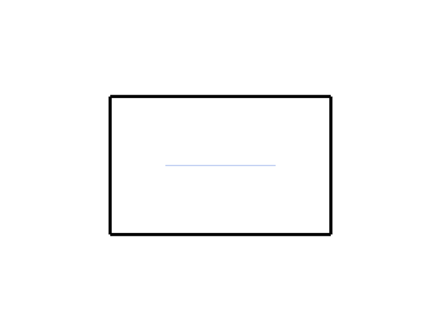

# 14.1 · Original drawings, entity queries and construction frames

**Goal:** Recognize the existing world prefix and resolve parsed coordinates from the plane origin, previous point and current direction. · **Steps:** 42 · **Source:** [app/walk/sheet.rs](../../../../src/app/walk/sheet.rs) · [app/sheet_query.rs](../../../../src/app/sheet_query.rs) · [app/stream.rs](../../../../src/app/stream.rs) · [app/cplane.rs](../../../../src/app/cplane.rs)

<div class="webgpu-schematic" style="width:100%;margin:6px auto;">
<svg xmlns="http://www.w3.org/2000/svg" width="1120" height="188" viewBox="0 0 1120 188" style="width:100%;max-width:100%;height:auto;display:block;margin:0 auto;" role="img">
  <defs>
    <marker id="arr" viewBox="0 0 10 10" refX="8" refY="5" markerWidth="6" markerHeight="6" orient="auto">
      <path d="M 0 1 L 9 5 L 0 9 z" fill="#111111"/>
    </marker>
    <marker id="arrR" viewBox="0 0 10 10" refX="8" refY="5" markerWidth="6" markerHeight="6" orient="auto">
      <path d="M 0 1 L 9 5 L 0 9 z" fill="#dc2626"/>
    </marker>
    <marker id="arrG" viewBox="0 0 10 10" refX="8" refY="5" markerWidth="6" markerHeight="6" orient="auto">
      <path d="M 0 1 L 9 5 L 0 9 z" fill="#16a34a"/>
    </marker>
    <marker id="arrB" viewBox="0 0 10 10" refX="8" refY="5" markerWidth="6" markerHeight="6" orient="auto">
      <path d="M 0 1 L 9 5 L 0 9 z" fill="#2563eb"/>
    </marker>
  </defs>
  <rect x="2" y="2" width="1116" height="184" rx="10" fill="#ffffff" stroke="#111111" stroke-width="2"/>
  <rect x="14" y="12" width="344" height="164" rx="8" fill="#ffffff" stroke="#111111" stroke-width="1.5"/>
  <text paint-order="stroke fill" stroke="#ffffff" stroke-width="5" stroke-linejoin="round" x="186" y="30" text-anchor="middle" font-family="monospace" font-size="10.5" font-weight="700" fill="#111111">Plane (O, u, v, w) + Polar (r, ∠θ) Input</text>
  <circle cx="112" cy="128" r="4" fill="#111111"/>
  <line x1="112" y1="128" x2="246" y2="128" stroke="#dc2626" stroke-width="2" marker-end="url(#arrR)"/>
  <line x1="112" y1="128" x2="112" y2="50" stroke="#16a34a" stroke-width="2" marker-end="url(#arrG)"/>
  <line x1="112" y1="128" x2="212" y2="68" stroke="#2563eb" stroke-width="2.2" marker-end="url(#arrB)"/>
  <path d="M 164 128 A 52 52 0 0 0 156 101" fill="none" stroke="#111111" stroke-width="1.5"/>
  <text paint-order="stroke fill" stroke="#ffffff" stroke-width="5" stroke-linejoin="round" x="176" y="114" font-family="monospace" font-size="10" font-weight="700" fill="#111111">r∠θ</text>
  <line x1="358" y1="94" x2="384" y2="94" stroke="#111111" stroke-width="2" marker-end="url(#arr)"/>
  <rect x="388" y="12" width="344" height="164" rx="8" fill="#ffffff" stroke="#111111" stroke-width="1.5"/>
  <text paint-order="stroke fill" stroke="#ffffff" stroke-width="5" stroke-linejoin="round" x="560" y="30" text-anchor="middle" font-family="monospace" font-size="10.5" font-weight="700" fill="#111111">Rational NURBS Conic Arc + B-Rep Solid Primitives</text>
  <polyline points="424,140 494,52 564,140" fill="none" stroke="#94a3b8" stroke-width="1.5" stroke-dasharray="4 3"/>
  <path d="M 424 140 Q 494 66 564 140" fill="none" stroke="#dc2626" stroke-width="2.5"/>
  <circle cx="494" cy="52" r="4.5" fill="#fef08a" stroke="#111111" stroke-width="1.5"/>
  <text paint-order="stroke fill" stroke="#ffffff" stroke-width="5" stroke-linejoin="round" x="494" y="44" text-anchor="middle" font-family="monospace" font-size="9" font-weight="700" fill="#111111">w = cos(θ/2)</text>
  <ellipse cx="648" cy="72" rx="38" ry="12" fill="#dbeafe" stroke="#111111" stroke-width="1.75"/>
  <path d="M 610 72 L 610 132 A 38 12 0 0 0 686 132 L 686 72" fill="#93c5fd" stroke="#111111" stroke-width="1.75"/>
  <line x1="732" y1="94" x2="758" y2="94" stroke="#111111" stroke-width="2" marker-end="url(#arr)"/>
  <rect x="762" y="12" width="344" height="164" rx="8" fill="#ffffff" stroke="#111111" stroke-width="1.75"/>
  <text paint-order="stroke fill" stroke="#ffffff" stroke-width="5" stroke-linejoin="round" x="934" y="30" text-anchor="middle" font-family="monospace" font-size="10.5" font-weight="700" fill="#111111">Exact Curves + Closed B-Rep Box / Cylinder / Torus</text>
  <rect x="806" y="44" width="256" height="118" rx="4" fill="#ffffff" stroke="#111111" stroke-width="2"/>
  <path d="M 828 138 Q 868 62 908 138" fill="none" stroke="#dc2626" stroke-width="2.5"/>
  <polygon points="928,136 928,82 978,66 978,120" fill="#dbeafe" stroke="#111111" stroke-width="1.75"/>
  <polygon points="978,66 1028,82 1028,136 978,120" fill="#93c5fd" stroke="#111111" stroke-width="1.75"/>
</svg>
</div>

## <a id="checkpoint-71-read-original-sheet-entity-metadata"></a>1. Own cancellable sheet-entity lookups

Complete the original lookup owner with its query id, sheet row and entity index.

### 1. `src/sheet_entity.rs`

Extend this original owner with the day’s complete input helpers. Supply only the unchanged original metadata and cancellation fixtures.

**Locate this existing block:**

```rust
        .map_err(|error| format!("Entity record is not valid JSON: {error}"))
}
```

Edit the existing block to match this code; keep unchanged lines:

```rust
        .map_err(|error| format!("Entity record is not valid JSON: {error}"))
}

/// One entity lookup in flight.
pub struct Query {
    pub id: u64,                   // lookup number
    pub row: u32,                  // the sheet's object row
    pub entity: u32,               // entity index in the sheet
    pub cancelled: Rc<Cell<bool>>, // set when a newer lookup replaces this
}

impl Query {
    /// A new lookup.
    pub fn new(id: u64, row: u32, entity: u32) -> Self {
        Self {
            id,
            row,
            entity,
            cancelled: Rc::new(Cell::new(false)),
        }
    }
}

impl Drop for Query {
    /// Cancel the lookup.
    fn drop(&mut self) {
        self.cancelled.set(true);
    }
}

/// The answer to one lookup.
pub struct Resolved {
    pub query: u64,                                       // which lookup
    pub result: Result<(EntityMeta, SheetTable), String>, // the entity and the table head
}

#[cfg(test)]
mod tests {
    use super::*;

    /// Build a side table from JSON blobs.
    fn table(blobs: &[&str]) -> Vec<u8> {
        let mut out = b"SHM1".to_vec();
        out.extend((blobs.len() as u32).to_le_bytes());
        let mut offset = 0u64;

        for blob in blobs {
            out.extend(offset.to_le_bytes());
            out.extend((blob.len() as u64).to_le_bytes());
            offset += blob.len() as u64;
        }

        for blob in blobs {
            out.extend(blob.as_bytes());
        }

        out
    }

    /// Head, records and blobs parse; junk is refused.
    #[test]
    fn side_table_head_records_and_blobs_parse_from_a_hand_built_buffer() {
        let raw = table(&[
            r#"{"guid":"g0","name":"Wall A","kind":"wall","width":0.35,"color":[0,0,0,255]}"#,
            r#"{"name":"Door","kind":"door","extra":true}"#,
        ]);
        let count = table_count(&raw[..HEAD_BYTES as usize]).unwrap();
        assert_eq!(count, 2);
        let blobs = record_at(count) as usize;
        let at = record_at(1) as usize;
        let (offset, length) = record(&raw[at..at + RECORD_BYTES as usize]).unwrap();
        let door =
            entity_from(&raw[blobs + offset as usize..][..length as usize]).unwrap();
        assert_eq!(door.name, "Door");
        assert_eq!(door.kind, "door");
        assert_eq!(door.guid, "");
        let at = record_at(0) as usize;
        let (offset, length) = record(&raw[at..at + RECORD_BYTES as usize]).unwrap();
        let wall =
            entity_from(&raw[blobs + offset as usize..][..length as usize]).unwrap();
        assert_eq!(wall.guid, "g0");
        assert_eq!(wall.width, 0.35);
        assert_eq!(wall.color, [0.0, 0.0, 0.0, 255.0]);
        assert!(table_count(b"SHM2\0\0\0\0").is_err());
        assert!(table_count(&raw[..7]).is_err());
        assert!(record(&raw[..15]).is_err());
        assert!(entity_from(b"{").is_err());
    }

    /// Dropping a query retires its token, so a late answer is ignored.
    #[test]
    fn dropping_a_query_cancels_its_token() {
        let query = Query::new(3, 1, 9);
        let token = query.cancelled.clone();
        drop(query);
        assert!(token.get());
    }
}
```

### 2. `src/sheet_example.rs`

Supply the existing sheet scene and side-table data specimen.

Create the file and type:

```rust
use session_rust::proto;
pub fn source() -> proto::Sheet {
    proto::Sheet {
        guid: "00000000-0000-0000-0000-000000000711".into(),
        name: "Original plan segments".into(),
        coords: vec![
            -0.8, -0.5, 0.3, 0.8, -0.5, 0.3, 0.8, -0.5, 0.3, 0.8, 0.5, 0.3, 0.8, 0.5,
            0.3, -0.8, 0.5, 0.3, -0.8, 0.5, 0.3, -0.8, -0.5, 0.3, -0.4, 0., 0.3, 0.4,
            0., 0.3,
        ],
        colors: vec![0xff00_0000; 4]
            .into_iter()
            .chain([0xffd0_5020])
            .collect(),
        widths: vec![0.025, 0.025, 0.025, 0.025, 0.],
        segment_count: 5,
        entity_count: 3,
        meta: "plan.shm".into(),
        source_ids: vec![1, 1, 1, 1, 2],
    }
}
pub fn bytes() -> Vec<u8> {
    use prost::Message;
    proto::Session {
        name: "Drawing sheet".into(),
        objects: Some(proto::Objects {
            sheets: vec![source()],
            ..Default::default()
        }),
        ..Default::default()
    }
    .encode_to_vec()
}
pub fn metadata() -> Vec<u8> {
    let records = [
        r#"{}"#,
        r#"{"guid":"source-wall","name":"Plan boundary","kind":"wall","width":0.025,"color":[0,0,0,255]}"#,
        r#"{"guid":"source-axis","name":"Centre axis","kind":"axis","width":0,"color":[32,80,208,255]}"#,
    ];
    let mut out = b"SHM1".to_vec();
    out.extend(3u32.to_le_bytes());
    let mut offset = 0u64;
    for record in records {
        out.extend(offset.to_le_bytes());
        out.extend((record.len() as u64).to_le_bytes());
        offset += record.len() as u64;
    }
    for record in records {
        out.extend(record.as_bytes());
    }
    out
}
```

### 3. `src/lib.rs`

Register the supplied sheet data specimen.

**Locate this existing block:**

```rust
pub mod sheet_entity;

#[cfg(target_arch = "wasm32")]
```

Edit the existing block to match this code; keep unchanged lines:

```rust
pub mod sheet_entity;

pub mod sheet_example;

#[cfg(target_arch = "wasm32")]
```

## <a id="checkpoint-71a-bound-original-entity-records-before-reading"></a>2. Bound entity records before reading

Bound original entity records before reading.

### 1. `src/sheet_entity.rs`

Bound metadata records and retain the original side-table byte length. Copy bounded metadata-record fixtures.

Edit these blocks from bottom to top. Keep the surrounding lines unchanged.

**Locate this block:**

```rust
        drop(query);
        assert!(token.get());
    }
```

Replace it with:

```rust
        drop(query);
        assert!(token.get());
    }
}

pub fn blob_range(
    count: u32,
    id: u32,
    raw: &[u8],
    total: u64,
) -> Result<(u64, u64), String> {
    if id >= count {
        return Err("Selected entity is outside the original side table".into());
    }
    let (offset, length) = record(raw)?;
    if length == 0 || length > MAX_BLOB {
        return Err("Entity record exceeds its bounded JSON size".into());
    }
    let at = record_at(count)
        .checked_add(offset)
        .ok_or("Entity record offset overflows")?;
    let end = at
        .checked_add(length)
        .ok_or("Entity record end overflows")?;
    if end > total {
        return Err("Entity record is outside its original side table".into());
    }
    Ok((at, length))
}

#[cfg(test)]
mod bounded_tests {
    use super::*;
    #[test]
    fn original_metadata_queries_bound_record_offsets_counts_sizes_and_file_ends() {
        let raw = [12u64, 32]
            .into_iter()
            .flat_map(u64::to_le_bytes)
            .collect::<Vec<_>>();
        assert_eq!(blob_range(3, 2, &raw, 100), Ok((68, 32)));
        assert!(blob_range(3, 3, &raw, 100).is_err());
        assert!(blob_range(3, 2, &raw, 99).is_err());
        let overflow = [u64::MAX, 1]
            .into_iter()
            .flat_map(u64::to_le_bytes)
            .collect::<Vec<_>>();
        assert!(blob_range(3, 2, &overflow, u64::MAX).is_err());
        let large = [0u64, MAX_BLOB + 1]
            .into_iter()
            .flat_map(u64::to_le_bytes)
            .collect::<Vec<_>>();
        assert!(blob_range(3, 2, &large, u64::MAX).is_err());
    }
```

**Locate this block:**

```rust
pub struct SheetTable {
    pub count: u32,               // records in the table
    pub revision: Option<String>, // ETag every read must match
}
```

Replace it with:

```rust
pub struct SheetTable {
    pub total: u64,
    pub count: u32,               // records in the table
    pub revision: Option<String>, // ETag every read must match
}
```

## <a id="checkpoint-71b-give-metadata-reads-their-own-cancellation-signal"></a>3. Give metadata reads their own cancellation signal

### 1. `src/range_fetch.rs`

Forward an owned cancellation signal to one bounded range read.

Edit these blocks from bottom to top. Keep the surrounding lines unchanged.

**Locate this block:**

```rust
        });
    }
    let range = crate::range_rules::header(start, length)?;
    let mut read = Read::new(url)?;
    let init = web_sys::RequestInit::new();
```

Replace it with:

```rust
        });
    }
    let range = crate::range_rules::header(start, length)?;
    let mut read = Read::new(url, signal)?;
    let init = web_sys::RequestInit::new();
```

**Locate this block:**

```rust
}

pub async fn get(url: &str, opts: &GetOpts) -> Result<Reply, String> {
    let (start, length) = opts
        .range
        .ok_or("This reader requires a byte range")?;
```

Replace it with:

```rust
}

pub async fn get(url: &str, opts: &GetOpts) -> Result<Reply, String> {
    get_with_signal(url, opts, None).await
}
pub async fn get_with_signal(
    url: &str,
    opts: &GetOpts,
    signal: Option<&web_sys::AbortSignal>,
) -> Result<Reply, String> {
    let (start, length) = opts
        .range
        .ok_or("This reader requires a byte range")?;
```

**Locate this block:**

```rust
}
impl Drop for Read {
    fn drop(&mut self) {
        REQUESTS.with(|requests| requests.borrow_mut().remove(&self.key));
        self.controller.abort();
        if let Some(window) = web_sys::window() {
```

Replace it with:

```rust
}
impl Drop for Read {
    fn drop(&mut self) {
        if let Some((signal, callback)) = self.external.take() {
            let _ = signal.remove_event_listener_with_callback(
                "abort",
                callback.as_ref().unchecked_ref(),
            );
        }
        REQUESTS.with(|requests| requests.borrow_mut().remove(&self.key));
        self.controller.abort();
        if let Some(window) = web_sys::window() {
```

**Locate this block:**

```rust
            flag.set(true);
            owned.abort();
        });
        let mut read = Self {
            key,
            controller,
            timer: 0,
```

Replace it with:

```rust
            flag.set(true);
            owned.abort();
        });
        let external = if let Some(signal) = signal {
            let owned = controller.clone();
            let callback = Closure::<dyn FnMut()>::new(move || owned.abort());
            signal
                .add_event_listener_with_callback(
                    "abort",
                    callback.as_ref().unchecked_ref(),
                )
                .map_err(describe)?;
            if signal.aborted() {
                controller.abort();
            }
            Some((signal.clone(), callback))
        } else {
            None
        };
        let mut read = Self {
            external,
            key,
            controller,
            timer: 0,
```

**Locate this block:**

```rust
    callback: Closure<dyn FnMut()>,
}
impl Read {
    fn new(url: &str) -> Result<Self, String> {
        let controller =
            web_sys::AbortController::new().map_err(|error| describe(error.into()))?;
        let key = NEXT.with(|next| {
```

Replace it with:

```rust
    callback: Closure<dyn FnMut()>,
}
impl Read {
    fn new(url: &str, signal: Option<&web_sys::AbortSignal>) -> Result<Self, String> {
        let controller =
            web_sys::AbortController::new().map_err(|error| describe(error.into()))?;
        let key = NEXT.with(|next| {
```

**Locate this block:**

```rust
struct Read {
    key: u64,
    controller: web_sys::AbortController,
    timer: i32,
```

Replace it with:

```rust
struct Read {
    external: Option<(web_sys::AbortSignal, Closure<dyn FnMut()>)>,
    key: u64,
    controller: web_sys::AbortController,
    timer: i32,
```

### 2. `src/sheet_entity_fetch.rs`

Register the current original metadata range types.

Create the file and type:

```rust
use crate::sheet_entity::{
    EntityMeta, HEAD_BYTES, RECORD_BYTES, SheetTable, blob_range, entity_from,
    record_at, table_count,
};
use std::cell::Cell;
```

### 3. `src/lib.rs`

Register the drawing component.

**Locate this existing block:**

```rust
#[cfg(target_arch = "wasm32")]
#[wasm_bindgen]
```

Edit the existing block to match this code; keep unchanged lines:

```rust
#[cfg(target_arch = "wasm32")]
pub mod sheet_entity_fetch;

#[cfg(target_arch = "wasm32")]
#[wasm_bindgen]
```

## <a id="checkpoint-71c-fetch-one-revision-matched-metadata-answer"></a>4. Fetch one revision-matched metadata answer

### 1. `src/sheet_entity_fetch.rs`

Read bounded original entity metadata under one owned signal.

**Locate this existing block:**

```rust
};
use std::cell::Cell;
```

Edit the existing block to match this code; keep unchanged lines:

```rust
};
use std::cell::Cell;
pub async fn read(
    url: &str,
    id: u32,
    entities: u32,
    cached: Option<SheetTable>,
    cancelled: &Cell<bool>,
    signal: &web_sys::AbortSignal,
) -> Result<(EntityMeta, SheetTable), String> {
    if cancelled.get() {
        return Err("Entity lookup cancelled".into());
    }
    let table = if let Some(table) = cached {
        table
    } else {
        let reply = crate::range_fetch::get_with_signal(
            url,
            &crate::range_fetch::GetOpts {
                range: Some((0, HEAD_BYTES)),
                revalidate: true,
            },
            Some(signal),
        )
        .await?;
        if reply.status != 206 {
            return Err("Entity metadata requires byte ranges".into());
        }
        let count = table_count(&reply.bytes)?;
        if count != entities {
            return Err(
                "Side table record count differs from the original sheet".into(),
            );
        }
        if reply.etag.is_none() && !crate::manifest::immutable_key(url) {
            return Err("Metadata reads require a revision or immutable URL".into());
        }
        SheetTable {
            count,
            revision: reply.etag,
            total: reply
                .total
                .ok_or("Side table has no checked byte length")?,
        }
    };
    if table.revision.is_none() && !crate::manifest::immutable_key(url) {
        return Err("Metadata reads require a revision or immutable URL".into());
    }
    if table.count != entities || id >= table.count || cancelled.get() {
        return Err("Entity lookup is stale or outside the original table".into());
    }
    let record = reply(
        url,
        record_at(id),
        RECORD_BYTES,
        &table,
        cancelled,
        signal,
    )
    .await?;
    let total = record
        .total
        .ok_or("Side table has no checked byte length")?;
    let (at, length) = blob_range(table.count, id, &record.bytes, total)?;
    let blob = reply(url, at, length, &table, cancelled, signal).await?;
    if blob.total != Some(total) || total != table.total {
        return Err("Original side table length changed".into());
    }
    Ok((entity_from(&blob.bytes)?, table))
}
async fn reply(
    url: &str,
    at: u64,
    length: u64,
    table: &SheetTable,
    cancelled: &Cell<bool>,
    signal: &web_sys::AbortSignal,
) -> Result<crate::range_fetch::Reply, String> {
    if cancelled.get() {
        return Err("Entity lookup cancelled".into());
    }
    let reply = crate::range_fetch::get_with_signal(
        url,
        &crate::range_fetch::GetOpts {
            range: Some((at, length)),
            revalidate: false,
        },
        Some(signal),
    )
    .await?;
    if cancelled.get() || reply.status != 206 || reply.etag != table.revision {
        return Err(
            "Original entity lookup was cancelled or its revision changed".into(),
        );
    }
    Ok(reply)
}
```

## <a id="checkpoint-71d-decode-precise-original-sheet-columns"></a>5. Decode precise sheet columns

Decode precise original sheet columns.

### 1. `src/sheet_page.rs`

Decode original drawing columns without truncating entity IDs.

Create the file and type:

```rust
use std::ops::Range;
pub struct Page {
    pub rows: Range<u32>,
    pub coordinates: Vec<f64>,
    pub display: Vec<f32>,
    pub colors: Vec<u32>,
    pub widths: Vec<f32>,
    pub entities: Vec<u32>,
}
impl Page {
    pub fn decode(
        rows: Range<u32>,
        total: u32,
        entities: u32,
        coordinates: &[u8],
        colors: Option<&[u8]>,
        widths: Option<&[u8]>,
        ids: Option<&[u8]>,
    ) -> Result<Self, &'static str> {
        if rows.start > rows.end || rows.end > total {
            return Err("Invalid original sheet row interval");
        }
        let count = (rows.end - rows.start) as usize;
        if coordinates.len()
            != count
                .checked_mul(48)
                .ok_or("Sheet page size overflow")?
        {
            return Err("Original sheet coordinates do not match segment count");
        }
        let coordinates = coordinates
            .chunks_exact(8)
            .map(|c| f64::from_le_bytes(c.try_into().unwrap()))
            .collect::<Vec<_>>();
        let display = coordinates
            .iter()
            .map(|c| *c as f32)
            .collect::<Vec<_>>();
        if coordinates.iter().any(|c| !c.is_finite())
            || display.iter().any(|c| !c.is_finite())
        {
            return Err("Invalid original sheet coordinates");
        }
        fn words(
            raw: Option<&[u8]>,
            count: usize,
            default: u32,
        ) -> Result<Vec<u32>, &'static str> {
            let Some(raw) = raw else {
                return Ok(vec![default; count]);
            };
            if raw.len() != count * 4 {
                return Err("Original sheet attribute does not match segment count");
            }
            Ok(raw
                .chunks_exact(4)
                .map(|c| u32::from_le_bytes(c.try_into().unwrap()))
                .collect())
        }
        let colors = words(colors, count, 0xff00_0000)?;
        let widths = words(widths, count, 0)?
            .into_iter()
            .map(f32::from_bits)
            .collect::<Vec<_>>();
        let ids = words(ids, count, u32::MAX)?;
        if ids
            .iter()
            .any(|id| *id != u32::MAX && *id >= entities)
        {
            return Err("Original sheet entity is outside its side table");
        }
        Ok(Self {
            rows,
            coordinates,
            display,
            colors,
            widths,
            entities: ids,
        })
    }
}
```

### 2. `src/lib.rs`

Register the drawing component.

**Locate this existing block:**

```rust
pub mod sheet_entity_fetch;

#[cfg(target_arch = "wasm32")]
```

Edit the existing block to match this code; keep unchanged lines:

```rust
pub mod sheet_entity_fetch;

pub mod sheet_page;

#[cfg(target_arch = "wasm32")]
```

## <a id="checkpoint-71e-measure-original-sheet-pages-and-world-pens"></a>6. Measure sheet pages and world pens

<div class="webgpu-schematic" style="width:100%;margin:6px auto;">
<svg xmlns="http://www.w3.org/2000/svg" width="1120" height="188" viewBox="0 0 1120 188" style="width:100%;max-width:100%;height:auto;display:block;margin:0 auto;" role="img">
  <defs>
    <marker id="arr" viewBox="0 0 10 10" refX="8" refY="5" markerWidth="6" markerHeight="6" orient="auto">
      <path d="M 0 1 L 9 5 L 0 9 z" fill="#111111"/>
    </marker>
    <marker id="arrR" viewBox="0 0 10 10" refX="8" refY="5" markerWidth="6" markerHeight="6" orient="auto">
      <path d="M 0 1 L 9 5 L 0 9 z" fill="#dc2626"/>
    </marker>
    <marker id="arrG" viewBox="0 0 10 10" refX="8" refY="5" markerWidth="6" markerHeight="6" orient="auto">
      <path d="M 0 1 L 9 5 L 0 9 z" fill="#16a34a"/>
    </marker>
    <marker id="arrB" viewBox="0 0 10 10" refX="8" refY="5" markerWidth="6" markerHeight="6" orient="auto">
      <path d="M 0 1 L 9 5 L 0 9 z" fill="#2563eb"/>
    </marker>
  </defs>
  <rect x="2" y="2" width="1116" height="184" rx="10" fill="#ffffff" stroke="#111111" stroke-width="2"/>
  <rect x="14" y="12" width="344" height="164" rx="8" fill="#ffffff" stroke="#111111" stroke-width="1.5"/>
  <text paint-order="stroke fill" stroke="#ffffff" stroke-width="5" stroke-linejoin="round" x="186" y="30" text-anchor="middle" font-family="monospace" font-size="10.5" font-weight="700" fill="#111111">Curve Quadrature ∑ w_i ||C'(t_i)|| &amp; Surface Patch dA = ||Su×Sv||</text>
  <path d="M 56 138 Q 112 52 176 126" fill="none" stroke="#dc2626" stroke-width="2.5"/>
  <circle cx="84" cy="98" r="4" fill="#fef08a" stroke="#111111" stroke-width="1.5"/>
  <circle cx="116" cy="84" r="4" fill="#fef08a" stroke="#111111" stroke-width="1.5"/>
  <circle cx="148" cy="98" r="4" fill="#fef08a" stroke="#111111" stroke-width="1.5"/>
  <polygon points="196,136 226,74 288,74 258,136" fill="#dbeafe" stroke="#111111" stroke-width="1.75"/>
  <line x1="226" y1="105" x2="268" y2="105" stroke="#2563eb" stroke-width="2" marker-end="url(#arrB)"/>
  <line x1="226" y1="105" x2="242" y2="74" stroke="#16a34a" stroke-width="2" marker-end="url(#arrG)"/>
  <line x1="358" y1="94" x2="384" y2="94" stroke="#111111" stroke-width="2" marker-end="url(#arr)"/>
  <rect x="388" y="12" width="344" height="164" rx="8" fill="#ffffff" stroke="#111111" stroke-width="1.5"/>
  <text paint-order="stroke fill" stroke="#ffffff" stroke-width="5" stroke-linejoin="round" x="560" y="30" text-anchor="middle" font-family="monospace" font-size="10.5" font-weight="700" fill="#111111">Divergence Volume: V = (1/6) ∑ det(v0, v1, v2) &amp; Centroid C_g</text>
  <circle cx="448" cy="138" r="4.5" fill="#111111"/>
  <text paint-order="stroke fill" stroke="#ffffff" stroke-width="5" stroke-linejoin="round" x="448" y="154" text-anchor="middle" font-family="monospace" font-size="9" font-weight="700" fill="#111111">Origin O</text>
  <polygon points="448,138 556,58 656,92" fill="#dbeafe" fill-opacity="0.55" stroke="#2563eb" stroke-width="1.5" stroke-dasharray="4 3"/>
  <polygon points="556,58 656,92 596,142" fill="#93c5fd" stroke="#111111" stroke-width="2"/>
  <circle cx="576" cy="104" r="5" fill="#fef08a" stroke="#dc2626" stroke-width="2"/>
  <line x1="732" y1="94" x2="758" y2="94" stroke="#111111" stroke-width="2" marker-end="url(#arr)"/>
  <rect x="762" y="12" width="344" height="164" rx="8" fill="#ffffff" stroke="#111111" stroke-width="1.75"/>
  <text paint-order="stroke fill" stroke="#ffffff" stroke-width="5" stroke-linejoin="round" x="934" y="30" text-anchor="middle" font-family="monospace" font-size="10.5" font-weight="700" fill="#111111">Exact Length, Area, Volume &amp; Centroid Marker</text>
  <rect x="806" y="44" width="256" height="118" rx="4" fill="#ffffff" stroke="#111111" stroke-width="2"/>
  <polygon points="846,136 894,64 988,64 940,136" fill="#dbeafe" stroke="#111111" stroke-width="2"/>
  <circle cx="917" cy="100" r="6" fill="#fef08a" stroke="#dc2626" stroke-width="2.2"/>
  <text paint-order="stroke fill" stroke="#ffffff" stroke-width="5" stroke-linejoin="round" x="1016" y="96" text-anchor="middle" font-family="monospace" font-size="9.5" font-weight="700" fill="#111111">C_g</text>
</svg>
</div>

Measure original sheet pages and world pens.

### 1. `src/sheet_page.rs`

Derive precise bounds, physical pen radii and capacity accounting. Copy original-column and malformed-page fixtures.

**Locate this existing block:**

```rust
    }
}
```

Edit the existing block to match this code; keep unchanged lines:

```rust
    }
    pub fn radius(&self, index: usize) -> f32 {
        let width = self.widths[index];
        if width.is_finite() && width > 0. {
            width * 0.5
        } else {
            0.
        }
    }
    pub fn bounds(&self) -> Option<crate::bounds::Bounds> {
        let mut points = self.coordinates.chunks_exact(3);
        let p = points.next()?;
        let mut bounds = crate::bounds::Bounds::point([p[0], p[1], p[2]]);
        for p in points {
            bounds.include([p[0], p[1], p[2]]);
        }
        Some(bounds)
    }
    pub fn bytes(&self) -> usize {
        self.coordinates.capacity() * 8
            + self.display.capacity() * 4
            + (self.colors.capacity()
                + self.widths.capacity()
                + self.entities.capacity())
                * 4
    }
}
impl crate::page_cache::ByteSize for Page {
    fn bytes(&self) -> usize {
        Page::bytes(self)
    }
}

#[cfg(test)]
mod tests {
    use super::*;
    #[test]
    fn sheet_pages_preserve_original_doubles_pens_and_repeated_full_u32_entity_ids() {
        let coordinates = [
            1_000_000_000.125f64,
            2.,
            3.,
            1_000_000_000.375,
            4.,
            5.,
            0.,
            0.,
            0.,
            1.,
            1.,
            0.,
        ]
        .into_iter()
        .flat_map(f64::to_le_bytes)
        .collect::<Vec<_>>();
        let ids = [u32::MAX - 1, u32::MAX - 1]
            .into_iter()
            .flat_map(u32::to_le_bytes)
            .collect::<Vec<_>>();
        let widths = [0.5f32, f32::NAN]
            .into_iter()
            .flat_map(f32::to_le_bytes)
            .collect::<Vec<_>>();
        let page = Page::decode(
            3..5,
            8,
            u32::MAX,
            &coordinates,
            None,
            Some(&widths),
            Some(&ids),
        )
        .unwrap();
        assert_eq!(page.coordinates[0], 1_000_000_000.125);
        assert_eq!(page.coordinates[3], 1_000_000_000.375);
        assert_eq!(page.display[0], page.display[3]);
        assert_eq!(page.entities, [u32::MAX - 1; 2]);
        assert_eq!(page.colors, [0xff00_0000; 2]);
        assert_eq!(page.radius(0), 0.25);
        assert_eq!(page.radius(1), 0.);
        assert!(page.widths[1].is_nan());
        assert_eq!(
            page.bounds().unwrap().max,
            [1_000_000_000.375, 4., 5.]
        );
        assert_eq!(page.bytes(), 168);
    }
    #[test]
    fn sheet_pages_refuse_partial_columns_invalid_coordinates_and_out_of_range_entities()
     {
        let coordinates = [0f64; 6]
            .into_iter()
            .flat_map(f64::to_le_bytes)
            .collect::<Vec<_>>();
        assert!(
            Page::decode(
                0..1,
                1,
                2,
                &coordinates[..47],
                None,
                None,
                None
            )
            .is_err()
        );
        assert!(
            Page::decode(
                0..1,
                1,
                2,
                &coordinates,
                Some(&[0; 3]),
                None,
                None
            )
            .is_err()
        );
        let ids = 2u32.to_le_bytes();
        assert!(
            Page::decode(
                0..1,
                1,
                2,
                &coordinates,
                None,
                None,
                Some(&ids)
            )
            .is_err()
        );
        let invalid = [f64::INFINITY; 6]
            .into_iter()
            .flat_map(f64::to_le_bytes)
            .collect::<Vec<_>>();
        assert!(Page::decode(0..1, 1, 2, &invalid, None, None, None).is_err());
        assert_eq!(
            Page::decode(0..1, 1, 0, &coordinates, None, None, None)
                .unwrap()
                .entities,
            [u32::MAX]
        );
    }
}
```

## <a id="checkpoint-71f-retain-charged-pages-beside-resident-pages"></a>7. Retain charged pages beside resident pages

### 1. `src/sheet_stream.rs`

Retain resident and charged streamed pages through one display interface.

Create the file and type:

```rust
use crate::{page_cache::Held, sheet_page::Page};
use std::rc::Rc;
pub const PREFIX: u32 = 25000;
pub const CHUNK: u32 = 500000;
pub const CEILING: u32 = 3000000;
#[derive(Clone)]
pub enum DisplayPage {
    Resident(Rc<Page>),
    Streamed(Rc<Held<Page>>),
}
impl std::ops::Deref for DisplayPage {
    type Target = Page;
    fn deref(&self) -> &Page {
        match self {
            Self::Resident(page) => page,
            Self::Streamed(page) => &page.value,
        }
    }
}
impl DisplayPage {
    pub fn key(&self) -> usize {
        &**self as *const Page as usize
    }
}
pub fn temporary_bytes(count: u32) -> Option<usize> {
    usize::try_from(count).ok()?.checked_mul(192)
}
pub fn next(from: u32, total: u32, left: u32) -> Option<std::ops::Range<u32>> {
    let count = total.checked_sub(from)?.min(CHUNK).min(left);
    (count > 0).then(|| from..from + count)
}
```

### 2. `src/lib.rs`

Register the drawing component.

**Locate this existing block:**

```rust
pub mod sheet_page;

#[cfg(target_arch = "wasm32")]
```

Edit the existing block to match this code; keep unchanged lines:

```rust
pub mod sheet_page;

pub mod sheet_stream;

#[cfg(target_arch = "wasm32")]
```

## <a id="checkpoint-71g-own-the-complete-original-drawing-source"></a>8. Own the complete drawing source

Own the complete original drawing source.

### 1. `src/sheet_source.rs`

Own immutable original sheet columns and derive their display defaults.

Create the file and type:

```rust
use session_rust::{Point, Xform, proto};
use std::rc::Rc;

pub struct Prepared {
    pub original: Rc<proto::Sheet>,
    pub page: Rc<crate::sheet_page::Page>,
}
impl Prepared {
    pub fn new(original: Rc<proto::Sheet>) -> Result<Self, &'static str> {
        if original.guid.is_empty()
            || original.coords.len() % 6 != 0
            || original.coords.len() / 6 != original.segment_count as usize
        {
            return Err("Original sheet count does not match its coordinates");
        }
        let count = original.segment_count as usize;
        // Missing authored columns use source defaults; present words stay original, including repeated entity IDs and hairline pens.
        fn column<T: Copy>(
            words: &[T],
            count: usize,
            default: T,
        ) -> Result<Vec<T>, &'static str> {
            if words.len() > count {
                return Err("Sheet attribute exceeds original segment count");
            }
            let mut words = words.to_vec();
            words.resize(count, default);
            Ok(words)
        }
        let coordinates = original
            .coords
            .iter()
            .flat_map(|v| v.to_le_bytes())
            .collect::<Vec<_>>();
        let colors = column(&original.colors, count, 0xff00_0000)?
            .into_iter()
            .flat_map(u32::to_le_bytes)
            .collect::<Vec<_>>();
        let widths = column(&original.widths, count, 0.)?
            .into_iter()
            .flat_map(f32::to_le_bytes)
            .collect::<Vec<_>>();
        let ids = column(&original.source_ids, count, u32::MAX)?
            .into_iter()
            .flat_map(u32::to_le_bytes)
            .collect::<Vec<_>>();
        let page = crate::sheet_page::Page::decode(
            0..original.segment_count,
            original.segment_count,
            original.entity_count,
            &coordinates,
            Some(&colors),
            Some(&widths),
            Some(&ids),
        )?;
        Ok(Self {
            original,
            page: Rc::new(page),
        })
    }
}
```

### 2. `src/lib.rs`

Register the drawing component.

**Locate this existing block:**

```rust
pub mod sheet_stream;

#[cfg(target_arch = "wasm32")]
```

Edit the existing block to match this code; keep unchanged lines:

```rust
pub mod sheet_stream;

pub mod sheet_source;

#[cfg(target_arch = "wasm32")]
```

## <a id="checkpoint-71h-place-drawing-rows-without-changing-endpoints"></a>9. Place drawing rows without changing endpoints

### 1. `src/sheet_source.rs`

Own independent row models and precise placed bounds.

**Locate this existing block:**

```rust
impl Prepared {
    pub fn new(original: Rc<proto::Sheet>) -> Result<Self, &'static str> {
        if original.guid.is_empty()
            || original.coords.len() % 6 != 0
            || original.coords.len() / 6 != original.segment_count as usize
        {
            return Err("Original sheet count does not match its coordinates");
        }
        let count = original.segment_count as usize;
        // Missing authored columns use source defaults; present words stay original, including repeated entity IDs and hairline pens.
        fn column<T: Copy>(
            words: &[T],
            count: usize,
            default: T,
        ) -> Result<Vec<T>, &'static str> {
            if words.len() > count {
                return Err("Sheet attribute exceeds original segment count");
            }
            let mut words = words.to_vec();
            words.resize(count, default);
            Ok(words)
        }
        let coordinates = original
            .coords
            .iter()
            .flat_map(|v| v.to_le_bytes())
            .collect::<Vec<_>>();
        let colors = column(&original.colors, count, 0xff00_0000)?
            .into_iter()
            .flat_map(u32::to_le_bytes)
            .collect::<Vec<_>>();
        let widths = column(&original.widths, count, 0.)?
            .into_iter()
            .flat_map(f32::to_le_bytes)
            .collect::<Vec<_>>();
        let ids = column(&original.source_ids, count, u32::MAX)?
            .into_iter()
            .flat_map(u32::to_le_bytes)
            .collect::<Vec<_>>();
        let page = crate::sheet_page::Page::decode(
            0..original.segment_count,
            original.segment_count,
            original.entity_count,
            &coordinates,
            Some(&colors),
            Some(&widths),
            Some(&ids),
        )?;
        Ok(Self {
            original,
            page: Rc::new(page),
        })
    }
```

Edit the existing block to match this code; keep unchanged lines:

```rust
impl Prepared {
    pub fn pages(&self) -> Vec<crate::sheet_stream::DisplayPage> {
        vec![crate::sheet_stream::DisplayPage::Resident(
            self.page.clone(),
        )]
    }
    pub fn bounds(&self) -> Option<crate::bounds::Bounds> {
        let mut bounds = None;
        for page in self.pages() {
            if let Some(next) = page.bounds() {
                if let Some(bounds) = &mut bounds {
                    crate::bounds::Bounds::include(bounds, next.min);
                    bounds.include(next.max);
                } else {
                    bounds = Some(next);
                }
            }
        }
        bounds
    }
    pub fn new(original: Rc<proto::Sheet>) -> Result<Self, &'static str> {
        if original.guid.is_empty()
            || original.coords.len() % 6 != 0
            || original.coords.len() / 6 != original.segment_count as usize
        {
            return Err("Original sheet count does not match its coordinates");
        }
        let count = original.segment_count as usize;
        // Missing authored columns use source defaults; present words stay original, including repeated entity IDs and hairline pens.
        fn column<T: Copy>(
            words: &[T],
            count: usize,
            default: T,
        ) -> Result<Vec<T>, &'static str> {
            if words.len() > count {
                return Err("Sheet attribute exceeds original segment count");
            }
            let mut words = words.to_vec();
            words.resize(count, default);
            Ok(words)
        }
        let coordinates = original
            .coords
            .iter()
            .flat_map(|v| v.to_le_bytes())
            .collect::<Vec<_>>();
        let colors = column(&original.colors, count, 0xff00_0000)?
            .into_iter()
            .flat_map(u32::to_le_bytes)
            .collect::<Vec<_>>();
        let widths = column(&original.widths, count, 0.)?
            .into_iter()
            .flat_map(f32::to_le_bytes)
            .collect::<Vec<_>>();
        let ids = column(&original.source_ids, count, u32::MAX)?
            .into_iter()
            .flat_map(u32::to_le_bytes)
            .collect::<Vec<_>>();
        let page = crate::sheet_page::Page::decode(
            0..original.segment_count,
            original.segment_count,
            original.entity_count,
            &coordinates,
            Some(&colors),
            Some(&widths),
            Some(&ids),
        )?;
        Ok(Self {
            original,
            page: Rc::new(page),
        })
    }
}
#[derive(Clone)]
pub struct Row {
    pub id: crate::scene::ObjectId,
    pub guid: String,
    pub prepared: Rc<Prepared>,
    pub model: Xform,
    pub url: Option<String>,
}
impl Row {
    pub fn bounds(&self) -> Option<crate::bounds::Bounds> {
        let local = self.prepared.bounds()?;
        let mut bounds = None;
        for x in [local.min[0], local.max[0]] {
            for y in [local.min[1], local.max[1]] {
                for z in [local.min[2], local.max[2]] {
                    let p = self
                        .model
                        .transform_point(&Point::new(x, y, z));
                    let p = [p[0], p[1], p[2]];
                    if let Some(b) = &mut bounds {
                        crate::bounds::Bounds::include(b, p);
                    } else {
                        bounds = Some(crate::bounds::Bounds::point(p));
                    }
                }
            }
        }
        bounds
    }
    pub fn has_entity(&self, id: u32) -> bool {
        id != u32::MAX
            && self
                .prepared
                .pages()
                .iter()
                .any(|page| page.entities.contains(&id))
    }
```

## <a id="checkpoint-71i-register-original-drawing-rows-on-the-current-layer"></a>10. Register drawing rows on the current layer

Register original drawing rows on the current layer.

### 1. `src/scene.rs`

Insert checked drawing rows and attach their layer identities.

Edit these blocks from bottom to top. Keep the surrounding lines unchanged.

**Locate this block:**

```rust
        for row in &mut self.streamed {
            row.controls_visible = Some(row.id) == parent;
        }
```

Replace it with:

```rust
        for row in &mut self.streamed {
            row.controls_visible = Some(row.id) == parent;
        }
    }
    pub fn sheets(&self) -> &[crate::sheet_source::Row] {
        &self.sheets
    }
    pub fn insert_sheet(
        &mut self,
        prepared: Rc<crate::sheet_source::Prepared>,
    ) -> Result<ObjectId, &'static str> {
        let next = self
            .next_id
            .checked_add(1)
            .ok_or("Object IDs exhausted")?;
        let id = ObjectId(self.next_id);
        let mut guid = prepared.original.guid.clone();
        let used = self.used_guids();
        while used.contains(&guid) {
            guid = uuid::Uuid::new_v4().to_string();
        }
        let name = prepared.original.name.clone();
        let url = None;
        let row = crate::sheet_source::Row {
            id,
            guid: guid.clone(),
            prepared,
            model: session_rust::Xform::identity(),
            url,
        };
        self.next_id = next;
        Rc::make_mut(&mut self.ids).insert(id);
        self.sheets.push(row);
        crate::layer_edit::attach_generated(self, id, guid, name)?;
        Ok(id)
    }
    pub fn place_sheet(
        &mut self,
        id: ObjectId,
        model: session_rust::Xform,
    ) -> Result<(), &'static str> {
        if !crate::placement::valid(&model.m) {
            return Err("Invalid sheet placement");
        }
        let row = self
            .sheets
            .iter_mut()
            .find(|r| r.id == id)
            .ok_or("Sheet is gone")?;
        let mut candidate = row.clone();
        candidate.model = model;
        if candidate.bounds().is_some_and(|b| {
            b.min
                .into_iter()
                .chain(b.max)
                .any(|v| !(v as f32).is_finite())
        }) {
            return Err("Sheet placement exceeds display range");
        }
        *row = candidate;
        Ok(())
    }
    pub fn sheet_import_url(
        &mut self,
        url: &str,
        previous: &std::collections::HashSet<ObjectId>,
    ) {
        for row in &mut self.sheets {
            if !previous.contains(&row.id) {
                row.url = Some(url.into());
            }
        }
    }
    pub fn sheet_url(&mut self, url: &str) {
        for row in &mut self.sheets {
            row.url = Some(url.into());
        }
```

**Locate this block:**

```rust
            ids: Default::default(),
            view: Default::default(),
            forest: Default::default(),
            streamed: Vec::new(),
            clouds: Vec::new(),
            texts: Vec::new(),
```

Replace it with:

```rust
            ids: Default::default(),
            view: Default::default(),
            forest: Default::default(),
            sheets: Vec::new(),
            streamed: Vec::new(),
            clouds: Vec::new(),
            texts: Vec::new(),
```

**Locate this block:**

```rust
    pub forest: crate::hierarchy::Forest,
    streamed: Vec<crate::range_cloud::Row>,
    clouds: Vec<crate::cloud::Row>,
    texts: Vec<crate::scene_label::Row>,
```

Replace it with:

```rust
    pub forest: crate::hierarchy::Forest,
    sheets: Vec<crate::sheet_source::Row>,
    streamed: Vec<crate::range_cloud::Row>,
    clouds: Vec<crate::cloud::Row>,
    texts: Vec<crate::scene_label::Row>,
```

## <a id="checkpoint-71j-carry-drawing-identity-through-scene-operations"></a>11. Carry drawing identity through scene operations

### 1. `src/scene.rs`

Connect drawing rows to existing generic scene operations.

Edit these blocks from bottom to top. Keep the surrounding lines unchanged.

**Locate this block:**

```rust
            .chain(self.texts.iter().map(|r| r.id))
            .chain(self.clouds.iter().map(|r| r.id))
            .chain(self.streamed.iter().map(|r| r.id))
            .filter(|id| self.pick_id(id.value()).is_some())
```

Replace it with:

```rust
            .chain(self.texts.iter().map(|r| r.id))
            .chain(self.clouds.iter().map(|r| r.id))
            .chain(self.streamed.iter().map(|r| r.id))
            .chain(self.sheets.iter().map(|r| r.id))
            .filter(|id| self.pick_id(id.value()).is_some())
```

**Locate this block:**

```rust
        self.texts.retain(|row| row.id != id);
        self.clouds.retain(|row| row.id != id);
        self.streamed.retain(|row| row.id != id);
        if self.extra == Some(id) {
            self.extra = None;
        }
```

Replace it with:

```rust
        self.texts.retain(|row| row.id != id);
        self.clouds.retain(|row| row.id != id);
        self.streamed.retain(|row| row.id != id);
        self.sheets.retain(|row| row.id != id);
        if self.extra == Some(id) {
            self.extra = None;
        }
```

**Locate this block:**

```rust
        self.forest = Default::default();
        self.clouds = Vec::new();
        self.streamed = Vec::new();
        self.texts = Vec::new();
        self.points = Vec::new();
        self.paths = Vec::new();
```

Replace it with:

```rust
        self.forest = Default::default();
        self.clouds = Vec::new();
        self.streamed = Vec::new();
        self.sheets = Vec::new();
        self.texts = Vec::new();
        self.points = Vec::new();
        self.paths = Vec::new();
```

**Locate this block:**

```rust
            .chain(self.clouds.iter().map(|r| r.guid.clone()))
            .chain(self.streamed.iter().map(|r| r.guid.clone()))
            .chain(self.texts.iter().map(|r| r.guid.clone()))
            .collect()
    }
```

Replace it with:

```rust
            .chain(self.clouds.iter().map(|r| r.guid.clone()))
            .chain(self.streamed.iter().map(|r| r.guid.clone()))
            .chain(self.texts.iter().map(|r| r.guid.clone()))
            .chain(self.sheets.iter().map(|r| r.guid.clone()))
            .collect()
    }
```

**Locate this block:**

```rust
        rows!(clouds);
        rows!(streamed);
        rows!(texts);
        for old in &ids {
            let id = remap[old];
            if let Some(owner) = source.instances.get(old) {
```

Replace it with:

```rust
        rows!(clouds);
        rows!(streamed);
        rows!(texts);
        rows!(sheets);
        for old in &ids {
            let id = remap[old];
            if let Some(owner) = source.instances.get(old) {
```

**Locate this block:**

```rust
                    .find(|row| row.id == id)
                    .map(|row| row.guid.as_str())
            })
    }

    pub(crate) fn append_document(
```

Replace it with:

```rust
                    .find(|row| row.id == id)
                    .map(|row| row.guid.as_str())
            })
            .or_else(|| {
                self.sheets
                    .iter()
                    .find(|row| row.id == id)
                    .map(|row| row.guid.as_str())
            })
    }

    pub(crate) fn append_document(
```

**Locate this block:**

```rust
            row.guid = guid;
            row.controls_visible = false;
            self.clouds.push(row);
        } else if let Some(row) = self.texts.iter().find(|row| row.id == id) {
            let mut row = row.clone();
            row.id = copy;
```

Replace it with:

```rust
            row.guid = guid;
            row.controls_visible = false;
            self.clouds.push(row);
        } else if let Some(row) = self.sheets.iter().find(|row| row.id == id) {
            let mut row = row.clone();
            row.id = copy;
            row.guid = guid;
            self.sheets.push(row);
        } else if let Some(row) = self.texts.iter().find(|row| row.id == id) {
            let mut row = row.clone();
            row.id = copy;
```

**Locate this block:**

```rust
        if let Some(row) = self.texts.iter().find(|row| row.id == id) {
            return row.bounds();
        }
        let object = self
            .objects
            .iter()
```

Replace it with:

```rust
        if let Some(row) = self.texts.iter().find(|row| row.id == id) {
            return row.bounds();
        }
        if let Some(row) = self.sheets.iter().find(|row| row.id == id) {
            return row.bounds();
        }
        let object = self
            .objects
            .iter()
```

**Locate this block:**

```rust
            let model = &shift * &row.model;
            return self.place_cloud(id, model);
        }
        if let Some(row) = self.texts.iter().find(|r| r.id == id) {
            let model = &shift * &row.model;
            return self.place_text(id, model);
```

Replace it with:

```rust
            let model = &shift * &row.model;
            return self.place_cloud(id, model);
        }
        if let Some(row) = self.sheets.iter().find(|r| r.id == id) {
            let model = &shift * &row.model;
            return self.place_sheet(id, model);
        }
        if let Some(row) = self.texts.iter().find(|r| r.id == id) {
            let model = &shift * &row.model;
            return self.place_text(id, model);
```

**Locate this block:**

```rust
            self.place_cloud(id, model)
        } else if self.streamed.iter().any(|r| r.id == id) {
            self.place_stream(id, model)
        } else if self.texts.iter().any(|r| r.id == id) {
            self.place_text(id, model)
        } else {
```

Replace it with:

```rust
            self.place_cloud(id, model)
        } else if self.streamed.iter().any(|r| r.id == id) {
            self.place_stream(id, model)
        } else if self.sheets.iter().any(|r| r.id == id) {
            self.place_sheet(id, model)
        } else if self.texts.iter().any(|r| r.id == id) {
            self.place_text(id, model)
        } else {
```

**Locate this block:**

```rust
                    .find(|r| r.id == id)
                    .map(|r| r.model.clone())
            })
    }

    pub fn with_descendants(&self, ids: &[ObjectId]) -> Vec<ObjectId> {
```

Replace it with:

```rust
                    .find(|r| r.id == id)
                    .map(|r| r.model.clone())
            })
            .or_else(|| {
                self.sheets
                    .iter()
                    .find(|r| r.id == id)
                    .map(|r| r.model.clone())
            })
    }

    pub fn with_descendants(&self, ids: &[ObjectId]) -> Vec<ObjectId> {
```

**Locate this block:**

```rust
        for row in self
            .streamed
            .iter()
            .filter(|r| self.visible(r.id))
```

Replace it with:

```rust
        for row in self
            .sheets
            .iter()
            .filter(|r| self.visible(r.id))
        {
            if let Some(next) = row.bounds() {
                if let Some(bounds) = &mut bounds {
                    bounds.include(next.min);
                    bounds.include(next.max);
                } else {
                    bounds = Some(next);
                }
            }
        }
        for row in self
            .streamed
            .iter()
            .filter(|r| self.visible(r.id))
```

### 2. `src/rect_select.rs`

Select original drawing segments through window and crossing rectangles.

**Locate this existing block:**

```rust
    }
    found.sort_unstable_by_key(|id| id.value());
```

Edit the existing block to match this code; keep unchanged lines:

```rust
    }
    for row in scene
        .sheets()
        .iter()
        .filter(|row| eligible(row.id))
    {
        let strokes = row
            .prepared
            .pages()
            .iter()
            .flat_map(|page| {
                page.coordinates
                    .chunks_exact(6)
                    .map(|p| {
                        vec![
                            world(&row.model, [p[0], p[1], p[2]]),
                            world(&row.model, [p[3], p[4], p[5]]),
                        ]
                    })
                    .collect::<Vec<_>>()
            })
            .collect();
        if matches(matrix, size, rectangle, strokes) {
            found.push(row.id);
        }
    }
    found.sort_unstable_by_key(|id| id.value());
```

## <a id="checkpoint-71k-save-and-reopen-complete-original-sheets"></a>12. Save and reopen complete sheets

Save and reopen complete original sheets.

### 1. `src/document_source.rs`

Connect original sheets to mixed document persistence and namespace identities.

Edit these blocks from bottom to top. Keep the surrounding lines unchanged.

**Locate this block:**

```rust
        || !objects.bboxes.is_empty()
        || !objects.elements.is_empty()
        || !objects.components.is_empty()
        || !objects.sheets.is_empty()
    {
        return Err(
            "This subject cannot open planes, boxes, assemblies or sheets yet".into(),
        );
    }
```

Replace it with:

```rust
        || !objects.bboxes.is_empty()
        || !objects.elements.is_empty()
        || !objects.components.is_empty()
    {
        return Err("This subject cannot open planes, boxes or assemblies yet".into());
    }
```

**Locate this block:**

```rust
        origin,
        tree,
        world,
    })
}
```

Replace it with:

```rust
        origin,
        tree,
        world,
        sheets,
    })
}
```

**Locate this block:**

```rust
            return Err("Invalid source placement".into());
        }
    }
    let origin = Rc::new(crate::origin::Origin::new(&message, bytes));
    let document = Rc::new(Session::from_proto(message).map_err(|e| e.to_string())?);
    let world =
```

Replace it with:

```rust
            return Err("Invalid source placement".into());
        }
    }
    let sheets = objects
        .sheets
        .iter()
        .cloned()
        .map(|sheet| {
            crate::sheet_source::Prepared::new(Rc::new(sheet))
                .map(Rc::new)
                .map_err(str::to_owned)
        })
        .collect::<Result<Vec<_>, _>>()?;
    let origin = Rc::new(crate::origin::Origin::new(&message, bytes));
    let document = Rc::new(Session::from_proto(message).map_err(|e| e.to_string())?);
    let world =
```

**Locate this block:**

```rust
    identity!(breps);
    identity!(pointclouds);
    identity!(instances);
    if let Some(root) = tree.as_ref() {
        crate::hierarchy::validate(root, &guids).map_err(str::to_owned)?;
    }
```

Replace it with:

```rust
    identity!(breps);
    identity!(pointclouds);
    identity!(instances);
    identity!(sheets);
    if let Some(root) = tree.as_ref() {
        crate::hierarchy::validate(root, &guids).map_err(str::to_owned)?;
    }
```

**Locate this block:**

```rust
    pub world: HashMap<String, Xform>,
}
pub(crate) fn prepare(
    bytes: &[u8],
```

Replace it with:

```rust
    pub world: HashMap<String, Xform>,
    pub sheets: Vec<Rc<crate::sheet_source::Prepared>>,
}
pub(crate) fn prepare(
    bytes: &[u8],
```

### 2. `src/document_geometry.rs`

Connect original sheets to mixed document persistence and namespace identities.

**Locate this existing block:**

```rust
    }
    let templates =
```

Edit the existing block to match this code; keep unchanged lines:

```rust
    }
    for source in &loaded.sheets {
        let original = &source.original;
        let model =
            crate::nested_placement::model(&loaded.world, place, &original.guid);
        let id = scene
            .insert_sheet(source.clone())
            .map_err(str::to_owned)?;
        scene
            .place_following(id, model)
            .map_err(str::to_owned)?;
        owners.push((
            original.guid.clone(),
            id,
            original.name.clone(),
        ));
    }
    let templates =
```

### 3. `src/archive_identity.rs`

Connect original sheets to mixed document persistence and namespace identities.

**Locate this existing block:**

```rust
    remap!(instances);
}
```

Edit the existing block to match this code; keep unchanged lines:

```rust
    remap!(instances);
    remap!(sheets);
}
```

### 4. `src/scene_archive.rs`

Connect original sheets to mixed document persistence and namespace identities.

**Locate this existing block:**

```rust
        .chain(scene.texts().iter().map(|row| row.id))
        .collect::<HashSet<_>>();
```

Edit the existing block to match this code; keep unchanged lines:

```rust
        .chain(scene.texts().iter().map(|row| row.id))
        .chain(scene.sheets().iter().map(|row| row.id))
        .collect::<HashSet<_>>();
```

### 5. `src/document.rs`

Connect original sheets to mixed document persistence and namespace identities.

**Locate this existing block:**

```rust
    }
    if !scene.clouds().is_empty() {
```

Edit the existing block to match this code; keep unchanged lines:

```rust
    }
    if !scene.sheets().is_empty() {
        return Err("Use the viewer archive to save original sheets");
    }
    if !scene.clouds().is_empty() {
```

### 6. `src/geometry_snapshot.rs`

Save complete original Sheet protobuf columns rather than display segments.

**Locate this existing block:**

```rust
    }
    for (id, owner) in scene
```

Edit the existing block to match this code; keep unchanged lines:

```rust
    }
    for row in scene
        .sheets()
        .iter()
        .filter(|row| ids.contains(&row.id))
    {
        let mut source = row.prepared.original.as_ref().clone();
        source.guid = scene
            .row_guid(row.id)
            .ok_or("Original sheet owner is missing")?
            .into();
        if !guids.insert(source.guid.clone()) {
            return Err("Sheet GUID occurs twice within one saved document".into());
        }
        out.sheets.push(source);
    }
    for (id, owner) in scene
```

## <a id="checkpoint-71l-locate-original-drawing-identity-and-fixed-ranges"></a>13. Locate drawing identity and fixed ranges

Locate original drawing identity and fixed ranges.

### 1. `src/sheet_range.rs`

Locate original sheet identity and checked column intervals.

Create the file and type:

```rust
use crate::stream::{SheetFields, field_at};
pub struct Source {
    pub guid: String,
    pub name: String,
    pub url: String,
    pub fields: SheetFields,
}
pub fn identity(head: &[u8]) -> Option<(String, String)> {
    let mut at = 0u64;
    let objects = loop {
        let f = field_at(head.get(at as usize..)?, at, u64::MAX)?;
        if f.field == 3 && f.wire == 2 {
            break f;
        }
        if f.field > 2 || f.wire != 2 {
            return None;
        }
        at = f.next;
    };
    at = objects.body;
    let sheet = loop {
        let f = field_at(head.get(at as usize..)?, at, objects.next)?;
        if f.field == 17 && f.wire == 2 && f.next == objects.next {
            break f;
        }
        if f.field > 2 || f.wire != 2 {
            return None;
        }
        at = f.next;
    };
    at = sheet.body;
    let mut guid = None;
    let mut name = String::new();
    loop {
        let f = field_at(head.get(at as usize..)?, at, sheet.next)?;
        if f.field == 3 && f.wire == 2 {
            return Some((guid?, name));
        }
        if f.wire != 2 || f.field > 2 || f.value > 256 {
            return None;
        }
        let text = std::str::from_utf8(head.get(f.body as usize..f.next as usize)?)
            .ok()?
            .to_owned();
        match f.field {
            1 if guid.is_none() && !text.is_empty() => guid = Some(text),
            2 => name = text,
            _ => return None,
        }
        at = f.next;
    }
}
pub fn slice(
    fields: &SheetFields,
    at: u64,
    length: u64,
    rows: std::ops::Range<u32>,
    stride: u64,
) -> Option<(u64, u64)> {
    if rows.start > rows.end || rows.end > fields.count {
        return None;
    }
    if length == 0 {
        return Some((0, 0));
    }
    let start = at.checked_add(u64::from(rows.start).checked_mul(stride)?)?;
    let bytes = u64::from(rows.end - rows.start).checked_mul(stride)?;
    let end = at.checked_add(length)?;
    if start.checked_add(bytes)? > end || end > fields.end {
        return None;
    }
    Some((start, bytes))
}
```

### 2. `src/lib.rs`

Register the drawing component.

**Locate this existing block:**

```rust
pub mod sheet_source;

#[cfg(target_arch = "wasm32")]
```

Edit the existing block to match this code; keep unchanged lines:

```rust
pub mod sheet_source;

pub mod sheet_range;

#[cfg(target_arch = "wasm32")]
```

### 3. `src/sheet_range.rs`

Copy exact original drawing-envelope and interval fixtures.

**Locate this existing block:**

```rust
    Some((start, bytes))
}
```

Edit the existing block to match this code; keep unchanged lines:

```rust
    Some((start, bytes))
}
#[cfg(test)]
mod tests {
    use super::*;
    use prost::Message;
    #[test]
    fn ranged_drawing_identity_and_fixed_column_offsets_match_the_original_protobuf() {
        let raw = crate::sheet_example::bytes();
        let original = crate::sheet_example::source();
        assert_eq!(
            identity(&raw),
            Some((original.guid, original.name))
        );
        let (at, length, end) = crate::stream::sheet_layout(&raw).unwrap();
        let fields = SheetFields {
            count: 5,
            end,
            coords_at: at,
            coords_len: length,
            ..Default::default()
        };
        assert_eq!(
            slice(&fields, at, length, 2..4, 48),
            Some((at + 96, 96))
        );
        assert!(slice(&fields, at, length, 4..6, 48).is_none());
        assert!(slice(&fields, u64::MAX, 48, 1..2, 48).is_none());
        let mut mixed = session_rust::proto::Session::decode(raw.as_slice()).unwrap();
        mixed
            .objects
            .as_mut()
            .unwrap()
            .points
            .push(session_rust::Point::new(0., 0., 0.).to_proto());
        assert!(identity(&mixed.encode_to_vec()).is_none());
        let mut repeated =
            session_rust::proto::Session::decode(raw.as_slice()).unwrap();
        repeated
            .objects
            .as_mut()
            .unwrap()
            .sheets
            .push(crate::sheet_example::source());
        assert!(identity(&repeated.encode_to_vec()).is_none());
    }
}
```

## <a id="checkpoint-71m-validate-the-bounded-drawing-envelope-tail"></a>14. Validate the bounded drawing envelope tail

### 1. `src/sheet_range.rs`

Validate bounded original drawing envelope metadata under its revision.

**Locate this existing block:**

```rust
        assert!(identity(&repeated.encode_to_vec()).is_none());
    }
}
```

Edit the existing block to match this code; keep unchanged lines:

```rust
        assert!(identity(&repeated.encode_to_vec()).is_none());
    }
}

#[cfg(target_arch = "wasm32")]
async fn envelope(
    url: &str,
    end: u64,
    total: u64,
    revision: &Option<String>,
    guid: &str,
) -> Result<(), String> {
    let length = total
        .checked_sub(end)
        .ok_or("Drawing exceeds its original file")?;
    if length > 1024 * 1024 {
        return Err(
            "Original drawing envelope metadata exceeds its range limit".into(),
        );
    }
    if length > 0 {
        let tail = crate::stream::source_range(url, end, length, revision)
            .await
            .ok_or("Drawing envelope read failed")?;
        crate::range_shape::metadata(&tail, guid)?;
    }
    Ok(())
}
```

### 2. `src/stream.rs`

Expose the existing bounded metadata window to drawing range adapters.

**Locate this existing block:**

```rust
#[derive(Default)]
struct MetadataWindow {
    at: u64,        // file position of `bytes[0]`
    bytes: Vec<u8>, // the cached bytes
}

#[cfg(any(target_arch = "wasm32", test))]
impl MetadataWindow {
    /// The cached bytes at `at`, if all present.
    fn slice(&self, at: u64, length: u64) -> Option<&[u8]> {
        let start = usize::try_from(at.checked_sub(self.at)?).ok()?;
        let length = usize::try_from(length).ok()?;
        self.bytes
            .get(start..start.checked_add(length)?)
    }

    /// How much to read at once: at least `length`, up to 64 KiB.
    fn read_length(at: u64, length: u64, end: u64) -> Option<u64> {
        if !bounded_range(at, length) {
            return None;
        }

        body_end(at, length, end)?;
        Some(length.max(64 * 1024).min(end - at))
    }
}

/// A packed `int32` (varint) array in full.
pub fn packed_i32(raw: &[u8]) -> Vec<i32> {
    let mut out = Vec::new();
    let mut i = 0usize;

    while i < raw.len() {
        let Some((v, n)) = varint(raw, i) else { break };
        out.push(v as i32);
        i += n;
    }

    out
}

/// A packed `double` array in full.
pub fn packed_f64(raw: &[u8]) -> Vec<f64> {
    let mut out = Vec::with_capacity(raw.len() / 8);

    for c in raw.chunks_exact(8) {
        out.push(f64::from_le_bytes(c.try_into().unwrap()));
    }

    out
}

/// A packed `fixed32` array in full.
pub fn packed_u32(raw: &[u8]) -> Vec<u32> {
    let mut out = Vec::with_capacity(raw.len() / 4);

    for c in raw.chunks_exact(4) {
        out.push(u32::from_le_bytes(c.try_into().unwrap()));
    }

    out
}

/// A packed `float` array in full; a non-finite value becomes 0.
pub fn packed_f32(raw: &[u8]) -> Vec<f32> {
    let mut out = Vec::with_capacity(raw.len() / 4);

    for c in raw.chunks_exact(4) {
        let v = f32::from_le_bytes(c.try_into().unwrap());
        out.push(if v.is_finite() {
            v
        } else {
            0.0
        });
    }

    out
}

/// An already-fetched coords slice as f32 triples.
pub fn positions_from(raw: &[u8]) -> Vec<f32> {
    let mut out = Vec::with_capacity(raw.len() / 8);

    for c in raw.chunks_exact(8) {
        out.push(f64::from_le_bytes(c.try_into().unwrap()) as f32);
    }

    out
}

/// Packed doubles, three per point, as octahedral normals; a degenerate one becomes 0.
pub fn normals_from(raw: &[u8]) -> Vec<u32> {
    let mut out = Vec::with_capacity(raw.len() / 24);

    for c in raw.chunks_exact(24) {
        let n = [
            f64::from_le_bytes(c[0..8].try_into().unwrap()),
            f64::from_le_bytes(c[8..16].try_into().unwrap()),
            f64::from_le_bytes(c[16..24].try_into().unwrap()),
        ];
        out.push(crate::cloud_normals::oct16(&n).unwrap_or(0));
    }

    out
}

/// `count` colours from packed varints, and where they ended.
pub fn colors_from(raw: &[u8], count: u32) -> Option<(Vec<u32>, usize)> {
    let mut out = Vec::with_capacity(count as usize);
    let mut i = 0usize;

    for _ in 0..count {
        let mut rgba = [255u8; 4];

        for k in &mut rgba {
            let (v, n) = varint(raw, i)?;
            i += n;
            *k = u8::try_from(v).ok()?;
        }

        out.push(u32::from_le_bytes(rgba));
    }

    Some((out, i))
}

/// A skipped field longer than this is geometry, not a name.
const NAME_BYTES: u64 = 256;

/// Enter field `want` of the message at `at`; returns its end.
fn descend_message(
    head: &[u8],
    at: &mut usize,
    parent_end: Option<u64>,
    want: u32,
) -> Option<u64> {
    loop {
        let (tag, used) = varint(head, *at)?;
        *at = (*at).checked_add(used)?;
        let (field, wire) = (u32::try_from(tag >> 3).ok()?, tag & 7);

        if field == 0 || wire != 2 {
            return None;
        }

        let (length, used) = varint(head, *at)?;
        *at = (*at).checked_add(used)?;
        let next = (*at as u64).checked_add(length)?;

        if let Some(end) = parent_end
            && next > end
        {
            return None;
        }

        if field == want {
            if let Some(end) = parent_end
                && end != next
            {
                return None;
            }

            return Some(next);
        }

        if length > NAME_BYTES {
            return None;
        }

        *at = usize::try_from(next).ok()?;
    }
}

/// The `coords` field, which only small names may precede.
fn first_array(head: &[u8], mut at: usize, end: u64) -> Option<(u64, u64, u64)> {
    while (at as u64) < end {
        let (tag, used) = varint(head, at)?;
        at = at.checked_add(used)?;
        let (field, wire) = (
            u32::try_from(tag >> 3).ok()?,
            (tag & 7) as u32,
        );

        if field == 0 {
            return None;
        }

        if wire != 2 {
            at = at.checked_add(skip_scalar(head, at, wire)?)?;

            if at as u64 > end {
                return None;
            }

            continue;
        }

        let (length, used) = varint(head, at)?;
        at = at.checked_add(used)?;
        let next = (at as u64).checked_add(length)?;

        if next > end {
            return None;
        }

        if field == 3 {
            return Some((at as u64, length, end));
        }

        if field > 3 || length > NAME_BYTES {
            return None;
        }

        at = usize::try_from(next).ok()?;
    }

    None
}

/// Start and length of a single cloud's `coords`; None otherwise.
pub fn walk_to_coords(head: &[u8]) -> Option<(u64, u64)> {
    let (at, length, _) = cloud_layout(head)?;
    Some((at, length))
}

/// Original GUID and name precede the large coordinate array in the ranged layout.
pub fn cloud_identity(head: &[u8]) -> Option<(String, String)> {
    let mut at = 0usize;
    let objects_end = descend_message(head, &mut at, None, 3)?;
    let end = descend_message(head, &mut at, Some(objects_end), 8)?;
    let mut guid = String::new();
    let mut name = String::new();
    while (at as u64) < end {
        let f = field_at(head.get(at..)?, at as u64, end)?;
        if f.field == 3 {
            return (!guid.is_empty()).then_some((guid, name));
        }
        if f.wire == 2 && (f.field == 1 || f.field == 2) && f.value <= NAME_BYTES {
            let value =
                std::str::from_utf8(head.get(f.body as usize..f.next as usize)?)
                    .ok()?
                    .to_owned();
            if f.field == 1 {
                if !guid.is_empty() {
                    return None;
                }
                guid = value;
            } else {
                name = value;
            }
        }
        at = usize::try_from(f.next).ok()?;
    }
    None
}

/// Start, length of `coords` and end of the cloud message.
fn cloud_layout(head: &[u8]) -> Option<(u64, u64, u64)> {
    let mut at = 0usize;
    let objects_end = descend_message(head, &mut at, None, 3)?;
    let end = descend_message(head, &mut at, Some(objects_end), 8)?;
    first_array(head, at, end)
}

/// Start, length of `coords` and end of the sheet message.
pub fn sheet_layout(head: &[u8]) -> Option<(u64, u64, u64)> {
    let mut at = 0usize;
    let objects_end = descend_message(head, &mut at, None, 3)?;
    let end = descend_message(head, &mut at, Some(objects_end), 17)?;
    first_array(head, at, end)
}

/// True for a file whose first bytes show neither a cloud nor a sheet: it loads whole.
pub fn plain(head: &[u8]) -> bool {
    cloud_layout(head).is_none() && sheet_layout(head).is_none()
}

impl SheetFields {
    /// Bytes per segment: six doubles.
    pub const SEGMENT_BYTES: u64 = 48;

    /// Record one field found after `coords`; false when it is wrong.
    pub fn set(&mut self, f: &Field, body: &[u8]) -> bool {
        let per_segment = u64::from(self.count) * 4;

        match (f.field, f.wire) {
            (4, 2) if self.colors_len == 0 && f.value == per_segment => {
                (self.colors_at, self.colors_len) = (f.body, f.value)
            }
            (5, 2) if self.widths_len == 0 && f.value == per_segment => {
                (self.widths_at, self.widths_len) = (f.body, f.value)
            }
            (15, 2) if self.ids_len == 0 && f.value == per_segment => {
                (self.ids_at, self.ids_len) = (f.body, f.value)
            }
            (6, 0) => return f.value == u64::from(self.count),
            (7, 0) => match u32::try_from(f.value) {
                Ok(entities) => self.entities = entities,
                Err(_) => return false,
            },
            (8, 2) if f.value <= NAME_BYTES => match std::str::from_utf8(body) {
                Ok(meta) => self.meta = meta.to_string(),
                Err(_) => return false,
            },
            (1..=8, _) | (15, _) => return false,
            _ => {}
        }

        true
    }
}

/// A cloud's octree node table.
#[derive(Clone, Default)]
pub struct CloudLod {
    pub min: Vec<f64>,      // cube corner, three per node
    pub size: Vec<f64>,     // cube size per node
    pub spacing: Vec<f64>,  // point spacing per node
    pub level: Vec<i32>,    // depth per node
    pub first: Vec<i32>,    // first point per node
    pub count: Vec<i32>,    // points per node
    pub children: Vec<i32>, // eight child indices per node, -1 = none
}

impl CloudLod {
    /// Number of nodes.
    pub fn len(&self) -> usize {
        self.size.len()
    }

    /// Fill one array from a packed field; false when unknown.
    pub fn set_field(&mut self, field: usize, raw: &[u8]) -> bool {
        if (8..=10).contains(&field) && !raw.len().is_multiple_of(8) {
            return false;
        }

        if (11..=14).contains(&field) {
            let mut at = 0;

            while at < raw.len() {
                let Some((_, bytes)) = varint(raw, at) else {
                    return false;
                };
                at += bytes;
            }
        }

        match field {
            8 => self.min = packed_f64(raw),
            9 => self.size = packed_f64(raw),
            10 => self.spacing = packed_f64(raw),
            11 => self.level = packed_i32(raw),
            12 => self.first = packed_i32(raw),
            13 => self.count = packed_i32(raw),
            14 => self.children = packed_i32(raw),
            _ => return false,
        }

        true
    }
}

impl CloudLod {
    /// True when one node's values are sound.
    fn valid_node(&self, node: usize, total: u32) -> bool {
        let size = self.size[node];
        let spacing = self.spacing[node];

        if !finite_float(size)
            || size < 0.0
            || !finite_float(spacing)
            || spacing < 0.0
            || self.level[node] < 0
        {
            return false;
        }

        for &min in &self.min[node * 3..node * 3 + 3] {
            if !finite_float(min) || !finite_float(min + size) {
                return false;
            }
        }

        let (Ok(first), Ok(count)) = (
            u32::try_from(self.first[node]),
            u32::try_from(self.count[node]),
        ) else {
            return false;
        };
        let Some(end) = first.checked_add(count) else {
            return false;
        };
        end <= total
    }

    /// True when a node's children are one level down and unclaimed.
    fn valid_children(&self, node: usize, parents: &mut [bool]) -> bool {
        for &child in &self.children[node * 8..node * 8 + 8] {
            if child == -1 {
                continue;
            }

            let Ok(child) = usize::try_from(child) else {
                return false;
            };

            if child == 0
                || child >= parents.len()
                || parents[child]
                || self.level[node].checked_add(1) != Some(self.level[child])
            {
                return false;
            }

            parents[child] = true;
        }

        true
    }

    /// True when the file carried no octree.
    pub fn is_empty(&self) -> bool {
        self.size.is_empty()
    }
}

impl CloudLod {
    /// True when every node and child index is sound.
    pub fn valid(&self, total: u32) -> bool {
        let n = self.len();
        let Some(triples) = n.checked_mul(3) else {
            return false;
        };
        let Some(children) = n.checked_mul(8) else {
            return false;
        };

        if n == 0
            || self.min.len() != triples
            || self.spacing.len() != n
            || self.level.len() != n
            || self.first.len() != n
            || self.count.len() != n
            || self.children.len() != children
            || self.level[0] != 0
        {
            return false;
        }

        let mut parents = vec![false; n];

        for node in 0..n {
            if !self.valid_node(node, total) || !self.valid_children(node, &mut parents)
            {
                return false;
            }
        }

        !parents[1..].contains(&false)
    }
}

#[cfg(target_arch = "wasm32")]
pub use web::*;

/// The reads: find the arrays, then fetch slices by range.
#[cfg(target_arch = "wasm32")]
mod web {
    use super::*;
    use crate::manifest::immutable_key;
    use crate::range_fetch::{
        GetOpts, PROBE_BYTES, Reply, Task, fetch_range, get, retryable,
    };
    use crate::range_gate::{RANGE_READS, RangeGate};
    use std::cell::RefCell;
    use std::rc::Rc;

    const POINT_BYTES: u64 = 24; // three doubles

    const MAX_TABLE_BYTES: u64 = 128 * 1024 * 1024; // largest node table read

    thread_local! {
        /// The scene's streaming range reads queue here.
        static GATE: RefCell<Rc<RangeGate>> = RefCell::new(RangeGate::new(RANGE_READS));
    }

    /// A new scene: turn the old scene's waiting reads away and start an empty queue.
    pub fn reset_range_gate() {
        GATE.with_borrow_mut(|gate| {
            gate.close();
            crate::range_fetch::cancel();
            *gate = RangeGate::new(RANGE_READS);
        });
    }

    impl MetadataWindow {
        /// The bytes at `at`, reading more when not cached.
        pub(super) async fn read(
            &mut self,
```

Edit the existing block to match this code; keep unchanged lines:

```rust
#[derive(Default)]
pub(crate) struct MetadataWindow {
    at: u64,        // file position of `bytes[0]`
    bytes: Vec<u8>, // the cached bytes
}

#[cfg(any(target_arch = "wasm32", test))]
impl MetadataWindow {
    /// The cached bytes at `at`, if all present.
    fn slice(&self, at: u64, length: u64) -> Option<&[u8]> {
        let start = usize::try_from(at.checked_sub(self.at)?).ok()?;
        let length = usize::try_from(length).ok()?;
        self.bytes
            .get(start..start.checked_add(length)?)
    }

    /// How much to read at once: at least `length`, up to 64 KiB.
    fn read_length(at: u64, length: u64, end: u64) -> Option<u64> {
        if !bounded_range(at, length) {
            return None;
        }

        body_end(at, length, end)?;
        Some(length.max(64 * 1024).min(end - at))
    }
}

/// A packed `int32` (varint) array in full.
pub fn packed_i32(raw: &[u8]) -> Vec<i32> {
    let mut out = Vec::new();
    let mut i = 0usize;

    while i < raw.len() {
        let Some((v, n)) = varint(raw, i) else { break };
        out.push(v as i32);
        i += n;
    }

    out
}

/// A packed `double` array in full.
pub fn packed_f64(raw: &[u8]) -> Vec<f64> {
    let mut out = Vec::with_capacity(raw.len() / 8);

    for c in raw.chunks_exact(8) {
        out.push(f64::from_le_bytes(c.try_into().unwrap()));
    }

    out
}

/// A packed `fixed32` array in full.
pub fn packed_u32(raw: &[u8]) -> Vec<u32> {
    let mut out = Vec::with_capacity(raw.len() / 4);

    for c in raw.chunks_exact(4) {
        out.push(u32::from_le_bytes(c.try_into().unwrap()));
    }

    out
}

/// A packed `float` array in full; a non-finite value becomes 0.
pub fn packed_f32(raw: &[u8]) -> Vec<f32> {
    let mut out = Vec::with_capacity(raw.len() / 4);

    for c in raw.chunks_exact(4) {
        let v = f32::from_le_bytes(c.try_into().unwrap());
        out.push(if v.is_finite() {
            v
        } else {
            0.0
        });
    }

    out
}

/// An already-fetched coords slice as f32 triples.
pub fn positions_from(raw: &[u8]) -> Vec<f32> {
    let mut out = Vec::with_capacity(raw.len() / 8);

    for c in raw.chunks_exact(8) {
        out.push(f64::from_le_bytes(c.try_into().unwrap()) as f32);
    }

    out
}

/// Packed doubles, three per point, as octahedral normals; a degenerate one becomes 0.
pub fn normals_from(raw: &[u8]) -> Vec<u32> {
    let mut out = Vec::with_capacity(raw.len() / 24);

    for c in raw.chunks_exact(24) {
        let n = [
            f64::from_le_bytes(c[0..8].try_into().unwrap()),
            f64::from_le_bytes(c[8..16].try_into().unwrap()),
            f64::from_le_bytes(c[16..24].try_into().unwrap()),
        ];
        out.push(crate::cloud_normals::oct16(&n).unwrap_or(0));
    }

    out
}

/// `count` colours from packed varints, and where they ended.
pub fn colors_from(raw: &[u8], count: u32) -> Option<(Vec<u32>, usize)> {
    let mut out = Vec::with_capacity(count as usize);
    let mut i = 0usize;

    for _ in 0..count {
        let mut rgba = [255u8; 4];

        for k in &mut rgba {
            let (v, n) = varint(raw, i)?;
            i += n;
            *k = u8::try_from(v).ok()?;
        }

        out.push(u32::from_le_bytes(rgba));
    }

    Some((out, i))
}

/// A skipped field longer than this is geometry, not a name.
const NAME_BYTES: u64 = 256;

/// Enter field `want` of the message at `at`; returns its end.
fn descend_message(
    head: &[u8],
    at: &mut usize,
    parent_end: Option<u64>,
    want: u32,
) -> Option<u64> {
    loop {
        let (tag, used) = varint(head, *at)?;
        *at = (*at).checked_add(used)?;
        let (field, wire) = (u32::try_from(tag >> 3).ok()?, tag & 7);

        if field == 0 || wire != 2 {
            return None;
        }

        let (length, used) = varint(head, *at)?;
        *at = (*at).checked_add(used)?;
        let next = (*at as u64).checked_add(length)?;

        if let Some(end) = parent_end
            && next > end
        {
            return None;
        }

        if field == want {
            if let Some(end) = parent_end
                && end != next
            {
                return None;
            }

            return Some(next);
        }

        if length > NAME_BYTES {
            return None;
        }

        *at = usize::try_from(next).ok()?;
    }
}

/// The `coords` field, which only small names may precede.
fn first_array(head: &[u8], mut at: usize, end: u64) -> Option<(u64, u64, u64)> {
    while (at as u64) < end {
        let (tag, used) = varint(head, at)?;
        at = at.checked_add(used)?;
        let (field, wire) = (
            u32::try_from(tag >> 3).ok()?,
            (tag & 7) as u32,
        );

        if field == 0 {
            return None;
        }

        if wire != 2 {
            at = at.checked_add(skip_scalar(head, at, wire)?)?;

            if at as u64 > end {
                return None;
            }

            continue;
        }

        let (length, used) = varint(head, at)?;
        at = at.checked_add(used)?;
        let next = (at as u64).checked_add(length)?;

        if next > end {
            return None;
        }

        if field == 3 {
            return Some((at as u64, length, end));
        }

        if field > 3 || length > NAME_BYTES {
            return None;
        }

        at = usize::try_from(next).ok()?;
    }

    None
}

/// Start and length of a single cloud's `coords`; None otherwise.
pub fn walk_to_coords(head: &[u8]) -> Option<(u64, u64)> {
    let (at, length, _) = cloud_layout(head)?;
    Some((at, length))
}

/// Original GUID and name precede the large coordinate array in the ranged layout.
pub fn cloud_identity(head: &[u8]) -> Option<(String, String)> {
    let mut at = 0usize;
    let objects_end = descend_message(head, &mut at, None, 3)?;
    let end = descend_message(head, &mut at, Some(objects_end), 8)?;
    let mut guid = String::new();
    let mut name = String::new();
    while (at as u64) < end {
        let f = field_at(head.get(at..)?, at as u64, end)?;
        if f.field == 3 {
            return (!guid.is_empty()).then_some((guid, name));
        }
        if f.wire == 2 && (f.field == 1 || f.field == 2) && f.value <= NAME_BYTES {
            let value =
                std::str::from_utf8(head.get(f.body as usize..f.next as usize)?)
                    .ok()?
                    .to_owned();
            if f.field == 1 {
                if !guid.is_empty() {
                    return None;
                }
                guid = value;
            } else {
                name = value;
            }
        }
        at = usize::try_from(f.next).ok()?;
    }
    None
}

/// Start, length of `coords` and end of the cloud message.
fn cloud_layout(head: &[u8]) -> Option<(u64, u64, u64)> {
    let mut at = 0usize;
    let objects_end = descend_message(head, &mut at, None, 3)?;
    let end = descend_message(head, &mut at, Some(objects_end), 8)?;
    first_array(head, at, end)
}

/// Start, length of `coords` and end of the sheet message.
pub fn sheet_layout(head: &[u8]) -> Option<(u64, u64, u64)> {
    let mut at = 0usize;
    let objects_end = descend_message(head, &mut at, None, 3)?;
    let end = descend_message(head, &mut at, Some(objects_end), 17)?;
    first_array(head, at, end)
}

/// True for a file whose first bytes show neither a cloud nor a sheet: it loads whole.
pub fn plain(head: &[u8]) -> bool {
    cloud_layout(head).is_none() && sheet_layout(head).is_none()
}

impl SheetFields {
    /// Bytes per segment: six doubles.
    pub const SEGMENT_BYTES: u64 = 48;

    /// Record one field found after `coords`; false when it is wrong.
    pub fn set(&mut self, f: &Field, body: &[u8]) -> bool {
        let per_segment = u64::from(self.count) * 4;

        match (f.field, f.wire) {
            (4, 2) if self.colors_len == 0 && f.value == per_segment => {
                (self.colors_at, self.colors_len) = (f.body, f.value)
            }
            (5, 2) if self.widths_len == 0 && f.value == per_segment => {
                (self.widths_at, self.widths_len) = (f.body, f.value)
            }
            (15, 2) if self.ids_len == 0 && f.value == per_segment => {
                (self.ids_at, self.ids_len) = (f.body, f.value)
            }
            (6, 0) => return f.value == u64::from(self.count),
            (7, 0) => match u32::try_from(f.value) {
                Ok(entities) => self.entities = entities,
                Err(_) => return false,
            },
            (8, 2) if f.value <= NAME_BYTES => match std::str::from_utf8(body) {
                Ok(meta) => self.meta = meta.to_string(),
                Err(_) => return false,
            },
            (1..=8, _) | (15, _) => return false,
            _ => {}
        }

        true
    }
}

/// A cloud's octree node table.
#[derive(Clone, Default)]
pub struct CloudLod {
    pub min: Vec<f64>,      // cube corner, three per node
    pub size: Vec<f64>,     // cube size per node
    pub spacing: Vec<f64>,  // point spacing per node
    pub level: Vec<i32>,    // depth per node
    pub first: Vec<i32>,    // first point per node
    pub count: Vec<i32>,    // points per node
    pub children: Vec<i32>, // eight child indices per node, -1 = none
}

impl CloudLod {
    /// Number of nodes.
    pub fn len(&self) -> usize {
        self.size.len()
    }

    /// Fill one array from a packed field; false when unknown.
    pub fn set_field(&mut self, field: usize, raw: &[u8]) -> bool {
        if (8..=10).contains(&field) && !raw.len().is_multiple_of(8) {
            return false;
        }

        if (11..=14).contains(&field) {
            let mut at = 0;

            while at < raw.len() {
                let Some((_, bytes)) = varint(raw, at) else {
                    return false;
                };
                at += bytes;
            }
        }

        match field {
            8 => self.min = packed_f64(raw),
            9 => self.size = packed_f64(raw),
            10 => self.spacing = packed_f64(raw),
            11 => self.level = packed_i32(raw),
            12 => self.first = packed_i32(raw),
            13 => self.count = packed_i32(raw),
            14 => self.children = packed_i32(raw),
            _ => return false,
        }

        true
    }
}

impl CloudLod {
    /// True when one node's values are sound.
    fn valid_node(&self, node: usize, total: u32) -> bool {
        let size = self.size[node];
        let spacing = self.spacing[node];

        if !finite_float(size)
            || size < 0.0
            || !finite_float(spacing)
            || spacing < 0.0
            || self.level[node] < 0
        {
            return false;
        }

        for &min in &self.min[node * 3..node * 3 + 3] {
            if !finite_float(min) || !finite_float(min + size) {
                return false;
            }
        }

        let (Ok(first), Ok(count)) = (
            u32::try_from(self.first[node]),
            u32::try_from(self.count[node]),
        ) else {
            return false;
        };
        let Some(end) = first.checked_add(count) else {
            return false;
        };
        end <= total
    }

    /// True when a node's children are one level down and unclaimed.
    fn valid_children(&self, node: usize, parents: &mut [bool]) -> bool {
        for &child in &self.children[node * 8..node * 8 + 8] {
            if child == -1 {
                continue;
            }

            let Ok(child) = usize::try_from(child) else {
                return false;
            };

            if child == 0
                || child >= parents.len()
                || parents[child]
                || self.level[node].checked_add(1) != Some(self.level[child])
            {
                return false;
            }

            parents[child] = true;
        }

        true
    }

    /// True when the file carried no octree.
    pub fn is_empty(&self) -> bool {
        self.size.is_empty()
    }
}

impl CloudLod {
    /// True when every node and child index is sound.
    pub fn valid(&self, total: u32) -> bool {
        let n = self.len();
        let Some(triples) = n.checked_mul(3) else {
            return false;
        };
        let Some(children) = n.checked_mul(8) else {
            return false;
        };

        if n == 0
            || self.min.len() != triples
            || self.spacing.len() != n
            || self.level.len() != n
            || self.first.len() != n
            || self.count.len() != n
            || self.children.len() != children
            || self.level[0] != 0
        {
            return false;
        }

        let mut parents = vec![false; n];

        for node in 0..n {
            if !self.valid_node(node, total) || !self.valid_children(node, &mut parents)
            {
                return false;
            }
        }

        !parents[1..].contains(&false)
    }
}

#[cfg(target_arch = "wasm32")]
pub use web::*;

/// The reads: find the arrays, then fetch slices by range.
#[cfg(target_arch = "wasm32")]
mod web {
    use super::*;
    use crate::manifest::immutable_key;
    use crate::range_fetch::{
        GetOpts, PROBE_BYTES, Reply, Task, fetch_range, get, retryable,
    };
    use crate::range_gate::{RANGE_READS, RangeGate};
    use std::cell::RefCell;
    use std::rc::Rc;

    const POINT_BYTES: u64 = 24; // three doubles

    const MAX_TABLE_BYTES: u64 = 128 * 1024 * 1024; // largest node table read

    thread_local! {
        /// The scene's streaming range reads queue here.
        static GATE: RefCell<Rc<RangeGate>> = RefCell::new(RangeGate::new(RANGE_READS));
    }

    /// A new scene: turn the old scene's waiting reads away and start an empty queue.
    pub fn reset_range_gate() {
        GATE.with_borrow_mut(|gate| {
            gate.close();
            crate::range_fetch::cancel();
            *gate = RangeGate::new(RANGE_READS);
        });
    }

    impl MetadataWindow {
        /// The bytes at `at`, reading more when not cached.
        pub(crate) async fn read(
            &mut self,
```

## <a id="checkpoint-71n-scan-drawing-columns-under-one-revision"></a>15. Scan drawing columns under one revision

### 1. `src/sheet_range.rs`

Scan original array positions and validate source revision before page reads.

**Locate this existing block:**

```rust
}
#[cfg(test)]
```

Edit the existing block to match this code; keep unchanged lines:

```rust
}
#[cfg(target_arch = "wasm32")]
impl Source {
    pub async fn from_probe(
        url: String,
        probe: &crate::range_fetch::Reply,
    ) -> Result<Self, String> {
        if probe.status != 206
            || probe.etag.is_none() && !crate::manifest::immutable_key(&url)
        {
            return Err(
                "Ranged drawings require byte ranges and a revision or immutable URL"
                    .into(),
            );
        }
        let (guid, name) = identity(&probe.bytes)
            .ok_or("Ranged drawing must contain one original sheet")?;
        let (coords_at, coords_len, end) = crate::stream::sheet_layout(&probe.bytes)
            .ok_or("Missing sheet coordinates")?;
        if coords_len == 0
            || coords_len % 48 != 0
            || end
                > probe
                    .total
                    .ok_or("Missing original drawing length")?
        {
            return Err("Invalid original sheet coordinate interval".into());
        }
        let mut fields = SheetFields {
            end,
            coords_at,
            coords_len,
            count: u32::try_from(coords_len / 48)
                .map_err(|_| "Too many drawing segments")?,
            revision: probe.etag.clone(),
            ..Default::default()
        };
        let mut at = coords_at + coords_len;
        let mut window = crate::stream::MetadataWindow::default();
        let mut seen = std::collections::HashSet::new();
        while at < end {
            let header = window
                .read(
                    &url,
                    at,
                    64.min(end - at),
                    end,
                    &fields.revision,
                )
                .await
                .ok_or("Drawing metadata range failed")?;
            let field = field_at(header, at, end).ok_or("Invalid drawing field")?;
            if !seen.insert(field.field) {
                return Err("Repeated original drawing field".into());
            }
            let body = if (field.field, field.wire) == (8, 2) {
                if field.value > 256 {
                    return Err("Original metadata URL is too long".into());
                }
                window
                    .read(
                        &url,
                        field.body,
                        field.value,
                        end,
                        &fields.revision,
                    )
                    .await
                    .ok_or("Drawing metadata URL range failed")?
            } else {
                &[]
            };
            if !fields.set(&field, body) {
                return Err("Invalid original drawing array or count".into());
            }
            at = field.next;
        }
        if !seen.contains(&6) {
            return Err("Original drawing has no declared segment count".into());
        }
        envelope(
            &url,
            end,
            probe.total.unwrap(),
            &fields.revision,
            &guid,
        )
        .await?;
        Ok(Self {
            guid,
            name,
            url,
            fields,
        })
    }
}
#[cfg(test)]
```

## <a id="checkpoint-71o-read-drawing-page-columns-through-the-shared-queue"></a>16. Read drawing page columns through the shared queue

### 1. `src/sheet_range.rs`

Read original page columns through the bounded source range queue.

**Locate this existing block:**

```rust
        })
    }
}
#[cfg(test)]
```

Edit the existing block to match this code; keep unchanged lines:

```rust
        })
    }
    pub async fn page(
        &self,
        rows: std::ops::Range<u32>,
    ) -> Result<crate::sheet_page::Page, String> {
        let fields = &self.fields;
        let ranges = [
            slice(
                fields,
                fields.coords_at,
                fields.coords_len,
                rows.clone(),
                48,
            ),
            slice(
                fields,
                fields.colors_at,
                fields.colors_len,
                rows.clone(),
                4,
            ),
            slice(
                fields,
                fields.widths_at,
                fields.widths_len,
                rows.clone(),
                4,
            ),
            slice(
                fields,
                fields.ids_at,
                fields.ids_len,
                rows.clone(),
                4,
            ),
        ];
        let mut tasks = Vec::new();
        for range in ranges {
            let (at, length) =
                range.ok_or("Original sheet page is outside its array")?;
            let url = self.url.clone();
            let revision = fields.revision.clone();
            tasks.push(crate::range_fetch::Task::start(async move {
                crate::stream::source_range(&url, at, length, &revision).await
            }));
        }
        let mut raw = Vec::new();
        for task in tasks {
            raw.push(
                task.wait()
                    .await
                    .flatten()
                    .ok_or("Original sheet page read failed")?,
            );
        }
        crate::sheet_page::Page::decode(
            rows,
            fields.count,
            fields.entities,
            &raw[0],
            (fields.colors_len > 0).then_some(raw[1].as_slice()),
            (fields.widths_len > 0).then_some(raw[2].as_slice()),
            (fields.ids_len > 0).then_some(raw[3].as_slice()),
        )
        .map_err(str::to_owned)
    }
}
#[cfg(test)]
```

## <a id="checkpoint-71p-adopt-nonoverlapping-charged-drawing-pages"></a>17. Adopt nonoverlapping charged drawing pages

### 1. `src/sheet_stream.rs`

Own checked original page intervals, cache charges and source generations. Copy segment-budget and retained-page ownership fixtures.

Replace the entire file with:

```rust
use crate::{
    page_cache::{Budget, Cache, Charge, Held},
    sheet_page::Page,
    sheet_range::Source,
};
use std::{
    cell::{Cell, RefCell},
    rc::Rc,
};
pub const PREFIX: u32 = 25_000;
pub const CHUNK: u32 = 500_000;
pub const CEILING: u32 = 3_000_000;
pub struct Stream {
    pub source: Rc<Source>,
    pub pages: RefCell<Cache<u32, Page>>,
    pub generation: RefCell<crate::stream_generation::Generation>,
    pub loaded: Cell<u32>,
}
impl Stream {
    pub fn new(source: Rc<Source>, budget: Rc<Budget>) -> Rc<Self> {
        Rc::new(Self {
            source,
            pages: RefCell::new(Cache::new(budget)),
            generation: Default::default(),
            loaded: Cell::new(0),
        })
    }
    pub fn adopt(
        &self,
        page: Page,
        charge: Charge,
    ) -> Result<Rc<Held<Page>>, &'static str> {
        if page.rows.start >= page.rows.end || page.rows.end > self.source.fields.count
        {
            return Err("Invalid original streamed drawing page");
        }
        let mut cache = self.pages.borrow_mut();
        for key in cache.keys() {
            let old = cache.get(&key).unwrap();
            if old.value.rows.start < page.rows.end
                && page.rows.start < old.value.rows.end
            {
                return Err("Original drawing pages overlap");
            }
        }
        let end = page.rows.end;
        let held = cache.insert(page.rows.start, page, charge)?;
        self.loaded.set(self.loaded.get().max(end));
        Ok(held)
    }
    pub fn pages(&self) -> Vec<Rc<Held<Page>>> {
        let mut cache = self.pages.borrow_mut();
        cache
            .keys()
            .into_iter()
            .filter_map(|key| cache.get(&key))
            .collect()
    }
}
#[derive(Clone)]
pub enum DisplayPage {
    Resident(Rc<Page>),
    Streamed(Rc<Held<Page>>),
}
impl std::ops::Deref for DisplayPage {
    type Target = Page;
    fn deref(&self) -> &Page {
        match self {
            Self::Resident(page) => page,
            Self::Streamed(page) => &page.value,
        }
    }
}
impl DisplayPage {
    pub fn key(&self) -> usize {
        &**self as *const Page as usize
    }
}
pub fn temporary_bytes(count: u32) -> Option<usize> {
    usize::try_from(count).ok()?.checked_mul(192)
}
pub fn next(from: u32, total: u32, left: u32) -> Option<std::ops::Range<u32>> {
    let count = total.checked_sub(from)?.min(CHUNK).min(left);
    (count > 0).then(|| from..from + count)
}
#[cfg(test)]
mod tests {
    use super::*;
    #[test]
    fn sheet_prefix_chunks_ceiling_and_retained_page_charges_are_explicit() {
        assert_eq!(PREFIX, 25_000);
        assert_eq!(CHUNK, 500_000);
        assert_eq!(CEILING, 3_000_000);
        assert_eq!(
            next(25_000, 4_000_000, 900_000),
            Some(25_000..525_000)
        );
        assert_eq!(
            next(u32::MAX - 3, u32::MAX, 10),
            Some(u32::MAX - 3..u32::MAX)
        );
        assert!(next(0, 10, 0).is_none());
        assert_eq!(temporary_bytes(CHUNK), Some(96_000_000));
        let budget = Budget::new(512);
        let source = Rc::new(Source {
            guid: "drawing".into(),
            name: "plan".into(),
            url: "plan.pb".into(),
            fields: crate::stream::SheetFields {
                count: 2,
                entities: 1,
                ..Default::default()
            },
        });
        let stream = Stream::new(source, budget.clone());
        let raw = [0f64, 0., 0., 1., 0., 0.]
            .into_iter()
            .flat_map(f64::to_le_bytes)
            .collect::<Vec<_>>();
        let page = Page::decode(0..1, 2, 1, &raw, None, None, None).unwrap();
        let held = stream
            .adopt(page, budget.reserve(192).unwrap())
            .unwrap();
        assert_eq!(budget.used(), 84);
        assert_eq!(stream.loaded.get(), 1);
        stream.pages.borrow_mut().clear();
        assert_eq!(budget.used(), 84);
        drop(held);
        assert_eq!(budget.used(), 0);
    }
}
```

## <a id="checkpoint-71q-keep-partial-drawing-sources-explicit"></a>18. Keep partial drawing sources explicit

### 1. `src/sheet_source.rs`

Keep complete and partial source ownership explicit. Copy immutable original source and display-default fixtures.

Edit these blocks from bottom to top. Keep the surrounding lines unchanged.

**Locate this block:**

```rust
                .iter()
                .any(|page| page.entities.contains(&id))
    }
```

Replace it with:

```rust
                .iter()
                .any(|page| page.entities.contains(&id))
    }
}
#[cfg(test)]
mod tests {
    use super::*;
    #[test]
    fn original_sheet_columns_remain_unpadded_while_display_defaults_match_current_source()
     {
        let original = Rc::new(proto::Sheet {
            guid: "sheet".into(),
            coords: vec![
                0., 0., 0., 1., 0., 0., 0., 1., 0., 1., 1., 0.,
            ],
            segment_count: 2,
            entity_count: 10,
            colors: vec![0xff00_00ff],
            widths: vec![0.5],
            source_ids: vec![9],
            ..Default::default()
        });
        let prepared = Prepared::new(original.clone()).unwrap();
        assert!(Rc::ptr_eq(&original, &prepared.original));
        assert_eq!(prepared.original.colors.len(), 1);
        assert_eq!(
            prepared.page.colors,
            [0xff00_00ff, 0xff00_0000]
        );
        assert_eq!(prepared.page.entities, [9, u32::MAX]);
        assert_eq!(prepared.page.widths, [0.5, 0.]);
        let mut bad = original.as_ref().clone();
        bad.segment_count = 3;
        assert!(Prepared::new(Rc::new(bad)).is_err());
    }
```

**Locate this block:**

```rust
        Ok(Self {
            original,
            page: Rc::new(page),
        })
    }
}
```

Replace it with:

```rust
        Ok(Self {
            original,
            page: Rc::new(page),
            streamed: None,
        })
    }
}
```

**Locate this block:**

```rust
        }
        bounds
    }
    pub fn new(original: Rc<proto::Sheet>) -> Result<Self, &'static str> {
        if original.guid.is_empty()
            || original.coords.len() % 6 != 0
```

Replace it with:

```rust
        }
        bounds
    }

    pub fn new(original: Rc<proto::Sheet>) -> Result<Self, &'static str> {
        if original.guid.is_empty()
            || original.coords.len() % 6 != 0
```

**Locate this block:**

```rust
    pub page: Rc<crate::sheet_page::Page>,
}
impl Prepared {
    pub fn pages(&self) -> Vec<crate::sheet_stream::DisplayPage> {
        vec![crate::sheet_stream::DisplayPage::Resident(
            self.page.clone(),
        )]
    }
    pub fn bounds(&self) -> Option<crate::bounds::Bounds> {
        let mut bounds = None;
```

Replace it with:

```rust
    pub page: Rc<crate::sheet_page::Page>,
    pub streamed: Option<Rc<crate::sheet_stream::Stream>>,
}
impl Prepared {
    pub fn streamed(stream: Rc<crate::sheet_stream::Stream>) -> Self {
        let source = &stream.source;
        let original = Rc::new(proto::Sheet {
            guid: source.guid.clone(),
            name: source.name.clone(),
            segment_count: source.fields.count,
            entity_count: source.fields.entities,
            meta: source.fields.meta.clone(),
            ..Default::default()
        });
        let page = Rc::new(
            crate::sheet_page::Page::decode(
                0..0,
                source.fields.count,
                source.fields.entities,
                &[],
                None,
                None,
                None,
            )
            .unwrap(),
        );
        Self {
            original,
            page,
            streamed: Some(stream),
        }
    }
    pub fn pages(&self) -> Vec<crate::sheet_stream::DisplayPage> {
        if let Some(stream) = &self.streamed {
            stream
                .pages()
                .into_iter()
                .map(crate::sheet_stream::DisplayPage::Streamed)
                .collect()
        } else {
            vec![crate::sheet_stream::DisplayPage::Resident(
                self.page.clone(),
            )]
        }
    }
    pub fn bounds(&self) -> Option<crate::bounds::Bounds> {
        let mut bounds = None;
```

### 2. `src/scene.rs`

Keep original stream URLs beside independent drawing rows.

**Locate this existing block:**

```rust
        let name = prepared.original.name.clone();
        let url = None;
        let row = crate::sheet_source::Row {
```

Edit the existing block to match this code; keep unchanged lines:

```rust
        let name = prepared.original.name.clone();
        let url = prepared
            .streamed
            .as_ref()
            .map(|stream| stream.source.url.clone());
        let row = crate::sheet_source::Row {
```

### 3. `src/geometry_snapshot.rs`

Refuse partial drawing sources before editable archive creation.

**Locate this existing block:**

```rust
    {
        let mut source = row.prepared.original.as_ref().clone();
```

Edit the existing block to match this code; keep unchanged lines:

```rust
    {
        if row.prepared.streamed.is_some() {
            return Err(
                "Open complete drawing sources before saving an editable session"
                    .into(),
            );
        }
        let mut source = row.prepared.original.as_ref().clone();
```

## <a id="checkpoint-71r-reserve-memory-before-the-drawing-prefix"></a>19. Reserve memory before the drawing prefix

### 1. `src/sheet_stream.rs`

Reserve temporary memory and stage one checked original drawing prefix.

**Locate this existing block:**

```rust
}
#[cfg(test)]
```

Edit the existing block to match this code; keep unchanged lines:

```rust
}
#[cfg(target_arch = "wasm32")]
pub struct Cursor {
    pub prepared: Rc<crate::sheet_source::Prepared>,
    pub from: u32,
    pub ceiling: u32,
}
#[cfg(target_arch = "wasm32")]
fn reserve(
    stream: &Stream,
    mut count: u32,
    changed: &dyn Fn(),
) -> Result<(u32, Charge), String> {
    loop {
        let bytes = temporary_bytes(count).ok_or("Drawing page size overflow")?;
        let result = stream.pages.borrow_mut().reserve(bytes);
        if let Ok(charge) = result {
            return Ok((count, charge));
        }
        let key = stream.pages.borrow().oldest();
        if let Some(key) = key {
            stream.pages.borrow_mut().remove(&key);
            changed();
        } else if count > 1 {
            count /= 2;
        } else {
            return Err("Original drawing pages are still held by readers".into());
        }
    }
}
#[cfg(target_arch = "wasm32")]
pub async fn start(
    source: Rc<Source>,
    budget: Rc<Budget>,
    remaining: u32,
) -> Result<Cursor, String> {
    let stream = Stream::new(source, budget);
    stream
        .generation
        .borrow_mut()
        .start()
        .map_err(str::to_owned)?;
    let requested = PREFIX
        .min(remaining)
        .min(stream.source.fields.count);
    if requested == 0 {
        return Err("Manifest exceeds the drawing segment ceiling".into());
    }
    let (count, charge) = reserve(&stream, requested, &|| {})?;
    let page = stream.source.page(0..count).await?;
    drop(
        stream
            .adopt(page, charge)
            .map_err(str::to_owned)?,
    );
    let prepared = Rc::new(crate::sheet_source::Prepared::streamed(
        stream,
    ));
    Ok(Cursor {
        prepared,
        from: count,
        ceiling: count,
    })
}
#[cfg(test)]
```

## <a id="checkpoint-71s-continue-drawing-reads-without-reviving-closed-sources"></a>20. Continue drawing reads without reviving closed sources

### 1. `src/sheet_stream.rs`

Continue checked drawing pages with explicit ownership and visible eviction refresh.

**Locate this existing block:**

```rust
}
#[cfg(test)]
```

Edit the existing block to match this code; keep unchanged lines:

```rust
}
#[cfg(target_arch = "wasm32")]
pub fn continue_read(
    cursor: Cursor,
    current: Rc<dyn Fn(&Rc<crate::sheet_source::Prepared>) -> bool>,
    changed: Rc<dyn Fn()>,
    error: Rc<dyn Fn(String)>,
    cancelled: Rc<Cell<bool>>,
) {
    wasm_bindgen_futures::spawn_local(async move {
        let Cursor {
            prepared,
            mut from,
            ceiling,
        } = cursor;
        let stream = prepared.streamed.as_ref().unwrap();
        while current(&prepared) && !cancelled.get() {
            let Some(rows) = next(
                from,
                stream.source.fields.count,
                ceiling.saturating_sub(from),
            ) else {
                return;
            };
            let (count, charge) =
                match reserve(stream, rows.end - rows.start, &*changed) {
                    Ok(value) => value,
                    Err(message) => {
                        error(message);
                        return;
                    }
                };
            let ticket = match stream.generation.borrow_mut().request() {
                Ok(ticket) => ticket,
                Err(_) => return,
            };
            let result = stream.source.page(from..from + count).await;
            if !current(&prepared)
                || cancelled.get()
                || !stream.generation.borrow_mut().finish(ticket)
            {
                return;
            }
            match result {
                Ok(page) => {
                    if let Err(message) = stream.adopt(page, charge) {
                        error(message.into());
                        return;
                    }
                    from += count;
                    changed();
                }
                Err(message) => {
                    error(message);
                    return;
                }
            }
        }
    });
}
#[cfg(test)]
```

## <a id="checkpoint-71t-resolve-sheet-picks-to-original-entity-ids"></a>21. Resolve sheet picks to entity IDs

Resolve sheet picks to original entity IDs.

### 1. `src/pick_sources.rs`

Resolve original sheet entities and guard display-only source edits.

**Locate this existing block:**

```rust
    CloudPoint(u32),
}

#[derive(Clone, Copy, Debug, PartialEq, Eq)]
pub struct Target {
    pub owner: ObjectId,
    pub part: Part,
}

#[derive(Clone, Copy, Debug, Default, PartialEq, Eq)]
#[repr(u32)]
pub enum Mode {
    #[default]
    Object,
    Face,
    Edge,
    Control,
}

#[derive(Default)]
pub struct Sources {
    pub faces: Vec<Target>,
    pub edges: Vec<Target>,
    pub controls: Vec<Target>,
    pub mesh_bases: Vec<(ObjectId, u32)>,
    pub mesh_ink: Vec<crate::stroke::Stroke>,
    pub mesh_ids: Vec<[u32; 2]>,
    pub line_ids: Vec<[u32; 2]>,
    pub path_ids: Vec<[u32; 2]>,
    pub marker_ids: Vec<[u32; 2]>,
}

fn append(
    rows: &mut Vec<Target>,
    kind: Kind,
    target: Target,
) -> Result<[u32; 2], &'static str> {
    let tag = sub_id::encode(kind, rows.len())?;
    rows.push(target);
    Ok([target.owner.value(), tag])
}

impl Sources {
    // A source table translates compact GPU addresses to original keys; addresses belong to this scene snapshot, not the document's saved identity.
    pub fn new(scene: &Scene) -> Result<Self, &'static str> {
        let mut sources = Self::default();
        let id = |owner: ObjectId, tag| {
            [
                scene
                    .pick_id(owner.value())
                    .map_or(0, ObjectId::value),
                tag,
            ]
        };
        for row in scene
            .objects()
            .iter()
            .filter(|row| scene.visible(row.id))
        {
            sources.mesh_bases.push((
                row.id,
                u32::try_from(sources.faces.len())
                    .map_err(|_| "Too many source faces")?,
            ));
            for &key in &row.mesh.parts.faces {
                append(
                    &mut sources.faces,
                    Kind::Face,
                    Target {
                        owner: row.id,
                        part: Part::Face(key),
                    },
                )?;
            }
            let mut cad_edges = row
                .cad
                .as_ref()
                .map(|cad| cad.edge_ids.iter());
            let mut surface_edges = row
                .surface
                .as_ref()
                .map(|surface| surface.edge_ids());
            for (&(a, b), ends) in row
                .mesh
                .parts
                .edges
                .iter()
                .zip(&row.mesh.parts.endpoints)
            {
                let part = cad_edges
                    .as_mut()
                    .and_then(|edges| edges.next())
                    .map(|edge| Part::BRepEdge(*edge))
                    .unwrap_or_else(|| {
                        surface_edges
                            .as_mut()
                            .and_then(|edges| edges.next())
                            .map_or(Part::MeshEdge(a, b), Part::SurfaceEdge)
                    });
                let ids = append(
                    &mut sources.edges,
                    Kind::Edge,
                    Target {
                        owner: row.id,
                        part,
                    },
                )?;
                let ends = ends.map(|p| {
                    row.model
                        .transform_point(&session_rust::Point::new(p[0], p[1], p[2]))
                        .to_f32()
                });
                sources.mesh_ink.push(crate::stroke::Stroke {
                    start: ends[0],
                    end: ends[1],
                    colour: scene.view.edges.get(&row.id).map_or(
                        [0., 0., 0., 1.],
                        |rgb| {
                            [
                                rgb[0] as f32 / 255.,
                                rgb[1] as f32 / 255.,
                                rgb[2] as f32 / 255.,
                                1.,
                            ]
                        },
                    ),
                    width: 1.,
                });
                sources.mesh_ids.push(id(row.id, ids[1]));
            }
        }
        for row in scene
            .lines()
            .iter()
            .filter(|row| scene.visible(row.id))
        {
            let ids = append(
                &mut sources.edges,
                Kind::Edge,
                Target {
                    owner: row.id,
                    part: Part::Curve,
                },
            )?;
            sources.line_ids.push(id(row.id, ids[1]));
        }
        for row in scene
            .paths()
            .iter()
            .filter(|row| scene.visible(row.id))
        {
            let points: Vec<_> = row
                .points()
                .iter()
                .map(session_rust::Point::to_f32)
                .collect();
            for (index, _) in points
                .windows(2)
                .enumerate()
                .filter(|(_, pair)| pair[0] != pair[1])
            {
                let part = if matches!(
                    row.prepared.source,
                    crate::chain::Source::Polyline(_)
                ) {
                    Part::PathEdge(index)
                } else {
                    Part::Curve
                };
                let ids = append(
                    &mut sources.edges,
                    Kind::Edge,
                    Target {
                        owner: row.id,
                        part,
                    },
                )?;
                sources.path_ids.push(id(row.id, ids[1]));
            }
        }
        for row in scene
            .points()
            .iter()
            .filter(|row| scene.visible(row.id))
        {
            sources.marker_ids.push(id(row.id, 1));
        }
        for row in scene.control_markers() {
            let ids = append(
                &mut sources.controls,
                Kind::Control,
                Target {
                    owner: row.parent,
                    part: Part::Control(row.control.index),
                },
            )?;
            sources
                .marker_ids
                .push(id(row.parent, ids[1]));
        }
```

Edit the existing block to match this code; keep unchanged lines:

```rust
    CloudPoint(u32),
    SheetEntity(u32),
}

#[derive(Clone, Copy, Debug, PartialEq, Eq)]
pub struct Target {
    pub owner: ObjectId,
    pub part: Part,
}

#[derive(Clone, Copy, Debug, Default, PartialEq, Eq)]
#[repr(u32)]
pub enum Mode {
    #[default]
    Object,
    Face,
    Edge,
    Control,
}

#[derive(Default)]
pub struct Sources {
    pub sheet_bases: std::collections::HashMap<(ObjectId, usize), u32>,
    pub faces: Vec<Target>,
    pub edges: Vec<Target>,
    pub controls: Vec<Target>,
    pub mesh_bases: Vec<(ObjectId, u32)>,
    pub mesh_ink: Vec<crate::stroke::Stroke>,
    pub mesh_ids: Vec<[u32; 2]>,
    pub line_ids: Vec<[u32; 2]>,
    pub path_ids: Vec<[u32; 2]>,
    pub marker_ids: Vec<[u32; 2]>,
}

fn append(
    rows: &mut Vec<Target>,
    kind: Kind,
    target: Target,
) -> Result<[u32; 2], &'static str> {
    let tag = sub_id::encode(kind, rows.len())?;
    rows.push(target);
    Ok([target.owner.value(), tag])
}

impl Sources {
    // A source table translates compact GPU addresses to original keys; addresses belong to this scene snapshot, not the document's saved identity.
    pub fn new(scene: &Scene) -> Result<Self, &'static str> {
        let mut sources = Self::default();
        let id = |owner: ObjectId, tag| {
            [
                scene
                    .pick_id(owner.value())
                    .map_or(0, ObjectId::value),
                tag,
            ]
        };
        for row in scene
            .objects()
            .iter()
            .filter(|row| scene.visible(row.id))
        {
            sources.mesh_bases.push((
                row.id,
                u32::try_from(sources.faces.len())
                    .map_err(|_| "Too many source faces")?,
            ));
            for &key in &row.mesh.parts.faces {
                append(
                    &mut sources.faces,
                    Kind::Face,
                    Target {
                        owner: row.id,
                        part: Part::Face(key),
                    },
                )?;
            }
            let mut cad_edges = row
                .cad
                .as_ref()
                .map(|cad| cad.edge_ids.iter());
            let mut surface_edges = row
                .surface
                .as_ref()
                .map(|surface| surface.edge_ids());
            for (&(a, b), ends) in row
                .mesh
                .parts
                .edges
                .iter()
                .zip(&row.mesh.parts.endpoints)
            {
                let part = cad_edges
                    .as_mut()
                    .and_then(|edges| edges.next())
                    .map(|edge| Part::BRepEdge(*edge))
                    .unwrap_or_else(|| {
                        surface_edges
                            .as_mut()
                            .and_then(|edges| edges.next())
                            .map_or(Part::MeshEdge(a, b), Part::SurfaceEdge)
                    });
                let ids = append(
                    &mut sources.edges,
                    Kind::Edge,
                    Target {
                        owner: row.id,
                        part,
                    },
                )?;
                let ends = ends.map(|p| {
                    row.model
                        .transform_point(&session_rust::Point::new(p[0], p[1], p[2]))
                        .to_f32()
                });
                sources.mesh_ink.push(crate::stroke::Stroke {
                    start: ends[0],
                    end: ends[1],
                    colour: scene.view.edges.get(&row.id).map_or(
                        [0., 0., 0., 1.],
                        |rgb| {
                            [
                                rgb[0] as f32 / 255.,
                                rgb[1] as f32 / 255.,
                                rgb[2] as f32 / 255.,
                                1.,
                            ]
                        },
                    ),
                    width: 1.,
                });
                sources.mesh_ids.push(id(row.id, ids[1]));
            }
        }
        for row in scene
            .lines()
            .iter()
            .filter(|row| scene.visible(row.id))
        {
            let ids = append(
                &mut sources.edges,
                Kind::Edge,
                Target {
                    owner: row.id,
                    part: Part::Curve,
                },
            )?;
            sources.line_ids.push(id(row.id, ids[1]));
        }
        for row in scene
            .paths()
            .iter()
            .filter(|row| scene.visible(row.id))
        {
            let points: Vec<_> = row
                .points()
                .iter()
                .map(session_rust::Point::to_f32)
                .collect();
            for (index, _) in points
                .windows(2)
                .enumerate()
                .filter(|(_, pair)| pair[0] != pair[1])
            {
                let part = if matches!(
                    row.prepared.source,
                    crate::chain::Source::Polyline(_)
                ) {
                    Part::PathEdge(index)
                } else {
                    Part::Curve
                };
                let ids = append(
                    &mut sources.edges,
                    Kind::Edge,
                    Target {
                        owner: row.id,
                        part,
                    },
                )?;
                sources.path_ids.push(id(row.id, ids[1]));
            }
        }
        for row in scene
            .points()
            .iter()
            .filter(|row| scene.visible(row.id))
        {
            sources.marker_ids.push(id(row.id, 1));
        }
        for row in scene.control_markers() {
            let ids = append(
                &mut sources.controls,
                Kind::Control,
                Target {
                    owner: row.parent,
                    part: Part::Control(row.control.index),
                },
            )?;
            sources
                .marker_ids
                .push(id(row.parent, ids[1]));
        }
        for row in scene
            .sheets()
            .iter()
            .filter(|row| scene.visible(row.id))
        {
            for page in row.prepared.pages() {
                sources.sheet_bases.insert(
                    (row.id, page.key()),
                    u32::try_from(sources.edges.len())
                        .map_err(|_| "Too many sheet pick addresses")?,
                );
                for entity in &page.entities {
                    append(
                        &mut sources.edges,
                        Kind::Edge,
                        Target {
                            owner: row.id,
                            part: if *entity == u32::MAX {
                                Part::Object
                            } else {
                                Part::SheetEntity(*entity)
                            },
                        },
                    )?;
                }
            }
        }
```

### 2. `src/selection.rs`

Resolve original sheet entities and guard display-only source edits.

**Locate this existing block:**

```rust
        match self.part {
            Part::CloudPoint(id)=>crate::cloud_pick::position(scene,self.owner,id).is_some(),
            Part::Object => true,
            Part::Face(key) => scene.objects().iter().any(|r| r.id == self.owner && r.mesh.parts.faces.contains(&key)),
            Part::BRepEdge(edge)=>scene.objects().iter().any(|r|r.id==self.owner&&r.cad.as_ref().is_some_and(|cad|cad.edges.iter().any(|border|border.edge==edge))),
            Part::SurfaceEdge(edge)=>scene.objects().iter().any(|r|r.id==self.owner&&r.surface.as_ref().is_some_and(|s|s.grid.boundaries.iter().any(|b|b.edge==edge))),
            Part::MeshEdge(a, b) => scene.objects().iter().any(|r| r.id == self.owner && r.mesh.parts.edges.contains(&(a, b))),
            Part::PathEdge(index) => scene.paths().iter().any(|r| r.id == self.owner && matches!(&r.prepared.source,
                crate::chain::Source::Polyline(line) if line.get_points().windows(2).nth(index).is_some_and(|pair| pair[0].to_f32() != pair[1].to_f32()))),
            Part::Curve => scene.lines().iter().any(|r| r.id == self.owner) || scene.paths().iter().any(|r| r.id == self.owner && !matches!(r.prepared.source, crate::chain::Source::Polyline(_))),
            Part::Control(index) => scene.paths().iter().any(|r| r.id == self.owner && r.controls_visible && matches!(&r.prepared.source,
                crate::chain::Source::Curve(curve, _) if crate::controls::Control::new(std::rc::Rc::clone(curve), index).is_ok())),
        }
    }

    pub fn describe(self) -> String {
        match self.part {
            Part::CloudPoint(id) => format!(
```

Edit the existing block to match this code; keep unchanged lines:

```rust
        match self.part {
            Part::SheetEntity(id)=>scene.sheets().iter().any(|row|row.id==self.owner&&row.has_entity(id)),
            Part::CloudPoint(id)=>crate::cloud_pick::position(scene,self.owner,id).is_some(),
            Part::Object => true,
            Part::Face(key) => scene.objects().iter().any(|r| r.id == self.owner && r.mesh.parts.faces.contains(&key)),
            Part::BRepEdge(edge)=>scene.objects().iter().any(|r|r.id==self.owner&&r.cad.as_ref().is_some_and(|cad|cad.edges.iter().any(|border|border.edge==edge))),
            Part::SurfaceEdge(edge)=>scene.objects().iter().any(|r|r.id==self.owner&&r.surface.as_ref().is_some_and(|s|s.grid.boundaries.iter().any(|b|b.edge==edge))),
            Part::MeshEdge(a, b) => scene.objects().iter().any(|r| r.id == self.owner && r.mesh.parts.edges.contains(&(a, b))),
            Part::PathEdge(index) => scene.paths().iter().any(|r| r.id == self.owner && matches!(&r.prepared.source,
                crate::chain::Source::Polyline(line) if line.get_points().windows(2).nth(index).is_some_and(|pair| pair[0].to_f32() != pair[1].to_f32()))),
            Part::Curve => scene.lines().iter().any(|r| r.id == self.owner) || scene.paths().iter().any(|r| r.id == self.owner && !matches!(r.prepared.source, crate::chain::Source::Polyline(_))),
            Part::Control(index) => scene.paths().iter().any(|r| r.id == self.owner && r.controls_visible && matches!(&r.prepared.source,
                crate::chain::Source::Curve(curve, _) if crate::controls::Control::new(std::rc::Rc::clone(curve), index).is_ok())),
        }
    }

    pub fn describe(self) -> String {
        match self.part {
            Part::SheetEntity(id) => format!(
                "Object {} · original sheet entity {id}",
                self.owner.value()
            ),
            Part::CloudPoint(id) => format!(
```

### 3. `src/highlight.rs`

Resolve original sheet entities and guard display-only source edits.

**Locate this existing block:**

```rust
                }
                Part::Object => {}
            }
```

Edit the existing block to match this code; keep unchanged lines:

```rust
                }
                Part::SheetEntity(_) | Part::Object => {}
            }
```

### 4. `src/part_preview.rs`

Resolve original sheet entities and guard display-only source edits.

**Locate this existing block:**

```rust
    }
    if matches!(target.part, Part::CloudPoint(_)) {
```

Edit the existing block to match this code; keep unchanged lines:

```rust
    }
    if matches!(target.part, Part::SheetEntity(_)) {
        return Err("Sheet entities are display references; edit the original drawing");
    }
    if matches!(target.part, Part::CloudPoint(_)) {
```

### 5. `src/sheet_lookup.rs`

Require current original ownership and selection for one metadata answer.

Create the file and type:

```rust
use crate::{
    pick_sources::{Part, Target},
    scene::{ObjectId, Scene},
    sheet_source::Prepared,
};
use std::rc::{Rc, Weak};
pub struct Request {
    pub query: crate::sheet_entity::Query,
    pub source: Weak<Prepared>,
    pub owner: ObjectId,
}
#[derive(Default)]
pub struct Gate {
    next: u64,
    pending: Option<Request>,
}
impl Gate {
    pub fn begin(
        &mut self,
        row: &crate::sheet_source::Row,
        entity: u32,
    ) -> Result<(u64, Rc<std::cell::Cell<bool>>), &'static str> {
        if !row.has_entity(entity) {
            return Err("Selected original sheet entity is gone");
        }
        let id = self
            .next
            .checked_add(1)
            .ok_or("Entity query IDs exhausted")?;
        self.next = id;
        let query = crate::sheet_entity::Query::new(id, row.id.value(), entity);
        let token = query.cancelled.clone();
        self.pending = Some(Request {
            query,
            source: Rc::downgrade(&row.prepared),
            owner: row.id,
        });
        Ok((id, token))
    }
    pub fn cancel(&mut self) {
        self.pending = None;
    }
    pub fn finish(&mut self, id: u64, scene: &Scene, selected: Option<Target>) -> bool {
        if self
            .pending
            .as_ref()
            .is_none_or(|request| request.query.id != id)
        {
            return false;
        }
        let request = self.pending.take().unwrap();
        let target = Target {
            owner: request.owner,
            part: Part::SheetEntity(request.query.entity),
        };
        selected == Some(target)
            && target.valid(scene)
            && request
                .source
                .upgrade()
                .is_some_and(|source| {
                    scene.sheets().iter().any(|row| {
                        row.id == request.owner && Rc::ptr_eq(&row.prepared, &source)
                    })
                })
    }
}
```

### 6. `src/lib.rs`

Register the drawing component.

**Locate this existing block:**

```rust
pub mod sheet_range;

#[cfg(target_arch = "wasm32")]
```

Edit the existing block to match this code; keep unchanged lines:

```rust
pub mod sheet_range;

pub mod sheet_lookup;

#[cfg(target_arch = "wasm32")]
```

### 7. `src/sheet_lookup.rs`

Copy late-answer, current-selection and weak-source cancellation fixtures.

**Locate this existing block:**

```rust
    }
}
```

Edit the existing block to match this code; keep unchanged lines:

```rust
    }
}
#[cfg(test)]
mod tests {
    use super::*;
    #[test]
    fn late_entity_answers_require_current_ticket_original_owner_and_current_selection_once()
     {
        let mut scene = Scene::empty();
        let id = scene
            .insert_sheet(Rc::new(
                Prepared::new(Rc::new(crate::sheet_example::source())).unwrap(),
            ))
            .unwrap();
        let target = Some(Target {
            owner: id,
            part: Part::SheetEntity(1),
        });
        let mut gate = Gate::default();
        let (first, cancelled) = gate.begin(&scene.sheets()[0], 1).unwrap();
        let (second, _) = gate.begin(&scene.sheets()[0], 1).unwrap();
        assert!(cancelled.get());
        assert!(!gate.finish(first, &scene, target));
        assert!(gate.finish(second, &scene, target));
        assert!(!gate.finish(second, &scene, target));
        let (third, _) = gate.begin(&scene.sheets()[0], 1).unwrap();
        assert!(!gate.finish(third, &scene, None));
        let (fourth, _) = gate.begin(&scene.sheets()[0], 1).unwrap();
        scene.clear();
        assert!(!gate.finish(fourth, &scene, target));
    }
    #[test]
    fn entity_queries_hold_no_original_source_and_cancellation_retires_the_read_token()
    {
        let mut scene = Scene::empty();
        scene
            .insert_sheet(Rc::new(
                Prepared::new(Rc::new(crate::sheet_example::source())).unwrap(),
            ))
            .unwrap();
        let source = Rc::downgrade(&scene.sheets()[0].prepared);
        let mut gate = Gate::default();
        let (_, token) = gate.begin(&scene.sheets()[0], 1).unwrap();
        scene.clear();
        assert!(source.upgrade().is_none());
        gate.cancel();
        assert!(token.get());
    }
}
```

## <a id="checkpoint-71u-project-authored-world-pens-into-drawing-quads"></a>22. Project authored world pens into drawing quads

### 1. `src/sheet.wgsl`

Project original physical sheet pens into covered quads.

Create the file and type:

```wgsl
struct View { transform: mat4x4<f32>, size: vec2<f32>, density: f32, projection_y: f32 }
struct Model { transform: mat4x4<f32>, tint: vec4<f32>, ids: vec4<u32> }
@group(0) @binding(0) var<uniform> view: View;
@group(1) @binding(0) var<uniform> model: Model;
struct Output {
    @builtin(position) position: vec4<f32>,
    @location(0) colour: vec4<f32>,
    @location(1) @interpolate(linear) side: f32,
    @location(2) @interpolate(linear) half_width: f32,
    @location(7) @interpolate(flat) id: vec2<u32>,
}
fn geometry(start: vec3<f32>, end: vec3<f32>, radius: f32, packed: u32, vertex: u32, segment: u32) -> Output {
    var colour = vec4<f32>(f32(packed & 255u), f32((packed >> 8u) & 255u), f32((packed >> 16u) & 255u), f32(packed >> 24u)) / 255.0;
    if (model.ids.z == 1u) { colour = vec4<f32>(1.0, 0.68, 0.05, colour.a); }
    else if (model.tint.a > 0.0) { colour = vec4<f32>(model.tint.rgb, colour.a); }
    var output = Output(vec4<f32>(2.0,2.0,2.0,1.0), colour, 0.0, 0.0, vec2<u32>(model.ids.x, (0x80000000u | (model.ids.y + segment)) + 1u));
    var a = view.transform * model.transform * vec4<f32>(start, 1.0);
    var b = view.transform * model.transform * vec4<f32>(end, 1.0);
    if (a.z < 0.0 && b.z < 0.0) { return output; }
    if (a.z < 0.0) { a = mix(a,b,-a.z/(b.z-a.z)); }
    if (b.z < 0.0) { b = mix(b,a,-b.z/(a.z-b.z)); }
    if (a.w <= 0.0 || b.w <= 0.0) { return output; }
    let delta = (b.xy/b.w-a.xy/a.w)*view.size;
    let length2 = dot(delta,delta);
    if (length2 < 0.000001) { return output; }
    let normal = vec2<f32>(-delta.y,delta.x)*inverseSqrt(length2);
    let corners = array<vec2<f32>,6>(vec2<f32>(0.0,-1.0),vec2<f32>(1.0,-1.0),vec2<f32>(0.0,1.0),vec2<f32>(0.0,1.0),vec2<f32>(1.0,-1.0),vec2<f32>(1.0,1.0));
    let corner = corners[vertex];
    var position = select(a,b,corner.x>0.5);
    var half_width = view.density*0.5;
    // Sheet pens are authored in world millimetres; instance scale changes positions while the authored pen remains unchanged.
    if (radius>0.0) { half_width = radius*view.projection_y*view.size.y*0.5/position.w; }
    if (model.ids.z == 1u) {half_width=max(half_width,view.density);}
    let fade=select(1.0,max(half_width/0.5,0.5),half_width<0.5);colour.a=colour.a*fade;output.colour=colour;
    half_width=max(half_width,0.5);
    let extent = half_width+0.70711;
    output.position = vec4<f32>(position.xy+normal*extent*2.0/view.size*corner.y*position.w,position.zw);
    output.side = corner.y*extent; output.half_width = half_width;
    return output;
}
```

## <a id="checkpoint-71v-use-the-same-sheet-coverage-for-color-and-picks"></a>23. Use the same sheet coverage for color and picks

### 1. `src/sheet.wgsl`

Connect original pen coverage to the color entry points.

**Locate this existing block:**

```wgsl
    return output;
}
```

Edit the existing block to match this code; keep unchanged lines:

```wgsl
    return output;
}
fn coverage(input:Output)->f32 {return input.colour.a*clamp(input.half_width+0.5-abs(input.side),0.0,1.0);}
@vertex
fn vertex(@location(0) start:vec3<f32>,@location(1) radius:f32,@location(2) end:vec3<f32>,@location(3) packed:u32,@builtin(vertex_index) v:u32,@builtin(instance_index) i:u32)->Output {return geometry(start,end,radius,packed,v,i);}
@fragment
fn fragment(input:Output)->@location(0) vec4<f32> {return vec4<f32>(input.colour.rgb,coverage(input));}
```

### 2. `src/sheet_pick.wgsl`

Use matching sheet coverage and compact original entity addresses in integer picks.

Create the file and type:

```wgsl
@group(2) @binding(0) var<uniform> crop:Crop;
@vertex
fn pick_vertex(@location(0) start:vec3<f32>,@location(1) radius:f32,@location(2) end:vec3<f32>,@location(3) packed:u32,@builtin(vertex_index) v:u32,@builtin(instance_index) i:u32)->Output {var output=geometry(start,end,radius,packed,v,i);output.position=crop.transform*output.position;return output;}
@fragment
fn pick_fragment(input:Output)->@location(0) vec2<u32> {if (!wanted(input.id.y,crop.mode)||coverage(input)<=0.0) {discard;}return input.id;}
```

## <a id="checkpoint-71w-build-sheet-color-and-integer-pipelines"></a>24. Build sheet color and integer pipelines

### 1. `src/sheet_pipeline.rs`

Build current wgpu color and exact integer sheet pipeline adapters.

Create the file and type:

```rust
pub fn make(
    device: &wgpu::Device,
    layout: &wgpu::PipelineLayout,
    shader: &wgpu::ShaderModule,
    vertex: &str,
    fragment: &str,
    format: wgpu::TextureFormat,
    blend: Option<wgpu::BlendState>,
) -> wgpu::RenderPipeline {
    device.create_render_pipeline(&wgpu::RenderPipelineDescriptor {label:Some("sheet batch"),layout:Some(layout),vertex:wgpu::VertexState {module:shader,entry_point:Some(vertex),compilation_options:Default::default(),buffers:&[wgpu::VertexBufferLayout {array_stride:32,step_mode:wgpu::VertexStepMode::Instance,attributes:&wgpu::vertex_attr_array![0=>Float32x3,1=>Float32,2=>Float32x3,3=>Uint32]}]},fragment:Some(wgpu::FragmentState {module:shader,entry_point:Some(fragment),compilation_options:Default::default(),targets:&[Some(wgpu::ColorTargetState {format,blend,write_mask:wgpu::ColorWrites::ALL})]}),primitive:Default::default(),depth_stencil:Some(crate::depth::ink()),multisample:Default::default(),multiview_mask:None,cache:None})
}

pub fn pipelines(
    device: &wgpu::Device,
    format: wgpu::TextureFormat,
) -> (wgpu::RenderPipeline, wgpu::RenderPipeline) {
    let view_layout = crate::gpu_layout::uniform(device, 80);
    let model_layout = crate::gpu_layout::uniform(device, 96);
    let crop_layout = crate::gpu_layout::uniform(device, 80);
    let source = include_str!("sheet.wgsl");
    let shader = device.create_shader_module(wgpu::ShaderModuleDescriptor {
        label: Some("sheet pens"),
        source: wgpu::ShaderSource::Wgsl(source.into()),
    });
    let pick_shader = device.create_shader_module(wgpu::ShaderModuleDescriptor {
        label: Some("sheet original entities"),
        source: wgpu::ShaderSource::Wgsl(
            format!(
                "{source}\n{}\n{}",
                include_str!("pick_crop.wgsl"),
                include_str!("sheet_pick.wgsl")
            )
            .into(),
        ),
    });
    let layout = device.create_pipeline_layout(&wgpu::PipelineLayoutDescriptor {
        label: Some("sheet pens"),
        bind_group_layouts: &[Some(&view_layout), Some(&model_layout)],
        immediate_size: 0,
    });
    let pick_layout = device.create_pipeline_layout(&wgpu::PipelineLayoutDescriptor {
        label: Some("sheet entity picks"),
        bind_group_layouts: &[
            Some(&view_layout),
            Some(&model_layout),
            Some(&crop_layout),
        ],
        immediate_size: 0,
    });
    let pipeline = make(
        device,
        &layout,
        &shader,
        "vertex",
        "fragment",
        format,
        Some(wgpu::BlendState::ALPHA_BLENDING),
    );
    let pick = make(
        device,
        &pick_layout,
        &pick_shader,
        "pick_vertex",
        "pick_fragment",
        wgpu::TextureFormat::Rg32Uint,
        None,
    );
    (pipeline, pick)
}
```

### 2. `src/lib.rs`

Register the drawing component.

**Locate this existing block:**

```rust
pub mod sheet_lookup;

#[cfg(target_arch = "wasm32")]
```

Edit the existing block to match this code; keep unchanged lines:

```rust
pub mod sheet_lookup;

pub mod sheet_pipeline;

#[cfg(target_arch = "wasm32")]
```

## <a id="checkpoint-71x-own-the-shared-drawing-lane-resources"></a>25. Own the shared drawing lane resources

<div class="webgpu-schematic" style="width:100%;margin:6px auto;">
<svg xmlns="http://www.w3.org/2000/svg" width="1120" height="188" viewBox="0 0 1120 188" style="width:100%;max-width:100%;height:auto;display:block;margin:0 auto;" role="img">
  <defs>
    <marker id="arr" viewBox="0 0 10 10" refX="8" refY="5" markerWidth="6" markerHeight="6" orient="auto">
      <path d="M 0 1 L 9 5 L 0 9 z" fill="#111111"/>
    </marker>
    <marker id="arrR" viewBox="0 0 10 10" refX="8" refY="5" markerWidth="6" markerHeight="6" orient="auto">
      <path d="M 0 1 L 9 5 L 0 9 z" fill="#dc2626"/>
    </marker>
    <marker id="arrG" viewBox="0 0 10 10" refX="8" refY="5" markerWidth="6" markerHeight="6" orient="auto">
      <path d="M 0 1 L 9 5 L 0 9 z" fill="#16a34a"/>
    </marker>
    <marker id="arrB" viewBox="0 0 10 10" refX="8" refY="5" markerWidth="6" markerHeight="6" orient="auto">
      <path d="M 0 1 L 9 5 L 0 9 z" fill="#2563eb"/>
    </marker>
  </defs>
  <rect x="2" y="2" width="1116" height="184" rx="10" fill="#ffffff" stroke="#111111" stroke-width="2"/>
  <rect x="14" y="12" width="344" height="164" rx="8" fill="#ffffff" stroke="#111111" stroke-width="1.5"/>
  <text paint-order="stroke fill" stroke="#ffffff" stroke-width="5" stroke-linejoin="round" x="186" y="30" text-anchor="middle" font-family="monospace" font-size="10.5" font-weight="700" fill="#111111">CPU Camera / View Uniform (16-Byte Aligned)</text>
  <rect x="52" y="48" width="268" height="106" rx="6" fill="#f8fafc" stroke="#111111" stroke-width="1.75"/>
  <rect x="66" y="58" width="240" height="38" fill="#dbeafe" stroke="#2563eb" stroke-width="1.5"/>
  <text paint-order="stroke fill" stroke="#ffffff" stroke-width="5" stroke-linejoin="round" x="186" y="81" text-anchor="middle" font-family="monospace" font-size="9.5" font-weight="700" fill="#111111">view_proj: [[f32; 4]; 4] (64B)</text>
  <rect x="66" y="104" width="240" height="36" fill="#fef08a" stroke="#d97706" stroke-width="1.5"/>
  <text paint-order="stroke fill" stroke="#ffffff" stroke-width="5" stroke-linejoin="round" x="186" y="126" text-anchor="middle" font-family="monospace" font-size="9.5" font-weight="700" fill="#111111">eye_pos / viewport_px (16B)</text>
  <line x1="358" y1="94" x2="384" y2="94" stroke="#111111" stroke-width="2" marker-end="url(#arr)"/>
  <rect x="388" y="12" width="344" height="164" rx="8" fill="#ffffff" stroke="#111111" stroke-width="1.5"/>
  <text paint-order="stroke fill" stroke="#ffffff" stroke-width="5" stroke-linejoin="round" x="560" y="30" text-anchor="middle" font-family="monospace" font-size="10.5" font-weight="700" fill="#111111">queue.write_buffer -&gt; wgpu::BindGroup (@group(0))</text>
  <rect x="424" y="50" width="272" height="102" rx="6" fill="#ffffff" stroke="#111111" stroke-width="1.75"/>
  <rect x="442" y="64" width="236" height="32" rx="4" fill="#dcfce7" stroke="#16a34a" stroke-width="1.5"/>
  <text paint-order="stroke fill" stroke="#ffffff" stroke-width="5" stroke-linejoin="round" x="560" y="84" text-anchor="middle" font-family="monospace" font-size="9.5" font-weight="700" fill="#111111">BufferUsages::UNIFORM | COPY_DST</text>
  <rect x="442" y="106" width="236" height="32" rx="4" fill="#dbeafe" stroke="#2563eb" stroke-width="1.5"/>
  <text paint-order="stroke fill" stroke="#ffffff" stroke-width="5" stroke-linejoin="round" x="560" y="126" text-anchor="middle" font-family="monospace" font-size="9.5" font-weight="700" fill="#2563eb">pass.set_bind_group(0, &amp;bg, &amp;[])</text>
  <line x1="732" y1="94" x2="758" y2="94" stroke="#111111" stroke-width="2" marker-end="url(#arr)"/>
  <rect x="762" y="12" width="344" height="164" rx="8" fill="#ffffff" stroke="#111111" stroke-width="1.75"/>
  <text paint-order="stroke fill" stroke="#ffffff" stroke-width="5" stroke-linejoin="round" x="934" y="30" text-anchor="middle" font-family="monospace" font-size="10.5" font-weight="700" fill="#111111">GPU Shader Uniform Read: var&lt;uniform&gt;</text>
  <rect x="806" y="44" width="256" height="118" rx="4" fill="#ffffff" stroke="#111111" stroke-width="2"/>
  <text paint-order="stroke fill" stroke="#ffffff" stroke-width="5" stroke-linejoin="round" x="934" y="76" text-anchor="middle" font-family="monospace" font-size="9.5" font-weight="700" fill="#2563eb">@group(0) @binding(0)</text>
  <text paint-order="stroke fill" stroke="#ffffff" stroke-width="5" stroke-linejoin="round" x="934" y="98" text-anchor="middle" font-family="monospace" font-size="9.5" font-weight="700" fill="#111111">var&lt;uniform&gt; u: Uniforms;</text>
  <rect x="828" y="114" width="212" height="32" rx="4" fill="#dcfce7" stroke="#16a34a" stroke-width="1.5"/>
  <text paint-order="stroke fill" stroke="#ffffff" stroke-width="5" stroke-linejoin="round" x="934" y="134" text-anchor="middle" font-family="monospace" font-size="9.5" font-weight="700" fill="#111111">u.view_proj * vec4(p, 1.0)</text>
</svg>
</div>

### 1. `src/sheet_gpu.rs`

Own shared sheet GPU resources and independent row settings.

Create the file and type:

```rust
use crate::{
    scene::{ObjectId, Scene},
    sheet_source::Prepared,
};
use std::{
    collections::HashMap,
    rc::{Rc, Weak},
};
use wgpu::util::DeviceExt;
struct Geometry {
    _page: crate::sheet_stream::DisplayPage,
    source: Rc<Prepared>,
    vertices: wgpu::Buffer,
    count: u32,
}
struct Draw {
    id: ObjectId,
    geometry: Rc<Geometry>,
    uniform: wgpu::Buffer,
    group: wgpu::BindGroup,
    bytes: Vec<u8>,
}
pub struct Lane {
    projection: std::cell::Cell<Option<f32>>,
    pipeline: wgpu::RenderPipeline,
    pick: wgpu::RenderPipeline,
    view: wgpu::Buffer,
    group: wgpu::BindGroup,
    draws: Vec<Draw>,
    cache: HashMap<(usize, u32), Weak<Geometry>>,
    pub uploads: u64,
    pub uploaded_bytes: u64,
}
impl Lane {
    pub fn new(device: &wgpu::Device, format: wgpu::TextureFormat) -> Self {
        let (pipeline, pick) = crate::sheet_pipeline::pipelines(device, format);
        let view = device.create_buffer(&wgpu::BufferDescriptor {
            label: Some("sheet view"),
            size: 80,
            usage: wgpu::BufferUsages::UNIFORM | wgpu::BufferUsages::COPY_DST,
            mapped_at_creation: false,
        });
        let group = crate::gpu_layout::group(
            device,
            &pipeline.get_bind_group_layout(0),
            &view,
        );
        Self {
            projection: Default::default(),
            pipeline,
            pick,
            view,
            group,
            draws: Vec::new(),
            cache: HashMap::new(),
            uploads: 0,
            uploaded_bytes: 0,
        }
    }
}
```

### 2. `src/lib.rs`

Register the drawing component.

**Locate this existing block:**

```rust
pub mod sheet_pipeline;

#[cfg(target_arch = "wasm32")]
```

Edit the existing block to match this code; keep unchanged lines:

```rust
pub mod sheet_pipeline;

pub mod sheet_gpu;

#[cfg(target_arch = "wasm32")]
```

## <a id="checkpoint-71y-bound-drawing-buffers-and-pack-independent-settings"></a>26. Bound drawing buffers and pack independent settings

### 1. `src/sheet_gpu.rs`

Bound source-buffer intervals and pack independent original owner settings. Copy exact original GPU interval fixtures.

**Locate this existing block:**

```rust
    }
}
```

Edit the existing block to match this code; keep unchanged lines:

```rust
    }
}
pub fn chunks(
    count: u32,
    bytes: u64,
) -> Result<Vec<std::ops::Range<u32>>, &'static str> {
    let size = u32::try_from((bytes / 32).min(u64::from(u32::MAX)))
        .map_err(|_| "Drawing buffer range overflow")?;
    if size == 0 {
        return Err("Device cannot hold one drawing segment");
    }
    let mut out = Vec::new();
    let mut from = 0;
    while from < count {
        let to = from + size.min(count - from);
        out.push(from..to);
        from = to;
    }
    Ok(out)
}
#[cfg(test)]
mod tests {
    #[test]
    fn drawing_buffer_chunks_keep_exact_original_intervals_within_device_limits() {
        assert_eq!(
            super::chunks(10, 128).unwrap(),
            vec![0..4, 4..8, 8..10]
        );
        assert!(super::chunks(1, 31).is_err());
        assert!(super::chunks(0, 32).unwrap().is_empty());
    }
}

fn settings(
    scene: &Scene,
    row: &crate::sheet_source::Row,
    base: u32,
    selected: bool,
) -> Vec<u8> {
    let mut bytes = row
        .model
        .m
        .iter()
        .flat_map(|v| (*v as f32).to_le_bytes())
        .collect::<Vec<_>>();
    bytes.extend(
        scene
            .face_rgba(row.id)
            .unwrap_or([0.; 4])
            .into_iter()
            .flat_map(f32::to_le_bytes),
    );
    bytes.extend(
        [
            scene
                .pick_id(row.id.value())
                .map_or(0, ObjectId::value),
            base,
            u32::from(selected),
            0,
        ]
        .into_iter()
        .flat_map(u32::to_le_bytes),
    );
    bytes
}
```

## <a id="checkpoint-71z-upload-each-original-drawing-page-once"></a>27. Upload each drawing page once

<div class="webgpu-schematic" style="width:100%;margin:6px auto;">
<svg xmlns="http://www.w3.org/2000/svg" width="1120" height="188" viewBox="0 0 1120 188" style="width:100%;max-width:100%;height:auto;display:block;margin:0 auto;" role="img">
  <defs>
    <marker id="arr" viewBox="0 0 10 10" refX="8" refY="5" markerWidth="6" markerHeight="6" orient="auto">
      <path d="M 0 1 L 9 5 L 0 9 z" fill="#111111"/>
    </marker>
    <marker id="arrR" viewBox="0 0 10 10" refX="8" refY="5" markerWidth="6" markerHeight="6" orient="auto">
      <path d="M 0 1 L 9 5 L 0 9 z" fill="#dc2626"/>
    </marker>
    <marker id="arrG" viewBox="0 0 10 10" refX="8" refY="5" markerWidth="6" markerHeight="6" orient="auto">
      <path d="M 0 1 L 9 5 L 0 9 z" fill="#16a34a"/>
    </marker>
    <marker id="arrB" viewBox="0 0 10 10" refX="8" refY="5" markerWidth="6" markerHeight="6" orient="auto">
      <path d="M 0 1 L 9 5 L 0 9 z" fill="#2563eb"/>
    </marker>
  </defs>
  <rect x="2" y="2" width="1116" height="184" rx="10" fill="#ffffff" stroke="#111111" stroke-width="2"/>
  <rect x="14" y="12" width="344" height="164" rx="8" fill="#ffffff" stroke="#111111" stroke-width="1.5"/>
  <text paint-order="stroke fill" stroke="#ffffff" stroke-width="5" stroke-linejoin="round" x="186" y="30" text-anchor="middle" font-family="monospace" font-size="10.5" font-weight="700" fill="#111111">CPU RAM: #[repr(C)] Structs -&gt; bytemuck::cast_slice</text>
  <rect x="46" y="54" width="280" height="44" fill="#f8fafc" stroke="#111111" stroke-width="1.75"/>
  <rect x="52" y="60" width="64" height="32" fill="#dbeafe" stroke="#2563eb" stroke-width="1.5"/>
  <text paint-order="stroke fill" stroke="#ffffff" stroke-width="5" stroke-linejoin="round" x="84" y="80" text-anchor="middle" font-family="monospace" font-size="9.5" font-weight="700" fill="#111111">v0: 24B</text>
  <rect x="122" y="60" width="64" height="32" fill="#dbeafe" stroke="#2563eb" stroke-width="1.5"/>
  <text paint-order="stroke fill" stroke="#ffffff" stroke-width="5" stroke-linejoin="round" x="154" y="80" text-anchor="middle" font-family="monospace" font-size="9.5" font-weight="700" fill="#111111">v1: 24B</text>
  <rect x="192" y="60" width="64" height="32" fill="#dbeafe" stroke="#2563eb" stroke-width="1.5"/>
  <text paint-order="stroke fill" stroke="#ffffff" stroke-width="5" stroke-linejoin="round" x="224" y="80" text-anchor="middle" font-family="monospace" font-size="9.5" font-weight="700" fill="#111111">v2: 24B</text>
  <text paint-order="stroke fill" stroke="#ffffff" stroke-width="5" stroke-linejoin="round" x="290" y="80" text-anchor="middle" font-family="monospace" font-size="10" font-weight="700" fill="#111111">...</text>
  <rect x="66" y="112" width="240" height="34" rx="4" fill="#fef08a" stroke="#111111" stroke-width="1.5"/>
  <text paint-order="stroke fill" stroke="#ffffff" stroke-width="5" stroke-linejoin="round" x="186" y="133" text-anchor="middle" font-family="monospace" font-size="9.5" font-weight="700" fill="#111111">&amp;[u8] Contiguous Byte Slice</text>
  <line x1="358" y1="94" x2="384" y2="94" stroke="#111111" stroke-width="2" marker-end="url(#arr)"/>
  <rect x="388" y="12" width="344" height="164" rx="8" fill="#ffffff" stroke="#111111" stroke-width="1.5"/>
  <text paint-order="stroke fill" stroke="#ffffff" stroke-width="5" stroke-linejoin="round" x="560" y="30" text-anchor="middle" font-family="monospace" font-size="10.5" font-weight="700" fill="#111111">CPU -&gt; GPU DMA: queue.write_buffer(buf, 0, bytes)</text>
  <rect x="424" y="54" width="272" height="92" rx="6" fill="#dcfce7" stroke="#16a34a" stroke-width="1.75"/>
  <line x1="448" y1="84" x2="672" y2="84" stroke="#16a34a" stroke-width="3" marker-end="url(#arrG)"/>
  <text paint-order="stroke fill" stroke="#ffffff" stroke-width="5" stroke-linejoin="round" x="560" y="74" text-anchor="middle" font-family="monospace" font-size="10" font-weight="700" fill="#111111">create_buffer_init / write_buffer</text>
  <text paint-order="stroke fill" stroke="#ffffff" stroke-width="5" stroke-linejoin="round" x="560" y="112" text-anchor="middle" font-family="monospace" font-size="9.5" font-weight="700" fill="#16a34a">VERTEX | INDEX | COPY_DST</text>
  <text paint-order="stroke fill" stroke="#ffffff" stroke-width="5" stroke-linejoin="round" x="560" y="132" text-anchor="middle" font-family="monospace" font-size="9" fill="#111111">array_stride = size_of::&lt;Vertex&gt;()</text>
  <line x1="732" y1="94" x2="758" y2="94" stroke="#111111" stroke-width="2" marker-end="url(#arr)"/>
  <rect x="762" y="12" width="344" height="164" rx="8" fill="#ffffff" stroke="#111111" stroke-width="1.75"/>
  <text paint-order="stroke fill" stroke="#ffffff" stroke-width="5" stroke-linejoin="round" x="934" y="30" text-anchor="middle" font-family="monospace" font-size="10.5" font-weight="700" fill="#111111">GPU VRAM Buffer -&gt; @vertex Input Locations</text>
  <rect x="806" y="44" width="256" height="118" rx="4" fill="#ffffff" stroke="#111111" stroke-width="2"/>
  <rect x="822" y="56" width="224" height="40" rx="4" fill="#dbeafe" stroke="#2563eb" stroke-width="1.5"/>
  <text paint-order="stroke fill" stroke="#ffffff" stroke-width="5" stroke-linejoin="round" x="934" y="80" text-anchor="middle" font-family="monospace" font-size="9.5" font-weight="700" fill="#111111">@location(0) pos: vec3&lt;f32&gt;</text>
  <rect x="822" y="106" width="224" height="40" rx="4" fill="#fce7f3" stroke="#db2777" stroke-width="1.5"/>
  <text paint-order="stroke fill" stroke="#ffffff" stroke-width="5" stroke-linejoin="round" x="934" y="130" text-anchor="middle" font-family="monospace" font-size="9.5" font-weight="700" fill="#111111">@location(1) color: vec3&lt;f32&gt;</text>
</svg>
</div>

Upload each original drawing page once.

### 1. `src/sheet_gpu.rs`

Reuse original page uploads while retaining their payload ownership.

**Locate this existing block:**

```rust
        }
    }
}
pub fn chunks(
```

Edit the existing block to match this code; keep unchanged lines:

```rust
        }
    }
    fn geometry(
        &mut self,
        device: &wgpu::Device,
        source: &Rc<Prepared>,
        page: crate::sheet_stream::DisplayPage,
        rows: std::ops::Range<u32>,
    ) -> Result<Rc<Geometry>, &'static str> {
        let key = (page.key(), rows.start);
        Ok(
            if let Some(owner) = self.cache.get(&key).and_then(Weak::upgrade) {
                owner
            } else {
                let count = rows.end - rows.start;
                if count as u64 * 32 > device.limits().max_buffer_size {
                    return Err("Sheet display exceeds the device buffer limit");
                }
                let mut bytes = Vec::with_capacity(count as usize * 32);
                for (i, p) in page
                    .display
                    .chunks_exact(6)
                    .enumerate()
                    .skip(rows.start as usize)
                    .take(count as usize)
                {
                    for v in &p[..3] {
                        bytes.extend(v.to_le_bytes());
                    }
                    bytes.extend(page.radius(i).to_le_bytes());
                    for v in &p[3..] {
                        bytes.extend(v.to_le_bytes());
                    }
                    bytes.extend(page.colors[i].to_le_bytes());
                }
                let vertices =
                    device.create_buffer_init(&wgpu::util::BufferInitDescriptor {
                        label: Some("shared original sheet segments"),
                        contents: &bytes,
                        usage: wgpu::BufferUsages::VERTEX,
                    });
                self.uploads += 1;
                self.uploaded_bytes += bytes.len() as u64;
                let owner = Rc::new(Geometry {
                    _page: page.clone(),
                    source: source.clone(),
                    vertices,
                    count,
                });
                self.cache.insert(key, Rc::downgrade(&owner));
                owner
            },
        )
    }
}
pub fn chunks(
```

## <a id="checkpoint-71aa-reuse-independent-drawing-placement-records"></a>28. Reuse independent drawing placement records

### 1. `src/sheet_gpu.rs`

Reuse shared source geometry and update only changed independent row records.

**Locate this existing block:**

```rust
        )
    }
}
pub fn chunks(
```

Edit the existing block to match this code; keep unchanged lines:

```rust
        )
    }
    pub fn set(
        &mut self,
        device: &wgpu::Device,
        queue: &wgpu::Queue,
        scene: &Scene,
        selected: &[ObjectId],
        bases: &HashMap<(ObjectId, usize), u32>,
    ) -> Result<(), &'static str> {
        let mut old = std::mem::take(&mut self.draws);
        for row in scene.sheets().iter().filter(|row| {
            scene.visible(row.id) && row.prepared.original.segment_count > 0
        }) {
            for page in row.prepared.pages() {
                for rows in chunks(
                    page.rows.end - page.rows.start,
                    device.limits().max_buffer_size,
                )? {
                    let key = page.key();
                    let geometry = self.geometry(
                        device,
                        &row.prepared,
                        page.clone(),
                        rows.clone(),
                    )?;
                    let base = bases
                        .get(&(row.id, key))
                        .ok_or("Missing sheet original entity addresses")?
                        .checked_add(rows.start)
                        .ok_or("Drawing pick address overflow")?;
                    let bytes = settings(scene, row, base, selected.contains(&row.id));
                    let draw = if let Some(i) = old.iter().position(|d| {
                        d.id == row.id && Rc::ptr_eq(&d.geometry, &geometry)
                    }) {
                        let mut draw = old.swap_remove(i);
                        if draw.bytes != bytes {
                            queue.write_buffer(&draw.uniform, 0, &bytes);
                            draw.bytes = bytes;
                        }
                        draw
                    } else {
                        let uniform = device.create_buffer_init(
                            &wgpu::util::BufferInitDescriptor {
                                label: Some("independent sheet placement"),
                                contents: &bytes,
                                usage: wgpu::BufferUsages::UNIFORM
                                    | wgpu::BufferUsages::COPY_DST,
                            },
                        );
                        let group = crate::gpu_layout::group(
                            device,
                            &self.pipeline.get_bind_group_layout(1),
                            &uniform,
                        );
                        Draw {
                            id: row.id,
                            geometry,
                            uniform,
                            group,
                            bytes,
                        }
                    };
                    self.draws.push(draw);
                }
            }
        }
        drop(old);
        self.cache
            .retain(|_, owner| owner.strong_count() > 0);
        Ok(())
    }
}
pub fn chunks(
```

## <a id="checkpoint-71ab-draw-world-pens-with-the-current-camera-lens"></a>29. Draw world pens with the current camera lens

<div class="webgpu-schematic" style="width:100%;margin:6px auto;">
<svg xmlns="http://www.w3.org/2000/svg" width="1120" height="188" viewBox="0 0 1120 188" style="width:100%;max-width:100%;height:auto;display:block;margin:0 auto;" role="img">
  <defs>
    <marker id="arr" viewBox="0 0 10 10" refX="8" refY="5" markerWidth="6" markerHeight="6" orient="auto">
      <path d="M 0 1 L 9 5 L 0 9 z" fill="#111111"/>
    </marker>
    <marker id="arrR" viewBox="0 0 10 10" refX="8" refY="5" markerWidth="6" markerHeight="6" orient="auto">
      <path d="M 0 1 L 9 5 L 0 9 z" fill="#dc2626"/>
    </marker>
    <marker id="arrG" viewBox="0 0 10 10" refX="8" refY="5" markerWidth="6" markerHeight="6" orient="auto">
      <path d="M 0 1 L 9 5 L 0 9 z" fill="#16a34a"/>
    </marker>
    <marker id="arrB" viewBox="0 0 10 10" refX="8" refY="5" markerWidth="6" markerHeight="6" orient="auto">
      <path d="M 0 1 L 9 5 L 0 9 z" fill="#2563eb"/>
    </marker>
  </defs>
  <rect x="2" y="2" width="1116" height="184" rx="10" fill="#ffffff" stroke="#111111" stroke-width="2"/>
  <rect x="14" y="12" width="344" height="164" rx="8" fill="#ffffff" stroke="#111111" stroke-width="1.5"/>
  <text paint-order="stroke fill" stroke="#ffffff" stroke-width="5" stroke-linejoin="round" x="186" y="30" text-anchor="middle" font-family="monospace" font-size="10.5" font-weight="700" fill="#111111">CPU CommandEncoder Records GPU Commands</text>
  <rect x="54" y="50" width="264" height="102" rx="6" fill="#f8fafc" stroke="#111111" stroke-width="1.75"/>
  <text paint-order="stroke fill" stroke="#ffffff" stroke-width="5" stroke-linejoin="round" x="186" y="76" text-anchor="middle" font-family="monospace" font-size="10" font-weight="700" fill="#111111">wgpu::CommandEncoder</text>
  <text paint-order="stroke fill" stroke="#ffffff" stroke-width="5" stroke-linejoin="round" x="186" y="100" text-anchor="middle" font-family="monospace" font-size="9.5" fill="#2563eb">1. begin_render_pass (3D Scene)</text>
  <text paint-order="stroke fill" stroke="#ffffff" stroke-width="5" stroke-linejoin="round" x="186" y="122" text-anchor="middle" font-family="monospace" font-size="9.5" fill="#16a34a">2. begin_render_pass (Overlay/UI)</text>
  <text paint-order="stroke fill" stroke="#ffffff" stroke-width="5" stroke-linejoin="round" x="186" y="142" text-anchor="middle" font-family="monospace" font-size="9.5" font-weight="700" fill="#dc2626">3. encoder.finish()</text>
  <line x1="358" y1="94" x2="384" y2="94" stroke="#111111" stroke-width="2" marker-end="url(#arr)"/>
  <rect x="388" y="12" width="344" height="164" rx="8" fill="#ffffff" stroke="#111111" stroke-width="1.5"/>
  <text paint-order="stroke fill" stroke="#ffffff" stroke-width="5" stroke-linejoin="round" x="560" y="30" text-anchor="middle" font-family="monospace" font-size="10.5" font-weight="700" fill="#111111">Pass 1 (LoadOp::Clear) -&gt; Pass 2 (LoadOp::Load)</text>
  <rect x="416" y="52" width="128" height="96" rx="4" fill="#dbeafe" stroke="#2563eb" stroke-width="1.75"/>
  <text paint-order="stroke fill" stroke="#ffffff" stroke-width="5" stroke-linejoin="round" x="480" y="76" text-anchor="middle" font-family="monospace" font-size="9.5" font-weight="700" fill="#111111">Pass 1: Clear</text>
  <polygon points="452,132 480,88 508,132" fill="#93c5fd" stroke="#111111" stroke-width="1.5"/>
  <line x1="544" y1="100" x2="572" y2="100" stroke="#111111" stroke-width="2" marker-end="url(#arr)"/>
  <rect x="576" y="52" width="128" height="96" rx="4" fill="#dcfce7" stroke="#16a34a" stroke-width="1.75"/>
  <text paint-order="stroke fill" stroke="#ffffff" stroke-width="5" stroke-linejoin="round" x="640" y="76" text-anchor="middle" font-family="monospace" font-size="9.5" font-weight="700" fill="#111111">Pass 2: Load</text>
  <polygon points="612,126 640,86 668,126" fill="#93c5fd" stroke="#111111" stroke-width="1.5"/>
  <rect x="590" y="130" width="100" height="12" fill="#fef08a" stroke="#111111" stroke-width="1"/>
  <line x1="732" y1="94" x2="758" y2="94" stroke="#111111" stroke-width="2" marker-end="url(#arr)"/>
  <rect x="762" y="12" width="344" height="164" rx="8" fill="#ffffff" stroke="#111111" stroke-width="1.75"/>
  <text paint-order="stroke fill" stroke="#ffffff" stroke-width="5" stroke-linejoin="round" x="934" y="30" text-anchor="middle" font-family="monospace" font-size="10.5" font-weight="700" fill="#111111">queue.submit([cmd_buf]) -&gt; GPU Execution</text>
  <rect x="806" y="44" width="256" height="118" rx="4" fill="#ffffff" stroke="#111111" stroke-width="2"/>
  <polygon points="884,132 934,58 984,132" fill="#93c5fd" stroke="#111111" stroke-width="2"/>
  <rect x="822" y="136" width="224" height="18" rx="3" fill="#f1f5f9" stroke="#111111" stroke-width="1.5"/>
  <text paint-order="stroke fill" stroke="#ffffff" stroke-width="5" stroke-linejoin="round" x="934" y="149" text-anchor="middle" font-family="monospace" font-size="9.5" font-weight="700" fill="#111111">Composited Frame Ready</text>
</svg>
</div>

### 1. `src/sheet_gpu.rs`

Draw original page batches with physical pens and truthful allocated-byte counters.

**Locate this existing block:**

```rust
    }
}
pub fn chunks(
```

Edit the existing block to match this code; keep unchanged lines:

```rust
    }
    pub fn camera(&self, camera: &crate::camera::Camera) {
        let lens = 1.0 / std::f64::consts::FRAC_PI_6.tan();
        let lens = match camera.projection {
            crate::camera::Projection::Perspective => lens,
            crate::camera::Projection::Orthographic => lens / camera.distance,
        };
        self.projection.set(Some(lens as f32));
    }
    pub fn view(
        &self,
        queue: &wgpu::Queue,
        transform: &[f32; 16],
        size: [u32; 2],
        density: f32,
    ) {
        let projection_y = self.projection.get().unwrap_or_else(|| {
            (transform[1] * transform[1]
                + transform[5] * transform[5]
                + transform[9] * transform[9])
                .sqrt()
        });
        let bytes = transform
            .iter()
            .copied()
            .chain([
                size[0] as f32,
                size[1] as f32,
                density,
                projection_y,
            ])
            .flat_map(f32::to_le_bytes)
            .collect::<Vec<_>>();
        queue.write_buffer(&self.view, 0, &bytes);
    }
    pub fn draw(&self, pass: &mut wgpu::RenderPass<'_>) {
        pass.set_pipeline(&self.pipeline);
        pass.set_bind_group(0, &self.group, &[]);
        for draw in &self.draws {
            pass.set_bind_group(1, &draw.group, &[]);
            pass.set_vertex_buffer(0, draw.geometry.vertices.slice(..));
            pass.draw(0..6, 0..draw.geometry.count);
        }
    }
    pub fn pick(&self, pass: &mut wgpu::RenderPass<'_>, crop: &wgpu::BindGroup) {
        pass.set_pipeline(&self.pick);
        pass.set_bind_group(0, &self.group, &[]);
        pass.set_bind_group(2, crop, &[]);
        for draw in &self.draws {
            pass.set_bind_group(1, &draw.group, &[]);
            pass.set_vertex_buffer(0, draw.geometry.vertices.slice(..));
            pass.draw(0..6, 0..draw.geometry.count);
        }
    }
    pub fn usage(&self) -> [u64; 5] {
        let mut unique = std::collections::HashSet::new();
        let bytes = self
            .draws
            .iter()
            .filter(|d| unique.insert(Rc::as_ptr(&d.geometry)))
            .map(|d| d.geometry.vertices.size())
            .sum::<u64>();
        [
            self.draws.len() as u64,
            unique.len() as u64,
            bytes + self.draws.len() as u64 * 96 + 80,
            self.uploads,
            self.uploaded_bytes,
        ]
    }
    pub fn sources(&self) -> impl Iterator<Item = &Rc<Prepared>> {
        self.draws
            .iter()
            .map(|draw| &draw.geometry.source)
    }
}

pub fn chunks(
```

## <a id="checkpoint-71ac-connect-sheet-batches-to-rendering-and-bounded-picks"></a>30. Connect sheet batches to rendering and bounded picks

### 1. `src/renderer.rs`

Connect shared original drawing batches to color and bounded integer picking.

Edit these blocks from bottom to top. Keep the surrounding lines unchanged.

**Locate this block:**

```rust
            self.mesh_ink.draw(&mut pass);
            self.grid.draw(&mut pass);
            self.strokes.draw(&mut pass);
            self.paths.draw(&mut pass);
```

Replace it with:

```rust
            self.mesh_ink.draw(&mut pass);
            self.grid.draw(&mut pass);
            self.strokes.draw(&mut pass);
            self.sheets.draw(&mut pass);
            self.paths.draw(&mut pass);
```

**Locate this block:**

```rust
            self.size,
            self.density,
        );
        self.paths.view(
            &self.queue,
            transform,
```

Replace it with:

```rust
            self.size,
            self.density,
        );
        self.sheets.view(
            &self.queue,
            transform,
            self.size,
            self.density,
        );
        self.paths.view(
            &self.queue,
            transform,
```

**Locate this block:**

```rust
        self.highlight.bytes()
    }

    pub fn instance_usage(&self) -> [u64; 5] {
        self.instances.usage()
    }
```

Replace it with:

```rust
        self.highlight.bytes()
    }

    pub fn sheet_camera(&self, camera: &crate::camera::Camera) {
        self.sheets.camera(camera);
    }
    pub fn sheet_usage(&self) -> [u64; 5] {
        self.sheets.usage()
    }
    pub fn instance_usage(&self) -> [u64; 5] {
        self.instances.usage()
    }
```

**Locate this block:**

```rust
    pub fn cloud_camera(&self, camera: &crate::camera::Camera) {
        self.cloud_view
            .set(crate::cloud_gpu::View::camera(camera));
    }
    pub fn cloud_usage(&self) -> [u64; 5] {
        self.clouds
```

Replace it with:

```rust
    pub fn cloud_camera(&self, camera: &crate::camera::Camera) {
        self.cloud_view
            .set(crate::cloud_gpu::View::camera(camera));
        self.sheets.camera(camera);
    }
    pub fn cloud_usage(&self) -> [u64; 5] {
        self.clouds
```

**Locate this block:**

```rust
            self.outline.borrow_mut().take();
        }
        self.set_clouds(scene, ids)?;
        if !ids.is_empty() {
            self.highlight
                .objects(&self.device, scene, ids)?;
```

Replace it with:

```rust
            self.outline.borrow_mut().take();
        }
        self.set_clouds(scene, ids)?;
        self.sheets.set(
            &self.device,
            &self.queue,
            scene,
            ids,
            &self.sources.sheet_bases,
        )?;
        if !ids.is_empty() {
            self.highlight
                .objects(&self.device, scene, ids)?;
```

**Locate this block:**

```rust
                &self.faces,
                self.text.borrow().as_ref(),
                self.clouds.borrow().as_ref(),
            );
        }
    }
```

Replace it with:

```rust
                &self.faces,
                self.text.borrow().as_ref(),
                self.clouds.borrow().as_ref(),
                Some(&self.sheets),
            );
        }
    }
```

**Locate this block:**

```rust
                    .filter(|row| self.instance_rows.contains(&row.id)),
            )
            .expect("Validated instance records fit device limits");
        self.geometry.prune();
        if !self.meshes.iter().any(GpuMesh::selected) {
            self.outline.borrow_mut().take();
```

Replace it with:

```rust
                    .filter(|row| self.instance_rows.contains(&row.id)),
            )
            .expect("Validated instance records fit device limits");
        self.sheets
            .set(
                &self.device,
                &self.queue,
                scene,
                selected.as_slice(),
                &self.sources.sheet_bases,
            )
            .expect("Prepared original sheet batches fit device limits");
        self.geometry.prune();
        if !self.meshes.iter().any(GpuMesh::selected) {
            self.outline.borrow_mut().take();
```

**Locate this block:**

```rust
        let picker = crate::pick_gpu::Picker::new(&device, &view_layout, &model_layout);
        let faces = crate::face_pick::Faces::new(&device);
        let mesh_ink = crate::stroke_gpu::Lane::new(&device, format);
        let mut renderer = Self {
            instances,
            instance_rows: Default::default(),
            clouds: Default::default(),
```

Replace it with:

```rust
        let picker = crate::pick_gpu::Picker::new(&device, &view_layout, &model_layout);
        let faces = crate::face_pick::Faces::new(&device);
        let mesh_ink = crate::stroke_gpu::Lane::new(&device, format);
        let sheets = crate::sheet_gpu::Lane::new(&device, format);
        let mut renderer = Self {
            sheets,
            instances,
            instance_rows: Default::default(),
            clouds: Default::default(),
```

**Locate this block:**

```rust
pub struct Renderer {
    clouds: std::cell::RefCell<Option<crate::cloud_gpu::Lane>>,
    cloud_view: std::cell::Cell<crate::cloud_gpu::View>,
    cloud_error: std::cell::RefCell<Option<String>>,
```

Replace it with:

```rust
pub struct Renderer {
    sheets: crate::sheet_gpu::Lane,
    clouds: std::cell::RefCell<Option<crate::cloud_gpu::Lane>>,
    cloud_view: std::cell::Cell<crate::cloud_gpu::View>,
    cloud_error: std::cell::RefCell<Option<String>>,
```

### 2. `src/pick_gpu.rs`

Connect shared original drawing batches to color and bounded integer picking.

**Locate this existing block:**

```rust
        clouds: Option<&crate::cloud_gpu::Lane>,
    ) {
        assert!(
            self.active.is_none(),
            "Only one pick may be in flight"
        );
        let request = queued.request;
        let window = request.window;
        if self.image.as_ref().is_none_or(|image| {
            image.window.draw[2..] != window.draw[2..]
                || image.readback.size() != window.bytes()
        }) {
            self.image = Some(crate::pick_image::Image::new(device, window));
        }
        let image = self.image.as_mut().unwrap();
        image.window = window;
        let mut bytes: Vec<u8> = request
            .transform
            .iter()
            .flat_map(|n| n.to_ne_bytes())
            .collect();
        bytes.resize(80, 0);
        queue.write_buffer(&self.view, 0, &bytes);
        let mut bytes: Vec<u8> = window
            .crop()
            .iter()
            .flat_map(|n| n.to_ne_bytes())
            .collect();
        bytes.extend((request.mode as u32).to_ne_bytes());
        bytes.resize(80, 0);
        queue.write_buffer(&self.crop, 0, &bytes);
        for lane in ink {
            lane.view(
                queue,
                &request.transform,
                window.full,
                request.density,
            );
        }
        queue.submit([crate::pick_encode::draw(
            device,
            image,
            window,
            &self.pipeline,
            &self.view_group,
            &self.crop_group,
            meshes,
            ink,
            faces,
            request.mode,
            text,
            clouds,
            &crate::text_gpu_support::GpuCtx {
```

Edit the existing block to match this code; keep unchanged lines:

```rust
        clouds: Option<&crate::cloud_gpu::Lane>,
        sheets: Option<&crate::sheet_gpu::Lane>,
    ) {
        assert!(
            self.active.is_none(),
            "Only one pick may be in flight"
        );
        let request = queued.request;
        let window = request.window;
        if self.image.as_ref().is_none_or(|image| {
            image.window.draw[2..] != window.draw[2..]
                || image.readback.size() != window.bytes()
        }) {
            self.image = Some(crate::pick_image::Image::new(device, window));
        }
        let image = self.image.as_mut().unwrap();
        image.window = window;
        let mut bytes: Vec<u8> = request
            .transform
            .iter()
            .flat_map(|n| n.to_ne_bytes())
            .collect();
        bytes.resize(80, 0);
        queue.write_buffer(&self.view, 0, &bytes);
        let mut bytes: Vec<u8> = window
            .crop()
            .iter()
            .flat_map(|n| n.to_ne_bytes())
            .collect();
        bytes.extend((request.mode as u32).to_ne_bytes());
        bytes.resize(80, 0);
        queue.write_buffer(&self.crop, 0, &bytes);
        for lane in ink {
            lane.view(
                queue,
                &request.transform,
                window.full,
                request.density,
            );
        }
        if let Some(sheets) = sheets {
            sheets.view(
                queue,
                &request.transform,
                window.full,
                request.density,
            );
        }
        queue.submit([crate::pick_encode::draw(
            device,
            image,
            window,
            &self.pipeline,
            &self.view_group,
            &self.crop_group,
            meshes,
            ink,
            faces,
            request.mode,
            text,
            clouds,
            sheets,
            &crate::text_gpu_support::GpuCtx {
```

### 3. `src/pick_encode.rs`

Connect shared original drawing batches to color and bounded integer picking.

**Locate this existing block:**

```rust
    clouds: Option<&crate::cloud_gpu::Lane>,
    ctx: &crate::text_gpu_support::GpuCtx,
) -> wgpu::CommandBuffer {
    let mut encoder = device.create_command_encoder(&Default::default());
    {
        let mut pass = encoder.begin_render_pass(&wgpu::RenderPassDescriptor {
            label: Some("IDs"),
            color_attachments: &[Some(wgpu::RenderPassColorAttachment {
                view: &image.colour,
                depth_slice: None,
                resolve_target: None,
                ops: wgpu::Operations {
                    load: wgpu::LoadOp::Clear(wgpu::Color::TRANSPARENT),
                    store: wgpu::StoreOp::Store,
                },
            })],
            depth_stencil_attachment: Some(wgpu::RenderPassDepthStencilAttachment {
                view: &image.depth,
                depth_ops: Some(wgpu::Operations {
                    load: wgpu::LoadOp::Clear(1.0),
                    store: wgpu::StoreOp::Store,
                }),
                stencil_ops: None,
            }),
            ..Default::default()
        });
        pass.set_pipeline(pipeline);
        pass.set_bind_group(0, view_group, &[]);
        pass.set_bind_group(2, crop_group, &[]);
        for mesh in meshes {
            mesh.draw(&mut pass);
        }
        if mode == crate::pick_sources::Mode::Face {
            faces.draw(&mut pass, meshes, view_group, crop_group);
        }
        for lane in ink {
            lane.pick(&mut pass, crop_group);
        }
        if let Some(clouds) = clouds {
            clouds.pick(ctx, &mut pass, window, mode);
        }
```

Edit the existing block to match this code; keep unchanged lines:

```rust
    clouds: Option<&crate::cloud_gpu::Lane>,
    sheets: Option<&crate::sheet_gpu::Lane>,
    ctx: &crate::text_gpu_support::GpuCtx,
) -> wgpu::CommandBuffer {
    let mut encoder = device.create_command_encoder(&Default::default());
    {
        let mut pass = encoder.begin_render_pass(&wgpu::RenderPassDescriptor {
            label: Some("IDs"),
            color_attachments: &[Some(wgpu::RenderPassColorAttachment {
                view: &image.colour,
                depth_slice: None,
                resolve_target: None,
                ops: wgpu::Operations {
                    load: wgpu::LoadOp::Clear(wgpu::Color::TRANSPARENT),
                    store: wgpu::StoreOp::Store,
                },
            })],
            depth_stencil_attachment: Some(wgpu::RenderPassDepthStencilAttachment {
                view: &image.depth,
                depth_ops: Some(wgpu::Operations {
                    load: wgpu::LoadOp::Clear(1.0),
                    store: wgpu::StoreOp::Store,
                }),
                stencil_ops: None,
            }),
            ..Default::default()
        });
        pass.set_pipeline(pipeline);
        pass.set_bind_group(0, view_group, &[]);
        pass.set_bind_group(2, crop_group, &[]);
        for mesh in meshes {
            mesh.draw(&mut pass);
        }
        if mode == crate::pick_sources::Mode::Face {
            faces.draw(&mut pass, meshes, view_group, crop_group);
        }
        for lane in ink {
            lane.pick(&mut pass, crop_group);
        }
        if let Some(clouds) = clouds {
            clouds.pick(ctx, &mut pass, window, mode);
        }
        if let Some(sheets) = sheets {
            sheets.pick(&mut pass, crop_group);
        }
```

## <a id="checkpoint-71ad-own-metadata-delivery-without-pinning-drawings"></a>31. Own metadata delivery without pinning drawings

### 1. `src/browser_sheet.rs`

Own cancellation, revision cache and current weak metadata delivery.

Create the file and type:

```rust
use crate::{
    pick_sources::{Part, Target},
    scene::{ObjectId, Scene},
    sheet_entity::{EntityMeta, SheetTable},
    sheet_source::Prepared,
};
use std::{
    cell::RefCell,
    collections::HashMap,
    rc::{Rc, Weak},
};
struct State {
    gate: crate::sheet_lookup::Gate,
    selected: Option<(ObjectId, u32, usize)>,
    abort: Option<web_sys::AbortController>,
    tables: HashMap<usize, (Weak<Prepared>, SheetTable)>,
    reply: Option<Result<EntityMeta, String>>,
    closed: bool,
}
pub struct Control(Rc<RefCell<State>>);
impl Default for Control {
    fn default() -> Self {
        Self(Rc::new(RefCell::new(State {
            gate: Default::default(),
            selected: None,
            abort: None,
            tables: HashMap::new(),
            reply: None,
            closed: false,
        })))
    }
}
impl Drop for Control {
    fn drop(&mut self) {
        let mut owner = self.0.borrow_mut();
        owner.closed = true;
        owner.gate.cancel();
        if let Some(abort) = owner.abort.take() {
            abort.abort();
        }
    }
}
impl Control {
    pub fn take(&self) -> Option<Result<EntityMeta, String>> {
        self.0.borrow_mut().reply.take()
    }
}

fn complete(
    weak: Weak<RefCell<State>>,
    fault: crate::gpu_fault::Fault,
    ticket: u64,
    source: Weak<Prepared>,
    source_key: usize,
    result: Result<(EntityMeta, SheetTable), String>,
) {
    let Some(state) = weak.upgrade() else {
        return;
    };
    let Some(document) = crate::browser_runtime::document(&fault) else {
        return;
    };
    let document = document.borrow();
    let mut owner = state.borrow_mut();
    if owner.closed
        || fault.message().is_some()
        || !owner
            .gate
            .finish(ticket, &document.scene, document.selection())
    {
        return;
    }
    owner.abort = None;
    owner.reply = Some(result.map(|(entity, table)| {
        owner
            .tables
            .insert(source_key, (source, table));
        entity
    }));
    drop(owner);
    drop(document);
    if let Some(window) = web_sys::window() {
        if let Ok(event) = web_sys::Event::new("viewer-sheet-entity") {
            let _ = window.dispatch_event(&event);
        }
    }
}
```

### 2. `src/lib.rs`

Register the drawing component.

**Locate this existing block:**

```rust
#[cfg(target_arch = "wasm32")]
#[wasm_bindgen]
```

Edit the existing block to match this code; keep unchanged lines:

```rust
#[cfg(target_arch = "wasm32")]
pub mod browser_sheet;

#[cfg(target_arch = "wasm32")]
#[wasm_bindgen]
```

## <a id="checkpoint-71ae-query-metadata-only-for-the-current-selected-entity"></a>32. Query metadata only for the current selected entity

### 1. `src/browser_sheet.rs`

Start one selected-entity query with independent cancellation and original URL identity.

**Locate this existing block:**

```rust
impl Control {
    pub fn take(&self) -> Option<Result<EntityMeta, String>> {
```

Edit the existing block to match this code; keep unchanged lines:

```rust
impl Control {
    pub fn observe(
        &self,
        scene: &Scene,
        selected: Option<Target>,
        fault: &crate::gpu_fault::Fault,
    ) {
        let row = selected.and_then(|target| match target.part {
            Part::SheetEntity(entity) if target.valid(scene) => scene
                .sheets()
                .iter()
                .find(|row| row.id == target.owner)
                .map(|row| (row, entity)),
            _ => None,
        });
        let key = row.map(|(row, entity)| {
            (
                row.id,
                entity,
                Rc::as_ptr(&row.prepared) as usize,
            )
        });
        let mut owner = self.0.borrow_mut();
        if owner.selected == key {
            return;
        }
        owner.gate.cancel();
        if let Some(abort) = owner.abort.take() {
            abort.abort();
        }
        owner.reply = None;
        owner.selected = key;
        owner
            .tables
            .retain(|_, (source, _)| source.strong_count() > 0);
        let Some((row, entity)) = row else {
            return;
        };
        let original = &row.prepared.original;
        if original.meta.is_empty() {
            return;
        }
        let Some(url) = row.url.as_ref() else {
            owner.reply = Some(Err(
                "Entity metadata needs the drawing's published URL".into(),
            ));
            return;
        };
        let url = match web_sys::Url::new_with_base(&original.meta, url) {
            Ok(url) if matches!(url.protocol().as_str(), "http:" | "https:") => {
                url.href()
            }
            _ => {
                owner.reply = Some(Err(
                    "Entity metadata needs an HTTP drawing URL".into(),
                ));
                return;
            }
        };
        let Ok(abort) = web_sys::AbortController::new() else {
            return;
        };
        let Ok((ticket, cancelled)) = owner.gate.begin(row, entity) else {
            return;
        };
        let cached = owner
            .tables
            .get(&key.unwrap().2)
            .map(|(_, table)| table.clone());
        let count = original.entity_count;
        let source = Rc::downgrade(&row.prepared);
        let source_key = key.unwrap().2;
        let signal = abort.signal();
        owner.abort = Some(abort);
        let weak = Rc::downgrade(&self.0);
        let fault = fault.clone();
        drop(owner);
        wasm_bindgen_futures::spawn_local(async move {
            let result = crate::sheet_entity_fetch::read(
                &url, entity, count, cached, &cancelled, &signal,
            )
            .await;
            complete(
                weak, fault, ticket, source, source_key, result,
            );
        });
    }
    pub fn take(&self) -> Option<Result<EntityMeta, String>> {
```

## <a id="checkpoint-71af-keep-published-drawing-sources-and-url-bases-independent"></a>33. Keep published drawing sources and URL bases independent

### 1. `src/publication.rs`

Keep original drawing revisions and per-import metadata URL bases independent.

**Locate this existing block:**

```rust
    }
    match crate::document::load_at(bytes, location) {
        Ok(loaded) => candidate
            .import(loaded)
            .map_err(str::to_owned)?,
        Err(_) => {
            crate::scene_document::import(
                &mut candidate,
                bytes,
                "",
                &session_rust::Xform::identity(),
                0.,
            )?;
        }
```

Edit the existing block to match this code; keep unchanged lines:

```rust
    }
    let url = location
        .as_ref()
        .map(|location| location.value().to_owned());
    match crate::document::load_at(bytes, location) {
        Ok(loaded) => candidate
            .import(loaded)
            .map_err(str::to_owned)?,
        Err(_) => {
            let previous = candidate.all_ids();
            crate::scene_document::import(
                &mut candidate,
                bytes,
                "",
                &session_rust::Xform::identity(),
                0.,
            )?;
            if let Some(url) = url {
                candidate.sheet_import_url(&url, &previous);
            }
        }
```

### 2. `src/publication_index.rs`

Keep original drawing revisions and per-import metadata URL bases independent.

**Locate this existing block:**

```rust
    }
    pub fn source_points(&self, url: &str) -> u32 {
```

Edit the existing block to match this code; keep unchanged lines:

```rust
    }
    pub fn source_segments(&self, url: &str) -> u32 {
        self.sources.get(url).map_or(0, |scene| {
            scene
                .sheets()
                .iter()
                .filter_map(|row| {
                    row.prepared
                        .streamed
                        .as_ref()
                        .map(|stream| stream.loaded.get())
                })
                .sum()
        })
    }
    pub fn streamed_segments(&self) -> u32 {
        self.sources.keys().fold(0u32, |sum, url| {
            sum.saturating_add(self.source_segments(url))
        })
    }
    pub fn stream_sheet(
        &mut self,
        url: &str,
        source: Rc<crate::sheet_source::Prepared>,
    ) -> Result<bool, String> {
        let revision = source
            .streamed
            .as_ref()
            .ok_or("Missing original drawing stream")?
            .source
            .fields
            .revision
            .clone();
        if self.cached(url) && revision.is_some() && self.etag(url) == revision {
            return Ok(false);
        }
        let mut scene = Scene::empty();
        scene
            .insert_sheet(source.clone())
            .map_err(str::to_owned)?;
        self.revisions.changed(
            url,
            revision,
            source.original.guid.as_bytes(),
        );
        self.sources.insert(url.into(), scene);
        self.sizes.remove(url);
        self.pending = true;
        Ok(true)
    }
    pub fn source_points(&self, url: &str) -> u32 {
```

## <a id="checkpoint-71ag-retire-staged-drawing-reads-with-their-publication-owner"></a>34. Retire staged drawing reads with their publication owner

### 1. `src/browser_publication.rs`

Own staged drawing delivery and retire obsolete original source generations.

Edit these blocks from bottom to top. Keep the surrounding lines unchanged.

**Locate this block:**

```rust
    for cursor in &mut cursors {
        cursor.ceiling = cursor.loaded + extra;
    }
    Ok(cursors)
}
```

Replace it with:

```rust
    for cursor in &mut cursors {
        cursor.ceiling = cursor.loaded + extra;
    }
    Ok((cursors, Vec::new()))
}
```

**Locate this block:**

```rust
    route: &Route,
    index: &mut Index,
    signal: &web_sys::AbortSignal,
) -> Result<Vec<crate::stream_load::Cursor>, String> {
    let mut cursors = Vec::new();
    let mut points = index.streamed_points();
    let budget = crate::page_cache::Budget::new(crate::stream_budget::PAGE_BYTES);
```

Replace it with:

```rust
    route: &Route,
    index: &mut Index,
    signal: &web_sys::AbortSignal,
) -> Result<
    (
        Vec<crate::stream_load::Cursor>,
        Vec<crate::sheet_stream::Cursor>,
    ),
    String,
> {
    let mut cursors = Vec::new();
    let mut points = index.streamed_points();
    let budget = crate::page_cache::Budget::new(crate::stream_budget::PAGE_BYTES);
```

**Locate this block:**

```rust
        if !current {
            return;
        }
        let outcome = result.and_then(|cursors| {
            for cursor in &cursors {
                owner
                    .streams
```

Replace it with:

```rust
        if !current {
            return;
        }
        let outcome = result.and_then(|(cursors, sheets)| {
            for cursor in &sheets {
                owner
                    .sheets
                    .push(Rc::downgrade(&cursor.prepared));
            }
            owner.pending_sheets.extend(sheets);
            for cursor in &cursors {
                owner
                    .streams
```

**Locate this block:**

```rust
                    }
                })
            });
            let cursors = std::mem::take(&mut owner.pending_streams);
            let cancelled = owner.cancelled.clone();
            drop(owner);
            for cursor in cursors {
                let weak = Rc::downgrade(&state);
                let current = Rc::new(
```

Replace it with:

```rust
                    }
                })
            });
            owner.sheets.retain(|weak| {
                weak.upgrade().is_some_and(|source| {
                    if next
                        .sheets()
                        .iter()
                        .any(|row| Rc::ptr_eq(&row.prepared, &source))
                    {
                        true
                    } else {
                        if let Some(stream) = &source.streamed {
                            stream.generation.borrow_mut().close();
                            crate::range_fetch::cancel_url(&stream.source.url);
                        }
                        false
                    }
                })
            });
            let sheet_cursors = std::mem::take(&mut owner.pending_sheets);
            let cursors = std::mem::take(&mut owner.pending_streams);
            let cancelled = owner.cancelled.clone();
            drop(owner);
            for cursor in sheet_cursors {
                let weak = Rc::downgrade(&state);
                let current = Rc::new(
                    move |source: &Rc<crate::sheet_source::Prepared>| {
                        weak.upgrade().is_some_and(|state| {
                            let owner = state.borrow();
                            owner.active
                                && crate::browser_runtime::owns(&owner.fault)
                                && owner.fault.message().is_none()
                                && owner
                                    .document
                                    .borrow()
                                    .scene
                                    .sheets()
                                    .iter()
                                    .any(|row| Rc::ptr_eq(&row.prepared, source))
                        })
                    },
                );
                let changed = Rc::new(|| {
                    if let Some(window) = web_sys::window() {
                        if let Ok(event) = web_sys::Event::new("viewer-stream-page") {
                            let _ = window.dispatch_event(&event);
                        }
                    }
                });
                let error = Rc::new(|message: String| {
                    crate::browser::report(&format!(
                        "Drawing page read stopped: {message}"
                    ))
                });
                crate::sheet_stream::continue_read(
                    cursor,
                    current,
                    changed,
                    error,
                    cancelled.clone(),
                );
            }
            for cursor in cursors {
                let weak = Rc::downgrade(&state);
                let current = Rc::new(
```

**Locate this block:**

```rust
        {
            source.generation.borrow_mut().close();
        }
        state.pending_streams.clear();
        crate::stream::reset_range_gate();
        state.gate.cancel();
```

Replace it with:

```rust
        {
            source.generation.borrow_mut().close();
        }
        for source in state
            .sheets
            .drain(..)
            .filter_map(|s| s.upgrade())
        {
            if let Some(stream) = &source.streamed {
                stream.generation.borrow_mut().close();
            }
        }
        state.pending_sheets.clear();
        state.pending_streams.clear();
        crate::stream::reset_range_gate();
        state.gate.cancel();
```

**Locate this block:**

```rust
            active: true,
            inflight: false,
            again: false,
            pending_streams: Vec::new(),
            streams: Vec::new(),
            cancelled: Rc::new(Cell::new(false)),
```

Replace it with:

```rust
            active: true,
            inflight: false,
            again: false,
            pending_sheets: Vec::new(),
            sheets: Vec::new(),
            pending_streams: Vec::new(),
            streams: Vec::new(),
            cancelled: Rc::new(Cell::new(false)),
```

**Locate this block:**

```rust
    again: bool,
    pending_streams: Vec<crate::stream_load::Cursor>,
    streams: Vec<std::rc::Weak<crate::range_cloud::Prepared>>,
    cancelled: Rc<Cell<bool>>,
```

Replace it with:

```rust
    again: bool,
    pending_sheets: Vec<crate::sheet_stream::Cursor>,
    sheets: Vec<Weak<crate::sheet_source::Prepared>>,
    pending_streams: Vec<crate::stream_load::Cursor>,
    streams: Vec<std::rc::Weak<crate::range_cloud::Prepared>>,
    cancelled: Rc<Cell<bool>>,
```

## <a id="checkpoint-71ah-stage-bounded-drawings-through-publication-loading"></a>35. Stage bounded drawings through publication loading

### 1. `src/browser_publication.rs`

Connect checked single-sheet ranges and staged segment ceilings to publication delivery.

Edit these blocks from bottom to top. Keep the surrounding lines unchanged.

**Locate this block:**

```rust
    for cursor in &mut cursors {
        cursor.ceiling = cursor.loaded + extra;
    }
    Ok((cursors, Vec::new()))
}
```

Replace it with:

```rust
    for cursor in &mut cursors {
        cursor.ceiling = cursor.loaded + extra;
    }
    let extra = crate::sheet_stream::CEILING.saturating_sub(segments)
        / (sheets.len().max(1) as u32);
    for cursor in &mut sheets {
        cursor.ceiling = cursor.from.saturating_add(extra);
    }
    Ok((cursors, sheets))
}
```

**Locate this block:**

```rust
                .is_some_and(|path| path.ends_with(".pb"))
        {
            if let Some(probe) = crate::stream::probe(&url).await {
                if crate::range_shape::single_cloud(&probe.bytes)
                    && crate::stream::cloud_identity(&probe.bytes).is_some()
                {
```

Replace it with:

```rust
                .is_some_and(|path| path.ends_with(".pb"))
        {
            if let Some(probe) = crate::stream::probe(&url).await {
                if crate::sheet_range::identity(&probe.bytes).is_some() {
                    let source =
                        crate::sheet_range::Source::from_probe(url.clone(), &probe)
                            .await?;
                    if source.fields.count > crate::sheet_stream::PREFIX {
                        if index.cached(&url)
                            && source.fields.revision.is_some()
                            && index.etag(&url) == source.fields.revision
                        {
                            continue;
                        }
                        if signal.aborted() {
                            return Err("Drawing source read cancelled".into());
                        }
                        segments = segments.saturating_sub(index.source_segments(&url));
                        let remaining =
                            crate::sheet_stream::CEILING.saturating_sub(segments);
                        let cursor = crate::sheet_stream::start(
                            Rc::new(source),
                            budget.clone(),
                            remaining,
                        )
                        .await?;
                        if signal.aborted() {
                            cursor
                                .prepared
                                .streamed
                                .as_ref()
                                .unwrap()
                                .generation
                                .borrow_mut()
                                .close();
                            return Err("Drawing source read cancelled".into());
                        }
                        segments = segments.saturating_add(cursor.from);
                        index.stream_sheet(&url, cursor.prepared.clone())?;
                        sheets.push(cursor);
                        continue;
                    }
                }
                if crate::range_shape::single_cloud(&probe.bytes)
                    && crate::stream::cloud_identity(&probe.bytes).is_some()
                {
```

**Locate this block:**

```rust
> {
    let mut cursors = Vec::new();
    let mut points = index.streamed_points();
    let budget = crate::page_cache::Budget::new(crate::stream_budget::PAGE_BYTES);
```

Replace it with:

```rust
> {
    let mut sheets = Vec::new();
    let mut segments = index.streamed_segments();
    let mut cursors = Vec::new();
    let mut points = index.streamed_points();
    let budget = crate::page_cache::Budget::new(crate::stream_budget::PAGE_BYTES);
```

## <a id="checkpoint-71ai-show-current-sheet-resources-and-selected-entity-answers"></a>36. Show current sheet resources and selected entity answers

### 1. `src/memory.rs`

Expose original drawing resources and only accepted current entity answers.

**Locate this existing block:**

```rust
    usage[2] = definitions.len();
    usage
}
```

Edit the existing block to match this code; keep unchanged lines:

```rust
    usage[2] = definitions.len();
    usage
}

pub fn sheets<'a>(scenes: impl IntoIterator<Item = &'a Scene>) -> [usize; 5] {
    let mut sources = HashSet::new();
    let mut pages = HashSet::new();
    let mut count = [0; 5];
    for scene in scenes {
        count[0] += scene.sheets().len();
        for row in scene.sheets() {
            let source = &row.prepared.original;
            if sources.insert(Rc::as_ptr(source)) {
                count[2] += source.coords.capacity() * 8
                    + (source.colors.capacity()
                        + source.widths.capacity()
                        + source.source_ids.capacity())
                        * 4
                    + source.guid.capacity()
                    + source.name.capacity()
                    + source.meta.capacity();
            }
            for page in row.prepared.pages() {
                if pages.insert(page.key()) {
                    count[3] += page.bytes();
                    count[4] += (page.rows.end - page.rows.start) as usize;
                }
            }
        }
    }
    count[1] = sources.len();
    count
}
```

### 2. `src/browser.rs`

Expose original drawing resources and only accepted current entity answers.

Edit these blocks from bottom to top. Keep the surrounding lines unchanged.

**Locate this block:**

```rust
            .selection()
            .map_or_else(String::new, |target| target.describe()),
    )?;
```

Replace it with:

```rust
            .selection()
            .map_or_else(String::new, |target| target.describe()),
    )?;
    let sheets=editor.scene.sheets().iter().map(|row|serde_json::json!({"row":row.id.value(),"guid":row.guid,"source":row.prepared.original.guid,"model":row.model.m,"segments":row.prepared.original.segment_count,"entities":row.prepared.original.entity_count,"meta":row.prepared.original.meta,"streamed":row.prepared.streamed.is_some(),"resident":row.prepared.pages().iter().map(|page|page.rows.end-page.rows.start).sum::<u32>()})).collect::<Vec<_>>();
    canvas.set_attribute(
        "data-sheets",
        &serde_json::to_string(&sheets).unwrap(),
    )?;
    canvas.set_attribute(
        "data-sheet-cpu",
        &serde_json::to_string(&crate::memory::sheets(editor.scenes())).unwrap(),
    )?;
    canvas.set_attribute(
        "data-sheet-gpu",
        &serde_json::to_string(&renderer.sheet_usage()).unwrap(),
    )?;
```

**Locate this block:**

```rust
    listeners.listen(document.as_ref(), "cancel")?;
    listeners.listen(window.as_ref(), "viewer-pick")?;
    listeners.listen(window.as_ref(), "viewer-publication")?;
    listeners.listen(window.as_ref(), "viewer-stream-page")?;
    listeners.listen(window.as_ref(), "viewer-file")?;
    listeners.listen(window.as_ref(), "viewer-file-error")?;
```

Replace it with:

```rust
    listeners.listen(document.as_ref(), "cancel")?;
    listeners.listen(window.as_ref(), "viewer-pick")?;
    listeners.listen(window.as_ref(), "viewer-publication")?;
    listeners.listen(window.as_ref(), "viewer-sheet-entity")?;
    listeners.listen(window.as_ref(), "viewer-stream-page")?;
    listeners.listen(window.as_ref(), "viewer-file")?;
    listeners.listen(window.as_ref(), "viewer-file-error")?;
```

**Locate this block:**

```rust
                    Err(error) => panel.result(&format!("Text: {error}")),
                }
            }
            renderer.refresh_text_bounds(&mut editor.scene);
            text_fonts.need(
                editor
```

Replace it with:

```rust
                    Err(error) => panel.result(&format!("Text: {error}")),
                }
            }
            sheet_query.observe(
                &editor.scene,
                editor.selection(),
                &active_fault,
            );
            if let Some(reply) = sheet_query.take() {
                match reply {
                    Ok(entity) => panel.result(&format!(
                        "{} · {} · {}",
                        entity.name, entity.kind, entity.guid
                    )),
                    Err(error) => panel.result(&error),
                }
            }
            renderer.refresh_text_bounds(&mut editor.scene);
            text_fonts.need(
                editor
```

**Locate this block:**

```rust
    drop(editor);
    let owned_editor = std::rc::Rc::clone(&shared);
    let update = Closure::<dyn FnMut(web_sys::Event)>::new(
        move |event: web_sys::Event| {
```

Replace it with:

```rust
    drop(editor);
    let sheet_query = crate::browser_sheet::Control::default();
    let owned_editor = std::rc::Rc::clone(&shared);
    let update = Closure::<dyn FnMut(web_sys::Event)>::new(
        move |event: web_sys::Event| {
```

## <a id="checkpoint-71aj-exercise-complete-and-ranged-original-drawings"></a>37. Exercise complete and ranged drawings

Exercise complete and ranged original drawings.

### 1. `src/editor.rs`

Connect the original drawing example through the existing history transactions.

Edit these blocks from bottom to top. Keep the surrounding lines unchanged.

**Locate this block:**

```rust
                let source = std::rc::Rc::new(crate::cloud::example());
                let prepared = crate::cloud::Prepared::new(source)?;
                self.history
                    .try_edit(&mut self.scene, |scene| {
                        scene.insert_cloud(prepared).map(|_| ())
                    })?;
```

Replace it with:

```rust
                let source = std::rc::Rc::new(crate::cloud::example());
                let prepared = crate::cloud::Prepared::new(source)?;
                self.history
                    .try_edit(&mut self.scene, |scene| {
                        scene.insert_cloud(prepared).map(|_| ())
                    })?;
            }
            Action::AddSheet => {
                self.history
                    .try_edit(&mut self.scene, |scene| {
                        crate::scene_document::import(
                            scene,
                            &crate::sheet_example::bytes(),
                            "",
                            &session_rust::Xform::identity(),
                            0.,
                        )
                        .map(|_| ())
                        .map_err(|_| "Cannot prepare original drawing sheet")
                    })?;
```

**Locate this block:**

```rust
    AddNestedInstances,
    AddText(crate::text::TextPlacement),
    AddSurface,
    AddLine,
```

Replace it with:

```rust
    AddNestedInstances,
    AddSheet,
    AddText(crate::text::TextPlacement),
    AddSurface,
    AddLine,
```

### 2. `src/commands.rs`

Connect the original drawing example through the existing history transactions.

**Locate this existing block:**

```rust
    }),
    ("Example Scene Text", || {
```

Edit the existing block to match this code; keep unchanged lines:

```rust
    }),
    ("Example Sheet", || Action::AddSheet),
    ("Example Scene Text", || {
```

### 3. `src/sheet_scene_tests.rs`

Copy exact original persistence, partial-source, revision and independent-URL fixtures.

Create the file and type:

```rust
use crate::{
    editor::{Action, Editor},
    scene::Scene,
    sheet_source::Prepared,
};
use prost::Message;
use session_rust::{Xform, proto};
use std::rc::Rc;
#[test]
fn sheet_import_copy_move_save_and_reopen_keep_original_columns_namespaces_and_flags() {
    let mut original = crate::sheet_example::source();
    original.coords[0] = 0.123456789012345;
    let before = original.clone();
    let source = proto::Session {
        objects: Some(proto::Objects {
            sheets: vec![original],
            points: vec![{
                let point = session_rust::Point::new(0., 0., 0.);
                let _ = point.guid();
                point.to_proto()
            }],
            ..Default::default()
        }),
        ..Default::default()
    };
    let mut scene = Scene::empty();
    crate::scene_document::import(
        &mut scene,
        &source.encode_to_vec(),
        "mixed",
        &Xform::translation(1_000_000_000.125, 0., 0.),
        0.,
    )
    .unwrap();
    assert_eq!(scene.sheets().len(), 1);
    assert_eq!(scene.points().len(), 1);
    let id = scene.sheets()[0].id;
    let copy = scene.copy_row(id, false).unwrap();
    scene
        .place_sheet(copy, Xform::translation(0., 2., 0.))
        .unwrap();
    assert!(Rc::ptr_eq(
        &scene.sheets()[0].prepared,
        &scene.sheets()[1].prepared
    ));
    assert_ne!(scene.row_guid(id), scene.row_guid(copy));
    Rc::make_mut(&mut scene.view).hide(&[id], true);
    Rc::make_mut(&mut scene.view).lock(&[copy], true);
    let saved = crate::scene_archive::save(&scene).unwrap();
    let bundle = crate::archive::Bundle::decode(&saved).unwrap();
    let sheets = bundle
        .documents
        .iter()
        .flat_map(|bytes| {
            proto::Session::decode(bytes.as_slice())
                .unwrap()
                .objects
                .unwrap()
                .sheets
        })
        .collect::<Vec<_>>();
    assert_eq!(sheets.len(), 2);
    assert!(
        sheets
            .iter()
            .all(|sheet| sheet.coords == before.coords
                && sheet.colors == before.colors
                && sheet.widths == before.widths
                && sheet.source_ids == before.source_ids
                && sheet.meta == before.meta)
    );
    let mut reopened = Scene::empty();
    crate::scene_document::open(&mut reopened, &saved).unwrap();
    assert_eq!(reopened.sheets().len(), 2);
    assert_eq!(reopened.points().len(), 1);
    assert_eq!(reopened.view.hidden.len(), 1);
    assert_eq!(reopened.view.locked.len(), 1);
    assert!(
        reopened
            .sheets()
            .iter()
            .any(|row| row.model.m[12] == 1_000_000_000.125)
    );
    assert!(
        reopened
            .sheets()
            .iter()
            .any(|row| row.model.m[13] == 2.)
    );
    assert_eq!(*scene.sheets()[0].prepared.original, before);
}
#[test]
fn rejected_sheet_coordinates_do_not_replace_the_scene_and_close_releases_history_owners()
 {
    let mut editor = Editor::default();
    let ids = editor.scene.all_ids();
    let mut invalid = crate::sheet_example::source();
    invalid.coords[0] = f64::NAN;
    let bad = proto::Session {
        objects: Some(proto::Objects {
            sheets: vec![invalid],
            ..Default::default()
        }),
        ..Default::default()
    }
    .encode_to_vec();
    assert!(crate::publication::prepare(&editor.scene, &bad, true, None).is_err());
    assert_eq!(editor.scene.all_ids(), ids);
    let prepared = crate::publication::prepare(
        &editor.scene,
        &crate::sheet_example::bytes(),
        true,
        None,
    )
    .unwrap();
    editor
        .apply(Action::Adopt {
            scene: Box::new(prepared),
            replace: true,
        })
        .unwrap();
    let weak = Rc::downgrade(&editor.scene.sheets()[0].prepared.original);
    let page = Rc::downgrade(&editor.scene.sheets()[0].prepared.page);
    let id = editor.scene.sheets()[0].id;
    editor.select_objects([id], false);
    editor
        .apply(Action::Translate([1., 0., 0.]))
        .unwrap();
    assert_eq!(editor.scene.sheets()[0].model.m[12], 1.);
    editor.apply(Action::Undo).unwrap();
    assert_eq!(editor.scene.sheets()[0].model.m[12], 0.);
    editor.apply(Action::Redo).unwrap();
    assert_eq!(editor.scene.sheets()[0].model.m[12], 1.);
    editor.apply(Action::Close).unwrap();
    assert!(weak.upgrade().is_none());
    assert!(page.upgrade().is_none());
}
#[test]
fn repeated_published_sheet_placements_share_original_display_and_resolve_metadata_relative_to_source()
 {
    let mut source = Scene::empty();
    let id = source
        .insert_sheet(Rc::new(
            Prepared::new(Rc::new(crate::sheet_example::source())).unwrap(),
        ))
        .unwrap();
    source.sheet_url("https://example.test/drawings/plan.pb");
    let manifest = crate::manifest::Manifest::parse(
        b"items: [{file: plan.pb}, {file: plan.pb, at: [2,0,0]}]",
    )
    .unwrap();
    let result = crate::scene_manifest::prepare(
        &Scene::empty(),
        &manifest,
        &["plan.pb".into(), "plan.pb".into()],
        &[("plan.pb".into(), source)]
            .into_iter()
            .collect(),
    )
    .unwrap();
    assert_eq!(result.sheets().len(), 2);
    assert!(Rc::ptr_eq(
        &result.sheets()[0].prepared,
        &result.sheets()[1].prepared
    ));
    assert_eq!(result.sheets()[1].model.m[12], 2.);
    assert_eq!(
        result.sheets()[0].url.as_deref(),
        Some("https://example.test/drawings/plan.pb")
    );
    assert_ne!(result.sheets()[0].id, result.sheets()[1].id);
    let _ = id;
    let raw = crate::sheet_example::metadata();
    let count = crate::sheet_entity::table_count(&raw[..8]).unwrap();
    let at = crate::sheet_entity::record_at(1) as usize;
    let (offset, length) =
        crate::sheet_entity::blob_range(count, 1, &raw[at..at + 16], raw.len() as u64)
            .unwrap();
    let entity =
        crate::sheet_entity::entity_from(&raw[offset as usize..][..length as usize])
            .unwrap();
    assert_eq!(entity.name, "Plan boundary");
    assert_eq!(entity.guid, "source-wall");
}
#[test]
fn streamed_sheet_partial_sources_refuse_editable_save_and_preserve_original_entity_columns()
 {
    let budget = crate::page_cache::Budget::new(4096);
    let source = Rc::new(crate::sheet_range::Source {
        guid: crate::sheet_example::source().guid,
        name: "ranged plan".into(),
        url: "https://example.test/plan.pb".into(),
        fields: crate::stream::SheetFields {
            count: 10,
            entities: u32::MAX,
            meta: "plan.shm".into(),
            revision: Some("v1".into()),
            ..Default::default()
        },
    });
    let stream = crate::sheet_stream::Stream::new(source, budget.clone());
    let raw = [-0.5f64, 0., 0.3, 0.5, 0., 0.3]
        .into_iter()
        .flat_map(f64::to_le_bytes)
        .collect::<Vec<_>>();
    let ids = (u32::MAX - 1).to_le_bytes();
    let page = crate::sheet_page::Page::decode(
        7..8,
        10,
        u32::MAX,
        &raw,
        None,
        None,
        Some(&ids),
    )
    .unwrap();
    drop(
        stream
            .adopt(page, budget.reserve(192).unwrap())
            .unwrap(),
    );
    let mut scene = Scene::empty();
    let prepared = Rc::new(Prepared::streamed(stream.clone()));
    let id = scene.insert_sheet(prepared).unwrap();
    assert!(scene.sheets()[0].has_entity(u32::MAX - 1));
    assert!(!scene.sheets()[0].has_entity(7));
    let picks = crate::pick_sources::Sources::new(&scene).unwrap();
    assert_eq!(
        picks.edges.last().unwrap().part,
        crate::pick_sources::Part::SheetEntity(u32::MAX - 1)
    );
    assert!(
        crate::scene_archive::save(&scene)
            .unwrap_err()
            .contains("complete drawing")
    );
    let copy = scene.copy_row(id, false).unwrap();
    scene
        .place_sheet(copy, Xform::translation(1., 0., 0.))
        .unwrap();
    assert_eq!(
        scene.sheets()[1].bounds().unwrap().min[0],
        0.5
    );
    stream.pages.borrow_mut().clear();
    assert_eq!(budget.used(), 0);
    assert!(!scene.sheets()[0].has_entity(u32::MAX - 1));
}
#[test]
fn streamed_sheet_revision_inventory_reuses_checked_sources_and_repeated_manifest_placements()
 {
    let budget = crate::page_cache::Budget::new(4096);
    let source = Rc::new(crate::sheet_range::Source {
        guid: crate::sheet_example::source().guid,
        name: "original drawing".into(),
        url: "plan.pb".into(),
        fields: crate::stream::SheetFields {
            count: 5,
            entities: 3,
            revision: Some("v1".into()),
            ..Default::default()
        },
    });
    let stream = crate::sheet_stream::Stream::new(source, budget);
    stream.loaded.set(2);
    let prepared = Rc::new(Prepared::streamed(stream));
    let mut index = crate::publication_index::Index::new("".into());
    index
        .manifest(
            "scene",
            None,
            b"items: [{file: plan.pb},{file: plan.pb,at: [2,0,0]}]",
        )
        .unwrap();
    assert!(
        index
            .stream_sheet("plan.pb", prepared.clone())
            .unwrap()
    );
    assert_eq!(index.streamed_segments(), 2);
    let scene = index
        .replacement(&Scene::empty())
        .unwrap()
        .unwrap();
    assert_eq!(scene.sheets().len(), 2);
    assert!(Rc::ptr_eq(
        &scene.sheets()[0].prepared,
        &scene.sheets()[1].prepared
    ));
    assert_eq!(scene.sheets()[1].model.m[12], 2.);
    assert!(
        !index
            .stream_sheet("plan.pb", prepared)
            .unwrap()
    );
    assert!(index.replacement(&scene).unwrap().is_none());
}
#[test]
fn appending_a_published_drawing_preserves_the_metadata_base_of_existing_originals() {
    let original = crate::sheet_example::bytes();
    let first = crate::publication::prepare(
        &Scene::empty(),
        &original,
        true,
        Some(Rc::new(crate::reload_url::ReloadUrl::new(
            "https://example.test/first/plan.pb".into(),
        ))),
    )
    .unwrap();
    let second = crate::publication::prepare(
        &first,
        &original,
        false,
        Some(Rc::new(crate::reload_url::ReloadUrl::new(
            "https://example.test/second/plan.pb".into(),
        ))),
    )
    .unwrap();
    assert_eq!(
        second.sheets()[0].url.as_deref(),
        Some("https://example.test/first/plan.pb")
    );
    assert_eq!(
        second.sheets()[1].url.as_deref(),
        Some("https://example.test/second/plan.pb")
    );
    assert_ne!(second.sheets()[0].id, second.sheets()[1].id);
}
```

### 4. `src/lib.rs`

Register the drawing component.

**Locate this existing block:**

```rust
pub mod browser_sheet;

#[cfg(target_arch = "wasm32")]
```

Edit the existing block to match this code; keep unchanged lines:

```rust
pub mod browser_sheet;

#[cfg(test)]
mod sheet_scene_tests;

#[cfg(target_arch = "wasm32")]
```

### 5. `src/pick_gpu_tests.rs`

Copy actual original entity IDs, physical pens, source sharing, camera shifts, locked occlusion and eviction fixtures.

Edit these blocks from bottom to top. Keep the surrounding lines unchanged.

**Locate this block:**

```rust
        }
    }
}
```

Replace it with:

```rust
        }
    }
}

#[test]
fn actual_sheet_batches_share_source_uploads_keep_world_pens_full_entity_ids_and_locked_occlusion()
 {
    use crate::pick_sources::{Mode, Part, Target};
    let mut source = crate::sheet_example::source();
    source.entity_count = u32::MAX;
    source.source_ids = vec![u32::MAX - 1; 5];
    let mut scene = Scene::empty();
    scene.next_id = 16_777_217;
    let id = scene
        .insert_sheet(Rc::new(
            crate::sheet_source::Prepared::new(Rc::new(source)).unwrap(),
        ))
        .unwrap();
    let copy = scene.copy_row(id, false).unwrap();
    scene
        .place_sheet(
            copy,
            session_rust::Xform::translation(0., 0.1, 0.),
        )
        .unwrap();
    let weak = Rc::downgrade(&scene.sheets()[0].prepared);
    let mut renderer = renderer(&scene);
    assert_eq!(renderer.sheet_usage()[..2], [2, 1]);
    let uploads = renderer.sheet_usage()[3];
    renderer.set_scene(&scene, None);
    assert_eq!(renderer.sheet_usage()[3], uploads);
    renderer.set_pick_mode(Mode::Edge);
    renderer
        .request_pick([0., -0.5], identity())
        .unwrap();
    let hit = finish(&mut renderer).unwrap();
    assert_eq!(
        renderer.resolve_pick(&scene, hit),
        Some(Target {
            owner: id,
            part: Part::SheetEntity(u32::MAX - 1)
        })
    );
    renderer
        .request_pick([0., -0.4], identity())
        .unwrap();
    let hit = finish(&mut renderer).unwrap();
    assert_eq!(
        renderer.resolve_pick(&scene, hit),
        Some(Target {
            owner: copy,
            part: Part::SheetEntity(u32::MAX - 1)
        })
    );
    assert!(hit[1] < u32::MAX - 1);
    let pixels = colour_pixels(&mut renderer);
    let black = (0..240)
        .filter(|y| {
            let p = &pixels[(*y * 320 + 160) * 4..][..4];
            p[0] < 30 && p[1] < 30 && p[2] < 30
        })
        .count();
    assert!(
        black >= 8 && black < 20,
        "Physical .025mm pens draw separate three-pixel boundaries: {black}"
    );
    scene
        .place_sheet(
            copy,
            session_rust::Xform::translation(0., 0.2, 0.),
        )
        .unwrap();
    renderer.set_scene(&scene, None);
    assert_eq!(renderer.sheet_usage()[3], uploads);
    let front = scene.insert(triangle(0.1)).unwrap();
    renderer.set_scene(&scene, None);
    renderer.set_pick_mode(Mode::Object);
    renderer
        .request_pick([0., -0.5], identity())
        .unwrap();
    assert_eq!(
        finish(&mut renderer).unwrap()[0],
        front.value()
    );
    Rc::make_mut(&mut scene.view).lock(&[front], true);
    renderer.set_scene(&scene, None);
    renderer
        .request_pick([0., -0.5], identity())
        .unwrap();
    assert!(finish(&mut renderer).is_none());
    Rc::make_mut(&mut scene.view).hide(&[front], true);
    Rc::make_mut(&mut scene.view).lock(&[id], true);
    renderer.set_scene(&scene, None);
    renderer
        .request_pick([0., -0.5], identity())
        .unwrap();
    assert!(finish(&mut renderer).is_none());
    scene.clear();
    renderer.set_scene(&scene, None);
    assert_eq!(renderer.sheet_usage()[..2], [0, 0]);
    assert!(weak.upgrade().is_none());
}

#[test]
fn actual_evicted_sheet_pages_remain_charged_until_renderer_refresh_cancels_old_picks()
{
    let budget = crate::page_cache::Budget::new(256);
    let source = Rc::new(crate::sheet_range::Source {
        guid: crate::sheet_example::source().guid,
        name: "paged drawing".into(),
        url: "plan.pb".into(),
        fields: crate::stream::SheetFields {
            count: 2,
            entities: u32::MAX,
            ..Default::default()
        },
    });
    let stream = crate::sheet_stream::Stream::new(source, budget.clone());
    let raw = [-0.5f64, 0., 0.3, 0.5, 0., 0.3]
        .into_iter()
        .flat_map(f64::to_le_bytes)
        .collect::<Vec<_>>();
    let page = crate::sheet_page::Page::decode(
        0..1,
        2,
        u32::MAX,
        &raw,
        None,
        None,
        Some(&(u32::MAX - 1).to_le_bytes()),
    )
    .unwrap();
    let held = stream
        .adopt(page, budget.reserve(192).unwrap())
        .unwrap();
    let weak = Rc::downgrade(&held);
    let mut scene = Scene::empty();
    let id = scene
        .insert_sheet(Rc::new(
            crate::sheet_source::Prepared::streamed(stream.clone()),
        ))
        .unwrap();
    let mut renderer = renderer(&scene);
    drop(held);
    renderer.set_pick_mode(crate::pick_sources::Mode::Edge);
    renderer
        .request_pick([0., 0.], identity())
        .unwrap();
    let hit = finish(&mut renderer).unwrap();
    assert_eq!(hit[0], id.value());
    assert!(renderer.resolve_pick(&scene, hit).is_some());
    assert_eq!(budget.used(), 84);
    stream.pages.borrow_mut().clear();
    assert_eq!(budget.used(), 84);
    assert!(budget.reserve(192).is_err());
    renderer
        .request_pick([0., 0.], identity())
        .unwrap();
    renderer.set_scene(&scene, None);
    assert!(renderer.take_pick(identity()).is_none());
    assert_eq!(budget.used(), 0);
    assert!(weak.upgrade().is_none());
    assert!(renderer.resolve_pick(&scene, hit).is_none());
    renderer
        .request_pick([0., 0.], identity())
        .unwrap();
    assert!(finish(&mut renderer).is_none());
}

#[test]
fn actual_sheet_pen_projection_uses_camera_lens_independently_of_panel_frame_shift() {
    let source = session_rust::proto::Sheet {
        guid: crate::sheet_example::source().guid,
        coords: vec![-0.6, 0., 0.3, 0.6, 0., 0.3],
        widths: vec![0.35],
        segment_count: 1,
        ..Default::default()
    };
    let mut scene = Scene::empty();
    scene
        .insert_sheet(Rc::new(
            crate::sheet_source::Prepared::new(Rc::new(source)).unwrap(),
        ))
        .unwrap();
    let mut renderer = renderer(&scene);
    let mut camera = crate::camera::Camera::default();
    let pen_rows = |pixels: Vec<u8>| {
        pixels
            .chunks_exact(320 * 4)
            .filter(|row| row[160 * 4..][..3].iter().all(|v| *v < 30))
            .count()
    };
    renderer.sheet_camera(&camera);
    let first = pen_rows(colour_pixels_at(
        &mut renderer,
        camera.uniform(),
    ));
    assert!(first > 20);
    camera.frame = [0., 0., 1., 0.2];
    renderer.sheet_camera(&camera);
    let shifted = pen_rows(colour_pixels_at(
        &mut renderer,
        camera.uniform(),
    ));
    assert_eq!(
        shifted, first,
        "A panel shifts the frame without changing the original world pen"
    );
}
```

**Locate this block:**

```rust
    renderer.draw_mode(
        &texture.create_view(&Default::default()),
        &Default::default(),
        &identity(),
        false,
    );
    let bytes = renderer
```

Replace it with:

```rust
    renderer.draw_mode(
        &texture.create_view(&Default::default()),
        &Default::default(),
        &transform,
        false,
    );
    let bytes = renderer
```

**Locate this block:**

```rust
fn colour_pixels(renderer: &mut Renderer) -> Vec<u8> {
    let texture = renderer
        .device
        .create_texture(&wgpu::TextureDescriptor {
```

Replace it with:

```rust
fn colour_pixels(renderer: &mut Renderer) -> Vec<u8> {
    colour_pixels_at(renderer, identity())
}
fn colour_pixels_at(renderer: &mut Renderer, transform: [f32; 16]) -> Vec<u8> {
    let texture = renderer
        .device
        .create_texture(&wgpu::TextureDescriptor {
```

### 6. `src/editor.rs`

Include original sheet owners in the existing Select All path before applying one Move transaction.

**Locate this existing block:**

```rust
                    .chain(self.scene.streams().iter().map(|r| r.id))
                    .collect();
```

Edit the existing block to match this code; keep unchanged lines:

```rust
                    .chain(self.scene.streams().iter().map(|r| r.id))
                    .chain(self.scene.sheets().iter().map(|r| r.id))
                    .collect();
```

### 7. `src/sheet_scene_tests.rs`

Validate mixed original selection, placement, shared source identity and one-step Undo/Redo.

**Locate this existing block:**

```rust
    assert_ne!(second.sheets()[0].id, second.sheets()[1].id);
}
```

Edit the existing block to match this code; keep unchanged lines:

```rust
    assert_ne!(second.sheets()[0].id, second.sheets()[1].id);
}

#[test]
fn select_all_moves_an_original_sheet_and_point_in_one_transaction_and_undo_restores_sources()
 {
    let mut editor = Editor::default();
    editor.apply(Action::Close).unwrap();
    editor.apply(Action::AddSheet).unwrap();
    editor.apply(Action::AddPoint).unwrap();
    let sheet = Rc::clone(&editor.scene.sheets()[0].prepared);
    let point = Rc::clone(&editor.scene.points()[0].prepared.source);
    let ids = [
        editor.scene.sheets()[0].id,
        editor.scene.points()[0].id,
    ];
    editor.apply(Action::SelectAll).unwrap();
    let mut selected = editor.selected_objects();
    selected.sort_unstable_by_key(|id| id.value());
    assert_eq!(selected, ids);
    editor
        .apply(Action::Translate([0.25, 0., 0.]))
        .unwrap();
    assert_eq!(editor.scene.sheets()[0].model.m[12], 0.25);
    assert!(Rc::ptr_eq(
        &sheet,
        &editor.scene.sheets()[0].prepared
    ));
    assert!(Rc::ptr_eq(
        &point,
        &editor.scene.points()[0].prepared.source
    ));
    editor.apply(Action::Undo).unwrap();
    assert_eq!(
        editor.scene.sheets()[0].model,
        Xform::identity()
    );
    assert!(Rc::ptr_eq(
        &sheet,
        &editor.scene.sheets()[0].prepared
    ));
    editor.apply(Action::Redo).unwrap();
    assert_eq!(editor.scene.sheets()[0].model.m[12], 0.25);
}
```

## <a id="checkpoint-71za-build-original-construction-plane-frames"></a>38. Build construction-plane frames

Describe the original world planes and a movable frame.

### 1. `src/cplane.rs`

Type the whole original frame or coordinate helpers using their shared owners.

Create the file and type:

```rust
use session_rust::{Point, Vector};

/// How square onto a world plane a view must look, as the cosine, for View mode to draw on it: within 20 degrees.
const SQUARE_ON: f64 = 0.94;

/// Below this cosine between a ray and the plane's normal, about 5 degrees off the plane, the ray only grazes it.
const GRAZING: f64 = 0.08;

/// A construction plane: one of the world planes, or a frame anywhere in space.
#[derive(Clone, Copy, Debug, PartialEq)]
pub enum CPlane {
    Xy, // ground, normal z
    Yz, // normal x
    Xz, // normal y
    Frame {
        origin: [f64; 3], // where its grid is centred
        x: [f64; 3],      // its unit x axis
        y: [f64; 3],      // its unit y axis, square to x
    },
}

impl CPlane {
    /// The plane through `origin`, its x axis toward `on_x`, `in_plane` on its positive y side; None when the three points are in line.
    pub fn from_3_points(
        origin: &Point,
        on_x: &Point,
        in_plane: &Point,
    ) -> Option<Self> {
        let x = unit(sub(on_x, origin))?;
        let z = unit(cross(x, sub(in_plane, origin)))?;
        let y = cross(z, x);

        Some(CPlane::Frame {
            origin: [origin[0], origin[1], origin[2]],
            x,
            y,
        })
    }

    /// The point its grid is centred on: the world origin for a world plane.
    pub fn origin(self) -> Point {
        match self {
            CPlane::Frame { origin, .. } => Point::new(origin[0], origin[1], origin[2]),
            _ => Point::new(0.0, 0.0, 0.0),
        }
    }

    /// Its two in-plane axes; x × y faces the viewer in Top, Front and Right.
    pub fn axes(self) -> (Vector, Vector) {
        match self {
            CPlane::Xy => (
                Vector::new(1.0, 0.0, 0.0),
                Vector::new(0.0, 1.0, 0.0),
            ),
            CPlane::Xz => (
                Vector::new(1.0, 0.0, 0.0),
                Vector::new(0.0, 0.0, 1.0),
            ),
            CPlane::Yz => (
                Vector::new(0.0, 1.0, 0.0),
                Vector::new(0.0, 0.0, 1.0),
            ),
            CPlane::Frame { x, y, .. } => (
                Vector::new(x[0], x[1], x[2]),
                Vector::new(y[0], y[1], y[2]),
            ),
        }
    }
}

/// `a - b` as an array.
fn sub(a: &Point, b: &Point) -> [f64; 3] {
    [a[0] - b[0], a[1] - b[1], a[2] - b[2]]
}

/// The cross product of two arrays.
fn cross(a: [f64; 3], b: [f64; 3]) -> [f64; 3] {
    [
        a[1] * b[2] - a[2] * b[1],
        a[2] * b[0] - a[0] * b[2],
        a[0] * b[1] - a[1] * b[0],
    ]
}

/// `v` scaled to length 1; None for a zero vector.
fn unit(v: [f64; 3]) -> Option<[f64; 3]> {
    let length = (v[0] * v[0] + v[1] * v[1] + v[2] * v[2]).sqrt();
    (length > 1e-9).then(|| [v[0] / length, v[1] / length, v[2] / length])
}
```

### 2. `src/lib.rs`

Compile this shared original frame or coordinate module.

**Locate this existing block:**

```rust
mod sheet_scene_tests;

#[cfg(target_arch = "wasm32")]
```

Edit the existing block to match this code; keep unchanged lines:

```rust
mod sheet_scene_tests;

pub mod cplane;

#[cfg(target_arch = "wasm32")]
```

## <a id="checkpoint-71zb-map-original-plane-and-world-coordinates"></a>39. Map plane and world coordinates

Reuse the existing origin and axes to map between plane and world coordinates.

### 1. `src/cplane.rs`

Extend this original owner with the day’s complete input helpers.

**Locate this existing block:**

```rust
    }
}
```

Edit the existing block to match this code; keep unchanged lines:

```rust
    }

    /// The grid's frame as a column-major matrix: x, y, x × y and the origin.
    pub fn matrix(self) -> [f32; 16] {
        let (x, y) = self.axes();
        let z = cross([x[0], x[1], x[2]], [y[0], y[1], y[2]]);
        let o = self.origin();
        [
            x[0] as f32,
            x[1] as f32,
            x[2] as f32,
            0.0,
            y[0] as f32,
            y[1] as f32,
            y[2] as f32,
            0.0,
            z[0] as f32,
            z[1] as f32,
            z[2] as f32,
            0.0,
            o[0] as f32,
            o[1] as f32,
            o[2] as f32,
            1.0,
        ]
    }

    /// `point` in plane coordinates: along x, along y, height off the plane.
    pub fn local(self, point: &Point) -> [f64; 3] {
        let (x, y) = self.axes();
        let z = cross([x[0], x[1], x[2]], [y[0], y[1], y[2]]);
        let d = sub(point, &self.origin());
        let dot = |a: [f64; 3]| a[0] * d[0] + a[1] * d[1] + a[2] * d[2];
        [
            dot([x[0], x[1], x[2]]),
            dot([y[0], y[1], y[2]]),
            dot(z),
        ]
    }

    /// The world point at plane coordinates `uvw`.
    pub fn world(self, uvw: [f64; 3]) -> Point {
        let (x, y) = self.axes();
        let z = cross([x[0], x[1], x[2]], [y[0], y[1], y[2]]);
        let o = self.origin();
        let at = |k: usize| o[k] + uvw[0] * x[k] + uvw[1] * y[k] + uvw[2] * z[k];
        Point::new(at(0), at(1), at(2))
    }
}
```

## <a id="checkpoint-71zc-guard-original-plane-and-ray-projections"></a>40. Guard plane and ray projections

Complete the original plane queries for view choice, nearest projection, facing and ray intersection.

### 1. `src/cplane.rs`

Extend this original owner with the day’s complete input helpers. Supply only the unchanged original frame and coordinate validation fixtures.

**Locate this existing block:**

```rust
    }
}

/// `a - b` as an array.
fn sub(a: &Point, b: &Point) -> [f64; 3] {
    [a[0] - b[0], a[1] - b[1], a[2] - b[2]]
}

/// The cross product of two arrays.
fn cross(a: [f64; 3], b: [f64; 3]) -> [f64; 3] {
    [
        a[1] * b[2] - a[2] * b[1],
        a[2] * b[0] - a[0] * b[2],
        a[0] * b[1] - a[1] * b[0],
    ]
}

/// `v` scaled to length 1; None for a zero vector.
fn unit(v: [f64; 3]) -> Option<[f64; 3]> {
    let length = (v[0] * v[0] + v[1] * v[1] + v[2] * v[2]).sqrt();
    (length > 1e-9).then(|| [v[0] / length, v[1] / length, v[2] / length])
}
```

Edit the existing block to match this code; keep unchanged lines:

```rust
    }

    /// The plane drawing follows the view on: the world plane a named view looks square onto, else the ground under a free or isometric view.
    pub fn view(forward: &Vector) -> Self {
        let (x, y) = (forward[0].abs(), forward[1].abs());

        match () {
            _ if x >= SQUARE_ON => CPlane::Yz,
            _ if y >= SQUARE_ON => CPlane::Xz,
            _ => CPlane::Xy,
        }
    }

    /// The point of the plane through `origin` nearest `point`.
    pub fn project(self, origin: &Point, point: &Point) -> Point {
        let n = self.normal();
        let h = (point[0] - origin[0]) * n[0]
            + (point[1] - origin[1]) * n[1]
            + (point[2] - origin[2]) * n[2];
        Point::new(
            point[0] - n[0] * h,
            point[1] - n[1] * h,
            point[2] - n[2] * h,
        )
    }

    /// True when a ray along `direction` meets the plane too obliquely to place a point well.
    pub fn grazed(self, direction: &Vector) -> bool {
        let n = self.normal();
        let along =
            (direction[0] * n[0] + direction[1] * n[1] + direction[2] * n[2]).abs();
        let length = (direction[0] * direction[0]
            + direction[1] * direction[1]
            + direction[2] * direction[2])
            .sqrt();
        along < GRAZING * length
    }

    /// The plane the view faces most directly.
    pub fn facing(forward: &Vector) -> Self {
        let (x, y, z) = (
            forward[0].abs(),
            forward[1].abs(),
            forward[2].abs(),
        );

        if z >= x && z >= y {
            CPlane::Xy
        } else if y >= x {
            CPlane::Xz
        } else {
            CPlane::Yz
        }
    }

    /// The plane's unit normal.
    pub fn normal(self) -> Vector {
        match self {
            CPlane::Xy => Vector::new(0.0, 0.0, 1.0),
            CPlane::Yz => Vector::new(1.0, 0.0, 0.0),
            CPlane::Xz => Vector::new(0.0, 1.0, 0.0),
            CPlane::Frame { x, y, .. } => {
                let z = cross(x, y);
                Vector::new(z[0], z[1], z[2])
            }
        }
    }

    /// Where a ray hits this plane through `origin`, in front of the eye.
    pub fn hit(
        self,
        origin: &Point,
        from: &Point,
        direction: &Vector,
    ) -> Option<Point> {
        let n = self.normal();
        let denom = direction[0] * n[0] + direction[1] * n[1] + direction[2] * n[2];

        if denom.abs() < 1e-12 {
            return None; // ray parallel to the plane
        }

        let num = (origin[0] - from[0]) * n[0]
            + (origin[1] - from[1]) * n[1]
            + (origin[2] - from[2]) * n[2];
        let t = num / denom;

        if !t.is_finite() || t <= 0.0 {
            return None; // behind the eye
        }

        Some(Point::new(
            from[0] + direction[0] * t,
            from[1] + direction[1] * t,
            from[2] + direction[2] * t,
        ))
    }
}

/// `a - b` as an array.
fn sub(a: &Point, b: &Point) -> [f64; 3] {
    [a[0] - b[0], a[1] - b[1], a[2] - b[2]]
}

/// The cross product of two arrays.
fn cross(a: [f64; 3], b: [f64; 3]) -> [f64; 3] {
    [
        a[1] * b[2] - a[2] * b[1],
        a[2] * b[0] - a[0] * b[2],
        a[0] * b[1] - a[1] * b[0],
    ]
}

/// `v` scaled to length 1; None for a zero vector.
fn unit(v: [f64; 3]) -> Option<[f64; 3]> {
    let length = (v[0] * v[0] + v[1] * v[1] + v[2] * v[2]).sqrt();
    (length > 1e-9).then(|| [v[0] / length, v[1] / length, v[2] / length])
}

#[cfg(test)]
mod tests {

    /// A named view draws on the plane it looks square onto; isometric and free views draw on the ground.
    #[test]
    fn view_mode_draws_on_the_ground_unless_square_on() {
        assert_eq!(
            CPlane::view(&Vector::new(0.0, 0.0, -1.0)),
            CPlane::Xy,
            "top"
        );
        assert_eq!(
            CPlane::view(&Vector::new(0.0, 1.0, 0.0)),
            CPlane::Xz,
            "front"
        );
        assert_eq!(
            CPlane::view(&Vector::new(-1.0, 0.0, 0.0)),
            CPlane::Yz,
            "right"
        );
        assert_eq!(
            CPlane::view(&Vector::new(0.43, 0.75, -0.5)),
            CPlane::Xy,
            "isometric"
        );
        assert_eq!(
            CPlane::view(&Vector::new(0.1, 0.98, -0.17)),
            CPlane::Xz,
            "nearly front"
        );
    }

    /// Seen edge-on the plane is grazed, and a point is laid onto it square to the plane.
    #[test]
    fn an_edge_on_plane_takes_the_nearest_point() {
        assert!(
            CPlane::Xz.grazed(&Vector::new(0.0, 0.0, -1.0)),
            "XZ from the top"
        );
        assert!(!CPlane::Xz.grazed(&Vector::new(0.0, 1.0, -0.5)));
        let p = CPlane::Xz.project(
            &Point::new(0.0, 0.0, 0.0),
            &Point::new(300.0, 750.0, 20.0),
        );
        assert_eq!([p[0], p[1], p[2]], [300.0, 0.0, 20.0]);
    }

    use super::*;

    /// Looking down picks the ground plane.
    #[test]
    fn the_plane_is_the_one_the_camera_faces() {
        assert_eq!(
            CPlane::facing(&Vector::new(0.0, 0.0, -1.0)),
            CPlane::Xy
        );
        assert_eq!(
            CPlane::facing(&Vector::new(0.0, 1.0, 0.0)),
            CPlane::Xz
        );
        assert_eq!(
            CPlane::facing(&Vector::new(-1.0, 0.0, 0.0)),
            CPlane::Yz
        );
        // a slightly tilted view still picks the ground
        assert_eq!(
            CPlane::facing(&Vector::new(0.6, 0.1, -0.79)),
            CPlane::Xy
        );
    }

    /// A ray straight down lands at the plane height.
    #[test]
    fn a_ray_lands_where_it_crosses() {
        let hit = CPlane::Xy
            .hit(
                &Point::new(0.0, 0.0, 5.0),
                &Point::new(2.0, 3.0, 20.0),
                &Vector::new(0.0, 0.0, -1.0),
            )
            .expect("a hit");
        assert!((hit[0] - 2.0).abs() < 1e-12);
        assert!((hit[1] - 3.0).abs() < 1e-12);
        assert!((hit[2] - 5.0).abs() < 1e-12);
    }

    /// Parallel and backward rays give no hit.
    #[test]
    fn parallel_and_backward_rays_do_not_resolve() {
        let origin = Point::new(0.0, 0.0, 0.0);
        assert!(
            CPlane::Xy
                .hit(
                    &origin,
                    &Point::new(0.0, 0.0, 4.0),
                    &Vector::new(1.0, 0.0, 0.0)
                )
                .is_none(),
            "parallel"
        );
        assert!(
            CPlane::Xy
                .hit(
                    &origin,
                    &Point::new(0.0, 0.0, 4.0),
                    &Vector::new(0.0, 0.0, 1.0)
                )
                .is_none(),
            "pointing away"
        );
    }

    /// Three points give an orthonormal, right-handed frame with the third point on its positive y side.
    #[test]
    fn three_points_make_a_frame() {
        let plane = CPlane::from_3_points(
            &Point::new(0.0, 0.0, 0.0),
            &Point::new(1000.0, 0.0, 1000.0),
            &Point::new(0.0, 1000.0, 0.0),
        )
        .expect("a frame");
        let (x, y) = plane.axes();
        let z = plane.normal();
        let dot = |a: &Vector, b: &Vector| a[0] * b[0] + a[1] * b[1] + a[2] * b[2];
        assert!((dot(&x, &x) - 1.0).abs() < 1e-12 && (dot(&y, &y) - 1.0).abs() < 1e-12);
        assert!(
            dot(&x, &y).abs() < 1e-12
                && dot(&x, &z).abs() < 1e-12
                && dot(&y, &z).abs() < 1e-12
        );
        assert!(
            (x[0] - x[2]).abs() < 1e-12 && x[1].abs() < 1e-12,
            "x along (1, 0, 1)"
        );
        assert!(
            plane.local(&Point::new(0.0, 1000.0, 0.0))[1] > 0.0,
            "the third point on +y"
        );
        assert!(z[2] > 0.0, "x then y turns up");
        let back = plane.world(plane.local(&Point::new(3.0, -4.0, 5.0)));
        assert!(
            (back[0] - 3.0).abs() < 1e-9
                && (back[1] + 4.0).abs() < 1e-9
                && (back[2] - 5.0).abs() < 1e-9
        );
        assert!(
            CPlane::from_3_points(
                &Point::new(0.0, 0.0, 0.0),
                &Point::new(1.0, 1.0, 1.0),
                &Point::new(2.0, 2.0, 2.0)
            )
            .is_none(),
            "in line"
        );
        // a ray down onto the tilted plane lands on it
        let hit = plane
            .hit(
                &plane.origin(),
                &Point::new(200.0, 300.0, 5000.0),
                &Vector::new(0.0, 0.0, -1.0),
            )
            .expect("a hit");
        assert!(plane.local(&hit)[2].abs() < 1e-9);
    }

    /// f64 keeps a millimetre a kilometre away.
    #[test]
    fn a_distant_plane_keeps_a_small_offset() {
        let expected = 1.0e6 + 1.0e-3;
        let hit = CPlane::Xy
            .hit(
                &Point::new(0.0, 0.0, expected),
                &Point::new(0.0, 0.0, 1.0e7),
                &Vector::new(0.0, 0.0, -1.0),
            )
            .expect("a hit");
        assert!(
            (hit[2] - expected).abs() < 1.0e-6,
            "kept, within rounding"
        );
        assert_eq!(
            expected as f32, 1.0e6_f32,
            "and f32 would have lost it"
        );
    }
}
```

## <a id="checkpoint-71zd-parse-original-drawing-coordinate-forms"></a>41. Parse drawing coordinate forms

Describe the original absolute, relative, polar and distance forms.

### 1. `src/drawing_coords.rs`

Type the whole original frame or coordinate helpers using their shared owners.

Create the file and type:

```rust
use crate::cplane::CPlane;
use session_rust::{Point, Vector};
use std::cell::Cell;

thread_local! {
    /// The fixed construction plane typed coordinates are measured in; None in View mode, where they are world coordinates.
    static PLANE: Cell<Option<CPlane>> = const { Cell::new(None) };
}

/// Fix the plane typed coordinates are measured in, None for world coordinates.
pub fn set_plane(plane: Option<CPlane>) {
    PLANE.with(|cell| cell.set(plane));
}

/// The fixed construction plane typed coordinates are measured in, if any.
pub fn plane() -> Option<CPlane> {
    PLANE.with(Cell::get)
}

/// A typed coordinate, not yet placed in the world.
#[derive(Clone, Copy, Debug, PartialEq)]
pub enum Typed {
    Absolute {
        x: f64,
        y: f64,
        z: Option<f64>,
    }, // `1,2,3` or `1,2` on the plane
    Relative {
        x: f64,
        y: f64,
        z: Option<f64>,
    }, // `@1,2` from the previous point
    Polar {
        distance: f64,
        degrees: f64,
    }, // `5<45` in the plane
    Distance(f64), // `5` along the current direction
}

/// How the prompt names typed points: `x,y,z`, or plane coordinates while a construction plane is fixed.
pub fn hint() -> &'static str {
    match plane() {
        Some(_) => "plane x,y,z (w for world)",
        None => "x,y,z",
    }
}

/// Parse coordinate text without the world prefix.
fn parse_plain(text: &str) -> Option<Typed> {
    let text = text.trim();

    if text.is_empty() {
        return None;
    }

    let (body, relative) = match text.strip_prefix('@') {
        Some(rest) => (rest.trim(), true),
        None => (text, false),
    };

    if let Some((d, a)) = body.split_once('<') {
        let distance = number(d)?;
        let degrees = number(a)?;
        return Some(Typed::Polar {
            distance,
            degrees,
        });
    }

    let parts: Vec<&str> = body.split(',').map(str::trim).collect();

    match parts.len() {
        1 if relative => None, // `@5` has no direction
        1 => Some(Typed::Distance(number(parts[0])?)),
        2 | 3 => {
            let x = number(parts[0])?;
            let y = number(parts[1])?;
            let z = match parts.get(2) {
                Some(v) => Some(number(v)?),
                None => None,
            };
            Some(if relative {
                Typed::Relative { x, y, z }
            } else {
                Typed::Absolute { x, y, z }
            })
        }
        _ => None,
    }
}

/// A finite number, or None.
fn number(text: &str) -> Option<f64> {
    let value: f64 = text.trim().parse().ok()?;
    value.is_finite().then_some(value)
}
```

### 2. `src/lib.rs`

Compile this shared original frame or coordinate module.

**Locate this existing block:**

```rust
pub mod cplane;

#[cfg(target_arch = "wasm32")]
```

Edit the existing block to match this code; keep unchanged lines:

```rust
pub mod cplane;

pub mod drawing_coords;

#[cfg(target_arch = "wasm32")]
```

## <a id="checkpoint-71ze-resolve-original-relative-and-polar-coordinates"></a>42. Resolve relative and polar coordinates

### 1. `src/drawing_coords.rs`

Extend this original owner with the day’s complete input helpers.

**Locate this existing block:**

```rust
}

/// Parse coordinate text without the world prefix.
fn parse_plain(text: &str) -> Option<Typed> {
    let text = text.trim();

    if text.is_empty() {
        return None;
    }

    let (body, relative) = match text.strip_prefix('@') {
        Some(rest) => (rest.trim(), true),
        None => (text, false),
    };

    if let Some((d, a)) = body.split_once('<') {
        let distance = number(d)?;
        let degrees = number(a)?;
        return Some(Typed::Polar {
            distance,
            degrees,
        });
    }

    let parts: Vec<&str> = body.split(',').map(str::trim).collect();

    match parts.len() {
        1 if relative => None, // `@5` has no direction
        1 => Some(Typed::Distance(number(parts[0])?)),
        2 | 3 => {
            let x = number(parts[0])?;
            let y = number(parts[1])?;
            let z = match parts.get(2) {
                Some(v) => Some(number(v)?),
                None => None,
            };
            Some(if relative {
                Typed::Relative { x, y, z }
            } else {
                Typed::Absolute { x, y, z }
            })
        }
        _ => None,
    }
```

Edit the existing block to match this code; keep unchanged lines:

```rust
}

/// Parse coordinate text, a leading `w` included; None when it is not a coordinate.
pub fn parse(text: &str) -> Option<Typed> {
    parse_world(text).map(|(typed, _)| typed)
}

/// Parse coordinate text and say whether a leading `w` asks for world coordinates, e.g. `w500,0,0` or `w@0,0,100`.
pub fn parse_world(text: &str) -> Option<(Typed, bool)> {
    let text = text.trim();

    match text.strip_prefix(['w', 'W']) {
        Some(rest) => Some((parse_plain(rest)?, true)),
        None => Some((parse_plain(text)?, false)),
    }
}

/// Parse coordinate text without the world prefix.
fn parse_plain(text: &str) -> Option<Typed> {
    let text = text.trim();

    if text.is_empty() {
        return None;
    }

    let (body, relative) = match text.strip_prefix('@') {
        Some(rest) => (rest.trim(), true),
        None => (text, false),
    };

    if let Some((d, a)) = body.split_once('<') {
        let distance = number(d)?;
        let degrees = number(a)?;
        return Some(Typed::Polar {
            distance,
            degrees,
        });
    }

    let parts: Vec<&str> = body.split(',').map(str::trim).collect();

    match parts.len() {
        1 if relative => None, // `@5` has no direction
        1 => Some(Typed::Distance(number(parts[0])?)),
        2 | 3 => {
            let x = number(parts[0])?;
            let y = number(parts[1])?;
            let z = match parts.get(2) {
                Some(v) => Some(number(v)?),
                None => None,
            };
            Some(if relative {
                Typed::Relative { x, y, z }
            } else {
                Typed::Absolute { x, y, z }
            })
        }
        _ => None,
    }
}

/// A typed coordinate as a point on the plane.
pub fn resolve(
    typed: Typed,
    origin: &Point,
    x_axis: &Vector,
    y_axis: &Vector,
    previous: Option<&Point>,
    along: Option<&Vector>,
) -> Option<Point> {
    // `base` plus u along x and v along y
    let on_plane = |u: f64, v: f64, base: &Point| {
        Point::new(
            base[0] + x_axis[0] * u + y_axis[0] * v,
            base[1] + x_axis[1] * u + y_axis[1] * v,
            base[2] + x_axis[2] * u + y_axis[2] * v,
        )
    };

    match typed {
        Typed::Absolute { x, y, z: Some(z) } => Some(Point::new(x, y, z)),
        Typed::Absolute { x, y, z: None } => Some(on_plane(x, y, origin)),
        Typed::Relative { x, y, z: Some(z) } => {
            let p = previous?;
            Some(Point::new(p[0] + x, p[1] + y, p[2] + z))
        }
        Typed::Relative { x, y, z: None } => Some(on_plane(x, y, previous?)),
        Typed::Polar {
            distance,
            degrees,
        } => {
            let r = degrees.to_radians();
            let base = previous.unwrap_or(origin);
            Some(on_plane(
                distance * r.cos(),
                distance * r.sin(),
                base,
            ))
        }
        Typed::Distance(d) => {
            let p = previous?;
            let v = along?;
            Some(Point::new(
                p[0] + v[0] * d,
                p[1] + v[1] * d,
                p[2] + v[2] * d,
            ))
        }
    }
```

## Build & Run



```sh
npm --prefix ../session_tests run course -- dependencies 14.1
cd workspace/journey
REGEN_PROTO=0 cargo build --lib --locked --target wasm32-unknown-unknown -j1
REGEN_PROTO=0 CARGO_BUILD_JOBS=1 trunk serve --port 8780
cd ../..
npm --prefix ../session_tests run course -- check 14.1
npm --prefix ../session_tests run course -- save 14.1
```

Continue with [14.2 · Precise coordinates and original drawing drafts](../../consolidation/72-copy-current-construction-planes-and-coordinate-forms.md).
