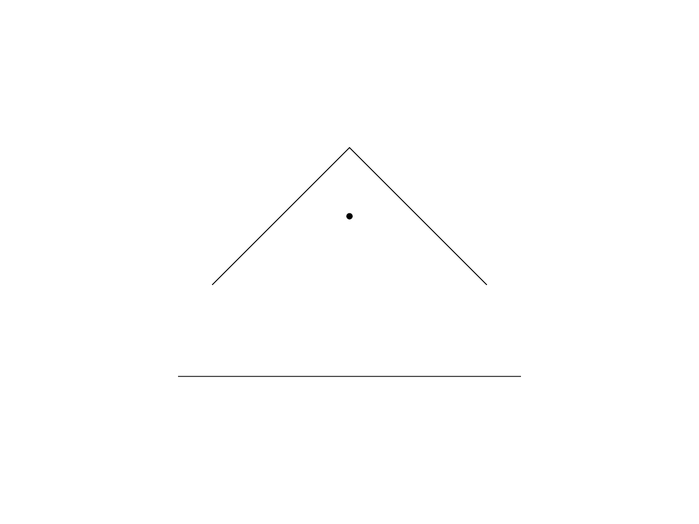

# 14.2 · Precise coordinates and original drawing drafts

**Goal:** Exercise current drawing tools and original persistence. · **Steps:** 20 · **Source:** [app/walk/sheet.rs](../../../../src/app/walk/sheet.rs) · [app/sheet_query.rs](../../../../src/app/sheet_query.rs) · [app/stream.rs](../../../../src/app/stream.rs) · [app/cplane.rs](../../../../src/app/cplane.rs) · [app/coords.rs](../../../../src/app/coords.rs) · [app/command/tool/shape.rs](../../../../src/app/command/tool/shape.rs) · [app/command/tool/gather.rs](../../../../src/app/command/tool/gather.rs) · [app/deform.rs](../../../../src/app/deform.rs) (`src/app/cplane.rs,src/app/primitives.rs,src/app/curves.rs`)

<div class="webgpu-schematic" style="width:100%;margin:6px auto;">
<svg xmlns="http://www.w3.org/2000/svg" width="1120" height="200" viewBox="0 0 1120 200" style="width:100%;max-width:100%;height:auto;display:block;margin:0 auto;" role="img">
  <defs>
    <marker id="arr" viewBox="0 0 10 10" refX="8" refY="5" markerWidth="6" markerHeight="6" orient="auto">
      <path d="M 0 1 L 9 5 L 0 9 z" fill="#111111"/>
    </marker>
    <marker id="arrR" viewBox="0 0 10 10" refX="8" refY="5" markerWidth="6" markerHeight="6" orient="auto">
      <path d="M 0 1 L 9 5 L 0 9 z" fill="#dc2626"/>
    </marker>
    <marker id="arrG" viewBox="0 0 10 10" refX="8" refY="5" markerWidth="6" markerHeight="6" orient="auto">
      <path d="M 0 1 L 9 5 L 0 9 z" fill="#16a34a"/>
    </marker>
    <marker id="arrB" viewBox="0 0 10 10" refX="8" refY="5" markerWidth="6" markerHeight="6" orient="auto">
      <path d="M 0 1 L 9 5 L 0 9 z" fill="#2563eb"/>
    </marker>
  </defs>
  <rect x="2" y="2" width="1116" height="196" rx="10" fill="#ffffff" stroke="#111111" stroke-width="2"/>
  <rect x="16" y="14" width="248" height="172" rx="8" fill="#ffffff" stroke="#111111" stroke-width="1.75"/>
  <text paint-order="stroke fill" stroke="#ffffff" stroke-width="5" stroke-linejoin="round" x="140" y="34" text-anchor="middle" font-family="monospace" font-size="11.5" font-weight="700" fill="#111111">1. Lesson 14.2 Code</text>
  <rect x="34" y="48" width="212" height="24" rx="4" fill="#ffffff" stroke="#111111" stroke-width="1.25"/>
  <text paint-order="stroke fill" stroke="#ffffff" stroke-width="5" stroke-linejoin="round" x="140" y="64" text-anchor="middle" font-family="monospace" font-size="10" font-weight="700" fill="#111111">src/drawing_coords.rs</text>
  <rect x="34" y="78" width="212" height="24" rx="4" fill="#ffffff" stroke="#111111" stroke-width="1.5"/>
  <text paint-order="stroke fill" stroke="#ffffff" stroke-width="5" stroke-linejoin="round" x="140" y="94" text-anchor="middle" font-family="monospace" font-size="10" font-weight="700" fill="#111111">src/drawing_input.rs</text>
  <rect x="34" y="108" width="212" height="24" rx="4" fill="#ffffff" stroke="#111111" stroke-width="1.25"/>
  <text paint-order="stroke fill" stroke="#ffffff" stroke-width="5" stroke-linejoin="round" x="140" y="124" text-anchor="middle" font-family="monospace" font-size="10" font-weight="700" fill="#111111">src/lib.rs</text>
  <text paint-order="stroke fill" stroke="#ffffff" stroke-width="5" stroke-linejoin="round" x="140" y="172" text-anchor="middle" font-family="monospace" font-size="9.5" fill="#111111">20 Coding Steps</text>
  <line x1="264" y1="100" x2="292" y2="100" stroke="#111111" stroke-width="2" marker-end="url(#arr)"/>
  <rect x="296" y="14" width="248" height="172" rx="8" fill="#ffffff" stroke="#111111" stroke-width="1.75"/>
  <text paint-order="stroke fill" stroke="#ffffff" stroke-width="5" stroke-linejoin="round" x="420" y="34" text-anchor="middle" font-family="monospace" font-size="11.5" font-weight="700" fill="#111111">2. session_viewer/src</text>
  <rect x="314" y="48" width="212" height="26" rx="4" fill="#ffffff" stroke="#111111" stroke-width="1.5"/>
  <text paint-order="stroke fill" stroke="#ffffff" stroke-width="5" stroke-linejoin="round" x="420" y="65" text-anchor="middle" font-family="monospace" font-size="10" font-weight="700" fill="#111111">src/app/cplane.rs</text>
  <rect x="314" y="80" width="212" height="26" rx="4" fill="#ffffff" stroke="#111111" stroke-width="1.5"/>
  <text paint-order="stroke fill" stroke="#ffffff" stroke-width="5" stroke-linejoin="round" x="420" y="97" text-anchor="middle" font-family="monospace" font-size="10" font-weight="700" fill="#111111">src/app/primitives.rs</text>
  <rect x="314" y="112" width="212" height="24" rx="4" fill="#ffffff" stroke="#111111" stroke-width="1.5"/>
  <text paint-order="stroke fill" stroke="#ffffff" stroke-width="5" stroke-linejoin="round" x="420" y="128" text-anchor="middle" font-family="monospace" font-size="9.5" font-weight="700" fill="#111111">✓ cargo check (wasm32)</text>
  <text paint-order="stroke fill" stroke="#ffffff" stroke-width="5" stroke-linejoin="round" x="420" y="172" text-anchor="middle" font-family="sans-serif" font-size="10" fill="#111111">Place coordinates in the…</text>
  <line x1="544" y1="100" x2="572" y2="100" stroke="#111111" stroke-width="2" marker-end="url(#arr)"/>
  <rect x="576" y="14" width="248" height="172" rx="8" fill="#ffffff" stroke="#111111" stroke-width="1.75"/>
  <text paint-order="stroke fill" stroke="#ffffff" stroke-width="5" stroke-linejoin="round" x="700" y="34" text-anchor="middle" font-family="monospace" font-size="11.5" font-weight="700" fill="#111111">3. Local C-Plane Triad &amp; OSnap</text>
  <polygon points="602,130 650,74 798,74 750,130" fill="#f8fafc" stroke="#111111" stroke-width="1.5"/>
  <line x1="686" y1="108" x2="742" y2="108" stroke="#dc2626" stroke-width="2.25" marker-end="url(#arrR)"/>
  <line x1="686" y1="108" x2="658" y2="132" stroke="#16a34a" stroke-width="2.25" marker-end="url(#arrG)"/>
  <line x1="686" y1="108" x2="686" y2="54" stroke="#2563eb" stroke-width="2.25" marker-end="url(#arrB)"/>
  <circle cx="686" cy="108" r="4.5" fill="#facc15" stroke="#111111" stroke-width="1.5"/>
  <text paint-order="stroke fill" stroke="#ffffff" stroke-width="5" stroke-linejoin="round" x="700" y="172" text-anchor="middle" font-family="monospace" font-size="9.5" fill="#111111">Precise coordinates and ori…</text>
  <line x1="824" y1="100" x2="852" y2="100" stroke="#111111" stroke-width="2" marker-end="url(#arr)"/>
  <rect x="856" y="14" width="248" height="172" rx="8" fill="#ffffff" stroke="#111111" stroke-width="1.75"/>
  <text paint-order="stroke fill" stroke="#ffffff" stroke-width="5" stroke-linejoin="round" x="980" y="34" text-anchor="middle" font-family="monospace" font-size="11.5" font-weight="700" fill="#111111">4. Exact Curves &amp; Primitives</text>
  <circle cx="928" cy="94" r="32" fill="#dbeafe" stroke="#111111" stroke-width="1.75"/>
  <rect x="982" y="64" width="62" height="60" rx="4" fill="#dcfce7" stroke="#111111" stroke-width="1.75"/>
  <text paint-order="stroke fill" stroke="#ffffff" stroke-width="5" stroke-linejoin="round" x="976" y="144" text-anchor="middle" font-family="monospace" font-size="9.5" font-weight="700" fill="#111111">NURBS Arc + B-Rep Box</text>
  <text paint-order="stroke fill" stroke="#ffffff" stroke-width="5" stroke-linejoin="round" x="980" y="172" text-anchor="middle" font-family="sans-serif" font-size="10" font-weight="700" fill="#111111">Exercise current drawing…</text>
</svg>
</div>

## <a id="checkpoint-72-copy-current-construction-planes-and-coordinate-forms"></a>1. Place coordinates in the selected plane

<div class="webgpu-schematic" style="width:100%;margin:6px auto;">
<svg xmlns="http://www.w3.org/2000/svg" width="1120" height="72" viewBox="0 0 1120 72" style="width:100%;max-width:100%;height:auto;display:block;margin:0 auto;" role="img">
  <defs>
    <marker id="arr" viewBox="0 0 10 10" refX="8" refY="5" markerWidth="6" markerHeight="6" orient="auto">
      <path d="M 0 1 L 9 5 L 0 9 z" fill="#111111"/>
    </marker>
    <marker id="arrR" viewBox="0 0 10 10" refX="8" refY="5" markerWidth="6" markerHeight="6" orient="auto">
      <path d="M 0 1 L 9 5 L 0 9 z" fill="#dc2626"/>
    </marker>
    <marker id="arrG" viewBox="0 0 10 10" refX="8" refY="5" markerWidth="6" markerHeight="6" orient="auto">
      <path d="M 0 1 L 9 5 L 0 9 z" fill="#16a34a"/>
    </marker>
    <marker id="arrB" viewBox="0 0 10 10" refX="8" refY="5" markerWidth="6" markerHeight="6" orient="auto">
      <path d="M 0 1 L 9 5 L 0 9 z" fill="#2563eb"/>
    </marker>
  </defs>
  <rect x="2" y="2" width="1116" height="68" rx="10" fill="#ffffff" stroke="#111111" stroke-width="2"/>
  <rect x="14" y="10" width="252" height="52" rx="6" fill="#ffffff" stroke="#111111" stroke-width="1.5"/>
  <text paint-order="stroke fill" stroke="#ffffff" stroke-width="5" stroke-linejoin="round" x="140" y="30" text-anchor="middle" font-family="monospace" font-size="10.5" font-weight="700" fill="#111111">Step 1 of 20</text>
  <text paint-order="stroke fill" stroke="#ffffff" stroke-width="5" stroke-linejoin="round" x="140" y="48" text-anchor="middle" font-family="monospace" font-size="9.5" fill="#111111">src/drawing_coords.rs</text>
  <line x1="266" y1="36" x2="292" y2="36" stroke="#111111" stroke-width="1.75" marker-end="url(#arr)"/>
  <rect x="296" y="10" width="252" height="52" rx="6" fill="#ffffff" stroke="#111111" stroke-width="1.5"/>
  <text paint-order="stroke fill" stroke="#ffffff" stroke-width="5" stroke-linejoin="round" x="422" y="30" text-anchor="middle" font-family="monospace" font-size="10" font-weight="700" fill="#111111">1. CPU / Rust Input</text>
  <text paint-order="stroke fill" stroke="#ffffff" stroke-width="5" stroke-linejoin="round" x="422" y="48" text-anchor="middle" font-family="sans-serif" font-size="9.5" fill="#111111">original frame</text>
  <line x1="548" y1="36" x2="574" y2="36" stroke="#111111" stroke-width="1.75" marker-end="url(#arr)"/>
  <rect x="578" y="10" width="252" height="52" rx="6" fill="#ffffff" stroke="#111111" stroke-width="1.5"/>
  <text paint-order="stroke fill" stroke="#ffffff" stroke-width="5" stroke-linejoin="round" x="704" y="30" text-anchor="middle" font-family="monospace" font-size="10" font-weight="700" fill="#111111">2. WebGPU / WGSL</text>
  <text paint-order="stroke fill" stroke="#ffffff" stroke-width="5" stroke-linejoin="round" x="704" y="48" text-anchor="middle" font-family="sans-serif" font-size="9.5" fill="#111111">parsed coordinates</text>
  <line x1="830" y1="36" x2="856" y2="36" stroke="#111111" stroke-width="1.75" marker-end="url(#arr)"/>
  <rect x="860" y="10" width="246" height="52" rx="6" fill="#fef9c3" stroke="#111111" stroke-width="1.75"/>
  <text paint-order="stroke fill" stroke="#ffffff" stroke-width="5" stroke-linejoin="round" x="983" y="30" text-anchor="middle" font-family="monospace" font-size="10" font-weight="700" fill="#111111">3. -&gt; src/app/cplane.rs</text>
  <text paint-order="stroke fill" stroke="#ffffff" stroke-width="5" stroke-linejoin="round" x="983" y="48" text-anchor="middle" font-family="sans-serif" font-size="9.5" fill="#111111">world drawing point</text>
</svg>
</div>

**What this code does:** Complete absolute coordinates, offsets and point placement with the original construction-plane rules.

### 1. `src/drawing_coords.rs`

Extend this original owner with the day’s complete input helpers. Supply only the unchanged original frame and coordinate validation fixtures.

**Locate this existing block:**

```rust
}

/// Parse coordinate text without the world prefix.
fn parse_plain(text: &str) -> Option<Typed> {
    let text = text.trim();

    if text.is_empty() {
        return None;
    }

    let (body, relative) = match text.strip_prefix('@') {
        Some(rest) => (rest.trim(), true),
        None => (text, false),
    };

    if let Some((d, a)) = body.split_once('<') {
        let distance = number(d)?;
        let degrees = number(a)?;
        return Some(Typed::Polar {
            distance,
            degrees,
        });
    }

    let parts: Vec<&str> = body.split(',').map(str::trim).collect();

    match parts.len() {
        1 if relative => None, // `@5` has no direction
        1 => Some(Typed::Distance(number(parts[0])?)),
        2 | 3 => {
            let x = number(parts[0])?;
            let y = number(parts[1])?;
            let z = match parts.get(2) {
                Some(v) => Some(number(v)?),
                None => None,
            };
            Some(if relative {
                Typed::Relative { x, y, z }
            } else {
                Typed::Absolute { x, y, z }
            })
        }
        _ => None,
    }
}

/// A typed coordinate as a point on the plane.
pub fn resolve(
    typed: Typed,
    origin: &Point,
    x_axis: &Vector,
    y_axis: &Vector,
    previous: Option<&Point>,
    along: Option<&Vector>,
) -> Option<Point> {
    // `base` plus u along x and v along y
    let on_plane = |u: f64, v: f64, base: &Point| {
        Point::new(
            base[0] + x_axis[0] * u + y_axis[0] * v,
            base[1] + x_axis[1] * u + y_axis[1] * v,
            base[2] + x_axis[2] * u + y_axis[2] * v,
        )
    };

    match typed {
        Typed::Absolute { x, y, z: Some(z) } => Some(Point::new(x, y, z)),
        Typed::Absolute { x, y, z: None } => Some(on_plane(x, y, origin)),
        Typed::Relative { x, y, z: Some(z) } => {
            let p = previous?;
            Some(Point::new(p[0] + x, p[1] + y, p[2] + z))
        }
        Typed::Relative { x, y, z: None } => Some(on_plane(x, y, previous?)),
        Typed::Polar {
            distance,
            degrees,
        } => {
            let r = degrees.to_radians();
            let base = previous.unwrap_or(origin);
            Some(on_plane(
                distance * r.cos(),
                distance * r.sin(),
                base,
            ))
        }
        Typed::Distance(d) => {
            let p = previous?;
            let v = along?;
            Some(Point::new(
                p[0] + v[0] * d,
                p[1] + v[1] * d,
                p[2] + v[2] * d,
            ))
        }
    }
}

/// A finite number, or None.
fn number(text: &str) -> Option<f64> {
    let value: f64 = text.trim().parse().ok()?;
    value.is_finite().then_some(value)
}
```

Edit the existing block to match this code; keep unchanged lines:

```rust
}

/// A typed absolute point in the world: measured in the fixed construction plane, in world coordinates in View mode or after `w`.
pub fn absolute(text: &str) -> Option<[f64; 3]> {
    let (Typed::Absolute { x, y, z }, world) = parse_world(text)? else {
        return None;
    };
    let uvw = [x, y, z.unwrap_or(0.0)];

    match plane().filter(|_| !world) {
        Some(plane) => {
            let p = plane.world(uvw);
            Some([p[0], p[1], p[2]])
        }
        None => Some(uvw),
    }
}

/// A typed offset in the world: along the fixed construction plane's axes, along the world axes in View mode or after `w`.
pub fn offset(uvw: [f64; 3], world: bool) -> [f64; 3] {
    match plane().filter(|_| !world) {
        Some(plane) => {
            let (o, p) = (plane.origin(), plane.world(uvw));
            [p[0] - o[0], p[1] - o[1], p[2] - o[2]]
        }
        None => uvw,
    }
}

/// A typed coordinate as a point: in the fixed construction plane's coordinates from its origin, else as `resolve` places it on the drawing plane.
pub fn place(
    typed: Typed,
    world: bool,
    x_axis: &Vector,
    y_axis: &Vector,
    previous: Option<&Point>,
    along: Option<&Vector>,
) -> Option<Point> {
    let Some(plane) = plane().filter(|_| !world) else {
        // world coordinates; a fixed plane's axes do not apply after `w`
        let (x, y) = match world && plane().is_some() {
            true => CPlane::Xy.axes(),
            false => (x_axis.clone(), y_axis.clone()),
        };
        return resolve(
            typed,
            &Point::new(0.0, 0.0, 0.0),
            &x,
            &y,
            previous,
            along,
        );
    };
    // `base` plus an offset in plane coordinates
    let moved = |base: &Point, uvw: [f64; 3]| {
        let d = offset(uvw, false);
        Point::new(
            base[0] + d[0],
            base[1] + d[1],
            base[2] + d[2],
        )
    };

    match typed {
        Typed::Absolute { x, y, z } => Some(plane.world([x, y, z.unwrap_or(0.0)])),
        Typed::Relative { x, y, z } => Some(moved(previous?, [x, y, z.unwrap_or(0.0)])),
        Typed::Polar {
            distance,
            degrees,
        } => {
            let r = degrees.to_radians();
            let base = previous
                .cloned()
                .unwrap_or_else(|| plane.origin());
            Some(moved(
                &base,
                [distance * r.cos(), distance * r.sin(), 0.0],
            ))
        }
        Typed::Distance(_) => resolve(
            typed,
            &plane.origin(),
            x_axis,
            y_axis,
            previous,
            along,
        ),
    }
}

/// Parse coordinate text without the world prefix.
fn parse_plain(text: &str) -> Option<Typed> {
    let text = text.trim();

    if text.is_empty() {
        return None;
    }

    let (body, relative) = match text.strip_prefix('@') {
        Some(rest) => (rest.trim(), true),
        None => (text, false),
    };

    if let Some((d, a)) = body.split_once('<') {
        let distance = number(d)?;
        let degrees = number(a)?;
        return Some(Typed::Polar {
            distance,
            degrees,
        });
    }

    let parts: Vec<&str> = body.split(',').map(str::trim).collect();

    match parts.len() {
        1 if relative => None, // `@5` has no direction
        1 => Some(Typed::Distance(number(parts[0])?)),
        2 | 3 => {
            let x = number(parts[0])?;
            let y = number(parts[1])?;
            let z = match parts.get(2) {
                Some(v) => Some(number(v)?),
                None => None,
            };
            Some(if relative {
                Typed::Relative { x, y, z }
            } else {
                Typed::Absolute { x, y, z }
            })
        }
        _ => None,
    }
}

/// A typed coordinate as a point on the plane.
pub fn resolve(
    typed: Typed,
    origin: &Point,
    x_axis: &Vector,
    y_axis: &Vector,
    previous: Option<&Point>,
    along: Option<&Vector>,
) -> Option<Point> {
    // `base` plus u along x and v along y
    let on_plane = |u: f64, v: f64, base: &Point| {
        Point::new(
            base[0] + x_axis[0] * u + y_axis[0] * v,
            base[1] + x_axis[1] * u + y_axis[1] * v,
            base[2] + x_axis[2] * u + y_axis[2] * v,
        )
    };

    match typed {
        Typed::Absolute { x, y, z: Some(z) } => Some(Point::new(x, y, z)),
        Typed::Absolute { x, y, z: None } => Some(on_plane(x, y, origin)),
        Typed::Relative { x, y, z: Some(z) } => {
            let p = previous?;
            Some(Point::new(p[0] + x, p[1] + y, p[2] + z))
        }
        Typed::Relative { x, y, z: None } => Some(on_plane(x, y, previous?)),
        Typed::Polar {
            distance,
            degrees,
        } => {
            let r = degrees.to_radians();
            let base = previous.unwrap_or(origin);
            Some(on_plane(
                distance * r.cos(),
                distance * r.sin(),
                base,
            ))
        }
        Typed::Distance(d) => {
            let p = previous?;
            let v = along?;
            Some(Point::new(
                p[0] + v[0] * d,
                p[1] + v[1] * d,
                p[2] + v[2] * d,
            ))
        }
    }
}

/// A finite number, or None.
fn number(text: &str) -> Option<f64> {
    let value: f64 = text.trim().parse().ok()?;
    value.is_finite().then_some(value)
}

#[cfg(test)]
mod tests {
    use super::*;

    /// The world XY plane.
    fn plane() -> (Point, Vector, Vector) {
        (
            Point::new(0.0, 0.0, 0.0),
            Vector::new(1.0, 0.0, 0.0),
            Vector::new(0.0, 1.0, 0.0),
        )
    }

    /// Absolute, relative, polar and distance all parse.
    #[test]
    fn the_four_forms_parse() {
        assert_eq!(
            parse("12,4,2"),
            Some(Typed::Absolute {
                x: 12.0,
                y: 4.0,
                z: Some(2.0)
            })
        );
        assert_eq!(
            parse(" 12 , 4 "),
            Some(Typed::Absolute {
                x: 12.0,
                y: 4.0,
                z: None
            })
        );
        assert_eq!(
            parse("@3,0"),
            Some(Typed::Relative {
                x: 3.0,
                y: 0.0,
                z: None
            })
        );
        assert_eq!(
            parse("@5<90"),
            Some(Typed::Polar {
                distance: 5.0,
                degrees: 90.0
            })
        );
        assert_eq!(parse("7.5"), Some(Typed::Distance(7.5)));
    }

    /// Words, extra parts and NaN are not coordinates.
    #[test]
    fn what_is_not_a_coordinate() {
        assert_eq!(parse("line"), None);
        assert_eq!(parse(""), None);
        assert_eq!(parse("1,2,3,4"), None);
        assert_eq!(parse("@5"), None, "no direction");
        assert_eq!(parse("nan"), None);
        assert_eq!(parse("inf,0"), None);
    }

    /// Two numbers land on the plane, three in the world.
    #[test]
    fn two_numbers_are_on_the_plane_and_three_are_not() {
        let lifted = Point::new(0.0, 0.0, 9.0);
        let (_, x, y) = plane();
        let on = resolve(
            parse("2,3").unwrap(),
            &lifted,
            &x,
            &y,
            None,
            None,
        )
        .unwrap();
        assert_eq!([on[0], on[1], on[2]], [2.0, 3.0, 9.0]);
        let world = resolve(
            parse("2,3,0").unwrap(),
            &lifted,
            &x,
            &y,
            None,
            None,
        )
        .unwrap();
        assert_eq!(
            [world[0], world[1], world[2]],
            [2.0, 3.0, 0.0]
        );
    }

    /// Relative and polar measure from the previous point.
    #[test]
    fn relative_forms_measure_from_the_previous_point() {
        let (o, x, y) = plane();
        let prev = Point::new(10.0, 10.0, 0.0);
        let r = resolve(
            parse("@3,4").unwrap(),
            &o,
            &x,
            &y,
            Some(&prev),
            None,
        )
        .unwrap();
        assert_eq!([r[0], r[1]], [13.0, 14.0]);
        let p = resolve(
            parse("@5<90").unwrap(),
            &o,
            &x,
            &y,
            Some(&prev),
            None,
        )
        .unwrap();
        assert!((p[0] - 10.0).abs() < 1e-12 && (p[1] - 15.0).abs() < 1e-12);
        let first = resolve(
            parse("@5<0").unwrap(),
            &o,
            &x,
            &y,
            None,
            None,
        )
        .unwrap();
        assert_eq!([first[0], first[1]], [5.0, 0.0]);
    }

    /// A relative form without a previous point gives nothing.
    #[test]
    fn a_missing_reference_does_not_resolve() {
        let (o, x, y) = plane();
        assert!(
            resolve(
                parse("@3,4").unwrap(),
                &o,
                &x,
                &y,
                None,
                None
            )
            .is_none()
        );
        assert!(resolve(parse("5").unwrap(), &o, &x, &y, None, None).is_none());
        let prev = Point::new(1.0, 0.0, 0.0);
        assert!(
            resolve(
                parse("5").unwrap(),
                &o,
                &x,
                &y,
                Some(&prev),
                None
            )
            .is_none()
        );
    }

    /// A millimetre typed a kilometre out is kept exactly.
    #[test]
    fn a_typed_coordinate_is_exact() {
        let (o, x, y) = plane();
        let p = resolve(
            parse("1000000.001,0,0").unwrap(),
            &o,
            &x,
            &y,
            None,
            None,
        )
        .unwrap();
        assert_eq!(p[0], 1_000_000.001);
    }

    /// On a fixed tilted plane typed points are plane coordinates from its origin; `w` and View mode mean world.
    #[test]
    fn typed_points_follow_a_fixed_construction_plane() {
        let tilted = CPlane::from_3_points(
            &Point::new(0.0, 0.0, 0.0),
            &Point::new(1000.0, 0.0, 1000.0),
            &Point::new(0.0, 1000.0, 0.0),
        )
        .unwrap();
        let near =
            |p: [f64; 3], q: [f64; 3]| (0..3).all(|k| (p[k] - q[k]).abs() < 1e-9);
        let h = std::f64::consts::FRAC_1_SQRT_2 * 1000.0;
        let (_, x, y) = plane();
        let at = |text: &str, previous: Option<&Point>| {
            let (typed, world) = parse_world(text).unwrap();
            let p = place(typed, world, &x, &y, previous, None).unwrap();
            [p[0], p[1], p[2]]
        };

        // View mode: world, as before
        set_plane(None);
        assert_eq!(
            absolute("1000,0,0"),
            Some([1000.0, 0.0, 0.0])
        );
        assert!(near(
            at("1000,0,0", None),
            [1000.0, 0.0, 0.0]
        ));

        set_plane(Some(tilted));
        assert_eq!(hint(), "plane x,y,z (w for world)");
        assert!(
            near(absolute("1000,0,0").unwrap(), [h, 0.0, h]),
            "along the plane's x axis"
        );
        assert!(
            near(absolute("0,0,1000").unwrap(), [-h, 0.0, h]),
            "z is the plane's normal"
        );
        assert_eq!(
            absolute("w1000,0,0"),
            Some([1000.0, 0.0, 0.0]),
            "w is world"
        );
        assert!(near(at("1000,0,0", None), [h, 0.0, h]));
        assert!(near(
            at("w1000,0,0", None),
            [1000.0, 0.0, 0.0]
        ));
        let start = Point::new(h, 0.0, h);
        assert!(
            near(at("@0,500", Some(&start)), [h, 500.0, h]),
            "relative along the plane's y"
        );
        assert!(
            near(at("1000<90", Some(&start)), [h, 1000.0, h]),
            "polar in the plane"
        );
        assert!(
            near(
                at("w@0,0,100", Some(&start)),
                [h, 0.0, h + 100.0]
            ),
            "w relative is world"
        );
        assert!(
            near(
                offset([1000.0, 0.0, 0.0], false),
                [h, 0.0, h]
            ) && offset([1.0, 2.0, 3.0], true) == [1.0, 2.0, 3.0]
        );
        set_plane(None);
    }
}
```

## <a id="checkpoint-72a-resolve-bounded-typed-batches-in-the-current-plane"></a>2. Resolve bounded typed batches in the current plane

<div class="webgpu-schematic" style="width:100%;margin:6px auto;">
<svg xmlns="http://www.w3.org/2000/svg" width="1120" height="72" viewBox="0 0 1120 72" style="width:100%;max-width:100%;height:auto;display:block;margin:0 auto;" role="img">
  <defs>
    <marker id="arr" viewBox="0 0 10 10" refX="8" refY="5" markerWidth="6" markerHeight="6" orient="auto">
      <path d="M 0 1 L 9 5 L 0 9 z" fill="#111111"/>
    </marker>
    <marker id="arrR" viewBox="0 0 10 10" refX="8" refY="5" markerWidth="6" markerHeight="6" orient="auto">
      <path d="M 0 1 L 9 5 L 0 9 z" fill="#dc2626"/>
    </marker>
    <marker id="arrG" viewBox="0 0 10 10" refX="8" refY="5" markerWidth="6" markerHeight="6" orient="auto">
      <path d="M 0 1 L 9 5 L 0 9 z" fill="#16a34a"/>
    </marker>
    <marker id="arrB" viewBox="0 0 10 10" refX="8" refY="5" markerWidth="6" markerHeight="6" orient="auto">
      <path d="M 0 1 L 9 5 L 0 9 z" fill="#2563eb"/>
    </marker>
  </defs>
  <rect x="2" y="2" width="1116" height="68" rx="10" fill="#ffffff" stroke="#111111" stroke-width="2"/>
  <rect x="14" y="10" width="252" height="52" rx="6" fill="#ffffff" stroke="#111111" stroke-width="1.5"/>
  <text paint-order="stroke fill" stroke="#ffffff" stroke-width="5" stroke-linejoin="round" x="140" y="30" text-anchor="middle" font-family="monospace" font-size="10.5" font-weight="700" fill="#111111">Step 2 of 20</text>
  <text paint-order="stroke fill" stroke="#ffffff" stroke-width="5" stroke-linejoin="round" x="140" y="48" text-anchor="middle" font-family="monospace" font-size="9.5" fill="#111111">src/drawing_input.rs, src/l…</text>
  <line x1="266" y1="36" x2="292" y2="36" stroke="#111111" stroke-width="1.75" marker-end="url(#arr)"/>
  <rect x="296" y="10" width="252" height="52" rx="6" fill="#ffffff" stroke="#111111" stroke-width="1.5"/>
  <text paint-order="stroke fill" stroke="#ffffff" stroke-width="5" stroke-linejoin="round" x="422" y="30" text-anchor="middle" font-family="monospace" font-size="10" font-weight="700" fill="#111111">1. CPU / Rust Input</text>
  <text paint-order="stroke fill" stroke="#ffffff" stroke-width="5" stroke-linejoin="round" x="422" y="48" text-anchor="middle" font-family="sans-serif" font-size="9.5" fill="#111111">typed words</text>
  <line x1="548" y1="36" x2="574" y2="36" stroke="#111111" stroke-width="1.75" marker-end="url(#arr)"/>
  <rect x="578" y="10" width="252" height="52" rx="6" fill="#ffffff" stroke="#111111" stroke-width="1.5"/>
  <text paint-order="stroke fill" stroke="#ffffff" stroke-width="5" stroke-linejoin="round" x="704" y="30" text-anchor="middle" font-family="monospace" font-size="10" font-weight="700" fill="#111111">2. WebGPU / WGSL</text>
  <text paint-order="stroke fill" stroke="#ffffff" stroke-width="5" stroke-linejoin="round" x="704" y="48" text-anchor="middle" font-family="sans-serif" font-size="9.5" fill="#111111">current fixed context</text>
  <line x1="830" y1="36" x2="856" y2="36" stroke="#111111" stroke-width="1.75" marker-end="url(#arr)"/>
  <rect x="860" y="10" width="246" height="52" rx="6" fill="#ffffff" stroke="#111111" stroke-width="1.75"/>
  <text paint-order="stroke fill" stroke="#ffffff" stroke-width="5" stroke-linejoin="round" x="983" y="30" text-anchor="middle" font-family="monospace" font-size="10" font-weight="700" fill="#111111">3. -&gt; src/app/cplane.rs</text>
  <text paint-order="stroke fill" stroke="#ffffff" stroke-width="5" stroke-linejoin="round" x="983" y="48" text-anchor="middle" font-family="sans-serif" font-size="9.5" fill="#111111">checked world points</text>
</svg>
</div>

**What this code does:** Resolve bounded typed batches in the current plane.

### 1. `src/drawing_input.rs`

Resolve current coordinate forms atomically before changing the draft.

Create the file and type:

```rust
use crate::{cplane::CPlane, drawing_coords as coords};
use session_rust::{Point, Vector};

pub fn points(
    text: &str,
    fixed: Option<CPlane>,
    frame: CPlane,
    previous: &[[f64; 3]],
    cursor: Option<[f64; 3]>,
) -> Result<Vec<[f64; 3]>, &'static str> {
    coords::set_plane(fixed);
    let (x, y) = frame.axes();
    let mut all = previous.to_vec();
    let mut added = Vec::new();
    for word in text.split_whitespace() {
        if all.len() >= 4096 {
            return Err("Drawing commands accept at most 4096 points");
        }
        if word
            .trim_start_matches(['w', 'W', '@'])
            .split([',', '<'])
            .any(|part| {
                part.parse::<f64>()
                    .is_ok_and(|v| !v.is_finite())
            })
        {
            return Err("Coordinates must be finite and within ±1e12");
        }
        let (typed, world) = coords::parse_world(word)
            .ok_or("Use x,y,z, @x,y,z, distance<angle, or w for world")?;
        let last = all
            .last()
            .map(|p| Point::new(p[0], p[1], p[2]));
        let along = all.last().zip(cursor).and_then(|(p, c)| {
            let d = std::array::from_fn::<_, 3, _>(|i| c[i] - p[i]);
            let n = d.iter().map(|v| v * v).sum::<f64>().sqrt();
            (n > 1e-12).then(|| Vector::new(d[0] / n, d[1] / n, d[2] / n))
        });
        let p = coords::place(
            typed,
            world,
            &x,
            &y,
            last.as_ref(),
            along.as_ref(),
        )
        .ok_or("This coordinate needs a previous point or a cursor direction")?;
        let p = crate::tool_coords::checked([p[0], p[1], p[2]])?;
        all.push(p);
        added.push(p);
    }
    if added.is_empty() {
        return Err("A coordinate is required");
    }
    Ok(added)
}
```

### 2. `src/lib.rs`

Register the drawing component.

**Locate this existing block:**

```rust
pub mod drawing_coords;

#[cfg(target_arch = "wasm32")]
```

Edit the existing block to match this code; keep unchanged lines:

```rust
pub mod drawing_coords;

pub mod drawing_input;

#[cfg(target_arch = "wasm32")]
```

## <a id="checkpoint-72b-place-clicks-on-stable-construction-planes"></a>3. Place clicks on stable construction planes

<div class="webgpu-schematic" style="width:100%;margin:6px auto;">
<svg xmlns="http://www.w3.org/2000/svg" width="1120" height="72" viewBox="0 0 1120 72" style="width:100%;max-width:100%;height:auto;display:block;margin:0 auto;" role="img">
  <defs>
    <marker id="arr" viewBox="0 0 10 10" refX="8" refY="5" markerWidth="6" markerHeight="6" orient="auto">
      <path d="M 0 1 L 9 5 L 0 9 z" fill="#111111"/>
    </marker>
    <marker id="arrR" viewBox="0 0 10 10" refX="8" refY="5" markerWidth="6" markerHeight="6" orient="auto">
      <path d="M 0 1 L 9 5 L 0 9 z" fill="#dc2626"/>
    </marker>
    <marker id="arrG" viewBox="0 0 10 10" refX="8" refY="5" markerWidth="6" markerHeight="6" orient="auto">
      <path d="M 0 1 L 9 5 L 0 9 z" fill="#16a34a"/>
    </marker>
    <marker id="arrB" viewBox="0 0 10 10" refX="8" refY="5" markerWidth="6" markerHeight="6" orient="auto">
      <path d="M 0 1 L 9 5 L 0 9 z" fill="#2563eb"/>
    </marker>
  </defs>
  <rect x="2" y="2" width="1116" height="68" rx="10" fill="#ffffff" stroke="#111111" stroke-width="2"/>
  <rect x="14" y="10" width="252" height="52" rx="6" fill="#ffffff" stroke="#111111" stroke-width="1.5"/>
  <text paint-order="stroke fill" stroke="#ffffff" stroke-width="5" stroke-linejoin="round" x="140" y="30" text-anchor="middle" font-family="monospace" font-size="10.5" font-weight="700" fill="#111111">Step 3 of 20</text>
  <text paint-order="stroke fill" stroke="#ffffff" stroke-width="5" stroke-linejoin="round" x="140" y="48" text-anchor="middle" font-family="monospace" font-size="9.5" fill="#111111">src/drawing_input.rs</text>
  <line x1="266" y1="36" x2="292" y2="36" stroke="#111111" stroke-width="1.75" marker-end="url(#arr)"/>
  <rect x="296" y="10" width="252" height="52" rx="6" fill="#ffffff" stroke="#111111" stroke-width="1.5"/>
  <text paint-order="stroke fill" stroke="#ffffff" stroke-width="5" stroke-linejoin="round" x="422" y="30" text-anchor="middle" font-family="monospace" font-size="10" font-weight="700" fill="#111111">1. CPU / Rust Input</text>
  <text paint-order="stroke fill" stroke="#ffffff" stroke-width="5" stroke-linejoin="round" x="422" y="48" text-anchor="middle" font-family="sans-serif" font-size="9.5" fill="#111111">screen ray</text>
  <line x1="548" y1="36" x2="574" y2="36" stroke="#111111" stroke-width="1.75" marker-end="url(#arr)"/>
  <rect x="578" y="10" width="252" height="52" rx="6" fill="#ffffff" stroke="#111111" stroke-width="1.5"/>
  <text paint-order="stroke fill" stroke="#ffffff" stroke-width="5" stroke-linejoin="round" x="704" y="30" text-anchor="middle" font-family="monospace" font-size="10" font-weight="700" fill="#111111">2. WebGPU / WGSL</text>
  <text paint-order="stroke fill" stroke="#ffffff" stroke-width="5" stroke-linejoin="round" x="704" y="48" text-anchor="middle" font-family="sans-serif" font-size="9.5" fill="#111111">stable depth</text>
  <line x1="830" y1="36" x2="856" y2="36" stroke="#111111" stroke-width="1.75" marker-end="url(#arr)"/>
  <rect x="860" y="10" width="246" height="52" rx="6" fill="#ffffff" stroke="#111111" stroke-width="1.75"/>
  <text paint-order="stroke fill" stroke="#ffffff" stroke-width="5" stroke-linejoin="round" x="983" y="30" text-anchor="middle" font-family="monospace" font-size="10" font-weight="700" fill="#111111">3. -&gt; src/app/cplane.rs</text>
  <text paint-order="stroke fill" stroke="#ffffff" stroke-width="5" stroke-linejoin="round" x="983" y="48" text-anchor="middle" font-family="sans-serif" font-size="9.5" fill="#111111">construction-plane point</text>
</svg>
</div>

**What this code does:** Place clicks on stable construction planes.

### 1. `src/drawing_input.rs`

Resolve finite construction-plane clicks and retain their original doubles.

**Locate this existing block:**

```rust
    Ok(added)
}
```

Edit the existing block to match this code; keep unchanged lines:

```rust
    Ok(added)
}

pub fn on_plane(
    camera: &crate::camera::Camera,
    screen: [f32; 2],
    frame: CPlane,
) -> Option<[f64; 3]> {
    on_at(camera, screen, frame, None)
}

pub fn on_at(
    camera: &crate::camera::Camera,
    screen: [f32; 2],
    frame: CPlane,
    through: Option<[f64; 3]>,
) -> Option<[f64; 3]> {
    let ray = camera.ray(screen)?;
    let o = through
        .map(|p| Point::new(p[0], p[1], p[2]))
        .unwrap_or_else(|| frame.origin());
    let from = Point::new(ray.origin[0], ray.origin[1], ray.origin[2]);
    // Edge-on planes use the cursor's view depth before projection, avoiding an unstable intersection with a nearly parallel ray.
    let hit = if frame.grazed(&ray.direction) {
        let forward = camera
            .orientation
            .rotate_vector(Vector::y_axis());
        let denominator = ray.direction.dot(&forward);
        if denominator.abs() < 1e-12 {
            return None;
        }
        let delta = Vector::new(
            camera.target[0] - from[0],
            camera.target[1] - from[1],
            camera.target[2] - from[2],
        );
        let distance = delta.dot(&forward) / denominator;
        if !distance.is_finite() || distance <= 0. || distance > ray.max_distance {
            return None;
        }
        let at = Point::new(
            from[0] + ray.direction[0] * distance,
            from[1] + ray.direction[1] * distance,
            from[2] + ray.direction[2] * distance,
        );
        frame.project(&o, &at)
    } else {
        frame.hit(&o, &from, &ray.direction)?
    };
    let distance = (0..3)
        .map(|i| (hit[i] - from[i]).powi(2))
        .sum::<f64>()
        .sqrt();
    if distance > ray.max_distance {
        return None;
    }
    crate::tool_coords::checked([hit[0], hit[1], hit[2]]).ok()
}
```

## <a id="checkpoint-72c-name-the-construction-plane-chooser-options"></a>4. Name the construction plane chooser options

<div class="webgpu-schematic" style="width:100%;margin:6px auto;">
<svg xmlns="http://www.w3.org/2000/svg" width="1120" height="72" viewBox="0 0 1120 72" style="width:100%;max-width:100%;height:auto;display:block;margin:0 auto;" role="img">
  <defs>
    <marker id="arr" viewBox="0 0 10 10" refX="8" refY="5" markerWidth="6" markerHeight="6" orient="auto">
      <path d="M 0 1 L 9 5 L 0 9 z" fill="#111111"/>
    </marker>
    <marker id="arrR" viewBox="0 0 10 10" refX="8" refY="5" markerWidth="6" markerHeight="6" orient="auto">
      <path d="M 0 1 L 9 5 L 0 9 z" fill="#dc2626"/>
    </marker>
    <marker id="arrG" viewBox="0 0 10 10" refX="8" refY="5" markerWidth="6" markerHeight="6" orient="auto">
      <path d="M 0 1 L 9 5 L 0 9 z" fill="#16a34a"/>
    </marker>
    <marker id="arrB" viewBox="0 0 10 10" refX="8" refY="5" markerWidth="6" markerHeight="6" orient="auto">
      <path d="M 0 1 L 9 5 L 0 9 z" fill="#2563eb"/>
    </marker>
  </defs>
  <rect x="2" y="2" width="1116" height="68" rx="10" fill="#ffffff" stroke="#111111" stroke-width="2"/>
  <rect x="14" y="10" width="252" height="52" rx="6" fill="#ffffff" stroke="#111111" stroke-width="1.5"/>
  <text paint-order="stroke fill" stroke="#ffffff" stroke-width="5" stroke-linejoin="round" x="140" y="30" text-anchor="middle" font-family="monospace" font-size="10.5" font-weight="700" fill="#111111">Step 4 of 20</text>
  <text paint-order="stroke fill" stroke="#ffffff" stroke-width="5" stroke-linejoin="round" x="140" y="48" text-anchor="middle" font-family="monospace" font-size="9.5" fill="#111111">src/drawing_input.rs</text>
  <line x1="266" y1="36" x2="292" y2="36" stroke="#111111" stroke-width="1.75" marker-end="url(#arr)"/>
  <rect x="296" y="10" width="252" height="52" rx="6" fill="#ffffff" stroke="#111111" stroke-width="1.5"/>
  <text paint-order="stroke fill" stroke="#ffffff" stroke-width="5" stroke-linejoin="round" x="422" y="30" text-anchor="middle" font-family="monospace" font-size="10" font-weight="700" fill="#111111">1. CPU / Rust Input</text>
  <text paint-order="stroke fill" stroke="#ffffff" stroke-width="5" stroke-linejoin="round" x="422" y="48" text-anchor="middle" font-family="sans-serif" font-size="9.5" fill="#111111">choice word</text>
  <line x1="548" y1="36" x2="574" y2="36" stroke="#111111" stroke-width="1.75" marker-end="url(#arr)"/>
  <rect x="578" y="10" width="252" height="52" rx="6" fill="#ffffff" stroke="#111111" stroke-width="1.5"/>
  <text paint-order="stroke fill" stroke="#ffffff" stroke-width="5" stroke-linejoin="round" x="704" y="30" text-anchor="middle" font-family="monospace" font-size="10" font-weight="700" fill="#111111">2. WebGPU / WGSL</text>
  <text paint-order="stroke fill" stroke="#ffffff" stroke-width="5" stroke-linejoin="round" x="704" y="48" text-anchor="middle" font-family="sans-serif" font-size="9.5" fill="#111111">plane action</text>
  <line x1="830" y1="36" x2="856" y2="36" stroke="#111111" stroke-width="1.75" marker-end="url(#arr)"/>
  <rect x="860" y="10" width="246" height="52" rx="6" fill="#ffffff" stroke="#111111" stroke-width="1.75"/>
  <text paint-order="stroke fill" stroke="#ffffff" stroke-width="5" stroke-linejoin="round" x="983" y="30" text-anchor="middle" font-family="monospace" font-size="10" font-weight="700" fill="#111111">3. -&gt; src/app/cplane.rs</text>
  <text paint-order="stroke fill" stroke="#ffffff" stroke-width="5" stroke-linejoin="round" x="983" y="48" text-anchor="middle" font-family="sans-serif" font-size="9.5" fill="#111111">prompt buttons</text>
</svg>
</div>

**What this code does:** Name the construction plane chooser options.

### 1. `src/drawing_input.rs`

Describe current construction-plane options without silently changing a plane.

**Locate this existing block:**

```rust
    crate::tool_coords::checked([hit[0], hit[1], hit[2]]).ok()
}
```

Edit the existing block to match this code; keep unchanged lines:

```rust
    crate::tool_coords::checked([hit[0], hit[1], hit[2]]).ok()
}

pub fn buttons() -> Vec<(String, String)> {
    ["XY", "XZ", "YZ", "3 Point", "View", "Cancel"]
        .into_iter()
        .map(|s| (s.into(), format!("CPlane {s}")))
        .collect()
}
```

## <a id="checkpoint-72d-add-original-polylines-to-the-point-tool"></a>5. Add polylines to the point tool

<div class="webgpu-schematic" style="width:100%;margin:6px auto;">
<svg xmlns="http://www.w3.org/2000/svg" width="1120" height="72" viewBox="0 0 1120 72" style="width:100%;max-width:100%;height:auto;display:block;margin:0 auto;" role="img">
  <defs>
    <marker id="arr" viewBox="0 0 10 10" refX="8" refY="5" markerWidth="6" markerHeight="6" orient="auto">
      <path d="M 0 1 L 9 5 L 0 9 z" fill="#111111"/>
    </marker>
    <marker id="arrR" viewBox="0 0 10 10" refX="8" refY="5" markerWidth="6" markerHeight="6" orient="auto">
      <path d="M 0 1 L 9 5 L 0 9 z" fill="#dc2626"/>
    </marker>
    <marker id="arrG" viewBox="0 0 10 10" refX="8" refY="5" markerWidth="6" markerHeight="6" orient="auto">
      <path d="M 0 1 L 9 5 L 0 9 z" fill="#16a34a"/>
    </marker>
    <marker id="arrB" viewBox="0 0 10 10" refX="8" refY="5" markerWidth="6" markerHeight="6" orient="auto">
      <path d="M 0 1 L 9 5 L 0 9 z" fill="#2563eb"/>
    </marker>
  </defs>
  <rect x="2" y="2" width="1116" height="68" rx="10" fill="#ffffff" stroke="#111111" stroke-width="2"/>
  <rect x="14" y="10" width="252" height="52" rx="6" fill="#ffffff" stroke="#111111" stroke-width="1.5"/>
  <text paint-order="stroke fill" stroke="#ffffff" stroke-width="5" stroke-linejoin="round" x="140" y="30" text-anchor="middle" font-family="monospace" font-size="10.5" font-weight="700" fill="#111111">Step 5 of 20</text>
  <text paint-order="stroke fill" stroke="#ffffff" stroke-width="5" stroke-linejoin="round" x="140" y="48" text-anchor="middle" font-family="monospace" font-size="9.5" fill="#111111">src/tool.rs, src/drawing_in…</text>
  <line x1="266" y1="36" x2="292" y2="36" stroke="#111111" stroke-width="1.75" marker-end="url(#arr)"/>
  <rect x="296" y="10" width="252" height="52" rx="6" fill="#ffffff" stroke="#111111" stroke-width="1.5"/>
  <text paint-order="stroke fill" stroke="#ffffff" stroke-width="5" stroke-linejoin="round" x="422" y="30" text-anchor="middle" font-family="monospace" font-size="10" font-weight="700" fill="#111111">1. CPU / Rust Input</text>
  <text paint-order="stroke fill" stroke="#ffffff" stroke-width="5" stroke-linejoin="round" x="422" y="48" text-anchor="middle" font-family="sans-serif" font-size="9.5" fill="#111111">original points</text>
  <line x1="548" y1="36" x2="574" y2="36" stroke="#111111" stroke-width="1.75" marker-end="url(#arr)"/>
  <rect x="578" y="10" width="252" height="52" rx="6" fill="#ffffff" stroke="#111111" stroke-width="1.5"/>
  <text paint-order="stroke fill" stroke="#ffffff" stroke-width="5" stroke-linejoin="round" x="704" y="30" text-anchor="middle" font-family="monospace" font-size="10" font-weight="700" fill="#111111">2. WebGPU / WGSL</text>
  <text paint-order="stroke fill" stroke="#ffffff" stroke-width="5" stroke-linejoin="round" x="704" y="48" text-anchor="middle" font-family="sans-serif" font-size="9.5" fill="#111111">original Polyline</text>
  <line x1="830" y1="36" x2="856" y2="36" stroke="#111111" stroke-width="1.75" marker-end="url(#arr)"/>
  <rect x="860" y="10" width="246" height="52" rx="6" fill="#ffffff" stroke="#111111" stroke-width="1.75"/>
  <text paint-order="stroke fill" stroke="#ffffff" stroke-width="5" stroke-linejoin="round" x="983" y="30" text-anchor="middle" font-family="monospace" font-size="10" font-weight="700" fill="#111111">3. -&gt; src/app/cplane.rs</text>
  <text paint-order="stroke fill" stroke="#ffffff" stroke-width="5" stroke-linejoin="round" x="983" y="48" text-anchor="middle" font-family="sans-serif" font-size="9.5" fill="#111111">derived chain</text>
</svg>
</div>

**What this code does:** Add original polylines to the point tool.

### 1. `src/tool.rs`

Prepare original bounded polylines beside existing point, line and Move tools.

**Locate this existing block:**

```rust
    Move([f64; 3]),
}

pub trait Tool: std::fmt::Debug {
    fn name(&self) -> &'static str;
    fn count(&self) -> usize;
    fn build(&self, points: &[[f64; 3]]) -> Result<Built, &'static str>;
    fn buttons(&self) -> Vec<(String, String)> {
        vec![("Cancel".into(), "Escape".into())]
    }
}

#[derive(Clone, Copy, Debug)]
pub enum Shape {
    Point,
    Line,
    Move,
}

impl Tool for Shape {
    fn name(&self) -> &'static str {
        match self {
            Self::Point => "Point",
            Self::Line => "Line",
            Self::Move => "Move",
        }
    }
    fn count(&self) -> usize {
        match self {
            Self::Point => 1,
            Self::Line | Self::Move => 2,
        }
    }
    fn build(&self, points: &[[f64; 3]]) -> Result<Built, &'static str> {
        match (self, points) {
            (Self::Point, [p]) => Ok(Built::Point(PreparedPoint::new(Rc::new(
                session_rust::Point::new(p[0], p[1], p[2]),
            ))?)),
            (Self::Line, [a, b]) => {
                if a.iter()
                    .zip(b)
                    .all(|(a, b)| (a - b).abs() < 1e-12)
                {
                    return Err("Line endpoints must differ");
                }
                Ok(Built::Line(PreparedLine::new(Rc::new(
                    session_rust::Line::new(a[0], a[1], a[2], b[0], b[1], b[2]),
                ))?))
            }
            (Self::Move, [a, b]) => Ok(Built::Move(std::array::from_fn(|i| {
                b[i] - a[i]
            }))),
            _ => Err("The tool needs more points"),
        }
    }
}

// A draft owns unfinished points and a cursor, so preview motion cannot become saved geometry or an Undo transaction.
```

Edit the existing block to match this code; keep unchanged lines:

```rust
    Move([f64; 3]),
    Polyline(crate::chain::PreparedChain),
}

pub trait Tool: std::fmt::Debug {
    fn name(&self) -> &'static str;
    fn count(&self) -> usize;
    fn build(&self, points: &[[f64; 3]]) -> Result<Built, &'static str>;
    fn buttons(&self) -> Vec<(String, String)> {
        vec![("Cancel".into(), "Escape".into())]
    }
}

#[derive(Clone, Copy, Debug)]
pub enum Shape {
    Point,
    Line,
    Move,
    Polyline,
}

impl Tool for Shape {
    fn name(&self) -> &'static str {
        match self {
            Self::Point => "Point",
            Self::Line => "Line",
            Self::Move => "Move",
            Self::Polyline => "Polyline",
        }
    }
    fn count(&self) -> usize {
        match self {
            Self::Point => 1,
            Self::Line | Self::Move => 2,
            Self::Polyline => 0,
        }
    }
    fn build(&self, points: &[[f64; 3]]) -> Result<Built, &'static str> {
        match (self, points) {
            (Self::Point, [p]) => Ok(Built::Point(PreparedPoint::new(Rc::new(
                session_rust::Point::new(p[0], p[1], p[2]),
            ))?)),
            (Self::Line, [a, b]) => {
                if a.iter()
                    .zip(b)
                    .all(|(a, b)| (a - b).abs() < 1e-12)
                {
                    return Err("Line endpoints must differ");
                }
                Ok(Built::Line(PreparedLine::new(Rc::new(
                    session_rust::Line::new(a[0], a[1], a[2], b[0], b[1], b[2]),
                ))?))
            }
            (Self::Move, [a, b]) => Ok(Built::Move(std::array::from_fn(|i| {
                b[i] - a[i]
            }))),
            (Self::Polyline, points) if (2..=MAX_POINTS).contains(&points.len()) => {
                if !points.windows(2).any(|p| p[0] != p[1]) {
                    return Err("Polyline points must differ");
                }
                let points = points
                    .iter()
                    .map(|p| session_rust::Point::new(p[0], p[1], p[2]))
                    .collect();
                Ok(Built::Polyline(
                    crate::chain::PreparedChain::polyline(Rc::new(
                        session_rust::Polyline::new(points),
                    ))?,
                ))
            }
            _ => Err("The tool needs more points"),
        }
    }
}

pub const MAX_POINTS: usize = 4096;

// A draft owns unfinished points and a cursor, so preview motion cannot become saved geometry or an Undo transaction.
```

### 2. `src/drawing_input.rs`

Share the same original point cap with coordinate parsing.

**Locate this existing block:**

```rust
    for word in text.split_whitespace() {
        if all.len() >= 4096 {
            return Err("Drawing commands accept at most 4096 points");
```

Edit the existing block to match this code; keep unchanged lines:

```rust
    for word in text.split_whitespace() {
        if all.len() >= crate::tool::MAX_POINTS {
            return Err("Drawing commands accept at most 4096 points");
```

### 3. `src/editor.rs`

Adopt a completed original polyline through the existing history transaction.

**Locate this existing block:**

```rust
                crate::tool::Built::Line(line) => scene.insert_line(line).map(|_| ()),
                crate::tool::Built::Move(_) => {
```

Edit the existing block to match this code; keep unchanged lines:

```rust
                crate::tool::Built::Line(line) => scene.insert_line(line).map(|_| ()),
                crate::tool::Built::Polyline(line) => {
                    scene.insert_path(line).map(|_| ())
                }
                crate::tool::Built::Move(_) => {
```

## <a id="checkpoint-72e-keep-construction-frames-and-plane-points-in-drafts"></a>6. Keep construction frames and plane points in drafts

<div class="webgpu-schematic" style="width:100%;margin:6px auto;">
<svg xmlns="http://www.w3.org/2000/svg" width="1120" height="72" viewBox="0 0 1120 72" style="width:100%;max-width:100%;height:auto;display:block;margin:0 auto;" role="img">
  <defs>
    <marker id="arr" viewBox="0 0 10 10" refX="8" refY="5" markerWidth="6" markerHeight="6" orient="auto">
      <path d="M 0 1 L 9 5 L 0 9 z" fill="#111111"/>
    </marker>
    <marker id="arrR" viewBox="0 0 10 10" refX="8" refY="5" markerWidth="6" markerHeight="6" orient="auto">
      <path d="M 0 1 L 9 5 L 0 9 z" fill="#dc2626"/>
    </marker>
    <marker id="arrG" viewBox="0 0 10 10" refX="8" refY="5" markerWidth="6" markerHeight="6" orient="auto">
      <path d="M 0 1 L 9 5 L 0 9 z" fill="#16a34a"/>
    </marker>
    <marker id="arrB" viewBox="0 0 10 10" refX="8" refY="5" markerWidth="6" markerHeight="6" orient="auto">
      <path d="M 0 1 L 9 5 L 0 9 z" fill="#2563eb"/>
    </marker>
  </defs>
  <rect x="2" y="2" width="1116" height="68" rx="10" fill="#ffffff" stroke="#111111" stroke-width="2"/>
  <rect x="14" y="10" width="252" height="52" rx="6" fill="#ffffff" stroke="#111111" stroke-width="1.5"/>
  <text paint-order="stroke fill" stroke="#ffffff" stroke-width="5" stroke-linejoin="round" x="140" y="30" text-anchor="middle" font-family="monospace" font-size="10.5" font-weight="700" fill="#111111">Step 6 of 20</text>
  <text paint-order="stroke fill" stroke="#ffffff" stroke-width="5" stroke-linejoin="round" x="140" y="48" text-anchor="middle" font-family="monospace" font-size="9.5" fill="#111111">src/tool.rs</text>
  <line x1="266" y1="36" x2="292" y2="36" stroke="#111111" stroke-width="1.75" marker-end="url(#arr)"/>
  <rect x="296" y="10" width="252" height="52" rx="6" fill="#ffffff" stroke="#111111" stroke-width="1.5"/>
  <text paint-order="stroke fill" stroke="#ffffff" stroke-width="5" stroke-linejoin="round" x="422" y="30" text-anchor="middle" font-family="monospace" font-size="10" font-weight="700" fill="#111111">1. CPU / Rust Input</text>
  <text paint-order="stroke fill" stroke="#ffffff" stroke-width="5" stroke-linejoin="round" x="422" y="48" text-anchor="middle" font-family="sans-serif" font-size="9.5" fill="#111111">draft frame</text>
  <line x1="548" y1="36" x2="574" y2="36" stroke="#111111" stroke-width="1.75" marker-end="url(#arr)"/>
  <rect x="578" y="10" width="252" height="52" rx="6" fill="#ffffff" stroke="#111111" stroke-width="1.5"/>
  <text paint-order="stroke fill" stroke="#ffffff" stroke-width="5" stroke-linejoin="round" x="704" y="30" text-anchor="middle" font-family="monospace" font-size="10" font-weight="700" fill="#111111">2. WebGPU / WGSL</text>
  <text paint-order="stroke fill" stroke="#ffffff" stroke-width="5" stroke-linejoin="round" x="704" y="48" text-anchor="middle" font-family="sans-serif" font-size="9.5" fill="#111111">plane-point collector</text>
  <line x1="830" y1="36" x2="856" y2="36" stroke="#111111" stroke-width="1.75" marker-end="url(#arr)"/>
  <rect x="860" y="10" width="246" height="52" rx="6" fill="#ffffff" stroke="#111111" stroke-width="1.75"/>
  <text paint-order="stroke fill" stroke="#ffffff" stroke-width="5" stroke-linejoin="round" x="983" y="30" text-anchor="middle" font-family="monospace" font-size="10" font-weight="700" fill="#111111">3. -&gt; src/app/cplane.rs</text>
  <text paint-order="stroke fill" stroke="#ffffff" stroke-width="5" stroke-linejoin="round" x="983" y="48" text-anchor="middle" font-family="sans-serif" font-size="9.5" fill="#111111">original point collector</text>
</svg>
</div>

**What this code does:** Keep construction frames and plane points in drafts.

### 1. `src/tool.rs`

Own separate construction-plane points and current drawing prompts.

**Locate this existing block:**

```rust
    pub snapped: Option<crate::snap::Kind>,
}

impl Draft {
    pub fn new(shape: Shape) -> Self {
        Self {
            tool: Box::new(shape),
            points: Vec::new(),
            cursor: None,
            snapped: None,
        }
    }
    pub fn prompt(&self) -> String {
        let mut prompt = format!(
            "{} point {} of {} · Esc cancels",
            self.tool.name(),
            self.points.len() + 1,
            self.tool.count()
        );
        if let Some(kind) = self.snapped {
```

Edit the existing block to match this code; keep unchanged lines:

```rust
    pub snapped: Option<crate::snap::Kind>,
    pub frame: crate::cplane::CPlane,
    pub plane_points: Option<Vec<[f64; 3]>>,
}

impl Draft {
    pub fn new(shape: Shape) -> Self {
        Self {
            tool: Box::new(shape),
            points: Vec::new(),
            cursor: None,
            snapped: None,
            frame: crate::cplane::CPlane::Xy,
            plane_points: None,
        }
    }
    pub fn prompt(&self) -> String {
        let mut prompt = if let Some(points) = &self.plane_points {
            format!(
                "CPlane 3 Point · point {} of 3 · Esc cancels",
                points.len() + 1
            )
        } else if self.tool.count() == 0 {
            format!(
                "{} point {} · Enter finishes · Esc cancels",
                self.tool.name(),
                self.points.len() + 1
            )
        } else {
            format!(
                "{} point {} of {} · Esc cancels",
                self.tool.name(),
                self.points.len() + 1,
                self.tool.count()
            )
        };
        if let Some(kind) = self.snapped {
```

## <a id="checkpoint-72f-replay-finished-drafts-with-explicit-world-prefixes"></a>7. Replay finished drafts with explicit world prefixes

<div class="webgpu-schematic" style="width:100%;margin:6px auto;">
<svg xmlns="http://www.w3.org/2000/svg" width="1120" height="72" viewBox="0 0 1120 72" style="width:100%;max-width:100%;height:auto;display:block;margin:0 auto;" role="img">
  <defs>
    <marker id="arr" viewBox="0 0 10 10" refX="8" refY="5" markerWidth="6" markerHeight="6" orient="auto">
      <path d="M 0 1 L 9 5 L 0 9 z" fill="#111111"/>
    </marker>
    <marker id="arrR" viewBox="0 0 10 10" refX="8" refY="5" markerWidth="6" markerHeight="6" orient="auto">
      <path d="M 0 1 L 9 5 L 0 9 z" fill="#dc2626"/>
    </marker>
    <marker id="arrG" viewBox="0 0 10 10" refX="8" refY="5" markerWidth="6" markerHeight="6" orient="auto">
      <path d="M 0 1 L 9 5 L 0 9 z" fill="#16a34a"/>
    </marker>
    <marker id="arrB" viewBox="0 0 10 10" refX="8" refY="5" markerWidth="6" markerHeight="6" orient="auto">
      <path d="M 0 1 L 9 5 L 0 9 z" fill="#2563eb"/>
    </marker>
  </defs>
  <rect x="2" y="2" width="1116" height="68" rx="10" fill="#ffffff" stroke="#111111" stroke-width="2"/>
  <rect x="14" y="10" width="252" height="52" rx="6" fill="#ffffff" stroke="#111111" stroke-width="1.5"/>
  <text paint-order="stroke fill" stroke="#ffffff" stroke-width="5" stroke-linejoin="round" x="140" y="30" text-anchor="middle" font-family="monospace" font-size="10.5" font-weight="700" fill="#111111">Step 7 of 20</text>
  <text paint-order="stroke fill" stroke="#ffffff" stroke-width="5" stroke-linejoin="round" x="140" y="48" text-anchor="middle" font-family="monospace" font-size="9.5" fill="#111111">src/tool.rs</text>
  <line x1="266" y1="36" x2="292" y2="36" stroke="#111111" stroke-width="1.75" marker-end="url(#arr)"/>
  <rect x="296" y="10" width="252" height="52" rx="6" fill="#ffffff" stroke="#111111" stroke-width="1.5"/>
  <text paint-order="stroke fill" stroke="#ffffff" stroke-width="5" stroke-linejoin="round" x="422" y="30" text-anchor="middle" font-family="monospace" font-size="10" font-weight="700" fill="#111111">1. CPU / Rust Input</text>
  <text paint-order="stroke fill" stroke="#ffffff" stroke-width="5" stroke-linejoin="round" x="422" y="48" text-anchor="middle" font-family="sans-serif" font-size="9.5" fill="#111111">accepted world points</text>
  <line x1="548" y1="36" x2="574" y2="36" stroke="#111111" stroke-width="1.75" marker-end="url(#arr)"/>
  <rect x="578" y="10" width="252" height="52" rx="6" fill="#ffffff" stroke="#111111" stroke-width="1.5"/>
  <text paint-order="stroke fill" stroke="#ffffff" stroke-width="5" stroke-linejoin="round" x="704" y="30" text-anchor="middle" font-family="monospace" font-size="10" font-weight="700" fill="#111111">2. WebGPU / WGSL</text>
  <text paint-order="stroke fill" stroke="#ffffff" stroke-width="5" stroke-linejoin="round" x="704" y="48" text-anchor="middle" font-family="sans-serif" font-size="9.5" fill="#111111">explicit w command</text>
  <line x1="830" y1="36" x2="856" y2="36" stroke="#111111" stroke-width="1.75" marker-end="url(#arr)"/>
  <rect x="860" y="10" width="246" height="52" rx="6" fill="#ffffff" stroke="#111111" stroke-width="1.75"/>
  <text paint-order="stroke fill" stroke="#ffffff" stroke-width="5" stroke-linejoin="round" x="983" y="30" text-anchor="middle" font-family="monospace" font-size="10" font-weight="700" fill="#111111">3. -&gt; src/app/cplane.rs</text>
  <text paint-order="stroke fill" stroke="#ffffff" stroke-width="5" stroke-linejoin="round" x="983" y="48" text-anchor="middle" font-family="sans-serif" font-size="9.5" fill="#111111">original geometry</text>
</svg>
</div>

**What this code does:** Replay finished drafts with explicit world prefixes.

### 1. `src/tool.rs`

Validate bounded batches and preserve original world positions through finished-command replay.

**Locate this existing block:**

```rust
    pub fn submit(&mut self, point: [f64; 3]) -> Result<Option<Built>, &'static str> {
        let point = crate::tool_coords::checked(point)?;
        let mut points = self.points.clone();
        points.push(point);
        if points.len() == self.tool.count() {
            return self.tool.build(&points).map(Some);
        }
        if points.len() > self.tool.count() {
            return Err("The tool has enough points");
        }
        self.points = points;
        self.cursor = None;
        self.snapped = None;
        Ok(None)
    }
```

Edit the existing block to match this code; keep unchanged lines:

```rust
    pub fn submit(&mut self, point: [f64; 3]) -> Result<Option<Built>, &'static str> {
        self.submit_many(&[point])
    }
    pub fn submit_many(
        &mut self,
        added: &[[f64; 3]],
    ) -> Result<Option<Built>, &'static str> {
        let mut points = self.points.clone();
        for &point in added {
            points.push(crate::tool_coords::checked(point)?);
        }
        let count = self.tool.count();
        let limit = if count == 0 {
            MAX_POINTS
        } else {
            count
        };
        if points.len() > limit {
            return Err("The tool has enough points");
        }
        let built = if count > 0 && points.len() == count {
            Some(self.build_world(&points)?)
        } else {
            None
        };
        self.points = points;
        self.cursor = None;
        self.snapped = None;
        Ok(built)
    }
    pub fn finish(&self) -> Result<Built, &'static str> {
        self.build_world(&self.points)
    }
    // Finished coordinates already belong to the world; their prefix prevents applying a fixed plane a second time during replay.
    pub fn command(&self, points: &[[f64; 3]]) -> String {
        let mut line = self.tool.name().to_owned();
        for p in points {
            line.push_str(&format!(" w{},{},{}", p[0], p[1], p[2]));
        }
        line
    }
    pub fn build_world(&self, points: &[[f64; 3]]) -> Result<Built, &'static str> {
        let command = self.command(points);
        let text = command
            .split_once(' ')
            .map_or("", |(_, text)| text);
        let world = crate::drawing_input::points(
            text,
            crate::drawing_coords::plane(),
            self.frame,
            &[],
            None,
        )?;
        self.tool.build(&world)
    }
```

## <a id="checkpoint-72g-own-the-fixed-construction-plane-in-the-editor"></a>8. Own the fixed construction plane in the editor

<div class="webgpu-schematic" style="width:100%;margin:6px auto;">
<svg xmlns="http://www.w3.org/2000/svg" width="1120" height="72" viewBox="0 0 1120 72" style="width:100%;max-width:100%;height:auto;display:block;margin:0 auto;" role="img">
  <defs>
    <marker id="arr" viewBox="0 0 10 10" refX="8" refY="5" markerWidth="6" markerHeight="6" orient="auto">
      <path d="M 0 1 L 9 5 L 0 9 z" fill="#111111"/>
    </marker>
    <marker id="arrR" viewBox="0 0 10 10" refX="8" refY="5" markerWidth="6" markerHeight="6" orient="auto">
      <path d="M 0 1 L 9 5 L 0 9 z" fill="#dc2626"/>
    </marker>
    <marker id="arrG" viewBox="0 0 10 10" refX="8" refY="5" markerWidth="6" markerHeight="6" orient="auto">
      <path d="M 0 1 L 9 5 L 0 9 z" fill="#16a34a"/>
    </marker>
    <marker id="arrB" viewBox="0 0 10 10" refX="8" refY="5" markerWidth="6" markerHeight="6" orient="auto">
      <path d="M 0 1 L 9 5 L 0 9 z" fill="#2563eb"/>
    </marker>
  </defs>
  <rect x="2" y="2" width="1116" height="68" rx="10" fill="#ffffff" stroke="#111111" stroke-width="2"/>
  <rect x="14" y="10" width="252" height="52" rx="6" fill="#ffffff" stroke="#111111" stroke-width="1.5"/>
  <text paint-order="stroke fill" stroke="#ffffff" stroke-width="5" stroke-linejoin="round" x="140" y="30" text-anchor="middle" font-family="monospace" font-size="10.5" font-weight="700" fill="#111111">Step 8 of 20</text>
  <text paint-order="stroke fill" stroke="#ffffff" stroke-width="5" stroke-linejoin="round" x="140" y="48" text-anchor="middle" font-family="monospace" font-size="9.5" fill="#111111">src/editor.rs</text>
  <line x1="266" y1="36" x2="292" y2="36" stroke="#111111" stroke-width="1.75" marker-end="url(#arr)"/>
  <rect x="296" y="10" width="252" height="52" rx="6" fill="#ffffff" stroke="#111111" stroke-width="1.5"/>
  <text paint-order="stroke fill" stroke="#ffffff" stroke-width="5" stroke-linejoin="round" x="422" y="30" text-anchor="middle" font-family="monospace" font-size="10" font-weight="700" fill="#111111">1. CPU / Rust Input</text>
  <text paint-order="stroke fill" stroke="#ffffff" stroke-width="5" stroke-linejoin="round" x="422" y="48" text-anchor="middle" font-family="sans-serif" font-size="9.5" fill="#111111">Editor plane</text>
  <line x1="548" y1="36" x2="574" y2="36" stroke="#111111" stroke-width="1.75" marker-end="url(#arr)"/>
  <rect x="578" y="10" width="252" height="52" rx="6" fill="#ffffff" stroke="#111111" stroke-width="1.5"/>
  <text paint-order="stroke fill" stroke="#ffffff" stroke-width="5" stroke-linejoin="round" x="704" y="30" text-anchor="middle" font-family="monospace" font-size="10" font-weight="700" fill="#111111">2. WebGPU / WGSL</text>
  <text paint-order="stroke fill" stroke="#ffffff" stroke-width="5" stroke-linejoin="round" x="704" y="48" text-anchor="middle" font-family="sans-serif" font-size="9.5" fill="#111111">current parse context</text>
  <line x1="830" y1="36" x2="856" y2="36" stroke="#111111" stroke-width="1.75" marker-end="url(#arr)"/>
  <rect x="860" y="10" width="246" height="52" rx="6" fill="#ffffff" stroke="#111111" stroke-width="1.75"/>
  <text paint-order="stroke fill" stroke="#ffffff" stroke-width="5" stroke-linejoin="round" x="983" y="30" text-anchor="middle" font-family="monospace" font-size="10" font-weight="700" fill="#111111">3. -&gt; src/app/cplane.rs</text>
  <text paint-order="stroke fill" stroke="#ffffff" stroke-width="5" stroke-linejoin="round" x="983" y="48" text-anchor="middle" font-family="sans-serif" font-size="9.5" fill="#111111">draft frame</text>
</svg>
</div>

**What this code does:** Own the fixed construction plane in the editor.

### 1. `src/editor.rs`

Retain the current fixed plane and chooser with the owning Editor.

**Locate this existing block:**

```rust
    pub draft: Option<crate::tool::Draft>,
    pub tool_status: String,
    pub scene: Scene,
    pub selected: Option<ObjectId>,
    pub selected_part: Option<crate::pick_sources::Part>,
    pub pick_mode: crate::pick_sources::Mode,
    objects: crate::object_selection::Objects,
    pub camera: Camera,
    pub background: Background,
    pub normal_view: bool,
    history: History,
    last_release: u64,
}

impl Default for Editor {
    fn default() -> Self {
        Self {
            canvas_drag: None,
            gizmo_edit: None,
            gizmo_hover: None,
            edit_preview: None,
            snapping: Default::default(),
            snap_index: None,
            draft: None,
            tool_status: String::new(),
            scene: Scene::demo(),
```

Edit the existing block to match this code; keep unchanged lines:

```rust
    pub draft: Option<crate::tool::Draft>,
    pub construction_plane: Option<crate::cplane::CPlane>,
    pub plane_menu: bool,
    pub plane_only: bool,
    pub tool_status: String,
    pub scene: Scene,
    pub selected: Option<ObjectId>,
    pub selected_part: Option<crate::pick_sources::Part>,
    pub pick_mode: crate::pick_sources::Mode,
    objects: crate::object_selection::Objects,
    pub camera: Camera,
    pub background: Background,
    pub normal_view: bool,
    history: History,
    last_release: u64,
}

impl Default for Editor {
    fn default() -> Self {
        Self {
            canvas_drag: None,
            gizmo_edit: None,
            gizmo_hover: None,
            edit_preview: None,
            snapping: Default::default(),
            snap_index: None,
            draft: None,
            tool_status: String::new(),
            construction_plane: None,
            plane_menu: false,
            plane_only: false,
            scene: Scene::demo(),
```

## <a id="checkpoint-72h-commit-completed-original-geometry-exactly-once"></a>9. Commit completed geometry exactly once

<div class="webgpu-schematic" style="width:100%;margin:6px auto;">
<svg xmlns="http://www.w3.org/2000/svg" width="1120" height="72" viewBox="0 0 1120 72" style="width:100%;max-width:100%;height:auto;display:block;margin:0 auto;" role="img">
  <defs>
    <marker id="arr" viewBox="0 0 10 10" refX="8" refY="5" markerWidth="6" markerHeight="6" orient="auto">
      <path d="M 0 1 L 9 5 L 0 9 z" fill="#111111"/>
    </marker>
    <marker id="arrR" viewBox="0 0 10 10" refX="8" refY="5" markerWidth="6" markerHeight="6" orient="auto">
      <path d="M 0 1 L 9 5 L 0 9 z" fill="#dc2626"/>
    </marker>
    <marker id="arrG" viewBox="0 0 10 10" refX="8" refY="5" markerWidth="6" markerHeight="6" orient="auto">
      <path d="M 0 1 L 9 5 L 0 9 z" fill="#16a34a"/>
    </marker>
    <marker id="arrB" viewBox="0 0 10 10" refX="8" refY="5" markerWidth="6" markerHeight="6" orient="auto">
      <path d="M 0 1 L 9 5 L 0 9 z" fill="#2563eb"/>
    </marker>
  </defs>
  <rect x="2" y="2" width="1116" height="68" rx="10" fill="#ffffff" stroke="#111111" stroke-width="2"/>
  <rect x="14" y="10" width="252" height="52" rx="6" fill="#ffffff" stroke="#111111" stroke-width="1.5"/>
  <text paint-order="stroke fill" stroke="#ffffff" stroke-width="5" stroke-linejoin="round" x="140" y="30" text-anchor="middle" font-family="monospace" font-size="10.5" font-weight="700" fill="#111111">Step 9 of 20</text>
  <text paint-order="stroke fill" stroke="#ffffff" stroke-width="5" stroke-linejoin="round" x="140" y="48" text-anchor="middle" font-family="monospace" font-size="9.5" fill="#111111">src/editor.rs</text>
  <line x1="266" y1="36" x2="292" y2="36" stroke="#111111" stroke-width="1.75" marker-end="url(#arr)"/>
  <rect x="296" y="10" width="252" height="52" rx="6" fill="#ffffff" stroke="#111111" stroke-width="1.5"/>
  <text paint-order="stroke fill" stroke="#ffffff" stroke-width="5" stroke-linejoin="round" x="422" y="30" text-anchor="middle" font-family="monospace" font-size="10" font-weight="700" fill="#111111">1. CPU / Rust Input</text>
  <text paint-order="stroke fill" stroke="#ffffff" stroke-width="5" stroke-linejoin="round" x="422" y="48" text-anchor="middle" font-family="sans-serif" font-size="9.5" fill="#111111">validated Built</text>
  <line x1="548" y1="36" x2="574" y2="36" stroke="#111111" stroke-width="1.75" marker-end="url(#arr)"/>
  <rect x="578" y="10" width="252" height="52" rx="6" fill="#ffffff" stroke="#111111" stroke-width="1.5"/>
  <text paint-order="stroke fill" stroke="#ffffff" stroke-width="5" stroke-linejoin="round" x="704" y="30" text-anchor="middle" font-family="monospace" font-size="10" font-weight="700" fill="#111111">2. WebGPU / WGSL</text>
  <text paint-order="stroke fill" stroke="#ffffff" stroke-width="5" stroke-linejoin="round" x="704" y="48" text-anchor="middle" font-family="sans-serif" font-size="9.5" fill="#111111">original insertion</text>
  <line x1="830" y1="36" x2="856" y2="36" stroke="#111111" stroke-width="1.75" marker-end="url(#arr)"/>
  <rect x="860" y="10" width="246" height="52" rx="6" fill="#ffffff" stroke="#111111" stroke-width="1.75"/>
  <text paint-order="stroke fill" stroke="#ffffff" stroke-width="5" stroke-linejoin="round" x="983" y="30" text-anchor="middle" font-family="monospace" font-size="10" font-weight="700" fill="#111111">3. -&gt; src/app/cplane.rs</text>
  <text paint-order="stroke fill" stroke="#ffffff" stroke-width="5" stroke-linejoin="round" x="983" y="48" text-anchor="middle" font-family="sans-serif" font-size="9.5" fill="#111111">one Undo entry</text>
</svg>
</div>

**What this code does:** Commit completed original geometry exactly once.

### 1. `src/editor.rs`

Commit completed originals once and preserve the existing Move preview contract.

**Locate this existing block:**

```rust
            .ok_or("No point tool is running")?;
        let name = draft.tool.name();
        let Some(built) = draft.submit(point)? else {
            self.tool_status = draft.prompt();
            self.snap_index = None;
            return self.update_edit_preview();
        };
        if let crate::tool::Built::Move(offset) = built {
            let preview = self
                .edit_preview
                .as_mut()
                .ok_or("No placement preview is running")?;
            preview.set(session_rust::Xform::translation(
                offset[0], offset[1], offset[2],
            ))?;
            let changed = preview.commit(&mut self.scene, &mut self.history)?;
            if self.edit_preview.take().is_some() {
                self.draft = None;
            }
            self.tool_status = "Move completed.".into();
```

Edit the existing block to match this code; keep unchanged lines:

```rust
            .ok_or("No point tool is running")?;
        crate::drawing_coords::set_plane(self.construction_plane);
        let Some(built) = draft.submit(point)? else {
            self.tool_status = draft.prompt();
            self.snap_index = None;
            return self.update_edit_preview();
        };
        self.commit_tool(built)
    }

    fn commit_tool(
        &mut self,
        built: crate::tool::Built,
    ) -> Result<Change, &'static str> {
        let name = self
            .draft
            .as_ref()
            .ok_or("No point tool is running")?
            .tool
            .name();
        if let crate::tool::Built::Move(offset) = built {
            let preview = self
                .edit_preview
                .as_mut()
                .ok_or("No placement preview is running")?;
            preview.set(session_rust::Xform::translation(
                offset[0], offset[1], offset[2],
            ))?;
            let changed = preview.commit(&mut self.scene, &mut self.history)?;
            self.edit_preview = None;
            self.draft = None;
            self.tool_status = "Move completed.".into();
```

## <a id="checkpoint-72i-change-fixed-planes-without-rewriting-accepted-points"></a>10. Change fixed planes without rewriting accepted points

<div class="webgpu-schematic" style="width:100%;margin:6px auto;">
<svg xmlns="http://www.w3.org/2000/svg" width="1120" height="72" viewBox="0 0 1120 72" style="width:100%;max-width:100%;height:auto;display:block;margin:0 auto;" role="img">
  <defs>
    <marker id="arr" viewBox="0 0 10 10" refX="8" refY="5" markerWidth="6" markerHeight="6" orient="auto">
      <path d="M 0 1 L 9 5 L 0 9 z" fill="#111111"/>
    </marker>
    <marker id="arrR" viewBox="0 0 10 10" refX="8" refY="5" markerWidth="6" markerHeight="6" orient="auto">
      <path d="M 0 1 L 9 5 L 0 9 z" fill="#dc2626"/>
    </marker>
    <marker id="arrG" viewBox="0 0 10 10" refX="8" refY="5" markerWidth="6" markerHeight="6" orient="auto">
      <path d="M 0 1 L 9 5 L 0 9 z" fill="#16a34a"/>
    </marker>
    <marker id="arrB" viewBox="0 0 10 10" refX="8" refY="5" markerWidth="6" markerHeight="6" orient="auto">
      <path d="M 0 1 L 9 5 L 0 9 z" fill="#2563eb"/>
    </marker>
  </defs>
  <rect x="2" y="2" width="1116" height="68" rx="10" fill="#ffffff" stroke="#111111" stroke-width="2"/>
  <rect x="14" y="10" width="252" height="52" rx="6" fill="#ffffff" stroke="#111111" stroke-width="1.5"/>
  <text paint-order="stroke fill" stroke="#ffffff" stroke-width="5" stroke-linejoin="round" x="140" y="30" text-anchor="middle" font-family="monospace" font-size="10.5" font-weight="700" fill="#111111">Step 10 of 20</text>
  <text paint-order="stroke fill" stroke="#ffffff" stroke-width="5" stroke-linejoin="round" x="140" y="48" text-anchor="middle" font-family="monospace" font-size="9.5" fill="#111111">src/editor.rs</text>
  <line x1="266" y1="36" x2="292" y2="36" stroke="#111111" stroke-width="1.75" marker-end="url(#arr)"/>
  <rect x="296" y="10" width="252" height="52" rx="6" fill="#ffffff" stroke="#111111" stroke-width="1.5"/>
  <text paint-order="stroke fill" stroke="#ffffff" stroke-width="5" stroke-linejoin="round" x="422" y="30" text-anchor="middle" font-family="monospace" font-size="10" font-weight="700" fill="#111111">1. CPU / Rust Input</text>
  <text paint-order="stroke fill" stroke="#ffffff" stroke-width="5" stroke-linejoin="round" x="422" y="48" text-anchor="middle" font-family="sans-serif" font-size="9.5" fill="#111111">plane option</text>
  <line x1="548" y1="36" x2="574" y2="36" stroke="#111111" stroke-width="1.75" marker-end="url(#arr)"/>
  <rect x="578" y="10" width="252" height="52" rx="6" fill="#ffffff" stroke="#111111" stroke-width="1.5"/>
  <text paint-order="stroke fill" stroke="#ffffff" stroke-width="5" stroke-linejoin="round" x="704" y="30" text-anchor="middle" font-family="monospace" font-size="10" font-weight="700" fill="#111111">2. WebGPU / WGSL</text>
  <text paint-order="stroke fill" stroke="#ffffff" stroke-width="5" stroke-linejoin="round" x="704" y="48" text-anchor="middle" font-family="sans-serif" font-size="9.5" fill="#111111">current Editor plane</text>
  <line x1="830" y1="36" x2="856" y2="36" stroke="#111111" stroke-width="1.75" marker-end="url(#arr)"/>
  <rect x="860" y="10" width="246" height="52" rx="6" fill="#ffffff" stroke="#111111" stroke-width="1.75"/>
  <text paint-order="stroke fill" stroke="#ffffff" stroke-width="5" stroke-linejoin="round" x="983" y="30" text-anchor="middle" font-family="monospace" font-size="10" font-weight="700" fill="#111111">3. -&gt; src/app/cplane.rs</text>
  <text paint-order="stroke fill" stroke="#ffffff" stroke-width="5" stroke-linejoin="round" x="983" y="48" text-anchor="middle" font-family="sans-serif" font-size="9.5" fill="#111111">current draft frame</text>
</svg>
</div>

**What this code does:** Change fixed planes without rewriting accepted points.

### 1. `src/editor.rs`

Set fixed or View input frames while retaining original accepted points.

Edit these blocks from bottom to top. Keep the surrounding lines unchanged.

**Locate this block:**

```rust
                let changed = preview.is_some() || self.edit_preview.is_some();
                self.edit_preview = preview;
                self.snap_index = None;
                self.draft = Some(crate::tool::Draft::new(shape));
                self.tool_status = self.draft.as_ref().unwrap().prompt();
```

Replace it with:

```rust
                let changed = preview.is_some() || self.edit_preview.is_some();
                self.edit_preview = preview;
                self.snap_index = None;
                let mut draft = crate::tool::Draft::new(shape);
                draft.frame = self.construction_plane.unwrap_or_else(|| {
                    crate::cplane::CPlane::view(
                        &self
                            .camera
                            .orientation
                            .rotate_vector(session_rust::Vector::y_axis()),
                    )
                });
                self.draft = Some(draft);
                self.tool_status = self.draft.as_ref().unwrap().prompt();
```

**Locate this block:**

```rust
            self.draft = None;
        }
        match action {
            Action::LayerEdit { key, edit } => {
                if matches!(edit, crate::layer_edit::Edit::Current) {
                    crate::layer_edit::apply(&mut self.scene, &key, edit)?;
```

Replace it with:

```rust
            self.draft = None;
        }
        match action {
            Action::ConstructionPlane(plane) => {
                self.construction_plane = plane;
                crate::drawing_coords::set_plane(plane);
                self.plane_menu = false;
                let frame = plane.unwrap_or_else(|| {
                    crate::cplane::CPlane::view(
                        &self
                            .camera
                            .orientation
                            .rotate_vector(session_rust::Vector::y_axis()),
                    )
                });
                if let Some(draft) = self.draft.as_mut() {
                    draft.frame = frame;
                    draft.cursor = None;
                    draft.snapped = None;
                }
                self.tool_status = "Construction plane changed.".into();
                return Ok(Change::View);
            }
            Action::LayerEdit { key, edit } => {
                if matches!(edit, crate::layer_edit::Edit::Current) {
                    crate::layer_edit::apply(&mut self.scene, &key, edit)?;
```

**Locate this block:**

```rust
                | Action::GizmoCancel
                | Action::GizmoNumber(_)
                | Action::BeginTool(_)
                | Action::ToolPoint(_)
                | Action::ToolScreen { .. }
                | Action::ToolHover(_)
```

Replace it with:

```rust
                | Action::GizmoCancel
                | Action::GizmoNumber(_)
                | Action::BeginTool(_)
                | Action::ConstructionPlane(_)
                | Action::ToolPoint(_)
                | Action::ToolScreen { .. }
                | Action::ToolHover(_)
```

**Locate this block:**

```rust
    StreamRefresh,
    CanvasStart {
        from: [f32; 2],
        to: [f32; 2],
```

Replace it with:

```rust
    StreamRefresh,
    ConstructionPlane(Option<crate::cplane::CPlane>),
    CanvasStart {
        from: [f32; 2],
        to: [f32; 2],
```

## <a id="checkpoint-72j-open-the-plane-chooser-and-collect-its-frame"></a>11. Open the plane chooser and collect its frame

<div class="webgpu-schematic" style="width:100%;margin:6px auto;">
<svg xmlns="http://www.w3.org/2000/svg" width="1120" height="72" viewBox="0 0 1120 72" style="width:100%;max-width:100%;height:auto;display:block;margin:0 auto;" role="img">
  <defs>
    <marker id="arr" viewBox="0 0 10 10" refX="8" refY="5" markerWidth="6" markerHeight="6" orient="auto">
      <path d="M 0 1 L 9 5 L 0 9 z" fill="#111111"/>
    </marker>
    <marker id="arrR" viewBox="0 0 10 10" refX="8" refY="5" markerWidth="6" markerHeight="6" orient="auto">
      <path d="M 0 1 L 9 5 L 0 9 z" fill="#dc2626"/>
    </marker>
    <marker id="arrG" viewBox="0 0 10 10" refX="8" refY="5" markerWidth="6" markerHeight="6" orient="auto">
      <path d="M 0 1 L 9 5 L 0 9 z" fill="#16a34a"/>
    </marker>
    <marker id="arrB" viewBox="0 0 10 10" refX="8" refY="5" markerWidth="6" markerHeight="6" orient="auto">
      <path d="M 0 1 L 9 5 L 0 9 z" fill="#2563eb"/>
    </marker>
  </defs>
  <rect x="2" y="2" width="1116" height="68" rx="10" fill="#ffffff" stroke="#111111" stroke-width="2"/>
  <rect x="14" y="10" width="252" height="52" rx="6" fill="#ffffff" stroke="#111111" stroke-width="1.5"/>
  <text paint-order="stroke fill" stroke="#ffffff" stroke-width="5" stroke-linejoin="round" x="140" y="30" text-anchor="middle" font-family="monospace" font-size="10.5" font-weight="700" fill="#111111">Step 11 of 20</text>
  <text paint-order="stroke fill" stroke="#ffffff" stroke-width="5" stroke-linejoin="round" x="140" y="48" text-anchor="middle" font-family="monospace" font-size="9.5" fill="#111111">src/editor.rs, src/drawing_…</text>
  <line x1="266" y1="36" x2="292" y2="36" stroke="#111111" stroke-width="1.75" marker-end="url(#arr)"/>
  <rect x="296" y="10" width="252" height="52" rx="6" fill="#ffffff" stroke="#111111" stroke-width="1.5"/>
  <text paint-order="stroke fill" stroke="#ffffff" stroke-width="5" stroke-linejoin="round" x="422" y="30" text-anchor="middle" font-family="monospace" font-size="10" font-weight="700" fill="#111111">1. CPU / Rust Input</text>
  <text paint-order="stroke fill" stroke="#ffffff" stroke-width="5" stroke-linejoin="round" x="422" y="48" text-anchor="middle" font-family="sans-serif" font-size="9.5" fill="#111111">chooser</text>
  <line x1="548" y1="36" x2="574" y2="36" stroke="#111111" stroke-width="1.75" marker-end="url(#arr)"/>
  <rect x="578" y="10" width="252" height="52" rx="6" fill="#ffffff" stroke="#111111" stroke-width="1.5"/>
  <text paint-order="stroke fill" stroke="#ffffff" stroke-width="5" stroke-linejoin="round" x="704" y="30" text-anchor="middle" font-family="monospace" font-size="10" font-weight="700" fill="#111111">2. WebGPU / WGSL</text>
  <text paint-order="stroke fill" stroke="#ffffff" stroke-width="5" stroke-linejoin="round" x="704" y="48" text-anchor="middle" font-family="sans-serif" font-size="9.5" fill="#111111">separate three points</text>
  <line x1="830" y1="36" x2="856" y2="36" stroke="#111111" stroke-width="1.75" marker-end="url(#arr)"/>
  <rect x="860" y="10" width="246" height="52" rx="6" fill="#ffffff" stroke="#111111" stroke-width="1.75"/>
  <text paint-order="stroke fill" stroke="#ffffff" stroke-width="5" stroke-linejoin="round" x="983" y="30" text-anchor="middle" font-family="monospace" font-size="10" font-weight="700" fill="#111111">3. -&gt; src/app/cplane.rs</text>
  <text paint-order="stroke fill" stroke="#ffffff" stroke-width="5" stroke-linejoin="round" x="983" y="48" text-anchor="middle" font-family="sans-serif" font-size="9.5" fill="#111111">checked fixed frame</text>
</svg>
</div>

**What this code does:** Open the plane chooser and collect its frame.

### 1. `src/editor.rs`

Open current plane options and collect a checked frame without committing scene geometry.

Edit these blocks from bottom to top. Keep the surrounding lines unchanged.

**Locate this block:**

```rust
                }
                self.tool_status = "Construction plane changed.".into();
                return Ok(Change::View);
```

Replace it with:

```rust
                }
                self.tool_status = "Construction plane changed.".into();
                return Ok(Change::View);
            }
            Action::PlaneMenu => {
                self.plane_menu = true;
                self.tool_status = "CPlane · XY XZ YZ 3 Point View Cancel".into();
                return Ok(Change::View);
            }
            Action::Plane3 => {
                self.plane_menu = false;
                self.plane_only = self.draft.is_none();
                if self.plane_only {
                    self.apply(Action::BeginTool(crate::tool::Shape::Point))?;
                }
                let draft = self.draft.as_mut().unwrap();
                draft.plane_points = Some(Vec::new());
                draft.frame = crate::cplane::CPlane::Xy;
                self.tool_status = draft.prompt();
                return Ok(Change::View);
```

**Locate this block:**

```rust
                | Action::GizmoNumber(_)
                | Action::BeginTool(_)
                | Action::ConstructionPlane(_)
                | Action::ToolPoint(_)
                | Action::ToolScreen { .. }
                | Action::ToolHover(_)
```

Replace it with:

```rust
                | Action::GizmoNumber(_)
                | Action::BeginTool(_)
                | Action::ConstructionPlane(_)
                | Action::PlaneMenu
                | Action::Plane3
                | Action::ToolPoint(_)
                | Action::ToolScreen { .. }
                | Action::ToolHover(_)
```

**Locate this block:**

```rust
            .draft
            .as_mut()
            .ok_or("No point tool is running")?;
        crate::drawing_coords::set_plane(self.construction_plane);
        let Some(built) = draft.submit(point)? else {
            self.tool_status = draft.prompt();
```

Replace it with:

```rust
            .draft
            .as_mut()
            .ok_or("No point tool is running")?;
        if let Some(points) = draft.plane_points.as_mut() {
            let point = crate::tool_coords::checked(point)?;
            let mut picked = points.clone();
            picked.push(point);
            if picked.len() == 3 {
                let p: Vec<_> = picked
                    .iter()
                    .map(|p| session_rust::Point::new(p[0], p[1], p[2]))
                    .collect();
                let plane =
                    crate::cplane::CPlane::from_3_points(&p[0], &p[1], &p[2])
                        .ok_or("The three points are in line; pick the third again")?;
                draft.plane_points = None;
                self.apply(Action::ConstructionPlane(Some(plane)))?;
                if self.plane_only {
                    self.draft = None;
                    self.plane_only = false;
                }
                return Ok(Change::View);
            }
            *points = picked;
            self.tool_status = draft.prompt();
            return Ok(Change::View);
        }
        crate::drawing_coords::set_plane(self.construction_plane);
        let Some(built) = draft.submit(point)? else {
            self.tool_status = draft.prompt();
```

**Locate this block:**

```rust
    StreamRefresh,
    ConstructionPlane(Option<crate::cplane::CPlane>),
    CanvasStart {
        from: [f32; 2],
```

Replace it with:

```rust
    StreamRefresh,
    PlaneMenu,
    Plane3,
    ConstructionPlane(Option<crate::cplane::CPlane>),
    CanvasStart {
        from: [f32; 2],
```

### 2. `src/drawing_input.rs`

Connect the shared point cap and current construction-plane actions.

**Locate this existing block:**

```rust
}

pub fn buttons() -> Vec<(String, String)> {
```

Edit the existing block to match this code; keep unchanged lines:

```rust
}

pub fn choice(text: &str) -> Option<crate::editor::Action> {
    use crate::editor::Action;
    Some(
        match text
            .split_whitespace()
            .collect::<String>()
            .to_ascii_lowercase()
            .as_str()
        {
            "xy" => Action::ConstructionPlane(Some(CPlane::Xy)),
            "xz" => Action::ConstructionPlane(Some(CPlane::Xz)),
            "yz" => Action::ConstructionPlane(Some(CPlane::Yz)),
            "view" => Action::ConstructionPlane(None),
            "3point" => Action::Plane3,
            "cancel" | "escape" => Action::CancelTool,
            _ => return None,
        },
    )
}

pub fn buttons() -> Vec<(String, String)> {
```

## <a id="checkpoint-72k-resolve-typed-input-against-the-current-draft"></a>12. Resolve typed input against the current draft

<div class="webgpu-schematic" style="width:100%;margin:6px auto;">
<svg xmlns="http://www.w3.org/2000/svg" width="1120" height="72" viewBox="0 0 1120 72" style="width:100%;max-width:100%;height:auto;display:block;margin:0 auto;" role="img">
  <defs>
    <marker id="arr" viewBox="0 0 10 10" refX="8" refY="5" markerWidth="6" markerHeight="6" orient="auto">
      <path d="M 0 1 L 9 5 L 0 9 z" fill="#111111"/>
    </marker>
    <marker id="arrR" viewBox="0 0 10 10" refX="8" refY="5" markerWidth="6" markerHeight="6" orient="auto">
      <path d="M 0 1 L 9 5 L 0 9 z" fill="#dc2626"/>
    </marker>
    <marker id="arrG" viewBox="0 0 10 10" refX="8" refY="5" markerWidth="6" markerHeight="6" orient="auto">
      <path d="M 0 1 L 9 5 L 0 9 z" fill="#16a34a"/>
    </marker>
    <marker id="arrB" viewBox="0 0 10 10" refX="8" refY="5" markerWidth="6" markerHeight="6" orient="auto">
      <path d="M 0 1 L 9 5 L 0 9 z" fill="#2563eb"/>
    </marker>
  </defs>
  <rect x="2" y="2" width="1116" height="68" rx="10" fill="#ffffff" stroke="#111111" stroke-width="2"/>
  <rect x="14" y="10" width="252" height="52" rx="6" fill="#ffffff" stroke="#111111" stroke-width="1.5"/>
  <text paint-order="stroke fill" stroke="#ffffff" stroke-width="5" stroke-linejoin="round" x="140" y="30" text-anchor="middle" font-family="monospace" font-size="10.5" font-weight="700" fill="#111111">Step 12 of 20</text>
  <text paint-order="stroke fill" stroke="#ffffff" stroke-width="5" stroke-linejoin="round" x="140" y="48" text-anchor="middle" font-family="monospace" font-size="9.5" fill="#111111">src/editor.rs</text>
  <line x1="266" y1="36" x2="292" y2="36" stroke="#111111" stroke-width="1.75" marker-end="url(#arr)"/>
  <rect x="296" y="10" width="252" height="52" rx="6" fill="#ffffff" stroke="#111111" stroke-width="1.5"/>
  <text paint-order="stroke fill" stroke="#ffffff" stroke-width="5" stroke-linejoin="round" x="422" y="30" text-anchor="middle" font-family="monospace" font-size="10" font-weight="700" fill="#111111">1. CPU / Rust Input</text>
  <text paint-order="stroke fill" stroke="#ffffff" stroke-width="5" stroke-linejoin="round" x="422" y="48" text-anchor="middle" font-family="sans-serif" font-size="9.5" fill="#111111">current draft</text>
  <line x1="548" y1="36" x2="574" y2="36" stroke="#111111" stroke-width="1.75" marker-end="url(#arr)"/>
  <rect x="578" y="10" width="252" height="52" rx="6" fill="#ffffff" stroke="#111111" stroke-width="1.5"/>
  <text paint-order="stroke fill" stroke="#ffffff" stroke-width="5" stroke-linejoin="round" x="704" y="30" text-anchor="middle" font-family="monospace" font-size="10" font-weight="700" fill="#111111">2. WebGPU / WGSL</text>
  <text paint-order="stroke fill" stroke="#ffffff" stroke-width="5" stroke-linejoin="round" x="704" y="48" text-anchor="middle" font-family="sans-serif" font-size="9.5" fill="#111111">checked points</text>
  <line x1="830" y1="36" x2="856" y2="36" stroke="#111111" stroke-width="1.75" marker-end="url(#arr)"/>
  <rect x="860" y="10" width="246" height="52" rx="6" fill="#ffffff" stroke="#111111" stroke-width="1.75"/>
  <text paint-order="stroke fill" stroke="#ffffff" stroke-width="5" stroke-linejoin="round" x="983" y="30" text-anchor="middle" font-family="monospace" font-size="10" font-weight="700" fill="#111111">3. -&gt; src/app/cplane.rs</text>
  <text paint-order="stroke fill" stroke="#ffffff" stroke-width="5" stroke-linejoin="round" x="983" y="48" text-anchor="middle" font-family="sans-serif" font-size="9.5" fill="#111111">completed result</text>
</svg>
</div>

**What this code does:** Resolve typed input against the current draft.

### 1. `src/editor.rs`

Resolve typed batches before mutating the current original-point collector.

**Locate this existing block:**

```rust
    }

    pub fn snap_point(
```

Edit the existing block to match this code; keep unchanged lines:

```rust
    }

    fn tool_text(&mut self, text: &str) -> Result<Change, &'static str> {
        let draft = self
            .draft
            .as_ref()
            .ok_or("No point tool is running")?;
        let points = draft
            .plane_points
            .as_deref()
            .unwrap_or(&draft.points);
        let added = crate::drawing_input::points(
            text,
            self.construction_plane,
            draft.frame,
            points,
            draft.cursor,
        )?;
        if draft.plane_points.is_some() {
            if added.len() != 1 {
                return Err("Supply one construction-plane point at a time");
            }
            return self.place_tool_point(added[0]);
        }
        let draft = self.draft.as_mut().unwrap();
        let Some(built) = draft.submit_many(&added)? else {
            self.tool_status = draft.prompt();
            self.snap_index = None;
            return self.update_edit_preview();
        };
        self.commit_tool(built)
    }

    pub fn snap_point(
```

## <a id="checkpoint-72l-finish-open-tools-with-enter-and-route-typed-forms"></a>13. Finish open tools with Enter and route typed forms

<div class="webgpu-schematic" style="width:100%;margin:6px auto;">
<svg xmlns="http://www.w3.org/2000/svg" width="1120" height="72" viewBox="0 0 1120 72" style="width:100%;max-width:100%;height:auto;display:block;margin:0 auto;" role="img">
  <defs>
    <marker id="arr" viewBox="0 0 10 10" refX="8" refY="5" markerWidth="6" markerHeight="6" orient="auto">
      <path d="M 0 1 L 9 5 L 0 9 z" fill="#111111"/>
    </marker>
    <marker id="arrR" viewBox="0 0 10 10" refX="8" refY="5" markerWidth="6" markerHeight="6" orient="auto">
      <path d="M 0 1 L 9 5 L 0 9 z" fill="#dc2626"/>
    </marker>
    <marker id="arrG" viewBox="0 0 10 10" refX="8" refY="5" markerWidth="6" markerHeight="6" orient="auto">
      <path d="M 0 1 L 9 5 L 0 9 z" fill="#16a34a"/>
    </marker>
    <marker id="arrB" viewBox="0 0 10 10" refX="8" refY="5" markerWidth="6" markerHeight="6" orient="auto">
      <path d="M 0 1 L 9 5 L 0 9 z" fill="#2563eb"/>
    </marker>
  </defs>
  <rect x="2" y="2" width="1116" height="68" rx="10" fill="#ffffff" stroke="#111111" stroke-width="2"/>
  <rect x="14" y="10" width="252" height="52" rx="6" fill="#ffffff" stroke="#111111" stroke-width="1.5"/>
  <text paint-order="stroke fill" stroke="#ffffff" stroke-width="5" stroke-linejoin="round" x="140" y="30" text-anchor="middle" font-family="monospace" font-size="10.5" font-weight="700" fill="#111111">Step 13 of 20</text>
  <text paint-order="stroke fill" stroke="#ffffff" stroke-width="5" stroke-linejoin="round" x="140" y="48" text-anchor="middle" font-family="monospace" font-size="9.5" fill="#111111">src/editor.rs</text>
  <line x1="266" y1="36" x2="292" y2="36" stroke="#111111" stroke-width="1.75" marker-end="url(#arr)"/>
  <rect x="296" y="10" width="252" height="52" rx="6" fill="#ffffff" stroke="#111111" stroke-width="1.5"/>
  <text paint-order="stroke fill" stroke="#ffffff" stroke-width="5" stroke-linejoin="round" x="422" y="30" text-anchor="middle" font-family="monospace" font-size="10" font-weight="700" fill="#111111">1. CPU / Rust Input</text>
  <text paint-order="stroke fill" stroke="#ffffff" stroke-width="5" stroke-linejoin="round" x="422" y="48" text-anchor="middle" font-family="sans-serif" font-size="9.5" fill="#111111">draft command input</text>
  <line x1="548" y1="36" x2="574" y2="36" stroke="#111111" stroke-width="1.75" marker-end="url(#arr)"/>
  <rect x="578" y="10" width="252" height="52" rx="6" fill="#ffffff" stroke="#111111" stroke-width="1.5"/>
  <text paint-order="stroke fill" stroke="#ffffff" stroke-width="5" stroke-linejoin="round" x="704" y="30" text-anchor="middle" font-family="monospace" font-size="10" font-weight="700" fill="#111111">2. WebGPU / WGSL</text>
  <text paint-order="stroke fill" stroke="#ffffff" stroke-width="5" stroke-linejoin="round" x="704" y="48" text-anchor="middle" font-family="sans-serif" font-size="9.5" fill="#111111">coordinate action or fini…</text>
  <line x1="830" y1="36" x2="856" y2="36" stroke="#111111" stroke-width="1.75" marker-end="url(#arr)"/>
  <rect x="860" y="10" width="246" height="52" rx="6" fill="#ffffff" stroke="#111111" stroke-width="1.75"/>
  <text paint-order="stroke fill" stroke="#ffffff" stroke-width="5" stroke-linejoin="round" x="983" y="30" text-anchor="middle" font-family="monospace" font-size="10" font-weight="700" fill="#111111">3. -&gt; src/app/cplane.rs</text>
  <text paint-order="stroke fill" stroke="#ffffff" stroke-width="5" stroke-linejoin="round" x="983" y="48" text-anchor="middle" font-family="sans-serif" font-size="9.5" fill="#111111">one transaction</text>
</svg>
</div>

**What this code does:** Finish open tools with Enter and route typed forms.

### 1. `src/editor.rs`

Route current coordinate forms and finish only validated open drafts.

Edit these blocks from bottom to top. Keep the surrounding lines unchanged.

**Locate this block:**

```rust
                self.tool_status = draft.prompt();
                return Ok(Change::View);
            }
```

Replace it with:

```rust
                self.tool_status = draft.prompt();
                return Ok(Change::View);
            }
            Action::ToolText(text) => return self.tool_text(&text),
            Action::FinishTool => {
                crate::drawing_coords::set_plane(self.construction_plane);
                let built = self
                    .draft
                    .as_ref()
                    .ok_or("No point tool is running")?
                    .finish()?;
                return self.commit_tool(built);
            }
```

**Locate this block:**

```rust
                | Action::ConstructionPlane(_)
                | Action::PlaneMenu
                | Action::Plane3
                | Action::ToolPoint(_)
                | Action::ToolScreen { .. }
                | Action::ToolHover(_)
```

Replace it with:

```rust
                | Action::ConstructionPlane(_)
                | Action::PlaneMenu
                | Action::Plane3
                | Action::ToolText(_)
                | Action::FinishTool
                | Action::ToolPoint(_)
                | Action::ToolScreen { .. }
                | Action::ToolHover(_)
```

**Locate this block:**

```rust
                },
            ));
        }
        self.draft.as_ref()?;
        if text.trim().is_empty() || text.eq_ignore_ascii_case("Escape") {
            return Some(Ok(Action::CancelTool));
        }
        text.contains(',')
            .then(|| crate::tool_coords::parse(text).map(Action::ToolPoint))
    }

    fn place_tool_point(&mut self, point: [f64; 3]) -> Result<Change, &'static str> {
```

Replace it with:

```rust
                },
            ));
        }
        if self.plane_menu {
            return Some(
                crate::drawing_input::choice(text)
                    .ok_or("Choose XY, XZ, YZ, 3 Point, View or Cancel"),
            );
        }
        let draft = self.draft.as_ref()?;
        if let Some(choice) = crate::drawing_input::choice(text) {
            return Some(Ok(choice));
        }
        if text.trim().is_empty() {
            return Some(Ok(
                if draft.tool.count() == 0 && !self.plane_only {
                    Action::FinishTool
                } else {
                    Action::CancelTool
                },
            ));
        }
        let word = text.trim();
        let coordinate = crate::drawing_coords::parse_world(word).is_some()
            || word.contains(',')
            || word.contains('<')
            || word.starts_with('@')
            || word.starts_with('w')
            || word.starts_with('W')
            || word
                .split_whitespace()
                .next()
                .is_some_and(|p| crate::drawing_coords::parse_world(p).is_some());
        coordinate.then(|| {
            let points = draft
                .plane_points
                .as_deref()
                .unwrap_or(&draft.points);
            crate::drawing_input::points(
                word,
                self.construction_plane,
                draft.frame,
                points,
                draft.cursor,
            )
            .map(|_| Action::ToolText(word.to_owned()))
        })
    }

    fn place_tool_point(&mut self, point: [f64; 3]) -> Result<Change, &'static str> {
```

**Locate this block:**

```rust
    StreamRefresh,
    PlaneMenu,
    Plane3,
    ConstructionPlane(Option<crate::cplane::CPlane>),
```

Replace it with:

```rust
    StreamRefresh,
    ToolText(String),
    FinishTool,
    PlaneMenu,
    Plane3,
    ConstructionPlane(Option<crate::cplane::CPlane>),
```

## <a id="checkpoint-72m-validate-complete-drawing-commands-before-adoption"></a>14. Validate complete drawing commands before adoption

<div class="webgpu-schematic" style="width:100%;margin:6px auto;">
<svg xmlns="http://www.w3.org/2000/svg" width="1120" height="72" viewBox="0 0 1120 72" style="width:100%;max-width:100%;height:auto;display:block;margin:0 auto;" role="img">
  <defs>
    <marker id="arr" viewBox="0 0 10 10" refX="8" refY="5" markerWidth="6" markerHeight="6" orient="auto">
      <path d="M 0 1 L 9 5 L 0 9 z" fill="#111111"/>
    </marker>
    <marker id="arrR" viewBox="0 0 10 10" refX="8" refY="5" markerWidth="6" markerHeight="6" orient="auto">
      <path d="M 0 1 L 9 5 L 0 9 z" fill="#dc2626"/>
    </marker>
    <marker id="arrG" viewBox="0 0 10 10" refX="8" refY="5" markerWidth="6" markerHeight="6" orient="auto">
      <path d="M 0 1 L 9 5 L 0 9 z" fill="#16a34a"/>
    </marker>
    <marker id="arrB" viewBox="0 0 10 10" refX="8" refY="5" markerWidth="6" markerHeight="6" orient="auto">
      <path d="M 0 1 L 9 5 L 0 9 z" fill="#2563eb"/>
    </marker>
  </defs>
  <rect x="2" y="2" width="1116" height="68" rx="10" fill="#ffffff" stroke="#111111" stroke-width="2"/>
  <rect x="14" y="10" width="252" height="52" rx="6" fill="#ffffff" stroke="#111111" stroke-width="1.5"/>
  <text paint-order="stroke fill" stroke="#ffffff" stroke-width="5" stroke-linejoin="round" x="140" y="30" text-anchor="middle" font-family="monospace" font-size="10.5" font-weight="700" fill="#111111">Step 14 of 20</text>
  <text paint-order="stroke fill" stroke="#ffffff" stroke-width="5" stroke-linejoin="round" x="140" y="48" text-anchor="middle" font-family="monospace" font-size="9.5" fill="#111111">src/editor.rs</text>
  <line x1="266" y1="36" x2="292" y2="36" stroke="#111111" stroke-width="1.75" marker-end="url(#arr)"/>
  <rect x="296" y="10" width="252" height="52" rx="6" fill="#ffffff" stroke="#111111" stroke-width="1.5"/>
  <text paint-order="stroke fill" stroke="#ffffff" stroke-width="5" stroke-linejoin="round" x="422" y="30" text-anchor="middle" font-family="monospace" font-size="10" font-weight="700" fill="#111111">1. CPU / Rust Input</text>
  <text paint-order="stroke fill" stroke="#ffffff" stroke-width="5" stroke-linejoin="round" x="422" y="48" text-anchor="middle" font-family="sans-serif" font-size="9.5" fill="#111111">direct command text</text>
  <line x1="548" y1="36" x2="574" y2="36" stroke="#111111" stroke-width="1.75" marker-end="url(#arr)"/>
  <rect x="578" y="10" width="252" height="52" rx="6" fill="#ffffff" stroke="#111111" stroke-width="1.5"/>
  <text paint-order="stroke fill" stroke="#ffffff" stroke-width="5" stroke-linejoin="round" x="704" y="30" text-anchor="middle" font-family="monospace" font-size="10" font-weight="700" fill="#111111">2. WebGPU / WGSL</text>
  <text paint-order="stroke fill" stroke="#ffffff" stroke-width="5" stroke-linejoin="round" x="704" y="48" text-anchor="middle" font-family="sans-serif" font-size="9.5" fill="#111111">checked original points</text>
  <line x1="830" y1="36" x2="856" y2="36" stroke="#111111" stroke-width="1.75" marker-end="url(#arr)"/>
  <rect x="860" y="10" width="246" height="52" rx="6" fill="#ffffff" stroke="#111111" stroke-width="1.75"/>
  <text paint-order="stroke fill" stroke="#ffffff" stroke-width="5" stroke-linejoin="round" x="983" y="30" text-anchor="middle" font-family="monospace" font-size="10" font-weight="700" fill="#111111">3. -&gt; src/app/cplane.rs</text>
  <text paint-order="stroke fill" stroke="#ffffff" stroke-width="5" stroke-linejoin="round" x="983" y="48" text-anchor="middle" font-family="sans-serif" font-size="9.5" fill="#111111">complete or partial draft</text>
</svg>
</div>

**What this code does:** Validate complete drawing commands before adoption.

### 1. `src/editor.rs`

Validate direct current-plane coordinate commands before changing the current draft.

Edit these blocks from bottom to top. Keep the surrounding lines unchanged.

**Locate this block:**

```rust
                    .finish()?;
                return self.commit_tool(built);
            }
```

Replace it with:

```rust
                    .finish()?;
                return self.commit_tool(built);
            }
            Action::Draw { shape, text } => {
                let frame = self.construction_plane.unwrap_or_else(|| {
                    crate::cplane::CPlane::view(
                        &self
                            .camera
                            .orientation
                            .rotate_vector(session_rust::Vector::y_axis()),
                    )
                });
                let added = crate::drawing_input::points(
                    &text,
                    self.construction_plane,
                    frame,
                    &[],
                    None,
                )?;
                let mut draft = crate::tool::Draft::new(shape);
                draft.frame = frame;
                let built = draft.submit_many(&added)?;
                let built =
                    if built.is_none() && draft.tool.count() == 0 && added.len() >= 2 {
                        Some(draft.finish()?)
                    } else {
                        built
                    };
                self.apply(Action::BeginTool(shape))?;
                self.draft = Some(draft);
                if let Some(built) = built {
                    return self.commit_tool(built);
                }
                self.tool_status = self.draft.as_ref().unwrap().prompt();
                return Ok(Change::View);
            }
```

**Locate this block:**

```rust
                | Action::Plane3
                | Action::ToolText(_)
                | Action::FinishTool
                | Action::ToolPoint(_)
                | Action::ToolScreen { .. }
                | Action::ToolHover(_)
```

Replace it with:

```rust
                | Action::Plane3
                | Action::ToolText(_)
                | Action::FinishTool
                | Action::Draw { .. }
                | Action::ToolPoint(_)
                | Action::ToolScreen { .. }
                | Action::ToolHover(_)
```

**Locate this block:**

```rust
    StreamRefresh,
    ToolText(String),
    FinishTool,
    PlaneMenu,
```

Replace it with:

```rust
    StreamRefresh,
    Draw {
        shape: crate::tool::Shape,
        text: String,
    },
    ToolText(String),
    FinishTool,
    PlaneMenu,
```

## <a id="checkpoint-72n-close-original-polylines-as-one-transaction"></a>15. Close polylines as one transaction

<div class="webgpu-schematic" style="width:100%;margin:6px auto;">
<svg xmlns="http://www.w3.org/2000/svg" width="1120" height="72" viewBox="0 0 1120 72" style="width:100%;max-width:100%;height:auto;display:block;margin:0 auto;" role="img">
  <defs>
    <marker id="arr" viewBox="0 0 10 10" refX="8" refY="5" markerWidth="6" markerHeight="6" orient="auto">
      <path d="M 0 1 L 9 5 L 0 9 z" fill="#111111"/>
    </marker>
    <marker id="arrR" viewBox="0 0 10 10" refX="8" refY="5" markerWidth="6" markerHeight="6" orient="auto">
      <path d="M 0 1 L 9 5 L 0 9 z" fill="#dc2626"/>
    </marker>
    <marker id="arrG" viewBox="0 0 10 10" refX="8" refY="5" markerWidth="6" markerHeight="6" orient="auto">
      <path d="M 0 1 L 9 5 L 0 9 z" fill="#16a34a"/>
    </marker>
    <marker id="arrB" viewBox="0 0 10 10" refX="8" refY="5" markerWidth="6" markerHeight="6" orient="auto">
      <path d="M 0 1 L 9 5 L 0 9 z" fill="#2563eb"/>
    </marker>
  </defs>
  <rect x="2" y="2" width="1116" height="68" rx="10" fill="#ffffff" stroke="#111111" stroke-width="2"/>
  <rect x="14" y="10" width="252" height="52" rx="6" fill="#ffffff" stroke="#111111" stroke-width="1.5"/>
  <text paint-order="stroke fill" stroke="#ffffff" stroke-width="5" stroke-linejoin="round" x="140" y="30" text-anchor="middle" font-family="monospace" font-size="10.5" font-weight="700" fill="#111111">Step 15 of 20</text>
  <text paint-order="stroke fill" stroke="#ffffff" stroke-width="5" stroke-linejoin="round" x="140" y="48" text-anchor="middle" font-family="monospace" font-size="9.5" fill="#111111">src/editor.rs, src/tool.rs</text>
  <line x1="266" y1="36" x2="292" y2="36" stroke="#111111" stroke-width="1.75" marker-end="url(#arr)"/>
  <rect x="296" y="10" width="252" height="52" rx="6" fill="#ffffff" stroke="#111111" stroke-width="1.5"/>
  <text paint-order="stroke fill" stroke="#ffffff" stroke-width="5" stroke-linejoin="round" x="422" y="30" text-anchor="middle" font-family="monospace" font-size="10" font-weight="700" fill="#111111">1. CPU / Rust Input</text>
  <text paint-order="stroke fill" stroke="#ffffff" stroke-width="5" stroke-linejoin="round" x="422" y="48" text-anchor="middle" font-family="sans-serif" font-size="9.5" fill="#111111">original first point</text>
  <line x1="548" y1="36" x2="574" y2="36" stroke="#111111" stroke-width="1.75" marker-end="url(#arr)"/>
  <rect x="578" y="10" width="252" height="52" rx="6" fill="#ffffff" stroke="#111111" stroke-width="1.5"/>
  <text paint-order="stroke fill" stroke="#ffffff" stroke-width="5" stroke-linejoin="round" x="704" y="30" text-anchor="middle" font-family="monospace" font-size="10" font-weight="700" fill="#111111">2. WebGPU / WGSL</text>
  <text paint-order="stroke fill" stroke="#ffffff" stroke-width="5" stroke-linejoin="round" x="704" y="48" text-anchor="middle" font-family="sans-serif" font-size="9.5" fill="#111111">validated closing segment</text>
  <line x1="830" y1="36" x2="856" y2="36" stroke="#111111" stroke-width="1.75" marker-end="url(#arr)"/>
  <rect x="860" y="10" width="246" height="52" rx="6" fill="#ffffff" stroke="#111111" stroke-width="1.75"/>
  <text paint-order="stroke fill" stroke="#ffffff" stroke-width="5" stroke-linejoin="round" x="983" y="30" text-anchor="middle" font-family="monospace" font-size="10" font-weight="700" fill="#111111">3. -&gt; src/app/cplane.rs</text>
  <text paint-order="stroke fill" stroke="#ffffff" stroke-width="5" stroke-linejoin="round" x="983" y="48" text-anchor="middle" font-family="sans-serif" font-size="9.5" fill="#111111">one completed polyline</text>
</svg>
</div>

**What this code does:** Close original polylines as one transaction.

### 1. `src/editor.rs`

Close original polylines without adding intermediate history transactions.

Edit these blocks from bottom to top. Keep the surrounding lines unchanged.

**Locate this block:**

```rust
                        .map(|h| h.kind);
                }
                if commit {
                    return hit.map_or(Ok(Change::View), |hit| {
```

Replace it with:

```rust
                        .map(|h| h.kind);
                }
                if commit {
                    if hit.is_some_and(|h| {
                        self.draft.as_ref().is_some_and(|d| {
                            d.tool.count() == 0
                                && d.points.len() >= 2
                                && d.points.first().is_some_and(|p| {
                                    (0..3).all(|i| (p[i] - h.point[i]).abs() <= 1e-12)
                                })
                        })
                    }) {
                        return self.apply(Action::CloseTool);
                    }
                    return hit.map_or(Ok(Change::View), |hit| {
```

**Locate this block:**

```rust
                self.tool_status = self.draft.as_ref().unwrap().prompt();
                return Ok(Change::View);
            }
            Action::LayerEdit { key, edit } => {
                if matches!(edit, crate::layer_edit::Edit::Current) {
                    crate::layer_edit::apply(&mut self.scene, &key, edit)?;
```

Replace it with:

```rust
                self.tool_status = self.draft.as_ref().unwrap().prompt();
                return Ok(Change::View);
            }
            Action::CloseTool => {
                let draft = self
                    .draft
                    .as_ref()
                    .ok_or("No point tool is running")?;
                if draft.tool.count() != 0 || draft.points.len() < 3 {
                    return Err("Close needs at least three polyline points");
                }
                if draft.points.len() >= crate::tool::MAX_POINTS {
                    return Err("Drawing commands accept at most 4096 points");
                }
                let mut points = draft.points.clone();
                points.push(points[0]);
                crate::drawing_coords::set_plane(self.construction_plane);
                let built = draft.build_world(&points)?;
                return self.commit_tool(built);
            }
            Action::LayerEdit { key, edit } => {
                if matches!(edit, crate::layer_edit::Edit::Current) {
                    crate::layer_edit::apply(&mut self.scene, &key, edit)?;
```

**Locate this block:**

```rust
                | Action::ToolText(_)
                | Action::FinishTool
                | Action::Draw { .. }
                | Action::ToolPoint(_)
                | Action::ToolScreen { .. }
                | Action::ToolHover(_)
```

Replace it with:

```rust
                | Action::ToolText(_)
                | Action::FinishTool
                | Action::Draw { .. }
                | Action::CloseTool
                | Action::ToolPoint(_)
                | Action::ToolScreen { .. }
                | Action::ToolHover(_)
```

**Locate this block:**

```rust
        if let Some(choice) = crate::drawing_input::choice(text) {
            return Some(Ok(choice));
        }
        if text.trim().is_empty() {
            return Some(Ok(
                if draft.tool.count() == 0 && !self.plane_only {
```

Replace it with:

```rust
        if let Some(choice) = crate::drawing_input::choice(text) {
            return Some(Ok(choice));
        }
        if text.trim().eq_ignore_ascii_case("Close") && draft.tool.count() == 0 {
            return Some(Ok(Action::CloseTool));
        }
        if text.trim().is_empty() {
            return Some(Ok(
                if draft.tool.count() == 0 && !self.plane_only {
```

**Locate this block:**

```rust
    StreamRefresh,
    Draw {
        shape: crate::tool::Shape,
        text: String,
```

Replace it with:

```rust
    StreamRefresh,
    CloseTool,
    Draw {
        shape: crate::tool::Shape,
        text: String,
```

### 2. `src/tool.rs`

Offer Close only for the open Polyline tool.

**Locate this existing block:**

```rust
    }
    fn build(&self, points: &[[f64; 3]]) -> Result<Built, &'static str> {
```

Edit the existing block to match this code; keep unchanged lines:

```rust
    }
    fn buttons(&self) -> Vec<(String, String)> {
        let mut buttons = vec![("Cancel".into(), "Escape".into())];
        if matches!(self, Self::Polyline) {
            buttons.insert(0, ("Close".into(), "Close".into()));
        }
        buttons
    }
    fn build(&self, points: &[[f64; 3]]) -> Result<Built, &'static str> {
```

## <a id="checkpoint-72o-snap-draft-starts-and-use-the-construction-frame-grid"></a>16. Snap draft starts and use the construction frame grid

<div class="webgpu-schematic" style="width:100%;margin:6px auto;">
<svg xmlns="http://www.w3.org/2000/svg" width="1120" height="72" viewBox="0 0 1120 72" style="width:100%;max-width:100%;height:auto;display:block;margin:0 auto;" role="img">
  <defs>
    <marker id="arr" viewBox="0 0 10 10" refX="8" refY="5" markerWidth="6" markerHeight="6" orient="auto">
      <path d="M 0 1 L 9 5 L 0 9 z" fill="#111111"/>
    </marker>
    <marker id="arrR" viewBox="0 0 10 10" refX="8" refY="5" markerWidth="6" markerHeight="6" orient="auto">
      <path d="M 0 1 L 9 5 L 0 9 z" fill="#dc2626"/>
    </marker>
    <marker id="arrG" viewBox="0 0 10 10" refX="8" refY="5" markerWidth="6" markerHeight="6" orient="auto">
      <path d="M 0 1 L 9 5 L 0 9 z" fill="#16a34a"/>
    </marker>
    <marker id="arrB" viewBox="0 0 10 10" refX="8" refY="5" markerWidth="6" markerHeight="6" orient="auto">
      <path d="M 0 1 L 9 5 L 0 9 z" fill="#2563eb"/>
    </marker>
  </defs>
  <rect x="2" y="2" width="1116" height="68" rx="10" fill="#ffffff" stroke="#111111" stroke-width="2"/>
  <rect x="14" y="10" width="252" height="52" rx="6" fill="#ffffff" stroke="#111111" stroke-width="1.5"/>
  <text paint-order="stroke fill" stroke="#ffffff" stroke-width="5" stroke-linejoin="round" x="140" y="30" text-anchor="middle" font-family="monospace" font-size="10.5" font-weight="700" fill="#111111">Step 16 of 20</text>
  <text paint-order="stroke fill" stroke="#ffffff" stroke-width="5" stroke-linejoin="round" x="140" y="48" text-anchor="middle" font-family="monospace" font-size="9.5" fill="#111111">src/editor.rs</text>
  <line x1="266" y1="36" x2="292" y2="36" stroke="#111111" stroke-width="1.75" marker-end="url(#arr)"/>
  <rect x="296" y="10" width="252" height="52" rx="6" fill="#ffffff" stroke="#111111" stroke-width="1.5"/>
  <text paint-order="stroke fill" stroke="#ffffff" stroke-width="5" stroke-linejoin="round" x="422" y="30" text-anchor="middle" font-family="monospace" font-size="10" font-weight="700" fill="#111111">1. CPU / Rust Input</text>
  <text paint-order="stroke fill" stroke="#ffffff" stroke-width="5" stroke-linejoin="round" x="422" y="48" text-anchor="middle" font-family="sans-serif" font-size="9.5" fill="#111111">object targets or own sta…</text>
  <line x1="548" y1="36" x2="574" y2="36" stroke="#111111" stroke-width="1.75" marker-end="url(#arr)"/>
  <rect x="578" y="10" width="252" height="52" rx="6" fill="#ffffff" stroke="#111111" stroke-width="1.5"/>
  <text paint-order="stroke fill" stroke="#ffffff" stroke-width="5" stroke-linejoin="round" x="704" y="30" text-anchor="middle" font-family="monospace" font-size="10" font-weight="700" fill="#111111">2. WebGPU / WGSL</text>
  <text paint-order="stroke fill" stroke="#ffffff" stroke-width="5" stroke-linejoin="round" x="704" y="48" text-anchor="middle" font-family="sans-serif" font-size="9.5" fill="#111111">current plane fallback</text>
  <line x1="830" y1="36" x2="856" y2="36" stroke="#111111" stroke-width="1.75" marker-end="url(#arr)"/>
  <rect x="860" y="10" width="246" height="52" rx="6" fill="#ffffff" stroke="#111111" stroke-width="1.75"/>
  <text paint-order="stroke fill" stroke="#ffffff" stroke-width="5" stroke-linejoin="round" x="983" y="30" text-anchor="middle" font-family="monospace" font-size="10" font-weight="700" fill="#111111">3. -&gt; src/app/cplane.rs</text>
  <text paint-order="stroke fill" stroke="#ffffff" stroke-width="5" stroke-linejoin="round" x="983" y="48" text-anchor="middle" font-family="sans-serif" font-size="9.5" fill="#111111">plane-axis grid</text>
</svg>
</div>

**What this code does:** Snap draft starts and use the construction frame grid.

### 1. `src/editor.rs`

Snap current original targets and place finite free points on the current construction frame.

**Locate this existing block:**

```rust
        };
        hit.or_else(|| crate::snap_index::fallback(self.snapping, &self.camera, screen))
    }
```

Edit the existing block to match this code; keep unchanged lines:

```rust
        };
        let own = self
            .draft
            .as_ref()
            .filter(|d| {
                d.tool.count() == 0
                    && d.points.len() >= 2
                    && self.snapping.objects
                    && self.snapping.modes & crate::snap::END != 0
            })
            .and_then(|d| {
                let point = *d.points.first()?;
                let viewport = crate::snap_math::Screen {
                    matrix: self.camera.view_projection().m,
                    size,
                };
                let p = viewport.point(point)?;
                let cursor = [
                    (screen[0] as f64 + 1.) * size[0] / 2.,
                    (1. - screen[1] as f64) * size[1] / 2.,
                ];
                ((p[0] - cursor[0]).hypot(p[1] - cursor[1]) <= 12.).then_some(
                    crate::snap::Hit {
                        point,
                        kind: crate::snap::Kind::End,
                        owner: None,
                    },
                )
            });
        own.or(hit).or_else(|| {
            let draft = self.draft.as_ref()?;
            let frame = self
                .construction_plane
                .unwrap_or(draft.frame);
            let through = if self.construction_plane.is_none() {
                draft.points.last().copied()
            } else {
                None
            };
            let point =
                crate::drawing_input::on_at(&self.camera, screen, frame, through)?;
            let (x, y) = frame.axes();
            let o = frame.origin();
            let point = if self.snapping.grid {
                crate::snap_math::grid(
                    point,
                    [o[0], o[1], o[2]],
                    [[x[0], x[1], x[2]], [y[0], y[1], y[2]]],
                    self.snapping.step,
                )?
            } else {
                point
            };
            Some(crate::snap::Hit {
                point,
                kind: if self.snapping.grid {
                    crate::snap::Kind::Grid
                } else {
                    crate::snap::Kind::Near
                },
                owner: None,
            })
        })
    }
```

## <a id="checkpoint-72p-register-current-drawing-commands-and-plane-choices"></a>17. Register current drawing commands and plane choices

<div class="webgpu-schematic" style="width:100%;margin:6px auto;">
<svg xmlns="http://www.w3.org/2000/svg" width="1120" height="72" viewBox="0 0 1120 72" style="width:100%;max-width:100%;height:auto;display:block;margin:0 auto;" role="img">
  <defs>
    <marker id="arr" viewBox="0 0 10 10" refX="8" refY="5" markerWidth="6" markerHeight="6" orient="auto">
      <path d="M 0 1 L 9 5 L 0 9 z" fill="#111111"/>
    </marker>
    <marker id="arrR" viewBox="0 0 10 10" refX="8" refY="5" markerWidth="6" markerHeight="6" orient="auto">
      <path d="M 0 1 L 9 5 L 0 9 z" fill="#dc2626"/>
    </marker>
    <marker id="arrG" viewBox="0 0 10 10" refX="8" refY="5" markerWidth="6" markerHeight="6" orient="auto">
      <path d="M 0 1 L 9 5 L 0 9 z" fill="#16a34a"/>
    </marker>
    <marker id="arrB" viewBox="0 0 10 10" refX="8" refY="5" markerWidth="6" markerHeight="6" orient="auto">
      <path d="M 0 1 L 9 5 L 0 9 z" fill="#2563eb"/>
    </marker>
  </defs>
  <rect x="2" y="2" width="1116" height="68" rx="10" fill="#ffffff" stroke="#111111" stroke-width="2"/>
  <rect x="14" y="10" width="252" height="52" rx="6" fill="#ffffff" stroke="#111111" stroke-width="1.5"/>
  <text paint-order="stroke fill" stroke="#ffffff" stroke-width="5" stroke-linejoin="round" x="140" y="30" text-anchor="middle" font-family="monospace" font-size="10.5" font-weight="700" fill="#111111">Step 17 of 20</text>
  <text paint-order="stroke fill" stroke="#ffffff" stroke-width="5" stroke-linejoin="round" x="140" y="48" text-anchor="middle" font-family="monospace" font-size="9.5" fill="#111111">src/commands.rs</text>
  <line x1="266" y1="36" x2="292" y2="36" stroke="#111111" stroke-width="1.75" marker-end="url(#arr)"/>
  <rect x="296" y="10" width="252" height="52" rx="6" fill="#ffffff" stroke="#111111" stroke-width="1.5"/>
  <text paint-order="stroke fill" stroke="#ffffff" stroke-width="5" stroke-linejoin="round" x="422" y="30" text-anchor="middle" font-family="monospace" font-size="10" font-weight="700" fill="#111111">1. CPU / Rust Input</text>
  <text paint-order="stroke fill" stroke="#ffffff" stroke-width="5" stroke-linejoin="round" x="422" y="48" text-anchor="middle" font-family="sans-serif" font-size="9.5" fill="#111111">command name</text>
  <line x1="548" y1="36" x2="574" y2="36" stroke="#111111" stroke-width="1.75" marker-end="url(#arr)"/>
  <rect x="578" y="10" width="252" height="52" rx="6" fill="#ffffff" stroke="#111111" stroke-width="1.5"/>
  <text paint-order="stroke fill" stroke="#ffffff" stroke-width="5" stroke-linejoin="round" x="704" y="30" text-anchor="middle" font-family="monospace" font-size="10" font-weight="700" fill="#111111">2. WebGPU / WGSL</text>
  <text paint-order="stroke fill" stroke="#ffffff" stroke-width="5" stroke-linejoin="round" x="704" y="48" text-anchor="middle" font-family="sans-serif" font-size="9.5" fill="#111111">drawing action</text>
  <line x1="830" y1="36" x2="856" y2="36" stroke="#111111" stroke-width="1.75" marker-end="url(#arr)"/>
  <rect x="860" y="10" width="246" height="52" rx="6" fill="#ffffff" stroke="#111111" stroke-width="1.75"/>
  <text paint-order="stroke fill" stroke="#ffffff" stroke-width="5" stroke-linejoin="round" x="983" y="30" text-anchor="middle" font-family="monospace" font-size="10" font-weight="700" fill="#111111">3. -&gt; src/app/cplane.rs</text>
  <text paint-order="stroke fill" stroke="#ffffff" stroke-width="5" stroke-linejoin="round" x="983" y="48" text-anchor="middle" font-family="sans-serif" font-size="9.5" fill="#111111">checked original result</text>
</svg>
</div>

**What this code does:** Register current drawing commands and plane choices.

### 1. `src/commands.rs`

Register current original drawing tools, direct coordinates and explicit construction-plane choices.

Edit these blocks from bottom to top. Keep the surrounding lines unchanged.

**Locate this block:**

```rust
pub fn parse(line: &str) -> Result<Command, String> {
    let words: Vec<_> = line.split_whitespace().collect();
    let (name, count) = matched(&words).ok_or("Unknown command. Type Help.")?;
    if name == "Move" && words.len() > count {
```

Replace it with:

```rust
pub fn parse(line: &str) -> Result<Command, String> {
    let words: Vec<_> = line.split_whitespace().collect();
    let (name, count) = matched(&words).ok_or("Unknown command. Type Help.")?;
    if name == "CPlane" && words.len() > count {
        return crate::drawing_input::choice(&words[count..].join(" "))
            .map(Command::Editor)
            .ok_or_else(|| "CPlane (XY XZ YZ 3 Point View Cancel)".into());
    }
    if matches!(name, "Point" | "Line" | "Polyline") && words.len() > count {
        let shape = match name {
            "Point" => crate::tool::Shape::Point,
            "Line" => crate::tool::Shape::Line,
            _ => crate::tool::Shape::Polyline,
        };
        return Ok(Command::Editor(Action::Draw {
            shape,
            text: words[count..].join(" "),
        }));
    }
    if name == "Move" && words.len() > count {
```

**Locate this block:**

```rust
    }),
    ("Hide", || Action::Hide),
    ("Show", || Action::Show),
    ("Example Box", || Action::AddBox),
```

Replace it with:

```rust
    }),
    ("Polyline", || {
        Action::BeginTool(crate::tool::Shape::Polyline)
    }),
    ("CPlane", || Action::PlaneMenu),
    ("Hide", || Action::Hide),
    ("Show", || Action::Show),
    ("Example Box", || Action::AddBox),
```

## <a id="checkpoint-72q-preview-accepted-segments-without-committing-originals"></a>18. Preview accepted segments without committing originals

<div class="webgpu-schematic" style="width:100%;margin:6px auto;">
<svg xmlns="http://www.w3.org/2000/svg" width="1120" height="72" viewBox="0 0 1120 72" style="width:100%;max-width:100%;height:auto;display:block;margin:0 auto;" role="img">
  <defs>
    <marker id="arr" viewBox="0 0 10 10" refX="8" refY="5" markerWidth="6" markerHeight="6" orient="auto">
      <path d="M 0 1 L 9 5 L 0 9 z" fill="#111111"/>
    </marker>
    <marker id="arrR" viewBox="0 0 10 10" refX="8" refY="5" markerWidth="6" markerHeight="6" orient="auto">
      <path d="M 0 1 L 9 5 L 0 9 z" fill="#dc2626"/>
    </marker>
    <marker id="arrG" viewBox="0 0 10 10" refX="8" refY="5" markerWidth="6" markerHeight="6" orient="auto">
      <path d="M 0 1 L 9 5 L 0 9 z" fill="#16a34a"/>
    </marker>
    <marker id="arrB" viewBox="0 0 10 10" refX="8" refY="5" markerWidth="6" markerHeight="6" orient="auto">
      <path d="M 0 1 L 9 5 L 0 9 z" fill="#2563eb"/>
    </marker>
  </defs>
  <rect x="2" y="2" width="1116" height="68" rx="10" fill="#ffffff" stroke="#111111" stroke-width="2"/>
  <rect x="14" y="10" width="252" height="52" rx="6" fill="#ffffff" stroke="#111111" stroke-width="1.5"/>
  <text paint-order="stroke fill" stroke="#ffffff" stroke-width="5" stroke-linejoin="round" x="140" y="30" text-anchor="middle" font-family="monospace" font-size="10.5" font-weight="700" fill="#111111">Step 18 of 20</text>
  <text paint-order="stroke fill" stroke="#ffffff" stroke-width="5" stroke-linejoin="round" x="140" y="48" text-anchor="middle" font-family="monospace" font-size="9.5" fill="#111111">src/tool_preview.rs, src/br…</text>
  <line x1="266" y1="36" x2="292" y2="36" stroke="#111111" stroke-width="1.75" marker-end="url(#arr)"/>
  <rect x="296" y="10" width="252" height="52" rx="6" fill="#ffffff" stroke="#111111" stroke-width="1.5"/>
  <text paint-order="stroke fill" stroke="#ffffff" stroke-width="5" stroke-linejoin="round" x="422" y="30" text-anchor="middle" font-family="monospace" font-size="10" font-weight="700" fill="#111111">1. CPU / Rust Input</text>
  <text paint-order="stroke fill" stroke="#ffffff" stroke-width="5" stroke-linejoin="round" x="422" y="48" text-anchor="middle" font-family="sans-serif" font-size="9.5" fill="#111111">unfinished original points</text>
  <line x1="548" y1="36" x2="574" y2="36" stroke="#111111" stroke-width="1.75" marker-end="url(#arr)"/>
  <rect x="578" y="10" width="252" height="52" rx="6" fill="#ffffff" stroke="#111111" stroke-width="1.5"/>
  <text paint-order="stroke fill" stroke="#ffffff" stroke-width="5" stroke-linejoin="round" x="704" y="30" text-anchor="middle" font-family="monospace" font-size="10" font-weight="700" fill="#111111">2. WebGPU / WGSL</text>
  <text paint-order="stroke fill" stroke="#ffffff" stroke-width="5" stroke-linejoin="round" x="704" y="48" text-anchor="middle" font-family="sans-serif" font-size="9.5" fill="#111111">temporary strokes</text>
  <line x1="830" y1="36" x2="856" y2="36" stroke="#111111" stroke-width="1.75" marker-end="url(#arr)"/>
  <rect x="860" y="10" width="246" height="52" rx="6" fill="#ffffff" stroke="#111111" stroke-width="1.75"/>
  <text paint-order="stroke fill" stroke="#ffffff" stroke-width="5" stroke-linejoin="round" x="983" y="30" text-anchor="middle" font-family="monospace" font-size="10" font-weight="700" fill="#111111">3. -&gt; src/app/cplane.rs</text>
  <text paint-order="stroke fill" stroke="#ffffff" stroke-width="5" stroke-linejoin="round" x="983" y="48" text-anchor="middle" font-family="sans-serif" font-size="9.5" fill="#111111">current prompt</text>
</svg>
</div>

**What this code does:** Preview accepted segments without committing originals.

### 1. `src/tool_preview.rs`

Preview accepted draft segments and cursor motion without scene or history changes.

**Locate this existing block:**

```rust
        if let Some(draft) = draft {
            if let Some(cursor) = draft.cursor {
```

Edit the existing block to match this code; keep unchanged lines:

```rust
        if let Some(draft) = draft {
            for pair in draft.points.windows(2) {
                if pair[0] != pair[1] {
                    strokes.push(crate::stroke::Stroke {
                        start: pair[0].map(|v| v as f32),
                        end: pair[1].map(|v| v as f32),
                        width: 2.,
                        colour: yellow,
                    });
                }
            }
            if let Some(cursor) = draft.cursor {
```

### 2. `src/browser.rs`

Connect the current construction-plane chooser and drawing controls.

**Locate this existing block:**

```rust
            }
            if let Some(draft) = editor.draft.as_ref() {
                panel.tool(draft.prompt(), draft.tool.buttons());
            } else {
```

Edit the existing block to match this code; keep unchanged lines:

```rust
            }
            if editor.plane_menu {
                panel.tool(
                    editor.tool_status.clone(),
                    crate::drawing_input::buttons(),
                );
            } else if let Some(draft) = editor.draft.as_ref() {
                let mut buttons = draft.tool.buttons();
                buttons.extend(crate::drawing_input::buttons());
                panel.tool(draft.prompt(), buttons);
            } else {
```

## <a id="checkpoint-72r-expose-original-drawing-coordinates-and-cancellation-state"></a>19. Expose drawing coordinates and cancellation state

<div class="webgpu-schematic" style="width:100%;margin:6px auto;">
<svg xmlns="http://www.w3.org/2000/svg" width="1120" height="72" viewBox="0 0 1120 72" style="width:100%;max-width:100%;height:auto;display:block;margin:0 auto;" role="img">
  <defs>
    <marker id="arr" viewBox="0 0 10 10" refX="8" refY="5" markerWidth="6" markerHeight="6" orient="auto">
      <path d="M 0 1 L 9 5 L 0 9 z" fill="#111111"/>
    </marker>
    <marker id="arrR" viewBox="0 0 10 10" refX="8" refY="5" markerWidth="6" markerHeight="6" orient="auto">
      <path d="M 0 1 L 9 5 L 0 9 z" fill="#dc2626"/>
    </marker>
    <marker id="arrG" viewBox="0 0 10 10" refX="8" refY="5" markerWidth="6" markerHeight="6" orient="auto">
      <path d="M 0 1 L 9 5 L 0 9 z" fill="#16a34a"/>
    </marker>
    <marker id="arrB" viewBox="0 0 10 10" refX="8" refY="5" markerWidth="6" markerHeight="6" orient="auto">
      <path d="M 0 1 L 9 5 L 0 9 z" fill="#2563eb"/>
    </marker>
  </defs>
  <rect x="2" y="2" width="1116" height="68" rx="10" fill="#ffffff" stroke="#111111" stroke-width="2"/>
  <rect x="14" y="10" width="252" height="52" rx="6" fill="#ffffff" stroke="#111111" stroke-width="1.5"/>
  <text paint-order="stroke fill" stroke="#ffffff" stroke-width="5" stroke-linejoin="round" x="140" y="30" text-anchor="middle" font-family="monospace" font-size="10.5" font-weight="700" fill="#111111">Step 19 of 20</text>
  <text paint-order="stroke fill" stroke="#ffffff" stroke-width="5" stroke-linejoin="round" x="140" y="48" text-anchor="middle" font-family="monospace" font-size="9.5" fill="#111111">src/browser.rs, src/editor.…</text>
  <line x1="266" y1="36" x2="292" y2="36" stroke="#111111" stroke-width="1.75" marker-end="url(#arr)"/>
  <rect x="296" y="10" width="252" height="52" rx="6" fill="#ffffff" stroke="#111111" stroke-width="1.5"/>
  <text paint-order="stroke fill" stroke="#ffffff" stroke-width="5" stroke-linejoin="round" x="422" y="30" text-anchor="middle" font-family="monospace" font-size="10" font-weight="700" fill="#111111">1. CPU / Rust Input</text>
  <text paint-order="stroke fill" stroke="#ffffff" stroke-width="5" stroke-linejoin="round" x="422" y="48" text-anchor="middle" font-family="sans-serif" font-size="9.5" fill="#111111">original coordinates</text>
  <line x1="548" y1="36" x2="574" y2="36" stroke="#111111" stroke-width="1.75" marker-end="url(#arr)"/>
  <rect x="578" y="10" width="252" height="52" rx="6" fill="#ffffff" stroke="#111111" stroke-width="1.5"/>
  <text paint-order="stroke fill" stroke="#ffffff" stroke-width="5" stroke-linejoin="round" x="704" y="30" text-anchor="middle" font-family="monospace" font-size="10" font-weight="700" fill="#111111">2. WebGPU / WGSL</text>
  <text paint-order="stroke fill" stroke="#ffffff" stroke-width="5" stroke-linejoin="round" x="704" y="48" text-anchor="middle" font-family="sans-serif" font-size="9.5" fill="#111111">current diagnostic state</text>
  <line x1="830" y1="36" x2="856" y2="36" stroke="#111111" stroke-width="1.75" marker-end="url(#arr)"/>
  <rect x="860" y="10" width="246" height="52" rx="6" fill="#ffffff" stroke="#111111" stroke-width="1.75"/>
  <text paint-order="stroke fill" stroke="#ffffff" stroke-width="5" stroke-linejoin="round" x="983" y="30" text-anchor="middle" font-family="monospace" font-size="10" font-weight="700" fill="#111111">3. -&gt; src/app/cplane.rs</text>
  <text paint-order="stroke fill" stroke="#ffffff" stroke-width="5" stroke-linejoin="round" x="983" y="48" text-anchor="middle" font-family="sans-serif" font-size="9.5" fill="#111111">explicit draft retirement</text>
</svg>
</div>

**What this code does:** Expose original drawing coordinates and cancellation state.

### 1. `src/browser.rs`

Expose precise original drawing coordinates and current fixed-plane chooser state.

**Locate this existing block:**

```rust
    canvas.set_attribute("data-edit-preview", &editor.edit_preview.as_ref().map_or_else(|| "null".into(),|p| serde_json::json!({"ids":p.ids().iter().map(|id| id.value()).collect::<Vec<_>>(),"matrix":p.matrix()}).to_string()))?;
    canvas.set_attribute("data-tool", &editor.draft.as_ref().map_or_else(|| "null".into(), |d| serde_json::json!({"name":d.tool.name(),"points":d.points,"cursor":d.cursor,"snap":d.snapped.map(|kind| format!("{kind:?}"))}).to_string()))?;
```

Edit the existing block to match this code; keep unchanged lines:

```rust
    canvas.set_attribute("data-edit-preview", &editor.edit_preview.as_ref().map_or_else(|| "null".into(),|p| serde_json::json!({"ids":p.ids().iter().map(|id| id.value()).collect::<Vec<_>>(),"matrix":p.matrix()}).to_string()))?;
    let originals = serde_json::json!({"points":editor.scene.points().iter().map(|row|(0..3).map(|i|row.prepared.source[i]).collect::<Vec<_>>()).collect::<Vec<_>>(),"lines":editor.scene.lines().iter().map(|row|{let s=&row.prepared.source;[s.start(),s.end()].map(|p|[p[0],p[1],p[2]])}).collect::<Vec<_>>(),"polylines":editor.scene.paths().iter().filter(|row|matches!(row.prepared.source,crate::chain::Source::Polyline(_))).map(|row|row.prepared.source.coordinates()).collect::<Vec<_>>()});
    canvas.set_attribute(
        "data-drawing-originals",
        &originals.to_string(),
    )?;
    canvas.set_attribute("data-cplane",&serde_json::json!({"fixed":editor.construction_plane.is_some(),"mode":format!("{:?}",editor.construction_plane),"chooser":editor.plane_menu}).to_string())?;
    canvas.set_attribute("data-tool", &editor.draft.as_ref().map_or_else(|| "null".into(), |d| serde_json::json!({"name":d.tool.name(),"points":d.points,"cursor":d.cursor,"snap":d.snapped.map(|kind| format!("{kind:?}"))}).to_string()))?;
```

### 2. `src/editor.rs`

Retire current plane collection and chooser state with draft cancellation and scene replacement.

Edit these blocks from bottom to top. Keep the surrounding lines unchanged.

**Locate this block:**

```rust
            Action::CancelTool => {
                let changed = self.edit_preview.take().is_some();
                self.draft = None;
                self.tool_status = "Tool cancelled.".into();
```

Replace it with:

```rust
            Action::CancelTool => {
                let changed = self.edit_preview.take().is_some();
                self.draft = None;
                self.plane_menu = false;
                self.plane_only = false;
                self.tool_status = "Tool cancelled.".into();
```

**Locate this block:**

```rust
                let built = draft.build_world(&points)?;
                return self.commit_tool(built);
            }
            Action::LayerEdit { key, edit } => {
                if matches!(edit, crate::layer_edit::Edit::Current) {
                    crate::layer_edit::apply(&mut self.scene, &key, edit)?;
```

Replace it with:

```rust
                let built = draft.build_world(&points)?;
                return self.commit_tool(built);
            }
            Action::FinishTool => {
                crate::drawing_coords::set_plane(self.construction_plane);
                let built = self
                    .draft
                    .as_ref()
                    .ok_or("No point tool is running")?
                    .finish()?;
                return self.commit_tool(built);
            }
            Action::LayerEdit { key, edit } => {
                if matches!(edit, crate::layer_edit::Edit::Current) {
                    crate::layer_edit::apply(&mut self.scene, &key, edit)?;
```

**Locate this block:**

```rust
                self.tool_status = self.draft.as_ref().unwrap().prompt();
                return Ok(Change::View);
            }
            Action::CloseTool => {
                let draft = self
                    .draft
```

Replace it with:

```rust
                self.tool_status = self.draft.as_ref().unwrap().prompt();
                return Ok(Change::View);
            }
            Action::ToolText(text) => return self.tool_text(&text),
            Action::CloseTool => {
                let draft = self
                    .draft
```

**Locate this block:**

```rust
                self.tool_status = draft.prompt();
                return Ok(Change::View);
            }
            Action::ToolText(text) => return self.tool_text(&text),
            Action::FinishTool => {
                crate::drawing_coords::set_plane(self.construction_plane);
                let built = self
                    .draft
                    .as_ref()
                    .ok_or("No point tool is running")?
                    .finish()?;
                return self.commit_tool(built);
            }
            Action::Draw { shape, text } => {
                let frame = self.construction_plane.unwrap_or_else(|| {
                    crate::cplane::CPlane::view(
```

Replace it with:

```rust
                self.tool_status = draft.prompt();
                return Ok(Change::View);
            }
            Action::Draw { shape, text } => {
                let frame = self.construction_plane.unwrap_or_else(|| {
                    crate::cplane::CPlane::view(
```

**Locate this block:**

```rust
                | Action::ReplaceAt(_, _)
        ) {
            self.draft = None;
        }
        match action {
            Action::ConstructionPlane(plane) => {
```

Replace it with:

```rust
                | Action::ReplaceAt(_, _)
        ) {
            self.draft = None;
            self.plane_menu = false;
            self.plane_only = false;
        }
        match action {
            Action::ConstructionPlane(plane) => {
```

**Locate this block:**

```rust
                | Action::GizmoCancel
                | Action::GizmoNumber(_)
                | Action::BeginTool(_)
                | Action::ConstructionPlane(_)
                | Action::PlaneMenu
                | Action::Plane3
                | Action::ToolText(_)
                | Action::FinishTool
                | Action::Draw { .. }
                | Action::CloseTool
                | Action::ToolPoint(_)
                | Action::ToolScreen { .. }
                | Action::ToolHover(_)
```

Replace it with:

```rust
                | Action::GizmoCancel
                | Action::GizmoNumber(_)
                | Action::BeginTool(_)
                | Action::Draw { .. }
                | Action::ToolText(_)
                | Action::FinishTool
                | Action::CloseTool
                | Action::ConstructionPlane(_)
                | Action::PlaneMenu
                | Action::Plane3
                | Action::ToolPoint(_)
                | Action::ToolScreen { .. }
                | Action::ToolHover(_)
```

**Locate this block:**

```rust
    StreamRefresh,
    CloseTool,
    Draw {
        shape: crate::tool::Shape,
        text: String,
    },
    ToolText(String),
    FinishTool,
    PlaneMenu,
    Plane3,
    ConstructionPlane(Option<crate::cplane::CPlane>),
    CanvasStart {
        from: [f32; 2],
        to: [f32; 2],
```

Replace it with:

```rust
    StreamRefresh,
    ConstructionPlane(Option<crate::cplane::CPlane>),
    PlaneMenu,
    Plane3,
    Draw {
        shape: crate::tool::Shape,
        text: String,
    },
    ToolText(String),
    FinishTool,
    CloseTool,
    CanvasStart {
        from: [f32; 2],
        to: [f32; 2],
```

## <a id="checkpoint-72s-exercise-current-drawing-tools-and-original-persistence"></a>20. Exercise current drawing tools and persistence

<div class="webgpu-schematic" style="width:100%;margin:6px auto;">
<svg xmlns="http://www.w3.org/2000/svg" width="1120" height="72" viewBox="0 0 1120 72" style="width:100%;max-width:100%;height:auto;display:block;margin:0 auto;" role="img">
  <defs>
    <marker id="arr" viewBox="0 0 10 10" refX="8" refY="5" markerWidth="6" markerHeight="6" orient="auto">
      <path d="M 0 1 L 9 5 L 0 9 z" fill="#111111"/>
    </marker>
    <marker id="arrR" viewBox="0 0 10 10" refX="8" refY="5" markerWidth="6" markerHeight="6" orient="auto">
      <path d="M 0 1 L 9 5 L 0 9 z" fill="#dc2626"/>
    </marker>
    <marker id="arrG" viewBox="0 0 10 10" refX="8" refY="5" markerWidth="6" markerHeight="6" orient="auto">
      <path d="M 0 1 L 9 5 L 0 9 z" fill="#16a34a"/>
    </marker>
    <marker id="arrB" viewBox="0 0 10 10" refX="8" refY="5" markerWidth="6" markerHeight="6" orient="auto">
      <path d="M 0 1 L 9 5 L 0 9 z" fill="#2563eb"/>
    </marker>
  </defs>
  <rect x="2" y="2" width="1116" height="68" rx="10" fill="#ffffff" stroke="#111111" stroke-width="2"/>
  <rect x="14" y="10" width="252" height="52" rx="6" fill="#ffffff" stroke="#111111" stroke-width="1.5"/>
  <text paint-order="stroke fill" stroke="#ffffff" stroke-width="5" stroke-linejoin="round" x="140" y="30" text-anchor="middle" font-family="monospace" font-size="10.5" font-weight="700" fill="#111111">Step 20 of 20</text>
  <text paint-order="stroke fill" stroke="#ffffff" stroke-width="5" stroke-linejoin="round" x="140" y="48" text-anchor="middle" font-family="monospace" font-size="9.5" fill="#111111">src/drawing_tests.rs, src/l…</text>
  <line x1="266" y1="36" x2="292" y2="36" stroke="#111111" stroke-width="1.75" marker-end="url(#arr)"/>
  <rect x="296" y="10" width="252" height="52" rx="6" fill="#ffffff" stroke="#111111" stroke-width="1.5"/>
  <text paint-order="stroke fill" stroke="#ffffff" stroke-width="5" stroke-linejoin="round" x="422" y="30" text-anchor="middle" font-family="monospace" font-size="10" font-weight="700" fill="#111111">1. CPU / Rust Input</text>
  <text paint-order="stroke fill" stroke="#ffffff" stroke-width="5" stroke-linejoin="round" x="422" y="48" text-anchor="middle" font-family="sans-serif" font-size="9.5" fill="#111111">current typed tools</text>
  <line x1="548" y1="36" x2="574" y2="36" stroke="#111111" stroke-width="1.75" marker-end="url(#arr)"/>
  <rect x="578" y="10" width="252" height="52" rx="6" fill="#ffffff" stroke="#111111" stroke-width="1.5"/>
  <text paint-order="stroke fill" stroke="#ffffff" stroke-width="5" stroke-linejoin="round" x="704" y="30" text-anchor="middle" font-family="monospace" font-size="10" font-weight="700" fill="#111111">2. WebGPU / WGSL</text>
  <text paint-order="stroke fill" stroke="#ffffff" stroke-width="5" stroke-linejoin="round" x="704" y="48" text-anchor="middle" font-family="sans-serif" font-size="9.5" fill="#111111">one history transaction</text>
  <line x1="830" y1="36" x2="856" y2="36" stroke="#111111" stroke-width="1.75" marker-end="url(#arr)"/>
  <rect x="860" y="10" width="246" height="52" rx="6" fill="#ffffff" stroke="#111111" stroke-width="1.75"/>
  <text paint-order="stroke fill" stroke="#ffffff" stroke-width="5" stroke-linejoin="round" x="983" y="30" text-anchor="middle" font-family="monospace" font-size="10" font-weight="700" fill="#111111">3. -&gt; src/app/cplane.rs</text>
  <text paint-order="stroke fill" stroke="#ffffff" stroke-width="5" stroke-linejoin="round" x="983" y="48" text-anchor="middle" font-family="sans-serif" font-size="9.5" fill="#111111">exact reopening</text>
</svg>
</div>

**What this code does:** Exercise current drawing tools and original persistence.

### 1. `src/drawing_tests.rs`

Copy precise current drawing, fixed-plane replay, bounded input and history fixtures.

Create the file and type:

```rust
use crate::{
    cplane::CPlane,
    editor::{Action, Change, Editor},
    tool::Shape,
};
use session_rust::Point;

fn editor() -> Editor {
    let mut e = Editor::default();
    e.apply(Action::Close).unwrap();
    e
}
fn command(e: &mut Editor, text: &str) -> Result<Change, String> {
    let action = if let Some(action) = e.tool_line(text) {
        action.map_err(str::to_owned)?
    } else {
        match crate::commands::parse(text)? {
            crate::commands::Command::Editor(action) => action,
            _ => return Err("Expected editor command".into()),
        }
    };
    e.apply(action).map_err(str::to_owned)
}
fn tilted() -> CPlane {
    CPlane::from_3_points(
        &Point::new(4., 5., 6.),
        &Point::new(5., 5., 7.),
        &Point::new(4., 6., 6.),
    )
    .unwrap()
}
fn near(a: [f64; 3], b: [f64; 3]) {
    for i in 0..3 {
        assert!((a[i] - b[i]).abs() < 1e-12, "{a:?} {b:?}");
    }
}

#[test]
fn finished_world_prefixed_drafts_do_not_apply_the_fixed_plane_twice() {
    let mut e = editor();
    let plane = tilted();
    e.apply(Action::ConstructionPlane(Some(plane)))
        .unwrap();
    command(&mut e, "Line").unwrap();
    command(&mut e, "1,0,0").unwrap();
    let a = plane.world([1., 0., 0.]);
    let b = [9.123456789012345, 8., 7.];
    let draft = e.draft.as_ref().unwrap();
    assert!(
        draft
            .command(&[[a[0], a[1], a[2]], b])
            .starts_with("Line w")
    );
    e.apply(Action::ToolPoint(b)).unwrap();
    let source = &e.scene.lines()[0].prepared.source;
    near(
        [
            source.start()[0],
            source.start()[1],
            source.start()[2],
        ],
        [a[0], a[1], a[2]],
    );
    near(
        [
            source.end()[0],
            source.end()[1],
            source.end()[2],
        ],
        b,
    );
    let bytes = crate::scene_archive::save(&e.scene).unwrap();
    e.apply(Action::Undo).unwrap();
    assert!(e.scene.lines().is_empty());
    e.apply(Action::Redo).unwrap();
    e.apply(Action::Close).unwrap();
    crate::scene_document::open(&mut e.scene, &bytes).unwrap();
    assert_eq!(
        e.scene.lines()[0].prepared.source.end()[0],
        b[0]
    );
}

#[test]
fn direct_and_interactive_coordinates_share_plane_relative_polar_and_world_rules() {
    let mut e = editor();
    command(&mut e, "CPlane XZ").unwrap();
    command(&mut e, "Line 1,2 @3,4").unwrap();
    let line = &e.scene.lines()[0].prepared.source;
    near(
        [
            line.start()[0],
            line.start()[1],
            line.start()[2],
        ],
        [1., 0., 2.],
    );
    near(
        [line.end()[0], line.end()[1], line.end()[2]],
        [4., 0., 6.],
    );
    command(&mut e, "Line").unwrap();
    command(&mut e, "w1,2,3").unwrap();
    command(&mut e, "5<90").unwrap();
    let line = &e.scene.lines()[1].prepared.source;
    near(
        [line.end()[0], line.end()[1], line.end()[2]],
        [1., 2., 8.],
    );
    command(&mut e, "CPlane View").unwrap();
    command(&mut e, "Point w1000000.001,0,0").unwrap();
    assert_eq!(
        e.scene.points()[0].prepared.source[0],
        1000000.001
    );
    assert!(e.construction_plane.is_none());
}

#[test]
fn typed_batches_validate_before_changing_a_draft_or_history() {
    let mut e = editor();
    command(&mut e, "Line").unwrap();
    for text in [
        "0,0,0 NaN,1,0",
        "0,0,0 1,0,0 2,0,0",
        "@1,0",
        "5",
    ] {
        assert!(command(&mut e, text).is_err(), "{text}");
        assert!(e.draft.as_ref().unwrap().points.is_empty());
    }
    command(&mut e, "0,0,0").unwrap();
    assert!(command(&mut e, "0,0,0").is_err());
    assert_eq!(
        e.draft.as_ref().unwrap().points,
        vec![[0.; 3]]
    );
    e.apply(Action::ToolHover(Some([0., 4., 0.])))
        .unwrap();
    command(&mut e, "2").unwrap();
    assert_eq!(
        e.scene.lines()[0].prepared.source.end()[1],
        2.
    );
    command(&mut e, "Undo").unwrap();
    assert!(e.scene.lines().is_empty());
    command(&mut e, "Line NaN,0 1,0").unwrap_err();
    assert!(e.draft.is_none());
    command(&mut e, "Redo").unwrap();
    assert_eq!(e.scene.lines().len(), 1);
}

#[test]
fn an_open_polyline_commits_once_on_enter_and_preserves_redo_when_cancelled() {
    let mut e = editor();
    command(&mut e, "Polyline").unwrap();
    command(&mut e, "0,0").unwrap();
    assert!(command(&mut e, "").is_err());
    assert!(e.scene.paths().is_empty());
    command(&mut e, "@1,0 @0,1").unwrap();
    assert!(e.scene.paths().is_empty());
    for x in 0..30 {
        e.apply(Action::ToolHover(Some([
            x as f64 / 30.,
            1.,
            0.,
        ])))
        .unwrap();
    }
    command(&mut e, "").unwrap();
    assert_eq!(
        e.scene.paths()[0]
            .prepared
            .source
            .coordinates(),
        vec![[0., 0., 0.], [1., 0., 0.], [1., 1., 0.]]
    );
    command(&mut e, "Undo").unwrap();
    assert!(e.scene.paths().is_empty());
    command(&mut e, "Polyline").unwrap();
    command(&mut e, "0,0 1,1").unwrap();
    command(&mut e, "Escape").unwrap();
    command(&mut e, "Redo").unwrap();
    assert_eq!(e.scene.paths().len(), 1);
}

#[test]
fn polyline_limits_and_direct_commands_leave_original_geometry_atomic() {
    let mut e = editor();
    command(&mut e, "Polyline w0,0,0 w1,0,0 w1,1,0").unwrap();
    assert_eq!(e.scene.paths().len(), 1);
    command(&mut e, "Polyline").unwrap();
    let points: Vec<_> = (0..crate::tool::MAX_POINTS)
        .map(|i| [i as f64, 0., 0.])
        .collect();
    e.draft
        .as_mut()
        .unwrap()
        .submit_many(&points)
        .unwrap();
    assert!(
        e.apply(Action::ToolPoint([4096., 0., 0.]))
            .is_err()
    );
    assert_eq!(e.draft.as_ref().unwrap().points.len(), 4096);
    command(&mut e, "Escape").unwrap();
    command(&mut e, "Undo").unwrap();
    assert!(e.scene.paths().is_empty());
}

#[test]
fn construction_plane_chooser_and_three_points_do_not_create_geometry_or_undo_entries()
{
    let mut e = editor();
    command(&mut e, "Point w0,0,0").unwrap();
    command(&mut e, "CPlane").unwrap();
    assert!(e.plane_menu);
    let buttons = crate::drawing_input::buttons();
    assert_eq!(buttons.len(), 6);
    command(&mut e, "3 Point").unwrap();
    command(&mut e, "w4,5,6").unwrap();
    command(&mut e, "w5,5,7").unwrap();
    assert!(command(&mut e, "w6,5,8").is_err());
    command(&mut e, "w4,6,6").unwrap();
    assert_eq!(e.construction_plane, Some(tilted()));
    assert!(e.draft.is_none());
    assert_eq!(e.scene.points().len(), 1);
    command(&mut e, "Undo").unwrap();
    assert!(e.scene.points().is_empty());
    command(&mut e, "Redo").unwrap();
    assert_eq!(e.scene.points().len(), 1);
}

#[test]
fn a_plane_can_change_mid_draft_without_reinterpreting_accepted_world_points() {
    let mut e = editor();
    command(&mut e, "Line").unwrap();
    command(&mut e, "w2,3,4").unwrap();
    command(&mut e, "3 Point").unwrap();
    command(&mut e, "w4,5,6").unwrap();
    command(&mut e, "w5,5,7").unwrap();
    command(&mut e, "w4,6,6").unwrap();
    assert_eq!(
        e.draft.as_ref().unwrap().points,
        vec![[2., 3., 4.]]
    );
    command(&mut e, "1,0,0").unwrap();
    let expected = tilted().world([1., 0., 0.]);
    let line = &e.scene.lines()[0].prepared.source;
    near(
        [
            line.start()[0],
            line.start()[1],
            line.start()[2],
        ],
        [2., 3., 4.],
    );
    near(
        [line.end()[0], line.end()[1], line.end()[2]],
        [expected[0], expected[1], expected[2]],
    );
}

#[test]
fn plane_clicks_grid_and_editor_coordinate_context_use_current_owners() {
    let mut a = editor();
    a.apply(Action::ConstructionPlane(Some(tilted())))
        .unwrap();
    let mut b = editor();
    command(&mut b, "Point 1,2,3").unwrap();
    assert_eq!(b.scene.points()[0].prepared.source[0], 1.);
    command(&mut a, "Point 1,0,0").unwrap();
    let expected = tilted().world([1., 0., 0.]);
    assert_eq!(
        a.scene.points()[0].prepared.source[0],
        expected[0]
    );
    a.apply(Action::ConstructionPlane(Some(CPlane::Xy)))
        .unwrap();
    a.apply(Action::BeginTool(Shape::Point))
        .unwrap();
    let hit = a.snap_point([0., 0.], [640., 480.]).unwrap();
    assert!(hit.point[2].abs() < 1e-12);
    a.apply(Action::Close).unwrap();
    assert!(a.draft.is_none());
}

#[test]
fn closing_a_polyline_is_one_transaction_and_the_last_point_is_original() {
    let mut e = editor();
    e.apply(Action::ConstructionPlane(Some(tilted())))
        .unwrap();
    command(&mut e, "Polyline").unwrap();
    command(&mut e, "w0,0 w1,0").unwrap();
    assert!(command(&mut e, "Close").is_err());
    command(&mut e, "w1,1").unwrap();
    command(&mut e, "Close").unwrap();
    let points = e.scene.paths()[0]
        .prepared
        .source
        .coordinates();
    assert_eq!(points.len(), 4);
    assert_eq!(points[0], points[3]);
    command(&mut e, "Undo").unwrap();
    assert!(e.scene.paths().is_empty());
    command(&mut e, "Redo").unwrap();
    assert_eq!(
        e.scene.paths()[0]
            .prepared
            .source
            .coordinates(),
        points
    );
}

#[test]
fn edge_on_planes_and_view_depth_keep_a_finite_click_point() {
    let camera = crate::camera::Camera::default();
    let point = crate::drawing_input::on_plane(&camera, [0., 0.], CPlane::Xz).unwrap();
    assert_eq!(point[1], 0.);
    assert!(point.iter().all(|v| v.is_finite()));
    let point = crate::drawing_input::on_at(
        &camera,
        [0., 0.],
        CPlane::Xy,
        Some([0., 0., 0.5]),
    )
    .unwrap();
    assert!((point[2] - 0.5).abs() < 1e-12);
}
```

### 2. `src/lib.rs`

Register the drawing component.

**Locate this existing block:**

```rust
pub mod drawing_input;

#[cfg(target_arch = "wasm32")]
```

Edit the existing block to match this code; keep unchanged lines:

```rust
pub mod drawing_input;

#[cfg(test)]
mod drawing_tests;

#[cfg(target_arch = "wasm32")]
```

## Build & Run



```sh
npm --prefix ../session_tests run course -- dependencies 14.2
cd workspace/journey
REGEN_PROTO=0 cargo build --lib --locked --target wasm32-unknown-unknown -j1
REGEN_PROTO=0 CARGO_BUILD_JOBS=1 trunk serve --port 8780
cd ../..
npm --prefix ../session_tests run course -- check 14.2
npm --prefix ../session_tests run course -- save 14.2
```

Continue with [14.3 · Planar boundaries and checked solid foundations](../../consolidation/73-construct-rectangles-and-polygons-in-plane-axes.md).
