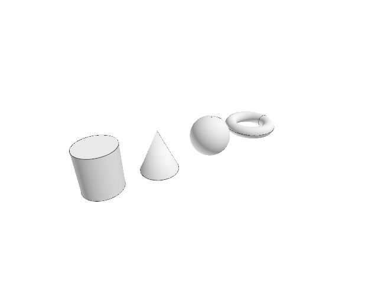

# 14.5 · Round solids and exact planar conics

**Goal:** Read the prepared start, apex and end from the checked local frame. · **Steps:** 11 · **Source:** [app/walk/sheet.rs](../../../../src/app/walk/sheet.rs) · [app/sheet_query.rs](../../../../src/app/sheet_query.rs) · [app/stream.rs](../../../../src/app/stream.rs) · [app/cplane.rs](../../../../src/app/cplane.rs)

<div class="webgpu-schematic" style="width:100%;margin:6px auto;">
<svg xmlns="http://www.w3.org/2000/svg" width="1120" height="188" viewBox="0 0 1120 188" style="width:100%;max-width:100%;height:auto;display:block;margin:0 auto;" role="img">
  <defs>
    <marker id="arr" viewBox="0 0 10 10" refX="8" refY="5" markerWidth="6" markerHeight="6" orient="auto">
      <path d="M 0 1 L 9 5 L 0 9 z" fill="#111111"/>
    </marker>
    <marker id="arrR" viewBox="0 0 10 10" refX="8" refY="5" markerWidth="6" markerHeight="6" orient="auto">
      <path d="M 0 1 L 9 5 L 0 9 z" fill="#dc2626"/>
    </marker>
    <marker id="arrG" viewBox="0 0 10 10" refX="8" refY="5" markerWidth="6" markerHeight="6" orient="auto">
      <path d="M 0 1 L 9 5 L 0 9 z" fill="#16a34a"/>
    </marker>
    <marker id="arrB" viewBox="0 0 10 10" refX="8" refY="5" markerWidth="6" markerHeight="6" orient="auto">
      <path d="M 0 1 L 9 5 L 0 9 z" fill="#2563eb"/>
    </marker>
  </defs>
  <rect x="2" y="2" width="1116" height="184" rx="10" fill="#ffffff" stroke="#111111" stroke-width="2"/>
  <rect x="14" y="12" width="344" height="164" rx="8" fill="#ffffff" stroke="#111111" stroke-width="1.5"/>
  <text paint-order="stroke fill" stroke="#ffffff" stroke-width="5" stroke-linejoin="round" x="186" y="30" text-anchor="middle" font-family="monospace" font-size="10.5" font-weight="700" fill="#111111">Plane (O, u, v, w) + Polar (r, ∠θ) Input</text>
  <circle cx="112" cy="128" r="4" fill="#111111"/>
  <line x1="112" y1="128" x2="246" y2="128" stroke="#dc2626" stroke-width="2" marker-end="url(#arrR)"/>
  <line x1="112" y1="128" x2="112" y2="50" stroke="#16a34a" stroke-width="2" marker-end="url(#arrG)"/>
  <line x1="112" y1="128" x2="212" y2="68" stroke="#2563eb" stroke-width="2.2" marker-end="url(#arrB)"/>
  <path d="M 164 128 A 52 52 0 0 0 156 101" fill="none" stroke="#111111" stroke-width="1.5"/>
  <text paint-order="stroke fill" stroke="#ffffff" stroke-width="5" stroke-linejoin="round" x="176" y="114" font-family="monospace" font-size="10" font-weight="700" fill="#111111">r∠θ</text>
  <line x1="358" y1="94" x2="384" y2="94" stroke="#111111" stroke-width="2" marker-end="url(#arr)"/>
  <rect x="388" y="12" width="344" height="164" rx="8" fill="#ffffff" stroke="#111111" stroke-width="1.5"/>
  <text paint-order="stroke fill" stroke="#ffffff" stroke-width="5" stroke-linejoin="round" x="560" y="30" text-anchor="middle" font-family="monospace" font-size="10.5" font-weight="700" fill="#111111">Rational NURBS Conic Arc + B-Rep Solid Primitives</text>
  <polyline points="424,140 494,52 564,140" fill="none" stroke="#94a3b8" stroke-width="1.5" stroke-dasharray="4 3"/>
  <path d="M 424 140 Q 494 66 564 140" fill="none" stroke="#dc2626" stroke-width="2.5"/>
  <circle cx="494" cy="52" r="4.5" fill="#fef08a" stroke="#111111" stroke-width="1.5"/>
  <text paint-order="stroke fill" stroke="#ffffff" stroke-width="5" stroke-linejoin="round" x="494" y="44" text-anchor="middle" font-family="monospace" font-size="9" font-weight="700" fill="#111111">w = cos(θ/2)</text>
  <ellipse cx="648" cy="72" rx="38" ry="12" fill="#dbeafe" stroke="#111111" stroke-width="1.75"/>
  <path d="M 610 72 L 610 132 A 38 12 0 0 0 686 132 L 686 72" fill="#93c5fd" stroke="#111111" stroke-width="1.75"/>
  <line x1="732" y1="94" x2="758" y2="94" stroke="#111111" stroke-width="2" marker-end="url(#arr)"/>
  <rect x="762" y="12" width="344" height="164" rx="8" fill="#ffffff" stroke="#111111" stroke-width="1.75"/>
  <text paint-order="stroke fill" stroke="#ffffff" stroke-width="5" stroke-linejoin="round" x="934" y="30" text-anchor="middle" font-family="monospace" font-size="10.5" font-weight="700" fill="#111111">Exact Curves + Closed B-Rep Box / Cylinder / Torus</text>
  <rect x="806" y="44" width="256" height="118" rx="4" fill="#ffffff" stroke="#111111" stroke-width="2"/>
  <path d="M 828 138 Q 868 62 908 138" fill="none" stroke="#dc2626" stroke-width="2.5"/>
  <polygon points="928,136 928,82 978,66 978,120" fill="#dbeafe" stroke="#111111" stroke-width="1.75"/>
  <polygon points="978,66 1028,82 1028,136 978,120" fill="#93c5fd" stroke="#111111" stroke-width="1.75"/>
</svg>
</div>

## <a id="checkpoint-75-reuse-current-round-solid-builders"></a>1. Build tori with checked radii

Collect a center and two radii with the existing question owner.

### 1. `src/round_torus.rs`

Type the whole original solid builder using the existing frame and question helpers. Supply only the unchanged original representation and topology fixture.

Create the file and type:

```rust
use crate::primitive_shape as shape;
use crate::primitive_shape::{Answer, Ask, BREP_MESH, Frame, Part, Shape, positive};
use session_rust::{BRep, Geometry, Point};

pub static SHAPE: Shape = Shape {
    name: "Torus",
    options: BREP_MESH,
    upfront: false,
    ask,
    read,
    outline,
    build,
};

/// Center, major radius, then minor radius.
fn ask(answers: &[Answer], _part: &Part, _option: &str) -> Option<Ask> {
    match answers.len() {
        0 => Some(Ask::point("Center")),
        1 => Some(Ask::size("Major radius")),
        2 => Some(Ask::size("Minor radius")),
        _ => None,
    }
}

/// The minor radius is a click's distance from the major circle, below the major radius.
fn read(frame: &Frame, answers: &[Answer], _option: &str) -> Result<Part, String> {
    let mut part = Part::new(frame.clone());

    if let Some(major) = answers.get(1) {
        part.sizes.push(positive(
            frame.size(major),
            "The major radius",
        )?);
    }

    if let Some(minor) = answers.get(2) {
        let major = part.sizes[0];
        let minor = match minor {
            Answer::Number(value) => *value,
            Answer::Point(_) => (frame.size(minor) - major).abs(),
        };

        if minor >= major {
            return Err("The minor radius must be below the major radius".into());
        }

        part.sizes
            .push(positive(minor, "The minor radius")?);
    }

    Ok(part)
}

/// The major circle, then the inner, outer, upper and lower rings.
fn outline(part: &Part) -> Vec<Vec<Point>> {
    let frame = &part.frame;

    match part.sizes[..] {
        [major] => vec![frame.ring(major, 0.0)],
        [major, minor] => vec![
            frame.ring(major - minor, 0.0),
            frame.ring(major + minor, 0.0),
            frame.ring(major, minor),
            frame.ring(major, -minor),
        ],
        _ => Vec::new(),
    }
}

/// A kernel torus about the normal.
fn build(part: &Part, option: &str) -> Result<Geometry, String> {
    let [major, minor] = part.sizes[..] else {
        return Err("Torus needs two radii".into());
    };
    Ok(shape::solid(
        BRep::create_torus(major, minor),
        option,
        &part.frame.to_xform(),
        "torus",
    ))
}

#[cfg(test)]
mod tests {
    use super::*;
    use crate::primitive_shape::tests::{XY, bounds, build, corners, p, plane};

    /// One face spanning 2(R + r) across and 2r high; a minor radius at or over the major is refused.
    #[test]
    fn the_torus_spans_its_radii() {
        let top = plane(XY.0, XY.1);
        let answers = [
            Answer::Point(p(0.0, 0.0, 0.0)),
            Answer::Number(500.0),
            Answer::Number(100.0),
        ];
        let Geometry::BRep(brep) = build(&SHAPE, &top, &answers, "Brep").unwrap()
        else {
            panic!()
        };
        assert_eq!(brep.face_count(), 1);
        let [low, high] = bounds(&corners(
            &build(&SHAPE, &top, &answers, "Mesh").unwrap(),
        ));
        assert!((high[0] - 600.0).abs() < 1.0 && (low[0] + 600.0).abs() < 1.0);
        assert!((high[2] - 100.0).abs() < 1.0 && (low[2] + 100.0).abs() < 1.0);
        let wide = [
            Answer::Point(p(0.0, 0.0, 0.0)),
            Answer::Number(100.0),
            Answer::Number(200.0),
        ];
        assert!(build(&SHAPE, &top, &wide, "Brep").is_err());
        let clicked = [
            Answer::Point(p(0.0, 0.0, 0.0)),
            Answer::Number(100.0),
            Answer::Point(p(0.0, 120.0, 0.0)),
        ];
        assert!(build(&SHAPE, &top, &clicked, "Brep").is_ok());
    }
}
```

### 2. `src/lib.rs`

Register this shared original solid builder.

**Locate this existing block:**

```rust
pub mod round_sphere;

#[cfg(target_arch = "wasm32")]
```

Edit the existing block to match this code; keep unchanged lines:

```rust
pub mod round_sphere;

pub mod round_torus;

#[cfg(target_arch = "wasm32")]
```

## <a id="checkpoint-75aa-build-original-capsules-with-shared-dimensions"></a>2. Build capsules with shared dimensions

Reuse the cylinder’s existing center, radius and signed-height questions.

### 1. `src/round_capsule.rs`

Type the whole original solid builder using the existing frame and question helpers. Supply only the unchanged original representation and topology fixture.

Create the file and type:

```rust
use crate::primitive_shape as shape;
use crate::primitive_shape::{MESH_ONLY, Part, Shape};
use crate::round_cylinder as cylinder;
use session_rust::{Geometry, Line, Point, Primitives};
use std::rc::Rc;

pub static SHAPE: Shape = Shape {
    name: "Capsule",
    options: MESH_ONLY,
    upfront: false,
    ask: cylinder::ask,
    read,
    outline,
    build,
};

/// The cylinder's radius and height, taller than the two caps.
fn read(
    frame: &shape::Frame,
    answers: &[shape::Answer],
    option: &str,
) -> Result<Part, String> {
    let part = cylinder::read(frame, answers, option)?;

    if let [radius, height] = part.sizes[..]
        && height.abs() <= 2.0 * radius
    {
        return Err("The height must exceed the diameter".into());
    }

    Ok(part)
}

/// The base ring, then the rings where the caps begin and four sides.
fn outline(part: &Part) -> Vec<Vec<Point>> {
    let [radius, height] = part.sizes[..] else {
        return part
            .sizes
            .first()
            .map_or_else(Vec::new, |radius| {
                vec![part.frame.ring(*radius, 0.0)]
            });
    };
    let (frame, height) = part.frame.upright(height);
    let (low, high) = (radius, height - radius);
    let mut wires = vec![
        frame.ring(radius, low),
        frame.ring(radius, high),
    ];

    for (u, v) in [
        (1.0, 0.0),
        (0.0, 1.0),
        (-1.0, 0.0),
        (0.0, -1.0),
    ] {
        wires.push(vec![
            frame.at(0.0, 0.0, 0.0),
            frame.at(u * radius, v * radius, low),
            frame.at(u * radius, v * radius, high),
            frame.at(0.0, 0.0, height),
        ]);
    }

    wires
}

/// The kernel capsule on the axis, its caps ending at the base and the height.
fn build(part: &Part, _option: &str) -> Result<Geometry, String> {
    let [radius, height] = part.sizes[..] else {
        return Err("Capsule needs a radius and a height".into());
    };
    let (frame, height) = part.frame.upright(height);
    let axis = Line::from_points(
        &Point::new(0.0, 0.0, radius),
        &Point::new(0.0, 0.0, height - radius),
    );
    let mut mesh = Primitives::capsule_mesh(&axis, radius);
    mesh.transform(&frame.to_xform());
    mesh.name = "capsule".into();
    Ok(Geometry::Mesh(Rc::new(mesh)))
}

#[cfg(test)]
mod tests {
    use super::*;
    use crate::primitive_shape::Answer;
    use crate::primitive_shape::tests::{XY, bounds, build, corners, p, plane};

    /// The capsule spans exactly the base to the height; a height within the diameter is refused.
    #[test]
    fn the_capsule_spans_the_height() {
        let top = plane(XY.0, XY.1);
        let answers = [
            Answer::Point(p(0.0, 0.0, 0.0)),
            Answer::Number(100.0),
            Answer::Number(600.0),
        ];
        let made = build(&SHAPE, &top, &answers, "Mesh").unwrap();
        let [low, high] = bounds(&corners(&made));
        assert!(low[2].abs() < 1e-9 && (high[2] - 600.0).abs() < 1e-9);
        let Geometry::Mesh(mesh) = made else { panic!() };
        assert!(mesh.is_closed());
        let short = [
            Answer::Point(p(0.0, 0.0, 0.0)),
            Answer::Number(100.0),
            Answer::Number(200.0),
        ];
        assert!(build(&SHAPE, &top, &short, "Mesh").is_err());
    }
}
```

### 2. `src/lib.rs`

Register this shared original solid builder.

**Locate this existing block:**

```rust
pub mod round_torus;

#[cfg(target_arch = "wasm32")]
```

Edit the existing block to match this code; keep unchanged lines:

```rust
pub mod round_torus;

pub mod round_capsule;

#[cfg(target_arch = "wasm32")]
```

## <a id="checkpoint-75a-retain-mesh-only-round-families"></a>3. Mesh quad-sphere patches

Ask the kernel for six original quad-sphere patches.

### 1. `src/round_quad_sphere.rs`

Type the whole original solid builder using the existing frame and question helpers. Supply only the unchanged original representation and topology fixture.

Create the file and type:

```rust
use crate::primitive_shape as shape;
use crate::primitive_shape::{MESH_ONLY, Part, Shape};
use session_rust::{Geometry, Primitives};
use std::rc::Rc;

pub static SHAPE: Shape = Shape {
    name: "Quad Sphere",
    options: MESH_ONLY,
    upfront: false,
    ask: shape::center_radius,
    read: shape::read_radius,
    outline: shape::sphere_outline,
    build,
};

const QUADS: usize = 8; // per patch side

/// Six kernel patches meshed and welded into one closed mesh.
fn build(part: &Part, _option: &str) -> Result<Geometry, String> {
    let [radius] = part.sizes[..] else {
        return Err("Quad Sphere needs a radius".into());
    };
    let patches: Vec<_> = Primitives::quad_sphere(0.0, 0.0, 0.0, radius)
        .iter()
        .map(|patch| Primitives::quad_mesh(patch, QUADS, QUADS))
        .collect();
    let mut mesh = shape::to_mesh(&patches);
    mesh.transform(&part.frame.to_xform());
    mesh.name = "quad sphere".into();
    Ok(Geometry::Mesh(Rc::new(mesh)))
}

#[cfg(test)]
mod tests {
    use super::*;
    use crate::primitive_shape::Answer;
    use crate::primitive_shape::tests::{XY, build, corners, p, plane};

    /// 384 quads, closed, every corner at the radius within the patches' accuracy; Brep is not an option.
    #[test]
    fn the_quad_sphere_is_closed_and_round() {
        let center = p(5.0, 0.0, 0.0);
        let answers = [
            Answer::Point(center.clone()),
            Answer::Number(300.0),
        ];
        let made = build(&SHAPE, &plane(XY.0, XY.1), &answers, "Mesh").unwrap();
        let Geometry::Mesh(mesh) = &made else {
            panic!()
        };
        assert_eq!(mesh.number_of_faces(), 384);
        assert!(mesh.is_closed());

        for q in corners(&made) {
            assert!((q.distance(&center, None) - 300.0).abs() < 2e-4 * 300.0); // the kernel patches are within 1e-4 of the sphere
        }

        assert!(
            crate::primitive_draft::Draft::new(&SHAPE, crate::cplane::CPlane::Xy, 1)
                .is_err()
        );
    }
}
```

### 2. `src/lib.rs`

Register this shared original solid builder.

**Locate this existing block:**

```rust
pub mod round_capsule;

#[cfg(target_arch = "wasm32")]
```

Edit the existing block to match this code; keep unchanged lines:

```rust
pub mod round_capsule;

pub mod round_quad_sphere;

#[cfg(target_arch = "wasm32")]
```

## <a id="checkpoint-75b-register-current-round-names-and-choices"></a>4. Register current round names and choices

### 1. `src/primitive_registry.rs`

Expose every current round verb and only its supported representation choices.

**Locate this existing block:**

```rust
    ),
    ("bo", &crate::primitive_box::SHAPE, 0),
```

Edit the existing block to match this code; keep unchanged lines:

```rust
    ),
    ("Cylinder", &crate::round_cylinder::SHAPE, 0),
    (
        "Cylinder Brep",
        &crate::round_cylinder::SHAPE,
        0,
    ),
    (
        "Cylinder Mesh",
        &crate::round_cylinder::SHAPE,
        1,
    ),
    ("Cone", &crate::round_cone::SHAPE, 0),
    ("Cone Brep", &crate::round_cone::SHAPE, 0),
    ("Cone Mesh", &crate::round_cone::SHAPE, 1),
    ("Sphere", &crate::round_sphere::SHAPE, 0),
    ("Sphere Brep", &crate::round_sphere::SHAPE, 0),
    ("Sphere Mesh", &crate::round_sphere::SHAPE, 1),
    ("Torus", &crate::round_torus::SHAPE, 0),
    ("Torus Brep", &crate::round_torus::SHAPE, 0),
    ("Torus Mesh", &crate::round_torus::SHAPE, 1),
    ("Capsule", &crate::round_capsule::SHAPE, 0),
    (
        "Capsule Mesh",
        &crate::round_capsule::SHAPE,
        0,
    ),
    (
        "Quad Sphere",
        &crate::round_quad_sphere::SHAPE,
        0,
    ),
    (
        "Quad Sphere Mesh",
        &crate::round_quad_sphere::SHAPE,
        0,
    ),
    ("bo", &crate::primitive_box::SHAPE, 0),
```

## <a id="checkpoint-75c-exercise-round-originals-and-one-transaction"></a>5. Exercise round originals and one transaction

### 1. `src/round_tests.rs`

Copy integrated current round representation, frame, preview, invalid-input, history and archive identity fixtures.

Create the file and type:

```rust
use crate::{
    cplane::CPlane,
    editor::{Action, Editor},
};
use session_rust::Point;
fn editor() -> Editor {
    let mut e = Editor::default();
    e.apply(Action::Close).unwrap();
    e
}
fn command(e: &mut Editor, line: &str) -> Result<(), String> {
    let action = if let Some(a) = e.tool_line(line) {
        a.map_err(str::to_owned)?
    } else {
        let crate::commands::Command::Editor(a) = crate::commands::parse(line)? else {
            return Err("Editor command".into());
        };
        a
    };
    e.apply(action).map_err(|message| {
        if message == "Shape input invalid" {
            e.tool_status.clone()
        } else {
            message.into()
        }
    })?;
    Ok(())
}
#[test]
fn all_round_families_create_current_originals_and_persist_with_one_transaction() {
    let mut e = editor();
    for (line, cad) in [
        ("Cylinder 0,0,0 0.4 1", true),
        ("Cone 2,0,0 0.4 1", true),
        ("Sphere 4,0,0 0.5", true),
        ("Torus 6,0,0 0.6 0.2", true),
        ("Capsule 8,0,0 0.3 1.5", false),
        ("Quad Sphere 10,0,0 0.5", false),
    ] {
        let count = e.scene.objects().len();
        command(&mut e, line).unwrap();
        assert!(e.draft.is_none());
        assert_eq!(
            e.scene
                .objects()
                .last()
                .unwrap()
                .cad
                .is_some(),
            cad
        );
        command(&mut e, "Undo").unwrap();
        assert_eq!(e.scene.objects().len(), count);
        command(&mut e, "Redo").unwrap();
        assert_eq!(e.scene.objects().len(), count + 1);
    }
    let snapshot = crate::scene_archive::save(&e.scene).unwrap();
    let guids = e
        .scene
        .objects()
        .iter()
        .map(|row| e.scene.row_guid(row.id).unwrap().to_owned())
        .collect::<Vec<_>>();
    e.apply(Action::Close).unwrap();
    crate::scene_document::open(&mut e.scene, &snapshot).unwrap();
    assert_eq!(e.scene.objects().len(), 6);
    for guid in guids {
        assert!(
            e.scene
                .objects()
                .iter()
                .any(|row| e.scene.row_guid(row.id).as_deref() == Some(guid.as_str()))
        );
    }
}
#[test]
fn round_options_reject_invalid_dimensions_without_losing_the_active_tool_or_redo() {
    let mut e = editor();
    command(&mut e, "Sphere 0,0,0 1").unwrap();
    command(&mut e, "Undo").unwrap();
    command(&mut e, "Torus").unwrap();
    command(&mut e, "w0,0,0 2").unwrap();
    assert!(command(&mut e, "3").is_err());
    assert_eq!(
        e.draft
            .as_ref()
            .unwrap()
            .primitive
            .as_ref()
            .unwrap()
            .answers
            .len(),
        2
    );
    command(&mut e, "0.5").unwrap();
    assert_eq!(e.scene.objects().len(), 1);
    command(&mut e, "Undo").unwrap();
    for line in [
        "Cylinder 0,0,0 1 0",
        "Cone 0,0,0 -1 2",
        "Capsule 0,0,0 1 2",
        "Sphere 0,0,0 0",
        "Quad Sphere Brep 0,0,0 1",
        "Capsule Brep 0,0,0 1 3",
    ] {
        assert!(command(&mut e, line).is_err(), "{line}");
        assert!(e.draft.is_none());
        assert!(e.scene.objects().is_empty());
    }
    command(&mut e, "Redo").unwrap();
    assert_eq!(e.scene.objects().len(), 1);
}
#[test]
fn tilted_round_frames_and_negative_heights_keep_original_geometry_and_temporary_wires()
{
    let mut e = editor();
    let plane = CPlane::from_3_points(
        &Point::new(4., 5., 6.),
        &Point::new(5., 5., 7.),
        &Point::new(4., 6., 6.),
    )
    .unwrap();
    e.apply(Action::ConstructionPlane(Some(plane)))
        .unwrap();
    command(&mut e, "Cylinder").unwrap();
    command(&mut e, "0,0,0 0.5").unwrap();
    assert_eq!(e.draft.as_ref().unwrap().outlines().len(), 1);
    assert!(e.scene.objects().is_empty());
    e.apply(Action::ToolHover(Some([4., 5., 7.])))
        .unwrap();
    assert!(e.draft.as_ref().unwrap().outlines().len() >= 1);
    command(&mut e, "-2").unwrap();
    let brep = &e.scene.objects()[0]
        .cad
        .as_ref()
        .unwrap()
        .source;
    let points = brep.vertex_points();
    let heights = points
        .iter()
        .map(|p| plane.local(p)[2])
        .collect::<Vec<_>>();
    assert!(heights.iter().any(|v| v.abs() < 1e-12));
    assert!(
        heights
            .iter()
            .any(|v| (*v + 2.).abs() < 1e-12)
    );
}
```

### 2. `src/lib.rs`

Register the maintained round component.

**Locate this existing block:**

```rust
pub mod round_quad_sphere;

#[cfg(target_arch = "wasm32")]
```

Edit the existing block to match this code; keep unchanged lines:

```rust
pub mod round_quad_sphere;

#[cfg(test)]
mod round_tests;

#[cfg(target_arch = "wasm32")]
```

## <a id="checkpoint-75za-build-original-planar-circles"></a>6. Build planar circles

Reuse the checked frame and positive-radius helpers from 73h–74.

### 1. `src/freeform_circle.rs`

Type the whole original curve helpers using the existing frame and geometry owners.

Create the file and type:

```rust
use crate::primitive_shape::{Answer, Ask, CURVE, Frame, Part, Shape, positive};
use session_rust::{Geometry, Point, Primitives};
use std::rc::Rc;

pub static SHAPE: Shape = Shape {
    name: "Nurbs Curve Circle",
    options: CURVE,
    upfront: false,
    ask,
    read,
    outline,
    build,
};

/// Center, then radius.
fn ask(answers: &[Answer], _part: &Part, _option: &str) -> Option<Ask> {
    match answers.len() {
        0 => Some(Ask::point("Center")),
        1 => Some(Ask::size("Radius")),
        _ => None,
    }
}

/// The radius in the plane.
fn read(frame: &Frame, answers: &[Answer], _option: &str) -> Result<Part, String> {
    let mut part = Part::new(frame.clone());

    if let Some(radius) = answers.get(1) {
        part.sizes
            .push(positive(frame.size(radius), "The radius")?);
    }

    Ok(part)
}

/// The circle.
fn outline(part: &Part) -> Vec<Vec<Point>> {
    part.sizes
        .iter()
        .map(|radius| part.frame.ring(*radius, 0.0))
        .collect()
}

/// The kernel circle, placed in the plane.
fn build(part: &Part, _option: &str) -> Result<Geometry, String> {
    let [radius] = part.sizes[..] else {
        return Err("Nurbs Curve Circle needs a radius".into());
    };
    let mut curve = Primitives::circle(0.0, 0.0, 0.0, radius);
    curve.transform(&part.frame.to_xform());
    curve.name = "circle".into();
    Ok(Geometry::NurbsCurve(Rc::new(curve)))
}
```

### 2. `src/lib.rs`

Compile this shared original curve module.

**Locate this existing block:**

```rust
mod round_tests;

#[cfg(target_arch = "wasm32")]
```

Edit the existing block to match this code; keep unchanged lines:

```rust
mod round_tests;

pub mod freeform_circle;

#[cfg(target_arch = "wasm32")]
```

### 3. `src/freeform_circle.rs`

Supply only the unchanged original curve validation fixtures.

**Locate this existing block:**

```rust
    Ok(Geometry::NurbsCurve(Rc::new(curve)))
}
```

Edit the existing block to match this code; keep unchanged lines:

```rust
    Ok(Geometry::NurbsCurve(Rc::new(curve)))
}

#[cfg(test)]
mod tests {
    use super::*;
    use crate::primitive_shape::tests::{XZ, build, corners, p, plane};

    /// Nine controls, closed, every sample at the radius in the plane.
    #[test]
    fn the_circle_lies_in_the_plane() {
        let center = p(1.0, 2.0, 3.0);
        let answers = [
            Answer::Point(center.clone()),
            Answer::Point(p(11.0, 2.0, 3.0)),
        ];
        let made = build(&SHAPE, &plane(XZ.0, XZ.1), &answers, "").unwrap();
        let Geometry::NurbsCurve(curve) = &made else {
            panic!()
        };
        assert_eq!(curve.cv_count(), 9);
        assert!(curve.is_closed());

        for q in corners(&made) {
            assert!((q.distance(&center, None) - 10.0).abs() < 1e-9);
            assert!((q[1] - 2.0).abs() < 1e-9);
        }
    }
}
```

## <a id="checkpoint-75zb-build-original-planar-ellipses"></a>7. Build planar ellipses

Reuse the same checked frame and radius owner.

### 1. `src/freeform_ellipse.rs`

Type the whole original curve helpers using the existing frame and geometry owners.

Create the file and type:

```rust
use crate::primitive_shape::{Answer, Ask, CURVE, Frame, Part, Shape, positive};
use session_rust::{Geometry, Point, Primitives};
use std::rc::Rc;

pub static SHAPE: Shape = Shape {
    name: "Nurbs Curve Ellipse",
    options: CURVE,
    upfront: false,
    ask,
    read,
    outline,
    build,
};

/// Center, the first axis end, then the second radius.
fn ask(answers: &[Answer], _part: &Part, _option: &str) -> Option<Ask> {
    match answers.len() {
        0 => Some(Ask::point("Center")),
        1 => Some(Ask::size("First axis end or radius")),
        2 => Some(Ask::size("Second radius")),
        _ => None,
    }
}

/// A click turns the first axis toward it; the second radius is a click's distance from that axis.
fn read(frame: &Frame, answers: &[Answer], _option: &str) -> Result<Part, String> {
    let mut part = Part::new(frame.clone());

    if let Some(first) = answers.get(1) {
        if let Answer::Point(end) = first {
            let [u, v, _] = frame.local(end);
            part.frame = frame.turned(u, v);
        }

        part.sizes.push(positive(
            frame.size(first),
            "The first radius",
        )?);
    }

    if let Some(second) = answers.get(2) {
        let radius = match second {
            Answer::Number(value) => *value,
            Answer::Point(p) => part.frame.local(p)[1].abs(),
        };
        part.sizes
            .push(positive(radius, "The second radius")?);
    }

    Ok(part)
}

/// The first axis, then the ellipse.
fn outline(part: &Part) -> Vec<Vec<Point>> {
    let frame = &part.frame;

    match part.sizes[..] {
        [first] => vec![vec![
            frame.at(-first, 0.0, 0.0),
            frame.at(first, 0.0, 0.0),
        ]],
        [first, second] => vec![frame.oval(first, second, 0.0)],
        _ => Vec::new(),
    }
}

/// The kernel ellipse, its first radius along the first axis.
fn build(part: &Part, _option: &str) -> Result<Geometry, String> {
    let [first, second] = part.sizes[..] else {
        return Err("Nurbs Curve Ellipse needs two radii".into());
    };
    let mut curve = Primitives::ellipse(0.0, 0.0, 0.0, first, second);
    curve.transform(&part.frame.to_xform());
    curve.name = "ellipse".into();
    Ok(Geometry::NurbsCurve(Rc::new(curve)))
}
```

### 2. `src/lib.rs`

Compile this shared original curve module.

**Locate this existing block:**

```rust
pub mod freeform_circle;

#[cfg(target_arch = "wasm32")]
```

Edit the existing block to match this code; keep unchanged lines:

```rust
pub mod freeform_circle;

pub mod freeform_ellipse;

#[cfg(target_arch = "wasm32")]
```

### 3. `src/freeform_ellipse.rs`

Supply only the unchanged original curve validation fixtures.

**Locate this existing block:**

```rust
    Ok(Geometry::NurbsCurve(Rc::new(curve)))
}
```

Edit the existing block to match this code; keep unchanged lines:

```rust
    Ok(Geometry::NurbsCurve(Rc::new(curve)))
}

#[cfg(test)]
mod tests {
    use super::*;
    use crate::primitive_shape::tests::{XY, build, corners, p, plane};

    /// It starts at the first axis end, and every sample fits (u/a)² + (v/b)² = 1.
    #[test]
    fn the_ellipse_follows_its_axes() {
        let top = plane(XY.0, XY.1);
        let answers = [
            Answer::Point(p(0.0, 0.0, 0.0)),
            Answer::Point(p(0.0, 20.0, 0.0)),
            Answer::Number(10.0),
        ];
        let made = build(&SHAPE, &top, &answers, "").unwrap();
        let Geometry::NurbsCurve(curve) = &made else {
            panic!()
        };
        assert_eq!(curve.cv_count(), 9);
        assert!(
            curve
                .point_at(curve.domain().0)
                .distance(&p(0.0, 20.0, 0.0), None)
                < 1e-9
        );

        for q in corners(&made) {
            assert!(((q[1] / 20.0).powi(2) + (q[0] / 10.0).powi(2) - 1.0).abs() < 1e-9);
        }
    }
}
```

## <a id="checkpoint-75zc-build-exact-rational-arc-spans"></a>8. Build exact rational arc spans

Build the original circular arc from rational quadratic spans.

### 1. `src/freeform_arc.rs`

Type the whole original curve helpers using the existing frame and geometry owners.

Create the file and type:

```rust
use crate::primitive_shape::{Answer, Ask, Frame, Part, RING, Shape, positive};
use session_rust::{Geometry, NurbsCurve, Point};
use std::rc::Rc;

/// The radius or chord as a line, then the arc.
fn outline(part: &Part) -> Vec<Vec<Point>> {
    let frame = &part.frame;

    match part.sizes[..] {
        [length] => vec![vec![
            frame.at(0.0, 0.0, 0.0),
            frame.at(length, 0.0, 0.0),
        ]],
        [radius, degrees] => {
            let count = ((RING as f64 * degrees / 360.0).ceil() as usize).max(2);
            let arc = (0..=count)
                .map(|i| {
                    let angle = (degrees * i as f64 / count as f64).to_radians();
                    frame.at(
                        radius * angle.cos(),
                        radius * angle.sin(),
                        0.0,
                    )
                })
                .collect();
            vec![arc]
        }
        _ => Vec::new(),
    }
}

/// The exact arc, placed in its circle's frame.
fn build(part: &Part, _option: &str) -> Result<Geometry, String> {
    let [radius, degrees] = part.sizes[..] else {
        return Err("Nurbs Curve Arc needs a radius and an angle".into());
    };
    let mut curve = arc(radius, degrees);
    curve.transform(&part.frame.to_xform());
    curve.name = "arc".into();
    Ok(Geometry::NurbsCurve(Rc::new(curve)))
}

/// A circular arc about z from angle 0 to `degrees`, one rational quadratic span per 90° or less.
pub fn arc(radius: f64, degrees: f64) -> NurbsCurve {
    let spans = ((degrees / 90.0 - 1e-9).ceil() as usize).max(1);
    let step = degrees.to_radians() / spans as f64;
    let weight = (step * 0.5).cos(); // of each span's middle control
    let mut curve = NurbsCurve::new(3, true, 3, 2 * spans + 1);

    for i in 0..2 * spans + 2 {
        curve.set_nurbsknot(i, (i / 2) as f64);
    }

    for i in 0..=2 * spans {
        let angle = step * 0.5 * i as f64;
        let w = if i % 2 == 1 {
            weight
        } else {
            1.0
        };
        let distance = radius / w; // the middle control lies outside the circle
        curve.set_cv_4d(
            i,
            distance * angle.cos() * w,
            distance * angle.sin() * w,
            0.0,
            w,
        );
    }

    curve
}
```

### 2. `src/lib.rs`

Compile this shared original curve module.

**Locate this existing block:**

```rust
pub mod freeform_ellipse;

#[cfg(target_arch = "wasm32")]
```

Edit the existing block to match this code; keep unchanged lines:

```rust
pub mod freeform_ellipse;

pub mod freeform_arc;

#[cfg(target_arch = "wasm32")]
```

## <a id="checkpoint-75zd-read-original-arcs-from-center-and-angle"></a>9. Read arcs from center and angle

Read the existing center-based arc inputs using the checked frame.

### 1. `src/freeform_arc.rs`

Extend this original owner with the day’s complete input helpers.

**Locate this existing block:**

```rust
use std::rc::Rc;

/// The radius or chord as a line, then the arc.
```

Edit the existing block to match this code; keep unchanged lines:

```rust
use std::rc::Rc;

/// A click's angle about the center, or typed degrees; negative runs clockwise.
fn read_center(frame: &Frame, answers: &[Answer]) -> Result<Part, String> {
    let mut part = Part::new(frame.clone());
    let Some(start) = answers.get(1) else {
        return Ok(part);
    };

    if let Answer::Point(start) = start {
        let [u, v, _] = frame.local(start);
        part.frame = frame.turned(u, v);
    }

    part.sizes
        .push(positive(frame.size(start), "The radius")?);
    let Some(end) = answers.get(2) else {
        return Ok(part);
    };
    let degrees = match end {
        Answer::Number(degrees) => *degrees,
        Answer::Point(end) => {
            let [u, v, _] = part.frame.local(end);
            let degrees = v.atan2(u).to_degrees();
            if degrees < 0.0 {
                degrees + 360.0
            } else {
                degrees
            }
        }
    };

    if !(degrees.abs() > 1e-9 && degrees.abs() < 360.0) {
        return Err(format!(
            "The angle must be above 0 and below 360 degrees, not {degrees}"
        ));
    }

    if degrees < 0.0 {
        part.frame = part.frame.flipped();
    }

    part.sizes.push(degrees.abs());
    Ok(part)
}

/// The radius or chord as a line, then the arc.
```

## <a id="checkpoint-75ze-read-three-point-arcs-and-connect-the-recipe"></a>10. Read three-point arcs and connect the recipe

Complete the existing arc recipe with its two input modes.

### 1. `src/freeform_arc.rs`

Extend this original owner with the day’s complete input helpers. Supply only the unchanged original curve validation fixtures.

**Locate this existing block:**

```rust
use std::rc::Rc;

/// A click's angle about the center, or typed degrees; negative runs clockwise.
fn read_center(frame: &Frame, answers: &[Answer]) -> Result<Part, String> {
    let mut part = Part::new(frame.clone());
    let Some(start) = answers.get(1) else {
        return Ok(part);
    };

    if let Answer::Point(start) = start {
        let [u, v, _] = frame.local(start);
        part.frame = frame.turned(u, v);
    }

    part.sizes
        .push(positive(frame.size(start), "The radius")?);
    let Some(end) = answers.get(2) else {
        return Ok(part);
    };
    let degrees = match end {
        Answer::Number(degrees) => *degrees,
        Answer::Point(end) => {
            let [u, v, _] = part.frame.local(end);
            let degrees = v.atan2(u).to_degrees();
            if degrees < 0.0 {
                degrees + 360.0
            } else {
                degrees
            }
        }
    };

    if !(degrees.abs() > 1e-9 && degrees.abs() < 360.0) {
        return Err(format!(
            "The angle must be above 0 and below 360 degrees, not {degrees}"
        ));
    }

    if degrees < 0.0 {
        part.frame = part.frame.flipped();
    }

    part.sizes.push(degrees.abs());
    Ok(part)
}

/// The radius or chord as a line, then the arc.
fn outline(part: &Part) -> Vec<Vec<Point>> {
    let frame = &part.frame;

    match part.sizes[..] {
        [length] => vec![vec![
            frame.at(0.0, 0.0, 0.0),
            frame.at(length, 0.0, 0.0),
        ]],
        [radius, degrees] => {
            let count = ((RING as f64 * degrees / 360.0).ceil() as usize).max(2);
            let arc = (0..=count)
                .map(|i| {
                    let angle = (degrees * i as f64 / count as f64).to_radians();
                    frame.at(
                        radius * angle.cos(),
                        radius * angle.sin(),
                        0.0,
                    )
                })
                .collect();
            vec![arc]
        }
        _ => Vec::new(),
    }
}

/// The exact arc, placed in its circle's frame.
fn build(part: &Part, _option: &str) -> Result<Geometry, String> {
    let [radius, degrees] = part.sizes[..] else {
        return Err("Nurbs Curve Arc needs a radius and an angle".into());
    };
    let mut curve = arc(radius, degrees);
    curve.transform(&part.frame.to_xform());
    curve.name = "arc".into();
    Ok(Geometry::NurbsCurve(Rc::new(curve)))
}

/// A circular arc about z from angle 0 to `degrees`, one rational quadratic span per 90° or less.
pub fn arc(radius: f64, degrees: f64) -> NurbsCurve {
    let spans = ((degrees / 90.0 - 1e-9).ceil() as usize).max(1);
    let step = degrees.to_radians() / spans as f64;
    let weight = (step * 0.5).cos(); // of each span's middle control
    let mut curve = NurbsCurve::new(3, true, 3, 2 * spans + 1);

    for i in 0..2 * spans + 2 {
        curve.set_nurbsknot(i, (i / 2) as f64);
    }

    for i in 0..=2 * spans {
        let angle = step * 0.5 * i as f64;
        let w = if i % 2 == 1 {
            weight
        } else {
            1.0
        };
        let distance = radius / w; // the middle control lies outside the circle
        curve.set_cv_4d(
            i,
            distance * angle.cos() * w,
            distance * angle.sin() * w,
            0.0,
            w,
        );
    }

    curve
}
```

Edit the existing block to match this code; keep unchanged lines:

```rust
use std::rc::Rc;

pub static SHAPE: Shape = Shape {
    name: "Nurbs Curve Arc",
    options: &[
        ("Center", "Center"),
        ("3 Points", "3Points"),
        ("Cancel", "Escape"),
    ],
    upfront: true,
    ask,
    read,
    outline,
    build,
};

/// Center, start, end; or start, end, a point on the arc.
fn ask(answers: &[Answer], _part: &Part, option: &str) -> Option<Ask> {
    match (option, answers.len()) {
        ("Center", 0) => Some(Ask::point("Center")),
        ("Center", 1) => Some(Ask::size("Start or radius")),
        ("Center", 2) => Some(Ask::size("End or angle in degrees")),
        (_, 0) => Some(Ask::point("Start")),
        (_, 1) => Some(Ask::size("End or chord length")),
        (_, 2) => Some(Ask::size("Point on the arc or bulge")),
        _ => None,
    }
}

/// The circle's frame, x toward the start, and the radius and angle in degrees counterclockwise.
fn read(frame: &Frame, answers: &[Answer], option: &str) -> Result<Part, String> {
    match option {
        "Center" => read_center(frame, answers),
        _ => read_points(frame, answers),
    }
}

/// A click's angle about the center, or typed degrees; negative runs clockwise.
fn read_center(frame: &Frame, answers: &[Answer]) -> Result<Part, String> {
    let mut part = Part::new(frame.clone());
    let Some(start) = answers.get(1) else {
        return Ok(part);
    };

    if let Answer::Point(start) = start {
        let [u, v, _] = frame.local(start);
        part.frame = frame.turned(u, v);
    }

    part.sizes
        .push(positive(frame.size(start), "The radius")?);
    let Some(end) = answers.get(2) else {
        return Ok(part);
    };
    let degrees = match end {
        Answer::Number(degrees) => *degrees,
        Answer::Point(end) => {
            let [u, v, _] = part.frame.local(end);
            let degrees = v.atan2(u).to_degrees();
            if degrees < 0.0 {
                degrees + 360.0
            } else {
                degrees
            }
        }
    };

    if !(degrees.abs() > 1e-9 && degrees.abs() < 360.0) {
        return Err(format!(
            "The angle must be above 0 and below 360 degrees, not {degrees}"
        ));
    }

    if degrees < 0.0 {
        part.frame = part.frame.flipped();
    }

    part.sizes.push(degrees.abs());
    Ok(part)
}

/// The circle through start, a point on it and end, running from start past that point.
fn read_points(frame: &Frame, answers: &[Answer]) -> Result<Part, String> {
    let mut part = Part::new(frame.clone());
    let Some(end) = answers.get(1) else {
        return Ok(part);
    };
    let start = frame.origin.clone();
    let end = match end {
        Answer::Number(length) => frame.at(*length, 0.0, 0.0),
        Answer::Point(end) => end.clone(),
    };
    let chord = positive(start.distance(&end, None), "The chord")?;
    let [u, v, _] = frame.local(&end);
    part.frame = frame.turned(u, v);
    part.sizes.push(chord);
    let Some(middle) = answers.get(2) else {
        return Ok(part);
    };
    let middle = match middle {
        Answer::Number(bulge) => part.frame.at(chord * 0.5, *bulge, 0.0), // to the left of start → end
        Answer::Point(p) => p.clone(),
    };
    let (ab, ac) = (&end - &start, &middle - &start);
    let normal = ac.cross(&ab); // start, middle, end run counterclockwise about it

    if normal.magnitude() <= 1e-9 * ab.magnitude() * ac.magnitude() {
        return Err("The three points are in a line".into());
    }

    let offset =
        &(&normal.cross(&ab) * ac.dot(&ac)) + &(&ac.cross(&normal) * ab.dot(&ab));
    let center = &start - (&offset * (0.5 / normal.dot(&normal)));
    let radius = center.distance(&start, None);
    let x = (&start - &center).normalized();
    let z = normal.normalized();
    let circle = Frame {
        origin: center,
        y: z.cross(&x),
        x,
        z,
    };
    let [u, v, _] = circle.local(&end);
    let degrees = v.atan2(u).to_degrees();
    part.frame = circle;
    part.sizes = vec![
        radius,
        if degrees <= 0.0 {
            degrees + 360.0
        } else {
            degrees
        },
    ];
    Ok(part)
}

/// The radius or chord as a line, then the arc.
fn outline(part: &Part) -> Vec<Vec<Point>> {
    let frame = &part.frame;

    match part.sizes[..] {
        [length] => vec![vec![
            frame.at(0.0, 0.0, 0.0),
            frame.at(length, 0.0, 0.0),
        ]],
        [radius, degrees] => {
            let count = ((RING as f64 * degrees / 360.0).ceil() as usize).max(2);
            let arc = (0..=count)
                .map(|i| {
                    let angle = (degrees * i as f64 / count as f64).to_radians();
                    frame.at(
                        radius * angle.cos(),
                        radius * angle.sin(),
                        0.0,
                    )
                })
                .collect();
            vec![arc]
        }
        _ => Vec::new(),
    }
}

/// The exact arc, placed in its circle's frame.
fn build(part: &Part, _option: &str) -> Result<Geometry, String> {
    let [radius, degrees] = part.sizes[..] else {
        return Err("Nurbs Curve Arc needs a radius and an angle".into());
    };
    let mut curve = arc(radius, degrees);
    curve.transform(&part.frame.to_xform());
    curve.name = "arc".into();
    Ok(Geometry::NurbsCurve(Rc::new(curve)))
}

/// A circular arc about z from angle 0 to `degrees`, one rational quadratic span per 90° or less.
pub fn arc(radius: f64, degrees: f64) -> NurbsCurve {
    let spans = ((degrees / 90.0 - 1e-9).ceil() as usize).max(1);
    let step = degrees.to_radians() / spans as f64;
    let weight = (step * 0.5).cos(); // of each span's middle control
    let mut curve = NurbsCurve::new(3, true, 3, 2 * spans + 1);

    for i in 0..2 * spans + 2 {
        curve.set_nurbsknot(i, (i / 2) as f64);
    }

    for i in 0..=2 * spans {
        let angle = step * 0.5 * i as f64;
        let w = if i % 2 == 1 {
            weight
        } else {
            1.0
        };
        let distance = radius / w; // the middle control lies outside the circle
        curve.set_cv_4d(
            i,
            distance * angle.cos() * w,
            distance * angle.sin() * w,
            0.0,
            w,
        );
    }

    curve
}

#[cfg(test)]
mod tests {
    use super::*;
    use crate::primitive_shape::tests::{XY, build, corners, p, plane};

    /// Every sample of a curve lies at `radius` from `center`.
    fn round(curve: &Geometry, center: &Point, radius: f64) -> bool {
        corners(curve).iter().all(|q| {
            (q.distance(center, None) - radius).abs() <= 1e-12 * radius.max(1.0) * 10.0
        })
    }

    /// 90° is one span and 270° three; every sample is on the circle, which the kernel arc misses.
    #[test]
    fn the_arc_is_exactly_round() {
        let top = plane(XY.0, XY.1);
        let quarter = [
            Answer::Point(p(0.0, 0.0, 0.0)),
            Answer::Number(500.0),
            Answer::Number(90.0),
        ];
        let made = build(&SHAPE, &top, &quarter, "Center").unwrap();
        let Geometry::NurbsCurve(curve) = &made else {
            panic!()
        };
        assert_eq!(curve.cv_count(), 3);
        assert!(round(&made, &p(0.0, 0.0, 0.0), 500.0));
        assert!(
            curve
                .point_at(curve.domain().1)
                .distance(&p(0.0, 500.0, 0.0), None)
                < 1e-9
        );
        let three = [
            Answer::Point(p(0.0, 0.0, 0.0)),
            Answer::Number(500.0),
            Answer::Number(270.0),
        ];
        let made = build(&SHAPE, &top, &three, "Center").unwrap();
        let Geometry::NurbsCurve(curve) = &made else {
            panic!()
        };
        assert_eq!(curve.cv_count(), 7);
        assert!(round(&made, &p(0.0, 0.0, 0.0), 500.0));
        let clockwise = [
            Answer::Point(p(0.0, 0.0, 0.0)),
            Answer::Point(p(0.0, 10.0, 0.0)),
            Answer::Number(-90.0),
        ];
        let Geometry::NurbsCurve(curve) =
            build(&SHAPE, &top, &clockwise, "Center").unwrap()
        else {
            panic!()
        };
        assert!(
            curve
                .point_at(curve.domain().1)
                .distance(&p(10.0, 0.0, 0.0), None)
                < 1e-9
        );

        for degrees in [0.0, 360.0, -360.0] {
            let bad = [
                Answer::Point(p(0.0, 0.0, 0.0)),
                Answer::Number(5.0),
                Answer::Number(degrees),
            ];
            let error = build(&SHAPE, &top, &bad, "Center").unwrap_err();
            assert!(
                error.ends_with(&format!("not {degrees}")),
                "{error}"
            );
        }
    }

    /// Three points: a semicircle through the third point; points in a line are refused.
    #[test]
    fn three_points_pass_the_middle_point() {
        let top = plane(XY.0, XY.1);
        let answers = [
            Answer::Point(p(0.0, 0.0, 0.0)),
            Answer::Point(p(10.0, 0.0, 0.0)),
            Answer::Point(p(5.0, 5.0, 0.0)),
        ];
        let made = build(&SHAPE, &top, &answers, "3 Points").unwrap();
        assert!(round(&made, &p(5.0, 0.0, 0.0), 5.0));
        let Geometry::NurbsCurve(curve) = &made else {
            panic!()
        };
        let (a, b) = curve.domain();
        assert!(
            curve
                .point_at(a)
                .distance(&p(0.0, 0.0, 0.0), None)
                < 1e-9
        );
        assert!(
            curve
                .point_at(b)
                .distance(&p(10.0, 0.0, 0.0), None)
                < 1e-9
        );
        assert!(
            corners(&made)
                .iter()
                .any(|q| q.distance(&p(5.0, 5.0, 0.0), None) < 0.5)
        );
        assert!(corners(&made).iter().all(|q| q[1] >= -1e-9));
        let bulge = [
            Answer::Point(p(0.0, 0.0, 0.0)),
            Answer::Number(1000.0),
            Answer::Number(500.0),
        ];
        assert!(round(
            &build(&SHAPE, &top, &bulge, "3 Points").unwrap(),
            &p(500.0, 0.0, 0.0),
            500.0
        ));
        let below = [
            Answer::Point(p(0.0, 0.0, 0.0)),
            Answer::Point(p(10.0, 0.0, 0.0)),
            Answer::Point(p(5.0, -2.0, 0.0)),
        ];
        assert!(
            corners(&build(&SHAPE, &top, &below, "3 Points").unwrap())
                .iter()
                .all(|q| q[1] <= 1e-9)
        );
        let line = [
            Answer::Point(p(0.0, 0.0, 0.0)),
            Answer::Point(p(10.0, 0.0, 0.0)),
            Answer::Point(p(20.0, 0.0, 0.0)),
        ];
        assert!(build(&SHAPE, &top, &line, "3 Points").is_err());
    }
}
```

## <a id="checkpoint-75zf-build-original-parabola-previews-and-sources"></a>11. Build parabola previews and sources

### 1. `src/freeform_parabola.rs`

Type the whole original curve helpers using the existing frame and geometry owners.

Create the file and type:

```rust
use crate::primitive_shape::{Answer, Ask, CURVE, Frame, Part, Shape, positive};
use session_rust::{Geometry, Point, Primitives};
use std::rc::Rc;

const SAMPLES: usize = 32; // preview segments

/// Start, apex and end in the world.
fn points(part: &Part) -> Option<[Point; 3]> {
    let [length, u, w, v] = part.sizes[..] else {
        return None;
    };
    let frame = &part.frame;
    Some([
        frame.at(0.0, 0.0, 0.0),
        frame.at(u, v, w),
        frame.at(length, 0.0, 0.0),
    ])
}

/// The chord, then the parabola.
fn outline(part: &Part) -> Vec<Vec<Point>> {
    let Some([start, apex, end]) = points(part) else {
        return part
            .sizes
            .first()
            .map_or_else(Vec::new, |length| {
                vec![vec![
                    part.frame.at(0.0, 0.0, 0.0),
                    part.frame.at(*length, 0.0, 0.0),
                ]]
            });
    };
    // the Bezier control that makes the curve pass the apex half way
    let control = [0, 1, 2].map(|i| 2.0 * apex[i] - 0.5 * (start[i] + end[i]));
    let curve = (0..=SAMPLES)
        .map(|i| {
            let t = i as f64 / SAMPLES as f64;
            let (a, b, c) = (
                (1.0 - t) * (1.0 - t),
                2.0 * t * (1.0 - t),
                t * t,
            );
            Point::new(
                a * start[0] + b * control[0] + c * end[0],
                a * start[1] + b * control[1] + c * end[1],
                a * start[2] + b * control[2] + c * end[2],
            )
        })
        .collect();
    vec![curve]
}

/// The kernel parabola through start, apex and end.
fn build(part: &Part, _option: &str) -> Result<Geometry, String> {
    let [start, apex, end] =
        points(part).ok_or("Nurbs Curve Parabola needs a start, an end and an apex")?;
    let mut curve = Primitives::parabola(&start, &apex, &end);
    curve.name = "parabola".into();
    Ok(Geometry::NurbsCurve(Rc::new(curve)))
}
```

### 2. `src/lib.rs`

Compile this shared original curve module.

**Locate this existing block:**

```rust
pub mod freeform_arc;

#[cfg(target_arch = "wasm32")]
```

Edit the existing block to match this code; keep unchanged lines:

```rust
pub mod freeform_arc;

pub mod freeform_parabola;

#[cfg(target_arch = "wasm32")]
```

## Build & Run



```sh
npm --prefix ../session_tests run course -- dependencies 14.5
cd workspace/journey
REGEN_PROTO=0 cargo build --lib --locked --target wasm32-unknown-unknown -j1
REGEN_PROTO=0 CARGO_BUILD_JOBS=1 trunk serve --port 8780
cd ../..
npm --prefix ../session_tests run course -- check 14.5
npm --prefix ../session_tests run course -- save 14.5
```

Continue with [14.6 · Exact parabola recipes and editable freeform controls](../../consolidation/76-copy-exact-planar-curve-definitions.md).
