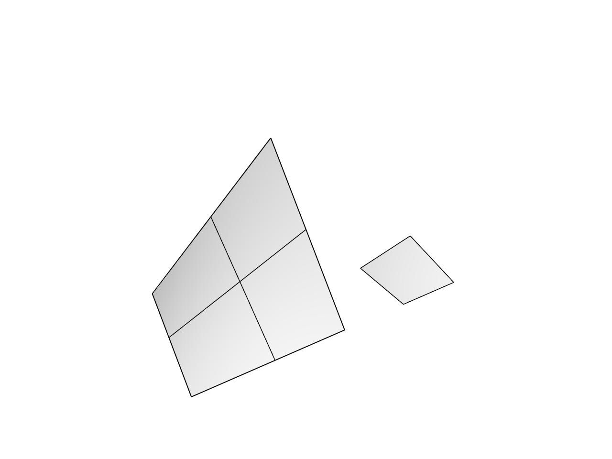

# 15.4 · Two-direction networks and corner patches

**Goal:** Reuse absolute coordinate parsing for named construction planes and three-point input. · **Steps:** 6 · **Source:** [app/deform.rs](../../../../src/app/deform.rs) · [state/edit.rs](../../../../src/state/edit.rs) · [app/command/tool/gather.rs](../../../../src/app/command/tool/gather.rs) · [app/command/tool/surfacing.rs](../../../../src/app/command/tool/surfacing.rs) · [app/walk/mesh.rs](../../../../src/app/walk/mesh.rs) · [app/walk/brep.rs](../../../../src/app/walk/brep.rs) (`src/app/transforms.rs,src/app/surfacing.rs,src/app/nurbs_eval.rs`)

<div class="webgpu-schematic" style="width:100%;margin:6px auto;">
<svg xmlns="http://www.w3.org/2000/svg" width="1120" height="188" viewBox="0 0 1120 188" style="width:100%;max-width:100%;height:auto;display:block;margin:0 auto;" role="img">
  <defs>
    <marker id="arr" viewBox="0 0 10 10" refX="8" refY="5" markerWidth="6" markerHeight="6" orient="auto">
      <path d="M 0 1 L 9 5 L 0 9 z" fill="#111111"/>
    </marker>
    <marker id="arrR" viewBox="0 0 10 10" refX="8" refY="5" markerWidth="6" markerHeight="6" orient="auto">
      <path d="M 0 1 L 9 5 L 0 9 z" fill="#dc2626"/>
    </marker>
    <marker id="arrG" viewBox="0 0 10 10" refX="8" refY="5" markerWidth="6" markerHeight="6" orient="auto">
      <path d="M 0 1 L 9 5 L 0 9 z" fill="#16a34a"/>
    </marker>
    <marker id="arrB" viewBox="0 0 10 10" refX="8" refY="5" markerWidth="6" markerHeight="6" orient="auto">
      <path d="M 0 1 L 9 5 L 0 9 z" fill="#2563eb"/>
    </marker>
  </defs>
  <rect x="2" y="2" width="1116" height="184" rx="10" fill="#ffffff" stroke="#111111" stroke-width="2"/>
  <rect x="14" y="12" width="344" height="164" rx="8" fill="#ffffff" stroke="#111111" stroke-width="1.5"/>
  <text paint-order="stroke fill" stroke="#ffffff" stroke-width="5" stroke-linejoin="round" x="186" y="30" text-anchor="middle" font-family="monospace" font-size="10.5" font-weight="700" fill="#111111">Section Profiles C_0(u)..C_k(u) + Rail Curve R(v)</text>
  <path d="M 58 142 Q 112 96 168 142" fill="none" stroke="#2563eb" stroke-width="2.5"/>
  <path d="M 88 106 Q 142 60 198 106" fill="none" stroke="#16a34a" stroke-width="2.5"/>
  <path d="M 118 70 Q 172 24 228 70" fill="none" stroke="#dc2626" stroke-width="2.5"/>
  <line x1="58" y1="142" x2="118" y2="70" stroke="#111111" stroke-width="1.5" stroke-dasharray="4 3"/>
  <line x1="168" y1="142" x2="228" y2="70" stroke="#111111" stroke-width="1.5" stroke-dasharray="4 3"/>
  <line x1="358" y1="94" x2="384" y2="94" stroke="#111111" stroke-width="2" marker-end="url(#arr)"/>
  <rect x="388" y="12" width="344" height="164" rx="8" fill="#ffffff" stroke="#111111" stroke-width="1.5"/>
  <text paint-order="stroke fill" stroke="#ffffff" stroke-width="5" stroke-linejoin="round" x="560" y="30" text-anchor="middle" font-family="monospace" font-size="10.5" font-weight="700" fill="#111111">Tensor-Product Loft / Sweep / Coons Patch S(u,v)</text>
  <polygon points="434,142 494,66 664,66 604,142" fill="#dbeafe" stroke="#111111" stroke-width="2"/>
  <line x1="464" y1="104" x2="634" y2="104" stroke="#2563eb" stroke-width="1.5"/>
  <line x1="491" y1="142" x2="551" y2="66" stroke="#16a34a" stroke-width="1.5"/>
  <line x1="548" y1="142" x2="608" y2="66" stroke="#16a34a" stroke-width="1.5"/>
  <circle cx="550" cy="104" r="4.5" fill="#fef08a" stroke="#dc2626" stroke-width="1.75"/>
  <line x1="732" y1="94" x2="758" y2="94" stroke="#111111" stroke-width="2" marker-end="url(#arr)"/>
  <rect x="762" y="12" width="344" height="164" rx="8" fill="#ffffff" stroke="#111111" stroke-width="1.75"/>
  <text paint-order="stroke fill" stroke="#ffffff" stroke-width="5" stroke-linejoin="round" x="934" y="30" text-anchor="middle" font-family="monospace" font-size="10.5" font-weight="700" fill="#111111">Shaded Freeform Surface + Tessellated Mesh</text>
  <rect x="806" y="44" width="256" height="118" rx="4" fill="#ffffff" stroke="#111111" stroke-width="2"/>
  <polygon points="838,138 888,68 1028,68 978,138" fill="#93c5fd" stroke="#111111" stroke-width="2"/>
  <line x1="888" y1="68" x2="978" y2="138" stroke="#1e3a8a" stroke-width="1.2"/>
  <line x1="863" y1="103" x2="1003" y2="103" stroke="#1e3a8a" stroke-width="1.2"/>
</svg>
</div>

## <a id="checkpoint-80-build-a-surface-through-two-directions-of-original-curves"></a>1. Build a surface through curve networks

**What this code does:** Connect the complete network helpers and retain the four-boundary Coons path.

### 1. `src/network_geometry.rs`

Extend this original owner with today’s complete helper. Supply only the unchanged original validation fixtures.

**Locate this existing block:**

```rust
    Ok(surface)
}
```

Edit the existing block to match this code; keep unchanged lines:

```rust
    Ok(surface)
}

/// The surface through a grid of curves: Coons for four boundaries, else a Gordon surface.
pub fn network(input: &[NurbsCurve]) -> Result<NurbsSurface, String> {
    let two = "Network curves must cross in two directions";

    if input.len() > 32 {
        return Err("A network takes at most 32 curves".into());
    }

    if input.len() < 4 {
        return Err(two.into());
    }

    let mut cross = crossings(input);
    let (mut us, mut vs) = directions(&cross)?;
    let curves = oriented(input, &mut us, &mut vs, &mut cross)?;

    if us.len() == 2 && vs.len() == 2 {
        let edge = Primitives::create_edge(
            &curves[us[0]],
            &curves[vs[1]],
            &curves[us[1]],
            &curves[vs[0]],
        );

        if edge.is_valid() {
            return Ok(edge);
        }
    }

    fitted(sampled(&curves, &us, &vs, &cross))
}

pub static RECIPE: Recipe = Recipe {
    name: "Nurbs Surface Network",
    chips: &[("Finish", ""), ("Cancel", "Escape")],
    steps: &[Step::Curves {
        prompt: "select the network curves, both directions",
        min: 2, // fewer than four is refused with the reason
        max: 32,
    }],
    axis: crate::gather_input::no_axis,
    build,
};

/// The surface through the picked network.
fn build(input: &Input) -> Result<Made, String> {
    let network_curves = curves(&input.curves[0]);
    let surface = network(&network_curves)?;
    Ok(Made {
        geometries: vec![checked(surface, "network")?],
        message: format!(
            "Built a NURBS surface through {}",
            count(network_curves.len(), "curve")
        ),
    })
}

#[cfg(test)]
mod tests {
    use super::*;
    use crate::surfacing::tests::{curve, p};

    /// The middle of a surface's domain.
    fn middle(surface: &NurbsSurface) -> Point {
        let (u, v) = (
            surface.domain(0).unwrap(),
            surface.domain(1).unwrap(),
        );
        surface
            .point_at((u.0 + u.1) / 2.0, (v.0 + v.1) / 2.0)
            .unwrap()
    }

    /// The six rulings of z = xy/100, shuffled and one reversed.
    fn rulings() -> Vec<NurbsCurve> {
        vec![
            curve(&[p(0., 50., 0.), p(100., 50., 50.)]),
            curve(&[p(100., 0., 0.), p(100., 100., 100.)]),
            curve(&[p(100., 0., 0.), p(0., 0., 0.)]),
            curve(&[p(50., 0., 0.), p(50., 100., 50.)]),
            curve(&[p(0., 100., 0.), p(100., 100., 100.)]),
            curve(&[p(0., 0., 0.), p(0., 100., 0.)]),
        ]
    }

    /// A shuffled grid of rulings gives the saddle, containing every ruling.
    #[test]
    fn a_saddle_from_its_rulings() {
        let lines = rulings();
        let surface = network(&lines).unwrap();
        assert!(surface.is_valid());
        assert!(middle(&surface).distance(&p(50., 50., 25.), None) < 1e-6);

        for line in &lines {
            for q in line.divide_by_count(20, true).0 {
                assert!(surface.closest_point(&q).distance(&q, None) < 1e-3);
            }
        }
    }

    /// Four boundaries meeting at their ends take the Coons patch.
    #[test]
    fn four_boundaries_take_the_coons_patch() {
        let lines = rulings();
        let boundary = vec![
            lines[2].clone(),
            lines[1].clone(),
            lines[4].clone(),
            lines[5].clone(),
        ];
        let coons = network(&boundary).unwrap();
        assert!(coons.is_valid());
        assert!(middle(&coons).distance(&p(50., 50., 25.), None) < 1e-6);
        assert_eq!((coons.degree(0), coons.degree(1)), (1, 1));
    }

    /// Parallel lines and two crossing curves of one direction are refused.
    #[test]
    fn a_broken_network_is_refused() {
        let parallel = vec![
            curve(&[p(0., 0., 0.), p(10., 0., 0.)]),
            curve(&[p(0., 5., 0.), p(10., 5., 0.)]),
            curve(&[p(0., 10., 0.), p(10., 10., 0.)]),
            curve(&[p(0., 15., 0.), p(10., 15., 0.)]),
        ];
        assert_eq!(
            network(&parallel).unwrap_err(),
            "Network curves must cross in two directions"
        );
        assert_eq!(
            network(&parallel[..3]).unwrap_err(),
            "Network curves must cross in two directions"
        );
        let mut tangled = rulings();
        tangled.push(curve(&[p(0., 0., 0.), p(100., 100., 30.)]));
        assert!(network(&tangled).is_err());
    }
}
```

## <a id="checkpoint-80a-construct-the-patch-through-four-ordered-corners"></a>2. Construct the patch through four ordered corners

**What this code does:** Construct the patch through four ordered corners.

### 1. `src/patch_geometry.rs`

Type the original recipe and whole geometry helpers using the earlier shared owners. Supply only the unchanged original geometry validation fixtures.

Create the file and type:

```rust
use crate::gather_input::{Input, Made, Recipe, Step};
use crate::surfacing::checked;
use session_rust::{NurbsSurface, Point};

pub static RECIPE: Recipe = Recipe {
    name: "Nurbs Surface 4 Points",
    chips: &[("Cancel", "Escape")],
    steps: &[
        Step::Point("corner 1 of 4"),
        Step::Point("corner 2 of 4"),
        Step::Point("corner 3 of 4"),
        Step::Point("corner 4 of 4"),
    ],
    axis: crate::gather_input::no_axis,
    build,
};

/// The bilinear patch a, b, c, d: u runs a to b, v runs a to d.
pub fn patch(corners: &[Point; 4]) -> Result<NurbsSurface, String> {
    let [a, b, c, d] = corners;
    let area = (c - a).cross(&(d - b)).magnitude();
    let size = [b, c, d]
        .iter()
        .map(|p| p.distance(a, None))
        .fold(1.0, f64::max);

    if area <= 1e-12 * size * size {
        return Err("The 4 corners enclose no area".into());
    }

    let points = [a.clone(), d.clone(), b.clone(), c.clone()];
    NurbsSurface::create(false, false, 1, 1, 2, 2, &points)
}

/// The patch through the four answered corners.
fn build(input: &Input) -> Result<Made, String> {
    let corners: Vec<Point> = (0..4)
        .filter_map(|index| input.point(index))
        .collect();
    let corners: [Point; 4] = corners
        .try_into()
        .map_err(|_| "Nurbs Surface 4 Points takes 4 corner points".to_string())?;
    Ok(Made {
        geometries: vec![checked(patch(&corners)?, "surface")?],
        message: "Created a NURBS surface from 4 corners".into(),
    })
}

#[cfg(test)]
mod tests {
    use super::*;
    use crate::surfacing::tests::p;

    /// The corners come back and the middle is their mean.
    #[test]
    fn the_corners_are_reproduced() {
        let corners = [
            p(0., 0., 0.),
            p(100., 0., 0.),
            p(100., 100., 50.),
            p(0., 100., 0.),
        ];
        let surface = patch(&corners).unwrap();
        let (u, v) = (
            surface.domain(0).unwrap(),
            surface.domain(1).unwrap(),
        );
        let at = |s: f64, t: f64| {
            surface
                .point_at(u.0 + s * (u.1 - u.0), v.0 + t * (v.1 - v.0))
                .unwrap()
        };
        assert!(at(0., 0.).distance(&corners[0], None) < 1e-9);
        assert!(at(1., 0.).distance(&corners[1], None) < 1e-9);
        assert!(at(1., 1.).distance(&corners[2], None) < 1e-9);
        assert!(at(0., 1.).distance(&corners[3], None) < 1e-9);
        assert!(at(0.5, 0.5).distance(&p(50., 50., 12.5), None) < 1e-9);
        let flat = [
            p(0., 0., 0.),
            p(1., 0., 0.),
            p(2., 0., 0.),
            p(3., 0., 0.),
        ];
        assert!(patch(&flat).is_err());
    }
}
```

### 2. `src/lib.rs`

Register the current surface component.

**Locate this existing block:**

```rust
pub mod network_geometry;
pub mod source_mesh_topology;
```

Edit the existing block to match this code; keep unchanged lines:

```rust
pub mod network_geometry;

pub mod patch_geometry;
pub mod source_mesh_topology;
```

## <a id="checkpoint-80b-guide-corner-questions-without-retaining-unrelated-profiles"></a>3. Guide corner questions without retaining unrelated profiles

**What this code does:** Guide corner questions without retaining unrelated profiles.

### 1. `src/gather_draft.rs`

Guide current point questions and retain original profile copies only for curve-gathering recipes.

Edit these blocks from bottom to top. Keep the surrounding lines unchanged.

**Locate this block:**

```rust
        crate::tool_coords::checked([p[0], p[1], p[2]]).ok()
    }
    pub fn outlines(&self, cursor: Option<[f64; 3]>) -> Vec<Vec<[f64; 3]>> {
        if !matches!(self.current(), Some(Step::Distance(_))) {
```

Replace it with:

```rust
        crate::tool_coords::checked([p[0], p[1], p[2]]).ok()
    }
    pub fn outlines(&self, cursor: Option<[f64; 3]>) -> Vec<Vec<[f64; 3]>> {
        if matches!(self.current(), Some(Step::Point(_))) {
            let mut points = self
                .answers
                .iter()
                .filter_map(|answer| {
                    if let Answer::Point(p) = answer {
                        Some([p[0], p[1], p[2]])
                    } else {
                        None
                    }
                })
                .collect::<Vec<_>>();
            if let Some(cursor) = cursor {
                points.push(cursor)
            }
            return vec![points];
        }
        if !matches!(self.current(), Some(Step::Distance(_))) {
```

**Locate this block:**

```rust
        };
        for id in before {
            if scene.pick_id(id.value()) == Some(id) {
                if let Some(curve) = Self::world(scene, id) {
                    result.originals.push((
                        id,
                        Self::source(scene, id).unwrap(),
                        scene.placement(id).unwrap(),
                    ));
                    result.curves.push((id, curve));
                }
            }
        }
        let rows = result
            .curves
            .iter()
            .map(|(id, _)| id.value())
            .collect::<Vec<_>>();
        result
            .progress
            .preselect(recipe.steps, &rows);
        Ok(result)
    }
    pub fn current(&self) -> Option<&'static Step> {
```

Replace it with:

```rust
        };
        if recipe.steps.iter().any(Step::curves) {
            for id in before {
                if scene.pick_id(id.value()) == Some(id) {
                    if let Some(curve) = Self::world(scene, id) {
                        result.originals.push((
                            id,
                            Self::source(scene, id).unwrap(),
                            scene.placement(id).unwrap(),
                        ));
                        result.curves.push((id, curve));
                    }
                }
            }
            let rows = result
                .curves
                .iter()
                .map(|(id, _)| id.value())
                .collect::<Vec<_>>();
            result
                .progress
                .preselect(recipe.steps, &rows);
        }
        Ok(result)
    }
    pub fn current(&self) -> Option<&'static Step> {
```

## <a id="checkpoint-80c-register-network-patch-aliases-and-initial-corner-arity"></a>4. Register network patch aliases and initial corner arity

**What this code does:** Register network patch aliases and initial corner arity.

### 1. `src/gather_registry.rs`

Register current network/patch names, aliases and initial four-corner argument validation.

**Locate this existing block:**

```rust
pub const ENTRIES: &[(&str, &Recipe)] = &[
    ("Loft", &crate::loft_geometry::RECIPE),
    (
        "Nurbs Surface Loft",
        &crate::nurbs_loft_geometry::RECIPE,
    ),
    (
        "Nurbs Surface Sweep1",
        &crate::sweep1_geometry::RECIPE,
    ),
    (
        "Nurbs Surface Sweep2",
        &crate::sweep2_geometry::RECIPE,
    ),
    ("Extrude", &crate::extrude_geometry::RECIPE),
    (
        "Nurbs Surface Revolve",
        &crate::revolve_geometry::RECIPE,
    ),
];
pub fn command(name: &str, text: &str) -> Option<Action> {
    let (_, recipe) = ENTRIES
        .iter()
        .find(|(label, _)| *label == name)?;
    Some(Action::GatherBegin {
        recipe,
        text: text.into(),
    })
}
pub fn alias(line: &str) -> String {
    let mut words = line.split_whitespace();
    let Some(first) = words.next() else {
        return line.into();
    };
    let name = match first.to_ascii_lowercase().as_str() {
        "nurbssurface_loft" => "Nurbs Surface Loft",
```

Edit the existing block to match this code; keep unchanged lines:

```rust
pub const ENTRIES: &[(&str, &Recipe)] = &[
    (
        "Nurbs Surface Network",
        &crate::network_geometry::RECIPE,
    ),
    (
        "Nurbs Surface 4 Points",
        &crate::patch_geometry::RECIPE,
    ),
    ("Loft", &crate::loft_geometry::RECIPE),
    (
        "Nurbs Surface Loft",
        &crate::nurbs_loft_geometry::RECIPE,
    ),
    (
        "Nurbs Surface Sweep1",
        &crate::sweep1_geometry::RECIPE,
    ),
    (
        "Nurbs Surface Sweep2",
        &crate::sweep2_geometry::RECIPE,
    ),
    ("Extrude", &crate::extrude_geometry::RECIPE),
    (
        "Nurbs Surface Revolve",
        &crate::revolve_geometry::RECIPE,
    ),
];
pub fn command(name: &str, text: &str) -> Option<Result<Action, String>> {
    let (_, recipe) = ENTRIES
        .iter()
        .find(|(label, _)| *label == name)?;
    if name == "Nurbs Surface 4 Points"
        && !text.trim().is_empty()
        && text.split_whitespace().count() != 4
    {
        return Some(Err(
            "Nurbs Surface 4 Points takes 4 corner points".into(),
        ));
    }
    Some(Ok(Action::GatherBegin {
        recipe,
        text: text.into(),
    }))
}
pub fn alias(line: &str) -> String {
    let mut words = line.split_whitespace();
    if words
        .clone()
        .take(3)
        .collect::<Vec<_>>()
        .join(" ")
        .eq_ignore_ascii_case("Nurbs Nurbs Network")
    {
        return std::iter::once("Nurbs Surface Network")
            .chain(words.skip(3))
            .collect::<Vec<_>>()
            .join(" ");
    }
    let Some(first) = words.next() else {
        return line.into();
    };
    let name = match first.to_ascii_lowercase().as_str() {
        "nurbssurface_network" | "nurbsnurbs_network" => "Nurbs Surface Network",
        "nurbssurface_4_points" => "Nurbs Surface 4 Points",
        "nurbssurface_loft" => "Nurbs Surface Loft",
```

### 2. `src/commands.rs`

Register current network/patch names, aliases and initial four-corner argument validation.

**Locate this existing block:**

```rust
        crate::gather_registry::command(name, &words[count..].join(" "))
    {
        return Ok(Command::Editor(action));
    }
    if let Some(action) =
```

Edit the existing block to match this code; keep unchanged lines:

```rust
        crate::gather_registry::command(name, &words[count..].join(" "))
    {
        return action.map(Command::Editor);
    }
    if let Some(action) =
```

## <a id="checkpoint-80d-exercise-networks-corner-retries-and-exact-original-archives"></a>5. Exercise networks corner retries and exact archives

**What this code does:** Exercise networks corner retries and exact original archives.

### 1. `src/network_tests.rs`

Copy integrated current network/patch/original-source/history/archive fixtures.

Create the file and type:

```rust
use crate::{
    editor::{Action, Editor},
    scene::Scene,
};
fn editor() -> Editor {
    let mut e = Editor::default();
    e.apply(Action::Close).unwrap();
    e
}
fn command(e: &mut Editor, line: &str) -> Result<(), String> {
    let action = if let Some(a) = e.tool_line(line) {
        a.map_err(str::to_owned)?
    } else {
        let crate::commands::Command::Editor(a) = crate::commands::parse(line)? else {
            return Err("Editor command".into());
        };
        a
    };
    e.apply(action).map_err(|message| {
        if message == "Shape input invalid" {
            e.tool_status.clone()
        } else {
            message.into()
        }
    })?;
    Ok(())
}
#[test]
fn four_corners_keep_world_prefix_fixed_plane_guides_original_surface_and_one_undo() {
    let mut e = editor();
    command(&mut e, "CPlane XZ").unwrap();
    command(&mut e, "Nurbs Surface 4 Points").unwrap();
    for word in ["0,0", "2,0", "2,2,0.5"] {
        command(&mut e, word).unwrap()
    }
    e.apply(Action::ToolHover(Some([0., 0., 2.])))
        .unwrap();
    assert!(e.scene.objects().is_empty());
    let draft = e.draft.as_ref().unwrap();
    assert_eq!(draft.outlines()[0].len(), 4);
    assert_eq!(draft.points.len(), 3);
    command(&mut e, "0,2").unwrap();
    let s = e.scene.objects()[0]
        .surface
        .as_ref()
        .unwrap()
        .source
        .clone();
    assert!(s.is_valid());
    assert_eq!(
        s.get_cv(0, 0).unwrap(),
        session_rust::Point::new(0., 0., 0.)
    );
    assert_eq!(
        s.get_cv(1, 0).unwrap(),
        session_rust::Point::new(2., 0., 0.)
    );
    let _ = s.guid();
    let original = s.to_proto();
    let bytes = crate::scene_archive::save(&e.scene).unwrap();
    let mut saved = Scene::empty();
    crate::scene_document::open(&mut saved, &bytes).unwrap();
    assert_eq!(
        saved.objects()[0]
            .surface
            .as_ref()
            .unwrap()
            .source
            .to_proto(),
        original
    );
    command(&mut e, "Undo").unwrap();
    assert!(e.scene.objects().is_empty());
    command(&mut e, "Redo").unwrap();
    assert_eq!(
        e.scene.objects()[0]
            .surface
            .as_ref()
            .unwrap()
            .source
            .to_proto(),
        original
    );
    command(
        &mut e,
        "Nurbs Surface 4 Points w3,0,0 w4,0,0 w4,1,0 w3,1,0",
    )
    .unwrap();
    assert_eq!(
        e.scene.objects()[1]
            .surface
            .as_ref()
            .unwrap()
            .source
            .get_cv(1, 1)
            .unwrap(),
        session_rust::Point::new(4., 1., 0.)
    );
}
#[test]
fn invalid_initial_corner_count_and_degenerate_final_answer_keep_owner_and_redo() {
    let mut e = editor();
    command(&mut e, "Point w5,0,0").unwrap();
    command(&mut e, "Undo").unwrap();
    command(&mut e, "Curve").unwrap();
    command(&mut e, "w0,0,0").unwrap();
    assert!(
        command(
            &mut e,
            "Nurbs Surface 4 Points w0,0,0 w1,0,0 w2,0,0"
        )
        .is_err()
    );
    assert_eq!(
        e.draft.as_ref().unwrap().tool.name(),
        "Curve"
    );
    command(&mut e, "Escape").unwrap();
    command(&mut e, "Nurbs Surface 4 Points").unwrap();
    command(&mut e, "w0,0,0 w1,0,0 w2,0,0").unwrap();
    assert!(command(&mut e, "w3,0,0").is_err());
    assert_eq!(e.draft.as_ref().unwrap().points.len(), 3);
    assert!(e.scene.objects().is_empty());
    command(&mut e, "Escape").unwrap();
    command(&mut e, "Redo").unwrap();
    assert_eq!(e.scene.points().len(), 1);
    assert_eq!(
        crate::commands::canonical("nurbssurface_4_points"),
        "Nurbs Surface 4 Points"
    );
}
#[test]
fn shuffled_placed_network_retains_original_lines_surface_archive_and_history() {
    let mut e = editor();
    for line in [
        "Line w0,1,0 w2,1,1",
        "Line w2,0,0 w2,2,2",
        "Line w2,0,0 w0,0,0",
        "Line w1,0,0 w1,2,1",
        "Line w0,2,0 w2,2,2",
        "Line w0,0,0 w0,2,0",
    ] {
        command(&mut e, line).unwrap()
    }
    let ids = e
        .scene
        .lines()
        .iter()
        .map(|r| r.id)
        .collect::<Vec<_>>();
    let sources = e
        .scene
        .lines()
        .iter()
        .map(|r| r.prepared.source.clone())
        .collect::<Vec<_>>();
    for id in &ids {
        e.scene
            .place_following(
                *id,
                session_rust::Xform::translation(10., 0., 0.),
            )
            .unwrap()
    }
    e.select_objects(ids, false);
    command(&mut e, "nurbsnurbs_network").unwrap();
    assert!(e.draft.is_none());
    let s = e.scene.objects()[0]
        .surface
        .as_ref()
        .unwrap()
        .source
        .clone();
    let u = s.domain(0).unwrap();
    let v = s.domain(1).unwrap();
    let middle = s
        .point_at((u.0 + u.1) / 2., (v.0 + v.1) / 2.)
        .unwrap();
    assert!(middle.distance(&session_rust::Point::new(11., 1., 0.5), None) < 1e-6);
    for (row, source) in e.scene.lines().iter().zip(sources) {
        assert!(std::rc::Rc::ptr_eq(
            &row.prepared.source,
            &source
        ))
    }
    let _ = s.guid();
    let proto = s.to_proto();
    let bytes = crate::scene_archive::save(&e.scene).unwrap();
    let mut saved = Scene::empty();
    crate::scene_document::open(&mut saved, &bytes).unwrap();
    assert_eq!(
        saved.objects()[0]
            .surface
            .as_ref()
            .unwrap()
            .source
            .to_proto(),
        proto
    );
    assert_eq!(saved.lines().len(), 6);
    command(&mut e, "Undo").unwrap();
    assert!(e.scene.objects().is_empty());
    assert_eq!(e.scene.lines().len(), 6);
    command(&mut e, "Redo").unwrap();
    assert_eq!(e.scene.objects().len(), 1);
    assert_eq!(
        crate::commands::canonical("Nurbs Nurbs Network"),
        "Nurbs Surface Network"
    );
}
#[test]
fn short_or_broken_network_keeps_ordered_picks_and_can_accept_more_curves() {
    let mut e = editor();
    for line in [
        "Line w0,0,0 w2,0,0",
        "Line w0,1,0 w2,1,0",
        "Line w0,0,0 w0,1,0",
        "Line w2,0,0 w2,1,0",
    ] {
        command(&mut e, line).unwrap()
    }
    let ids = e
        .scene
        .lines()
        .iter()
        .map(|r| r.id)
        .collect::<Vec<_>>();
    command(&mut e, "Nurbs Surface Network").unwrap();
    e.apply(Action::GatherPick(Some(ids[0])))
        .unwrap();
    assert!(command(&mut e, "").is_err());
    e.apply(Action::GatherPick(Some(ids[1])))
        .unwrap();
    assert!(command(&mut e, "").is_err());
    assert_eq!(
        e.draft
            .as_ref()
            .unwrap()
            .gather
            .as_ref()
            .unwrap()
            .progress
            .rows[0],
        vec![ids[0].value(), ids[1].value()]
    );
    for id in &ids[2..] {
        e.apply(Action::GatherPick(Some(*id)))
            .unwrap();
    }
    command(&mut e, "").unwrap();
    assert_eq!(e.scene.objects().len(), 1);
    assert_eq!(
        e.scene.objects()[0]
            .surface
            .as_ref()
            .unwrap()
            .source
            .degree(0),
        1
    );
    assert_eq!(
        e.scene.objects()[0]
            .surface
            .as_ref()
            .unwrap()
            .source
            .degree(1),
        1
    );
}
```

### 2. `src/lib.rs`

Register the current surface component.

**Locate this existing block:**

```rust
pub mod patch_geometry;
pub mod source_mesh_topology;
```

Edit the existing block to match this code; keep unchanged lines:

```rust
pub mod patch_geometry;

#[cfg(test)]
mod network_tests;
pub mod source_mesh_topology;
```

## <a id="checkpoint-80za-read-original-projection-planes"></a>6. Read projection planes

**What this code does:** Reuse absolute coordinate parsing for named construction planes and three-point input.

### 1. `src/project_geometry.rs`

Type the whole original helpers introduced today.

Create the file and type:

```rust
use crate::drawing_coords as coords;
use session_rust::{Geometry, Plane, Point, Vector, Xform};
use std::rc::Rc;
/// A plane word, or 3Point with none or three typed points.
pub fn parse(_verb: &str, rest: &[&str]) -> Result<Project, String> {
    let usage = "try Project To Plane XY, CPlane, YZ, ZX or 3Point 0,0,0 1,0,0 0,1,0";
    let word = rest.first().map_or("cplane".into(), |word| {
        word.to_ascii_lowercase()
    });
    let plane = match word.as_str() {
        "cplane" => "CPlane",
        "xy" => "XY",
        "yz" => "YZ",
        "zx" | "xz" => "ZX",
        "3point" | "3points" => "3Point",
        _ => return Err(usage.into()),
    };
    let points = rest
        .iter()
        .skip(1)
        .map(|word| match coords::absolute(word) {
            Some(point) => Ok(point),
            None => Err(format!("`{word}` is not a point; use x,y,z")),
        })
        .collect::<Result<Vec<_>, _>>()?;

    match (plane, points.len()) {
        ("3Point", 0 | 3) => {}
        ("3Point", _) => {
            return Err("3Point takes three x,y,z points, or none to pick them".into());
        }
        (_, 0) => {}
        _ => return Err(usage.into()),
    }

    Ok(Project { plane, points })
}

/// Project the selection onto a named plane, or onto three points.
#[derive(Debug)]
pub struct Project {
    pub plane: &'static str,   // CPlane, XY, YZ, ZX or 3Point
    pub points: Vec<[f64; 3]>, // the three typed points of 3Point
}

/// The plane through three points, x toward the second; refused when they are in a line.
pub fn plane_of(a: &Point, b: &Point, c: &Point) -> Result<Plane, String> {
    let (x, y) = (b - a, c - a);

    if x.cross(&y).magnitude() <= 1e-9 * x.magnitude() * y.magnitude()
        || x.magnitude() <= 1e-12
    {
        return Err(
            "The three points lie on one line; pick a point off the line".into(),
        );
    }

    Ok(Plane::from_points(vec![
        a.clone(),
        b.clone(),
        c.clone(),
    ]))
}
```

### 2. `src/lib.rs`

Register the original projection helpers.

**Locate this existing block:**

```rust
mod network_tests;
pub mod source_mesh_topology;
```

Edit the existing block to match this code; keep unchanged lines:

```rust
mod network_tests;

pub mod project_geometry;
pub mod source_mesh_topology;
```

## Build & Run



```sh
npm --prefix ../session_tests run course -- dependencies 15.4
cd workspace/journey
REGEN_PROTO=0 cargo build --lib --locked --target wasm32-unknown-unknown -j1
REGEN_PROTO=0 CARGO_BUILD_JOBS=1 trunk serve --port 8780
cd ../..
npm --prefix ../session_tests run course -- check 15.4
npm --prefix ../session_tests run course -- save 15.4
```

Continue with [16.1 · Projection, extension and stable edit targets](../../consolidation/81-project-originals-through-the-current-plane-algorithms.md).
