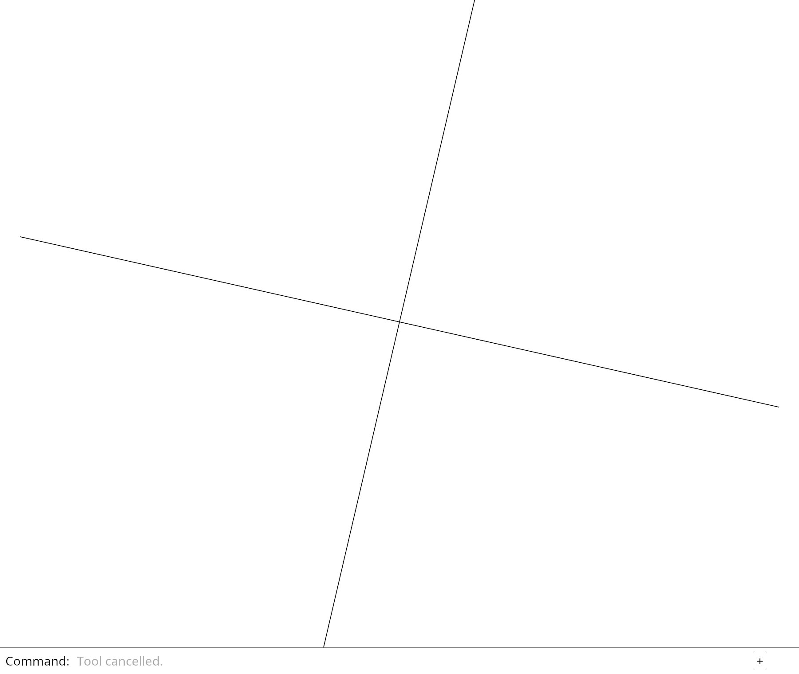

# 16.5 · Text, Plane, Trim and integrated editing commands

**Steps:** 52 · **Source:** [app/command/verbs/project_to_plane.rs](../../../../src/app/command/verbs/project_to_plane.rs) · [app/command/verbs/extend.rs](../../../../src/app/command/verbs/extend.rs) · [app/splitting.rs](../../../../src/app/splitting.rs) · [app/command/verbs/measure.rs](../../../../src/app/command/verbs/measure.rs)

<div class="webgpu-schematic" style="width:100%;margin:6px auto;">
<svg xmlns="http://www.w3.org/2000/svg" width="1120" height="188" viewBox="0 0 1120 188" style="width:100%;max-width:100%;height:auto;display:block;margin:0 auto;" role="img">
  <defs>
    <marker id="arr" viewBox="0 0 10 10" refX="8" refY="5" markerWidth="6" markerHeight="6" orient="auto">
      <path d="M 0 1 L 9 5 L 0 9 z" fill="#111111"/>
    </marker>
    <marker id="arrR" viewBox="0 0 10 10" refX="8" refY="5" markerWidth="6" markerHeight="6" orient="auto">
      <path d="M 0 1 L 9 5 L 0 9 z" fill="#dc2626"/>
    </marker>
    <marker id="arrG" viewBox="0 0 10 10" refX="8" refY="5" markerWidth="6" markerHeight="6" orient="auto">
      <path d="M 0 1 L 9 5 L 0 9 z" fill="#16a34a"/>
    </marker>
    <marker id="arrB" viewBox="0 0 10 10" refX="8" refY="5" markerWidth="6" markerHeight="6" orient="auto">
      <path d="M 0 1 L 9 5 L 0 9 z" fill="#2563eb"/>
    </marker>
  </defs>
  <rect x="2" y="2" width="1116" height="184" rx="10" fill="#ffffff" stroke="#111111" stroke-width="2"/>
  <rect x="14" y="12" width="344" height="164" rx="8" fill="#ffffff" stroke="#111111" stroke-width="1.5"/>
  <text paint-order="stroke fill" stroke="#ffffff" stroke-width="5" stroke-linejoin="round" x="186" y="30" text-anchor="middle" font-family="monospace" font-size="10.5" font-weight="700" fill="#111111">Intersecting Solids A &amp; B + Cut Curve C = ∂A ∩ ∂B</text>
  <rect x="68" y="64" width="96" height="76" fill="#dbeafe" fill-opacity="0.8" stroke="#2563eb" stroke-width="2"/>
  <rect x="128" y="52" width="96" height="76" fill="#fee2e2" fill-opacity="0.8" stroke="#dc2626" stroke-width="2"/>
  <rect x="128" y="64" width="36" height="64" fill="#fef08a" stroke="#111111" stroke-width="2.2"/>
  <text paint-order="stroke fill" stroke="#ffffff" stroke-width="5" stroke-linejoin="round" x="92" y="106" font-family="monospace" font-size="11" font-weight="700" fill="#1e3a8a">A</text>
  <text paint-order="stroke fill" stroke="#ffffff" stroke-width="5" stroke-linejoin="round" x="194" y="94" font-family="monospace" font-size="11" font-weight="700" fill="#991b1b">B</text>
  <line x1="358" y1="94" x2="384" y2="94" stroke="#111111" stroke-width="2" marker-end="url(#arr)"/>
  <rect x="388" y="12" width="344" height="164" rx="8" fill="#ffffff" stroke="#111111" stroke-width="1.5"/>
  <text paint-order="stroke fill" stroke="#ffffff" stroke-width="5" stroke-linejoin="round" x="560" y="30" text-anchor="middle" font-family="monospace" font-size="10.5" font-weight="700" fill="#111111">Boolean (A ∪ B, A \ B, A ∩ B) + Area ∫||Su×Sv||, Vol ⅓∫p·N</text>
  <polygon points="424,64 520,64 520,128 484,128 484,140 424,140" fill="#dbeafe" stroke="#111111" stroke-width="2"/>
  <text paint-order="stroke fill" stroke="#ffffff" stroke-width="5" stroke-linejoin="round" x="462" y="156" text-anchor="middle" font-family="monospace" font-size="9.5" font-weight="700" fill="#111111">A \ B</text>
  <rect x="548" y="72" width="44" height="56" fill="#fef08a" stroke="#111111" stroke-width="2"/>
  <text paint-order="stroke fill" stroke="#ffffff" stroke-width="5" stroke-linejoin="round" x="570" y="156" text-anchor="middle" font-family="monospace" font-size="9.5" font-weight="700" fill="#111111">A ∩ B</text>
  <polygon points="618,128 656,68 694,128" fill="#bbf7d0" stroke="#16a34a" stroke-width="1.75"/>
  <circle cx="656" cy="108" r="4" fill="#dc2626"/>
  <line x1="732" y1="94" x2="758" y2="94" stroke="#111111" stroke-width="2" marker-end="url(#arr)"/>
  <rect x="762" y="12" width="344" height="164" rx="8" fill="#ffffff" stroke="#111111" stroke-width="1.75"/>
  <text paint-order="stroke fill" stroke="#ffffff" stroke-width="5" stroke-linejoin="round" x="934" y="30" text-anchor="middle" font-family="monospace" font-size="10.5" font-weight="700" fill="#111111">Trimmed Boolean Solid + Centroid &amp; Area Witness</text>
  <rect x="806" y="44" width="256" height="118" rx="4" fill="#ffffff" stroke="#111111" stroke-width="2"/>
  <polygon points="846,66 956,66 956,118 912,118 912,144 846,144" fill="#93c5fd" stroke="#111111" stroke-width="2"/>
  <circle cx="892" cy="102" r="5" fill="#fef08a" stroke="#dc2626" stroke-width="2"/>
  <text paint-order="stroke fill" stroke="#ffffff" stroke-width="5" stroke-linejoin="round" x="998" y="98" text-anchor="middle" font-family="monospace" font-size="9.5" font-weight="700" fill="#111111">V, A, C_g</text>
</svg>
</div>

## <a id="checkpoint-85-copy-current-original-command-recipes"></a>1. Write text placement and curve heads

### 1. `src/lib.rs`

**Locate this existing block:**

```rust
mod shader_check;

pub mod selection_region;

pub mod source_shape;
```

Edit the existing block to match this code; keep unchanged lines:

```rust
mod shader_check;
```

### 2. `src/text_geometry.rs`

Create the file and type:

```rust
use crate::text::{TextLabel, TextPlacement};
use session_rust::{Point, Vector};
const FONT_SIZE: f32 = 18.;
const LINE_HEIGHT: f32 = 26.;
pub fn label(
    text: &str,
    point: &Point,
    right: [f64; 3],
    up: [f64; 3],
    height: f64,
) -> TextLabel {
    let lift = height * f64::from(LINE_HEIGHT) / f64::from(FONT_SIZE); // the line box above the point
    TextLabel {
        id: 0,
        object: None,
        text: text.into(),
        font_size: FONT_SIZE,
        line_height: LINE_HEIGHT,
        color: [255; 4],
        placement: TextPlacement::WorldPlane {
            world: [0, 1, 2].map(|axis| point[axis] + up[axis] * lift),
            right,
            up,
            world_height: height,
        },
        clip: None,
    }
}

/// Of the plane axes `a` and `b`, the one along the screen's right and the other toward its top.
pub fn reading_axes(
    a: &Vector,
    b: &Vector,
    right: &Vector,
    up: &Vector,
) -> ([f64; 3], [f64; 3]) {
    let (along, across) = if a.dot(right).abs() >= b.dot(right).abs() {
        (a, b)
    } else {
        (b, a)
    };
    let sign = |axis: &Vector, toward: &Vector| {
        let flip = if axis.dot(toward) < 0.0 {
            -1.0
        } else {
            1.0
        };
        [
            axis[0] * flip,
            axis[1] * flip,
            axis[2] * flip,
        ]
    };
    (sign(along, right), sign(across, up))
}

/// `value` rounded down to 1, 2 or 5 times a power of ten; 1 when it is not a positive number.
pub fn nice(value: f64) -> f64 {
    if !(value > 0.0 && value.is_finite()) {
        return 1.0;
    }

    let power = 10f64.powf(value.log10().floor());
    let step = match value / power {
        m if m >= 5.0 => 5.0,
        m if m >= 2.0 => 2.0,
        _ => 1.0,
    };
    step * power
}
```

### 3. `src/lib.rs`

**Locate this existing block:**

```rust
pub mod explode_geometry;
pub mod source_mesh_topology;

#[cfg(target_arch = "wasm32")]
```

Edit the existing block to match this code; keep unchanged lines:

```rust
pub mod explode_geometry;

pub mod source_mesh_topology;
pub mod text_geometry;

#[cfg(target_arch = "wasm32")]
```

### 4. `src/curve_heads.rs`

Create the file and type:

```rust
use session_rust::{Arrowhead, Geometry};
use std::rc::Rc;
pub fn headed(geometry: &Geometry, head: Arrowhead) -> Option<(Geometry, bool)> {
    let out = match geometry {
        Geometry::Line(line) => {
            let mut next = (**line).clone();
            next.arrowhead = head;
            (
                Geometry::Line(Rc::new(next)),
                line.arrowhead != head,
            )
        }
        Geometry::Polyline(polyline) => {
            let mut next = (**polyline).clone();
            next.arrowhead = head;
            (
                Geometry::Polyline(Rc::new(next)),
                polyline.arrowhead != head,
            )
        }
        Geometry::NurbsCurve(curve) => {
            let mut next = (**curve).clone();
            next.arrowhead = head;
            (
                Geometry::NurbsCurve(Rc::new(next)),
                curve.arrowhead != head,
            )
        }
        _ => return None,
    };
    Some(out)
}
```

### 5. `src/lib.rs`

**Locate this existing block:**

```rust
pub mod explode_geometry;

pub mod source_mesh_topology;
pub mod text_geometry;

#[cfg(target_arch = "wasm32")]
```

Edit the existing block to match this code; keep unchanged lines:

```rust
pub mod explode_geometry;

pub mod text_geometry;

pub mod curve_heads;
pub mod source_mesh_topology;

#[cfg(target_arch = "wasm32")]
```

### 6. `src/curve_heads.rs`

**Locate this existing block:**

```rust
    Some(out)
}
```

Edit the existing block to match this code; keep unchanged lines:

```rust
    Some(out)
}

#[cfg(test)]
mod tests {
    use super::*;
    use session_rust::{Line, NurbsCurve, Point, Polyline};
    #[test]
    fn only_curves_take_heads() {
        let p = |x: f64, y: f64| Point::new(x, y, 0.0);
        let line = Geometry::Line(Rc::new(Line::from_points(
            &p(0.0, 0.0),
            &p(1.0, 0.0),
        )));
        let polyline = Geometry::Polyline(Rc::new(Polyline::new(vec![
            p(0.0, 0.0),
            p(1.0, 1.0),
        ])));
        let curve = Geometry::NurbsCurve(Rc::new(NurbsCurve::create(
            false,
            2,
            &[p(0.0, 0.0), p(1.0, 1.0), p(2.0, 0.0)],
        )));

        for geometry in [line, polyline, curve] {
            let Some((out, true)) = headed(&geometry, Arrowhead::BOTH) else {
                panic!("a curve takes heads")
            };
            let head = match &out {
                Geometry::Line(l) => l.arrowhead,
                Geometry::Polyline(pl) => pl.arrowhead,
                Geometry::NurbsCurve(c) => c.arrowhead,
                _ => unreachable!(),
            };
            assert_eq!(head, Arrowhead::BOTH);
            assert!(
                matches!(
                    headed(&out, Arrowhead::BOTH),
                    Some((_, false))
                ),
                "the same heads change nothing"
            );
        }

        assert!(
            headed(
                &Geometry::Point(Rc::new(p(0.0, 0.0))),
                Arrowhead::END
            )
            .is_none()
        );
    }
}
```

### 7. `src/lib.rs`

**Locate this existing block:**

```rust
pub mod curve_heads;
pub mod source_mesh_topology;

#[cfg(target_arch = "wasm32")]
```

Edit the existing block to match this code; keep unchanged lines:

```rust
pub mod curve_heads;

pub mod selection_region;

pub mod source_mesh_topology;
pub mod source_shape;

#[cfg(target_arch = "wasm32")]
```

## <a id="checkpoint-85a-validate-original-plane-display-and-precise-bounds"></a>2. Validate Plane display and precise bounds

### 1. `src/plane_original.rs`

Create the file and type:

```rust
use session_rust::{Geometry, Mesh, Plane, Point, Xform};
use std::rc::Rc;
pub fn valid(plane: &Plane) -> bool {
    let o = plane.origin();
    let x = plane.x_axis();
    let y = plane.y_axis();
    (0..3).all(|i| o[i].is_finite() && x[i].is_finite() && y[i].is_finite())
        && x.magnitude() > 0.
        && y.magnitude() > 0.
        && x.cross(&y).magnitude() > 1e-12
        && plane.width.is_finite()
        && plane.width >= 0.
}
pub fn points(plane: &Plane) -> Result<Vec<Point>, &'static str> {
    if !valid(plane) {
        return Err("Invalid original plane frame");
    }
    let o = plane.origin();
    let x = plane.x_axis();
    let y = plane.y_axis();
    let z = x.cross(&y).normalized();
    let arrow = 0.2 * x.magnitude().min(y.magnitude());
    let tip = &o + &z * arrow;
    let back = &o + &z * (arrow * 0.7);
    let wing = x.normalized() * (arrow * 0.25);
    Ok(vec![
        &o + &x + y.clone(),
        &o - &x + y.clone(),
        &o - &x - y.clone(),
        &o + &x - y,
        o.clone(),
        tip,
        &back + &wing,
        &back - &wing,
        &o - &z * arrow,
    ])
}
pub fn prepared(plane: &Plane) -> Result<crate::prepared::PreparedMesh, &'static str> {
    let points = points(plane)?;
    let edges = vec![
        (0, 1),
        (1, 2),
        (2, 3),
        (3, 0),
        (4, 5),
        (5, 6),
        (5, 7),
    ];
    let mut source = Mesh::from_vertices_and_faces(points.clone(), Vec::new());
    source.set_guid(plane.guid().into());
    source.name = plane.name.clone();
    source.set_objectcolor(plane.linecolor.clone());
    source.is_visible = plane.is_visible;
    source.is_locked = plane.is_locked;
    let mut display = crate::mesh::Mesh::new(
        points
            .iter()
            .map(|p| {
                [
                    p[0] as f32,
                    p[1] as f32,
                    p[2] as f32,
                    0.,
                    0.,
                    0.,
                ]
            })
            .collect(),
        Vec::new(),
    )?;
    let endpoints = edges
        .iter()
        .map(|&(a, b)| [&points[a], &points[b]].map(|p| [p[0], p[1], p[2]]))
        .collect();
    display.parts = crate::mesh_parts::Parts {
        faces: Vec::new(),
        triangles: Vec::new(),
        edges,
        endpoints,
    };
    Ok(crate::prepared::PreparedMesh {
        geometry: Rc::new(source),
        display,
        source: None,
        model: Xform::identity(),
    })
}
pub fn placed(plane: &Plane, model: &Xform) -> Option<crate::bounds::Bounds> {
    let points = points(plane).ok()?;
    let p = points.first()?.transformed(model);
    let mut bounds = crate::bounds::Bounds::point([p[0], p[1], p[2]]);
    for p in points {
        let p = p.transformed(model);
        bounds.include([p[0], p[1], p[2]])
    }
    Some(bounds)
}
pub fn insert(
    scene: &mut crate::scene::Scene,
    plane: Rc<Plane>,
) -> Result<crate::scene::ObjectId, &'static str> {
    let id = scene.insert(prepared(&plane)?)?;
    scene
        .objects_mut()
        .iter_mut()
        .find(|r| r.id == id)
        .unwrap()
        .original = Some(Geometry::Plane(plane));
    Ok(id)
}
```

### 2. `src/lib.rs`

**Locate this existing block:**

```rust
pub mod selection_region;

pub mod source_mesh_topology;
pub mod source_shape;

#[cfg(target_arch = "wasm32")]
```

Edit the existing block to match this code; keep unchanged lines:

```rust
pub mod selection_region;

pub mod source_shape;

pub mod plane_original;
pub mod source_mesh_topology;

#[cfg(target_arch = "wasm32")]
```

## <a id="checkpoint-85b-retain-original-plane-and-text-edit-eligibility"></a>3. Retain Plane and Text edit eligibility

### 1. `src/source_edit.rs`

**Locate this existing block:**

```rust
    }
    crate::gather_draft::Draft::source(scene, id)
}
pub fn same(a: &Geometry, b: &Geometry) -> bool {
    match (a, b) {
        (Geometry::OBB(a), Geometry::OBB(b)) => Rc::ptr_eq(a, b),
        (Geometry::Line(a), Geometry::Line(b)) => Rc::ptr_eq(a, b),
        (Geometry::Polyline(a), Geometry::Polyline(b)) => Rc::ptr_eq(a, b),
        (Geometry::NurbsCurve(a), Geometry::NurbsCurve(b)) => Rc::ptr_eq(a, b),
        (Geometry::Point(a), Geometry::Point(b)) => Rc::ptr_eq(a, b),
        (Geometry::Mesh(a), Geometry::Mesh(b)) => Rc::ptr_eq(a, b),
        (Geometry::BRep(a), Geometry::BRep(b)) => Rc::ptr_eq(a, b),
        (Geometry::NurbsSurface(a), Geometry::NurbsSurface(b)) => Rc::ptr_eq(a, b),
        _ => false,
    }
}
#[derive(Clone)]
pub struct Owner {
    pub id: ObjectId,
    pub source: Geometry,
    pub model: Xform,
}
impl Owner {
    pub fn capture(scene: &Scene, id: ObjectId) -> Result<Self, &'static str> {
        if scene.pick_id(id.value()) != Some(id) {
            return Err("Pick a visible unlocked original");
        }
        Ok(Self {
            id,
            source: original(scene, id).ok_or("Reload an editable original source")?,
            model: scene
                .placement(id)
                .ok_or("Source placement is missing")?,
        })
    }
    pub fn valid(&self, scene: &Scene) -> Result<(), &'static str> {
        if scene.pick_id(self.id.value()) != Some(self.id)
            || scene
                .placement(self.id)
                .is_none_or(|p| p.m != self.model.m)
            || original(scene, self.id).is_none_or(|g| !same(&self.source, &g))
        {
            return Err("Original source changed; start again");
        }
        Ok(())
    }
}
```

Edit the existing block to match this code; keep unchanged lines:

```rust
    }
    if let Some(row) = scene.clouds().iter().find(|r| r.id == id) {
        return Some(Geometry::PointCloud(
            row.prepared.source.clone(),
        ));
    }
    crate::gather_draft::Draft::source(scene, id)
}
pub fn same(a: &Geometry, b: &Geometry) -> bool {
    match (a, b) {
        (Geometry::PointCloud(a), Geometry::PointCloud(b)) => Rc::ptr_eq(a, b),
        (Geometry::Plane(a), Geometry::Plane(b)) => Rc::ptr_eq(a, b),
        (Geometry::OBB(a), Geometry::OBB(b)) => Rc::ptr_eq(a, b),
        (Geometry::Line(a), Geometry::Line(b)) => Rc::ptr_eq(a, b),
        (Geometry::Polyline(a), Geometry::Polyline(b)) => Rc::ptr_eq(a, b),
        (Geometry::NurbsCurve(a), Geometry::NurbsCurve(b)) => Rc::ptr_eq(a, b),
        (Geometry::Point(a), Geometry::Point(b)) => Rc::ptr_eq(a, b),
        (Geometry::Mesh(a), Geometry::Mesh(b)) => Rc::ptr_eq(a, b),
        (Geometry::BRep(a), Geometry::BRep(b)) => Rc::ptr_eq(a, b),
        (Geometry::NurbsSurface(a), Geometry::NurbsSurface(b)) => Rc::ptr_eq(a, b),
        _ => false,
    }
}
#[derive(Clone)]
pub struct Owner {
    pub id: ObjectId,
    pub source: Geometry,
    pub model: Xform,
}
impl Owner {
    pub fn capture(scene: &Scene, id: ObjectId) -> Result<Self, &'static str> {
        if scene.pick_id(id.value()) != Some(id) {
            return Err("Pick a visible unlocked original");
        }
        Ok(Self {
            id,
            source: original(scene, id).ok_or("Reload an editable original source")?,
            model: scene
                .placement(id)
                .ok_or("Source placement is missing")?,
        })
    }
    pub fn valid(&self, scene: &Scene) -> Result<(), &'static str> {
        if scene.pick_id(self.id.value()) != Some(self.id)
            || scene
                .placement(self.id)
                .is_none_or(|p| p.m != self.model.m)
            || original(scene, self.id).is_none_or(|g| !same(&self.source, &g))
        {
            return Err("Original source changed; start again");
        }
        Ok(())
    }
}

pub fn editable(scene: &Scene, id: ObjectId) -> Result<(), &'static str> {
    if scene.pick_id(id.value()) != Some(id) {
        return Err("Pick a visible unlocked original");
    }
    if scene
        .objects()
        .iter()
        .any(|r| r.id == id && r.original.is_none() && r.geometry().is_none())
    {
        return Err("Reload an editable original source");
    }
    Ok(())
}
```

### 2. `src/source_part.rs`

**Locate this existing block:**

```rust
        .ok_or("Source object is missing")?;
    if let Some(cad) = &row.cad {
```

Edit the existing block to match this code; keep unchanged lines:

```rust
        .ok_or("Source object is missing")?;
    if let Some(original) = &row.original {
        return Ok(original.clone());
    }
    if let Some(cad) = &row.cad {
```

## <a id="checkpoint-85c-find-eligible-objects-by-name-or-world-size"></a>4. Find eligible objects by name or world size

### 1. `src/selection_query.rs`

Create the file and type:

```rust
use crate::scene::{ObjectId, Scene};
pub enum Query {
    Small(f64),
    Name(String),
}
impl Query {
    pub fn name(words: &[&str]) -> Result<Self, String> {
        let joined = words.join(" ");
        let text = ['"', '\'']
            .iter()
            .find_map(|quote| {
                joined
                    .strip_prefix(*quote)?
                    .strip_suffix(*quote)
            })
            .unwrap_or(&joined)
            .trim();
        if text.is_empty() {
            return Err("Type a name after Select By Name".into());
        }
        Ok(Self::Name(text.into()))
    }
    pub fn found(&self, scene: &Scene) -> Result<Vec<ObjectId>, String> {
        let mut ids = scene
            .all_ids()
            .into_iter()
            .filter(|id| scene.pick_id(id.value()) == Some(*id))
            .filter(|id| match self {
                Self::Small(length) => {
                    scene
                        .selected_bounds(*id)
                        .is_some_and(|bounds| {
                            let d = std::array::from_fn::<_, 3, _>(|i| {
                                bounds.max[i] - bounds.min[i]
                            });
                            d[0].hypot(d[1]).hypot(d[2]) < *length
                        })
                }
                Self::Name(text) => scene
                    .forest
                    .documents
                    .iter()
                    .flat_map(|d| &d.nodes)
                    .find(|n| n.object == Some(*id))
                    .is_some_and(|n| {
                        n.label
                            .to_lowercase()
                            .contains(&text.to_lowercase())
                    }),
            })
            .collect::<Vec<_>>();
        ids.sort_unstable_by_key(|id| id.value());
        if ids.is_empty() {
            return Err(
                "No visible unlocked object matches; selection unchanged".into(),
            );
        }
        Ok(ids)
    }
}
```

### 2. `src/lib.rs`

**Locate this existing block:**

```rust
pub mod plane_original;
pub mod source_mesh_topology;
```

Edit the existing block to match this code; keep unchanged lines:

```rust
pub mod plane_original;

pub mod selection_query;
pub mod source_mesh_topology;
```

## <a id="checkpoint-85d-plan-sibling-pieces-from-original-owners"></a>5. Plan sibling pieces from owners

### 1. `src/explode_edit.rs`

Create the file and type:

```rust
use crate::{
    scene::{ObjectId, Scene},
    source_edit::Owner,
};
use session_rust::{Geometry, Xform};
pub struct Plan {
    targets: Vec<(Owner, Vec<Geometry>)>,
    count: usize,
}
impl Plan {
    pub fn prepare(scene: &Scene, ids: &[ObjectId]) -> Result<Self, String> {
        let mut targets = Vec::new();
        let mut count = 0;
        let mut refused = None;
        for &id in ids {
            let owner = Owner::capture(scene, id)?;
            if scene.forest.documents.iter().any(|d| {
                d.nodes
                    .iter()
                    .enumerate()
                    .any(|(i, n)| n.object == Some(id) && n.end > i + 1)
            }) {
                return Err("Explode needs an object without child objects".into());
            }
            match crate::explode_geometry::pieces(&owner.source) {
                Ok(pieces) => {
                    count += pieces.len();
                    if count > crate::interval_geometry::MAX_POINTS {
                        return Err("Explode makes at most4096 objects at once".into());
                    }
                    targets.push((owner, pieces));
                }
                Err(error) => refused = Some(error),
            }
        }
        if targets.is_empty() {
            return Err(refused.unwrap_or_else(|| "Nothing to explode".into()));
        }
        Ok(Self { targets, count })
    }
    pub fn adopt(self, scene: &mut Scene) -> Result<Vec<ObjectId>, &'static str> {
        let mut made = Vec::with_capacity(self.count);
        for (owner, pieces) in self.targets {
            owner.valid(scene)?;
            for piece in pieces {
                let copy = crate::layer_edit::copy_objects(
                    scene,
                    &[owner.id],
                    &Xform::identity(),
                )?[0];
                scene.replace_original(copy, piece)?;
                made.push(copy);
            }
            scene.remove(owner.id);
        }
        Ok(made)
    }
}
```

### 2. `src/lib.rs`

**Locate this existing block:**

```rust
pub mod selection_query;
pub mod source_mesh_topology;
```

Edit the existing block to match this code; keep unchanged lines:

```rust
pub mod selection_query;

pub mod explode_edit;
pub mod source_mesh_topology;
```

## <a id="checkpoint-85e-own-text-height-and-words-before-placement"></a>6. Own Text height and words before placement

### 1. `src/text_draft.rs`

Create the file and type:

```rust
pub struct Draft {
    pub words: String,
    pub height: f64,
    pub asking: bool,
}
impl Draft {
    pub fn new(words: String, distance: f64, last: f64) -> Result<Self, &'static str> {
        if !(1..=80).contains(&words.chars().count()) {
            return Err("Text takes 1 to 80 characters");
        }
        Ok(Self {
            words,
            height: if last > 0. {
                last
            } else {
                crate::text_geometry::nice(distance / 25.)
            },
            asking: false,
        })
    }
    pub fn prompt(&self) -> String {
        if self.asking {
            "Type the letter height".into()
        } else {
            format!(
                "Lower-left point of \"{}\" · Height {} (type Height N)",
                self.words, self.height
            )
        }
    }
    pub fn height(&mut self, text: &str) -> Result<(), &'static str> {
        let words = text.split_whitespace().collect::<Vec<_>>();
        let value = match words.as_slice() {
            [word] if word.eq_ignore_ascii_case("Height") => {
                self.asking = true;
                return Ok(());
            }
            [name, value] if name.eq_ignore_ascii_case("Height") => *value,
            [value] if self.asking => *value,
            _ => return Err("Height wants a number above zero"),
        };
        let height = value
            .parse::<f64>()
            .ok()
            .filter(|v| v.is_finite() && *v > 0. && *v <= 1e9)
            .ok_or("Height must be a number above zero")?;
        self.height = height;
        self.asking = false;
        Ok(())
    }
    pub fn source(
        &self,
        point: [f64; 3],
        frame: crate::cplane::CPlane,
        camera: &crate::camera::Camera,
    ) -> crate::scene_label::Source {
        let (x, y) = frame.axes();
        let (right, up) = crate::text_geometry::reading_axes(
            &x,
            &y,
            &camera
                .orientation
                .rotate_vector(session_rust::Vector::x_axis()),
            &camera
                .orientation
                .rotate_vector(session_rust::Vector::z_axis()),
        );
        let label = crate::text_geometry::label(
            &self.words,
            &session_rust::Point::new(point[0], point[1], point[2]),
            right,
            up,
            self.height,
        );
        crate::scene_label::Source {
            guid: uuid::Uuid::new_v4().to_string(),
            name: self.words.clone(),
            visible: true,
            locked: false,
            label,
        }
    }
}
```

### 2. `src/lib.rs`

**Locate this existing block:**

```rust
pub mod explode_edit;
pub mod source_mesh_topology;

#[cfg(target_arch = "wasm32")]
```

Edit the existing block to match this code; keep unchanged lines:

```rust
pub mod explode_edit;

pub mod source_mesh_topology;
pub mod text_draft;

#[cfg(target_arch = "wasm32")]
```

## <a id="checkpoint-85f-own-unpickable-cached-guide-data"></a>7. Own unpickable cached guide data

### 1. `src/guide_gpu.rs`

Create the file and type:

```rust
use crate::{marker::Marker, stroke::Stroke, stroke_gpu::Lane};
#[derive(Clone, Debug, PartialEq)]
pub struct Segment {
    pub stroke: Stroke,
    pub dashed: bool,
}
#[derive(Clone, Debug, Default, PartialEq)]
pub struct Overlay {
    pub segments: Vec<Segment>,
    pub marks: Vec<Marker>,
    pub label: Option<([f64; 3], String)>,
}
impl Overlay {
    pub fn wire(&mut self, points: &[[f64; 3]], colour: [f32; 4], dashed: bool) {
        for p in points.windows(2) {
            if p[0] != p[1] {
                self.segments.push(Segment {
                    stroke: Stroke {
                        start: p[0].map(|v| v as f32),
                        end: p[1].map(|v| v as f32),
                        colour,
                        width: 2.,
                    },
                    dashed,
                })
            }
        }
    }
    pub fn labels(
        &self,
        existing: &[crate::text::TextLabel],
    ) -> Vec<crate::text::TextLabel> {
        self.label
            .as_ref()
            .map_or_else(Vec::new, |(point, label)| {
                crate::measure_mark::Mark {
                    points: vec![*point],
                    label: label.clone(),
                }
                .labels(existing)
            })
    }
}
```

### 2. `src/lib.rs`

**Locate this existing block:**

```rust
pub mod explode_edit;

pub mod source_mesh_topology;
pub mod text_draft;

#[cfg(target_arch = "wasm32")]
```

Edit the existing block to match this code; keep unchanged lines:

```rust
pub mod explode_edit;

pub mod text_draft;

pub mod guide_gpu;
pub mod source_mesh_topology;

#[cfg(target_arch = "wasm32")]
```

## <a id="checkpoint-85g-shade-explicit-dashed-guides"></a>8. Shade explicit dashed guides

### 1. `src/guide.wgsl`

Create the file and type:

```wgsl
struct View { transform: mat4x4<f32>, size: vec2<f32>, density: f32 }
@group(0) @binding(0) var<uniform> view: View;

struct Output {
    @builtin(position) position: vec4<f32>,
    @location(0) colour: vec4<f32>,
    @location(1) @interpolate(linear) side: f32,
    @location(2) @interpolate(flat) half_width: f32,
    @location(3) @interpolate(linear) along: f32,
    @location(4) @interpolate(flat) dashed: u32,
}

fn hidden(colour: vec4<f32>) -> Output {
    return Output(vec4<f32>(2.0, 2.0, 2.0, 1.0), colour, 0.0, 0.0,0.,0u);
}

fn geometry(start: vec3<f32>, end: vec3<f32>, colour: vec4<f32>, width: f32, index: u32,dashed:u32) -> Output {
    var a = view.transform * vec4<f32>(start, 1.0);
    var b = view.transform * vec4<f32>(end, 1.0);
    if (a.z < 0.0 && b.z < 0.0) { return hidden(colour); }
    if (a.z < 0.0) { a = mix(a, b, -a.z / (b.z - a.z)); }
    if (b.z < 0.0) { b = mix(b, a, -b.z / (a.z - b.z)); }
    if (a.w <= 0.0 || b.w <= 0.0) { return hidden(colour); }
    let delta = (b.xy / b.w - a.xy / a.w) * view.size;
    let length2 = dot(delta, delta);
    if (length2 < 0.000001) { return hidden(colour); }
    let normal = vec2<f32>(-delta.y, delta.x) * inverseSqrt(length2);
    let corners = array<vec2<f32>, 6>(vec2<f32>(0.0, -1.0), vec2<f32>(1.0, -1.0),
        vec2<f32>(0.0, 1.0), vec2<f32>(0.0, 1.0), vec2<f32>(1.0, -1.0), vec2<f32>(1.0, 1.0));
    let corner = corners[index];
    let half_width = width * view.density * 0.5;
    let extent = half_width + 0.70711;
    var position = select(a, b, corner.x > 0.5);
    position = vec4<f32>(position.xy + normal * extent * 2.0 / view.size * corner.y * position.w, position.zw);
    return Output(position, colour, corner.y * extent, half_width,corner.x*sqrt(length2)*0.5/view.density,dashed);
}

fn colour(input: Output) -> vec4<f32> {
    let coverage = clamp(input.half_width + 0.5 - abs(input.side), 0.0, 1.0);
    return vec4<f32>(input.colour.rgb, input.colour.a * coverage);
}

@vertex
fn vertex(@location(0) start: vec3<f32>, @location(1) end: vec3<f32>,
    @location(2) colour: vec4<f32>, @location(3) width: f32,
    @location(4) dashed:u32,@builtin(vertex_index) index: u32) -> Output { return geometry(start, end, colour, width, index,dashed); }
@fragment
fn fragment(input: Output) -> @location(0) vec4<f32> { if(input.dashed!=0u&&fract(input.along/10.)>0.6){discard;}return colour(input); }
```

### 2. `src/guide_pick.wgsl`

Create the file and type:

```wgsl
@group(1) @binding(0) var<uniform> crop:Crop;
struct PickOutput{@builtin(position)position:vec4<f32>}
@vertex fn pick_vertex(@location(0)start:vec3<f32>,@location(1)end:vec3<f32>,@location(2)colour:vec4<f32>,@location(3)width:f32,@location(4)dashed:u32,@builtin(vertex_index)index:u32)->PickOutput{return PickOutput(crop.transform*geometry(start,end,colour,width,index,dashed).position);}
@fragment fn pick_fragment()->@location(0)vec2<u32>{return vec2<u32>(0u);}
```

## <a id="checkpoint-85h-cache-guide-buffers-and-actual-allocation"></a>9. Cache guide buffers and actual allocation

### 1. `src/stroke_gpu.rs`

Edit these blocks from bottom to top. Keep the surrounding lines unchanged.

**Locate this block:**

```rust
                immediate_size: 0,
            });
        let pick_source = match stride {
            44 => include_str!("stroke_pick.wgsl"),
```

Replace it with:

```rust
                immediate_size: 0,
            });
        let pick_source = match stride {
            48 => include_str!("guide_pick.wgsl"),
            44 => include_str!("stroke_pick.wgsl"),
```

**Locate this block:**

```rust
        )
    }

    pub fn overlay(device: &wgpu::Device, format: wgpu::TextureFormat) -> Self {
        let mut depth = crate::depth::ink();
        depth.depth_compare = Some(wgpu::CompareFunction::Always);
```

Replace it with:

```rust
        )
    }

    pub fn guides(device: &wgpu::Device, format: wgpu::TextureFormat) -> Self {
        let mut depth = crate::depth::ink();
        depth.depth_compare = Some(wgpu::CompareFunction::Always);
        Self::layout_depth(
            device,
            format,
            include_str!("guide.wgsl"),
            48,
            6,
            &wgpu::vertex_attr_array![0=>Float32x3,1=>Float32x3,2=>Float32x4,3=>Float32,4=>Uint32],
            depth,
        )
    }
    pub fn overlay(device: &wgpu::Device, format: wgpu::TextureFormat) -> Self {
        let mut depth = crate::depth::ink();
        depth.depth_compare = Some(wgpu::CompareFunction::Always);
```

**Locate this block:**

```rust
    }

    pub fn set_chains(
        &mut self,
        device: &wgpu::Device,
```

Replace it with:

```rust
    }

    pub fn set_guides(
        &mut self,
        device: &wgpu::Device,
        segments: &[crate::guide_gpu::Segment],
    ) -> Result<(), &'static str> {
        if self.stride != 48 {
            return Err("Guide data needs the guide layout");
        }
        let mut bytes = Vec::with_capacity(segments.len() * 48);
        for segment in segments {
            if segment.stroke.width <= 0.
                || segment
                    .stroke
                    .values()
                    .iter()
                    .any(|v| !v.is_finite())
            {
                return Err("Invalid guide stroke");
            }
            bytes.extend(segment.stroke.bytes());
            bytes.extend(u32::from(segment.dashed).to_ne_bytes());
        }
        self.set_bytes(device, bytes)
    }
    pub fn set_chains(
        &mut self,
        device: &wgpu::Device,
```

## <a id="checkpoint-85i-draw-cached-guides-through-the-overlay-owner"></a>10. Draw cached guides through the overlay owner

### 1. `src/guide_gpu.rs`

**Locate this existing block:**

```rust
    }
}
```

Edit the existing block to match this code; keep unchanged lines:

```rust
    }
}
pub struct Guide {
    pub overlay: Overlay,
    segments: Lane,
    marks: Lane,
}
impl Guide {
    pub fn new(device: &wgpu::Device, format: wgpu::TextureFormat) -> Self {
        Self {
            overlay: Default::default(),
            segments: Lane::guides(device, format),
            marks: Lane::markers(device, format),
        }
    }
    pub fn set(
        &mut self,
        device: &wgpu::Device,
        overlay: &Overlay,
    ) -> Result<bool, &'static str> {
        if &self.overlay == overlay {
            return Ok(false);
        }
        self.segments
            .set_guides(device, &overlay.segments)?;
        self.marks
            .set_points(device, overlay.marks.iter().copied())?;
        self.overlay = overlay.clone();
        Ok(true)
    }
    pub fn view(
        &self,
        queue: &wgpu::Queue,
        matrix: &[f32; 16],
        size: [u32; 2],
        density: f32,
    ) {
        self.segments
            .view(queue, matrix, size, density);
        self.marks.view(queue, matrix, size, density)
    }
    pub fn draw(&self, pass: &mut wgpu::RenderPass<'_>) {
        self.segments.draw(pass);
        self.marks.draw(pass)
    }
    pub fn bytes(&self) -> u64 {
        self.segments.usage()[1] + self.marks.usage()[1]
    }
}
```

## <a id="checkpoint-85j-own-trim-targets-cutters-and-part-state"></a>11. Own Trim targets cutters and part state

### 1. `src/trim_draft.rs`

Create the file and type:

```rust
use crate::{
    scene::{ObjectId, Scene},
    source_cut::{
        Cutter, as_curve, as_plane, fence_plane, nearest_px, plane_moved, unit_ray,
    },
    source_edit::Owner,
    trim_parts::{Blade, Parts},
};
use session_rust::{Geometry, Line, Point, Vector, Xform, intersection};
#[derive(Clone, Copy, Debug, PartialEq, Eq)]
pub enum Phase {
    Targets,
    Cutters,
    Parts,
}
pub struct Cut {
    pub owner: Owner,
    pub parts: Parts,
    pub removed: Vec<usize>,
    pub outlines: Vec<Vec<Point>>,
    pub marks: Vec<Point>,
    pub section: Vec<Vec<Point>>,
}
pub struct Draft {
    pub before: Vec<ObjectId>,
    pub targets: Vec<Owner>,
    pub cutters: Vec<Owner>,
    pub phase: Phase,
    pub cuts: Vec<Cut>,
    pub hover: Option<(usize, usize)>,
    pub preview: Option<Scene>,
    pub missed: usize,
}
impl Draft {
    pub fn new(scene: &Scene, before: Vec<ObjectId>) -> Result<Self, String> {
        let mut draft = Self {
            before: before.clone(),
            targets: Vec::new(),
            cutters: Vec::new(),
            phase: Phase::Targets,
            cuts: Vec::new(),
            hover: None,
            preview: None,
            missed: 0,
        };
        for id in before {
            draft.pick(scene, Some(id))?;
        }
        if !draft.targets.is_empty() {
            draft.phase = Phase::Cutters;
        }
        Ok(draft)
    }
    pub fn prompt(&self) -> String {
        match self.phase {
            Phase::Targets => format!(
                "Trim · pick objects, Enter ({} selected)",
                self.targets.len()
            ),
            Phase::Cutters => format!(
                "Trim · pick cutters, Enter ({} selected)",
                self.cutters.len()
            ),
            Phase::Parts => format!(
                "Trim · click parts to remove, Enter finishes · Esc cancels ({} not crossed)",
                self.missed
            ),
        }
    }
    pub fn picks(&self) -> bool {
        self.phase != Phase::Parts
    }
    pub fn pick(&mut self, scene: &Scene, id: Option<ObjectId>) -> Result<(), String> {
        let id = id.ok_or("Nothing there · pick an original")?;
        if !self.picks() {
            return Err("Trim now needs a part click".into());
        }
        if self.phase == Phase::Cutters && self.targets.iter().any(|o| o.id == id) {
            return Err("A target cannot cut itself".into());
        }
        let list = if self.phase == Phase::Targets {
            &mut self.targets
        } else {
            &mut self.cutters
        };
        if let Some(at) = list.iter().position(|owner| owner.id == id) {
            list.remove(at);
            return Ok(());
        }
        let owner = Owner::capture(scene, id)?;
        if list.len() >= crate::interval_geometry::MAX_POINTS {
            return Err("Trim accepts at most4096 owners".into());
        }
        if self.phase == Phase::Targets {
            if !matches!(
                &owner.source,
                Geometry::Line(_)
                    | Geometry::Polyline(_)
                    | Geometry::NurbsCurve(_)
                    | Geometry::NurbsSurface(_)
                    | Geometry::BRep(_)
                    | Geometry::Mesh(_)
            ) {
                return Err("Pick an original curve, surface, BRep or mesh".into());
            }
            let document = |id| {
                scene
                    .forest
                    .documents
                    .iter()
                    .find(|d| d.nodes.iter().any(|n| n.object == Some(id)))
                    .map(|d| d.key)
            };
            if list
                .first()
                .is_some_and(|first| document(first.id) != document(id))
            {
                return Err("Trim edits one document at a time".into());
            }
        } else {
            if as_curve(&owner.source).is_none() && as_plane(&owner.source).is_none() {
                return Err("Cut with a curve, Plane or planar surface".into());
            }
        }
        list.push(owner);
        Ok(())
    }
}
```

### 2. `src/lib.rs`

**Locate this existing block:**

```rust
pub mod guide_gpu;
pub mod source_mesh_topology;

#[cfg(target_arch = "wasm32")]
```

Edit the existing block to match this code; keep unchanged lines:

```rust
pub mod guide_gpu;

pub mod source_mesh_topology;
pub mod trim_draft;

#[cfg(target_arch = "wasm32")]
```

## <a id="checkpoint-85k-prepare-local-cuts-from-world-cutters"></a>12. Prepare local cuts from world cutters

### 1. `src/trim_draft.rs`

**Locate this existing block:**

```rust
    }
}
```

Edit the existing block to match this code; keep unchanged lines:

```rust
    }
    pub fn prepare(
        &mut self,
        scene: &Scene,
        camera: &crate::camera::Camera,
    ) -> Result<(), String> {
        if self.phase == Phase::Targets {
            if self.targets.is_empty() {
                return Err("Select objects to trim first".into());
            }
            self.phase = Phase::Cutters;
            return Ok(());
        }
        if self.cutters.is_empty() {
            return Err("Select cutting objects first".into());
        }
        let normal = crate::cplane::CPlane::facing(
            &camera
                .orientation
                .rotate_vector(Vector::y_axis()),
        )
        .normal();
        let mut blades = Vec::new();
        for owner in &self.cutters {
            owner.valid(scene)?;
            if let Some(plane) = as_plane(&owner.source) {
                if let Some(plane) = plane_moved(&plane, &owner.model) {
                    blades.push((Cutter::Plane(plane), None))
                }
                continue;
            }
            let curve = as_curve(&owner.source)
                .ok_or("Unsupported cutter")?
                .transformed(&owner.model);
            let fence = matches!(&owner.source, Geometry::Line(_))
                .then(|| {
                    fence_plane(
                        &Line::from_points(
                            &curve.point_at_start(),
                            &curve.point_at_end(),
                        ),
                        &normal,
                    )
                    .ok()
                })
                .flatten();
            blades.push((Cutter::Curve(curve), fence));
        }
        let mut cuts = Vec::new();
        let mut missed = 0;
        let mut refusal = None;
        for owner in &self.targets {
            owner.valid(scene)?;
            let back = owner
                .model
                .inverse()
                .ok_or("Trim placement cannot be inverted")?;
            let local = blades
                .iter()
                .filter_map(|(cutter, fence)| {
                    Some(Blade {
                        cutter: cutter.moved(&back)?,
                        fence: fence
                            .as_ref()
                            .and_then(|p| plane_moved(p, &back)),
                    })
                })
                .collect::<Vec<_>>();
            match crate::trim_parts::cut(&owner.source, &local) {
                Ok(parts) => {
                    let world = |p: &Point| p.transformed(&owner.model);
                    let outlines = (0..parts.count())
                        .map(|i| parts.outline(i).iter().map(world).collect())
                        .collect();
                    let marks = parts
                        .cut_points()
                        .iter()
                        .map(world)
                        .collect();
                    let section = parts
                        .section()
                        .iter()
                        .map(|line| line.iter().map(world).collect())
                        .collect();
                    cuts.push(Cut {
                        owner: owner.clone(),
                        parts,
                        removed: Vec::new(),
                        outlines,
                        marks,
                        section,
                    });
                }
                Err(error) if error == "not crossed" => missed += 1,
                Err(error) => refusal = Some(error),
            }
        }
        if cuts.is_empty() {
            return Err(refusal
                .unwrap_or_else(|| "No crossings: pick other cutters or Esc".into()));
        }
        self.cuts = cuts;
        self.phase = Phase::Parts;
        self.missed = missed;
        Ok(())
    }
}
```

## <a id="checkpoint-85l-hit-remaining-trim-parts-in-canvas-pixels"></a>13. Hit remaining trim parts in canvas pixels

### 1. `src/trim_draft.rs`

**Locate this existing block:**

```rust
    }
}
```

Edit the existing block to match this code; keep unchanged lines:

```rust
    }
    pub fn part_at(
        &self,
        camera: &crate::camera::Camera,
        screen: [f32; 2],
        size: [f64; 2],
        surfaces: bool,
    ) -> Option<(usize, usize)> {
        let project = crate::snap_math::Screen {
            matrix: camera.view_projection().m,
            size,
        };
        let at = (
            (screen[0] as f64 + 1.) * size[0] / 2.,
            (1. - screen[1] as f64) * size[1] / 2.,
        );
        let mut lines = Vec::new();
        let mut owners = Vec::new();
        for (i, cut) in self.cuts.iter().enumerate() {
            for (part, line) in cut.outlines.iter().enumerate() {
                if cut.removed.contains(&part) || line.is_empty() {
                    continue;
                }
                lines.push(
                    line.iter()
                        .filter_map(|p| {
                            project
                                .point([p[0], p[1], p[2]])
                                .map(|p| (p[0], p[1]))
                        })
                        .collect(),
                );
                owners.push((i, part));
            }
        }
        if let Some(hit) = nearest_px(&lines, at, 12.) {
            return Some(owners[hit]);
        }
        if !surfaces {
            return None;
        }
        let ray = camera.ray(screen)?;
        let mut best = None::<(f64, (usize, usize))>;
        for (i, cut) in self.cuts.iter().enumerate() {
            let back = cut.owner.model.inverse()?;
            let local = unit_ray(&ray.origin, &ray.direction, &back);
            for (part, mesh) in cut.parts.hit_meshes() {
                if cut.removed.contains(&part) {
                    continue;
                }
                if let Some(hits) = intersection::ray_mesh(&local, mesh, 1e-12, false) {
                    if let Some(hit) = hits.first() {
                        let distance = hit
                            .transformed(&cut.owner.model)
                            .distance(&ray.origin, None);
                        if best.is_none_or(|(near, _)| distance < near) {
                            best = Some((distance, (i, part)))
                        }
                    }
                }
            }
        }
        best.map(|(_, hit)| hit)
    }
}
```

## <a id="checkpoint-85m-preview-cuts-without-changing-originals"></a>14. Preview cuts without changing originals

### 1. `src/trim_draft.rs`

**Locate this existing block:**

```rust
    }
}
```

Edit the existing block to match this code; keep unchanged lines:

```rust
    }
    pub fn remove(&mut self, cut: usize, part: usize) -> Result<bool, String> {
        let cut = self
            .cuts
            .get_mut(cut)
            .ok_or("Trim target is gone")?;
        if part >= cut.parts.count() || cut.removed.contains(&part) {
            return Err("Click a remaining trim part".into());
        }
        if cut.parts.count() - cut.removed.len() < 2 {
            return Err("The last part stays; use Delete".into());
        }
        cut.removed.push(part);
        self.hover = None;
        Ok(!self
            .cuts
            .iter()
            .any(|c| c.parts.count() - c.removed.len() > 1))
    }
    pub fn refresh_preview(&mut self, scene: &Scene) -> Result<(), String> {
        let mut preview = scene.clone();
        for cut in &self.cuts {
            cut.owner.valid(scene)?;
            if !cut.removed.is_empty() {
                let pieces = crate::trim_parts::kept(
                    &cut.owner.source,
                    &cut.parts,
                    &cut.removed,
                )?;
                crate::split_draft::adopt(&mut preview, cut.owner.id, pieces)?;
            }
        }
        self.preview = Some(preview);
        Ok(())
    }

    pub fn changed(&self) -> bool {
        self.cuts
            .iter()
            .any(|c| !c.removed.is_empty())
    }
    pub fn prepared_edits(
        &self,
        scene: &Scene,
    ) -> Result<Vec<(ObjectId, Vec<Geometry>)>, String> {
        self.cuts
            .iter()
            .filter(|c| !c.removed.is_empty())
            .map(|c| {
                c.owner.valid(scene)?;
                Ok((
                    c.owner.id,
                    crate::trim_parts::kept(&c.owner.source, &c.parts, &c.removed)?,
                ))
            })
            .collect()
    }
}
```

## <a id="checkpoint-85n-show-remaining-cuts-and-removed-part-guides"></a>15. Show remaining cuts and removed-part guides

### 1. `src/trim_draft.rs`

**Locate this existing block:**

```rust
    }

    pub fn changed(&self) -> bool {
```

Edit the existing block to match this code; keep unchanged lines:

```rust
    }
    pub fn overlay(&self) -> crate::guide_gpu::Overlay {
        let mut overlay = crate::guide_gpu::Overlay::default();
        if self.phase != Phase::Parts {
            return overlay;
        }
        let red = [210. / 255., 40. / 255., 40. / 255., 1.];
        let blue = [30. / 255., 110. / 255., 170. / 255., 1.];
        for (i, cut) in self.cuts.iter().enumerate() {
            for (part, line) in cut.outlines.iter().enumerate() {
                if cut.removed.contains(&part) {
                    continue;
                }
                let hovered = self.hover == Some((i, part));
                let points = line
                    .iter()
                    .map(|p| [p[0], p[1], p[2]])
                    .collect::<Vec<_>>();
                overlay.wire(
                    &points,
                    if hovered {
                        red
                    } else {
                        blue
                    },
                    hovered,
                );
                if hovered {
                    if let Some(point) = points.get(points.len() / 2) {
                        overlay.label = Some((*point, "remove".into()))
                    }
                }
            }
            for line in &cut.section {
                overlay.wire(
                    &line
                        .iter()
                        .map(|p| [p[0], p[1], p[2]])
                        .collect::<Vec<_>>(),
                    red,
                    false,
                )
            }
            overlay.marks.extend(
                cut.marks
                    .iter()
                    .map(|p| crate::marker::Marker {
                        center: p.to_f32(),
                        diameter: 6.,
                        colour: blue,
                    }),
            );
        }
        overlay
    }
    pub fn changed(&self) -> bool {
```

## <a id="checkpoint-85o-sample-bounded-physical-pixel-lasso-loops"></a>16. Sample bounded physical-pixel lasso loops

### 1. `src/lasso.rs`

Create the file and type:

```rust
use crate::{
    camera::Camera,
    scene::{ObjectId, Scene},
};
const SPACING: f64 = 2.;
pub const MAX_POINTS: usize = 4096;
#[derive(Default)]
pub struct Lasso {
    pub points: Vec<(f64, f64)>,
    pub spacing: f64,
    pub pointer: Option<i32>,
    pub size: [f64; 2],
    pub density: f64,
}
impl Lasso {
    pub fn follow(&mut self, at: (f64, f64)) -> bool {
        let Some(last) = self.points.last() else {
            return false;
        };

        if (at.0 - last.0).hypot(at.1 - last.1) < self.spacing.max(SPACING) {
            return false;
        }

        // full: thin the loop evenly instead of cutting its end off
        if self.points.len() >= MAX_POINTS {
            let mut index = 0;
            self.points.retain(|_| {
                index += 1;
                index % 2 == 1
            });
            self.spacing = 2.0 * self.spacing.max(SPACING);
        }

        self.points.push(at);
        true
    }
    pub fn found(
        &self,
        scene: &Scene,
        camera: &Camera,
    ) -> Result<Vec<ObjectId>, &'static str> {
        if self.points.len() < 3 {
            return Err("Draw a loop first");
        }
        let region = crate::selection_region::Region::new(&self.points);
        let view = camera.view_projection();
        let inside = |p: [f64; 3]| {
            crate::rect_select::screen(
                &view.m,
                p,
                self.size.map(|v| v * self.density),
            )
            .is_some_and(|p| region.contains((p[0], p[1])))
        };
        let mut ids = scene
            .all_ids()
            .into_iter()
            .filter(|id| scene.pick_id(id.value()) == Some(*id))
            .filter(|id| {
                if let Some(source) = crate::source_edit::original(scene, *id) {
                    let model = scene.placement(*id).unwrap();
                    if let Some(yes) =
                        crate::selection_region::enclosed(&source, &|p| {
                            let p = model.transform_point(&session_rust::Point::new(
                                p[0], p[1], p[2],
                            ));
                            inside([p[0], p[1], p[2]])
                        })
                    {
                        return yes;
                    }
                }
                scene
                    .selected_bounds(*id)
                    .is_some_and(|bounds| {
                        (0..8).all(|mask| {
                            inside(std::array::from_fn(|i| {
                                if mask & (1 << i) == 0 {
                                    bounds.min[i]
                                } else {
                                    bounds.max[i]
                                }
                            }))
                        })
                    })
            })
            .collect::<Vec<_>>();
        ids.sort_unstable_by_key(|id| id.value());
        if ids.is_empty() {
            return Err(
                "nothing visible lies entirely inside the lasso; the selection is unchanged",
            );
        }
        Ok(ids)
    }
    pub fn abandoned(&mut self) {
        self.points.clear();
        self.pointer = None;
    }
}
```

### 2. `src/lib.rs`

**Locate this existing block:**

```rust
pub mod guide_gpu;

pub mod source_mesh_topology;
pub mod trim_draft;

#[cfg(target_arch = "wasm32")]
```

Edit the existing block to match this code; keep unchanged lines:

```rust
pub mod guide_gpu;

pub mod trim_draft;

pub mod lasso;
pub mod source_mesh_topology;

#[cfg(target_arch = "wasm32")]
```

### 3. `src/lasso.rs`

**Locate this existing block:**

```rust
    }
}
```

Edit the existing block to match this code; keep unchanged lines:

```rust
    }
}
#[cfg(test)]
mod tests {
    use super::*;
    /// Points closer than the spacing are skipped; a full loop thins out but keeps its start and end.
    #[test]
    fn a_lasso_records_points_apart() {
        let mut lasso = Lasso::default();
        assert!(
            !lasso.follow((1.0, 0.0)),
            "nothing pressed yet"
        );
        lasso.points.push((0.0, 0.0));
        assert!(!lasso.follow((1.0, 0.0)));
        assert!(lasso.follow((5.0, 0.0)));
        assert_eq!(lasso.points.len(), 2);

        for i in 0..20_000 {
            lasso.follow((8.0 + 3.0 * i as f64, 0.0));
        }

        let end = 8.0 + 3.0 * 19_999.0;
        assert!(
            lasso.points.len() <= MAX_POINTS,
            "{}",
            lasso.points.len()
        );
        assert_eq!(lasso.points[0], (0.0, 0.0));
        assert!(
            end - lasso.points.last().unwrap().0 < lasso.spacing,
            "the end is kept"
        );
        lasso.abandoned();
        assert!(lasso.points.is_empty());
    }
}
```

## <a id="checkpoint-85p-own-document-scoped-groups-and-links"></a>17. Own document-scoped groups and links

### 1. `src/scene.rs`

**Locate this existing block:**

```rust
pub struct Scene {
    pub cad_walks: [usize; 2],
    pub(crate) instances:
        std::collections::HashMap<ObjectId, crate::instance_plan::Owner>,
    pub(crate) created: Option<u32>,
    ids: Rc<std::collections::HashSet<ObjectId>>,
    pub view: Rc<crate::view_flags::Flags>,
    pub forest: crate::hierarchy::Forest,
    sheets: Vec<crate::sheet_source::Row>,
    streamed: Vec<crate::range_cloud::Row>,
    clouds: Vec<crate::cloud::Row>,
    texts: Vec<crate::scene_label::Row>,
    points: Vec<PointObject>,
    paths: Vec<PathObject>,
    lines: Vec<LineObject>,
    objects: Vec<Object>,
    next_id: u32,
    extra: Option<ObjectId>,
}

impl Scene {
    pub fn pick_id(&self, value: u32) -> Option<ObjectId> {
        let id = ObjectId(value);
        (self.visible(id)
            && !self.view.locked.contains(&id)
            && !self.forest.readonly(id))
        .then_some(id)
    }

    pub fn empty() -> Self {
        Self {
            cad_walks: [0; 2],
```

Edit the existing block to match this code; keep unchanged lines:

```rust
pub struct Scene {
    pub groups: Rc<std::collections::HashSet<(u32, String)>>,
    pub graphs: Rc<std::collections::HashMap<u32, Rc<session_rust::Graph>>>,
    pub cad_walks: [usize; 2],
    pub(crate) instances:
        std::collections::HashMap<ObjectId, crate::instance_plan::Owner>,
    pub(crate) created: Option<u32>,
    ids: Rc<std::collections::HashSet<ObjectId>>,
    pub view: Rc<crate::view_flags::Flags>,
    pub forest: crate::hierarchy::Forest,
    sheets: Vec<crate::sheet_source::Row>,
    streamed: Vec<crate::range_cloud::Row>,
    clouds: Vec<crate::cloud::Row>,
    texts: Vec<crate::scene_label::Row>,
    points: Vec<PointObject>,
    paths: Vec<PathObject>,
    lines: Vec<LineObject>,
    objects: Vec<Object>,
    next_id: u32,
    extra: Option<ObjectId>,
}

impl Scene {
    pub fn pick_id(&self, value: u32) -> Option<ObjectId> {
        let id = ObjectId(value);
        (self.visible(id)
            && !self.view.locked.contains(&id)
            && !self.forest.readonly(id))
        .then_some(id)
    }

    pub fn empty() -> Self {
        Self {
            groups: Default::default(),
            graphs: Default::default(),
            cad_walks: [0; 2],
```

## <a id="checkpoint-85q-resolve-current-graph-and-group-identities"></a>18. Resolve current graph and group identities

### 1. `src/graph_edit.rs`

Create the file and type:

```rust
use crate::scene::{ObjectId, Scene};
use std::rc::Rc;
pub fn expand(scene: &Scene, ids: impl IntoIterator<Item = ObjectId>) -> Vec<ObjectId> {
    let ids = ids.into_iter().collect::<Vec<_>>();
    let mut out = ids.clone();
    for doc in &scene.forest.documents {
        for (index, node) in doc.nodes.iter().enumerate() {
            if !scene
                .groups
                .contains(&(doc.key, node.source.guid.clone()))
            {
                continue;
            }
            let members = doc.nodes[index + 1..node.end]
                .iter()
                .filter_map(|n| n.object)
                .collect::<Vec<_>>();
            if members.iter().any(|id| ids.contains(id)) {
                out.extend(members)
            }
        }
    }
    out.sort_unstable_by_key(|id| id.value());
    out.dedup();
    out
}

fn current(scene: &Scene, doc: &crate::hierarchy::Document) -> session_rust::Graph {
    scene.graphs.get(&doc.key).map_or_else(
        || {
            let mut source = doc
                .header
                .as_ref()
                .and_then(|header| header.header.graph.clone())
                .unwrap_or_default();
            let aliases = doc
                .nodes
                .iter()
                .filter_map(|node| {
                    Some((
                        node.source.name.clone(),
                        scene.row_guid(node.object?)?.to_owned(),
                    ))
                })
                .collect::<std::collections::HashMap<_, _>>();
            let remap = |s: &str| {
                aliases
                    .get(s)
                    .cloned()
                    .unwrap_or_else(|| s.into())
            };
            source.vertices = source
                .vertices
                .into_iter()
                .map(|(key, mut vertex)| {
                    vertex.name = remap(&vertex.name);
                    (remap(&key), vertex)
                })
                .collect();
            for edge in &mut source.edges {
                edge.v0 = remap(&edge.v0);
                edge.v1 = remap(&edge.v1)
            }
            session_rust::Graph::from_proto(source)
        },
        |g| (**g).clone(),
    )
}
```

### 2. `src/lib.rs`

**Locate this existing block:**

```rust
pub mod lasso;
pub mod source_mesh_topology;
```

Edit the existing block to match this code; keep unchanged lines:

```rust
pub mod lasso;

pub mod graph_edit;
pub mod source_mesh_topology;
```

## <a id="checkpoint-85r-connect-two-original-owners-and-save-their-links"></a>19. Connect two owners and save their links

### 1. `src/graph_edit.rs`

**Locate this existing block:**

```rust
}

fn current(scene: &Scene, doc: &crate::hierarchy::Document) -> session_rust::Graph {
```

Edit the existing block to match this code; keep unchanged lines:

```rust
}
pub fn connect(scene: &mut Scene, ids: &[ObjectId]) -> Result<String, &'static str> {
    let [a, b] = ids else {
        return Err("Add Edge connects exactly two selected objects");
    };
    if a == b {
        return Err("Connect two different objects");
    }
    for id in ids {
        crate::source_edit::editable(scene, *id)?;
    }
    let docs = ids
        .iter()
        .map(|id| {
            scene
                .forest
                .documents
                .iter()
                .find(|doc| {
                    doc.nodes
                        .iter()
                        .any(|n| n.object == Some(*id))
                })
                .ok_or("Only document objects can be connected")
        })
        .collect::<Result<Vec<_>, _>>()?;
    if docs[0].key != docs[1].key {
        return Err("Add Edge connects two objects of one document");
    }
    let key = docs[0].key;
    let names = ids
        .iter()
        .map(|id| scene.row_guid(*id).unwrap().to_owned())
        .collect::<Vec<_>>();
    let mut graph = current(scene, docs[0]);
    if graph.has_edge((&names[0], &names[1])) {
        return Err("These objects are already connected");
    }
    graph.add_edge(&names[0], &names[1], "");
    Rc::make_mut(&mut scene.graphs).insert(key, Rc::new(graph));
    Ok(format!(
        "Connected {} and {}",
        names[0], names[1]
    ))
}
pub fn saved(
    scene: &Scene,
    doc: &crate::hierarchy::Document,
    names: &std::collections::HashMap<String, String>,
) -> Option<session_rust::proto::Graph> {
    let mut graph = scene
        .graphs
        .get(&doc.key)
        .map(|g| g.to_proto())
        .or_else(|| doc.header.as_ref()?.header.graph.clone())?;
    let remap = |s: &str| {
        names
            .get(s)
            .cloned()
            .unwrap_or_else(|| s.into())
    };
    graph.vertices = graph
        .vertices
        .into_iter()
        .map(|(key, mut vertex)| {
            vertex.name = remap(&vertex.name);
            (remap(&key), vertex)
        })
        .collect();
    for edge in &mut graph.edges {
        edge.v0 = remap(&edge.v0);
        edge.v1 = remap(&edge.v1)
    }
    Some(graph)
}

fn current(scene: &Scene, doc: &crate::hierarchy::Document) -> session_rust::Graph {
```

## <a id="checkpoint-85s-remap-appended-links-and-remove-deleted-owners"></a>20. Remap appended links and remove deleted owners

### 1. `src/graph_edit.rs`

**Locate this existing block:**

```rust
    )
}
```

Edit the existing block to match this code; keep unchanged lines:

```rust
    )
}

pub fn remove(scene: &mut Scene, id: ObjectId) {
    let Some(guid) = scene.row_guid(id).map(str::to_owned) else {
        return;
    };
    let Some(doc) = scene
        .forest
        .documents
        .iter()
        .find(|doc| {
            doc.nodes
                .iter()
                .any(|n| n.object == Some(id))
        })
        .cloned()
    else {
        return;
    };
    if !scene.graphs.contains_key(&doc.key)
        && doc
            .header
            .as_ref()
            .and_then(|h| h.header.graph.as_ref())
            .is_none()
    {
        return;
    }
    let mut graph = current(scene, &doc);
    graph.remove_node(&guid);
    Rc::make_mut(&mut scene.graphs).insert(doc.key, Rc::new(graph));
}

pub fn transferred(
    scene: &Scene,
    doc: &crate::hierarchy::Document,
    names: &std::collections::HashMap<String, String>,
) -> session_rust::proto::Graph {
    let mut graph = current(scene, doc).to_proto();
    let remap = |s: &str| {
        names
            .get(s)
            .cloned()
            .unwrap_or_else(|| s.into())
    };
    graph.vertices = graph
        .vertices
        .into_iter()
        .map(|(key, mut vertex)| {
            vertex.name = remap(&vertex.name);
            (remap(&key), vertex)
        })
        .collect();
    for edge in &mut graph.edges {
        edge.v0 = remap(&edge.v0);
        edge.v1 = remap(&edge.v1)
    }
    graph
}

pub fn rows(scene: &Scene) -> Vec<(String, String, String, String)> {
    scene
        .forest
        .documents
        .iter()
        .flat_map(|doc| {
            let graph = scene
                .graphs
                .get(&doc.key)
                .map(|g| g.to_proto())
                .or_else(|| {
                    doc.header
                        .as_ref()
                        .and_then(|h| h.header.graph.clone())
                });
            let name = |guid: &str| {
                doc.nodes
                    .iter()
                    .find(|n| {
                        n.source.name == guid
                            || n.object
                                .is_some_and(|id| scene.row_guid(id) == Some(guid))
                    })
                    .map_or_else(|| guid.to_owned(), |n| n.label.clone())
            };
            graph
                .into_iter()
                .flat_map(|g| {
                    g.edges.into_iter().map(|edge| {
                        (
                            doc.label.clone(),
                            name(&edge.v0),
                            name(&edge.v1),
                            edge.attribute,
                        )
                    })
                })
                .collect::<Vec<_>>()
        })
        .collect()
}
```

## <a id="checkpoint-85t-plan-world-preserving-original-groups"></a>21. Plan world-preserving groups

### 1. `src/group_plan.rs`

Create the file and type:

```rust
use crate::{
    hierarchy::Document,
    scene::{ObjectId, Scene},
};
use std::rc::Rc;
pub struct Plan {
    pub owner: usize,
    pub document: Rc<Document>,
    pub name: String,
    pub parent: usize,
    pub members: Vec<ObjectId>,
}
impl Plan {
    pub fn new(
        scene: &Scene,
        ids: &[ObjectId],
        name: &str,
    ) -> Result<Self, &'static str> {
        use std::collections::HashSet;
        let chosen = ids.iter().copied().collect::<HashSet<_>>();
        if chosen.is_empty() {
            return Err("Select objects first");
        }
        for id in &chosen {
            crate::source_edit::editable(scene, *id)?;
        }
        let owners = scene
            .forest
            .documents
            .iter()
            .enumerate()
            .filter_map(|(owner, doc)| {
                doc.nodes
                    .iter()
                    .any(|n| {
                        n.object
                            .is_some_and(|id| chosen.contains(&id))
                    })
                    .then_some(owner)
            })
            .collect::<Vec<_>>();
        if owners.len() != 1 {
            return Err(
                "Add Group keeps objects in their document; select objects of one document",
            );
        }
        let owner = owners[0];
        let doc = scene.forest.documents[owner].clone();
        if doc.nodes.len() >= crate::hierarchy::MAX_NODES {
            return Err("Tree exceeds its node limit");
        }
        let name = name.trim();
        if name.contains('/') {
            return Err("A group name must be without /");
        }
        let taken = |s: &str| {
            doc.nodes
                .iter()
                .any(|n| n.label == s || n.source.name == s)
        };
        let name = if name.is_empty() {
            (1..)
                .map(|i| format!("Group {i}"))
                .find(|s| !taken(s))
                .unwrap()
        } else {
            if taken(name) {
                return Err("This name is already used in the document");
            }
            name.into()
        };
        let mut members = Vec::new();
        let mut shared = None::<Vec<usize>>;
        for node in &doc.nodes {
            let Some(id) = node.object.filter(|id| chosen.contains(id)) else {
                continue;
            };
            let mut ancestors = Vec::new();
            let mut parent = node.parent;
            let mut follows = false;
            while let Some(p) = parent {
                let n = &doc.nodes[p];
                follows |= n
                    .object
                    .is_some_and(|id| chosen.contains(&id));
                ancestors.push(p);
                parent = n.parent;
            }
            if follows {
                continue;
            }
            let layers = ancestors
                .into_iter()
                .rev()
                .take_while(|&p| doc.nodes[p].object.is_none())
                .collect::<Vec<_>>();
            shared = Some(match shared {
                None => layers,
                Some(mut common) => {
                    let n = common
                        .iter()
                        .zip(layers)
                        .take_while(|(a, b)| **a == *b)
                        .count();
                    common.truncate(n);
                    common
                }
            });
            members.push(id);
        }
        let parent = shared
            .and_then(|v| v.last().copied())
            .ok_or("This document has no layer to hold a group")?;
        Ok(Self {
            owner,
            document: doc,
            name,
            parent,
            members,
        })
    }
}
```

### 2. `src/lib.rs`

**Locate this existing block:**

```rust
pub mod graph_edit;
pub mod source_mesh_topology;
```

Edit the existing block to match this code; keep unchanged lines:

```rust
pub mod graph_edit;

pub mod group_plan;
pub mod source_mesh_topology;
```

## <a id="checkpoint-85u-adopt-group-branches-with-one-reversible-edit"></a>22. Adopt group branches with one reversible edit

### 1. `src/layer_edit.rs`

Edit these blocks from bottom to top. Keep the surrounding lines unchanged.

**Locate this block:**

```rust
    }
    Ok(copies)
}
```

Replace it with:

```rust
    }
    Ok(copies)
}

pub fn group(
    scene: &mut Scene,
    ids: &[crate::scene::ObjectId],
    name: &str,
) -> Result<String, &'static str> {
    let crate::group_plan::Plan {
        owner,
        document: doc,
        name,
        parent,
        members,
    } = crate::group_plan::Plan::new(scene, ids, name)?;
    let parent_node = &doc.nodes[parent];
    let parent_world = parent_node.placement.world.clone();
    let back = parent_world
        .inverse()
        .ok_or("The layer is degenerate")?;
    let source = session_rust::proto::TreeNode {
        guid: uuid::Uuid::new_v4().to_string(),
        name: name.clone(),
        ..Default::default()
    };
    let group_guid = source.guid.clone();
    let mut group = Branch {
        node: Node {
            placement: crate::nested_placement::Node {
                local: Default::default(),
                world: parent_world.clone(),
                parent: parent_world.clone(),
            },
            portable_guid: group_guid.clone(),
            source,
            object: None,
            label: name.clone(),
            parent: None,
            depth: 0,
            end: 1,
            readonly: false,
        },
        children: Vec::new(),
    };
    let mut tree = branch(&doc, 0);
    for id in members {
        let mut member = take(&mut tree, id).ok_or("Object tree is gone")?;
        let world = scene
            .placement(id)
            .ok_or("Source placement is missing")?;
        member.node.placement = crate::nested_placement::Node {
            local: &back * &world,
            world,
            parent: parent_world.clone(),
        };
        group.children.push(member);
    }
    find(&mut tree, &parent_node.source.guid)
        .ok_or("Shared layer is gone")?
        .children
        .push(group);
    let mut nodes = Vec::new();
    flatten(tree.clone(), None, 0, &mut nodes);
    if nodes
        .iter()
        .any(|node| node.depth > crate::hierarchy::MAX_DEPTH)
    {
        return Err("Tree exceeds its depth limit");
    }
    replace(scene, owner, tree);
    Rc::make_mut(&mut scene.groups).insert((doc.key, group_guid));
    Ok(name)
}
```

**Locate this block:**

```rust
) -> Result<Branch, &'static str> {
    tree.node.source.guid = uuid::Uuid::new_v4().to_string();
    tree.node.portable_guid = tree.node.source.guid.clone();
    if let Some(id) = tree.node.object {
        let copy = scene.copy_row(id, all)?;
        tree.node.object = Some(copy);
```

Replace it with:

```rust
) -> Result<Branch, &'static str> {
    let group_doc = scene
        .forest
        .documents
        .iter()
        .find(|d| {
            scene
                .groups
                .contains(&(d.key, tree.node.source.guid.clone()))
        })
        .map(|d| d.key);
    tree.node.source.guid = uuid::Uuid::new_v4().to_string();
    tree.node.portable_guid = tree.node.source.guid.clone();
    if let Some(key) = group_doc {
        Rc::make_mut(&mut scene.groups).insert((key, tree.node.source.guid.clone()));
    }
    if let Some(id) = tree.node.object {
        let copy = scene.copy_row(id, all)?;
        tree.node.object = Some(copy);
```

## <a id="checkpoint-85v-append-namespaced-graphs-and-preserve-original-row-identities"></a>23. Append namespaced graphs and preserve row identities

### 1. `src/scene.rs`

Edit these blocks from bottom to top. Keep the surrounding lines unchanged.

**Locate this block:**

```rust
    }

    pub fn remove(&mut self, id: ObjectId) -> bool {
        self.instances.remove(&id);
```

Replace it with:

```rust
    }

    pub fn remove(&mut self, id: ObjectId) -> bool {
        crate::graph_edit::remove(self, id);
        self.instances.remove(&id);
```

**Locate this block:**

```rust
    }

    pub fn clear(&mut self) {
        self.cad_walks = [0; 2];
        self.instances.clear();
        self.created = None;
```

Replace it with:

```rust
    }

    pub fn clear(&mut self) {
        self.groups = Default::default();
        self.graphs = Default::default();
        self.cad_walks = [0; 2];
        self.instances.clear();
        self.created = None;
```

**Locate this block:**

```rust
                    .cloned()
                    .unwrap_or_default();
            }
            if source.created == Some(old_key) && candidate.created.is_none() {
                candidate.created = Some(doc.key);
            }
```

Replace it with:

```rust
                    .cloned()
                    .unwrap_or_default();
            }
            for (key, guid) in source
                .groups
                .iter()
                .filter(|(key, _)| *key == old_key)
            {
                let _ = key;
                if let Some(guid) = guids.get(guid) {
                    Rc::make_mut(&mut candidate.groups).insert((doc.key, guid.clone()));
                }
            }
            let graph_names = ids
                .iter()
                .filter_map(|old| {
                    Some((
                        source.row_guid(*old)?.to_owned(),
                        names[old].clone(),
                    ))
                })
                .collect::<std::collections::HashMap<_, _>>();
            if source.graphs.contains_key(&old_key)
                || doc
                    .header
                    .as_ref()
                    .and_then(|h| h.header.graph.as_ref())
                    .is_some()
            {
                let graph = crate::graph_edit::transferred(
                    source,
                    source
                        .forest
                        .documents
                        .iter()
                        .find(|d| d.key == old_key)
                        .unwrap(),
                    &graph_names,
                );
                Rc::make_mut(&mut candidate.graphs).insert(
                    doc.key,
                    Rc::new(session_rust::Graph::from_proto(graph)),
                );
            }
            if source.created == Some(old_key) && candidate.created.is_none() {
                candidate.created = Some(doc.key);
            }
```

**Locate this block:**

```rust
        &mut self,
        prepared: crate::stroke::PreparedLine,
    ) -> Result<ObjectId, &'static str> {
        let next = self
            .next_id
            .checked_add(1)
```

Replace it with:

```rust
        &mut self,
        prepared: crate::stroke::PreparedLine,
    ) -> Result<ObjectId, &'static str> {
        if prepared.source.arrowhead != session_rust::Arrowhead::NONE {
            return self.insert_path(crate::chain::PreparedChain::line(
                prepared.source,
            )?);
        }
        let next = self
            .next_id
            .checked_add(1)
```

**Locate this block:**

```rust
            .find(|object| object.id == id)?;
        if let Some(session_rust::Geometry::OBB(source)) = &object.original {
            return Some(crate::bounds_original::placed(
                source,
```

Replace it with:

```rust
            .find(|object| object.id == id)?;
        if let Some(session_rust::Geometry::Plane(source)) = &object.original {
            return crate::plane_original::placed(source, &object.model);
        }
        if let Some(session_rust::Geometry::OBB(source)) = &object.original {
            return Some(crate::bounds_original::placed(
                source,
```

## <a id="checkpoint-85w-replace-original-families-without-changing-world-placement"></a>24. Replace families without changing world placement

### 1. `src/scene.rs`

**Locate this existing block:**

```rust
        }
        let original = crate::source_edit::original(self, id)
            .ok_or("Reload an editable original source")?;
        let model = self
            .placement(id)
            .ok_or("Source placement is missing")?;
        geometry.set_guid(original.guid());
        match geometry {
            Geometry::OBB(source) => {
                let prepared = crate::bounds_original::prepared(&source)?;
                let bounds = crate::bounds_original::placed(&source, &model);
                if bounds
                    .min
                    .into_iter()
                    .chain(bounds.max)
                    .any(|v| !(v as f32).is_finite())
                {
                    return Err("Edited box exceeds display range");
                }
                let row = self
                    .objects
                    .iter_mut()
                    .find(|r| r.id == id)
                    .ok_or("Expected a box source")?;
                row.mesh = Rc::new(prepared.display);
                row.original = Some(Geometry::OBB(source));
                row.editable = crate::edit_source::EditSource::Loaded {
                    geometry: prepared.geometry,
                    source: None,
                };
            }
            Geometry::Point(source) => {
                let prepared = crate::marker::PreparedPoint::new(source)?;
                let p = model.transform_point(&prepared.source);
                if (0..3).any(|i| !(p[i] as f32).is_finite()) {
                    return Err("Edited point exceeds display range");
                }
                self.points
                    .iter_mut()
                    .find(|r| r.id == id)
                    .ok_or("Expected a point source")?
                    .prepared = prepared;
            }
            Geometry::Line(source) if self.lines.iter().any(|r| r.id == id) => {
                let prepared = crate::stroke::PreparedLine::new(source)?;
                for p in [
                    prepared.source.start(),
                    prepared.source.end(),
                ] {
                    let p = model.transform_point(&p);
                    if (0..3).any(|i| !(p[i] as f32).is_finite()) {
                        return Err("Edited line exceeds display range");
                    }
                }
                self.lines
                    .iter_mut()
                    .find(|r| r.id == id)
                    .unwrap()
                    .prepared = prepared;
            }
```

Edit the existing block to match this code; keep unchanged lines:

```rust
        }
        crate::source_edit::original(self, id)
            .ok_or("Reload an editable original source")?;
        let model = self
            .placement(id)
            .ok_or("Source placement is missing")?;
        geometry.set_guid(
            self.row_guid(id)
                .ok_or("Original source identity is missing")?,
        );
        match geometry {
            Geometry::Plane(source) => {
                let prepared = crate::plane_original::prepared(&source)?;
                let row = self
                    .objects
                    .iter_mut()
                    .find(|r| r.id == id)
                    .ok_or("Expected a plane source")?;
                row.mesh = Rc::new(prepared.display);
                row.original = Some(Geometry::Plane(source));
                row.editable = crate::edit_source::EditSource::Loaded {
                    geometry: prepared.geometry,
                    source: None,
                };
            }
            Geometry::OBB(source) => {
                let prepared = crate::bounds_original::prepared(&source)?;
                let bounds = crate::bounds_original::placed(&source, &model);
                if bounds
                    .min
                    .into_iter()
                    .chain(bounds.max)
                    .any(|v| !(v as f32).is_finite())
                {
                    return Err("Edited box exceeds display range");
                }
                let row = self
                    .objects
                    .iter_mut()
                    .find(|r| r.id == id)
                    .ok_or("Expected a box source")?;
                row.mesh = Rc::new(prepared.display);
                row.original = Some(Geometry::OBB(source));
                row.editable = crate::edit_source::EditSource::Loaded {
                    geometry: prepared.geometry,
                    source: None,
                };
            }
            Geometry::Point(source) => {
                let prepared = crate::marker::PreparedPoint::new(source)?;
                let p = model.transform_point(&prepared.source);
                if (0..3).any(|i| !(p[i] as f32).is_finite()) {
                    return Err("Edited point exceeds display range");
                }
                if let Some(row) = self.points.iter_mut().find(|r| r.id == id) {
                    row.prepared = prepared;
                } else if let Some(row) = self.clouds.iter().find(|r| r.id == id) {
                    let guid = row.guid.clone();
                    self.clouds.retain(|r| r.id != id);
                    self.points.push(PointObject {
                        id,
                        guid,
                        prepared,
                        model,
                    });
                } else {
                    return Err("Expected a point source");
                }
            }
            Geometry::Line(source) if self.lines.iter().any(|r| r.id == id) => {
                let prepared = crate::chain::PreparedChain::line(source.clone())?;
                for p in prepared.source.bounds_coordinates() {
                    let p = model
                        .transform_point(&session_rust::Point::new(p[0], p[1], p[2]));
                    if (0..3).any(|i| !(p[i] as f32).is_finite()) {
                        return Err("Edited line exceeds display range");
                    }
                }
                if source.arrowhead == session_rust::Arrowhead::NONE {
                    self.lines
                        .iter_mut()
                        .find(|r| r.id == id)
                        .unwrap()
                        .prepared = crate::stroke::PreparedLine::new(source)?;
                } else {
                    let old = self
                        .lines
                        .iter()
                        .find(|r| r.id == id)
                        .unwrap();
                    let guid = old.guid.clone();
                    self.lines.retain(|r| r.id != id);
                    self.paths.push(PathObject {
                        controls_visible: false,
                        id,
                        guid,
                        prepared,
                        model,
                    });
                }
            }
```

## <a id="checkpoint-85x-save-group-namespaces-and-original-planes"></a>25. Save group namespaces and planes

### 1. `src/archive_document.rs`

**Locate this existing block:**

```rust
    }
    let root = if namespace.doc.is_some() && roots.len() == 1 {
```

Edit the existing block to match this code; keep unchanged lines:

```rust
    }
    if let Some(doc) = namespace.doc.as_ref() {
        source.graph = crate::graph_edit::saved(scene, doc, &names);
    }
    let root = if namespace.doc.is_some() && roots.len() == 1 {
```

### 2. `src/archive_identity.rs`

**Locate this existing block:**

```rust
    }
    remap!(bboxes);
```

Edit the existing block to match this code; keep unchanged lines:

```rust
    }
    remap!(planes);
    remap!(bboxes);
```

### 3. `src/archive_presentation.rs`

**Locate this existing block:**

```rust
            }
        }
    }
    Ok(())
```

Edit the existing block to match this code; keep unchanged lines:

```rust
            }
        }
        for node in &doc.nodes {
            if scene
                .groups
                .contains(&(doc.key, node.source.guid.clone()))
            {
                metadata
                    .groups
                    .push((index, node.portable_guid.clone()));
            }
        }
    }
    Ok(())
```

### 4. `src/archive_restore_flags.rs`

**Locate this existing block:**

```rust
    }
    Ok(())
```

Edit the existing block to match this code; keep unchanged lines:

```rust
    }
    for (index, guid) in &metadata.groups {
        let doc = scene
            .forest
            .documents
            .iter()
            .find(|doc| doc.key == keys[*index])
            .ok_or("Saved group document is missing")?;
        let node = doc
            .nodes
            .iter()
            .find(|n| n.source.guid == *guid && n.object.is_none())
            .ok_or("Saved group layer is missing")?;
        Rc::make_mut(&mut scene.groups).insert((doc.key, node.source.guid.clone()));
    }
    Ok(())
```

### 5. `src/document_geometry.rs`

**Locate this existing block:**

```rust
    }
    for source in &loaded.document.objects.bboxes {
```

Edit the existing block to match this code; keep unchanged lines:

```rust
    }
    for source in &loaded.document.objects.planes {
        add!(
            source,
            crate::plane_original::insert(scene, source.clone())
        );
    }
    for source in &loaded.document.objects.bboxes {
```

### 6. `src/document_source.rs`

Edit these blocks from bottom to top. Keep the surrounding lines unchanged.

**Locate this block:**

```rust
        .objects
        .as_ref()
        .ok_or("Session has no objects")?;
    if !objects.planes.is_empty()
        || !objects.elements.is_empty()
        || !objects.components.is_empty()
    {
        return Err("This subject cannot open planes, boxes or assemblies yet".into());
    }
```

Replace it with:

```rust
        .objects
        .as_ref()
        .ok_or("Session has no objects")?;
    if !objects.elements.is_empty() || !objects.components.is_empty() {
        return Err("This subject cannot open assemblies yet".into());
    }
```

**Locate this block:**

```rust
    }
    identity!(bboxes);
    identity!(meshes);
    identity!(points);
```

Replace it with:

```rust
    }
    identity!(planes);
    identity!(bboxes);
    identity!(meshes);
    identity!(points);
```

### 7. `src/geometry_snapshot.rs`

**Locate this existing block:**

```rust
    {
        if let Some(session_rust::Geometry::OBB(source)) = &row.original {
            push!(bboxes, row.id, source.to_proto());
```

Edit the existing block to match this code; keep unchanged lines:

```rust
    {
        if let Some(session_rust::Geometry::Plane(source)) = &row.original {
            push!(planes, row.id, source.to_proto());
        } else if let Some(session_rust::Geometry::OBB(source)) = &row.original {
            push!(bboxes, row.id, source.to_proto());
```

### 8. `src/source_validate.rs`

**Locate this existing block:**

```rust
    if let Some(objects) = &source.objects {
        let count = objects.bboxes.len()
            + objects.points.len()
            + objects.lines.len()
            + objects.polylines.len()
            + objects.meshes.len()
            + objects.pointclouds.len()
            + objects.nurbscurves.len()
            + objects.nurbssurfaces.len()
            + objects.breps.len()
            + objects.elements.len();

        if count > MAX_OBJECTS {
            return Err(TOO_MANY.into());
        }

        for item in &objects.bboxes {
```

Edit the existing block to match this code; keep unchanged lines:

```rust
    if let Some(objects) = &source.objects {
        let count = objects.planes.len()
            + objects.bboxes.len()
            + objects.points.len()
            + objects.lines.len()
            + objects.polylines.len()
            + objects.meshes.len()
            + objects.pointclouds.len()
            + objects.nurbscurves.len()
            + objects.nurbssurfaces.len()
            + objects.breps.len()
            + objects.elements.len();

        if count > MAX_OBJECTS {
            return Err(TOO_MANY.into());
        }

        for item in &objects.planes {
            if !crate::plane_original::valid(&session_rust::Plane::from_proto(
                item.clone(),
            )) {
                return Err("Invalid original plane frame".into());
            }
        }
        for item in &objects.bboxes {
```

## <a id="checkpoint-85y-keep-named-views-and-grid-on-the-drawing-plane"></a>26. Keep named views and grid on the drawing plane

### 1. `src/camera.rs`

Edit these blocks from bottom to top. Keep the surrounding lines unchanged.

**Locate this block:**

```rust
        let near = self.distance * NEAR_FRACTION;
        let reach = self
            .grid
            .and_then(|grid| grid.reach(self.target).ok())
            .map_or(self.radius, |reach| self.radius.max(reach));
```

Replace it with:

```rust
        let near = self.distance * NEAR_FRACTION;
        let reach = self
            .grid
            .and_then(|grid| {
                grid.reach_on(
                    self.grid_plane.unwrap_or_else(|| {
                        crate::cplane::CPlane::view(
                            &self
                                .orientation
                                .rotate_vector(Vector::y_axis()),
                        )
                    }),
                    self.target,
                )
                .ok()
            })
            .map_or(self.radius, |reach| self.radius.max(reach));
```

**Locate this block:**

```rust
        self.orientation = (turn * (tilt * self.orientation.duplicate())).normalized();
    }

    pub fn isometric(&mut self) {
        let turn = Quaternion::from_axis_angle(
            Vector::z_axis(),
```

Replace it with:

```rust
        self.orientation = (turn * (tilt * self.orientation.duplicate())).normalized();
    }

    pub fn set_view(&mut self, view: View) {
        use std::f64::consts::{FRAC_PI_2, FRAC_PI_6, PI};
        let z = Vector::z_axis();
        let x = Vector::x_axis();
        self.orientation = match view {
            View::Front => Quaternion::from_axis_angle(z, 0.0),
            View::Back => Quaternion::from_axis_angle(z, PI),
            View::Right => Quaternion::from_axis_angle(z, FRAC_PI_2),
            View::Left => Quaternion::from_axis_angle(z, -FRAC_PI_2),
            View::Top => Quaternion::from_axis_angle(x, -FRAC_PI_2),
            View::Bottom => Quaternion::from_axis_angle(x, FRAC_PI_2),
            View::Iso => {
                let yaw_q = Quaternion::from_axis_angle(z, -FRAC_PI_6);
                let rv = yaw_q.rotate_vector(x);
                (Quaternion::from_axis_angle(rv, -FRAC_PI_6) * yaw_q).normalized()
            }
            View::IsoBack => {
                // the isometric from the opposite corner: turned half round
                let yaw_q = Quaternion::from_axis_angle(z, PI - FRAC_PI_6);
                let rv = yaw_q.rotate_vector(x);
                (Quaternion::from_axis_angle(rv, -FRAC_PI_6) * yaw_q).normalized()
            }
        };

        self.projection = Projection::Orthographic;
    }

    pub fn isometric(&mut self) {
        let turn = Quaternion::from_axis_angle(
            Vector::z_axis(),
```

**Locate this block:**

```rust
            aspect: 640.0 / 480.0,
            projection: Projection::Perspective,
            grid: None,
            frame: [0., 0., 1., 1.],
        }
    }
```

Replace it with:

```rust
            aspect: 640.0 / 480.0,
            projection: Projection::Perspective,
            grid: None,
            grid_plane: None,
            frame: [0., 0., 1., 1.],
        }
    }
```

**Locate this block:**

```rust
    pub aspect: f64,
    pub projection: Projection,
    pub grid: Option<crate::grid::Settings>,
    pub frame: [f64; 4],
}
```

Replace it with:

```rust
    pub aspect: f64,
    pub projection: Projection,
    pub grid: Option<crate::grid::Settings>,
    pub grid_plane: Option<crate::cplane::CPlane>,
    pub frame: [f64; 4],
}
```

**Locate this block:**

```rust
}

pub struct Camera {
    pub target: [f64; 3],
    pub distance: f64,
```

Replace it with:

```rust
}

#[derive(Clone, Copy, Debug)]
pub enum View {
    Front,
    Back,
    Left,
    Right,
    Top,
    Bottom,
    Iso,
    IsoBack,
}

pub struct Camera {
    pub target: [f64; 3],
    pub distance: f64,
```

### 2. `src/grid.rs`

**Locate this existing block:**

```rust
    pub fn reach(self, target: [f64; 3]) -> Result<f64, &'static str> {
        if target.iter().any(|v| !v.is_finite()) {
            return Err("Grid target must be finite");
        }
        let reach = self
            .points()?
            .iter()
            .map(|p| {
                (p[0] - target[0])
                    .hypot(p[1] - target[1])
                    .hypot(p[2] - target[2])
            })
            .fold(0.0, f64::max);
        if !reach.is_finite() {
            return Err("Grid target exceeds the depth range");
        }
        Ok(reach)
    }
```

Edit the existing block to match this code; keep unchanged lines:

```rust
    pub fn reach(self, target: [f64; 3]) -> Result<f64, &'static str> {
        self.reach_on(crate::cplane::CPlane::Xy, target)
    }
    pub fn reach_on(
        self,
        plane: crate::cplane::CPlane,
        target: [f64; 3],
    ) -> Result<f64, &'static str> {
        if target.iter().any(|v| !v.is_finite()) {
            return Err("Grid target must be finite");
        }
        let reach = self
            .points()?
            .into_iter()
            .map(|p| {
                let p = plane.world(p);
                (p[0] - target[0])
                    .hypot(p[1] - target[1])
                    .hypot(p[2] - target[2])
            })
            .fold(0., f64::max);
        if !reach.is_finite() {
            return Err("Grid target exceeds the depth range");
        }
        Ok(reach)
    }
    pub fn strokes_on(
        self,
        plane: crate::cplane::CPlane,
    ) -> Result<Vec<Stroke>, &'static str> {
        let mut strokes = self.strokes()?;
        for stroke in &mut strokes {
            for p in [&mut stroke.start, &mut stroke.end] {
                let world = plane.world(p.map(f64::from));
                let values = [
                    world[0] as f32,
                    world[1] as f32,
                    world[2] as f32,
                ];
                if values.iter().any(|v| !v.is_finite()) {
                    return Err("Grid plane exceeds display range");
                }
                *p = values;
            }
        }
        Ok(strokes)
    }
```

### 3. `src/text_geometry.rs`

**Locate this existing block:**

```rust
    step * power
}
```

Edit the existing block to match this code; keep unchanged lines:

```rust
    step * power
}

#[cfg(test)]
mod tests {
    use super::*;
    use crate::camera::{Camera, View};
    #[test]
    fn the_text_reads_from_every_standard_view() {
        let x = Vector::x_axis();
        let y = Vector::y_axis();
        let z = Vector::z_axis();

        for (view, a, b, right, up) in [
            (
                View::Top,
                &x,
                &y,
                [1.0, 0.0, 0.0],
                [0.0, 1.0, 0.0],
            ),
            (
                View::Front,
                &x,
                &z,
                [1.0, 0.0, 0.0],
                [0.0, 0.0, 1.0],
            ),
            (
                View::Right,
                &y,
                &z,
                [0.0, 1.0, 0.0],
                [0.0, 0.0, 1.0],
            ),
            (
                View::Back,
                &x,
                &z,
                [-1.0, 0.0, 0.0],
                [0.0, 0.0, 1.0],
            ),
            (
                View::Bottom,
                &x,
                &y,
                [1.0, 0.0, 0.0],
                [0.0, -1.0, 0.0],
            ),
        ] {
            let mut camera = Camera::default();
            camera.set_view(view);
            let turn = &camera.orientation;
            let found = reading_axes(
                a,
                b,
                &turn.rotate_vector(Vector::x_axis()),
                &turn.rotate_vector(Vector::z_axis()),
            );
            let close =
                |p: [f64; 3], q: [f64; 3]| (0..3).all(|i| (p[i] - q[i]).abs() < 1e-9);
            assert!(
                close(found.0, right) && close(found.1, up),
                "{found:?} should be {right:?} {up:?}"
            );
        }
    }

    /// The line box stands on the point, and the label shapes.
    #[test]
    fn the_line_box_stands_on_the_insertion_point() {
        let label = label(
            "Hello",
            &Point::new(1.0, 2.0, 3.0),
            [1.0, 0.0, 0.0],
            [0.0, 1.0, 0.0],
            18.0,
        );
        let TextPlacement::WorldPlane { world, .. } = label.placement else {
            panic!("a plane label");
        };
        assert_eq!(world, [1.0, 28.0, 3.0]);
        assert!(
            crate::text::TextDocument::new()
                .set_labels(vec![label])
                .is_ok()
        );
    }

    /// Heights round down to 1, 2 or 5 times a power of ten.
    #[test]
    fn nice_heights_round_down() {
        assert_eq!(nice(137.0), 100.0);
        assert!((nice(0.37) - 0.2).abs() < 1e-12);
        assert_eq!(nice(5.0), 5.0);
        assert_eq!(nice(0.0), 1.0);
        assert_eq!(nice(f64::NAN), 1.0);
    }
}
```

## <a id="checkpoint-85z-connect-cached-guide-and-placed-grid-lanes"></a>27. Connect cached guide and placed grid lanes

### 1. `src/renderer.rs`

Edit these blocks from bottom to top. Keep the surrounding lines unchanged.

**Locate this block:**

```rust
                multiview_mask: None,
            });
            self.measurement.draw(&mut pass);
        }
```

Replace it with:

```rust
                multiview_mask: None,
            });
            self.measurement.draw(&mut pass);
            self.guides.draw(&mut pass);
        }
```

**Locate this block:**

```rust
            self.size,
            self.density,
        );
        let [r, g, b] = background.rgb();
        let mut encoder = self
            .device
```

Replace it with:

```rust
            self.size,
            self.density,
        );
        self.guides.view(
            &self.queue,
            transform,
            self.size,
            self.density,
        );
        let [r, g, b] = background.rgb();
        let mut encoder = self
            .device
```

**Locate this block:**

```rust
        if let Some(mark) = &self.measurement.mark {
            labels.extend(mark.labels(&labels));
        }
        labels
    }
    fn set_scene_measure_text(&self) -> anyhow::Result<()> {
```

Replace it with:

```rust
        if let Some(mark) = &self.measurement.mark {
            labels.extend(mark.labels(&labels));
        }
        labels.extend(self.guides.overlay.labels(&labels));
        labels
    }
    fn set_scene_measure_text(&self) -> anyhow::Result<()> {
```

**Locate this block:**

```rust
        Ok(())
    }

    pub fn set_measurement(
        &mut self,
        mark: Option<&crate::measure_mark::Mark>,
```

Replace it with:

```rust
        Ok(())
    }

    pub fn set_guides(
        &mut self,
        overlay: &crate::guide_gpu::Overlay,
    ) -> Result<(), &'static str> {
        if self.guides.set(&self.device, overlay)? {
            self.set_scene_measure_text()
                .map_err(|_| "Cannot prepare editing guide label")?
        }
        Ok(())
    }
    pub fn guide_bytes(&self) -> u64 {
        self.guides.bytes()
    }
    pub fn set_measurement(
        &mut self,
        mark: Option<&crate::measure_mark::Mark>,
```

**Locate this block:**

```rust
        &mut self,
        settings: Option<crate::grid::Settings>,
    ) -> Result<(), &'static str> {
        if settings == self.grid_settings {
            return Ok(());
        }
        let strokes = settings
            .map(crate::grid::Settings::strokes)
            .transpose()?
            .unwrap_or_default();
        self.grid.set(&self.device, strokes)?;
        self.grid_settings = settings;
        Ok(())
    }
```

Replace it with:

```rust
        &mut self,
        settings: Option<crate::grid::Settings>,
    ) -> Result<(), &'static str> {
        self.set_grid_on(settings, crate::cplane::CPlane::Xy)
    }
    pub fn set_grid_on(
        &mut self,
        settings: Option<crate::grid::Settings>,
        plane: crate::cplane::CPlane,
    ) -> Result<(), &'static str> {
        if settings == self.grid_settings && plane == self.grid_plane {
            return Ok(());
        }
        let strokes = settings
            .map(|s| s.strokes_on(plane))
            .transpose()?
            .unwrap_or_default();
        self.grid.set(&self.device, strokes)?;
        self.grid_settings = settings;
        self.grid_plane = plane;
        Ok(())
    }
```

**Locate this block:**

```rust
            markers,
            grid,
            grid_settings: None,
            size: [640, 480],
            density: 1.0,
            picker,
```

Replace it with:

```rust
            markers,
            grid,
            grid_settings: None,
            grid_plane: crate::cplane::CPlane::Xy,
            size: [640, 480],
            density: 1.0,
            picker,
```

**Locate this block:**

```rust
        let mesh_ink = crate::stroke_gpu::Lane::new(&device, format);
        let sheets = crate::sheet_gpu::Lane::new(&device, format);
        let measurement = crate::measure_gpu::Measurement::new(&device, format);
        let mut renderer = Self {
            measurement,
            sheets,
            instances,
```

Replace it with:

```rust
        let mesh_ink = crate::stroke_gpu::Lane::new(&device, format);
        let sheets = crate::sheet_gpu::Lane::new(&device, format);
        let measurement = crate::measure_gpu::Measurement::new(&device, format);
        let guides = crate::guide_gpu::Guide::new(&device, format);
        let mut renderer = Self {
            guides,
            measurement,
            sheets,
            instances,
```

**Locate this block:**

```rust
    markers: crate::stroke_gpu::Lane,
    grid: crate::stroke_gpu::Lane,
    grid_settings: Option<crate::grid::Settings>,
    size: [u32; 2],
    density: f32,
    picker: crate::pick_gpu::Picker,
```

Replace it with:

```rust
    markers: crate::stroke_gpu::Lane,
    grid: crate::stroke_gpu::Lane,
    grid_settings: Option<crate::grid::Settings>,
    grid_plane: crate::cplane::CPlane,
    size: [u32; 2],
    density: f32,
    picker: crate::pick_gpu::Picker,
```

**Locate this block:**

```rust
pub struct Renderer {
    measurement: crate::measure_gpu::Measurement,
    sheets: crate::sheet_gpu::Lane,
    clouds: std::cell::RefCell<Option<crate::cloud_gpu::Lane>>,
```

Replace it with:

```rust
pub struct Renderer {
    guides: crate::guide_gpu::Guide,
    measurement: crate::measure_gpu::Measurement,
    sheets: crate::sheet_gpu::Lane,
    clouds: std::cell::RefCell<Option<crate::cloud_gpu::Lane>>,
```

## <a id="checkpoint-85aa-expose-graph-links-and-the-lasso-overlay"></a>28. Expose graph links and the lasso overlay

### 1. `src/tree_panel.rs`

Edit these blocks from bottom to top. Keep the surrounding lines unchanged.

**Locate this block:**

```rust
        egui::Frame::group(ui.style()).fill(egui::Color32::from_rgb(248,248,248)).show(ui,|ui| {
            ui.set_width((root.available_width()/3.).clamp(240.,413.33334));ui.set_height((root.max_rect().height()-32.).max(60.));ui.horizontal(|ui| {ui.strong("Layers");let close=ui.button("×");record(controls,"tree/close","Close Layers",&close);if close.clicked() {model.open=false;}});
            dialogs(ui,model,controls);
            if pages>1 {ui.horizontal(|ui| {if ui.button("Previous").clicked() {model.page=model.page.saturating_sub(1);}ui.label(format!("{} / {pages}",model.page+1));if ui.button("Next").clicked() {model.page=(model.page+1).min(pages-1);}});}
```

Replace it with:

```rust
        egui::Frame::group(ui.style()).fill(egui::Color32::from_rgb(248,248,248)).show(ui,|ui| {
            ui.set_width((root.available_width()/3.).clamp(240.,413.33334));ui.set_height((root.max_rect().height()-32.).max(60.));ui.horizontal(|ui| {ui.strong("Layers");let close=ui.button("×");record(controls,"tree/close","Close Layers",&close);if close.clicked() {model.open=false;}});
            dialogs(ui,model,controls);
            ui.horizontal(|ui|{let button=ui.selectable_label(model.graph_open,format!("Graph ({})",model.graph.len()));record(controls,"tree/graph","Graph",&button);if button.clicked(){model.graph_open=!model.graph_open;}});
            if model.graph_open{egui::ScrollArea::vertical().id_salt("graph-table").max_height(150.).show(ui,|ui|{egui::Grid::new("graph-edges").striped(true).show(ui,|ui|{for title in ["Document","From","To","Attribute"]{ui.strong(title);}ui.end_row();for(doc,from,to,attribute)in model.graph.iter().take(128){for word in [doc,from,to,attribute]{ui.label(word);}ui.end_row();}});if model.graph.len()>128{ui.label(format!("Showing first 128 of {} edges",model.graph.len()));}});}
            if pages>1 {ui.horizontal(|ui| {if ui.button("Previous").clicked() {model.page=model.page.saturating_sub(1);}ui.label(format!("{} / {pages}",model.page+1));if ui.button("Next").clicked() {model.page=(model.page+1).min(pages-1);}});}
```

**Locate this block:**

```rust
}
impl TreePanel {
    pub fn refresh(&mut self, scene: &crate::scene::Scene, selected: Vec<ObjectId>) {
        self.rows = crate::hierarchy::rows(scene);
        self.selected = selected;
        self.states = self
```

Replace it with:

```rust
}
impl TreePanel {
    pub fn refresh(&mut self, scene: &crate::scene::Scene, selected: Vec<ObjectId>) {
        self.graph = crate::graph_edit::rows(scene);
        for doc in &scene.forest.documents {
            for (index, node) in doc.nodes.iter().enumerate() {
                if scene
                    .groups
                    .contains(&(doc.key, node.source.guid.clone()))
                    && doc.nodes[index + 1..node.end]
                        .iter()
                        .filter_map(|n| n.object)
                        .any(|id| selected.contains(&id))
                {
                    let mut parent = Some(index);
                    while let Some(i) = parent {
                        self.expanded.insert(format!(
                            "{}/{}",
                            doc.key, doc.nodes[i].source.guid
                        ));
                        parent = doc.nodes[i].parent;
                    }
                }
            }
        }
        self.rows = crate::hierarchy::rows(scene);
        self.selected = selected;
        self.states = self
```

**Locate this block:**

```rust
pub struct TreePanel {
    pub edit: Option<(String, crate::layer_edit::Edit)>,
    pub rename: Option<(String, String)>,
    pub rename_error: String,
```

Replace it with:

```rust
pub struct TreePanel {
    pub graph_open: bool,
    pub graph: Vec<(String, String, String, String)>,
    pub edit: Option<(String, crate::layer_edit::Edit)>,
    pub rename: Option<(String, String)>,
    pub rename_error: String,
```

### 2. `src/panel.rs`

Edit these blocks from bottom to top. Keep the surrounding lines unchanged.

**Locate this block:**

```rust
        self.controls = Some(Vec::new());
        let mut line = None;
        let output = self.context.run_ui(input, |root| {
            if let Some(rectangle) = self.rectangle {
```

Replace it with:

```rust
        self.controls = Some(Vec::new());
        let mut line = None;
        let output = self.context.run_ui(input, |root| {
            if self.lasso.len() > 1 {
                let painter = root.ctx().layer_painter(egui::LayerId::new(
                    egui::Order::Middle,
                    egui::Id::new("selection-lasso"),
                ));
                for pair in self
                    .lasso
                    .iter()
                    .copied()
                    .chain(self.lasso.first().copied())
                    .collect::<Vec<_>>()
                    .windows(2)
                {
                    painter.line_segment(
                        [
                            egui::pos2(pair[0][0], pair[0][1]),
                            egui::pos2(pair[1][0], pair[1][1]),
                        ],
                        egui::Stroke::new(1.5, egui::Color32::from_rgb(30, 110, 170)),
                    );
                }
            }
            if let Some(rectangle) = self.rectangle {
```

**Locate this block:**

```rust
        let painter =
            egui_wgpu::Renderer::new(&renderer.device, format, Default::default());
        Self {
            rectangle: None,
            tree: Default::default(),
            number: Default::default(),
```

Replace it with:

```rust
        let painter =
            egui_wgpu::Renderer::new(&renderer.device, format, Default::default());
        Self {
            lasso: Vec::new(),
            rectangle: None,
            tree: Default::default(),
            number: Default::default(),
```

**Locate this block:**

```rust
pub struct Panel {
    pub rectangle: Option<crate::rect_select::Rectangle>,
    pub tree: crate::tree_panel::TreePanel,
    number: crate::number_box::NumberBox,
```

Replace it with:

```rust
pub struct Panel {
    pub lasso: Vec<[f32; 2]>,
    pub rectangle: Option<crate::rect_select::Rectangle>,
    pub tree: crate::tree_panel::TreePanel,
    number: crate::number_box::NumberBox,
```

### 3. `src/measure_mark.rs`

**Locate this existing block:**

```rust
}
#[derive(Clone, Copy)]
pub enum Kind {
```

Edit the existing block to match this code; keep unchanged lines:

```rust
}
#[derive(Clone, Copy, Debug, PartialEq)]
pub enum Kind {
```

### 4. `src/scene_document.rs`

**Locate this existing block:**

```rust
    let bundle = crate::archive::Bundle::decode(bytes)?;
    if !bundle.metadata.groups.is_empty() {
        return Err("Object groups arrive in a later subject".into());
    }
    let mut candidate = scene.clone();
```

Edit the existing block to match this code; keep unchanged lines:

```rust
    let bundle = crate::archive::Bundle::decode(bytes)?;
    let mut candidate = scene.clone();
```

## <a id="checkpoint-85ab-own-current-pending-command-state"></a>29. Own current pending command state

### 1. `src/editor.rs`

Edit these blocks from bottom to top. Keep the surrounding lines unchanged.

**Locate this block:**

```rust
impl Default for Editor {
    fn default() -> Self {
        Self {
            mark: None,
```

Replace it with:

```rust
impl Default for Editor {
    fn default() -> Self {
        Self {
            interaction_epoch: 0,
            lasso: None,
            trim: None,
            last_text_height: 0.,
            mark: None,
```

**Locate this block:**

```rust
}

pub struct Editor {
    pub mark: Option<crate::measure_mark::Mark>,
    pub unit: crate::measure_mark::Unit,
    pub split: Option<crate::split_draft::Draft>,
```

Replace it with:

```rust
}

pub struct Editor {
    pub interaction_epoch: u64,
    pub lasso: Option<crate::lasso::Lasso>,
    pub trim: Option<crate::trim_draft::Draft>,
    pub last_text_height: f64,
    pub mark: Option<crate::measure_mark::Mark>,
    pub unit: crate::measure_mark::Unit,
    pub split: Option<crate::split_draft::Draft>,
```

**Locate this block:**

```rust
pub enum Action {
    StreamRefresh,
    Measure(crate::measure_mark::Kind),
    MeasureDistance(String),
    BoundingBox,
```

Replace it with:

```rust
pub enum Action {
    SelectLasso,
    LassoPress {
        at: [f64; 2],
        size: [f64; 2],
        density: f64,
        pointer: i32,
    },
    LassoMove {
        at: [f64; 2],
        pointer: i32,
    },
    LassoRelease {
        at: [f64; 2],
        pointer: i32,
        add: bool,
        remove: bool,
    },
    LassoCancel,
    AddGroup(String),
    AddEdge,
    StreamRefresh,
    Trim,
    TrimPick(Option<ObjectId>),
    TrimScreen {
        screen: [f32; 2],
        size: [f64; 2],
        commit: bool,
    },
    CancelTrim,
    TextBegin(String),
    Explode,
    Query(crate::selection_query::Query),
    Arrowhead(session_rust::Arrowhead),
    Escape,
    NamedView(crate::camera::View),
    Measure(crate::measure_mark::Kind),
    MeasureDistance(String),
    BoundingBox,
```

## <a id="checkpoint-85ac-retain-text-answers-inside-the-existing-point-draft"></a>30. Retain Text answers inside the existing point draft

### 1. `src/tool.rs`

**Locate this existing block:**

```rust
pub struct Draft {
    pub tool: Box<dyn Tool>,
    pub points: Vec<[f64; 3]>,
    pub cursor: Option<[f64; 3]>,
    pub snapped: Option<crate::snap::Kind>,
    pub frame: crate::cplane::CPlane,
    pub plane_points: Option<Vec<[f64; 3]>>,
    pub primitive: Option<crate::primitive_draft::Draft>,
    pub transform: Option<crate::transform_draft::Draft>,
    pub gather: Option<crate::gather_draft::Draft>,
    pub project: Option<crate::project_draft::Draft>,
    pub extend: Option<crate::extend_draft::Draft>,
}

impl Draft {
    pub fn new(shape: Shape) -> Self {
        Self {
            project: None,
            extend: None,
            gather: None,
            tool: Box::new(shape),
            points: Vec::new(),
            cursor: None,
            snapped: None,
            frame: crate::cplane::CPlane::Xy,
            plane_points: None,
            primitive: if let Shape::Primitive(shape) = shape {
                Some(
                    crate::primitive_draft::Draft::new(
                        shape,
                        crate::cplane::CPlane::Xy,
                        0,
                    )
                    .expect("Registered primitive option"),
                )
            } else {
                None
            },
            transform: if let Shape::Transform(kind) = shape {
                Some(crate::transform_draft::Draft::new(
                    kind,
                    crate::cplane::CPlane::Xy,
                ))
            } else {
                None
            },
        }
    }
    pub fn prompt(&self) -> String {
        if self.plane_points.is_none() {
```

Edit the existing block to match this code; keep unchanged lines:

```rust
pub struct Draft {
    pub text: Option<crate::text_draft::Draft>,
    pub tool: Box<dyn Tool>,
    pub points: Vec<[f64; 3]>,
    pub cursor: Option<[f64; 3]>,
    pub snapped: Option<crate::snap::Kind>,
    pub frame: crate::cplane::CPlane,
    pub plane_points: Option<Vec<[f64; 3]>>,
    pub primitive: Option<crate::primitive_draft::Draft>,
    pub transform: Option<crate::transform_draft::Draft>,
    pub gather: Option<crate::gather_draft::Draft>,
    pub project: Option<crate::project_draft::Draft>,
    pub extend: Option<crate::extend_draft::Draft>,
}

impl Draft {
    pub fn new(shape: Shape) -> Self {
        Self {
            text: None,
            project: None,
            extend: None,
            gather: None,
            tool: Box::new(shape),
            points: Vec::new(),
            cursor: None,
            snapped: None,
            frame: crate::cplane::CPlane::Xy,
            plane_points: None,
            primitive: if let Shape::Primitive(shape) = shape {
                Some(
                    crate::primitive_draft::Draft::new(
                        shape,
                        crate::cplane::CPlane::Xy,
                        0,
                    )
                    .expect("Registered primitive option"),
                )
            } else {
                None
            },
            transform: if let Shape::Transform(kind) = shape {
                Some(crate::transform_draft::Draft::new(
                    kind,
                    crate::cplane::CPlane::Xy,
                ))
            } else {
                None
            },
        }
    }
    pub fn prompt(&self) -> String {
        if self.plane_points.is_none() {
            if let Some(text) = &self.text {
                return text.prompt();
            }
        }
        if self.plane_points.is_none() {
```

## <a id="checkpoint-85ad-complete-original-text-and-headed-arrow-tools"></a>31. Complete Text and headed Arrow tools

<div class="webgpu-schematic" style="width:100%;margin:6px auto;">
<svg xmlns="http://www.w3.org/2000/svg" width="1120" height="188" viewBox="0 0 1120 188" style="width:100%;max-width:100%;height:auto;display:block;margin:0 auto;" role="img">
  <defs>
    <marker id="arr" viewBox="0 0 10 10" refX="8" refY="5" markerWidth="6" markerHeight="6" orient="auto">
      <path d="M 0 1 L 9 5 L 0 9 z" fill="#111111"/>
    </marker>
    <marker id="arrR" viewBox="0 0 10 10" refX="8" refY="5" markerWidth="6" markerHeight="6" orient="auto">
      <path d="M 0 1 L 9 5 L 0 9 z" fill="#dc2626"/>
    </marker>
    <marker id="arrG" viewBox="0 0 10 10" refX="8" refY="5" markerWidth="6" markerHeight="6" orient="auto">
      <path d="M 0 1 L 9 5 L 0 9 z" fill="#16a34a"/>
    </marker>
    <marker id="arrB" viewBox="0 0 10 10" refX="8" refY="5" markerWidth="6" markerHeight="6" orient="auto">
      <path d="M 0 1 L 9 5 L 0 9 z" fill="#2563eb"/>
    </marker>
  </defs>
  <rect x="2" y="2" width="1116" height="184" rx="10" fill="#ffffff" stroke="#111111" stroke-width="2"/>
  <rect x="14" y="12" width="344" height="164" rx="8" fill="#ffffff" stroke="#111111" stroke-width="1.5"/>
  <text paint-order="stroke fill" stroke="#ffffff" stroke-width="5" stroke-linejoin="round" x="186" y="30" text-anchor="middle" font-family="monospace" font-size="10.5" font-weight="700" fill="#111111">Corner Tangents t0, t1 &amp; Miter Vector m = (n0+n1)/dot</text>
  <polyline points="58,136 164,66 270,136" fill="none" stroke="#111111" stroke-width="2" stroke-dasharray="4 3"/>
  <polygon points="48,122 164,44 280,122 260,150 164,88 68,150" fill="#dbeafe" fill-opacity="0.7" stroke="#2563eb" stroke-width="1.75"/>
  <line x1="164" y1="66" x2="164" y2="44" stroke="#dc2626" stroke-width="2.5" marker-end="url(#arrR)"/>
  <text paint-order="stroke fill" stroke="#ffffff" stroke-width="5" stroke-linejoin="round" x="192" y="54" font-family="monospace" font-size="9.5" font-weight="700" fill="#dc2626">m</text>
  <line x1="358" y1="94" x2="384" y2="94" stroke="#111111" stroke-width="2" marker-end="url(#arr)"/>
  <rect x="388" y="12" width="344" height="164" rx="8" fill="#ffffff" stroke="#111111" stroke-width="1.5"/>
  <text paint-order="stroke fill" stroke="#ffffff" stroke-width="5" stroke-linejoin="round" x="560" y="30" text-anchor="middle" font-family="monospace" font-size="10.5" font-weight="700" fill="#111111">Round Cap SDF (||uv|| &lt;= 1) + Arc-Length Dash Modulo</text>
  <circle cx="468" cy="102" r="28" fill="#dcfce7" stroke="#16a34a" stroke-width="2"/>
  <line x1="468" y1="102" x2="496" y2="102" stroke="#dc2626" stroke-width="2"/>
  <rect x="526" y="88" width="46" height="28" fill="#dbeafe" stroke="#111111" stroke-width="1.75"/>
  <rect x="592" y="88" width="24" height="28" fill="none" stroke="#94a3b8" stroke-width="1.5" stroke-dasharray="3 3"/>
  <rect x="636" y="88" width="46" height="28" fill="#dbeafe" stroke="#111111" stroke-width="1.75"/>
  <line x1="732" y1="94" x2="758" y2="94" stroke="#111111" stroke-width="2" marker-end="url(#arr)"/>
  <rect x="762" y="12" width="344" height="164" rx="8" fill="#ffffff" stroke="#111111" stroke-width="1.75"/>
  <text paint-order="stroke fill" stroke="#ffffff" stroke-width="5" stroke-linejoin="round" x="934" y="30" text-anchor="middle" font-family="monospace" font-size="10.5" font-weight="700" fill="#111111">Clean Mitered Corners &amp; Dashed CAD Strokes</text>
  <rect x="806" y="44" width="256" height="118" rx="4" fill="#ffffff" stroke="#111111" stroke-width="2"/>
  <polyline points="834,136 904,68 974,136" fill="none" stroke="#111111" stroke-width="6" stroke-linejoin="miter" stroke-linecap="round"/>
  <line x1="964" y1="74" x2="1044" y2="136" stroke="#2563eb" stroke-width="4" stroke-dasharray="10 6" stroke-linecap="round"/>
</svg>
</div>

### 1. `src/tool.rs`

**Locate this existing block:**

```rust
pub enum Built {
    Measured([[f64; 3]; 2]),
    Point(PreparedPoint),
    Line(PreparedLine),
    Move([f64; 3]),
    Polyline(crate::chain::PreparedChain),
    Geometry(session_rust::Geometry),
}

pub trait Tool: std::fmt::Debug {
    fn name(&self) -> &'static str;
    fn count(&self) -> usize;
    fn build(&self, points: &[[f64; 3]]) -> Result<Built, &'static str>;
    fn build_on_plane(
        &self,
        points: &[[f64; 3]],
        _plane: crate::cplane::CPlane,
    ) -> Result<Built, &'static str> {
        self.build(points)
    }
    fn outline(
        &self,
        points: &[[f64; 3]],
        _plane: crate::cplane::CPlane,
    ) -> Vec<[f64; 3]> {
        points.to_vec()
    }
    fn sides(&self) -> Option<usize> {
        None
    }
    fn set_sides(&mut self, _sides: usize) -> Result<(), &'static str> {
        Err("Sides works while drawing a polygon")
    }
    fn buttons(&self) -> Vec<(String, String)> {
        vec![("Cancel".into(), "Escape".into())]
    }
}

#[derive(Clone, Copy, Debug)]
pub enum Shape {
    Measure,
    Project,
    Extend,
    Gather(&'static crate::gather_input::Recipe),
    Point,
    Line,
    Move,
    Polyline,
    Curve,
    Rectangle,
    Polygon { sides: usize },
    Primitive(&'static crate::primitive_shape::Shape),
    Transform(crate::transform_draft::Kind),
}

impl Tool for Shape {
    fn name(&self) -> &'static str {
        match self {
            Self::Measure => "Measure Distance",
            Self::Project => "Project To Plane",
            Self::Extend => "Extend",
            Self::Gather(recipe) => recipe.name,
            Self::Point => "Point",
            Self::Line => "Line",
            Self::Move => "Move",
            Self::Polyline => "Polyline",
            Self::Curve => "Curve",
            Self::Rectangle => "Polyline Rectangle",
            Self::Polygon { .. } => "Polyline Polygon",
            Self::Primitive(shape) => shape.name,
            Self::Transform(kind) => kind.name(),
        }
    }
    fn count(&self) -> usize {
        match self {
            Self::Project | Self::Extend => 0,
            Self::Gather(_) => 0,
            Self::Point => 1,
            Self::Line | Self::Move | Self::Measure => 2,
            Self::Polyline | Self::Curve => 0,
            Self::Rectangle | Self::Polygon { .. } => 2,
            Self::Primitive(_) | Self::Transform(_) => 0,
        }
    }
    fn sides(&self) -> Option<usize> {
        if let Self::Polygon { sides } = self {
            Some(*sides)
        } else {
            None
        }
    }
    fn set_sides(&mut self, value: usize) -> Result<(), &'static str> {
        if !(3..MAX_POINTS).contains(&value) {
            return Err("Polygon sides must be between 3 and 4095");
        }
        let Self::Polygon { sides } = self else {
            return Err("Sides works while drawing a polygon");
        };
        *sides = value;
        Ok(())
    }
    fn build_on_plane(
        &self,
        points: &[[f64; 3]],
        plane: crate::cplane::CPlane,
    ) -> Result<Built, &'static str> {
        let (kind, sides) = match self {
            Self::Rectangle => ("rectangle", 4),
            Self::Polygon { sides } => ("polygon", *sides),
            _ => return self.build(points),
        };
        let points = crate::planar::points(kind, plane, sides, points)?;
        Self::Polyline.build(&points)
    }
    fn outline(
        &self,
        points: &[[f64; 3]],
        plane: crate::cplane::CPlane,
    ) -> Vec<[f64; 3]> {
        match self {
            Self::Rectangle if points.len() == 2 => {
                crate::planar::points("rectangle", plane, 4, points).unwrap_or_default()
            }
            Self::Polygon { sides } if points.len() == 2 => {
                crate::planar::points("polygon", plane, *sides, points)
                    .unwrap_or_default()
            }
            _ => points.to_vec(),
        }
    }
    fn buttons(&self) -> Vec<(String, String)> {
        if matches!(self, Self::Project) {
            return vec![("Cancel".into(), "Escape".into())];
        }
        if matches!(self, Self::Extend) {
            return vec![
                ("Distance".into(), "Distance".into()),
                ("Next / Done".into(), "".into()),
                ("Cancel".into(), "Escape".into()),
            ];
        }
        if let Self::Gather(recipe) = self {
            return recipe
                .chips
                .iter()
                .map(|(label, line)| ((*label).into(), (*line).into()))
                .collect();
        }
        if let Self::Transform(kind) = self {
            return crate::transform_draft::Draft::new(
                *kind,
                crate::cplane::CPlane::Xy,
            )
            .buttons();
        }
        if let Self::Primitive(shape) = self {
            return shape
                .options
                .iter()
                .map(|(label, line)| ((*label).into(), (*line).into()))
                .collect();
        }
        let mut buttons = vec![("Cancel".into(), "Escape".into())];
        if matches!(
            self,
            Self::Polyline | Self::Rectangle | Self::Polygon { .. }
        ) {
            for name in ["Points", "Rectangle", "Polygon"] {
                buttons.push((name.into(), format!("Polyline {name}")));
            }
        }
        if matches!(self, Self::Polyline | Self::Curve) {
            buttons.insert(0, ("Close".into(), "Close".into()));
        }
        buttons
    }
    fn build(&self, points: &[[f64; 3]]) -> Result<Built, &'static str> {
        match (self, points) {
            (Self::Measure, [a, b]) => Ok(Built::Measured([*a, *b])),
```

Edit the existing block to match this code; keep unchanged lines:

```rust
pub enum Built {
    Text([f64; 3]),
    Measured([[f64; 3]; 2]),
    Point(PreparedPoint),
    Line(PreparedLine),
    Move([f64; 3]),
    Polyline(crate::chain::PreparedChain),
    Geometry(session_rust::Geometry),
}

pub trait Tool: std::fmt::Debug {
    fn name(&self) -> &'static str;
    fn count(&self) -> usize;
    fn build(&self, points: &[[f64; 3]]) -> Result<Built, &'static str>;
    fn build_on_plane(
        &self,
        points: &[[f64; 3]],
        _plane: crate::cplane::CPlane,
    ) -> Result<Built, &'static str> {
        self.build(points)
    }
    fn outline(
        &self,
        points: &[[f64; 3]],
        _plane: crate::cplane::CPlane,
    ) -> Vec<[f64; 3]> {
        points.to_vec()
    }
    fn sides(&self) -> Option<usize> {
        None
    }
    fn set_sides(&mut self, _sides: usize) -> Result<(), &'static str> {
        Err("Sides works while drawing a polygon")
    }
    fn buttons(&self) -> Vec<(String, String)> {
        vec![("Cancel".into(), "Escape".into())]
    }
}

#[derive(Clone, Copy, Debug)]
pub enum Shape {
    Text,
    Arrow,
    Measure,
    Project,
    Extend,
    Gather(&'static crate::gather_input::Recipe),
    Point,
    Line,
    Move,
    Polyline,
    Curve,
    Rectangle,
    Polygon { sides: usize },
    Primitive(&'static crate::primitive_shape::Shape),
    Transform(crate::transform_draft::Kind),
}

impl Tool for Shape {
    fn name(&self) -> &'static str {
        match self {
            Self::Text => "Text",
            Self::Arrow => "Arrow",
            Self::Measure => "Measure Distance",
            Self::Project => "Project To Plane",
            Self::Extend => "Extend",
            Self::Gather(recipe) => recipe.name,
            Self::Point => "Point",
            Self::Line => "Line",
            Self::Move => "Move",
            Self::Polyline => "Polyline",
            Self::Curve => "Curve",
            Self::Rectangle => "Polyline Rectangle",
            Self::Polygon { .. } => "Polyline Polygon",
            Self::Primitive(shape) => shape.name,
            Self::Transform(kind) => kind.name(),
        }
    }
    fn count(&self) -> usize {
        match self {
            Self::Project | Self::Extend => 0,
            Self::Gather(_) => 0,
            Self::Point | Self::Text => 1,
            Self::Line | Self::Move | Self::Measure | Self::Arrow => 2,
            Self::Polyline | Self::Curve => 0,
            Self::Rectangle | Self::Polygon { .. } => 2,
            Self::Primitive(_) | Self::Transform(_) => 0,
        }
    }
    fn sides(&self) -> Option<usize> {
        if let Self::Polygon { sides } = self {
            Some(*sides)
        } else {
            None
        }
    }
    fn set_sides(&mut self, value: usize) -> Result<(), &'static str> {
        if !(3..MAX_POINTS).contains(&value) {
            return Err("Polygon sides must be between 3 and 4095");
        }
        let Self::Polygon { sides } = self else {
            return Err("Sides works while drawing a polygon");
        };
        *sides = value;
        Ok(())
    }
    fn build_on_plane(
        &self,
        points: &[[f64; 3]],
        plane: crate::cplane::CPlane,
    ) -> Result<Built, &'static str> {
        let (kind, sides) = match self {
            Self::Rectangle => ("rectangle", 4),
            Self::Polygon { sides } => ("polygon", *sides),
            _ => return self.build(points),
        };
        let points = crate::planar::points(kind, plane, sides, points)?;
        Self::Polyline.build(&points)
    }
    fn outline(
        &self,
        points: &[[f64; 3]],
        plane: crate::cplane::CPlane,
    ) -> Vec<[f64; 3]> {
        match self {
            Self::Rectangle if points.len() == 2 => {
                crate::planar::points("rectangle", plane, 4, points).unwrap_or_default()
            }
            Self::Polygon { sides } if points.len() == 2 => {
                crate::planar::points("polygon", plane, *sides, points)
                    .unwrap_or_default()
            }
            _ => points.to_vec(),
        }
    }
    fn buttons(&self) -> Vec<(String, String)> {
        if matches!(self, Self::Project) {
            return vec![("Cancel".into(), "Escape".into())];
        }
        if matches!(self, Self::Extend) {
            return vec![
                ("Distance".into(), "Distance".into()),
                ("Next / Done".into(), "".into()),
                ("Cancel".into(), "Escape".into()),
            ];
        }
        if let Self::Gather(recipe) = self {
            return recipe
                .chips
                .iter()
                .map(|(label, line)| ((*label).into(), (*line).into()))
                .collect();
        }
        if let Self::Transform(kind) = self {
            return crate::transform_draft::Draft::new(
                *kind,
                crate::cplane::CPlane::Xy,
            )
            .buttons();
        }
        if let Self::Primitive(shape) = self {
            return shape
                .options
                .iter()
                .map(|(label, line)| ((*label).into(), (*line).into()))
                .collect();
        }
        let mut buttons = vec![("Cancel".into(), "Escape".into())];
        if matches!(
            self,
            Self::Polyline | Self::Rectangle | Self::Polygon { .. }
        ) {
            for name in ["Points", "Rectangle", "Polygon"] {
                buttons.push((name.into(), format!("Polyline {name}")));
            }
        }
        if matches!(self, Self::Polyline | Self::Curve) {
            buttons.insert(0, ("Close".into(), "Close".into()));
        }
        buttons
    }
    fn build(&self, points: &[[f64; 3]]) -> Result<Built, &'static str> {
        match (self, points) {
            (Self::Arrow, [a, b]) => {
                let mut line =
                    session_rust::Line::new(a[0], a[1], a[2], b[0], b[1], b[2]);
                if line.length() <= 1e-12 {
                    return Err("Arrow needs distinct endpoints");
                }
                line.arrowhead = session_rust::Arrowhead::END;
                Ok(Built::Polyline(
                    crate::chain::PreparedChain::line(Rc::new(line))?,
                ))
            }
            (Self::Text, [p]) => Ok(Built::Text(*p)),
            (Self::Measure, [a, b]) => Ok(Built::Measured([*a, *b])),
```

### 2. `src/editor.rs`

Edit these blocks from bottom to top. Keep the surrounding lines unchanged.

**Locate this block:**

```rust
        self.select_objects(id, false);
        self.tool_status = "Created a world axis aligned bounding box".into();
        Ok(Change::Scene)
```

Replace it with:

```rust
        self.select_objects(id, false);
        self.tool_status = "Created a world axis aligned bounding box".into();
        Ok(Change::Scene)
    }
    fn begin_text(&mut self, words: String) -> Result<Change, &'static str> {
        let text = crate::text_draft::Draft::new(
            words,
            self.camera.distance,
            self.last_text_height,
        )?;
        self.apply(Action::BeginTool(crate::tool::Shape::Text))?;
        self.draft.as_mut().unwrap().text = Some(text);
        self.tool_status = self.draft.as_ref().unwrap().prompt();
        Ok(Change::View)
    }
    fn commit_text(&mut self, point: [f64; 3]) -> Result<Change, &'static str> {
        let draft = self
            .draft
            .as_ref()
            .ok_or("Start Text first")?;
        let text = draft
            .text
            .as_ref()
            .ok_or("Start Text first")?;
        let prepared = crate::scene_label::Prepared::new(std::rc::Rc::new(
            text.source(point, draft.frame, &self.camera),
        ))?;
        let height = text.height;
        self.history
            .try_edit(&mut self.scene, |scene| {
                scene.insert_text(prepared).map(|_| ())
            })?;
        self.last_text_height = height;
        self.draft = None;
        self.tool_status = "Created original scene text. Undo removes it.".into();
        Ok(Change::Scene)
```

**Locate this block:**

```rust
                crate::tool::Built::Geometry(geometry) => {
                    crate::primitive_geometry::insert(scene, geometry).map(|_| ())
                }
                crate::tool::Built::Measured(_) => {
                    unreachable!("Measurement changes no original geometry")
                }
```

Replace it with:

```rust
                crate::tool::Built::Geometry(geometry) => {
                    crate::primitive_geometry::insert(scene, geometry).map(|_| ())
                }
                crate::tool::Built::Text(_) => {
                    unreachable!("Text adopts its original label owner")
                }
                crate::tool::Built::Measured(_) => {
                    unreachable!("Measurement changes no original geometry")
                }
```

**Locate this block:**

```rust
    ) -> Result<Change, &'static str> {
        if let crate::tool::Built::Measured(points) = built {
            return self.distance_mark(points);
        }
```

Replace it with:

```rust
    ) -> Result<Change, &'static str> {
        if let crate::tool::Built::Text(point) = built {
            return self.commit_text(point);
        }
        if let crate::tool::Built::Measured(points) = built {
            return self.distance_mark(points);
        }
```

## <a id="checkpoint-85ae-present-cached-extension-guides-and-error-endpoints"></a>32. Present cached extension guides and error endpoints

### 1. `src/editor.rs`

Edit these blocks from bottom to top. Keep the surrounding lines unchanged.

**Locate this block:**

```rust
        self.tool_status = "Created a world axis aligned bounding box".into();
        Ok(Change::Scene)
    }
```

Replace it with:

```rust
        self.tool_status = "Created a world axis aligned bounding box".into();
        Ok(Change::Scene)
    }
    pub fn guide_overlay(&self) -> crate::guide_gpu::Overlay {
        if let Some(trim) = &self.trim {
            return trim.overlay();
        }
        let mut overlay = crate::guide_gpu::Overlay::default();
        let red = [210. / 255., 40. / 255., 40. / 255., 1.];
        let Some(extend) = self
            .draft
            .as_ref()
            .and_then(|d| d.extend.as_ref())
        else {
            return overlay;
        };
        let label = if let Some(hover) = &extend.hover {
            overlay.wire(&hover.tail, red, true);
            hover.tail.last().map(|point| {
                let added = hover
                    .tail
                    .windows(2)
                    .map(|p| {
                        (p[1][0] - p[0][0])
                            .hypot(p[1][1] - p[0][1])
                            .hypot(p[1][2] - p[0][2])
                    })
                    .sum::<f64>();
                (*point, format!("+{added:.3}"))
            })
        } else if !extend.error.is_empty() {
            extend.last.and_then(|(id, end)| {
                let owner = &extend
                    .candidates
                    .iter()
                    .find(|c| c.0.id == id)?
                    .0;
                let (tip, _) = crate::extend_reach::tip(&owner.source, end)?;
                let p = tip.transformed(&owner.model);
                Some(([p[0], p[1], p[2]], extend.error.clone()))
            })
        } else {
            None
        };
        if let Some((point, word)) = label {
            overlay.marks.push(crate::marker::Marker {
                center: point.map(|v| v as f32),
                diameter: 6.,
                colour: red,
            });
            overlay.label = Some((point, word));
        }
        overlay
    }
```

**Locate this block:**

```rust
    }

    pub fn tool_line(&self, text: &str) -> Option<Result<Action, &'static str>> {
        if self.mark.is_some() && text.trim().eq_ignore_ascii_case("Escape") {
            return Some(Ok(Action::CancelTool));
```

Replace it with:

```rust
    }

    pub fn drawing_plane(&self) -> crate::cplane::CPlane {
        self.construction_plane.unwrap_or_else(|| {
            crate::cplane::CPlane::view(
                &self
                    .camera
                    .orientation
                    .rotate_vector(session_rust::Vector::y_axis()),
            )
        })
    }
    pub fn tool_line(&self, text: &str) -> Option<Result<Action, &'static str>> {
        if self.mark.is_some() && text.trim().eq_ignore_ascii_case("Escape") {
            return Some(Ok(Action::CancelTool));
```

### 2. `src/tool_preview.rs`

**Locate this existing block:**

```rust
        if let Some(draft) = draft {
            for wire in draft.outlines() {
                for pair in wire.windows(2) {
```

Edit the existing block to match this code; keep unchanged lines:

```rust
        if let Some(draft) = draft {
            for wire in if draft.extend.is_some() {
                Vec::new()
            } else {
                draft.outlines()
            } {
                for pair in wire.windows(2) {
```

## <a id="checkpoint-85af-commit-prepared-trims-once"></a>33. Commit prepared trims once

### 1. `src/editor.rs`

**Locate this existing block:**

```rust
    }
    fn begin_text(&mut self, words: String) -> Result<Change, &'static str> {
```

Edit the existing block to match this code; keep unchanged lines:

```rust
    }
    pub fn trimming_picks(&self) -> bool {
        self.trim.as_ref().is_some_and(|t| t.picks())
    }
    pub fn trimming_parts(&self) -> bool {
        self.trim
            .as_ref()
            .is_some_and(|t| !t.picks())
    }
    fn commit_trim(&mut self) -> Result<Change, &'static str> {
        let trim = self.trim.take().ok_or("Start Trim first")?;
        let before = trim.before.clone();
        if !trim.changed() {
            self.select_objects(before, false);
            self.tool_status = "Trim cancelled · nothing changed".into();
            return Ok(Change::Preview);
        }
        let edits = trim
            .prepared_edits(&self.scene)
            .map_err(|message| {
                self.select_objects(before.clone(), false);
                self.primitive_failure(message)
            })?;
        let result = self
            .history
            .try_edit(&mut self.scene, |scene| {
                for (id, pieces) in edits {
                    crate::split_draft::adopt(scene, id, pieces)?
                }
                Ok(())
            });
        self.select_objects([], false);
        self.snap_index = None;
        result?;
        self.tool_status = "Trimmed originals · one Undo restores them".into();
        Ok(Change::Scene)
    }
    fn begin_text(&mut self, words: String) -> Result<Change, &'static str> {
```

## <a id="checkpoint-85ag-advance-trim-through-targets-cutters-and-parts"></a>34. Advance Trim through targets cutters and parts

### 1. `src/editor.rs`

**Locate this existing block:**

```rust
    }
    fn commit_trim(&mut self) -> Result<Change, &'static str> {
        let trim = self.trim.take().ok_or("Start Trim first")?;
        let before = trim.before.clone();
        if !trim.changed() {
            self.select_objects(before, false);
            self.tool_status = "Trim cancelled · nothing changed".into();
            return Ok(Change::Preview);
        }
        let edits = trim
            .prepared_edits(&self.scene)
            .map_err(|message| {
                self.select_objects(before.clone(), false);
                self.primitive_failure(message)
            })?;
        let result = self
            .history
            .try_edit(&mut self.scene, |scene| {
                for (id, pieces) in edits {
                    crate::split_draft::adopt(scene, id, pieces)?
                }
                Ok(())
            });
        self.select_objects([], false);
        self.snap_index = None;
        result?;
        self.tool_status = "Trimmed originals · one Undo restores them".into();
        Ok(Change::Scene)
    }
```

Edit the existing block to match this code; keep unchanged lines:

```rust
    }
    fn trim_command(&mut self) -> Result<Change, &'static str> {
        if self.trim.is_none() {
            if self.selected_part.is_some() {
                return Err("Trim starts from whole original objects");
            }
            let next =
                crate::trim_draft::Draft::new(&self.scene, self.selected_objects())
                    .map_err(|message| self.primitive_failure(message))?;
            self.apply(Action::CancelTool)?;
            self.select_objects([], false);
            self.tool_status = next.prompt();
            self.trim = Some(next);
            return Ok(Change::View);
        }
        if self.trimming_parts() {
            return self.commit_trim();
        }
        let mut trim = self.trim.take().unwrap();
        let result = trim.prepare(&self.scene, &self.camera);
        self.tool_status = trim.prompt();
        self.trim = Some(trim);
        result.map_err(|message| self.primitive_failure(message))?;
        Ok(Change::View)
    }
    fn commit_trim(&mut self) -> Result<Change, &'static str> {
        let trim = self.trim.take().ok_or("Start Trim first")?;
        let before = trim.before.clone();
        if !trim.changed() {
            self.select_objects(before, false);
            self.tool_status = "Trim cancelled · nothing changed".into();
            return Ok(Change::Preview);
        }
        let edits = trim
            .prepared_edits(&self.scene)
            .map_err(|message| {
                self.select_objects(before.clone(), false);
                self.primitive_failure(message)
            })?;
        let result = self
            .history
            .try_edit(&mut self.scene, |scene| {
                for (id, pieces) in edits {
                    crate::split_draft::adopt(scene, id, pieces)?
                }
                Ok(())
            });
        self.select_objects([], false);
        self.snap_index = None;
        result?;
        self.tool_status = "Trimmed originals · one Undo restores them".into();
        Ok(Change::Scene)
    }
    fn trim_screen(
        &mut self,
        screen: [f32; 2],
        size: [f64; 2],
        commit: bool,
    ) -> Result<Change, &'static str> {
        let mut trim = self.trim.take().ok_or("Start Trim first")?;
        let hit = trim.part_at(&self.camera, screen, size, commit);
        if !commit {
            trim.hover = hit;
            self.trim = Some(trim);
            return Ok(Change::View);
        }
        let result = hit
            .ok_or_else(|| "Click a remaining trim part".to_owned())
            .and_then(|(cut, part)| trim.remove(cut, part));
        let finish = match result {
            Ok(finish) => finish,
            Err(message) => {
                self.trim = Some(trim);
                return Err(self.primitive_failure(message));
            }
        };
        if !finish {
            if let Err(message) = trim.refresh_preview(&self.scene) {
                self.trim = Some(trim);
                return Err(self.primitive_failure(message));
            }
        }
        self.trim = Some(trim);
        if finish {
            self.commit_trim()
        } else {
            Ok(Change::Preview)
        }
    }
```

## <a id="checkpoint-85ah-adopt-original-pieces-and-arrowhead-changes-atomically"></a>35. Adopt pieces and arrowhead changes atomically

### 1. `src/editor.rs`

**Locate this existing block:**

```rust
    }
    fn begin_text(&mut self, words: String) -> Result<Change, &'static str> {
```

Edit the existing block to match this code; keep unchanged lines:

```rust
    }
    fn explode_selected(&mut self) -> Result<Change, &'static str> {
        if self.selected_part.is_some() {
            return Err("Explode works on whole objects");
        }
        let plan =
            crate::explode_edit::Plan::prepare(&self.scene, &self.selected_objects())
                .map_err(|message| self.primitive_failure(message))?;
        let mut made = None;
        self.history
            .try_edit(&mut self.scene, |scene| {
                made = Some(plan.adopt(scene)?);
                Ok(())
            })?;
        self.select_objects(made.unwrap(), false);
        self.snap_index = None;
        Ok(Change::Scene)
    }
    fn curve_heads(
        &mut self,
        head: session_rust::Arrowhead,
    ) -> Result<Change, &'static str> {
        let mut edits = Vec::new();
        let mut curves = 0;
        for id in self.measured_ids() {
            let owner = crate::source_edit::Owner::capture(&self.scene, id)?;
            if let Some((next, changed)) =
                crate::curve_heads::headed(&owner.source, head)
            {
                curves += 1;
                if changed {
                    edits.push((id, next))
                }
            }
        }
        if curves == 0 {
            return Err("Arrowhead needs a selected line, polyline or curve");
        }
        if edits.is_empty() {
            return Ok(Change::View);
        }
        self.history
            .try_edit(&mut self.scene, |scene| {
                for (id, source) in edits {
                    scene.replace_original(id, source)?;
                }
                Ok(())
            })?;
        self.snap_index = None;
        Ok(Change::Scene)
    }
    fn begin_text(&mut self, words: String) -> Result<Change, &'static str> {
```

## <a id="checkpoint-85ai-dispatch-current-original-commands-through-checked-owners"></a>36. Dispatch current commands through checked owners

### 1. `src/editor.rs`

**Locate this existing block:**

```rust
        match action {
            Action::Measure(kind) => return self.measure_selection(kind),
```

Edit the existing block to match this code; keep unchanged lines:

```rust
        match action {
            Action::SelectLasso => {
                self.lasso = Some(Default::default());
                self.tool_status="Select Lasso · drag a loop · Shift adds · Ctrl removes · Esc cancels".into();
                return Ok(Change::View);
            }
            Action::LassoCancel => {
                self.lasso = None;
                self.tool_status = "Select Lasso cancelled; selection unchanged".into();
                return Ok(Change::View);
            }
            Action::LassoPress { .. }
            | Action::LassoMove { .. }
            | Action::LassoRelease { .. } => unreachable!(),
            Action::AddGroup(name) => {
                let ids = self.selected_objects();
                let mut label = String::new();
                self.history
                    .try_edit(&mut self.scene, |scene| {
                        label = crate::layer_edit::group(scene, &ids, &name)?;
                        Ok(())
                    })?;
                self.tool_status = format!(
                    "Grouped {} objects as {label}; a click selects all; Undo removes the group",
                    ids.len()
                );
                return Ok(Change::Scene);
            }
            Action::AddEdge => {
                let ids = self.selected_objects();
                let mut message = String::new();
                self.history
                    .try_edit(&mut self.scene, |scene| {
                        message = crate::graph_edit::connect(scene, &ids)?;
                        Ok(())
                    })?;
                self.tool_status = message;
                return Ok(Change::Scene);
            }
            Action::Explode => return self.explode_selected(),
            Action::TextBegin(words) => return self.begin_text(words),
            Action::Trim => return self.trim_command(),
            Action::TrimPick(id) => {
                let mut trim = self.trim.take().ok_or("Start Trim first")?;
                let result = trim.pick(&self.scene, id);
                self.tool_status = trim.prompt();
                self.trim = Some(trim);
                result.map_err(|message| self.primitive_failure(message))?;
                return Ok(Change::View);
            }
            Action::TrimScreen {
                screen,
                size,
                commit,
            } => return self.trim_screen(screen, size, commit),
            Action::CancelTrim => {
                if let Some(trim) = self.trim.take() {
                    self.select_objects(trim.before, false)
                }
                self.tool_status = "Trim cancelled · nothing changed".into();
                return Ok(Change::Preview);
            }
            Action::Query(query) => {
                let ids = query
                    .found(&self.scene)
                    .map_err(|message| self.primitive_failure(message))?;
                self.select_objects(ids, false);
                return Ok(Change::View);
            }
            Action::Arrowhead(head) => return self.curve_heads(head),
            Action::Escape => {
                if self.draft.is_some()
                    || self.split.is_some()
                    || self.gizmo_edit.is_some()
                {
                    self.apply_action(Action::GizmoCancel)?;
                    return self.apply_action(Action::CancelTool);
                }
                self.select_objects([], false);
                return Ok(Change::View);
            }
            Action::Measure(kind) => return self.measure_selection(kind),
```

## <a id="checkpoint-85aj-preserve-previews-selection-and-accepted-tool-answers"></a>37. Preserve previews selection and accepted tool answers

### 1. `src/editor.rs`

Edit these blocks from bottom to top. Keep the surrounding lines unchanged.

**Locate this block:**

```rust
        Ok(Change::Scene)
    }
    fn tool_text(&mut self, text: &str) -> Result<Change, &'static str> {
        if self
```

Replace it with:

```rust
        Ok(Change::Scene)
    }
    fn tool_text(&mut self, text: &str) -> Result<Change, &'static str> {
        if let Some(label) = self
            .draft
            .as_mut()
            .filter(|d| d.plane_points.is_none())
            .and_then(|d| d.text.as_mut())
        {
            if label.asking
                || text
                    .split_whitespace()
                    .next()
                    .is_some_and(|w| w.eq_ignore_ascii_case("Height"))
            {
                label.height(text)?;
                self.tool_status = label.prompt();
                return Ok(Change::View);
            }
        }
        if self
```

**Locate this block:**

```rust
        }
        overlay
    }
    pub fn trimming_picks(&self) -> bool {
        self.trim.as_ref().is_some_and(|t| t.picks())
    }
```

Replace it with:

```rust
        }
        overlay
    }

    pub fn trimming_picks(&self) -> bool {
        self.trim.as_ref().is_some_and(|t| t.picks())
    }
```

**Locate this block:**

```rust
        self.transform_outcome(next, outcome)
    }
    pub fn highlighted_objects(&self) -> Vec<ObjectId> {
        if let Some(split) = &self.split {
            return std::iter::once(split.target.id)
                .chain(split.cutters.iter().map(|o| o.id))
```

Replace it with:

```rust
        self.transform_outcome(next, outcome)
    }
    pub fn highlighted_objects(&self) -> Vec<ObjectId> {
        if let Some(trim) = &self.trim {
            return if trim.phase == crate::trim_draft::Phase::Parts {
                Vec::new()
            } else if trim.phase == crate::trim_draft::Phase::Targets {
                trim.targets.iter().map(|o| o.id).collect()
            } else {
                trim.cutters.iter().map(|o| o.id).collect()
            };
        }
        if let Some(split) = &self.split {
            return std::iter::once(split.target.id)
                .chain(split.cutters.iter().map(|o| o.id))
```

**Locate this block:**

```rust
            );
        }
        let draft = self.draft.as_ref()?;
        if let Some(choice) = crate::drawing_input::choice(text) {
            return Some(Ok(choice));
        }
```

Replace it with:

```rust
            );
        }
        let draft = self.draft.as_ref()?;
        if draft.plane_points.is_none() {
            if let Some(label) = &draft.text {
                if label.asking
                    || text
                        .split_whitespace()
                        .next()
                        .is_some_and(|w| w.eq_ignore_ascii_case("Height"))
                {
                    return Some(Ok(Action::ToolText(text.into())));
                }
            }
        }

        if let Some(choice) = crate::drawing_input::choice(text) {
            return Some(Ok(choice));
        }
```

**Locate this block:**

```rust
        })
    }
    pub fn tool_line(&self, text: &str) -> Option<Result<Action, &'static str>> {
        if self.mark.is_some() && text.trim().eq_ignore_ascii_case("Escape") {
            return Some(Ok(Action::CancelTool));
        }
```

Replace it with:

```rust
        })
    }
    pub fn tool_line(&self, text: &str) -> Option<Result<Action, &'static str>> {
        if self.trim.is_some() {
            return match text.trim() {
                "" => Some(Ok(Action::Trim)),
                v if v.eq_ignore_ascii_case("Trim") => Some(Ok(Action::Trim)),
                v if v.eq_ignore_ascii_case("Escape")
                    || v.eq_ignore_ascii_case("Esc") =>
                {
                    Some(Ok(Action::CancelTrim))
                }
                _ => None,
            };
        }
        if self.mark.is_some() && text.trim().eq_ignore_ascii_case("Escape") {
            return Some(Ok(Action::CancelTool));
        }
```

**Locate this block:**

```rust
            let old = self.selected_objects();
            self.objects.set(&self.scene, old, false);
        }
        self.selected_part = None;
        self.objects.set(&self.scene, rows, additive);
        self.selected = self.objects.primary();
```

Replace it with:

```rust
            let old = self.selected_objects();
            self.objects.set(&self.scene, old, false);
        }
        let rows = crate::graph_edit::expand(&self.scene, rows);
        self.selected_part = None;
        self.objects.set(&self.scene, rows, additive);
        self.selected = self.objects.primary();
```

**Locate this block:**

```rust
    }

    pub fn gizmo_origin(&self) -> Option<[f64; 3]> {
        if self.split.is_some() || self.draft.is_some() || self.canvas_drag.is_some() {
            return None;
        }
        if self
```

Replace it with:

```rust
    }

    pub fn gizmo_origin(&self) -> Option<[f64; 3]> {
        if self.trim.is_some()
            || self.split.is_some()
            || self.draft.is_some()
            || self.canvas_drag.is_some()
        {
            return None;
        }
        if self
```

**Locate this block:**

```rust
    pub fn display_scene(&self) -> &Scene {
        self.canvas_drag
            .as_ref()
            .and_then(|d| d.preview.as_ref())
```

Replace it with:

```rust
    pub fn display_scene(&self) -> &Scene {
        if let Some(scene) = self
            .trim
            .as_ref()
            .and_then(|t| t.preview.as_ref())
        {
            return scene;
        }
        self.canvas_drag
            .as_ref()
            .and_then(|d| d.preview.as_ref())
```

## <a id="checkpoint-85ak-keep-annotations-during-touch-navigation-and-capture-lasso-input"></a>38. Keep annotations during touch navigation and capture lasso input

### 1. `src/editor.rs`

**Locate this existing block:**

```rust
    pub fn apply(&mut self, action: Action) -> Result<Change, &'static str> {
        if !matches!(
            &action,
            Action::Zoom(_)
                | Action::ZoomAt { .. }
                | Action::PanScreen { .. }
                | Action::Pan(_, _)
                | Action::Orbit(_, _)
                | Action::Fit
                | Action::FitSelected
                | Action::Projection(_)
                | Action::ResetView
                | Action::Isometric
                | Action::Background
                | Action::NormalView(_)
                | Action::Grid(_)
        ) {
            self.mark = None;
        }
        match action {
            Action::StreamRefresh => {
                self.snap_index = None;
                return Ok(Change::Scene);
            }
            Action::Touch(actions) => {
                let mut change = Change::View;
                for action in actions {
                    let next = self.apply(action)?;
                    if next != Change::View {
                        change = next;
                    }
                }
                return Ok(change);
            }
```

Edit the existing block to match this code; keep unchanged lines:

```rust
    pub fn apply(&mut self, action: Action) -> Result<Change, &'static str> {
        let action = match action {
            Action::Touch(actions) => {
                let mut change = Change::View;
                for action in actions {
                    let next = self.apply(action)?;
                    if next != Change::View {
                        change = next;
                    }
                }
                return Ok(change);
            }
            action => action,
        };
        if !matches!(
            &action,
            Action::Zoom(_)
                | Action::ZoomAt { .. }
                | Action::PanScreen { .. }
                | Action::Pan(_, _)
                | Action::Orbit(_, _)
                | Action::Fit
                | Action::FitSelected
                | Action::Projection(_)
                | Action::NamedView(_)
                | Action::Isometric
                | Action::ResetView
                | Action::Background
                | Action::NormalView(_)
                | Action::Grid(_)
                | Action::CanvasCancel
                | Action::ToolScreen {
                    commit: false,
                    ..
                }
                | Action::TrimScreen {
                    commit: false,
                    ..
                }
                | Action::ToolHover(_)
        ) {
            self.interaction_epoch = self.interaction_epoch.wrapping_add(1);
        }
        if matches!(&action, Action::Escape) {
            return if self.lasso.is_some() {
                self.apply(Action::LassoCancel)
            } else if self.trim.is_some() {
                self.apply(Action::CancelTrim)
            } else if self.split.is_some() {
                self.apply(Action::CancelSplit)
            } else if self.gizmo_edit.is_some() {
                self.apply(Action::GizmoCancel)
            } else if self.draft.is_some() || self.plane_menu {
                self.apply(Action::CancelTool)
            } else {
                self.apply(Action::Picked(None))
            };
        }
        if !matches!(
            &action,
            Action::Zoom(_)
                | Action::ZoomAt { .. }
                | Action::PanScreen { .. }
                | Action::Pan(_, _)
                | Action::Orbit(_, _)
                | Action::Fit
                | Action::FitSelected
                | Action::Projection(_)
                | Action::NamedView(_)
                | Action::Isometric
                | Action::ResetView
                | Action::Background
                | Action::NormalView(_)
                | Action::Grid(_)
                | Action::CanvasCancel
        ) {
            self.mark = None;
        }
        match action {
            Action::LassoPress {
                at,
                size,
                density,
                pointer,
            } => {
                if size
                    .iter()
                    .any(|v| !v.is_finite() || *v <= 0.)
                    || !density.is_finite()
                    || density <= 0.
                    || size.iter().any(|v| v * density > 32768.)
                    || at.iter().any(|v| !v.is_finite())
                {
                    return Err("Invalid lasso viewport");
                }
                let lasso = self
                    .lasso
                    .as_mut()
                    .ok_or("Start Select Lasso first")?;
                lasso.abandoned();
                lasso.size = size;
                lasso.density = density;
                lasso.pointer = Some(pointer);
                lasso.spacing = 2.;
                lasso
                    .points
                    .push((at[0] * density, at[1] * density));
                return Ok(Change::View);
            }
            Action::LassoMove { at, pointer } => {
                if let Some(lasso) = self
                    .lasso
                    .as_mut()
                    .filter(|l| l.pointer == Some(pointer))
                {
                    if at.iter().all(|v| v.is_finite()) {
                        let at = [
                            at[0].clamp(0., lasso.size[0]),
                            at[1].clamp(0., lasso.size[1]),
                        ];
                        lasso.follow((at[0] * lasso.density, at[1] * lasso.density));
                    }
                }
                return Ok(Change::View);
            }
            Action::LassoRelease {
                at,
                pointer,
                add,
                remove,
            } => {
                self.apply(Action::LassoMove { at, pointer })?;
                let Some(lasso) = self
                    .lasso
                    .as_mut()
                    .filter(|l| l.pointer == Some(pointer))
                else {
                    return Ok(Change::View);
                };
                lasso.pointer = None;
                if lasso.points.len() < 3 {
                    lasso.points.clear();
                    return Ok(Change::View);
                }
                let ids = lasso.found(&self.scene, &self.camera);
                lasso.points.clear();
                let ids = ids?;
                self.select_rows(ids, add && !remove, remove);
                self.lasso = None;
                self.tool_status = format!(
                    "{} selected inside the lasso",
                    self.selected_objects().len()
                );
                return Ok(Change::View);
            }
            Action::StreamRefresh => {
                self.snap_index = None;
                return Ok(Change::Scene);
            }
```

## <a id="checkpoint-85al-preserve-pending-originals-during-view-changes"></a>39. Preserve pending originals during view changes

### 1. `src/editor.rs`

Edit these blocks from bottom to top. Keep the surrounding lines unchanged.

**Locate this block:**

```rust
                | Action::Snap(_)
                | Action::Zoom(_)
                | Action::ZoomAt { .. }
                | Action::PanScreen { .. }
                | Action::Pan(_, _)
                | Action::Orbit(_, _)
                | Action::Fit
                | Action::FitSelected
                | Action::Projection(_)
                | Action::ResetView
```

Replace it with:

```rust
                | Action::Snap(_)
                | Action::Zoom(_)
                | Action::ZoomAt { .. }
                | Action::PanScreen { .. }
                | Action::Pan(_, _)
                | Action::Orbit(_, _)
                | Action::Fit
                | Action::FitSelected
                | Action::Projection(_)
                | Action::NamedView(_)
                | Action::Isometric
                | Action::ResetView
```

**Locate this block:**

```rust
                | Action::Pan(_, _)
                | Action::Orbit(_, _)
                | Action::Fit
                | Action::FitSelected
                | Action::Projection(_)
                | Action::ResetView
                | Action::Background
                | Action::NormalView(_)
                | Action::Grid(_)
                | Action::Snap(_)
```

Replace it with:

```rust
                | Action::Pan(_, _)
                | Action::Orbit(_, _)
                | Action::Fit
                | Action::FitSelected
                | Action::Projection(_)
                | Action::NamedView(_)
                | Action::Isometric
                | Action::ResetView
                | Action::Background
                | Action::NormalView(_)
                | Action::Grid(_)
                | Action::Snap(_)
```

**Locate this block:**

```rust
            Action::SelectRows { ids, add, remove } => {
                if self.split.is_some() {
                    for id in ids {
                        self.split_pick(Some(id))?;
```

Replace it with:

```rust
            Action::SelectRows { ids, add, remove } => {
                if self.trimming_picks() {
                    for id in ids {
                        self.apply_action(Action::TrimPick(Some(id)))?;
                    }
                    return Ok(Change::View);
                }
                if self.trimming_parts() {
                    return Err("Trim now needs a part click");
                }
                if self.split.is_some() {
                    for id in ids {
                        self.split_pick(Some(id))?;
```

## <a id="checkpoint-85am-route-named-views-and-whole-trim-picks"></a>40. Route named views and whole trim picks

### 1. `src/editor.rs`

Edit these blocks from bottom to top. Keep the surrounding lines unchanged.

**Locate this block:**

```rust
                        self.camera = Camera {
                            aspect,
                            grid: self.camera.grid,
                            frame: self.camera.frame,
```

Replace it with:

```rust
                        self.camera = Camera {
                            aspect,
                            grid: self.camera.grid,
                            grid_plane: self.camera.grid_plane,
                            frame: self.camera.frame,
```

**Locate this block:**

```rust
                    }
                    Action::Pan(dx, dy) => self.camera.pan(dx, dy),
                    Action::Orbit(yaw, pitch) => self.camera.orbit(yaw, pitch),
                    Action::Isometric => self.camera.isometric(),
                    Action::Projection(mode) => self.camera.projection = mode,
                    Action::Fit => {
                        if let Some(bounds) = self
```

Replace it with:

```rust
                    }
                    Action::Pan(dx, dy) => self.camera.pan(dx, dy),
                    Action::Orbit(yaw, pitch) => self.camera.orbit(yaw, pitch),
                    Action::Isometric => self
                        .camera
                        .set_view(crate::camera::View::Iso),
                    Action::NamedView(view) => self.camera.set_view(view),
                    Action::Projection(mode) => self.camera.projection = mode,
                    Action::Fit => {
                        if let Some(bounds) = self
```

**Locate this block:**

```rust
                return Ok(Change::Preview);
            }
            Action::TreePick { ids, additive } => {
                if self.split.is_some() {
                    for id in ids {
                        self.split_pick(Some(id))?;
```

Replace it with:

```rust
                return Ok(Change::Preview);
            }
            Action::TreePick { ids, additive } => {
                if self.trimming_picks() {
                    for id in ids {
                        self.apply_action(Action::TrimPick(Some(id)))?;
                    }
                    return Ok(Change::View);
                }
                if self.trimming_parts() {
                    return Err("Trim now needs a part click");
                }
                if self.split.is_some() {
                    for id in ids {
                        self.split_pick(Some(id))?;
```

**Locate this block:**

```rust
                {
                    gather.frame = frame;
                }
                self.construction_plane = plane;
                crate::drawing_coords::set_plane(plane);
                self.plane_menu = false;
```

Replace it with:

```rust
                {
                    gather.frame = frame;
                }
                self.camera.grid_plane = plane;
                self.construction_plane = plane;
                crate::drawing_coords::set_plane(plane);
                self.plane_menu = false;
```

**Locate this block:**

```rust
                    | Action::Fit
                    | Action::FitSelected
                    | Action::Projection(_)
                    | Action::ResetView
                    | Action::Background
                    | Action::NormalView(_)
```

Replace it with:

```rust
                    | Action::Fit
                    | Action::FitSelected
                    | Action::Projection(_)
                    | Action::NamedView(_)
                    | Action::Isometric
                    | Action::ResetView
                    | Action::Background
                    | Action::NormalView(_)
```

**Locate this block:**

```rust
    fn apply_action(&mut self, action: Action) -> Result<Change, &'static str> {
        if matches!(
            &action,
            Action::Close
```

Replace it with:

```rust
    fn apply_action(&mut self, action: Action) -> Result<Change, &'static str> {
        if self.lasso.is_some()
            && !matches!(
                &action,
                Action::SelectLasso
                    | Action::LassoCancel
                    | Action::Zoom(_)
                    | Action::ZoomAt { .. }
                    | Action::PanScreen { .. }
                    | Action::Pan(_, _)
                    | Action::Orbit(_, _)
                    | Action::NamedView(_)
                    | Action::Isometric
                    | Action::Projection(_)
                    | Action::Fit
                    | Action::FitSelected
                    | Action::ResetView
                    | Action::Grid(_)
                    | Action::ConstructionPlane(_)
            )
        {
            self.lasso = None;
        }
        if self.trim.is_some()
            && !matches!(
                &action,
                Action::Trim
                    | Action::TrimPick(_)
                    | Action::TrimScreen { .. }
                    | Action::CancelTrim
                    | Action::TreePick { .. }
                    | Action::ResetView
                    | Action::Zoom(_)
                    | Action::ZoomAt { .. }
                    | Action::PanScreen { .. }
                    | Action::Pan(_, _)
                    | Action::Orbit(_, _)
                    | Action::NamedView(_)
                    | Action::Isometric
                    | Action::Projection(_)
                    | Action::Fit
                    | Action::FitSelected
                    | Action::Grid(_)
                    | Action::NormalView(_)
                    | Action::Background
                    | Action::ConstructionPlane(_)
                    | Action::PlaneMenu
                    | Action::Plane3
            )
        {
            let trim = self.trim.take().unwrap();
            self.select_objects(trim.before, false);
        }

        if matches!(
            &action,
            Action::Close
```

## <a id="checkpoint-85an-capture-source-backed-command-arguments"></a>41. Capture source-backed command arguments

### 1. `src/command_request.rs`

Create the file and type:

```rust
use crate::{
    editor::{Action, Editor},
    scene::ObjectId,
};
#[derive(Clone, Debug, PartialEq)]
pub enum Request {
    BoundingBox,
    Measure(crate::measure_mark::Kind),
    Explode,
    Arrowhead(session_rust::Arrowhead),
    Group(String),
    Edge,
    Project(Vec<String>),
    Interval(crate::interval_geometry::Interval),
    Extend {
        distance: Option<f64>,
        asking: bool,
    },
    Split,
    Trim,
    Transform {
        kind: crate::transform_draft::Kind,
        delta: [f64; 16],
    },
    BeginTransform(crate::transform_draft::Kind),
    Scale(f64),
    Rotate {
        axis: crate::gizmo::Axis,
        degrees: f64,
    },
    Move([f64; 3]),
    Delete,
    Gather {
        name: String,
        text: String,
    },
    Pick {
        kind: u8,
        id: Option<ObjectId>,
    },
}
impl Request {
    pub fn capture(action: &Action) -> Option<Self> {
        Some(match action {
            Action::BoundingBox => Self::BoundingBox,
            Action::Measure(kind) => Self::Measure(*kind),
            Action::Explode => Self::Explode,
            Action::Arrowhead(head) => Self::Arrowhead(*head),
            Action::AddGroup(name) => Self::Group(name.clone()),
            Action::AddEdge => Self::Edge,
            Action::Project(words) => Self::Project(words.clone()),
            Action::Interval(interval) => Self::Interval(*interval),
            Action::ExtendBegin { distance, asking } => Self::Extend {
                distance: *distance,
                asking: *asking,
            },
            Action::Split => Self::Split,
            Action::Trim => Self::Trim,
            Action::Transformation { kind, delta } => Self::Transform {
                kind: *kind,
                delta: delta.m,
            },
            Action::BeginTransformation(kind) => Self::BeginTransform(*kind),
            Action::ScaleFactor(factor) => Self::Scale(*factor),
            Action::RotateWorld { axis, degrees } => Self::Rotate {
                axis: *axis,
                degrees: *degrees,
            },
            Action::Translate(offset) => Self::Move(*offset),
            Action::Delete => Self::Delete,
            Action::GatherBegin { recipe, text } => Self::Gather {
                name: recipe.name.into(),
                text: text.clone(),
            },
            Action::TrimPick(id) => Self::Pick { kind: 0, id: *id },
            Action::SplitPick(id) => Self::Pick { kind: 1, id: *id },
            Action::ExtendPick(id) => Self::Pick { kind: 2, id: *id },
            Action::GatherPick(id) => Self::Pick { kind: 3, id: *id },
            _ => return None,
        })
    }
}
```

### 2. `src/lib.rs`

**Locate this existing block:**

```rust
pub mod group_plan;
pub mod source_mesh_topology;
```

Edit the existing block to match this code; keep unchanged lines:

```rust
pub mod group_plan;

pub mod command_request;
pub mod source_mesh_topology;
```

## <a id="checkpoint-85ao-restore-typed-requests-and-their-selected-owners"></a>42. Restore typed requests and their selected owners

### 1. `src/command_request.rs`

**Locate this existing block:**

```rust
    }
}
```

Edit the existing block to match this code; keep unchanged lines:

```rust
    }
    pub fn action(&self) -> Result<Action, &'static str> {
        Ok(match self {
            Self::BoundingBox => Action::BoundingBox,
            Self::Measure(kind) => Action::Measure(*kind),
            Self::Explode => Action::Explode,
            Self::Arrowhead(head) => Action::Arrowhead(*head),
            Self::Group(name) => Action::AddGroup(name.clone()),
            Self::Edge => Action::AddEdge,
            Self::Project(words) => Action::Project(words.clone()),
            Self::Interval(interval) => Action::Interval(*interval),
            Self::Extend { distance, asking } => Action::ExtendBegin {
                distance: *distance,
                asking: *asking,
            },
            Self::Split => Action::Split,
            Self::Trim => Action::Trim,
            Self::Transform { kind, delta } => Action::Transformation {
                kind: *kind,
                delta: session_rust::Xform::from_matrix(*delta),
            },
            Self::BeginTransform(kind) => Action::BeginTransformation(*kind),
            Self::Scale(factor) => Action::ScaleFactor(*factor),
            Self::Rotate { axis, degrees } => Action::RotateWorld {
                axis: *axis,
                degrees: *degrees,
            },
            Self::Move(offset) => Action::Translate(*offset),
            Self::Delete => Action::Delete,
            Self::Gather { name, text } => crate::gather_registry::command(name, text)
                .ok_or("Gathering recipe is gone")?
                .map_err(|_| "Gathering recipe changed")?,
            Self::Pick { kind, id } => match kind {
                0 => Action::TrimPick(*id),
                1 => Action::SplitPick(*id),
                2 => Action::ExtendPick(*id),
                3 => Action::GatherPick(*id),
                _ => return Err("Pending cutter kind is gone"),
            },
        })
    }
    pub fn ids(&self, editor: &Editor) -> Vec<ObjectId> {
        match self {
            Self::Pick { id, .. } => id.iter().copied().collect(),
            _ => editor
                .selected_part
                .and(editor.selected)
                .into_iter()
                .chain(editor.selected_objects())
                .collect(),
        }
    }
}
```

## <a id="checkpoint-85ap-witness-identities-and-placement-during-source-loading"></a>43. Witness identities and placement during source loading

### 1. `src/command_request.rs`

**Locate this existing block:**

```rust
    }
}
```

Edit the existing block to match this code; keep unchanged lines:

```rust
    }
}
#[derive(Clone, Debug, PartialEq)]
pub struct Pending {
    pub request: Request,
    pub ids: Vec<ObjectId>,
    pub part: Option<crate::pick_sources::Part>,
    pub epoch: u64,
    pub owners: Vec<(ObjectId, String, [f64; 16])>,
}
impl Pending {
    pub fn capture(action: &Action, editor: &Editor) -> Option<Self> {
        let request = Request::capture(action)?;
        let ids = request.ids(editor);
        let owners = ids
            .iter()
            .filter_map(|id| {
                Some((
                    *id,
                    editor.scene.row_guid(*id)?.to_owned(),
                    editor.scene.placement(*id)?.m,
                ))
            })
            .collect();
        Some(Self {
            request,
            ids,
            part: editor.selected_part,
            epoch: editor.interaction_epoch,
            owners,
        })
    }
    pub fn valid(&self, editor: &Editor) -> bool {
        self.epoch == editor.interaction_epoch
            && self.owners.iter().all(|(id, guid, model)| {
                editor.scene.pick_id(id.value()) == Some(*id)
                    && editor.scene.row_guid(*id) == Some(guid)
                    && editor
                        .scene
                        .placement(*id)
                        .is_some_and(|p| p.m == *model)
            })
    }
}
```

## <a id="checkpoint-85aq-deduplicate-original-fetches-and-replay-safely"></a>44. Deduplicate fetches and replay safely

### 1. `src/command_request.rs`

**Locate this existing block:**

```rust
            })
    }
}
```

Edit the existing block to match this code; keep unchanged lines:

```rust
            })
    }
    pub fn keys(&self, editor: &Editor) -> Vec<crate::rehydrate::ReloadKey> {
        let mut seen = std::collections::HashSet::new();
        self.ids
            .iter()
            .filter_map(|id| {
                editor
                    .scene
                    .objects()
                    .iter()
                    .find(|r| r.id == *id)
            })
            .filter_map(crate::rehydrate::ReloadKey::of)
            .filter(|key| seen.insert(key.origin.id))
            .collect()
    }
    pub fn replay(
        self,
        editor: &mut Editor,
    ) -> Result<crate::edit_replay::Reply, &'static str> {
        if !self.valid(editor) {
            return Err("Command target changed during source loading; start again");
        }
        let saved = editor.selected_objects();
        let saved_part = editor.selected_part;
        let saved_selected = editor.selected;
        if !matches!(&self.request, Request::Pick { .. }) {
            editor.select_objects(self.ids, false);
            editor.selected_part = self.part;
        }
        let result = editor.apply(self.request.action()?);
        if result.is_err() {
            editor.select_objects(saved, false);
            editor.selected = saved_selected;
            editor.selected_part = saved_part;
        }
        result.map(crate::edit_replay::Reply::Changed)
    }
}
```

## <a id="checkpoint-85ar-route-source-backed-edits-through-guarded-replay"></a>45. Route source-backed edits through guarded replay

### 1. `src/edit_intent.rs`

**Locate this existing block:**

```rust
};

#[derive(Clone, Copy, Debug, PartialEq)]
pub enum Intent {
    Move {
        id: ObjectId,
        offset: [f64; 3],
    },
    Delete {
        id: ObjectId,
    },
    Save,
}

impl Intent {
    pub fn command(self) -> &'static str {
        match self {
            Self::Move { .. } => "Move",
            Self::Delete { .. } => "Delete",
            Self::Save => "Save",
        }
    }

    pub fn keys(&self, editor: &Editor) -> Result<Vec<ReloadKey>, &'static str> {
        match self {
            Self::Save => Ok(editor.reload_keys()),
```

Edit the existing block to match this code; keep unchanged lines:

```rust
};

#[derive(Clone, Debug, PartialEq)]
pub enum Intent {
    Command(crate::command_request::Pending),
    Move {
        id: ObjectId,
        offset: [f64; 3],
    },
    Delete {
        id: ObjectId,
    },
    Save,
}

impl Intent {
    pub fn command(&self) -> &'static str {
        match self {
            Self::Command(_) => "Command",
            Self::Move { .. } => "Move",
            Self::Delete { .. } => "Delete",
            Self::Save => "Save",
        }
    }

    pub fn capture_for(
        action: &Action,
        editor: &Editor,
    ) -> Result<Option<Self>, &'static str> {
        if let Action::Translate(offset) = action {
            if offset.iter().any(|v| !v.is_finite()) {
                return Err("Move needs finite coordinates");
            }
            if offset.iter().all(|v| *v == 0.) {
                return Ok(None);
            }
        }
        if let Some(pending) = crate::command_request::Pending::capture(action, editor)
        {
            if !pending.keys(editor).is_empty() {
                return Ok(Some(Self::Command(pending)));
            }
        }
        if editor.selected_objects().len() > 1 {
            return Ok(None);
        }
        Self::capture(action, editor.whole_selection())
    }

    pub fn keys(&self, editor: &Editor) -> Result<Vec<ReloadKey>, &'static str> {
        match self {
            Self::Command(pending) => {
                if !pending.valid(editor) {
                    return Err("Command target changed before loading sources");
                }
                Ok(pending.keys(editor))
            }
            Self::Save => Ok(editor.reload_keys()),
```

### 2. `src/edit_replay.rs`

**Locate this existing block:**

```rust
        match self {
            Self::Move { id, offset } => editor.move_object(id, offset).map(Reply::Changed),
```

Edit the existing block to match this code; keep unchanged lines:

```rust
        match self {
            Self::Command(pending)=>pending.replay(editor),
            Self::Move { id, offset } => editor.move_object(id, offset).map(Reply::Changed),
```

### 3. `src/browser.rs`

**Locate this existing block:**

```rust
                        .intent
                        .map_or("Reload Sources", |intent| intent.command());
```

Edit the existing block to match this code; keep unchanged lines:

```rust
                        .intent
                        .as_ref()
                        .map_or("Reload Sources", |intent| intent.command());
```

## <a id="checkpoint-85as-register-current-names-views-and-command-aliases"></a>46. Register current names views and command aliases

### 1. `src/commands.rs`

Edit these blocks from bottom to top. Keep the surrounding lines unchanged.

**Locate this block:**

```rust
        .ok_or("Command registry is incomplete")?;
    Ok(Command::Host(*host))
}
```

Replace it with:

```rust
        .ok_or("Command registry is incomplete")?;
    Ok(Command::Host(*host))
}

fn command_alias(line: &str) -> String {
    let words = line.split_whitespace().collect::<Vec<_>>();
    let compact = words.join("").to_ascii_lowercase();
    for (alias, current) in [
        ("object", "Select Object"),
        ("face", "Select Face"),
        ("edge", "Select Edge"),
        ("escape", "Escape"),
        ("esc", "Escape"),
    ] {
        if compact == alias {
            return current.into();
        }
    }
    for count in (1..=words.len().min(2)).rev() {
        if ["ConstructionPlane", "CPlane"]
            .iter()
            .any(|name| {
                words[..count]
                    .join("")
                    .eq_ignore_ascii_case(name)
            })
        {
            return std::iter::once("Construction Plane")
                .chain(words[count..].iter().copied())
                .collect::<Vec<_>>()
                .join(" ");
        }
    }
    line.into()
}
```

**Locate this block:**

```rust
    {
        return Ok(Command::Editor(action));
    }
    if name == "CPlane" && words.len() > count {
        return crate::drawing_input::choice(&words[count..].join(" "))
            .map(Command::Editor)
            .ok_or_else(|| "CPlane (XY XZ YZ 3 Point View Cancel)".into());
```

Replace it with:

```rust
    {
        return Ok(Command::Editor(action));
    }
    if name == "Construction Plane" && words.len() > count {
        return crate::drawing_input::choice(&words[count..].join(" "))
            .map(Command::Editor)
            .ok_or_else(|| "CPlane (XY XZ YZ 3 Point View Cancel)".into());
```

**Locate this block:**

```rust
}

pub fn parse(line: &str) -> Result<Command, String> {
    let line = crate::gather_registry::alias(line);
    let alias = crate::transform_commands::alias(&line);
    let line = alias.as_str();
```

Replace it with:

```rust
}

pub fn parse(line: &str) -> Result<Command, String> {
    let line = command_alias(line);
    let line = line.as_str();
    let line = crate::gather_registry::alias(line);
    let alias = crate::transform_commands::alias(&line);
    let line = alias.as_str();
```

**Locate this block:**

```rust
}

pub fn canonical(line: &str) -> String {
    let line = crate::gather_registry::alias(line);
    let alias = crate::transform_commands::alias(&line);
    let line = alias.as_str();
```

Replace it with:

```rust
}

pub fn canonical(line: &str) -> String {
    let line = command_alias(line);
    let line = line.as_str();
    let line = crate::gather_registry::alias(line);
    let alias = crate::transform_commands::alias(&line);
    let line = alias.as_str();
```

**Locate this block:**

```rust
    ("Orbit Up", || {
        Action::Orbit(0.0, std::f64::consts::FRAC_PI_6)
    }),
    ("View Isometric", || Action::Isometric),
    ("Fit", || Action::Fit),
    ("Fit Selected", || Action::FitSelected),
```

Replace it with:

```rust
    ("Orbit Up", || {
        Action::Orbit(0.0, std::f64::consts::FRAC_PI_6)
    }),
    ("View Top", || {
        Action::NamedView(crate::camera::View::Top)
    }),
    ("View Side", || {
        Action::NamedView(crate::camera::View::Right)
    }),
    ("View Front", || {
        Action::NamedView(crate::camera::View::Front)
    }),
    ("View Back", || {
        Action::NamedView(crate::camera::View::Back)
    }),
    ("View Left", || {
        Action::NamedView(crate::camera::View::Left)
    }),
    ("View Right", || {
        Action::NamedView(crate::camera::View::Right)
    }),
    ("View Bottom", || {
        Action::NamedView(crate::camera::View::Bottom)
    }),
    ("View Isometric Back", || {
        Action::NamedView(crate::camera::View::IsoBack)
    }),
    ("View Isometric", || Action::Isometric),
    ("Fit", || Action::Fit),
    ("Fit Selected", || Action::FitSelected),
```

**Locate this block:**

```rust
    ("Select Control", || {
        Action::PickMode(crate::pick_sources::Mode::Control)
    }),
    ("Delete", || Action::Delete),
    ("Undo", || Action::Undo),
    ("Redo", || Action::Redo),
```

Replace it with:

```rust
    ("Select Control", || {
        Action::PickMode(crate::pick_sources::Mode::Control)
    }),
    ("Escape", || Action::Escape),
    ("Delete", || Action::Delete),
    ("Undo", || Action::Undo),
    ("Redo", || Action::Redo),
```

**Locate this block:**

```rust
    ("Polyline Polygon", || {
        Action::BeginTool(crate::tool::Shape::Polygon { sides: 6 })
    }),
    ("CPlane", || Action::PlaneMenu),
    ("Hide", || Action::Hide),
    ("Show", || Action::Show),
    ("Example Box", || Action::AddBox),
```

Replace it with:

```rust
    ("Polyline Polygon", || {
        Action::BeginTool(crate::tool::Shape::Polygon { sides: 6 })
    }),
    ("Construction Plane", || Action::PlaneMenu),
    ("Hide", || Action::Hide),
    ("Show", || Action::Show),
    ("Example Box", || Action::AddBox),
```

**Locate this block:**

```rust
    ("Point", || {
        Action::BeginTool(crate::tool::Shape::Point)
    }),
    ("Line", || {
        Action::BeginTool(crate::tool::Shape::Line)
    }),
```

Replace it with:

```rust
    ("Point", || {
        Action::BeginTool(crate::tool::Shape::Point)
    }),
    ("Text", || Action::TextBegin(String::new())),
    ("Arrow", || {
        Action::BeginTool(crate::tool::Shape::Arrow)
    }),
    ("Line", || {
        Action::BeginTool(crate::tool::Shape::Line)
    }),
```

**Locate this block:**

```rust
pub const ACTIONS: &[(&str, Factory)] = &[
    ("Snap", || {
        Action::Snap(crate::snap::Setting::Objects(None))
    }),
```

Replace it with:

```rust
pub const ACTIONS: &[(&str, Factory)] = &[
    ("Select By Name", || {
        Action::Query(crate::selection_query::Query::Name(
            String::new(),
        ))
    }),
    ("Select Small", || {
        Action::Query(crate::selection_query::Query::Small(0.))
    }),
    ("Add Group", || {
        Action::AddGroup(String::new())
    }),
    ("Add Edge", || Action::AddEdge),
    ("Select Lasso", || Action::SelectLasso),
    ("Trim", || Action::Trim),
    ("Explode", || Action::Explode),
    ("Arrowhead", || {
        Action::Arrowhead(session_rust::Arrowhead::NONE)
    }),
    ("Snap", || {
        Action::Snap(crate::snap::Setting::Objects(None))
    }),
```

### 2. `src/panel.rs`

**Locate this existing block:**

```rust
        if line == "Escape" {
            return Ok(None);
        }
```

Edit the existing block to match this code; keep unchanged lines:

```rust
        if line == "Escape" {
            return Ok(Some(line));
        }
```

### 3. `src/browser.rs`

**Locate this existing block:**

```rust
                event.prevent_default();
                return None;
            }
```

Edit the existing block to match this code; keep unchanged lines:

```rust
                event.prevent_default();
                return Some(Action::Escape);
            }
```

## <a id="checkpoint-85at-validate-current-command-words-and-options"></a>47. Validate current command words and options

### 1. `src/commands.rs`

**Locate this existing block:**

```rust
pub fn parse(line: &str) -> Result<Command, String> {
    let line = command_alias(line);
    let line = line.as_str();
    let line = crate::gather_registry::alias(line);
    let alias = crate::transform_commands::alias(&line);
    let line = alias.as_str();
    let words: Vec<_> = line.split_whitespace().collect();
    let (name, count) = matched(&words).ok_or("Unknown command. Type Help.")?;
    if name == "Measure Distance" {
        if words.len() > count + 2 {
            return Err("Measure Distance takes two points".into());
        }
        return Ok(Command::Editor(Action::MeasureDistance(
            words[count..].join(" "),
        )));
    }
    if name == "Split" {
        return if words.len() == count {
            Ok(Command::Editor(Action::Split))
        } else {
            Err("Split takes no arguments".into())
        };
    }
    if let Some(action) = crate::editing_commands::action(name, &words[count..]) {
        return action.map(Command::Editor);
    }
    if let Some(action) = crate::transform_commands::action(name, &words[count..]) {
        return action.map(Command::Editor);
    }
    if let Some(action) =
        crate::gather_registry::command(name, &words[count..].join(" "))
    {
        return action.map(Command::Editor);
    }
    if let Some(action) =
        crate::primitive_registry::command(name, &words[count..].join(" "))
    {
        return Ok(Command::Editor(action));
    }
    if name == "Construction Plane" && words.len() > count {
        return crate::drawing_input::choice(&words[count..].join(" "))
            .map(Command::Editor)
            .ok_or_else(|| "CPlane (XY XZ YZ 3 Point View Cancel)".into());
    }
    if matches!(
        name,
        "Point"
            | "Line"
            | "Curve"
            | "Polyline"
            | "Polyline Points"
            | "Polyline Rectangle"
            | "Polyline Polygon"
    ) && words.len() > count
    {
        let shape = match name {
            "Point" => crate::tool::Shape::Point,
```

Edit the existing block to match this code; keep unchanged lines:

```rust
pub fn parse(line: &str) -> Result<Command, String> {
    if line.len() > 65536 {
        return Err("command exceeds 64 KiB".into());
    }
    let line = command_alias(line);
    let line = line.as_str();
    let line = crate::gather_registry::alias(line);
    let alias = crate::transform_commands::alias(&line);
    let line = alias.as_str();
    let words: Vec<_> = line.split_whitespace().collect();
    let (name, count) = matched(&words).ok_or("Unknown command. Type Help.")?;
    if name == "Add Group" {
        let name = words[count..].join(" ");
        if name.contains('/') {
            return Err("A group name must be without /".into());
        }
        return Ok(Command::Editor(Action::AddGroup(name)));
    }
    if name == "Trim" {
        return match &words[count..] {
            [] => Ok(Command::Editor(Action::Trim)),
            [a, b] => {
                let (a, b) = (
                    a.parse::<f64>()
                        .map_err(|_| "Trim takes two domain parameters")?,
                    b.parse::<f64>()
                        .map_err(|_| "Trim takes two domain parameters")?,
                );
                Ok(Command::Editor(Action::Interval(
                    crate::interval_geometry::Interval::Trim(a, b),
                )))
            }
            _ => Err("Trim takes two domain parameters".into()),
        };
    }
    if name == "Text" {
        return Ok(Command::Editor(Action::TextBegin(
            words[count..].join(" "),
        )));
    }
    if name == "Select By Name" {
        return crate::selection_query::Query::name(&words[count..])
            .map(|query| Command::Editor(Action::Query(query)));
    }
    if name == "Select Small" {
        if words.len() != count + 1 {
            return Err("Select Small takes one positive length".into());
        }
        let value = words[count]
            .parse::<f64>()
            .ok()
            .filter(|v| v.is_finite() && *v > 0.)
            .ok_or("Select Small wants a length above zero")?;
        return Ok(Command::Editor(Action::Query(
            crate::selection_query::Query::Small(value),
        )));
    }
    if name == "Arrowhead" {
        let head = match &words[count..] {
            [v] if v.eq_ignore_ascii_case("None") => session_rust::Arrowhead::NONE,
            [v] if v.eq_ignore_ascii_case("Start") => session_rust::Arrowhead::START,
            [v] if v.eq_ignore_ascii_case("End") => session_rust::Arrowhead::END,
            [v] if v.eq_ignore_ascii_case("Both") => session_rust::Arrowhead::BOTH,
            _ => return Err("Arrowhead None Start End Both".into()),
        };
        return Ok(Command::Editor(Action::Arrowhead(head)));
    }
    if name == "Measure Distance" {
        if words.len() > count + 2 {
            return Err("Measure Distance takes two points".into());
        }
        return Ok(Command::Editor(Action::MeasureDistance(
            words[count..].join(" "),
        )));
    }
    if name == "Split" {
        return if words.len() == count {
            Ok(Command::Editor(Action::Split))
        } else {
            Err("Split takes no arguments".into())
        };
    }
    if let Some(action) = crate::editing_commands::action(name, &words[count..]) {
        return action.map(Command::Editor);
    }
    if let Some(action) = crate::transform_commands::action(name, &words[count..]) {
        return action.map(Command::Editor);
    }
    if let Some(action) =
        crate::gather_registry::command(name, &words[count..].join(" "))
    {
        return action.map(Command::Editor);
    }
    if let Some(action) =
        crate::primitive_registry::command(name, &words[count..].join(" "))
    {
        return Ok(Command::Editor(action));
    }
    if name == "Construction Plane" && words.len() > count {
        return crate::drawing_input::choice(&words[count..].join(" "))
            .map(Command::Editor)
            .ok_or_else(|| "CPlane (XY XZ YZ 3 Point View Cancel)".into());
    }
    if matches!(
        name,
        "Arrow"
            | "Point"
            | "Line"
            | "Curve"
            | "Polyline"
            | "Polyline Points"
            | "Polyline Rectangle"
            | "Polyline Polygon"
    ) && words.len() > count
    {
        let shape = match name {
            "Arrow" => crate::tool::Shape::Arrow,
            "Point" => crate::tool::Shape::Point,
```

## <a id="checkpoint-85au-capture-lasso-pointer-ownership-in-the-browser"></a>48. Capture lasso pointer ownership in the browser

### 1. `src/browser.rs`

**Locate this existing block:**

```rust
        None
    }
}
```

Edit the existing block to match this code; keep unchanged lines:

```rust
        None
    }
}

fn lasso_action(
    event: &web_sys::Event,
    canvas: &web_sys::HtmlCanvasElement,
    editor: &Editor,
    consumed: bool,
) -> Option<Action> {
    let lasso = editor.lasso.as_ref()?;
    if matches!(event.type_().as_str(), "resize" | "blur") {
        return Some(Action::LassoCancel);
    }
    let pointer = event.dyn_ref::<web_sys::PointerEvent>()?;
    let id = pointer.pointer_id();
    let r = canvas.get_bounding_client_rect();
    let at = [
        pointer.client_x() as f64 - r.left(),
        pointer.client_y() as f64 - r.top(),
    ];
    if lasso.pointer == Some(id) {
        event.prevent_default();
        return match event.type_().as_str() {
            "pointermove" => Some(Action::LassoMove { at, pointer: id }),
            "pointerup" => {
                let _ = canvas.release_pointer_capture(id);
                Some(Action::LassoRelease {
                    at,
                    pointer: id,
                    add: pointer.shift_key(),
                    remove: pointer.ctrl_key() || pointer.meta_key(),
                })
            }
            "pointercancel" | "lostpointercapture" => Some(Action::LassoCancel),
            _ => None,
        };
    }
    if consumed
        || event.type_() != "pointerdown"
        || pointer.button() != 0
        || !pointer.is_primary()
    {
        return None;
    }
    event.prevent_default();
    if canvas.set_pointer_capture(id).is_err() {
        return Some(Action::LassoCancel);
    }
    Some(Action::LassoPress {
        at,
        size: [r.width(), r.height()],
        density: canvas.width() as f64 / r.width(),
        pointer: id,
    })
}
```

## <a id="checkpoint-85av-route-trim-and-lasso-pointer-input"></a>49. Route trim and lasso pointer input

### 1. `src/browser.rs`

Edit these blocks from bottom to top. Keep the surrounding lines unchanged.

**Locate this block:**

```rust
                        for action in actions {
                            match action {
                                Action::Pick(screen) => {
                                    if editor.split.is_some()
                                        || editor.editing_boundaries()
```

Replace it with:

```rust
                        for action in actions {
                            match action {
                                Action::Pick(screen) => {
                                    if editor.trimming_parts() {
                                        let r =
                                            pointer_canvas.get_bounding_client_rect();
                                        applied.push(Action::TrimScreen {
                                            screen,
                                            size: [r.width(), r.height()],
                                            commit: true,
                                        });
                                    } else if editor.trimming_picks()
                                        || editor.split.is_some()
                                        || editor.editing_boundaries()
```

**Locate this block:**

```rust
                            commit: true,
                        })
                    }
                    None if editor.draft.is_some()
                        && matches!(
                            event.type_().as_str(),
```

Replace it with:

```rust
                            commit: true,
                        })
                    }
                    None if editor.trimming_parts()
                        && event.type_() == "pointermove" =>
                    {
                        let r = pointer_canvas.get_bounding_client_rect();
                        event
                            .dyn_ref::<web_sys::PointerEvent>()
                            .and_then(|e| {
                                (r.width() > 0. && r.height() > 0.).then(|| {
                                    [
                                        (2. * (e.client_x() as f64 - r.left())
                                            / r.width()
                                            - 1.)
                                            as f32,
                                        (1. - 2. * (e.client_y() as f64 - r.top())
                                            / r.height())
                                            as f32,
                                    ]
                                })
                            })
                            .map(|screen| Action::TrimScreen {
                                screen,
                                size: [r.width(), r.height()],
                                commit: false,
                            })
                    }
                    None if editor.draft.is_some()
                        && matches!(
                            event.type_().as_str(),
```

**Locate this block:**

```rust
                }
            } else {
                match action {
                    Some(Action::Pick(screen))
                        if editor.split.is_some()
                            || editor.editing_boundaries()
                            || editor.gathering_curves() =>
                    {
```

Replace it with:

```rust
                }
            } else {
                match action {
                    Some(Action::Pick(screen)) if editor.trimming_parts() => {
                        let r = pointer_canvas.get_bounding_client_rect();
                        Some(Action::TrimScreen {
                            screen,
                            size: [r.width(), r.height()],
                            commit: true,
                        })
                    }
                    Some(Action::Pick(screen))
                        if editor.trimming_picks()
                            || editor.split.is_some()
                            || editor.editing_boundaries()
                            || editor.gathering_curves() =>
                    {
```

**Locate this block:**

```rust
                    Some(Ok(hit)) => {
                        let target = hit
                            .and_then(|hit| renderer.resolve_pick(&editor.scene, hit));
                        if editor.split.is_some() {
                            Some(Action::SplitPick(target.map(|t| t.owner)))
                        } else if editor.editing_boundaries() {
                            Some(Action::ExtendPick(target.map(|t| t.owner)))
```

Replace it with:

```rust
                    Some(Ok(hit)) => {
                        let target = hit
                            .and_then(|hit| renderer.resolve_pick(&editor.scene, hit));
                        if editor.trimming_picks() {
                            Some(Action::TrimPick(target.map(|t| t.owner)))
                        } else if editor.split.is_some() {
                            Some(Action::SplitPick(target.map(|t| t.owner)))
                        } else if editor.editing_boundaries() {
                            Some(Action::ExtendPick(target.map(|t| t.owner)))
```

**Locate this block:**

```rust
            } else {
                None
            };
            let handle_action = gizmo_action(
                &event,
                &pointer_canvas,
                &editor,
                panel.consumed,
            );
            let action = if let Some((key, edit)) = panel.tree.edit.take() {
                renderer.cancel_pick();
                gesture.cancel();
```

Replace it with:

```rust
            } else {
                None
            };
            let handle_action = lasso_action(
                &event,
                &pointer_canvas,
                &editor,
                panel.consumed,
            )
            .or_else(|| {
                gizmo_action(
                    &event,
                    &pointer_canvas,
                    &editor,
                    panel.consumed,
                )
            });
            let action = if let Some((key, edit)) = panel.tree.edit.take() {
                renderer.cancel_pick();
                gesture.cancel();
```

**Locate this block:**

```rust
            };
            let line = if (editor.mark.is_some()
                || editor.split.is_some()
                || editor.draft.is_some()
                || editor.gizmo_edit.is_some())
```

Replace it with:

```rust
            };
            let line = if (editor.lasso.is_some()
                || editor.trim.is_some()
                || editor.mark.is_some()
                || editor.split.is_some()
                || editor.draft.is_some()
                || editor.gizmo_edit.is_some())
```

## <a id="checkpoint-85aw-refresh-command-panels-source-loading-and-cached-previews"></a>50. Refresh command panels source loading and cached previews

### 1. `src/browser.rs`

Edit these blocks from bottom to top. Keep the surrounding lines unchanged.

**Locate this block:**

```rust
        &serde_json::to_string(&editor.camera.frame).unwrap(),
    )?;
    canvas.set_attribute("data-view-flags",&serde_json::json!({"current":crate::layer_edit::current_key(&editor.scene),"rows":view_rows}).to_string())?;
    canvas.set_attribute("data-tree",&serde_json::json!(crate::hierarchy::rows(&editor.scene).iter().map(|r|serde_json::json!({"key":r.key,"label":r.label,"depth":r.depth,"end":r.end,"readonly":r.readonly,"ids":r.ids.iter().map(|id|id.value()).collect::<Vec<_>>()})).collect::<Vec<_>>()).to_string())?;
```

Replace it with:

```rust
        &serde_json::to_string(&editor.camera.frame).unwrap(),
    )?;
    canvas.set_attribute("data-view-flags",&serde_json::json!({"current":crate::layer_edit::current_key(&editor.scene),"rows":view_rows}).to_string())?;
    canvas.set_attribute(
        "data-groups",
        &serde_json::json!(
            editor
                .scene
                .groups
                .iter()
                .collect::<Vec<_>>()
        )
        .to_string(),
    )?;
    canvas.set_attribute(
        "data-graph",
        &serde_json::json!(crate::graph_edit::rows(&editor.scene)).to_string(),
    )?;
    canvas.set_attribute("data-lasso",&editor.lasso.as_ref().map_or_else(||"null".into(),|l|serde_json::json!({"points":l.points.len(),"spacing":l.spacing,"density":l.density}).to_string()))?;
    canvas.set_attribute("data-tree",&serde_json::json!(crate::hierarchy::rows(&editor.scene).iter().map(|r|serde_json::json!({"key":r.key,"label":r.label,"depth":r.depth,"end":r.end,"readonly":r.readonly,"ids":r.ids.iter().map(|id|id.value()).collect::<Vec<_>>()})).collect::<Vec<_>>()).to_string())?;
```

**Locate this block:**

```rust
                    return;
                }
            }
            if let Err(error) = renderer.set_grid(editor.camera.grid) {
                report(error);
                return;
            }
```

Replace it with:

```rust
                    return;
                }
            }
            if let Err(error) =
                renderer.set_grid_on(editor.camera.grid, editor.drawing_plane())
            {
                report(error);
                return;
            }
```

**Locate this block:**

```rust
                panel.result(error);
            }
            renderer.set_pick_mode(
                if editor.split.is_some()
                    || editor.editing_boundaries()
                    || editor.gathering_curves()
                {
```

Replace it with:

```rust
                panel.result(error);
            }
            renderer.set_pick_mode(
                if editor.trimming_picks()
                    || editor.split.is_some()
                    || editor.editing_boundaries()
                    || editor.gathering_curves()
                {
```

**Locate this block:**

```rust
                .filter(|d| d.missed)
                .and_then(|d| d.rectangle());
            panel.number(number);
            panel
                .tree
                .refresh(&editor.scene, editor.selected_objects());
```

Replace it with:

```rust
                .filter(|d| d.missed)
                .and_then(|d| d.rectangle());
            panel.number(number);
            panel.lasso = editor
                .lasso
                .as_ref()
                .map_or_else(Vec::new, |l| {
                    l.points
                        .iter()
                        .map(|p| {
                            [
                                (p.0 / l.density) as f32,
                                (p.1 / l.density) as f32,
                            ]
                        })
                        .collect()
                });
            panel
                .tree
                .refresh(&editor.scene, editor.selected_objects());
```

**Locate this block:**

```rust
                    Err(error) => panel.result(&error),
                }
            }
            if let Err(error) = renderer.set_measurement(editor.mark.as_ref()) {
                panel.result(error);
            }
```

Replace it with:

```rust
                    Err(error) => panel.result(&error),
                }
            }
            if let Err(error) = renderer.set_guides(&editor.guide_overlay()) {
                panel.result(error);
            }
            if let Err(error) = renderer.set_measurement(editor.mark.as_ref()) {
                panel.result(error);
            }
```

**Locate this block:**

```rust
                );
            } else if let Some(draft) = editor.draft.as_ref() {
                let mut buttons = draft.tool.buttons();
                buttons.extend(crate::drawing_input::buttons());
                panel.tool(draft.prompt(), buttons);
            } else {
```

Replace it with:

```rust
                );
            } else if let Some(draft) = editor.draft.as_ref() {
                let mut buttons = draft.tool.buttons();
                if draft.text.is_some() {
                    buttons.push(("Height".into(), "Height".into()));
                }
                buttons.extend(crate::drawing_input::buttons());
                panel.tool(draft.prompt(), buttons);
            } else {
```

**Locate this block:**

```rust
                    editor.tool_status.clone(),
                    crate::drawing_input::buttons(),
                );
            } else if let Some(split) = &editor.split {
                panel.tool(
                    split.prompt(),
```

Replace it with:

```rust
                    editor.tool_status.clone(),
                    crate::drawing_input::buttons(),
                );
            } else if let Some(trim) = &editor.trim {
                panel.tool(
                    trim.prompt(),
                    vec![
                        ("Enter".into(), "Trim".into()),
                        ("Cancel".into(), "Escape".into()),
                    ],
                );
            } else if let Some(split) = &editor.split {
                panel.tool(
                    split.prompt(),
```

**Locate this block:**

```rust
                            .map_err(str::to_owned)
                    }
                });
                if rename_action {
                    panel
                        .tree
```

Replace it with:

```rust
                            .map_err(str::to_owned)
                    }
                });
                if change.is_ok() && (group_action || graph_action) {
                    panel.tree.open = true;
                    if graph_action {
                        panel.tree.graph_open = true;
                    }
                }
                if rename_action {
                    panel
                        .tree
```

**Locate this block:**

```rust
                );
                let closing = matches!(&action, Action::Close);
                let unloading = matches!(&action, Action::UnloadSources);
                let waiting = if editor.selected_objects().len() > 1 {
                    Ok(None)
                } else {
                    crate::edit_intent::Intent::capture(
                        &action,
                        editor.whole_selection(),
                    )
                }
                .map_err(str::to_owned)
                .and_then(|intent| match intent {
                    Some(intent) => crate::browser_reload::restore_for(
                        intent,
                        &editor,
                        std::rc::Rc::clone(&reload),
                        std::rc::Rc::clone(&reload_delivery),
                    ),
                    None => Ok(false),
                });
                let change = waiting.and_then(|waiting| {
                    if waiting {
                        panel.result("Reloading editable sources…");
```

Replace it with:

```rust
                );
                let closing = matches!(&action, Action::Close);
                let unloading = matches!(&action, Action::UnloadSources);
                let waiting = crate::edit_intent::Intent::capture_for(&action, &editor)
                    .map_err(str::to_owned)
                    .and_then(|intent| match intent {
                        Some(intent) => crate::browser_reload::restore_for(
                            intent,
                            &editor,
                            std::rc::Rc::clone(&reload),
                            std::rc::Rc::clone(&reload_delivery),
                        ),
                        None => Ok(false),
                    });
                let change = waiting.and_then(|waiting| {
                    if waiting {
                        panel.result("Reloading editable sources…");
```

**Locate this block:**

```rust
                );
                if matches!(
                    &action,
                    Action::CancelTool | Action::CancelSplit
                ) {
                    panel.cancel_input();
                }
```

Replace it with:

```rust
                );
                if matches!(
                    &action,
                    Action::CancelTool | Action::CancelSplit | Action::CancelTrim
                ) {
                    panel.cancel_input();
                }
```

**Locate this block:**

```rust
                );
                let tool_action = matches!(
                    &action,
                    Action::Measure(_)
                        | Action::MeasureDistance(_)
                        | Action::BoundingBox
                        | Action::Split
```

Replace it with:

```rust
                );
                let tool_action = matches!(
                    &action,
                    Action::AddGroup(_)
                        | Action::AddEdge
                        | Action::SelectLasso
                        | Action::LassoRelease { .. }
                        | Action::LassoCancel
                        | Action::TextBegin(_)
                        | Action::Trim
                        | Action::TrimPick(_)
                        | Action::TrimScreen { commit: true, .. }
                        | Action::CancelTrim
                        | Action::Arrowhead(_)
                        | Action::Explode
                        | Action::Query(_)
                        | Action::Measure(_)
                        | Action::MeasureDistance(_)
                        | Action::BoundingBox
                        | Action::Split
```

**Locate this block:**

```rust
                highlight_changed |= matches!(&action, Action::SelectAll);
                let rename_action = matches!(
                    &action,
                    Action::LayerEdit {
```

Replace it with:

```rust
                highlight_changed |= matches!(&action, Action::SelectAll);
                let group_action = matches!(&action, Action::AddGroup(_));
                let graph_action = matches!(&action, Action::AddEdge);
                let rename_action = matches!(
                    &action,
                    Action::LayerEdit {
```

## <a id="checkpoint-85ax-observe-current-original-command-state"></a>51. Observe current command state

### 1. `src/browser.rs`

Edit these blocks from bottom to top. Keep the surrounding lines unchanged.

**Locate this block:**

```rust
            .map(|id| format!("{id:?}"))
            .unwrap_or_default(),
    )?;
    canvas.set_attribute(
```

Replace it with:

```rust
            .map(|id| format!("{id:?}"))
            .unwrap_or_default(),
    )?;
    canvas.set_attribute("data-grid-plane",&serde_json::json!({"origin":(0..3).map(|i|editor.drawing_plane().origin()[i]).collect::<Vec<_>>(),"matrix":editor.drawing_plane().matrix()}).to_string())?;
    canvas.set_attribute(
```

**Locate this block:**

```rust
    )?;
    canvas.set_attribute("data-split", &editor.split.as_ref().map_or_else(||"null".into(),|s|serde_json::json!({"target":s.target.id.value(),"face":s.face,"cutters":s.cutters.iter().map(|o|o.id.value()).collect::<Vec<_>>()}).to_string()))?;
    canvas.set_attribute("data-project", &editor.draft.as_ref().and_then(|d|d.project.as_ref()).map_or_else(||"null".into(), |p|serde_json::json!({"targets":p.targets.iter().map(|o|o.id.value()).collect::<Vec<_>>(),"points":p.points,"unsupported":p.unsupported}).to_string()))?;
    canvas.set_attribute("data-extend", &editor.draft.as_ref().and_then(|d|d.extend.as_ref()).map_or_else(||"null".into(), |e|serde_json::json!({"boundaries":e.boundaries.iter().map(|o|o.id.value()).collect::<Vec<_>>(),"curves":e.curves,"distance":e.distance,"asking":e.asking,"candidates":e.candidates.len(),"hover":e.hover.as_ref().map(|h|serde_json::json!({"owner":h.owner.id.value(),"end":format!("{:?}",h.end),"tail":h.tail})),"error":e.error}).to_string()))?;
```

Replace it with:

```rust
    )?;
    canvas.set_attribute(
        "data-guide-gpu-bytes",
        &renderer.guide_bytes().to_string(),
    )?;
    canvas.set_attribute("data-trim",&editor.trim.as_ref().map_or_else(||"null".into(),|t|serde_json::json!({"phase":format!("{:?}",t.phase),"targets":t.targets.iter().map(|o|o.id.value()).collect::<Vec<_>>(),"cutters":t.cutters.iter().map(|o|o.id.value()).collect::<Vec<_>>(),"parts":t.cuts.iter().map(|c|c.parts.count()).collect::<Vec<_>>(),"removed":t.cuts.iter().map(|c|&c.removed).collect::<Vec<_>>(),"hover":t.hover}).to_string()))?;
    canvas.set_attribute("data-split", &editor.split.as_ref().map_or_else(||"null".into(),|s|serde_json::json!({"target":s.target.id.value(),"face":s.face,"cutters":s.cutters.iter().map(|o|o.id.value()).collect::<Vec<_>>()}).to_string()))?;
    canvas.set_attribute("data-project", &editor.draft.as_ref().and_then(|d|d.project.as_ref()).map_or_else(||"null".into(), |p|serde_json::json!({"targets":p.targets.iter().map(|o|o.id.value()).collect::<Vec<_>>(),"points":p.points,"unsupported":p.unsupported}).to_string()))?;
    canvas.set_attribute("data-extend", &editor.draft.as_ref().and_then(|d|d.extend.as_ref()).map_or_else(||"null".into(), |e|serde_json::json!({"boundaries":e.boundaries.iter().map(|o|o.id.value()).collect::<Vec<_>>(),"curves":e.curves,"distance":e.distance,"asking":e.asking,"candidates":e.candidates.len(),"hover":e.hover.as_ref().map(|h|serde_json::json!({"owner":h.owner.id.value(),"end":format!("{:?}",h.end),"tail":h.tail})),"error":e.error}).to_string()))?;
```

## <a id="checkpoint-85ay-exercise-current-original-commands-together"></a>52. Exercise current commands together

### 1. `src/command_inventory_tests.rs`

Create the file and type:

```rust
use crate::{
    camera::Projection,
    editor::{Action, Editor},
    scene::Scene,
};
use session_rust::{Geometry, Line, Mesh, Point, PointCloud, Polyline, Vector, Xform};
use std::rc::Rc;
fn editor() -> Editor {
    let mut e = Editor::default();
    e.apply(Action::Close).unwrap();
    e
}
fn command(e: &mut Editor, line: &str) -> Result<(), String> {
    let action = if let Some(action) = e.tool_line(line) {
        action.map_err(str::to_owned)?
    } else {
        let crate::commands::Command::Editor(action) = crate::commands::parse(line)?
        else {
            return Err("Editor command".into());
        };
        action
    };
    e.apply(action).map_err(str::to_owned)?;
    Ok(())
}
fn history(e: &Editor) -> usize {
    e.scenes().count()
}
#[test]
fn named_views_and_view_grid_use_the_current_drawing_plane() {
    let mut e = editor();
    command(&mut e, "Line w0,0,0 w1,0,0").unwrap();
    let source = e.scene.lines()[0].prepared.source.clone();
    let n = history(&e);
    for (view, plane) in [
        ("Top", crate::cplane::CPlane::Xy),
        ("Front", crate::cplane::CPlane::Xz),
        ("Right", crate::cplane::CPlane::Yz),
        ("Isometric", crate::cplane::CPlane::Xy),
        ("Isometric Back", crate::cplane::CPlane::Xy),
    ] {
        command(&mut e, "Construction Plane View").unwrap();
        command(&mut e, &format!("View {view}")).unwrap();
        assert_eq!(e.camera.projection, Projection::Orthographic);
        assert_eq!(e.drawing_plane(), plane);
        for line in crate::grid::Settings::default()
            .strokes_on(plane)
            .unwrap()
            .iter()
            .take(22)
        {
            for p in [line.start, line.end] {
                let local = plane.local(&Point::new(
                    p[0] as f64,
                    p[1] as f64,
                    p[2] as f64,
                ));
                assert!(local[2].abs() < 1e-8);
            }
        }
    }
    command(&mut e, "CPlane XZ").unwrap();
    command(&mut e, "View Top").unwrap();
    assert_eq!(e.drawing_plane(), crate::cplane::CPlane::Xz);
    assert_eq!(
        e.camera.grid_plane,
        Some(crate::cplane::CPlane::Xz)
    );
    assert_eq!(history(&e), n);
    assert!(Rc::ptr_eq(
        &source,
        &e.scene.lines()[0].prepared.source
    ));
    command(&mut e, "Curve w0,0,0").unwrap();
    command(&mut e, "View Front").unwrap();
    assert_eq!(
        e.draft.as_ref().unwrap().points,
        vec![[0.; 3]]
    );
    command(&mut e, "Escape").unwrap();
    assert!(e.draft.is_none());
    assert!(crate::commands::parse(&"x".repeat(65537)).is_err());
    for name in ["object", "FACE", "edge", "esc"] {
        assert!(crate::commands::parse(name).is_ok());
    }
}
#[test]
fn queries_preserve_selection_on_misses_and_exclude_hidden_locked_rows() {
    let mut e = editor();
    let mut small = Line::new(0., 0., 0., 3., 4., 0.);
    small.name = "Träger A1".into();
    let id = e
        .scene
        .insert_line(crate::stroke::PreparedLine::new(Rc::new(small)).unwrap())
        .unwrap();
    let mut big = Line::new(0., 0., 0., 20., 0., 0.);
    big.name = "Beam B2".into();
    let other = e
        .scene
        .insert_line(crate::stroke::PreparedLine::new(Rc::new(big)).unwrap())
        .unwrap();
    command(&mut e, "Select By Name \"TRÄGER\"").unwrap();
    assert_eq!(e.selected_objects(), vec![id]);
    assert!(command(&mut e, "Select Small 5").is_err());
    assert_eq!(e.selected_objects(), vec![id]);
    command(&mut e, "selectsmall 5.1").unwrap();
    assert_eq!(e.selected_objects(), vec![id]);
    Rc::make_mut(&mut e.scene.view).lock(&[other], true);
    assert!(command(&mut e, "Select By Name beam").is_err());
    Rc::make_mut(&mut e.scene.view).hide(&[id], true);
    assert!(command(&mut e, "Select Small 100").is_err());
    for line in [
        "Select By Name",
        "Select By Name \"\"",
        "Select Small 0",
        "Select Small NaN",
        "Select Small 1 2",
    ] {
        assert!(command(&mut e, line).is_err());
    }
}
#[test]
fn arrow_heads_keep_source_identity_and_undo_as_one_change() {
    let mut e = editor();
    command(&mut e, "Line w0,0,0 w3,0,0").unwrap();
    let id = e.scene.lines()[0].id;
    let source = e.scene.lines()[0].prepared.source.clone();
    let guid = e.scene.row_guid(id).unwrap().to_owned();
    e.select_objects([id], false);
    command(&mut e, "Arrowhead Both").unwrap();
    assert_eq!(e.scene.paths().len(), 1);
    let Geometry::Line(next) = crate::source_edit::original(&e.scene, id).unwrap()
    else {
        panic!()
    };
    assert_eq!(next.arrowhead, session_rust::Arrowhead::BOTH);
    assert_eq!(e.scene.row_guid(id), Some(guid.as_str()));
    assert_eq!(e.scene.paths()[0].prepared.heads, 3);
    assert_eq!(
        source.arrowhead,
        session_rust::Arrowhead::NONE
    );
    command(&mut e, "Undo").unwrap();
    assert_eq!(e.scene.lines().len(), 1);
    assert!(Rc::ptr_eq(
        &source,
        &e.scene.lines()[0].prepared.source
    ));
    command(&mut e, "Redo").unwrap();
    assert_eq!(e.scene.paths()[0].prepared.heads, 3);
    let n = history(&e);
    command(&mut e, "Arrowhead Both").unwrap();
    assert_eq!(history(&e), n);
    command(&mut e, "Arrow w0,1,0 w2,1,0").unwrap();
    assert_eq!(
        e.scene
            .paths()
            .last()
            .unwrap()
            .prepared
            .heads,
        1
    );
    let bytes = crate::scene_archive::save(&e.scene).unwrap();
    let mut opened = Scene::empty();
    crate::scene_document::open(&mut opened, &bytes).unwrap();
    assert_eq!(
        opened
            .paths()
            .iter()
            .map(|r| r.prepared.heads)
            .collect::<Vec<_>>(),
        vec![3, 1]
    );
}
#[test]
fn explode_keeps_parent_placement_and_originals_then_restores_all_pieces() {
    let mut e = editor();
    let source = Rc::new(Polyline::new(vec![
        Point::new(0., 0., 0.),
        Point::new(1., 0., 0.),
        Point::new(1., 1., 0.),
    ]));
    let id = e
        .scene
        .insert_path(crate::chain::PreparedChain::polyline(source.clone()).unwrap())
        .unwrap();
    e.scene
        .place_following(id, Xform::translation(10., 20., 30.))
        .unwrap();
    e.select_objects([id], false);
    command(&mut e, "Explode").unwrap();
    assert_eq!(e.scene.paths().len(), 2);
    assert!(!e.scene.contains(id));
    for row in e.scene.paths() {
        assert!(matches!(
            row.prepared.source,
            crate::chain::Source::Line(_)
        ));
        assert_eq!(row.model.m[12..15], [10., 20., 30.]);
    }
    assert_eq!(e.selected_objects().len(), 2);
    command(&mut e, "Undo").unwrap();
    assert_eq!(e.scene.paths().len(), 1);
    let Geometry::Polyline(restored) =
        crate::source_edit::original(&e.scene, id).unwrap()
    else {
        panic!()
    };
    assert!(Rc::ptr_eq(&source, &restored));
    command(&mut e, "Redo").unwrap();
    assert_eq!(e.scene.paths().len(), 2);
    let mut cloud = PointCloud::new(
        vec![
            Point::new(2., 3., 4.),
            Point::new(5., 6., 7.),
        ],
        vec![Vector::z_axis(); 2],
        vec![session_rust::Color::red(); 2],
    );
    cloud.name = "scan".into();
    let cloud = Rc::new(cloud);
    let id = e
        .scene
        .insert_cloud(crate::cloud::Prepared::new(cloud.clone()).unwrap())
        .unwrap();
    e.select_objects([id], false);
    command(&mut e, "Explode").unwrap();
    assert!(e.scene.clouds().is_empty());
    assert_eq!(e.scene.points().len(), 2);
    assert_eq!(e.scene.points()[1].prepared.source[0], 5.);
    command(&mut e, "Undo").unwrap();
    assert!(Rc::ptr_eq(
        &cloud,
        &e.scene.clouds()[0].prepared.source
    ));
}
#[test]
fn original_text_accepts_height_on_a_fixed_plane_and_keeps_invalid_input() {
    let mut e = editor();
    command(&mut e, "CPlane XZ").unwrap();
    command(&mut e, "View Front").unwrap();
    command(&mut e, "Text Hello world").unwrap();
    command(&mut e, "Height").unwrap();
    assert!(command(&mut e, "0").is_err());
    assert!(
        e.draft
            .as_ref()
            .unwrap()
            .text
            .as_ref()
            .unwrap()
            .asking
    );
    command(&mut e, "2").unwrap();
    command(&mut e, "1,3").unwrap();
    assert!(e.draft.is_none());
    assert_eq!(e.scene.texts().len(), 1);
    let source = e.scene.texts()[0].prepared.source.clone();
    assert_eq!(source.label.text, "Hello world");
    let crate::text::TextPlacement::WorldPlane {
        world,
        right,
        up,
        world_height,
    } = source.label.placement
    else {
        panic!()
    };
    assert_eq!(right, [1., 0., 0.]);
    assert_eq!(up, [0., 0., 1.]);
    assert!((world[2] - (3. + 2. * 26. / 18.)).abs() < 1e-12);
    assert_eq!(world_height, 2.);
    assert_eq!(e.last_text_height, 2.);
    command(&mut e, "Undo").unwrap();
    assert!(e.scene.texts().is_empty());
    command(&mut e, "Redo").unwrap();
    assert!(Rc::ptr_eq(
        &source,
        &e.scene.texts()[0].prepared.source
    ));
    let bytes = crate::scene_archive::save(&e.scene).unwrap();
    let mut opened = Scene::empty();
    crate::scene_document::open(&mut opened, &bytes).unwrap();
    assert_eq!(
        opened.texts()[0].prepared.source.label.text,
        "Hello world"
    );
    command(&mut e, "Curve w0,0,0").unwrap();
    assert!(command(&mut e, &format!("Text {}", "é".repeat(81))).is_err());
    assert_eq!(
        e.draft.as_ref().unwrap().points,
        vec![[0.; 3]]
    );
    command(&mut e, "Escape").unwrap();
    command(&mut e, "Text é").unwrap();
    assert_eq!(
        e.draft
            .as_ref()
            .unwrap()
            .text
            .as_ref()
            .unwrap()
            .height,
        2.
    );
    command(&mut e, "Escape").unwrap();
    assert!(e.draft.is_none());
}
fn trim_scene() -> (
    Editor,
    crate::scene::ObjectId,
    crate::scene::ObjectId,
) {
    let mut e = editor();
    command(&mut e, "Line w-2,0,0 w2,0,0").unwrap();
    command(&mut e, "Line w0,-2,0 w0,2,0").unwrap();
    let ids = e
        .scene
        .lines()
        .iter()
        .map(|r| r.id)
        .collect::<Vec<_>>();
    command(&mut e, "View Top").unwrap();
    command(&mut e, "Select None").unwrap();
    command(&mut e, "Fit").unwrap();
    (e, ids[0], ids[1])
}
#[test]
fn trim_world_hit_commits_once_and_retains_the_original_cutter() {
    let (mut e, target, cutter) = trim_scene();
    let original = e.scene.lines()[0].prepared.source.clone();
    e.select_objects([target], false);
    command(&mut e, "Trim").unwrap();
    assert!(e.gizmo_origin().is_none());
    assert_eq!(
        e.trim.as_ref().unwrap().phase,
        crate::trim_draft::Phase::Cutters
    );
    e.apply(Action::TrimPick(Some(cutter)))
        .unwrap();
    command(&mut e, "Trim").unwrap();
    assert_eq!(
        e.trim.as_ref().unwrap().cuts[0]
            .parts
            .count(),
        2
    );
    let p = e.camera.view_projection().m;
    let q = [
        p[0] * -1. + p[12],
        p[1] * -1. + p[13],
        p[3] * -1. + p[15],
    ];
    let screen = [(q[0] / q[2]) as f32, (q[1] / q[2]) as f32];
    e.apply(Action::TrimScreen {
        screen,
        size: [640., 480.],
        commit: true,
    })
    .unwrap();
    assert!(e.trim.is_none());
    let Geometry::Line(next) = crate::source_edit::original(&e.scene, target).unwrap()
    else {
        panic!()
    };
    assert!(next.start()[0].abs() < 1e-8);
    assert_eq!(next.end()[0], 2.);
    assert_eq!(original.start()[0], -2.);
    assert_eq!(e.scene.lines()[1].id, cutter);
    command(&mut e, "Undo").unwrap();
    assert!(Rc::ptr_eq(
        &original,
        &e.scene.lines()[0].prepared.source
    ));
    command(&mut e, "Redo").unwrap();
    assert_eq!(
        e.scene.lines()[0].prepared.source.start()[0],
        0.
    );
}
#[test]
fn trim_toggles_empty_confirmation_and_escape_preserve_sources_and_redo() {
    let (mut e, target, cutter) = trim_scene();
    command(&mut e, "Example Box").unwrap();
    command(&mut e, "Undo").unwrap();
    let original = e.scene.lines()[0].prepared.source.clone();
    e.select_objects([target], false);
    command(&mut e, "Trim").unwrap();
    assert!(command(&mut e, "Trim").is_err());
    e.apply(Action::TrimPick(Some(cutter)))
        .unwrap();
    e.apply(Action::TrimPick(Some(cutter)))
        .unwrap();
    assert!(e.trim.as_ref().unwrap().cutters.is_empty());
    e.apply(Action::TreePick {
        ids: vec![cutter],
        additive: false,
    })
    .unwrap();
    command(&mut e, "Trim").unwrap();
    command(&mut e, "View Front").unwrap();
    assert!(e.trimming_parts());
    command(&mut e, "Escape").unwrap();
    assert_eq!(e.selected_objects(), vec![target]);
    assert!(Rc::ptr_eq(
        &original,
        &e.scene.lines()[0].prepared.source
    ));
    command(&mut e, "Redo").unwrap();
    assert_eq!(e.scene.objects().len(), 1);
    e.select_objects([target], false);
    command(&mut e, "Trim 0.25 0.75").unwrap();
    assert_eq!(
        e.scene.lines()[0].prepared.source.start()[0],
        -1.
    );
    assert_eq!(
        e.scene.lines()[0].prepared.source.end()[0],
        1.
    );
    command(&mut e, "Undo").unwrap();
    assert!(Rc::ptr_eq(
        &original,
        &e.scene.lines()[0].prepared.source
    ));
}
#[test]
fn actual_guides_cache_css_dashes_labels_and_grid_without_pick_ownership() {
    let scene = Scene::empty();
    let instance = wgpu::Instance::new(wgpu::InstanceDescriptor {
        backends: wgpu::Backends::VULKAN,
        flags: Default::default(),
        memory_budget_thresholds: Default::default(),
        backend_options: Default::default(),
        display: None,
    });
    let adapter =
        pollster::block_on(instance.request_adapter(&Default::default())).unwrap();
    let (device, queue) =
        pollster::block_on(adapter.request_device(&Default::default())).unwrap();
    let mut renderer = crate::renderer::Renderer::new(
        device,
        queue,
        wgpu::TextureFormat::Rgba8Unorm,
        &scene,
    );
    renderer.resize(crate::viewport::Viewport {
        width: 320,
        height: 240,
    });
    let mut overlay = crate::guide_gpu::Overlay::default();
    overlay.wire(
        &[[-0.8, -0.3, 0.2], [0.8, -0.3, 0.2]],
        [210. / 255., 40. / 255., 40. / 255., 1.],
        true,
    );
    overlay.wire(
        &[[-0.8, 0.3, 0.2], [0.8, 0.3, 0.2]],
        [30. / 255., 110. / 255., 170. / 255., 1.],
        false,
    );
    overlay.label = Some(([0., 0., 0.2], "remove".into()));
    renderer.set_guides(&overlay).unwrap();
    let bytes = renderer.guide_bytes();
    let shaping = renderer.text_usage()[0];
    renderer.set_guides(&overlay).unwrap();
    assert_eq!(renderer.guide_bytes(), bytes);
    assert_eq!(renderer.text_usage()[0], shaping);
    assert!(bytes > 0);
    renderer
        .set_grid_on(
            Some(crate::grid::Settings::default()),
            crate::cplane::CPlane::Xz,
        )
        .unwrap();
    let uploads = renderer.grid_usage();
    renderer
        .set_grid_on(
            Some(crate::grid::Settings::default()),
            crate::cplane::CPlane::Xz,
        )
        .unwrap();
    assert_eq!(renderer.grid_usage(), uploads);
    renderer
        .set_grid_on(None, crate::cplane::CPlane::Xz)
        .unwrap();
    let texture = renderer
        .device
        .create_texture(&wgpu::TextureDescriptor {
            label: None,
            size: wgpu::Extent3d {
                width: 320,
                height: 240,
                depth_or_array_layers: 1,
            },
            mip_level_count: 1,
            sample_count: 1,
            dimension: wgpu::TextureDimension::D2,
            format: wgpu::TextureFormat::Rgba8Unorm,
            usage: wgpu::TextureUsages::RENDER_ATTACHMENT
                | wgpu::TextureUsages::COPY_SRC,
            view_formats: &[],
        });
    let view = texture.create_view(&Default::default());
    let matrix = Xform::identity().m.map(|v| v as f32);
    renderer.draw(
        &view,
        &crate::background::Background::default(),
        &matrix,
    );
    let buffer = renderer
        .device
        .create_buffer(&wgpu::BufferDescriptor {
            label: None,
            size: 1280 * 240,
            usage: wgpu::BufferUsages::COPY_DST | wgpu::BufferUsages::MAP_READ,
            mapped_at_creation: false,
        });
    let mut encoder = renderer
        .device
        .create_command_encoder(&Default::default());
    encoder.copy_texture_to_buffer(
        wgpu::TexelCopyTextureInfo {
            texture: &texture,
            mip_level: 0,
            origin: wgpu::Origin3d::ZERO,
            aspect: wgpu::TextureAspect::All,
        },
        wgpu::TexelCopyBufferInfo {
            buffer: &buffer,
            layout: wgpu::TexelCopyBufferLayout {
                offset: 0,
                bytes_per_row: Some(1280),
                rows_per_image: Some(240),
            },
        },
        texture.size(),
    );
    renderer.queue.submit([encoder.finish()]);
    let (tx, rx) = std::sync::mpsc::channel();
    buffer
        .slice(..)
        .map_async(wgpu::MapMode::Read, move |result| {
            tx.send(result).unwrap()
        });
    renderer
        .device
        .poll(wgpu::PollType::Wait {
            submission_index: None,
            timeout: Some(std::time::Duration::from_secs(5)),
        })
        .unwrap();
    rx.recv().unwrap().unwrap();
    let pixels = buffer.slice(..).get_mapped_range();
    let red = pixels
        .chunks_exact(4)
        .filter(|p| p[0] > 150 && p[1] < 100 && p[2] < 100)
        .count();
    let blue = pixels
        .chunks_exact(4)
        .filter(|p| p[0] < 100 && p[1] > 70 && p[2] > 120)
        .count();
    assert!(
        red > 100 && blue > 100,
        "actual red dashed and blue solid guides: {red}, {blue}"
    );
    assert!(
        red < blue,
        "dashes leave real gaps at the same CSS width"
    );
    drop(pixels);
    buffer.unmap();
    renderer
        .request_pick([0., -0.3], matrix)
        .unwrap();
    renderer
        .device
        .poll(wgpu::PollType::Wait {
            submission_index: None,
            timeout: Some(std::time::Duration::from_secs(5)),
        })
        .unwrap();
    assert_eq!(
        renderer.take_pick(matrix).unwrap().unwrap(),
        None
    );
    assert!(scene.all_ids().is_empty());
    renderer
        .set_guides(&Default::default())
        .unwrap();
    assert_eq!(renderer.guide_bytes(), 0);
    assert_eq!(renderer.text_usage()[0], 0);
}
```

### 2. `src/lib.rs`

**Locate this existing block:**

```rust
pub mod command_request;
pub mod source_mesh_topology;
```

Edit the existing block to match this code; keep unchanged lines:

```rust
pub mod command_request;

#[cfg(test)]
mod command_inventory_tests;
pub mod source_mesh_topology;
```

### 3. `src/command_owner_tests.rs`

Create the file and type:

```rust
use crate::{
    editor::{Action, Editor},
    scene::Scene,
};
use session_rust::{Geometry, Line, Plane, Point, Xform};
use std::rc::Rc;
fn editor() -> Editor {
    let mut e = Editor::default();
    e.apply(Action::Close).unwrap();
    e
}
fn command(e: &mut Editor, line: &str) -> Result<(), String> {
    let action = if let Some(action) = e.tool_line(line) {
        action.map_err(str::to_owned)?
    } else {
        let crate::commands::Command::Editor(action) = crate::commands::parse(line)?
        else {
            return Err("Editor command".into());
        };
        action
    };
    e.apply(action).map_err(str::to_owned)?;
    Ok(())
}
#[test]
fn groups_and_graphs_preserve_world_originals_history_and_archive() {
    let mut e = editor();
    command(&mut e, "Line w0,0,0 w1,0,0").unwrap();
    command(&mut e, "Line w0,1,0 w1,1,0").unwrap();
    let ids = e
        .scene
        .lines()
        .iter()
        .map(|r| r.id)
        .collect::<Vec<_>>();
    let a = e.scene.lines()[0].prepared.source.clone();
    let b = e.scene.lines()[1].prepared.source.clone();
    for (i, id) in ids.iter().enumerate() {
        e.scene
            .place_following(
                *id,
                Xform::translation(1000000000.125, 20. + i as f64, 3.),
            )
            .unwrap();
    }
    let poses = ids
        .iter()
        .map(|id| e.scene.placement(*id).unwrap().m)
        .collect::<Vec<_>>();
    e.select_objects(ids.clone(), false);
    let n = e.scenes().count();
    command(&mut e, "Add Group timber").unwrap();
    assert_eq!(e.scenes().count(), n + 1);
    assert_eq!(e.scene.groups.len(), 1);
    e.select_objects([ids[0]], false);
    let mut selected = e.selected_objects();
    selected.sort_unstable_by_key(|id| id.value());
    assert_eq!(selected, ids);
    for (id, m) in ids.iter().zip(&poses) {
        assert_eq!(e.scene.placement(*id).unwrap().m, *m)
    }
    assert!(Rc::ptr_eq(
        &a,
        &e.scene.lines()[0].prepared.source
    ));
    assert!(Rc::ptr_eq(
        &b,
        &e.scene.lines()[1].prepared.source
    ));
    command(&mut e, "Add Edge").unwrap();
    let key = e.scene.forest.documents[0].key;
    let graph = e.scene.graphs[&key].to_proto();
    assert_eq!(graph.edges.len(), 1);
    let n = e.scenes().count();
    assert!(command(&mut e, "Add Edge").is_err());
    assert_eq!(e.scenes().count(), n);
    command(&mut e, "Undo").unwrap();
    assert!(e.scene.graphs.is_empty());
    assert_eq!(e.scene.groups.len(), 1);
    assert!(command(&mut e, "Add Group timber").is_err());
    command(&mut e, "Redo").unwrap();
    assert_eq!(
        e.scene.graphs[&key].to_proto().edges,
        graph.edges
    );
    let bytes = crate::scene_archive::save(&e.scene).unwrap();
    let mut restored = Scene::empty();
    crate::scene_document::open(&mut restored, &bytes).unwrap();
    assert_eq!(restored.groups.len(), 1);
    let doc = &restored.forest.documents[0];
    assert_eq!(
        doc.header
            .as_ref()
            .unwrap()
            .header
            .graph
            .as_ref()
            .unwrap()
            .edges
            .len(),
        1
    );
    for (row, pose) in restored.lines().iter().zip(&poses) {
        assert_eq!(row.model.m, *pose)
    }
    e.apply(Action::Close).unwrap();
    e.scene = restored;
    e.select_objects([e.scene.lines()[0].id], false);
    assert_eq!(e.selected_objects().len(), 2);
    assert!(command(&mut e, "Add Edge").is_err());
    let mut panel = crate::tree_panel::TreePanel::default();
    panel.refresh(&e.scene, e.selected_objects());
    assert_eq!(panel.graph.len(), 1);
    assert_eq!(panel.graph[0].3, "");
}
#[test]
fn plane_sources_are_wire_only_exactly_saved_and_used_as_trim_cutters() {
    let mut e = editor();
    let plane = Rc::new(Plane::yz_plane());
    let _ = plane.guid();
    let before = plane.to_proto();
    let cut = crate::plane_original::insert(&mut e.scene, plane.clone()).unwrap();
    let row = &e.scene.objects()[0];
    assert!(row.mesh.indices().is_empty());
    assert_eq!(row.mesh.parts.edges.len(), 7);
    assert!(
        crate::source_cut::as_plane(
            &crate::source_edit::original(&e.scene, cut).unwrap()
        )
        .is_some()
    );
    let surface = Rc::new(
        crate::patch_geometry::patch(&[
            Point::new(-2., -2., 0.),
            Point::new(2., -2., 0.),
            Point::new(2., 2., 0.),
            Point::new(-2., 2., 0.),
        ])
        .unwrap(),
    );
    let target = e
        .scene
        .insert_surface(surface.clone())
        .unwrap();
    e.select_objects([target], false);
    command(&mut e, "Trim").unwrap();
    e.apply(Action::TrimPick(Some(cut))).unwrap();
    command(&mut e, "Trim").unwrap();
    assert!(e.trimming_parts());
    assert_eq!(
        e.trim.as_ref().unwrap().cuts[0]
            .parts
            .count(),
        2
    );
    let mut draft = e.trim.take().unwrap();
    assert!(draft.remove(0, 0).unwrap());
    assert!(draft.remove(0, 1).is_err());
    draft.refresh_preview(&e.scene).unwrap();
    assert!(Rc::ptr_eq(
        &surface,
        &e.scene
            .objects()
            .iter()
            .find(|r| r.id == target)
            .unwrap()
            .surface
            .as_ref()
            .unwrap()
            .source
    ));
    assert!(
        draft
            .preview
            .as_ref()
            .unwrap()
            .objects()
            .iter()
            .find(|r| r.id == target)
            .unwrap()
            .cad
            .is_some()
    );
    e.trim = Some(draft);
    command(&mut e, "Escape").unwrap();
    assert!(
        e.scene
            .objects()
            .iter()
            .find(|r| r.id == target)
            .unwrap()
            .surface
            .is_some()
    );
    command(&mut e, "Trim").unwrap();
    e.apply(Action::TrimPick(Some(cut))).unwrap();
    command(&mut e, "Trim").unwrap();
    let mut draft = e.trim.take().unwrap();
    draft.remove(0, 0).unwrap();
    e.trim = Some(draft);
    let n = e.scenes().count();
    command(&mut e, "Trim").unwrap();
    assert_eq!(e.scenes().count(), n + 1);
    let row = e
        .scene
        .objects()
        .iter()
        .find(|r| r.id == target)
        .unwrap();
    assert_eq!(
        row.cad.as_ref().unwrap().source.face_count(),
        1
    );
    assert!(
        (crate::measure_area::compute_area(
            &Geometry::BRep(row.cad.as_ref().unwrap().source.clone()),
            &Xform::identity(),
            None
        )
        .unwrap()
            - 8.)
            .abs()
            < 1e-5
    );
    let bytes = crate::scene_archive::save(&e.scene).unwrap();
    let mut restored = Scene::empty();
    crate::scene_document::open(&mut restored, &bytes).unwrap();
    let original = restored
        .objects()
        .iter()
        .find_map(|r| match &r.original {
            Some(Geometry::Plane(p)) => Some(p),
            _ => None,
        })
        .unwrap();
    assert_eq!(original.to_proto(), before);
    assert_eq!(plane.to_proto(), before);
    command(&mut e, "Undo").unwrap();
    assert!(Rc::ptr_eq(
        &surface,
        &e.scene
            .objects()
            .iter()
            .find(|r| r.id == target)
            .unwrap()
            .surface
            .as_ref()
            .unwrap()
            .source
    ));
    command(&mut e, "Redo").unwrap();
    assert!(
        e.scene
            .objects()
            .iter()
            .find(|r| r.id == target)
            .unwrap()
            .cad
            .is_some()
    );
}
#[test]
fn trim_preview_rejects_changed_originals_without_creating_history() {
    let mut e = editor();
    let id = e
        .scene
        .insert_line(
            crate::stroke::PreparedLine::new(Rc::new(Line::new(
                -3., 0., 0., 3., 0., 0.,
            )))
            .unwrap(),
        )
        .unwrap();
    let mut cutters = Vec::new();
    for x in [-1., 1.] {
        let plane = Rc::new(Plane::from_point_normal(
            Point::new(x, 0., 0.),
            session_rust::Vector::x_axis(),
            None,
        ));
        cutters.push(crate::plane_original::insert(&mut e.scene, plane).unwrap());
    }
    e.select_objects([id], false);
    command(&mut e, "Trim").unwrap();
    for cut in cutters {
        e.apply(Action::TrimPick(Some(cut))).unwrap();
    }
    command(&mut e, "Trim").unwrap();
    let mut draft = e.trim.take().unwrap();
    assert_eq!(draft.cuts[0].parts.count(), 3);
    assert!(!draft.remove(0, 1).unwrap());
    draft.refresh_preview(&e.scene).unwrap();
    assert_eq!(e.scene.lines().len(), 1);
    assert_eq!(
        draft.preview.as_ref().unwrap().paths().len()
            + draft.preview.as_ref().unwrap().lines().len(),
        2
    );
    let n = e.scenes().count();
    e.scene
        .place_following(id, Xform::translation(1., 0., 0.))
        .unwrap();
    assert!(draft.prepared_edits(&e.scene).is_err());
    e.trim = Some(draft);
    assert!(command(&mut e, "Trim").is_err());
    assert!(e.trim.is_none());
    assert_eq!(e.scenes().count(), n);
    assert_eq!(e.scene.lines().len(), 1);
}
#[test]
fn lasso_uses_physical_spacing_whole_originals_and_retains_selection_on_a_miss() {
    let mut e = editor();
    command(&mut e, "Point w-1,0,0").unwrap();
    command(&mut e, "Point w1,0,0").unwrap();
    command(&mut e, "View Top").unwrap();
    let ids = e
        .scene
        .points()
        .iter()
        .map(|r| r.id)
        .collect::<Vec<_>>();
    e.select_objects([ids[1]], false);
    let n = e.scenes().count();
    for text in ["Select Lasso", "selectlasso"] {
        command(&mut e, text).unwrap();
        command(&mut e, "Escape").unwrap();
    }
    assert!(crate::commands::parse("Select Lasso x").is_err());
    command(&mut e, "Select Lasso").unwrap();
    let point = e.scene.points()[0].point();
    let p = crate::rect_select::screen(
        &e.camera.view_projection().m,
        [point[0], point[1], point[2]],
        [640., 480.],
    )
    .unwrap();
    let corners = [
        [p[0] - 15., p[1] - 15.],
        [p[0] + 15., p[1] - 15.],
        [p[0] + 15., p[1] + 15.],
        [p[0] - 15., p[1] + 15.],
    ];
    e.apply(Action::LassoPress {
        at: corners[0],
        size: [640., 480.],
        density: 2.,
        pointer: 7,
    })
    .unwrap();
    for at in &corners[1..] {
        e.apply(Action::LassoMove {
            at: *at,
            pointer: 7,
        })
        .unwrap();
    }
    assert_eq!(
        e.lasso.as_ref().unwrap().points[0],
        (corners[0][0] * 2., corners[0][1] * 2.)
    );
    e.apply(Action::LassoRelease {
        at: corners[0],
        pointer: 7,
        add: true,
        remove: false,
    })
    .unwrap();
    let mut selected = e.selected_objects();
    selected.sort_unstable_by_key(|id| id.value());
    assert_eq!(selected, ids);
    assert!(e.lasso.is_none());
    assert_eq!(e.scenes().count(), n);
    command(&mut e, "Select Lasso").unwrap();
    e.apply(Action::LassoPress {
        at: [5., 5.],
        size: [640., 480.],
        density: 1.,
        pointer: 9,
    })
    .unwrap();
    for at in [[20., 5.], [20., 20.], [5., 20.]] {
        e.apply(Action::LassoMove { at, pointer: 9 })
            .unwrap();
    }
    assert!(
        e.apply(Action::LassoRelease {
            at: [5., 5.],
            pointer: 9,
            add: false,
            remove: false
        })
        .is_err()
    );
    assert!(e.lasso.is_some());
    let mut selected = e.selected_objects();
    selected.sort_unstable_by_key(|id| id.value());
    assert_eq!(selected, ids);
    command(&mut e, "View Front").unwrap();
    assert!(e.lasso.is_some());
    command(&mut e, "Text tree").unwrap();
    assert!(e.lasso.is_none());
    assert!(e.draft.as_ref().unwrap().text.is_some());
}
#[test]
fn appended_group_archives_keep_independent_graphs_and_delete_cleans_only_its_document()
{
    let mut e = editor();
    command(&mut e, "Line w0,0,0 w1,0,0").unwrap();
    command(&mut e, "Line w0,1,0 w1,1,0").unwrap();
    command(&mut e, "Select All").unwrap();
    command(&mut e, "Add Group pair").unwrap();
    command(&mut e, "Add Edge").unwrap();
    let mut candidate = e.scene.clone();
    candidate
        .append_document(&e.scene, "", &Xform::identity(), 0.)
        .unwrap();
    e.apply(Action::Adopt {
        scene: Box::new(candidate),
        replace: false,
    })
    .unwrap();
    assert_eq!(e.scene.groups.len(), 2);
    assert_eq!(e.scene.graphs.len(), 2);
    assert_eq!(e.scene.lines().len(), 4);
    let first = e.scene.lines()[0].id;
    e.select_objects([first], false);
    assert_eq!(e.selected_objects().len(), 2);
    assert!(command(&mut e, "Add Edge").is_err());
    command(&mut e, "Delete").unwrap();
    assert_eq!(e.scene.lines().len(), 2);
    let counts = e
        .scene
        .graphs
        .values()
        .map(|g| g.to_proto().edges.len())
        .collect::<Vec<_>>();
    assert!(counts.contains(&0) && counts.contains(&1));
    command(&mut e, "Undo").unwrap();
    assert_eq!(e.scene.lines().len(), 4);
    assert!(
        e.scene
            .graphs
            .values()
            .all(|g| g.to_proto().edges.len() == 1)
    );
    let bytes = crate::scene_archive::save(&e.scene).unwrap();
    let mut restored = Scene::empty();
    crate::scene_document::open(&mut restored, &bytes).unwrap();
    assert_eq!(restored.groups.len(), 2);
    assert_eq!(restored.forest.documents.len(), 2);
    for doc in &restored.forest.documents {
        assert_eq!(
            doc.header
                .as_ref()
                .unwrap()
                .header
                .graph
                .as_ref()
                .unwrap()
                .edges
                .len(),
            1
        )
    }
}
#[test]
fn extension_errors_mark_the_original_world_endpoint_and_escape_releases_guides() {
    let mut e = editor();
    command(&mut e, "Line w0,0,0 w1,0,0").unwrap();
    let id = e.scene.lines()[0].id;
    e.scene
        .place_following(id, Xform::translation(10., 20., 30.))
        .unwrap();
    let source = e.scene.lines()[0].prepared.source.clone();
    command(&mut e, "Extend Distance 1").unwrap();
    let draft = e
        .draft
        .as_mut()
        .unwrap()
        .extend
        .as_mut()
        .unwrap();
    draft.error = "No crossing".into();
    draft.last = Some((id, crate::extend_reach::End::End));
    draft.hover = None;
    let overlay = e.guide_overlay();
    assert_eq!(
        overlay.label,
        Some(([11., 20., 30.], "No crossing".into()))
    );
    assert_eq!(overlay.marks.len(), 1);
    assert!(overlay.segments.is_empty());
    let n = e.scenes().count();
    command(&mut e, "Escape").unwrap();
    assert_eq!(e.guide_overlay(), Default::default());
    assert_eq!(e.scenes().count(), n);
    assert!(Rc::ptr_eq(
        &source,
        &e.scene.lines()[0].prepared.source
    ));
}

#[test]
fn groups_keep_text_membership_and_original_words_through_save_open() {
    let mut e = editor();
    command(&mut e, "Line w0,0,0 w1,0,0").unwrap();
    command(&mut e, "Text beam").unwrap();
    command(&mut e, "w0,1,0").unwrap();
    command(&mut e, "Select All").unwrap();
    assert_eq!(e.selected_objects().len(), 2);
    command(&mut e, "Add Group labelled").unwrap();
    let text = e.scene.texts()[0].prepared.source.clone();
    e.select_objects([e.scene.lines()[0].id], false);
    assert_eq!(e.selected_objects().len(), 2);
    let saved = crate::scene_archive::save(&e.scene).unwrap();
    let mut opened = Scene::empty();
    crate::scene_document::open(&mut opened, &saved).unwrap();
    assert_eq!(
        opened.texts()[0].prepared.source.label.text,
        "beam"
    );
    assert_eq!(opened.groups.len(), 1);
    e.scene = opened;
    e.select_objects([e.scene.lines()[0].id], false);
    assert_eq!(e.selected_objects().len(), 2);
    assert_eq!(text.label.text, "beam");
}

#[test]
fn cancelling_pointer_drag_and_touch_view_controls_keep_a_completed_measurement() {
    let mut e = editor();
    command(&mut e, "Measure Distance w0,0,0 w3,4,0").unwrap();
    let mark = e.mark.clone();
    let n = e.scenes().count();
    e.apply(Action::CanvasCancel).unwrap();
    assert_eq!(e.mark, mark);
    e.apply(Action::Touch(vec![
        Action::Orbit(0.2, 0.1),
        Action::Zoom(1.2),
        Action::Pan(0.1, 0.),
    ]))
    .unwrap();
    assert_eq!(e.mark, mark);
    assert_eq!(e.scenes().count(), n);
    command(&mut e, "Escape").unwrap();
    assert!(e.mark.is_none());
}
```

### 4. `src/lib.rs`

**Locate this existing block:**

```rust
mod command_inventory_tests;
pub mod source_mesh_topology;
```

Edit the existing block to match this code; keep unchanged lines:

```rust
mod command_inventory_tests;

#[cfg(test)]
mod command_owner_tests;
pub mod source_mesh_topology;
```

### 5. `src/command_fetch_tests.rs`

Create the file and type:

```rust
use crate::{
    edit_intent::Intent,
    editor::{Action, Editor},
    reload_reply::Reply,
};
use std::rc::Rc;
fn cold() -> (Editor, Vec<u8>) {
    let mut e = Editor::default();
    let bytes = crate::specimen::bytes();
    e.apply(Action::ReplaceAt(
        bytes.clone(),
        Rc::new(crate::reload_url::ReloadUrl::new(
            "test:command-source".into(),
        )),
    ))
    .unwrap();
    e.apply(Action::SelectAll).unwrap();
    e.apply(Action::UnloadSources).unwrap();
    (e, bytes)
}
#[test]
fn cold_multi_object_commands_load_each_origin_once_and_replay_after_orbit() {
    let (mut e, bytes) = cold();
    let ids = e.selected_objects();
    let action = Action::BoundingBox;
    let intent = Intent::capture_for(&action, &e)
        .unwrap()
        .unwrap();
    let keys = intent.keys(&e).unwrap();
    assert_eq!(keys.len(), 1);
    assert!(
        e.scene
            .objects()
            .iter()
            .all(|r| r.geometry().is_none())
    );
    let n = e.scenes().count();
    e.apply(Action::CanvasCancel).unwrap();
    e.apply(Action::Touch(vec![Action::Orbit(0.2, 0.1)]))
        .unwrap();
    let camera = e.camera.uniform();
    let result = Reply::new(keys, Some(intent), Ok(vec![bytes]))
        .complete(&mut e)
        .unwrap()
        .unwrap();
    assert_eq!(
        result,
        crate::edit_replay::Reply::Changed(crate::editor::Change::Scene)
    );
    assert_eq!(e.camera.uniform(), camera);
    assert_eq!(e.scenes().count(), n + 1);
    assert_eq!(e.scene.objects().len(), ids.len() + 1);
    assert_eq!(
        e.scene
            .objects()
            .iter()
            .filter(|r| matches!(
                r.original,
                Some(session_rust::Geometry::OBB(_))
            ))
            .count(),
        1
    );
    e.apply(Action::Undo).unwrap();
    assert_eq!(e.scene.objects().len(), ids.len());
    e.apply(Action::Redo).unwrap();
    assert_eq!(e.scene.objects().len(), ids.len() + 1);
}
#[test]
fn source_backed_face_measurement_replays_its_part_without_history() {
    let (mut e, bytes) = cold();
    let id = e.scene.objects()[0].id;
    e.apply(Action::PickedTarget(Some(
        crate::pick_sources::Target {
            owner: id,
            part: crate::pick_sources::Part::Face(0),
        },
    )))
    .unwrap();
    let n = e.scenes().count();
    let intent = Intent::capture_for(
        &Action::Measure(crate::measure_mark::Kind::Area),
        &e,
    )
    .unwrap()
    .unwrap();
    let keys = intent.keys(&e).unwrap();
    Reply::new(keys, Some(intent), Ok(vec![bytes]))
        .complete(&mut e)
        .unwrap();
    assert_eq!(
        e.selected_part,
        Some(crate::pick_sources::Part::Face(0))
    );
    assert!(
        e.mark
            .as_ref()
            .unwrap()
            .label
            .ends_with("mm²")
    );
    assert_eq!(e.scenes().count(), n);
}
#[test]
fn a_later_command_changed_target_or_fetch_failure_cannot_replay_a_pending_edit() {
    for kind in 0..4 {
        let (mut e, bytes) = cold();
        let id = e.scene.objects()[0].id;
        let intent = Intent::capture_for(&Action::AddGroup("loaded".into()), &e)
            .unwrap()
            .unwrap();
        let keys = intent.keys(&e).unwrap();
        let n = e.scenes().count();
        let groups = e.scene.groups.len();
        match kind {
            0 => {
                e.apply(Action::Picked(Some(id))).unwrap();
            }
            1 => {
                e.scene
                    .objects_mut()
                    .iter_mut()
                    .find(|r| r.id == id)
                    .unwrap()
                    .model = session_rust::Xform::translation(1., 0., 0.);
            }
            2 => {
                e.apply(Action::ConstructionPlane(Some(
                    crate::cplane::CPlane::Xz,
                )))
                .unwrap();
            }
            _ => {}
        }
        let response = if kind == 3 {
            Err("fetch failed".into())
        } else {
            Ok(vec![bytes])
        };
        let result = Reply::new(keys, Some(intent), response).complete(&mut e);
        assert!(result.is_err());
        assert_eq!(e.scenes().count(), n);
        assert_eq!(e.scene.groups.len(), groups);
        if kind == 3 {
            assert!(
                e.scene
                    .objects()
                    .iter()
                    .all(|r| r.geometry().is_none())
            );
        }
    }
}
```

### 6. `src/lib.rs`

**Locate this existing block:**

```rust
mod command_owner_tests;
pub mod source_mesh_topology;
```

Edit the existing block to match this code; keep unchanged lines:

```rust
mod command_owner_tests;

#[cfg(test)]
mod command_fetch_tests;
pub mod source_mesh_topology;
```

### 7. `src/lasso_geometry_tests.rs`

Create the file and type:

```rust
mod tests {
    use crate::selection_region::{EDGE_STEPS, Region, curve_samples, enclosed};
    use session_rust::{
        AABB, BRep, Geometry, Line, Mesh, NurbsCurve, OBB, Polyline, Vector,
    };
    use session_rust::{Plane, Point};
    use std::cell::Cell;

    /// Inside the square 0..10 in x and y.
    fn square(p: [f64; 3]) -> bool {
        (0.0..=10.0).contains(&p[0]) && (0.0..=10.0).contains(&p[1])
    }

    /// Even-odd by brute force: crossings left of `at` on its row's centre line.
    fn ray_cast(points: &[(f64, f64)], at: (f64, f64)) -> bool {
        let y = at.1.floor() + 0.5;
        let mut count = 0;

        for (index, a) in points.iter().enumerate() {
            let b = points[(index + 1) % points.len()];

            if (a.1 <= y && y < b.1) || (b.1 <= y && y < a.1) {
                let x = a.0 + (y - a.1) * (b.0 - a.0) / (b.1 - a.1);
                count += usize::from(x < at.0);
            }
        }

        count % 2 == 1
    }

    /// A square holds its centre; a U rejects its notch; a bow-tie follows even-odd; a flat loop holds nothing.
    #[test]
    fn a_loop_holds_what_it_surrounds() {
        let region = Region::new(&[
            (10.0, 10.0),
            (50.0, 10.0),
            (50.0, 50.0),
            (10.0, 50.0),
        ]);
        assert!(region.contains((30.0, 30.0)));
        assert!(!region.contains((60.0, 30.0)));
        assert!(!region.contains((30.0, 5.0)));
        assert!(!region.contains((30.0, 55.0)));

        let u = Region::new(&[
            (0.0, 0.0),
            (10.0, 0.0),
            (10.0, 30.0),
            (20.0, 30.0),
            (20.0, 0.0),
            (30.0, 0.0),
            (30.0, 40.0),
            (0.0, 40.0),
        ]);
        assert!(!u.contains((15.0, 10.0)), "the notch");
        assert!(u.contains((5.0, 10.0)));
        assert!(u.contains((15.0, 35.0)));

        let tie = Region::new(&[
            (0.0, 0.0),
            (10.0, 10.0),
            (10.0, 0.0),
            (0.0, 10.0),
        ]);
        assert!(tie.contains((2.0, 5.0)));
        assert!(tie.contains((8.0, 5.0)));
        assert!(!tie.contains((5.0, 2.0)));

        let flat = Region::new(&[(0.0, 0.0), (5.0, 5.0), (10.0, 10.0)]);

        for at in [
            (5.0, 5.0),
            (5.5, 5.5),
            (2.0, 2.0),
            (7.0, 3.0),
        ] {
            assert!(!flat.contains(at), "{at:?}");
        }
    }

    /// The row index answers like a ray cast over a twelve-point star.
    #[test]
    fn the_scanline_index_agrees_with_ray_casting() {
        let star: Vec<(f64, f64)> = (0..12)
            .map(|i| {
                let angle = i as f64 * std::f64::consts::PI / 6.0;
                let radius = if i % 2 == 0 {
                    100.0
                } else {
                    40.0
                };
                (
                    150.0 + radius * angle.cos(),
                    150.0 + radius * angle.sin(),
                )
            })
            .collect();
        let region = Region::new(&star);
        let mut inside = 0;

        for x in 0..300 {
            for y in 0..300 {
                let at = (x as f64 + 0.25, y as f64 + 0.5);
                assert_eq!(
                    region.contains(at),
                    ray_cast(&star, at),
                    "{at:?}"
                );
                inside += usize::from(region.contains(at));
            }
        }

        assert!(inside > 10_000, "{inside}");
    }

    /// Points, lines, polylines, curves and meshes pass only with every sample inside.
    #[test]
    fn geometry_is_inside_only_when_every_sample_is() {
        let shape = |geometry: Geometry| enclosed(&geometry, &square);
        assert_eq!(
            shape(Geometry::Point(
                Point::new(5.0, 5.0, 0.0).into()
            )),
            Some(true)
        );
        assert_eq!(
            shape(Geometry::Point(
                Point::new(15.0, 5.0, 0.0).into()
            )),
            Some(false)
        );
        assert_eq!(
            shape(Geometry::Line(
                Line::new(1.0, 1.0, 0.0, 9.0, 9.0, 0.0).into()
            )),
            Some(true)
        );
        assert_eq!(
            shape(Geometry::Line(
                Line::new(1.0, 1.0, 0.0, 11.0, 9.0, 0.0).into()
            )),
            Some(false)
        );
        let corners = vec![
            Point::new(1.0, 1.0, 0.0),
            Point::new(9.0, 1.0, 0.0),
            Point::new(9.0, 9.0, 0.0),
        ];
        assert_eq!(
            shape(Geometry::Polyline(
                Polyline::new(corners.clone()).into()
            )),
            Some(true)
        );
        let mut out = corners;
        out.push(Point::new(-1.0, 9.0, 0.0));
        assert_eq!(
            shape(Geometry::Polyline(Polyline::new(out).into())),
            Some(false)
        );
        assert_eq!(
            shape(Geometry::Polyline(
                Polyline::new(Vec::new()).into()
            )),
            None
        );

        let bulge = [
            Point::new(1.0, 1.0, 0.0),
            Point::new(5.0, 30.0, 0.0),
            Point::new(9.0, 1.0, 0.0),
        ];
        assert_eq!(
            shape(Geometry::NurbsCurve(
                NurbsCurve::create(false, 2, &bulge).into()
            )),
            Some(false)
        );
        let low = [
            Point::new(1.0, 1.0, 0.0),
            Point::new(5.0, 9.0, 0.0),
            Point::new(9.0, 1.0, 0.0),
        ];
        assert_eq!(
            shape(Geometry::NurbsCurve(
                NurbsCurve::create(false, 2, &low).into()
            )),
            Some(true)
        );

        let shifted = |p: [f64; 3]| square([p[0] + 5.0, p[1] + 5.0, p[2]]);
        let small = Geometry::Mesh(Mesh::create_box(4.0, 4.0, 4.0).into());
        let large = Geometry::Mesh(Mesh::create_box(20.0, 20.0, 20.0).into());
        assert_eq!(enclosed(&small, &shifted), Some(true));
        assert_eq!(enclosed(&large, &shifted), Some(false));
    }

    /// A sphere's single face is judged by its surface, not by its seam; a box's flat faces add nothing.
    #[test]
    fn a_curved_face_is_judged_by_its_surface() {
        let sphere = BRep::create_sphere(5.0);
        let half = |p: [f64; 3]| p[0] >= -0.1;
        let seam: Vec<_> = sphere
            .m_curves_3d
            .iter()
            .flat_map(|curve| curve_samples(curve, EDGE_STEPS))
            .collect();
        assert!(
            !seam.is_empty() && seam.iter().all(|p| half(*p)),
            "the seam alone passes"
        );
        assert_eq!(
            enclosed(&Geometry::BRep(sphere.into()), &half),
            Some(false)
        );

        let boxed = BRep::create_box(2.0, 2.0, 2.0);
        let calls = Cell::new(0);
        let wide = |p: [f64; 3]| {
            calls.set(calls.get() + 1);
            p.iter().all(|value| value.abs() < 100.0)
        };
        let straight = boxed
            .m_curves_3d
            .iter()
            .all(|curve| curve.degree() == 1);
        assert_eq!(
            enclosed(&Geometry::BRep(boxed.into()), &wide),
            Some(true)
        );
        assert!(straight, "a box's edges are straight");
        assert_eq!(
            calls.get(),
            8 + 12 * 2,
            "vertices and edge ends, no face samples"
        );
    }

    /// Planes and frames have no samples of their own.
    #[test]
    fn planes_and_frames_fall_back_to_their_box() {
        let plane = Plane::from_point_normal(
            Point::new(0.0, 0.0, 0.0),
            Vector::new(0.0, 0.0, 1.0),
            None,
        );
        assert_eq!(
            enclosed(&Geometry::Plane(plane.into()), &square),
            None
        );
        let frame = OBB::from_aabb(&AABB::new(5.0, 5.0, 0.0, 1.0, 1.0, 1.0));
        assert_eq!(
            enclosed(&Geometry::OBB(frame.into()), &square),
            None
        );
    }
}
```

### 8. `src/lib.rs`

**Locate this existing block:**

```rust
mod command_fetch_tests;
pub mod source_mesh_topology;
```

Edit the existing block to match this code; keep unchanged lines:

```rust
mod command_fetch_tests;

#[cfg(test)]
mod lasso_geometry_tests;
pub mod source_mesh_topology;
```

## Build & Run



```sh
npm --prefix ../session_tests run course -- dependencies 16.5
cd workspace/journey
REGEN_PROTO=0 cargo build --lib --locked --target wasm32-unknown-unknown -j1
REGEN_PROTO=0 CARGO_BUILD_JOBS=1 trunk serve --port 8780
cd ../..
npm --prefix ../session_tests run course -- check 16.5
npm --prefix ../session_tests run course -- save 16.5
```

Continue with [17.1 · Bounded projected triangles and tile lists](../../consolidation/86-copy-finite-tile-allocation-rules.md).
