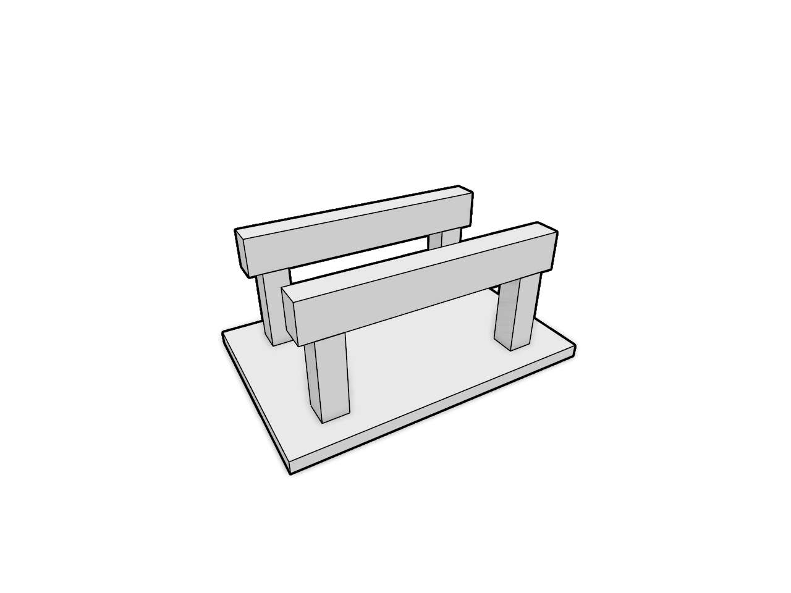

# 18.4 · Original Wood Elements and portable source records

**Goal:** Prove Element recipes source history and archives. · **Steps:** 17 · **Source:** [engine/gpu/ssao.rs](../../../../src/engine/gpu/ssao.rs) · [engine/gpu/ssao/pipelines.rs](../../../../src/engine/gpu/ssao/pipelines.rs) · [shaders/ssao.wgsl](../../../../src/shaders/ssao.wgsl) · [shaders/triangle.wgsl](../../../../src/shaders/triangle.wgsl) · [shaders/ink_visibility.wgsl](../../../../src/shaders/ink_visibility.wgsl) · [engine/gpu/surface_outline.rs](../../../../src/engine/gpu/surface_outline.rs) · [engine/gpu/render.rs](../../../../src/engine/gpu/render.rs) · [engine/performance.rs](../../../../src/engine/performance.rs) · [engine/gpu/timing.rs](../../../../src/engine/gpu/timing.rs) · [app/command/tool/elements.rs](../../../../src/app/command/tool/elements.rs) (`src/shaders/hzb.wgsl,src/shaders/ssao.wgsl,src/app/wood_elements.rs`)

<div class="webgpu-schematic" style="width:100%;margin:6px auto;">
<svg xmlns="http://www.w3.org/2000/svg" width="1120" height="188" viewBox="0 0 1120 188" style="width:100%;max-width:100%;height:auto;display:block;margin:0 auto;" role="img">
  <defs>
    <marker id="arr" viewBox="0 0 10 10" refX="8" refY="5" markerWidth="6" markerHeight="6" orient="auto">
      <path d="M 0 1 L 9 5 L 0 9 z" fill="#111111"/>
    </marker>
    <marker id="arrR" viewBox="0 0 10 10" refX="8" refY="5" markerWidth="6" markerHeight="6" orient="auto">
      <path d="M 0 1 L 9 5 L 0 9 z" fill="#dc2626"/>
    </marker>
    <marker id="arrG" viewBox="0 0 10 10" refX="8" refY="5" markerWidth="6" markerHeight="6" orient="auto">
      <path d="M 0 1 L 9 5 L 0 9 z" fill="#16a34a"/>
    </marker>
    <marker id="arrB" viewBox="0 0 10 10" refX="8" refY="5" markerWidth="6" markerHeight="6" orient="auto">
      <path d="M 0 1 L 9 5 L 0 9 z" fill="#2563eb"/>
    </marker>
  </defs>
  <rect x="2" y="2" width="1116" height="184" rx="10" fill="#ffffff" stroke="#111111" stroke-width="2"/>
  <rect x="14" y="12" width="344" height="164" rx="8" fill="#ffffff" stroke="#111111" stroke-width="1.5"/>
  <text paint-order="stroke fill" stroke="#ffffff" stroke-width="5" stroke-linejoin="round" x="186" y="30" text-anchor="middle" font-family="monospace" font-size="10.5" font-weight="700" fill="#111111">Timber Plate Polylines (Top / Bottom) + Joint Cut Loops</text>
  <polygon points="56,136 96,64 268,64 228,136" fill="#fde68a" stroke="#111111" stroke-width="2"/>
  <polygon points="142,64 186,64 174,94 130,94" fill="#ffffff" stroke="#dc2626" stroke-width="2"/>
  <circle cx="142" cy="64" r="3.5" fill="#dc2626"/>
  <circle cx="186" cy="64" r="3.5" fill="#dc2626"/>
  <line x1="358" y1="94" x2="384" y2="94" stroke="#111111" stroke-width="2" marker-end="url(#arr)"/>
  <rect x="388" y="12" width="344" height="164" rx="8" fill="#ffffff" stroke="#111111" stroke-width="1.5"/>
  <text paint-order="stroke fill" stroke="#ffffff" stroke-width="5" stroke-linejoin="round" x="560" y="30" text-anchor="middle" font-family="monospace" font-size="10.5" font-weight="700" fill="#111111">Joint Pair Graph (e_A ↔ e_B) + Insertion Vector v_ins</text>
  <rect x="432" y="76" width="98" height="48" fill="#fde68a" stroke="#111111" stroke-width="1.75"/>
  <text paint-order="stroke fill" stroke="#ffffff" stroke-width="5" stroke-linejoin="round" x="481" y="104" text-anchor="middle" font-family="monospace" font-size="10" font-weight="700" fill="#111111">Beam A</text>
  <line x1="530" y1="100" x2="588" y2="100" stroke="#dc2626" stroke-width="2.5" marker-end="url(#arrR)"/>
  <rect x="592" y="56" width="84" height="88" fill="#fcd34d" stroke="#111111" stroke-width="1.75"/>
  <text paint-order="stroke fill" stroke="#ffffff" stroke-width="5" stroke-linejoin="round" x="634" y="104" text-anchor="middle" font-family="monospace" font-size="10" font-weight="700" fill="#111111">Post B</text>
  <line x1="732" y1="94" x2="758" y2="94" stroke="#111111" stroke-width="2" marker-end="url(#arr)"/>
  <rect x="762" y="12" width="344" height="164" rx="8" fill="#ffffff" stroke="#111111" stroke-width="1.75"/>
  <text paint-order="stroke fill" stroke="#ffffff" stroke-width="5" stroke-linejoin="round" x="934" y="30" text-anchor="middle" font-family="monospace" font-size="10.5" font-weight="700" fill="#111111">Assembled Timber Frame with Highlighted Joints</text>
  <rect x="806" y="44" width="256" height="118" rx="4" fill="#ffffff" stroke="#111111" stroke-width="2"/>
  <polygon points="834,116 964,116 964,82 834,82" fill="#fde68a" stroke="#111111" stroke-width="1.75"/>
  <polygon points="948,146 998,146 998,56 948,56" fill="#fcd34d" stroke="#111111" stroke-width="1.75"/>
  <rect x="948" y="82" width="16" height="34" fill="#fef08a" stroke="#dc2626" stroke-width="2"/>
</svg>
</div>

## <a id="checkpoint-92-link-current-wood-element-builders"></a>1. Link current Wood element builders

**What this code does:** Link current Wood element builders.

### 1. `Cargo.toml`

Link current Wood element builders beside the original kernel.

**Locate this existing block:**

```toml
[dependencies]
wasm-bindgen = "=0.2.128"
```

Edit the existing block to match this code; keep unchanged lines:

```toml
[dependencies]
wood = { path = "../../../../wood/rust" }
wasm-bindgen = "=0.2.128"
```

## <a id="checkpoint-91zza-write-original-beam-column-and-plate-builders"></a>2. Write beam column and plate builders

**What this code does:** Parse positive finite lengths while retaining omitted defaults.

### 1. `src/element_values.rs`

Adapt the maintained positive-length recipe to the earlier number parser.

Create the file and type:

```rust
pub fn lengths<const N: usize>(
    rest: &[&str],
    defaults: [f64; N],
    usage: &str,
) -> Result<[f64; N], String> {
    if rest.len() > N {
        return Err(format!("Too many numbers · {usage}"));
    }

    let mut values = defaults;

    for (value, word) in values.iter_mut().zip(rest) {
        *value = word
            .parse::<f64>()
            .ok()
            .filter(|v| v.is_finite())
            .filter(|value| *value > 0.0)
            .ok_or_else(|| format!("`{word}` is not a positive length · {usage}"))?;
    }

    Ok(values)
}
```

### 2. `src/lib.rs`

Register the completed Element component.

**Locate this existing block:**

```rust
#[cfg(test)]
mod ambient_shader_contract;
pub mod finite_project_source;
#[cfg(test)]
mod finite_scan_contract;
#[cfg(test)]
mod finite_tiles_contract;
#[cfg(test)]
mod global_outline_command_tests;
pub mod source_mesh_topology;
```

Edit the existing block to match this code; keep unchanged lines:

```rust
#[cfg(test)]
mod global_outline_command_tests;

#[cfg(test)]
mod ambient_shader_contract;
pub mod element_values;
pub mod finite_project_source;
#[cfg(test)]
mod finite_scan_contract;
#[cfg(test)]
mod finite_tiles_contract;
pub mod source_mesh_topology;
```

### 3. `src/element_beam.rs`

Type the whole original helpers introduced today.

Create the file and type:

```rust
use session_rust::Polyline;
use wood::Beam;
use wood::geometry::profile_rectangle;
const USAGE: &str = "Element Beam width height · Example: select lines or polylines, then Element Beam 120 200";
pub fn build(axes: &[Polyline], width: f64, height: f64) -> Result<Vec<Beam>, String> {
    let beams: Vec<Beam> = axes
        .iter()
        .filter(|axis| axis.segment_count() >= 1)
        .map(|axis| {
            Beam::from_profile(
                axis,
                profile_rectangle(width, height),
                "beam",
            )
        })
        .collect();

    match beams.is_empty() {
        true => Err(format!(
            "Select lines or polylines, the beam axes · {USAGE}"
        )),
        false => Ok(beams),
    }
}
```

### 4. `src/lib.rs`

Register this original element builder.

**Locate this existing block:**

```rust
mod global_outline_command_tests;

#[cfg(test)]
mod ambient_shader_contract;
pub mod element_values;
pub mod finite_project_source;
```

Edit the existing block to match this code; keep unchanged lines:

```rust
mod global_outline_command_tests;

pub mod element_values;

#[cfg(test)]
mod ambient_shader_contract;
pub mod element_beam;
pub mod finite_project_source;
```

### 5. `src/element_column.rs`

Type the whole original helpers introduced today.

Create the file and type:

```rust
use session_rust::{Line, Polyline};
use wood::Column;
use wood::geometry::profile_rectangle;
const USAGE: &str =
    "Element Column width depth · Example: select lines, then Element Column 200 300";
pub fn build(axes: &[Polyline], width: f64, depth: f64) -> Result<Vec<Column>, String> {
    let columns: Vec<Column> = axes
        .iter()
        .filter_map(|axis| {
            Some(Line::from_points(
                &axis.get_point(0)?,
                &axis.get_point(axis.point_count() - 1)?,
            ))
        })
        .filter(|axis| axis.length() > 0.0)
        .map(|axis| {
            Column::from_profile(
                &axis,
                profile_rectangle(width, depth),
                0.0,
                "column",
            )
        })
        .collect();

    match columns.is_empty() {
        true => Err(format!(
            "Select lines, the column axes · {USAGE}"
        )),
        false => Ok(columns),
    }
}
```

### 6. `src/lib.rs`

Register this original element builder.

**Locate this existing block:**

```rust
pub mod element_values;

#[cfg(test)]
mod ambient_shader_contract;
pub mod element_beam;
pub mod finite_project_source;
```

Edit the existing block to match this code; keep unchanged lines:

```rust
pub mod element_values;

pub mod element_beam;

#[cfg(test)]
mod ambient_shader_contract;
pub mod element_column;
pub mod finite_project_source;
```

### 7. `src/element_plate.rs`

Type the whole original helpers introduced today.

Create the file and type:

```rust
use session_rust::Polyline;
use wood::Plate;
const USAGE: &str =
    "Element Plate thickness · Example: select closed polylines, then Element Plate 40";
pub fn build(outlines: &[Polyline], thickness: f64) -> Result<Vec<Plate>, String> {
    match outlines.is_empty() {
        true => Err(format!(
            "Select closed polylines, the plate outlines · {USAGE}"
        )),
        false => Ok(outlines
            .iter()
            .map(|outline| Plate::from_outline(outline, thickness, "plate"))
            .collect()),
    }
}
```

### 8. `src/lib.rs`

Register this original element builder.

**Locate this existing block:**

```rust
pub mod element_beam;

#[cfg(test)]
mod ambient_shader_contract;
pub mod element_column;
pub mod finite_project_source;
```

Edit the existing block to match this code; keep unchanged lines:

```rust
pub mod element_beam;

pub mod element_column;

#[cfg(test)]
mod ambient_shader_contract;
pub mod element_plate;
pub mod finite_project_source;
```

## <a id="checkpoint-92a-retain-current-positive-lengths-and-six-builders"></a>3. Write support variable beam and block builders

**What this code does:** Add the remaining original Support, Beam Variable and Block wrappers.

### 1. `src/element_support.rs`

Type the whole original helpers introduced today.

Create the file and type:

```rust
use session_rust::Plane;
use wood::Support;
const USAGE: &str =
    "Element Support · Example: select points or planes, then Element Support";
pub fn build(planes: &[Plane]) -> Result<Vec<Support>, String> {
    match planes.is_empty() {
        true => Err(format!(
            "Select points or planes, where the supports stand · {USAGE}"
        )),
        false => Ok(planes
            .iter()
            .map(|plane| Support::new(plane, "support"))
            .collect()),
    }
}
```

### 2. `src/lib.rs`

Register this original element builder.

**Locate this existing block:**

```rust
pub mod element_column;

#[cfg(test)]
mod ambient_shader_contract;
pub mod element_plate;
pub mod finite_project_source;
```

Edit the existing block to match this code; keep unchanged lines:

```rust
pub mod element_column;

pub mod element_plate;

#[cfg(test)]
mod ambient_shader_contract;
pub mod element_support;
pub mod finite_project_source;
```

### 3. `src/element_beam_variable.rs`

Type the whole original helpers introduced today.

Create the file and type:

```rust
use session_rust::Polyline;
use wood::BeamVariable;
const USAGE: &str = "Element Beam Variable · Example: pick closed polylines of one point count in station order, then Element Beam Variable";
pub fn build(sections: Vec<Polyline>) -> Result<BeamVariable, String> {
    if sections.len() < 2 {
        return Err(format!(
            "Pick at least two closed sections · {USAGE}"
        ));
    }

    if sections
        .iter()
        .any(|section| section.point_count() != sections[0].point_count())
    {
        return Err(format!(
            "Every section needs one point count · {USAGE}"
        ));
    }

    Ok(BeamVariable::through(
        sections,
        "beam_variable",
    ))
}
```

### 4. `src/lib.rs`

Register this original element builder.

**Locate this existing block:**

```rust
pub mod element_plate;

#[cfg(test)]
mod ambient_shader_contract;
pub mod element_support;
pub mod finite_project_source;
```

Edit the existing block to match this code; keep unchanged lines:

```rust
pub mod element_plate;

pub mod element_support;

#[cfg(test)]
mod ambient_shader_contract;
pub mod element_beam_variable;
pub mod finite_project_source;
```

### 5. `src/element_block.rs`

Type the whole original helpers introduced today.

Create the file and type:

```rust
use session_rust::Polyline;
use wood::Block;
const USAGE: &str = "Element Block · Example: pick a bottom and a top closed polyline of one point count, then Element Block";
pub fn build(loops: Vec<Polyline>) -> Result<Block, String> {
    if loops.len() < 2 || !loops.len().is_multiple_of(2) {
        return Err(format!(
            "Pick an even number of closed polylines · {USAGE}"
        ));
    }

    if loops
        .chunks(2)
        .any(|pair| pair[0].point_count() != pair[1].point_count())
    {
        return Err(format!(
            "A bottom and its top need one point count · {USAGE}"
        ));
    }

    Ok(Block::new(loops, "block"))
}
```

### 6. `src/lib.rs`

Register this original element builder.

**Locate this existing block:**

```rust
pub mod element_support;

#[cfg(test)]
mod ambient_shader_contract;
pub mod element_beam_variable;
pub mod finite_project_source;
```

Edit the existing block to match this code; keep unchanged lines:

```rust
pub mod element_support;

pub mod element_beam_variable;

#[cfg(test)]
mod ambient_shader_contract;
pub mod element_block;
pub mod finite_project_source;
```

## <a id="checkpoint-92b-own-original-element-geometry"></a>4. Own Element geometry

**What this code does:** Own original Element geometry.

### 1. `src/element_original.rs`

Retain the original Element beside its derived display.

Create the file and type:

```rust
use crate::scene::{ObjectId, Scene};
use session_rust::{Element, Geometry, element::ElementGeometry};
use std::rc::Rc;
pub fn insert(
    scene: &mut Scene,
    source: Rc<Element>,
) -> Result<ObjectId, &'static str> {
    let id = match source.geometry() {
        ElementGeometry::BRep(brep) => {
            let mut brep = brep.clone();
            brep.set_guid(source.guid().into());
            brep.name = source.name.clone();
            brep.is_visible = source.is_visible;
            brep.is_locked = source.is_locked;
            scene.insert_cad(Rc::new(brep))?
        }
        ElementGeometry::Mesh(mesh) => {
            let mut mesh = mesh.clone();
            mesh.set_guid(source.guid().into());
            mesh.name = source.name.clone();
            mesh.is_visible = source.is_visible;
            mesh.is_locked = source.is_locked;
            scene.insert(crate::prepared::PreparedMesh::new(mesh)?)?
        }
        ElementGeometry::None => return Err("Element has no display geometry"),
    };
    scene
        .objects_mut()
        .iter_mut()
        .find(|row| row.id == id)
        .unwrap()
        .original = Some(Geometry::Element(source));
    Ok(id)
}
```

### 2. `src/lib.rs`

Register the completed Element component.

**Locate this existing block:**

```rust
pub mod element_beam_variable;

#[cfg(test)]
mod ambient_shader_contract;
pub mod element_block;
pub mod finite_project_source;
```

Edit the existing block to match this code; keep unchanged lines:

```rust
pub mod element_beam_variable;

pub mod element_block;

#[cfg(test)]
mod ambient_shader_contract;
pub mod element_original;
pub mod finite_project_source;
```

## <a id="checkpoint-92c-read-current-element-command-defaults"></a>5. Read current Element command defaults

**What this code does:** Read current Element command defaults.

### 1. `src/element_input.rs`

Own the six current command kinds and exact defaults.

Create the file and type:

```rust
use session_rust::{Element, Geometry, Plane, Polyline};
use std::rc::Rc;
use wood::WoodElement;
#[derive(Clone, Copy, Debug, PartialEq, Eq)]
pub enum Kind {
    Beam,
    Column,
    Plate,
    Support,
    Variable,
    Block,
}
impl Kind {
    pub fn name(self) -> &'static str {
        match self {
            Self::Beam => "Element Beam",
            Self::Column => "Element Column",
            Self::Plate => "Element Plate",
            Self::Support => "Element Support",
            Self::Variable => "Element Beam Variable",
            Self::Block => "Element Block",
        }
    }
    pub fn params(self) -> Vec<Param> {
        match self {
            Self::Beam => vec![
                Param {
                    name: "Width",
                    value: 120.,
                },
                Param {
                    name: "Height",
                    value: 200.,
                },
            ],
            Self::Column => vec![
                Param {
                    name: "Width",
                    value: 200.,
                },
                Param {
                    name: "Depth",
                    value: 300.,
                },
            ],
            Self::Plate => vec![Param {
                name: "Thickness",
                value: 40.,
            }],
            _ => vec![],
        }
    }
    pub fn read(self, text: &str) -> Result<(Vec<Param>, bool), String> {
        let words = text.split_whitespace().collect::<Vec<_>>();
        let mut params = self.params();
        let count = params.len();
        let values = match self {
            Self::Beam => {
                crate::element_values::lengths(&words, [120., 200.], self.name())?
                    .to_vec()
            }
            Self::Column => {
                crate::element_values::lengths(&words, [200., 300.], self.name())?
                    .to_vec()
            }
            Self::Plate => {
                crate::element_values::lengths(&words, [40.], self.name())?.to_vec()
            }
            _ => {
                if !words.is_empty() {
                    return Err(format!("{} takes no arguments", self.name()));
                }
                vec![]
            }
        };
        for (p, v) in params.iter_mut().zip(values) {
            p.value = v;
        }
        Ok((params, count == 0 || !words.is_empty()))
    }
    pub fn fits(self, g: &Geometry) -> bool {
        match self {
            Self::Support => matches!(g, Geometry::Point(_) | Geometry::Plane(_)),
            _ => matches!(g, Geometry::Line(_) | Geometry::Polyline(_)),
        }
    }
}
#[derive(Clone, Copy, Debug, PartialEq)]
pub struct Param {
    pub name: &'static str,
    pub value: f64,
}

// No option toggles the current value; explicit On/Off never depends on the prior value.
pub fn visibility(words: &[&str]) -> Result<Option<bool>, String> {
    match words {
        [] => Ok(None),
        [word] if word.eq_ignore_ascii_case("On") => Ok(Some(true)),
        [word] if word.eq_ignore_ascii_case("Off") => Ok(Some(false)),
        _ => Err("Expected On or Off".into()),
    }
}
```

### 2. `src/lib.rs`

Register the completed Element component.

**Locate this existing block:**

```rust
pub mod element_block;

#[cfg(test)]
mod ambient_shader_contract;
pub mod element_original;
pub mod finite_project_source;
```

Edit the existing block to match this code; keep unchanged lines:

```rust
pub mod element_block;

pub mod element_original;

#[cfg(test)]
mod ambient_shader_contract;
pub mod element_input;
pub mod finite_project_source;
```

## <a id="checkpoint-92d-build-typed-elements-from-ordered-world-picks"></a>6. Build typed Elements from ordered world picks

**What this code does:** Build typed Elements from ordered world picks.

### 1. `src/element_input.rs`

Route ordered original sources into current Wood builders and base planes.

**Locate this existing block:**

```rust
}

// No option toggles the current value; explicit On/Off never depends on the prior value.
```

Edit the existing block to match this code; keep unchanged lines:

```rust
}
pub struct Made {
    pub source: Rc<Element>,
    pub plane: Option<Plane>,
}
fn items<T: WoodElement>(items: Vec<T>) -> Vec<Made> {
    items
        .into_iter()
        .map(|v| {
            let mut plane = v.base_plane();
            if let Some(p) = &mut plane {
                p.name = "base_plane".into();
                p.is_visible = false;
                p.linecolor = session_rust::Color::black();
            }
            Made {
                source: Rc::new(v.to_element()),
                plane,
            }
        })
        .collect()
}
pub fn build(
    kind: Kind,
    values: &[Param],
    sources: &[(Geometry, session_rust::Xform)],
) -> Result<Vec<Made>, String> {
    let curves = sources
        .iter()
        .filter_map(|(g, m)| match g {
            Geometry::Line(l) => {
                let l = l.transformed(m);
                Some(Polyline::new(vec![l.start(), l.end()]))
            }
            Geometry::Polyline(p) => Some(p.transformed(m)),
            _ => None,
        })
        .collect::<Vec<_>>();
    let loops = curves
        .iter()
        .filter(|p| p.is_closed() && p.point_count() >= 4)
        .cloned()
        .collect::<Vec<_>>();
    Ok(match kind {
        Kind::Beam => items(crate::element_beam::build(
            &curves,
            values[0].value,
            values[1].value,
        )?),
        Kind::Column => items(crate::element_column::build(
            &curves,
            values[0].value,
            values[1].value,
        )?),
        Kind::Plate => items(crate::element_plate::build(
            &loops,
            values[0].value,
        )?),
        Kind::Variable => items(vec![crate::element_beam_variable::build(
            loops,
        )?]),
        Kind::Block => items(vec![crate::element_block::build(loops)?]),
        Kind::Support => {
            let planes = sources
                .iter()
                .filter_map(|(g, m)| match g {
                    Geometry::Point(p) => Some(Plane::new(
                        p.transformed(m),
                        session_rust::Vector::x_axis(),
                        session_rust::Vector::y_axis(),
                    )),
                    Geometry::Plane(p) => Some(p.transformed(m)),
                    _ => None,
                })
                .collect::<Vec<_>>();
            items(crate::element_support::build(&planes)?)
        }
    })
}

// No option toggles the current value; explicit On/Off never depends on the prior value.
```

## <a id="checkpoint-92e-capture-original-picks-while-the-tool-runs"></a>7. Capture picks while the tool runs

**What this code does:** Capture original picks while the tool runs.

### 1. `src/element_draft.rs`

Capture fitting original sources and ordered tool state.

Create the file and type:

```rust
use crate::{
    element_input::{Kind, Made, Param},
    scene::{ObjectId, Scene},
};
#[derive(Clone)]
pub struct Draft {
    pub kind: Kind,
    pub params: Vec<Param>,
    pub picked: Vec<crate::source_edit::Owner>,
    pub asking: Option<usize>,
    pub next: usize,
}
impl Draft {
    pub fn new(
        kind: Kind,
        text: &str,
        scene: &Scene,
        ids: Vec<ObjectId>,
    ) -> Result<(Self, bool), String> {
        let (params, typed) = kind.read(text)?;
        let mut result = Self {
            kind,
            params,
            picked: vec![],
            asking: None,
            next: 0,
        };
        for id in ids {
            if let Ok(owner) = crate::source_edit::Owner::capture(scene, id) {
                if kind.fits(&owner.source) {
                    result.picked.push(owner);
                }
            }
        }
        Ok((result, typed))
    }
    pub fn ids(&self) -> Vec<ObjectId> {
        self.picked.iter().map(|o| o.id).collect()
    }
    pub fn pick(&mut self, scene: &Scene, id: Option<ObjectId>) -> Result<(), String> {
        let id = id.ok_or("Nothing there: pick an original source")?;
        if let Some(i) = self.picked.iter().position(|o| o.id == id) {
            self.picked.remove(i);
            return Ok(());
        }
        let owner =
            crate::source_edit::Owner::capture(scene, id).map_err(str::to_owned)?;
        if !self.kind.fits(&owner.source) {
            return Err(format!(
                "{}: pick fitting original sources",
                self.kind.name()
            ));
        }
        self.picked.push(owner);
        Ok(())
    }
    pub fn valid(&self, scene: &Scene) -> Result<(), String> {
        for o in &self.picked {
            o.valid(scene).map_err(str::to_owned)?;
        }
        Ok(())
    }
    pub fn build(&self, scene: &Scene) -> Result<Vec<Made>, String> {
        self.valid(scene)?;
        crate::element_input::build(
            self.kind,
            &self.params,
            &self
                .picked
                .iter()
                .map(|o| (o.source.clone(), o.model.clone()))
                .collect::<Vec<_>>(),
        )
    }

    pub fn values(&self) -> String {
        self.params
            .iter()
            .map(|p| format!("{} {}", p.name, p.value))
            .collect::<Vec<_>>()
            .join(" · ")
    }
    pub fn prompt(&self) -> String {
        if let Some(i) = self.asking {
            format!(
                "{} <{}>: type a number · Enter keeps it",
                self.params[i].name, self.params[i].value
            )
        } else {
            format!(
                "{} · pick original sources ({} picked) · Enter creates · Esc cancels",
                self.kind.name(),
                self.picked.len()
            )
        }
    }
    pub fn buttons(&self) -> Vec<(String, String)> {
        self.params
            .iter()
            .map(|p| {
                (
                    format!("{}={}", p.name, p.value),
                    p.name.into(),
                )
            })
            .chain([
                ("Create".into(), "".into()),
                ("Cancel".into(), "Escape".into()),
            ])
            .collect()
    }
}
```

### 2. `src/lib.rs`

Register the completed Element component.

**Locate this existing block:**

```rust
pub mod element_original;

#[cfg(test)]
mod ambient_shader_contract;
pub mod element_input;
pub mod finite_project_source;
```

Edit the existing block to match this code; keep unchanged lines:

```rust
pub mod element_original;

pub mod element_input;

#[cfg(test)]
mod ambient_shader_contract;
pub mod element_draft;
pub mod finite_project_source;
```

## <a id="checkpoint-92f-teach-named-and-bare-element-values"></a>8. Teach named and bare Element values

**What this code does:** Teach named and bare Element values.

### 1. `src/element_draft.rs`

Adapt the maintained Element parameter word recipe without changing its semantics.

**Locate this existing block:**

```rust
    }
}
```

Edit the existing block to match this code; keep unchanged lines:

```rust
    }
    pub fn take(&mut self, word: &str) -> Result<(), String> {
        let (name, number) = match word.split_once('=') {
            Some((name, number)) => (Some(name), Some(number)),
            None if word
                .parse::<f64>()
                .ok()
                .filter(|v| v.is_finite())
                .is_some() =>
            {
                (None, Some(word))
            }
            None => (Some(word), None),
        };

        if let Some(name) = name {
            let at = self
                .params
                .iter()
                .position(|param| param.name.eq_ignore_ascii_case(name))
                .ok_or_else(|| {
                    format!(
                        "`{word}` is not a value of {} · {}",
                        self.kind.name(),
                        self.values()
                    )
                })?;
            self.asking = Some(at);
        }

        let Some(number) = number else {
            return Ok(());
        };
        let value = number
            .parse::<f64>()
            .ok()
            .filter(|v| v.is_finite())
            .filter(|value| *value > 0.0)
            .ok_or_else(|| format!("`{number}` is not a positive length"))?;

        if self.params.is_empty() {
            return Err(format!(
                "{} takes no values · pick {}",
                self.kind.name(),
                "fitting original sources"
            ));
        }

        let at = self
            .asking
            .take()
            .unwrap_or(self.next % self.params.len());
        self.params[at].value = value;
        self.next = at + 1;
        Ok(())
    }
}
```

## <a id="checkpoint-92g-make-element-input-batches-atomic"></a>9. Make Element input batches atomic

**What this code does:** Make Element input batches atomic.

### 1. `src/element_draft.rs`

Adopt only validated current parameter batches.

**Locate this existing block:**

```rust
    }

    pub fn values(&self) -> String {
```

Edit the existing block to match this code; keep unchanged lines:

```rust
    }
    pub fn text(&mut self, text: &str) -> Result<bool, String> {
        let mut next = self.clone();
        if text.trim().is_empty() {
            if next.asking.take().is_none() {
                return Ok(true);
            }
        } else {
            for word in text.split_whitespace() {
                next.take(word)?;
            }
        }
        *self = next;
        Ok(false)
    }
    pub fn values(&self) -> String {
```

## <a id="checkpoint-92h-attach-readonly-element-attributes"></a>10. Attach readonly Element attributes

**What this code does:** Attach readonly Element attributes.

### 1. `src/layer_edit.rs`

Attach generated original attributes under their Element owner.

**Locate this existing block:**

```rust
    Ok(name)
}
```

Edit the existing block to match this code; keep unchanged lines:

```rust
    Ok(name)
}

pub fn attach_attributes(
    scene: &mut Scene,
    parent: crate::scene::ObjectId,
    ids: Vec<crate::scene::ObjectId>,
    name: &str,
) -> Result<(), &'static str> {
    let (owner, index) = scene
        .forest
        .documents
        .iter()
        .enumerate()
        .find_map(|(i, d)| {
            d.nodes
                .iter()
                .position(|n| n.object == Some(parent))
                .map(|n| (i, n))
        })
        .ok_or("Element hierarchy owner is missing")?;
    let doc = &scene.forest.documents[owner];
    let guid = doc.nodes[index].source.guid.clone();
    let mut root = branch(doc, 0);
    let mut children = Vec::new();
    for id in ids {
        let mut child =
            take(&mut root, id).ok_or("Element attribute must share its document")?;
        child.node.readonly = true;
        children.push(child);
    }
    let parent = find(&mut root, &guid).ok_or("Element hierarchy owner is missing")?;
    let mut node = parent.node.clone();
    node.object = None;
    node.readonly = true;
    node.label = name.into();
    node.source = session_rust::proto::TreeNode {
        guid: uuid::Uuid::new_v4().to_string(),
        name: name.into(),
        ..Default::default()
    };
    node.portable_guid = node.source.guid.clone();
    node.placement = Default::default();
    parent
        .children
        .push(Branch { node, children });
    let mut count = 0;
    let mut max = 0;
    fn size(b: &Branch, depth: usize, count: &mut usize, max: &mut usize) {
        *count += 1;
        *max = (*max).max(depth);
        for c in &b.children {
            size(c, depth + 1, count, max)
        }
    }
    size(&root, 0, &mut count, &mut max);
    if count > crate::hierarchy::MAX_NODES || max > crate::hierarchy::MAX_DEPTH {
        return Err("Element attributes exceed hierarchy limits");
    }
    replace(scene, owner, root);
    Ok(())
}
```

## <a id="checkpoint-92i-adopt-elements-and-consume-sources-once"></a>11. Adopt Elements and consume sources once

**What this code does:** Adopt Elements and consume sources once.

### 1. `src/element_adopt.rs`

Adopt original Element payloads and readonly attributes as one edit.

Create the file and type:

```rust
use crate::element_input::Made;
use crate::scene::{ObjectId, Scene};
use std::rc::Rc;

pub fn adopt(
    scene: &mut Scene,
    made: Vec<Made>,
    consumed: &[ObjectId],
) -> Result<Vec<ObjectId>, &'static str> {
    let mut ids = Vec::new();
    for item in made {
        let id = crate::element_original::insert(scene, item.source.clone())?;
        ids.push(id);
        let mut attributes = Vec::new();
        let mut interactions = Vec::new();
        if let Some(plane) = item.plane {
            attributes.push(crate::plane_original::insert(
                scene,
                Rc::new(plane),
            )?);
        }
        // Own axes and sections are attributes; contact, joint, cut and drill geometry comes from interactions.
        for feature in &item.source.features {
            let interaction = matches!(
                feature.feature_type.as_str(),
                "contact" | "joint" | "cut" | "drill"
            );
            for outline in &feature.outlines {
                let mut source = outline.clone();
                source.set_guid(uuid::Uuid::new_v4().to_string());
                source.name = format!("{} {}", feature.feature_type, feature.name);
                let piece = scene.insert_path(
                    crate::chain::PreparedChain::polyline(Rc::new(source))?,
                )?;
                if interaction {
                    interactions.push(piece);
                } else {
                    attributes.push(piece);
                }
            }
        }
        if !attributes.is_empty() {
            Rc::make_mut(&mut scene.view).hide(&attributes, true);
            crate::layer_edit::attach_attributes(scene, id, attributes, "attributes")?;
        }
        if !interactions.is_empty() {
            crate::layer_edit::attach_attributes(
                scene,
                id,
                interactions,
                "interactions",
            )?;
        }
    }
    for id in scene.with_descendants(consumed) {
        scene.remove(id);
    }
    Ok(ids)
}

fn group_ids(scene: &Scene, name: &str) -> Vec<ObjectId> {
    scene
        .forest
        .documents
        .iter()
        .flat_map(|doc| {
            doc.nodes
                .iter()
                .enumerate()
                .filter(move |(_, node)| node.source.name == name && node.readonly)
                .flat_map(|(index, node)| {
                    doc.nodes[index + 1..node.end]
                        .iter()
                        .filter_map(|node| node.object)
                })
        })
        .collect()
}
pub fn attribute_ids(scene: &Scene) -> Vec<ObjectId> {
    group_ids(scene, "attributes")
}
pub fn interaction_ids(scene: &Scene) -> Vec<ObjectId> {
    group_ids(scene, "interactions")
}
```

### 2. `src/lib.rs`

Register the completed Element component.

**Locate this existing block:**

```rust
pub mod element_input;

#[cfg(test)]
mod ambient_shader_contract;
pub mod element_draft;
pub mod finite_project_source;
```

Edit the existing block to match this code; keep unchanged lines:

```rust
pub mod element_input;

pub mod element_draft;

#[cfg(test)]
mod ambient_shader_contract;
pub mod element_adopt;
pub mod finite_project_source;
```

### 3. `src/source_edit.rs`

Validate captured original Element identity by shared source ownership.

**Locate this existing block:**

```rust
        (Geometry::PointCloud(a), Geometry::PointCloud(b)) => Rc::ptr_eq(a, b),
        (Geometry::Plane(a), Geometry::Plane(b)) => Rc::ptr_eq(a, b),
```

Edit the existing block to match this code; keep unchanged lines:

```rust
        (Geometry::PointCloud(a), Geometry::PointCloud(b)) => Rc::ptr_eq(a, b),
        (Geometry::Element(a), Geometry::Element(b)) => Rc::ptr_eq(a, b),
        (Geometry::Plane(a), Geometry::Plane(b)) => Rc::ptr_eq(a, b),
```

## <a id="checkpoint-92j-save-and-open-original-element-records"></a>12. Save and open Element records

**What this code does:** Save and open original Element records.

### 1. `src/geometry_snapshot.rs`

Route original Element records through mixed-document archives.

**Locate this existing block:**

```rust
    {
        if let Some(session_rust::Geometry::Plane(source)) = &row.original {
            push!(planes, row.id, source.to_proto());
```

Edit the existing block to match this code; keep unchanged lines:

```rust
    {
        if let Some(session_rust::Geometry::Element(source)) = &row.original {
            push!(elements, row.id, source.to_proto());
        } else if let Some(session_rust::Geometry::Plane(source)) = &row.original {
            push!(planes, row.id, source.to_proto());
```

### 2. `src/archive_identity.rs`

Route original Element records through mixed-document archives.

**Locate this existing block:**

```rust
    }
    remap!(planes);
```

Edit the existing block to match this code; keep unchanged lines:

```rust
    }
    remap!(elements);
    remap!(planes);
```

### 3. `src/document_source.rs`

Route original Element records through mixed-document archives.

Edit these blocks from bottom to top. Keep the surrounding lines unchanged.

**Locate this block:**

```rust
        .objects
        .as_ref()
        .ok_or("Session has no objects")?;
    if !objects.elements.is_empty() || !objects.components.is_empty() {
        return Err("This subject cannot open assemblies yet".into());
```

Replace it with:

```rust
        .objects
        .as_ref()
        .ok_or("Session has no objects")?;
    if !objects.components.is_empty() {
        return Err("This subject cannot open assemblies yet".into());
```

**Locate this block:**

```rust
    }
    identity!(planes);
    identity!(bboxes);
    identity!(meshes);
```

Replace it with:

```rust
    }
    identity!(elements);
    identity!(planes);
    identity!(bboxes);
    identity!(meshes);
```

### 4. `src/document_geometry.rs`

Route original Element records through mixed-document archives.

**Locate this existing block:**

```rust
    }
    for source in &loaded.document.objects.meshes {
```

Edit the existing block to match this code; keep unchanged lines:

```rust
    }
    for source in &loaded.document.objects.elements {
        add!(
            source,
            crate::element_original::insert(scene, source.clone())
        );
    }
    for source in &loaded.document.objects.meshes {
```

## <a id="checkpoint-92k-own-independent-element-tool-state"></a>13. Own independent Element tool state

**What this code does:** Own independent Element tool state.

### 1. `src/editor.rs`

Own Element draft state and cleanup before routing its commands.

Edit these blocks from bottom to top. Keep the surrounding lines unchanged.

**Locate this block:**

```rust
                return self.update_edit_preview();
            }
            Action::CancelTool => {
                if let Some(before) = self
```

Replace it with:

```rust
                return self.update_edit_preview();
            }
            Action::CancelTool => {
                self.element = None;
                if let Some(before) = self
```

**Locate this block:**

```rust
            }
            Action::Arrowhead(head) => return self.curve_heads(head),
            Action::Escape => {
                if self.draft.is_some()
                    || self.split.is_some()
                    || self.gizmo_edit.is_some()
                {
```

Replace it with:

```rust
            }
            Action::Arrowhead(head) => return self.curve_heads(head),
            Action::Escape => {
                if self.element.is_some()
                    || self.draft.is_some()
                    || self.split.is_some()
                    || self.gizmo_edit.is_some()
                {
```

**Locate this block:**

```rust
        self.transform_outcome(next, outcome)
    }
    pub fn highlighted_objects(&self) -> Vec<ObjectId> {
        if let Some(trim) = &self.trim {
            return if trim.phase == crate::trim_draft::Phase::Parts {
                Vec::new()
```

Replace it with:

```rust
        self.transform_outcome(next, outcome)
    }
    pub fn highlighted_objects(&self) -> Vec<ObjectId> {
        if let Some(e) = &self.element {
            return e.ids();
        }
        if let Some(trim) = &self.trim {
            return if trim.phase == crate::trim_draft::Phase::Parts {
                Vec::new()
```

**Locate this block:**

```rust
impl Default for Editor {
    fn default() -> Self {
        Self {
            arctic: false,
            outlines: false,
            clipping_enabled: true,
```

Replace it with:

```rust
impl Default for Editor {
    fn default() -> Self {
        Self {
            element: None,
            element_attributes: false,
            element_interactions: true,
            arctic: false,
            outlines: false,
            clipping_enabled: true,
```

**Locate this block:**

```rust
pub struct Editor {
    pub arctic: bool,
    pub outlines: bool,
    pub clipping_enabled: bool,
```

Replace it with:

```rust
pub struct Editor {
    pub element: Option<crate::element_draft::Draft>,
    pub element_attributes: bool,
    pub element_interactions: bool,
    pub arctic: bool,
    pub outlines: bool,
    pub clipping_enabled: bool,
```

## <a id="checkpoint-92l-commit-one-element-creation-and-retry-errors"></a>14. Commit one Element creation and retry errors

**What this code does:** Commit one Element creation and retry errors.

### 1. `src/editor.rs`

Connect staged Element creation, named input and ordered picks.

**Locate this existing block:**

```rust
    }

    pub fn apply(&mut self, action: Action) -> Result<Change, &'static str> {
```

Edit the existing block to match this code; keep unchanged lines:

```rust
    }

    fn element_commit(
        &mut self,
        next: crate::element_draft::Draft,
    ) -> Result<Change, &'static str> {
        let made = next
            .build(&self.scene)
            .map_err(|m| self.primitive_failure(m))?;
        let consumed = next.ids();
        let mut ids = Vec::new();
        let show = self.element_attributes;
        let interactions = self.element_interactions;
        self.history
            .try_edit(&mut self.scene, |scene| {
                ids = crate::element_adopt::adopt(scene, made, &consumed)?;
                let features = crate::element_adopt::attribute_ids(scene);
                std::rc::Rc::make_mut(&mut scene.view).hide(&features, !show);
                let ids = crate::element_adopt::interaction_ids(scene);
                std::rc::Rc::make_mut(&mut scene.view).hide(&ids, !interactions);
                Ok(())
            })?;
        self.element = None;
        self.select_objects(ids, false);
        self.snap_index = None;
        self.tool_status = format!(
            "Created {} from its sources · Undo restores them",
            next.kind.name()
        );
        Ok(Change::Scene)
    }
    fn element_begin(
        &mut self,
        kind: crate::element_input::Kind,
        text: &str,
    ) -> Result<Change, &'static str> {
        let (next, typed) = crate::element_draft::Draft::new(
            kind,
            text,
            &self.scene,
            self.selected_objects(),
        )
        .map_err(|m| self.primitive_failure(m))?;
        self.apply(Action::CancelTool)?;
        if typed && !next.picked.is_empty() {
            return self.element_commit(next);
        }
        self.select_objects([], false);
        self.tool_status = next.prompt();
        self.element = Some(next);
        Ok(Change::View)
    }
    fn element_text(&mut self, text: &str) -> Result<Change, &'static str> {
        let mut next = self
            .element
            .clone()
            .ok_or("Start an Element tool first")?;
        next.valid(&self.scene)
            .map_err(|m| self.primitive_failure(m))?;
        let finish = next
            .text(text)
            .map_err(|m| self.primitive_failure(m))?;
        if finish {
            return self.element_commit(next);
        }
        self.tool_status = next.prompt();
        self.element = Some(next);
        Ok(Change::View)
    }
    fn element_pick(&mut self, id: Option<ObjectId>) -> Result<Change, &'static str> {
        let mut next = self
            .element
            .clone()
            .ok_or("Start an Element tool first")?;
        next.valid(&self.scene)
            .map_err(|m| self.primitive_failure(m))?;
        next.pick(&self.scene, id)
            .map_err(|m| self.primitive_failure(m))?;
        self.tool_status = next.prompt();
        self.element = Some(next);
        Ok(Change::View)
    }
    pub fn apply(&mut self, action: Action) -> Result<Change, &'static str> {
```

## <a id="checkpoint-92m-route-current-element-commands-and-feature-visibility"></a>15. Route Element commands and independent visibility

**What this code does:** Toggle Element Attributes and Element Interactions independently.

### 1. `src/editor.rs`

Route Element actions and current feature presentation.

Edit these blocks from bottom to top. Keep the surrounding lines unchanged.

**Locate this block:**

```rust
            self.split = None;
        }
        match action {
            Action::ViewOutline(_) => {
```

Replace it with:

```rust
            self.split = None;
        }
        match action {
            Action::ElementBegin { kind, text } => {
                return self.element_begin(kind, &text);
            }
            Action::ElementText(text) => return self.element_text(&text),
            Action::ElementPick(id) => return self.element_pick(id),
            Action::ElementAttributes(on) | Action::ElementInteractions(on) => {
                let (shown, ids, label) =
                    if matches!(action, Action::ElementInteractions(_)) {
                        (
                            &mut self.element_interactions,
                            crate::element_adopt::interaction_ids(&self.scene),
                            "Interactions",
                        )
                    } else {
                        (
                            &mut self.element_attributes,
                            crate::element_adopt::attribute_ids(&self.scene),
                            "Attributes",
                        )
                    };
                *shown = on.unwrap_or(!*shown);
                std::rc::Rc::make_mut(&mut self.scene.view).hide(&ids, !*shown);
                self.tool_status = format!(
                    "Element {label} {}",
                    if *shown {
                        "On"
                    } else {
                        "Off"
                    }
                );
                return Ok(Change::Scene);
            }
            Action::ViewOutline(_) => {
```

**Locate this block:**

```rust
        })
    }
    pub fn tool_line(&self, text: &str) -> Option<Result<Action, &'static str>> {
        if self
            .draft
            .as_ref()
```

Replace it with:

```rust
        })
    }
    pub fn tool_line(&self, text: &str) -> Option<Result<Action, &'static str>> {
        if self.element.is_some() {
            return Some(Ok(
                if text.trim().eq_ignore_ascii_case("Escape") {
                    Action::CancelTool
                } else {
                    Action::ElementText(text.into())
                },
            ));
        }
        if self
            .draft
            .as_ref()
```

**Locate this block:**

```rust
pub enum Action {
    Arctic(Option<bool>),
    ViewOutline(Option<bool>),
    Clipping(crate::clipping_input::Request),
```

Replace it with:

```rust
pub enum Action {
    ElementBegin {
        kind: crate::element_input::Kind,
        text: String,
    },
    ElementText(String),
    ElementPick(Option<ObjectId>),
    ElementAttributes(Option<bool>),
    ElementInteractions(Option<bool>),
    Arctic(Option<bool>),
    ViewOutline(Option<bool>),
    Clipping(crate::clipping_input::Request),
```

### 2. `src/commands.rs`

Register current Element commands and strict argument parsing.

Edit these blocks from bottom to top. Keep the surrounding lines unchanged.

**Locate this block:**

```rust
    {
        return Ok(Command::Editor(action));
    }
```

Replace it with:

```rust
    {
        return Ok(Command::Editor(action));
    }
    if let Some(kind) = [
        (
            "Element Beam",
            crate::element_input::Kind::Beam,
        ),
        (
            "Element Column",
            crate::element_input::Kind::Column,
        ),
        (
            "Element Plate",
            crate::element_input::Kind::Plate,
        ),
        (
            "Element Support",
            crate::element_input::Kind::Support,
        ),
        (
            "Element Beam Variable",
            crate::element_input::Kind::Variable,
        ),
        (
            "Element Block",
            crate::element_input::Kind::Block,
        ),
    ]
    .into_iter()
    .find_map(|(n, k)| (n == name).then_some(k))
    {
        let text = words[count..].join(" ");
        kind.read(&text)?;
        return Ok(Command::Editor(Action::ElementBegin {
            kind,
            text,
        }));
    }
    if matches!(
        name,
        "Element Attributes" | "Element Interactions"
    ) {
        let on = crate::element_input::visibility(&words[count..])?;
        return Ok(Command::Editor(
            if name == "Element Attributes" {
                Action::ElementAttributes(on)
            } else {
                Action::ElementInteractions(on)
            },
        ));
    }
```

**Locate this block:**

```rust
pub const ACTIONS: &[(&str, Factory)] = &[
    ("View Outline", || Action::ViewOutline(None)),
    ("Arctic", || Action::Arctic(None)),
    ("Select By Name", || {
```

Replace it with:

```rust
pub const ACTIONS: &[(&str, Factory)] = &[
    ("Element Beam Variable", || {
        Action::ElementBegin {
            kind: crate::element_input::Kind::Variable,
            text: String::new(),
        }
    }),
    ("Element Beam", || Action::ElementBegin {
        kind: crate::element_input::Kind::Beam,
        text: String::new(),
    }),
    ("Element Column", || Action::ElementBegin {
        kind: crate::element_input::Kind::Column,
        text: String::new(),
    }),
    ("Element Plate", || Action::ElementBegin {
        kind: crate::element_input::Kind::Plate,
        text: String::new(),
    }),
    ("Element Support", || Action::ElementBegin {
        kind: crate::element_input::Kind::Support,
        text: String::new(),
    }),
    ("Element Block", || Action::ElementBegin {
        kind: crate::element_input::Kind::Block,
        text: String::new(),
    }),
    ("Element Attributes", || {
        Action::ElementAttributes(None)
    }),
    ("Element Interactions", || {
        Action::ElementInteractions(None)
    }),
    ("View Outline", || Action::ViewOutline(None)),
    ("Arctic", || Action::Arctic(None)),
    ("Select By Name", || {
```

## <a id="checkpoint-92n-pick-elements-through-the-real-command-dock"></a>16. Pick Elements through the real command dock

**What this code does:** Pick Elements through the real command dock.

### 1. `src/browser.rs`

Route actual browser original picks, command results and Element parameter controls.

Edit these blocks from bottom to top. Keep the surrounding lines unchanged.

**Locate this block:**

```rust
                panel.result(error);
            }
            renderer.set_pick_mode(
                if editor.trimming_picks()
                    || editor.split.is_some()
```

Replace it with:

```rust
                panel.result(error);
            }
            renderer.set_pick_mode(
                if editor.element.is_some()
                    || editor.trimming_picks()
                    || editor.split.is_some()
```

**Locate this block:**

```rust
                    }
                }
            }
            if editor.plane_menu {
                panel.tool(
                    editor.tool_status.clone(),
                    crate::drawing_input::buttons(),
```

Replace it with:

```rust
                    }
                }
            }
            if let Some(element) = &editor.element {
                panel.tool(element.prompt(), element.buttons());
            } else if editor.plane_menu {
                panel.tool(
                    editor.tool_status.clone(),
                    crate::drawing_input::buttons(),
```

**Locate this block:**

```rust
                );
                let tool_action = matches!(
                    &action,
                    Action::AddGroup(_)
                        | Action::AddEdge
                        | Action::SelectLasso
                        | Action::LassoRelease { .. }
```

Replace it with:

```rust
                );
                let tool_action = matches!(
                    &action,
                    Action::ElementBegin { .. }
                        | Action::ElementText(_)
                        | Action::ElementPick(_)
                        | Action::ElementAttributes(_)
                        | Action::AddGroup(_)
                        | Action::AddEdge
                        | Action::SelectLasso
                        | Action::LassoRelease { .. }
```

**Locate this block:**

```rust
                                            size: [r.width(), r.height()],
                                            commit: true,
                                        });
                                    } else if editor.trimming_picks()
                                        || editor.split.is_some()
                                        || editor.editing_boundaries()
                                        || editor.gathering_curves()
```

Replace it with:

```rust
                                            size: [r.width(), r.height()],
                                            commit: true,
                                        });
                                    } else if editor.element.is_some()
                                        || editor.trimming_picks()
                                        || editor.split.is_some()
                                        || editor.editing_boundaries()
                                        || editor.gathering_curves()
```

**Locate this block:**

```rust
                        })
                    }
                    Some(Action::Pick(screen))
                        if editor.trimming_picks()
                            || editor.split.is_some()
                            || editor.editing_boundaries()
                            || editor.gathering_curves() =>
```

Replace it with:

```rust
                        })
                    }
                    Some(Action::Pick(screen))
                        if editor.element.is_some()
                            || editor.trimming_picks()
                            || editor.split.is_some()
                            || editor.editing_boundaries()
                            || editor.gathering_curves() =>
```

**Locate this block:**

```rust
                            .and_then(|hit| renderer.resolve_pick(&editor.scene, hit));
                        if editor.trimming_picks() {
                            Some(Action::TrimPick(target.map(|t| t.owner)))
                        } else if editor.split.is_some() {
                            Some(Action::SplitPick(target.map(|t| t.owner)))
```

Replace it with:

```rust
                            .and_then(|hit| renderer.resolve_pick(&editor.scene, hit));
                        if editor.element.is_some() {
                            Some(Action::ElementPick(target.map(|t| t.owner)))
                        } else if editor.trimming_picks() {
                            Some(Action::TrimPick(target.map(|t| t.owner)))
                        } else if editor.split.is_some() {
                            Some(Action::SplitPick(target.map(|t| t.owner)))
```

## <a id="checkpoint-92o-prove-element-recipes-source-history-and-archives"></a>17. Prove Element recipes source history and archives

**What this code does:** Prove Element recipes source history and archives.

### 1. `src/element_tests.rs`

Copy supplied original Element adapter and archive fixtures.

Create the file and type:

```rust
use crate::{
    editor::{Action, Editor},
    scene::Scene,
};
use session_rust::{Geometry, Point, Polyline};
use std::rc::Rc;
use wood::WoodElement;
pub fn square(side: f64, z: f64) -> Polyline {
    let corners = [
        (0.0, 0.0),
        (side, 0.0),
        (side, side),
        (0.0, side),
        (0.0, 0.0),
    ];
    Polyline::new(
        corners
            .iter()
            .map(|&(x, y)| Point::new(x, y, z))
            .collect(),
    )
}

fn command(e: &mut Editor, text: &str) -> Result<crate::editor::Change, &'static str> {
    let action = if let Some(a) = e.tool_line(text) {
        a?
    } else {
        let crate::commands::Command::Editor(a) =
            crate::commands::parse(text).map_err(|_| "Invalid command")?
        else {
            return Err("Editor command");
        };
        a
    };
    e.apply(action)
}
fn line(e: &mut Editor) -> crate::scene::ObjectId {
    let source = Rc::new(session_rust::Line::new(
        0., 0., 0., 1000., 0., 0.,
    ));
    e.scene
        .insert_line(crate::stroke::PreparedLine::new(source).unwrap())
        .unwrap()
}
fn original(e: &Editor) -> Rc<session_rust::Element> {
    e.scene
        .objects()
        .iter()
        .find_map(|r| {
            if let Some(Geometry::Element(v)) = &r.original {
                Some(v.clone())
            } else {
                None
            }
        })
        .unwrap()
}
#[test]
fn element_current_defaults_named_values_and_atomic_input_are_preserved() {
    let mut e = Editor::default();
    e.apply(Action::Close).unwrap();
    let id = line(&mut e);
    e.select_objects([id], false);
    command(&mut e, "Element Beam").unwrap();
    let draft = e.element.as_ref().unwrap();
    assert_eq!(
        draft
            .params
            .iter()
            .map(|p| p.value)
            .collect::<Vec<_>>(),
        [120., 200.]
    );
    assert_eq!(draft.ids(), [id]);
    command(&mut e, "Width").unwrap();
    command(&mut e, "").unwrap();
    assert!(e.element.is_some());
    command(&mut e, "Width=100 Height=150").unwrap();
    let before = e.element.as_ref().unwrap().params.clone();
    assert!(command(&mut e, "Width=99 Height=-1").is_err());
    assert_eq!(e.element.as_ref().unwrap().params, before);
    command(&mut e, "").unwrap();
    assert!(e.element.is_none());
    let source = original(&e);
    let beam = wood::Beam::from_element(&source).unwrap();
    assert!((beam.solid().volume().abs() - 1000. * 100. * 150.).abs() < 1e-6);
    assert!(!e.scene.contains(id));
}
#[test]
fn element_world_placements_consumed_sources_and_one_history_step_roundtrip() {
    let mut e = Editor::default();
    e.apply(Action::Close).unwrap();
    let id = line(&mut e);
    e.scene
        .place_line(
            id,
            session_rust::Xform::translation(0.125, 2., 3.),
        )
        .unwrap();
    let source = crate::source_edit::original(&e.scene, id).unwrap();
    let Geometry::Line(before) = source else {
        unreachable!()
    };
    let before_proto = before.to_proto();
    e.select_objects([id], false);
    command(&mut e, "Element Beam 100 200").unwrap();
    let made = original(&e);
    let _ = made.guid();
    let made_proto = made.to_proto();
    let beam = wood::Beam::from_element(&made).unwrap();
    assert_eq!(
        beam.axis.get_point(0).unwrap(),
        Point::new(0.125, 2., 3.)
    );
    assert!(!e.scene.contains(id));
    let parent = e.selected_objects()[0];
    let attrs = e.scene.with_descendants(&[parent]);
    assert!(attrs.len() > 2);
    assert!(
        attrs
            .iter()
            .filter(|id| **id != parent)
            .all(|id| e.scene.forest.readonly(*id))
    );
    e.apply(Action::Undo).unwrap();
    assert!(e.scene.contains(id));
    assert_eq!(before.to_proto(), before_proto);
    assert!(
        e.scene
            .objects()
            .iter()
            .all(|r| !matches!(r.original, Some(Geometry::Element(_))))
    );
    e.apply(Action::Redo).unwrap();
    assert!(Rc::ptr_eq(&original(&e), &made));
    assert_eq!(made.to_proto(), made_proto);
    let saved = crate::scene_archive::save(&e.scene).unwrap();
    let mut restored = Scene::empty();
    crate::scene_document::open(&mut restored, &saved).unwrap();
    let elem = restored
        .objects()
        .iter()
        .find_map(|r| {
            if let Some(Geometry::Element(v)) = &r.original {
                Some(v)
            } else {
                None
            }
        })
        .unwrap();
    assert_eq!(elem.to_proto(), made_proto);
    let parent = restored
        .objects()
        .iter()
        .find(|r| matches!(r.original, Some(Geometry::Element(_))))
        .unwrap()
        .id;
    assert!(restored.with_descendants(&[parent]).len() > 2);
    let child = restored.with_descendants(&[parent])[1];
    assert!(restored.forest.readonly(child));
    assert!(
        restored
            .place_owner(child, session_rust::Xform::identity())
            .is_err()
    );
}
#[test]
fn element_picked_stale_source_rejects_creation_without_consumption() {
    let mut e = Editor::default();
    e.apply(Action::Close).unwrap();
    let id = line(&mut e);
    command(&mut e, "Element Beam").unwrap();
    e.apply(Action::ElementPick(Some(id)))
        .unwrap();
    e.scene
        .place_line(
            id,
            session_rust::Xform::translation(1., 0., 0.),
        )
        .unwrap();
    assert!(command(&mut e, "").is_err());
    assert!(e.scene.contains(id));
    assert!(e.element.is_some());
    assert!(e.scene.objects().is_empty());
    command(&mut e, "Escape").unwrap();
    assert!(e.element.is_none());
}
#[test]
fn element_attributes_toggle_follows_parent_and_preserves_original_payload() {
    let mut e = Editor::default();
    e.apply(Action::Close).unwrap();
    let id = line(&mut e);
    e.select_objects([id], false);
    command(&mut e, "Element Beam 100 200").unwrap();
    let source = original(&e);
    let before = source.to_proto();
    let parent = e.selected_objects()[0];
    let children = crate::element_adopt::attribute_ids(&e.scene);
    assert!(children.len() > 1);
    assert!(
        children
            .iter()
            .all(|id| !e.scene.visible(*id))
    );
    command(&mut e, "Element Attributes On").unwrap();
    assert!(
        children
            .iter()
            .all(|id| e.scene.visible(*id))
    );
    command(&mut e, "Element Attributes Off").unwrap();
    assert!(
        children
            .iter()
            .all(|id| !e.scene.visible(*id))
    );
    let old = children
        .iter()
        .map(|id| e.scene.placement(*id).unwrap())
        .collect::<Vec<_>>();
    e.select_objects([parent], false);
    e.apply(Action::Translate([3., 4., 5.]))
        .unwrap();
    for (id, old) in children.iter().zip(old) {
        let matrix = e.scene.placement(*id).unwrap();
        assert_eq!(matrix.m[12], old.m[12] + 3.);
        assert_eq!(matrix.m[13], old.m[13] + 4.);
        assert_eq!(matrix.m[14], old.m[14] + 5.);
    }
    assert_eq!(source.to_proto(), before);
}
#[test]
fn element_strict_arguments_longest_command_and_selection_order() {
    for bad in [
        "Element Beam 1 2 3",
        "Element Plate -1",
        "Element Support 1",
        "Element Block 3",
        "Element Beam Variable 1",
        "Element Column NaN",
        "Element Attributes What",
    ] {
        assert!(crate::commands::parse(bad).is_err(), "{bad}");
    }
    let mut e = Editor::default();
    e.apply(Action::Close).unwrap();
    let mut ids = Vec::new();
    for z in [0., 250., 500.] {
        ids.push(
            e.scene
                .insert_path(
                    crate::chain::PreparedChain::polyline(Rc::new(square(100., z)))
                        .unwrap(),
                )
                .unwrap(),
        );
    }
    e.select_objects(ids.clone(), false);
    command(&mut e, "Element Beam Variable").unwrap();
    let source = original(&e);
    assert_eq!(source.element_type, wood::BeamVariable::TYPE);
    let beam = wood::BeamVariable::from_element(&source).unwrap();
    assert!((beam.axis.length() - 500.).abs() < 1e-9);
    assert!(ids.iter().all(|id| !e.scene.contains(*id)));
    let mut e = Editor::default();
    e.apply(Action::Close).unwrap();
    let id = line(&mut e);
    e.select_objects([id], false);
    command(&mut e, "Element Plate 40").unwrap_err();
    assert!(e.scene.contains(id));
    assert!(e.scene.objects().is_empty());
}
#[test]
fn element_bounding_box_measurement_and_delete_keep_parent_ownership() {
    let mut e = Editor::default();
    e.apply(Action::Close).unwrap();
    let id = line(&mut e);
    e.select_objects([id], false);
    command(&mut e, "Element Beam 100 200").unwrap();
    let source = original(&e);
    let before = source.to_proto();
    let owner = e.selected_objects()[0];
    command(&mut e, "Length BoundingBox").unwrap();
    assert_eq!(
        e.mark.as_ref().unwrap().label,
        "X 1000 · Y 100 · Z 200 mm"
    );
    command(&mut e, "BoundingBox").unwrap();
    assert_eq!(source.to_proto(), before);
    e.apply(Action::Undo).unwrap();
    e.select_objects([owner], false);
    let all = e.scene.with_descendants(&[owner]);
    command(&mut e, "Delete").unwrap();
    assert!(all.iter().all(|id| !e.scene.contains(*id)));
    e.apply(Action::Undo).unwrap();
    assert!(all.iter().all(|id| e.scene.contains(*id)));
    assert!(Rc::ptr_eq(&original(&e), &source));
}

#[test]
fn attributes_and_interactions_have_independent_defaults_and_keep_originals() {
    use session_rust::element::ElementFeature;
    let mut e = Editor::default();
    e.apply(Action::Close).unwrap();
    assert!(!e.element_attributes && e.element_interactions);
    let mut source = session_rust::Element::new("host");
    source.set_geometry(session_rust::Mesh::create_box(
        100., 100., 100.,
    ));
    for kind in ["axis", "contact", "joint", "cut", "drill"] {
        source.add_feature(ElementFeature::new(
            kind,
            -1,
            vec![square(100., 0.)],
            kind,
        ));
    }
    let source = Rc::new(source);
    let _ = source.guid();
    let before = source.to_proto();
    let made = crate::element_input::Made {
        source: source.clone(),
        plane: None,
    };
    crate::element_adopt::adopt(&mut e.scene, vec![made], &[]).unwrap();
    let attributes = crate::element_adopt::attribute_ids(&e.scene);
    let interactions = crate::element_adopt::interaction_ids(&e.scene);
    assert_eq!(attributes.len(), 1);
    assert_eq!(interactions.len(), 4);
    assert!(
        attributes
            .iter()
            .all(|id| !e.scene.visible(*id))
    );
    assert!(
        interactions
            .iter()
            .all(|id| e.scene.visible(*id))
    );
    command(&mut e, "Element Attributes On").unwrap();
    command(&mut e, "Element Interactions Off").unwrap();
    assert!(
        attributes
            .iter()
            .all(|id| e.scene.visible(*id))
    );
    assert!(
        interactions
            .iter()
            .all(|id| !e.scene.visible(*id))
    );
    command(&mut e, "Element Interactions").unwrap();
    assert!(
        interactions
            .iter()
            .all(|id| e.scene.visible(*id))
    );
    use prost::Message;
    let mut after = source.to_proto();
    // Protobuf map entry order is not geometry identity; compare the decoded mesh fields exactly.
    let original_mesh =
        session_rust::proto::Mesh::decode(before.geometry_data.as_slice()).unwrap();
    let current_mesh =
        session_rust::proto::Mesh::decode(after.geometry_data.as_slice()).unwrap();
    assert_eq!(current_mesh, original_mesh);
    after.geometry_data = before.geometry_data.clone();
    assert_eq!(after, before);
    assert!(crate::commands::parse("Element Interactions Maybe").is_err());
    assert!(crate::commands::parse("Element Features On").is_err());
}
```

### 2. `src/lib.rs`

Register the completed Element component.

**Locate this existing block:**

```rust
pub mod element_draft;

#[cfg(test)]
mod ambient_shader_contract;
pub mod element_adopt;
pub mod finite_project_source;
```

Edit the existing block to match this code; keep unchanged lines:

```rust
pub mod element_draft;

pub mod element_adopt;

#[cfg(test)]
mod ambient_shader_contract;
#[cfg(test)]
mod element_tests;
pub mod finite_project_source;
```

### 3. `src/element_beam.rs`

Copy maintained beam solid and command fixtures.

**Locate this existing block:**

```rust
    }
}
```

Edit the existing block to match this code; keep unchanged lines:

```rust
    }
}

#[cfg(test)]
mod tests {
    use super::*;
    use crate::commands::parse as parse_line;
    use session_rust::Point;
    use wood::WoodElement;

    #[test]
    fn element_beam_sweeps_the_rectangle_along_the_axis() {
        assert!(
            parse_line("Element Beam 100 200").is_ok()
                && parse_line("Element Beam").is_ok()
        );
        assert!(parse_line("Element Beam 1 2 3").is_err());
        let axis = Polyline::new(vec![
            Point::new(0.0, 0.0, 0.0),
            Point::new(1000.0, 0.0, 0.0),
        ]);
        let solid = build(&[axis], 100.0, 200.0).unwrap()[0].solid();
        assert!(
            (solid.volume().abs() - 1000.0 * 100.0 * 200.0).abs() < 1e-6
                && solid.is_closed()
        );
        assert!(
            build(
                &[Polyline::new(vec![Point::new(
                    0.0, 0.0, 0.0
                )])],
                1.0,
                1.0
            )
            .is_err()
        );
    }
}
```

### 4. `src/element_column.rs`

Copy maintained column solid and command fixtures.

**Locate this existing block:**

```rust
    }
}
```

Edit the existing block to match this code; keep unchanged lines:

```rust
    }
}

#[cfg(test)]
mod tests {
    use super::*;
    use crate::commands::parse as parse_line;
    use session_rust::Point;
    use wood::WoodElement;

    #[test]
    fn element_column_lofts_the_rectangle_up_the_line() {
        assert!(
            parse_line("Element Column 200 300").is_ok()
                && parse_line("Element Column x").is_err()
        );
        let axis = Polyline::new(vec![
            Point::new(0.0, 0.0, 0.0),
            Point::new(0.0, 0.0, 3000.0),
        ]);
        let columns = build(&[axis], 200.0, 300.0).unwrap();
        let solid = columns[0].solid();
        assert!(
            (solid.volume().abs() - 200.0 * 300.0 * 3000.0).abs() < 1e-6
                && solid.is_closed()
        );
        assert!(columns[0].base_plane().is_some());
    }
}
```

### 5. `src/element_plate.rs`

Copy maintained plate solid and command fixtures.

**Locate this existing block:**

```rust
    }
}
```

Edit the existing block to match this code; keep unchanged lines:

```rust
    }
}

#[cfg(test)]
mod tests {
    use super::*;
    use crate::commands::parse as parse_line;
    use crate::element_tests::square;
    use wood::WoodElement;

    #[test]
    fn element_plate_lofts_the_outline_by_its_thickness() {
        assert!(
            parse_line("Element Plate").is_ok()
                && parse_line("element plate 25").is_ok()
        );
        assert!(parse_line("Element Plate -4").is_err());
        let plates = build(&[square(600.0, 0.0)], 40.0).unwrap();
        let solid = plates[0].solid();
        assert!(
            (solid.volume().abs() - 600.0 * 600.0 * 40.0).abs() < 1e-6
                && solid.is_closed()
        );
        assert!(build(&[], 40.0).is_err());
    }
}
```

### 6. `src/element_support.rs`

Copy maintained support solid and command fixtures.

**Locate this existing block:**

```rust
    }
}
```

Edit the existing block to match this code; keep unchanged lines:

```rust
    }
}

#[cfg(test)]
mod tests {
    use super::*;
    use crate::commands::parse as parse_line;
    use wood::WoodElement;

    #[test]
    fn element_support_stands_on_its_plane() {
        assert!(
            parse_line("Element Support").is_ok()
                && parse_line("Element Support 1").is_err()
        );
        let supports = build(&[Plane::xy_plane()]).unwrap();
        assert!(supports[0].solid().number_of_faces() > 0);
        assert_eq!(
            supports[0].base_plane().unwrap().origin(),
            Plane::xy_plane().origin()
        );
        assert!(build(&[]).is_err());
    }
}
```

### 7. `src/element_beam_variable.rs`

Copy maintained beam variable solid and command fixtures.

**Locate this existing block:**

```rust
    ))
}
```

Edit the existing block to match this code; keep unchanged lines:

```rust
    ))
}

#[cfg(test)]
mod tests {
    use super::*;
    use crate::commands::parse as parse_line;
    use crate::element_tests::square;
    use wood::WoodElement;

    #[test]
    fn element_beam_variable_lofts_through_its_stations() {
        // the longest name wins: this is not Element Beam with the word Variable
        assert!(parse_line("Element Beam Variable").is_ok());
        let beam = build(vec![
            square(100.0, 0.0),
            square(100.0, 500.0),
            square(100.0, 1000.0),
        ])
        .unwrap();
        let solid = beam.solid();
        assert!(
            (solid.volume().abs() - 100.0 * 100.0 * 1000.0).abs() < 1e-6
                && solid.is_closed()
        );
        assert!((beam.axis.length() - 1000.0).abs() < 1e-9);
        assert!(build(vec![square(100.0, 0.0)]).is_err());
    }
}
```

### 8. `src/element_block.rs`

Copy maintained block solid and command fixtures.

**Locate this existing block:**

```rust
    Ok(Block::new(loops, "block"))
}
```

Edit the existing block to match this code; keep unchanged lines:

```rust
    Ok(Block::new(loops, "block"))
}

#[cfg(test)]
mod tests {
    use super::*;
    use crate::commands::parse as parse_line;
    use crate::element_tests::square;
    use wood::WoodElement;

    #[test]
    fn element_block_lofts_bottom_to_top() {
        assert!(
            parse_line("Element Block").is_ok()
                && parse_line("Element Block 3").is_err()
        );
        let solid = build(vec![
            square(300.0, 0.0),
            square(300.0, 250.0),
        ])
        .unwrap()
        .solid();
        assert!(
            (solid.volume().abs() - 300.0 * 300.0 * 250.0).abs() < 1e-6
                && solid.is_closed()
        );
        assert!(build(vec![square(300.0, 0.0)]).is_err());
    }
}
```

## Build & Run



```sh
npm --prefix ../session_tests run course -- dependencies 18.4
cd workspace/journey
REGEN_PROTO=0 cargo build --lib --locked --target wasm32-unknown-unknown -j1
REGEN_PROTO=0 CARGO_BUILD_JOBS=1 trunk serve --port 8780
cd ../..
npm --prefix ../session_tests run course -- check 18.4
npm --prefix ../session_tests run course -- save 18.4
```

Continue with [18.5 · Glass, X-ray and shared visibility rules](../../consolidation/93-classify-original-solids-independently-of-clipping.md).
