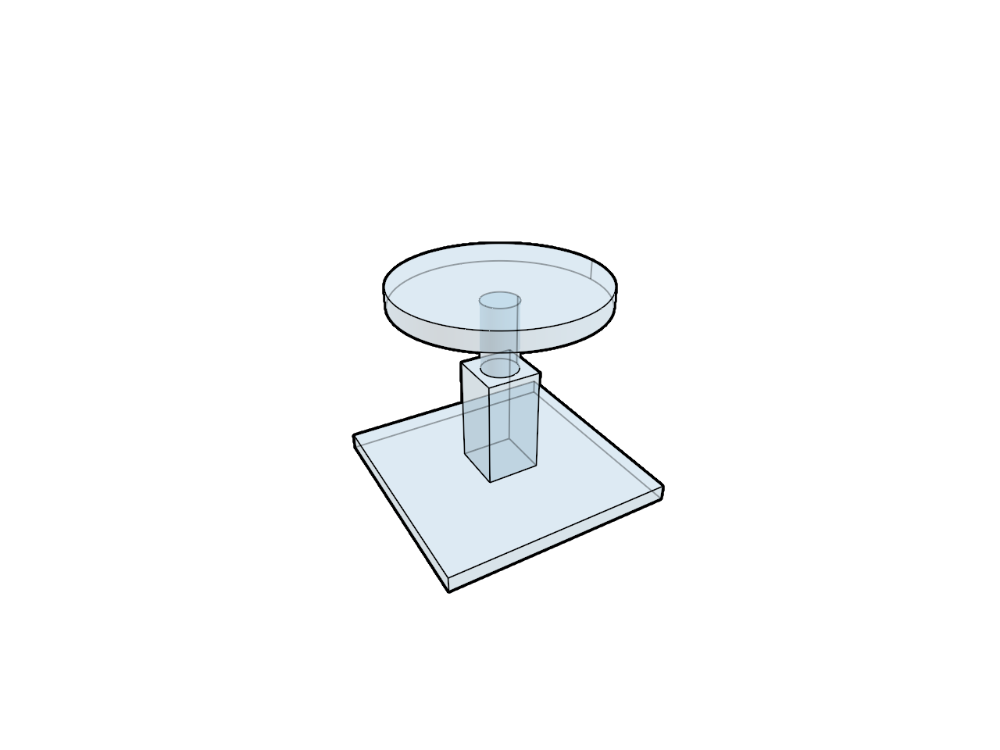

# 18.5 · Glass, X-ray and shared visibility rules

**Steps:** 9 · **Source:** [engine/gpu/ssao.rs](../../../../src/engine/gpu/ssao.rs) · [engine/gpu/ssao/pipelines.rs](../../../../src/engine/gpu/ssao/pipelines.rs) · [shaders/ssao.wgsl](../../../../src/shaders/ssao.wgsl) · [shaders/triangle.wgsl](../../../../src/shaders/triangle.wgsl)

<div class="webgpu-schematic" style="width:100%;margin:6px auto;">
<svg xmlns="http://www.w3.org/2000/svg" width="1120" height="188" viewBox="0 0 1120 188" style="width:100%;max-width:100%;height:auto;display:block;margin:0 auto;" role="img">
  <defs>
    <marker id="arr" viewBox="0 0 10 10" refX="8" refY="5" markerWidth="6" markerHeight="6" orient="auto">
      <path d="M 0 1 L 9 5 L 0 9 z" fill="#111111"/>
    </marker>
    <marker id="arrR" viewBox="0 0 10 10" refX="8" refY="5" markerWidth="6" markerHeight="6" orient="auto">
      <path d="M 0 1 L 9 5 L 0 9 z" fill="#dc2626"/>
    </marker>
    <marker id="arrG" viewBox="0 0 10 10" refX="8" refY="5" markerWidth="6" markerHeight="6" orient="auto">
      <path d="M 0 1 L 9 5 L 0 9 z" fill="#16a34a"/>
    </marker>
    <marker id="arrB" viewBox="0 0 10 10" refX="8" refY="5" markerWidth="6" markerHeight="6" orient="auto">
      <path d="M 0 1 L 9 5 L 0 9 z" fill="#2563eb"/>
    </marker>
  </defs>
  <rect x="2" y="2" width="1116" height="184" rx="10" fill="#ffffff" stroke="#111111" stroke-width="2"/>
  <rect x="14" y="12" width="344" height="164" rx="8" fill="#ffffff" stroke="#111111" stroke-width="1.5"/>
  <text paint-order="stroke fill" stroke="#ffffff" stroke-width="5" stroke-linejoin="round" x="186" y="30" text-anchor="middle" font-family="monospace" font-size="10.5" font-weight="700" fill="#111111">Half-Space Clip: d_i = dot(P_i, n_clip) + w_clip</text>
  <polygon points="58,138 118,58 258,58 198,138" fill="#dbeafe" stroke="#111111" stroke-width="1.75"/>
  <line x1="164" y1="44" x2="164" y2="156" stroke="#dc2626" stroke-width="2.5" stroke-dasharray="5 3"/>
  <line x1="164" y1="98" x2="218" y2="98" stroke="#dc2626" stroke-width="2.2" marker-end="url(#arrR)"/>
  <text paint-order="stroke fill" stroke="#ffffff" stroke-width="5" stroke-linejoin="round" x="236" y="102" font-family="monospace" font-size="9.5" font-weight="700" fill="#dc2626">d &lt; 0</text>
  <line x1="358" y1="94" x2="384" y2="94" stroke="#111111" stroke-width="2" marker-end="url(#arr)"/>
  <rect x="388" y="12" width="344" height="164" rx="8" fill="#ffffff" stroke="#111111" stroke-width="1.5"/>
  <text paint-order="stroke fill" stroke="#ffffff" stroke-width="5" stroke-linejoin="round" x="560" y="30" text-anchor="middle" font-family="monospace" font-size="10.5" font-weight="700" fill="#111111">Triangle-Plane Edge Segments -&gt; Welded Closed Cap Polygon</text>
  <polygon points="448,70 668,70 638,138 418,138" fill="#fef08a" stroke="#dc2626" stroke-width="2.2"/>
  <line x1="458" y1="70" x2="428" y2="138" stroke="#dc2626" stroke-width="1.5"/>
  <line x1="508" y1="70" x2="478" y2="138" stroke="#dc2626" stroke-width="1.5"/>
  <line x1="558" y1="70" x2="528" y2="138" stroke="#dc2626" stroke-width="1.5"/>
  <line x1="608" y1="70" x2="578" y2="138" stroke="#dc2626" stroke-width="1.5"/>
  <circle cx="448" cy="70" r="4" fill="#111111"/>
  <circle cx="668" cy="70" r="4" fill="#111111"/>
  <line x1="732" y1="94" x2="758" y2="94" stroke="#111111" stroke-width="2" marker-end="url(#arr)"/>
  <rect x="762" y="12" width="344" height="164" rx="8" fill="#ffffff" stroke="#111111" stroke-width="1.75"/>
  <text paint-order="stroke fill" stroke="#ffffff" stroke-width="5" stroke-linejoin="round" x="934" y="30" text-anchor="middle" font-family="monospace" font-size="10.5" font-weight="700" fill="#111111">Live Section Cut with Capped Solid Interior</text>
  <rect x="806" y="44" width="256" height="118" rx="4" fill="#ffffff" stroke="#111111" stroke-width="2"/>
  <polygon points="838,138 882,66 948,66 948,138" fill="#93c5fd" stroke="#111111" stroke-width="2"/>
  <polygon points="948,66 994,82 994,146 948,138" fill="#fef08a" stroke="#dc2626" stroke-width="2.2"/>
</svg>
</div>

## <a id="checkpoint-93-classify-original-solids-independently-of-clipping"></a>1. Classify solids independently of clipping

<div class="webgpu-schematic" style="width:100%;margin:6px auto;">
<svg xmlns="http://www.w3.org/2000/svg" width="1120" height="188" viewBox="0 0 1120 188" style="width:100%;max-width:100%;height:auto;display:block;margin:0 auto;" role="img">
  <defs>
    <marker id="arr" viewBox="0 0 10 10" refX="8" refY="5" markerWidth="6" markerHeight="6" orient="auto">
      <path d="M 0 1 L 9 5 L 0 9 z" fill="#111111"/>
    </marker>
    <marker id="arrR" viewBox="0 0 10 10" refX="8" refY="5" markerWidth="6" markerHeight="6" orient="auto">
      <path d="M 0 1 L 9 5 L 0 9 z" fill="#dc2626"/>
    </marker>
    <marker id="arrG" viewBox="0 0 10 10" refX="8" refY="5" markerWidth="6" markerHeight="6" orient="auto">
      <path d="M 0 1 L 9 5 L 0 9 z" fill="#16a34a"/>
    </marker>
    <marker id="arrB" viewBox="0 0 10 10" refX="8" refY="5" markerWidth="6" markerHeight="6" orient="auto">
      <path d="M 0 1 L 9 5 L 0 9 z" fill="#2563eb"/>
    </marker>
  </defs>
  <rect x="2" y="2" width="1116" height="184" rx="10" fill="#ffffff" stroke="#111111" stroke-width="2"/>
  <rect x="14" y="12" width="344" height="164" rx="8" fill="#ffffff" stroke="#111111" stroke-width="1.5"/>
  <text paint-order="stroke fill" stroke="#ffffff" stroke-width="5" stroke-linejoin="round" x="186" y="30" text-anchor="middle" font-family="monospace" font-size="10.5" font-weight="700" fill="#111111">CPU RAM: #[repr(C)] Structs -&gt; bytemuck::cast_slice</text>
  <rect x="46" y="54" width="280" height="44" fill="#f8fafc" stroke="#111111" stroke-width="1.75"/>
  <rect x="52" y="60" width="64" height="32" fill="#dbeafe" stroke="#2563eb" stroke-width="1.5"/>
  <text paint-order="stroke fill" stroke="#ffffff" stroke-width="5" stroke-linejoin="round" x="84" y="80" text-anchor="middle" font-family="monospace" font-size="9.5" font-weight="700" fill="#111111">v0: 24B</text>
  <rect x="122" y="60" width="64" height="32" fill="#dbeafe" stroke="#2563eb" stroke-width="1.5"/>
  <text paint-order="stroke fill" stroke="#ffffff" stroke-width="5" stroke-linejoin="round" x="154" y="80" text-anchor="middle" font-family="monospace" font-size="9.5" font-weight="700" fill="#111111">v1: 24B</text>
  <rect x="192" y="60" width="64" height="32" fill="#dbeafe" stroke="#2563eb" stroke-width="1.5"/>
  <text paint-order="stroke fill" stroke="#ffffff" stroke-width="5" stroke-linejoin="round" x="224" y="80" text-anchor="middle" font-family="monospace" font-size="9.5" font-weight="700" fill="#111111">v2: 24B</text>
  <text paint-order="stroke fill" stroke="#ffffff" stroke-width="5" stroke-linejoin="round" x="290" y="80" text-anchor="middle" font-family="monospace" font-size="10" font-weight="700" fill="#111111">...</text>
  <rect x="66" y="112" width="240" height="34" rx="4" fill="#fef08a" stroke="#111111" stroke-width="1.5"/>
  <text paint-order="stroke fill" stroke="#ffffff" stroke-width="5" stroke-linejoin="round" x="186" y="133" text-anchor="middle" font-family="monospace" font-size="9.5" font-weight="700" fill="#111111">&amp;[u8] Contiguous Byte Slice</text>
  <line x1="358" y1="94" x2="384" y2="94" stroke="#111111" stroke-width="2" marker-end="url(#arr)"/>
  <rect x="388" y="12" width="344" height="164" rx="8" fill="#ffffff" stroke="#111111" stroke-width="1.5"/>
  <text paint-order="stroke fill" stroke="#ffffff" stroke-width="5" stroke-linejoin="round" x="560" y="30" text-anchor="middle" font-family="monospace" font-size="10.5" font-weight="700" fill="#111111">CPU -&gt; GPU DMA: queue.write_buffer(buf, 0, bytes)</text>
  <rect x="424" y="54" width="272" height="92" rx="6" fill="#dcfce7" stroke="#16a34a" stroke-width="1.75"/>
  <line x1="448" y1="84" x2="672" y2="84" stroke="#16a34a" stroke-width="3" marker-end="url(#arrG)"/>
  <text paint-order="stroke fill" stroke="#ffffff" stroke-width="5" stroke-linejoin="round" x="560" y="74" text-anchor="middle" font-family="monospace" font-size="10" font-weight="700" fill="#111111">create_buffer_init / write_buffer</text>
  <text paint-order="stroke fill" stroke="#ffffff" stroke-width="5" stroke-linejoin="round" x="560" y="112" text-anchor="middle" font-family="monospace" font-size="9.5" font-weight="700" fill="#16a34a">VERTEX | INDEX | COPY_DST</text>
  <text paint-order="stroke fill" stroke="#ffffff" stroke-width="5" stroke-linejoin="round" x="560" y="132" text-anchor="middle" font-family="monospace" font-size="9" fill="#111111">array_stride = size_of::&lt;Vertex&gt;()</text>
  <line x1="732" y1="94" x2="758" y2="94" stroke="#111111" stroke-width="2" marker-end="url(#arr)"/>
  <rect x="762" y="12" width="344" height="164" rx="8" fill="#ffffff" stroke="#111111" stroke-width="1.75"/>
  <text paint-order="stroke fill" stroke="#ffffff" stroke-width="5" stroke-linejoin="round" x="934" y="30" text-anchor="middle" font-family="monospace" font-size="10.5" font-weight="700" fill="#111111">GPU VRAM Buffer -&gt; @vertex Input Locations</text>
  <rect x="806" y="44" width="256" height="118" rx="4" fill="#ffffff" stroke="#111111" stroke-width="2"/>
  <rect x="822" y="56" width="224" height="40" rx="4" fill="#dbeafe" stroke="#2563eb" stroke-width="1.5"/>
  <text paint-order="stroke fill" stroke="#ffffff" stroke-width="5" stroke-linejoin="round" x="934" y="80" text-anchor="middle" font-family="monospace" font-size="9.5" font-weight="700" fill="#111111">@location(0) pos: vec3&lt;f32&gt;</text>
  <rect x="822" y="106" width="224" height="40" rx="4" fill="#fce7f3" stroke="#db2777" stroke-width="1.5"/>
  <text paint-order="stroke fill" stroke="#ffffff" stroke-width="5" stroke-linejoin="round" x="934" y="130" text-anchor="middle" font-family="monospace" font-size="9.5" font-weight="700" fill="#111111">@location(1) color: vec3&lt;f32&gt;</text>
</svg>
</div>

### 1. `src/caps_gpu.rs`

Edit these blocks from bottom to top. Keep the surrounding lines unchanged.

**Locate this block:**

```rust
                .filter(|r| scene.visible(r.id)),
        ) {
            assert_eq!(mesh.id, object.id);
            let flags = if self.verified {
                self.solids.flags(object)
            } else {
                0
            };
            let token = if flags & CLOSED != 0 {
                self.rows
```

Replace it with:

```rust
                .filter(|r| scene.visible(r.id)),
        ) {
            assert_eq!(mesh.id, object.id);
            let flags = self.solids.flags(object);
            let token = if !planes.is_empty() && flags & CLOSED != 0 {
                self.rows
```

**Locate this block:**

```rust
        planes: &[crate::clipping_rows::Row],
    ) {
        self.planes = planes.len() as u32;
        self.verified |= !planes.is_empty();
        self.rows.clear();
        self.targets.clear();
        for (mesh, object) in meshes.iter_mut().zip(
```

Replace it with:

```rust
        planes: &[crate::clipping_rows::Row],
    ) {
        self.planes = planes.len() as u32;
        self.rows.clear();
        self.targets.clear();
        for (mesh, object) in meshes.iter_mut().zip(
```

**Locate this block:**

```rust
            bounds: Default::default(),
            targets: Default::default(),
            solids: Default::default(),
            verified: false,
            pipes: None,
            counts: None,
            depth: Image::new(
```

Replace it with:

```rust
            bounds: Default::default(),
            targets: Default::default(),
            solids: Default::default(),
            pipes: None,
            counts: None,
            depth: Image::new(
```

**Locate this block:**

```rust
    pub solids: crate::solid_cache::Solids,
    verified: bool,
    pipes: Option<crate::cap_pipeline::Pipelines>,
    counts: Option<Counts>,
    pub depth: Image,
```

Replace it with:

```rust
    pub solids: crate::solid_cache::Solids,
    pipes: Option<crate::cap_pipeline::Pipelines>,
    counts: Option<Counts>,
    pub depth: Image,
```

### 2. `src/gpu_mesh.rs`

Edit these blocks from bottom to top. Keep the surrounding lines unchanged.

**Locate this block:**

```rust
        object: &Object,
        style: Style,
    ) -> [usize; 2] {
        let next = settings(object, style, self.cap_flags, self.cap_token);
        let mut writes = [0, 0];
```

Replace it with:

```rust
        object: &Object,
        style: Style,
    ) -> [usize; 2] {
        let next = settings(
            object,
            style,
            self.cap_flags
                | if self.xray && self.cap_flags & 8192 != 0 {
                    32768
                } else {
                    0
                },
            self.cap_token,
        );
        let mut writes = [0, 0];
```

**Locate this block:**

```rust
        }
        let plane =
            u32::from_ne_bytes(self.previous[72..76].try_into().unwrap()) & 4096;
        self.previous[72..76].copy_from_slice(&(plane | flags).to_ne_bytes());
        self.previous[76..80].copy_from_slice(&token.to_ne_bytes());
        queue.write_buffer(&self.model, 72, &self.previous[72..80]);
        self.cap_flags = flags;
```

Replace it with:

```rust
        }
        let plane =
            u32::from_ne_bytes(self.previous[72..76].try_into().unwrap()) & 4096;
        self.previous[72..76].copy_from_slice(
            &(plane
                | flags
                | if self.xray && flags & 8192 != 0 {
                    32768
                } else {
                    0
                })
            .to_ne_bytes(),
        );
        self.previous[76..80].copy_from_slice(&token.to_ne_bytes());
        queue.write_buffer(&self.model, 72, &self.previous[72..80]);
        self.cap_flags = flags;
```

**Locate this block:**

```rust
        u32::from_ne_bytes(self.previous[64..68].try_into().unwrap()) != 0
    }

    pub fn closed(&self) -> bool {
        self.cap_flags & crate::solid_orientation::CLOSED != 0
    }
    pub fn pickable(&self) -> bool {
        u32::from_ne_bytes(self.previous[68..72].try_into().unwrap()) != 0
```

Replace it with:

```rust
        u32::from_ne_bytes(self.previous[64..68].try_into().unwrap()) != 0
    }

    pub fn set_xray(&mut self, queue: &wgpu::Queue, on: bool) {
        if self.xray == on {
            return;
        }
        self.xray = on;
        let flags = u32::from_ne_bytes(self.previous[72..76].try_into().unwrap());
        let flags = (flags & !32768)
            | if on && flags & 8192 != 0 {
                32768
            } else {
                0
            };
        self.previous[72..76].copy_from_slice(&flags.to_ne_bytes());
        queue.write_buffer(&self.model, 72, &self.previous[72..76]);
    }
    pub fn closed(&self) -> bool {
        !self.xray && self.cap_flags & crate::solid_orientation::CLOSED != 0
    }
    pub fn pickable(&self) -> bool {
        u32::from_ne_bytes(self.previous[68..72].try_into().unwrap()) != 0
```

**Locate this block:**

```rust
            id: object.id,
            model,
            previous: bytes,
            cap_flags: 0,
            cap_token: 0,
        }
```

Replace it with:

```rust
            id: object.id,
            model,
            previous: bytes,
            xray: false,
            cap_flags: 0,
            cap_token: 0,
        }
```

**Locate this block:**

```rust
    previous: [u8; 160],
    cap_flags: u32,
    cap_token: u32,
}
```

Replace it with:

```rust
    previous: [u8; 160],
    xray: bool,
    cap_flags: u32,
    cap_token: u32,
}
```

## <a id="checkpoint-93a-own-opacity-in-the-existing-surface-frame"></a>2. Own opacity in the existing surface frame

<div class="webgpu-schematic" style="width:100%;margin:6px auto;">
<svg xmlns="http://www.w3.org/2000/svg" width="1120" height="188" viewBox="0 0 1120 188" style="width:100%;max-width:100%;height:auto;display:block;margin:0 auto;" role="img">
  <defs>
    <marker id="arr" viewBox="0 0 10 10" refX="8" refY="5" markerWidth="6" markerHeight="6" orient="auto">
      <path d="M 0 1 L 9 5 L 0 9 z" fill="#111111"/>
    </marker>
    <marker id="arrR" viewBox="0 0 10 10" refX="8" refY="5" markerWidth="6" markerHeight="6" orient="auto">
      <path d="M 0 1 L 9 5 L 0 9 z" fill="#dc2626"/>
    </marker>
    <marker id="arrG" viewBox="0 0 10 10" refX="8" refY="5" markerWidth="6" markerHeight="6" orient="auto">
      <path d="M 0 1 L 9 5 L 0 9 z" fill="#16a34a"/>
    </marker>
    <marker id="arrB" viewBox="0 0 10 10" refX="8" refY="5" markerWidth="6" markerHeight="6" orient="auto">
      <path d="M 0 1 L 9 5 L 0 9 z" fill="#2563eb"/>
    </marker>
  </defs>
  <rect x="2" y="2" width="1116" height="184" rx="10" fill="#ffffff" stroke="#111111" stroke-width="2"/>
  <rect x="14" y="12" width="344" height="164" rx="8" fill="#ffffff" stroke="#111111" stroke-width="1.5"/>
  <text paint-order="stroke fill" stroke="#ffffff" stroke-width="5" stroke-linejoin="round" x="186" y="30" text-anchor="middle" font-family="monospace" font-size="10.5" font-weight="700" fill="#111111">CPU Camera / View Uniform (16-Byte Aligned)</text>
  <rect x="52" y="48" width="268" height="106" rx="6" fill="#f8fafc" stroke="#111111" stroke-width="1.75"/>
  <rect x="66" y="58" width="240" height="38" fill="#dbeafe" stroke="#2563eb" stroke-width="1.5"/>
  <text paint-order="stroke fill" stroke="#ffffff" stroke-width="5" stroke-linejoin="round" x="186" y="81" text-anchor="middle" font-family="monospace" font-size="9.5" font-weight="700" fill="#111111">view_proj: [[f32; 4]; 4] (64B)</text>
  <rect x="66" y="104" width="240" height="36" fill="#fef08a" stroke="#d97706" stroke-width="1.5"/>
  <text paint-order="stroke fill" stroke="#ffffff" stroke-width="5" stroke-linejoin="round" x="186" y="126" text-anchor="middle" font-family="monospace" font-size="9.5" font-weight="700" fill="#111111">eye_pos / viewport_px (16B)</text>
  <line x1="358" y1="94" x2="384" y2="94" stroke="#111111" stroke-width="2" marker-end="url(#arr)"/>
  <rect x="388" y="12" width="344" height="164" rx="8" fill="#ffffff" stroke="#111111" stroke-width="1.5"/>
  <text paint-order="stroke fill" stroke="#ffffff" stroke-width="5" stroke-linejoin="round" x="560" y="30" text-anchor="middle" font-family="monospace" font-size="10.5" font-weight="700" fill="#111111">queue.write_buffer -&gt; wgpu::BindGroup (@group(0))</text>
  <rect x="424" y="50" width="272" height="102" rx="6" fill="#ffffff" stroke="#111111" stroke-width="1.75"/>
  <rect x="442" y="64" width="236" height="32" rx="4" fill="#dcfce7" stroke="#16a34a" stroke-width="1.5"/>
  <text paint-order="stroke fill" stroke="#ffffff" stroke-width="5" stroke-linejoin="round" x="560" y="84" text-anchor="middle" font-family="monospace" font-size="9.5" font-weight="700" fill="#111111">BufferUsages::UNIFORM | COPY_DST</text>
  <rect x="442" y="106" width="236" height="32" rx="4" fill="#dbeafe" stroke="#2563eb" stroke-width="1.5"/>
  <text paint-order="stroke fill" stroke="#ffffff" stroke-width="5" stroke-linejoin="round" x="560" y="126" text-anchor="middle" font-family="monospace" font-size="9.5" font-weight="700" fill="#2563eb">pass.set_bind_group(0, &amp;bg, &amp;[])</text>
  <line x1="732" y1="94" x2="758" y2="94" stroke="#111111" stroke-width="2" marker-end="url(#arr)"/>
  <rect x="762" y="12" width="344" height="164" rx="8" fill="#ffffff" stroke="#111111" stroke-width="1.75"/>
  <text paint-order="stroke fill" stroke="#ffffff" stroke-width="5" stroke-linejoin="round" x="934" y="30" text-anchor="middle" font-family="monospace" font-size="10.5" font-weight="700" fill="#111111">GPU Shader Uniform Read: var&lt;uniform&gt;</text>
  <rect x="806" y="44" width="256" height="118" rx="4" fill="#ffffff" stroke="#111111" stroke-width="2"/>
  <text paint-order="stroke fill" stroke="#ffffff" stroke-width="5" stroke-linejoin="round" x="934" y="76" text-anchor="middle" font-family="monospace" font-size="9.5" font-weight="700" fill="#2563eb">@group(0) @binding(0)</text>
  <text paint-order="stroke fill" stroke="#ffffff" stroke-width="5" stroke-linejoin="round" x="934" y="98" text-anchor="middle" font-family="monospace" font-size="9.5" font-weight="700" fill="#111111">var&lt;uniform&gt; u: Uniforms;</text>
  <rect x="828" y="114" width="212" height="32" rx="4" fill="#dcfce7" stroke="#16a34a" stroke-width="1.5"/>
  <text paint-order="stroke fill" stroke="#ffffff" stroke-width="5" stroke-linejoin="round" x="934" y="134" text-anchor="middle" font-family="monospace" font-size="9.5" font-weight="700" fill="#111111">u.view_proj * vec4(p, 1.0)</text>
</svg>
</div>

### 1. `src/renderer.rs`

Edit these blocks from bottom to top. Keep the surrounding lines unchanged.

**Locate this block:**

```rust
            pass.set_bind_group(2, &clip_group, &[]);
            pass.set_pipeline(&self.pipeline);
            pass.set_bind_group(0, &self.view_group, &[]);
            for mesh in self
                .meshes
                .iter()
                .filter(|row| !self.instance_rows.contains(&row.id))
            {
                mesh.draw(&mut pass);
            }
            self.instances.draw(&mut pass);
            pass.set_pipeline(&self.highlight_pipeline);
```

Replace it with:

```rust
            pass.set_bind_group(2, &clip_group, &[]);
            pass.set_pipeline(&self.pipeline);
            pass.set_bind_group(0, &self.view_group, &[]);
            for mesh in self.meshes.iter().filter(|row| {
                self.opacity.get() < 1. || !self.instance_rows.contains(&row.id)
            }) {
                mesh.draw(&mut pass);
            }
            if self.opacity.get() >= 1. {
                self.instances.draw(&mut pass);
            }
            pass.set_pipeline(&self.highlight_pipeline);
```

**Locate this block:**

```rust
            } else {
                0.0
            },
            0.0,
            0.0,
            0.0,
        ];
        bytes.extend(
            display
```

Replace it with:

```rust
            } else {
                0.0
            },
            self.opacity.get(),
            0.0,
            0.0,
        ];
        bytes.extend(
            display
```

**Locate this block:**

```rust
            &mut self.meshes,
            &self.clipping.borrow().rows,
        );
        self.tiles
            .borrow_mut()
            .set(&self.device, &self.meshes);
```

Replace it with:

```rust
            &mut self.meshes,
            &self.clipping.borrow().rows,
        );
        for mesh in &mut self.meshes {
            mesh.set_xray(&self.queue, self.opacity.get() == 0.);
        }
        self.tiles
            .borrow_mut()
            .set(&self.device, &self.meshes);
```

**Locate this block:**

```rust
        let measurement = crate::measure_gpu::Measurement::new(&device, format);
        let guides = crate::guide_gpu::Guide::new(&device, format);
        let mut renderer = Self {
            ambient_enabled: Default::default(),
            ambient: Default::default(),
            ambient_rows: Default::default(),
```

Replace it with:

```rust
        let measurement = crate::measure_gpu::Measurement::new(&device, format);
        let guides = crate::guide_gpu::Guide::new(&device, format);
        let mut renderer = Self {
            opacity: std::cell::Cell::new(1.),
            ambient_enabled: Default::default(),
            ambient: Default::default(),
            ambient_rows: Default::default(),
```

**Locate this block:**

```rust
                module: &shader,
                entry_point: Some("fragment"),
                compilation_options: Default::default(),
                targets: &[Some(format.into())],
            }),
            primitive: Default::default(),
            depth_stencil: Some(depth),
```

Replace it with:

```rust
                module: &shader,
                entry_point: Some("fragment"),
                compilation_options: Default::default(),
                targets: &[Some(wgpu::ColorTargetState{format,blend:Some(wgpu::BlendState::ALPHA_BLENDING),write_mask:wgpu::ColorWrites::ALL})],
            }),
            primitive: Default::default(),
            depth_stencil: Some(depth),
```

**Locate this block:**

```rust
pub struct Renderer {
    ambient_enabled: std::cell::Cell<bool>,
    ambient: std::cell::RefCell<Option<crate::ambient_gpu::Ambient>>,
    ambient_rows: crate::ambient_rows::Rows,
```

Replace it with:

```rust
pub struct Renderer {
    opacity: std::cell::Cell<f32>,
    ambient_enabled: std::cell::Cell<bool>,
    ambient: std::cell::RefCell<Option<crate::ambient_gpu::Ambient>>,
    ambient_rows: crate::ambient_rows::Rows,
```

## <a id="checkpoint-93b-blend-closed-faces-and-retain-opaque-open-surfaces"></a>3. Blend closed faces and retain opaque open surfaces

<div class="webgpu-schematic" style="width:100%;margin:6px auto;">
<svg xmlns="http://www.w3.org/2000/svg" width="1120" height="188" viewBox="0 0 1120 188" style="width:100%;max-width:100%;height:auto;display:block;margin:0 auto;" role="img">
  <defs>
    <marker id="arr" viewBox="0 0 10 10" refX="8" refY="5" markerWidth="6" markerHeight="6" orient="auto">
      <path d="M 0 1 L 9 5 L 0 9 z" fill="#111111"/>
    </marker>
    <marker id="arrR" viewBox="0 0 10 10" refX="8" refY="5" markerWidth="6" markerHeight="6" orient="auto">
      <path d="M 0 1 L 9 5 L 0 9 z" fill="#dc2626"/>
    </marker>
    <marker id="arrG" viewBox="0 0 10 10" refX="8" refY="5" markerWidth="6" markerHeight="6" orient="auto">
      <path d="M 0 1 L 9 5 L 0 9 z" fill="#16a34a"/>
    </marker>
    <marker id="arrB" viewBox="0 0 10 10" refX="8" refY="5" markerWidth="6" markerHeight="6" orient="auto">
      <path d="M 0 1 L 9 5 L 0 9 z" fill="#2563eb"/>
    </marker>
  </defs>
  <rect x="2" y="2" width="1116" height="184" rx="10" fill="#ffffff" stroke="#111111" stroke-width="2"/>
  <rect x="14" y="12" width="344" height="164" rx="8" fill="#ffffff" stroke="#111111" stroke-width="1.5"/>
  <text paint-order="stroke fill" stroke="#ffffff" stroke-width="5" stroke-linejoin="round" x="186" y="30" text-anchor="middle" font-family="monospace" font-size="10.5" font-weight="700" fill="#111111">HZB Max-Depth Mip Pyramid + SSAO Hemisphere Samples</text>
  <rect x="56" y="54" width="64" height="64" fill="#dbeafe" stroke="#111111" stroke-width="1.75"/>
  <rect x="130" y="68" width="42" height="42" fill="#93c5fd" stroke="#111111" stroke-width="1.75"/>
  <rect x="182" y="80" width="24" height="24" fill="#60a5fa" stroke="#111111" stroke-width="1.75"/>
  <path d="M 224 134 A 34 34 0 0 1 292 134" fill="#fef9c3" stroke="#111111" stroke-width="1.75"/>
  <line x1="258" y1="134" x2="240" y2="104" stroke="#dc2626" stroke-width="1.75" marker-end="url(#arrR)"/>
  <line x1="258" y1="134" x2="258" y2="96" stroke="#16a34a" stroke-width="1.75" marker-end="url(#arrG)"/>
  <line x1="258" y1="134" x2="278" y2="106" stroke="#2563eb" stroke-width="1.75" marker-end="url(#arrB)"/>
  <line x1="358" y1="94" x2="384" y2="94" stroke="#111111" stroke-width="2" marker-end="url(#arr)"/>
  <rect x="388" y="12" width="344" height="164" rx="8" fill="#ffffff" stroke="#111111" stroke-width="1.5"/>
  <text paint-order="stroke fill" stroke="#ffffff" stroke-width="5" stroke-linejoin="round" x="560" y="30" text-anchor="middle" font-family="monospace" font-size="10.5" font-weight="700" fill="#111111">WoodElement Timber Plate + Joint Cut Polylines &amp; Vectors</text>
  <polygon points="434,136 468,66 644,66 610,136" fill="#fde68a" stroke="#111111" stroke-width="2"/>
  <polygon points="518,66 558,66 548,92 508,92" fill="#ffffff" stroke="#dc2626" stroke-width="2"/>
  <line x1="533" y1="79" x2="533" y2="44" stroke="#dc2626" stroke-width="2.2" marker-end="url(#arrR)"/>
  <line x1="732" y1="94" x2="758" y2="94" stroke="#111111" stroke-width="2" marker-end="url(#arr)"/>
  <rect x="762" y="12" width="344" height="164" rx="8" fill="#ffffff" stroke="#111111" stroke-width="1.75"/>
  <text paint-order="stroke fill" stroke="#ffffff" stroke-width="5" stroke-linejoin="round" x="934" y="30" text-anchor="middle" font-family="monospace" font-size="10.5" font-weight="700" fill="#111111">Contact-Darkened Creases + Timber Joinery Scene</text>
  <rect x="806" y="44" width="256" height="118" rx="4" fill="#ffffff" stroke="#111111" stroke-width="2"/>
  <polygon points="838,138 874,66 1018,66 982,138" fill="#fcd34d" stroke="#111111" stroke-width="2"/>
  <polygon points="914,66 952,66 942,92 904,92" fill="#78350f" stroke="#111111" stroke-width="2"/>
</svg>
</div>

### 1. `src/triangle.wgsl`

**Locate this existing block:**

```wgsl
    @location(3) @interpolate(flat) clip_flags:u32,
}

fn geometry(position: vec3<f32>, colour: vec3<f32>, normal: vec3<f32>) -> VertexOutput {
    var output: VertexOutput;
    let world = object.model * vec4<f32>(position, 1.0);
    output.position = view.transform * world;
    let displayed=select(colour,object.face_colour.xyz,object.face_colour.w>0.5);
    output.colour = select(displayed, vec3<f32>(1.0, 0.75, 0.05), object.selection.x != 0u);
    output.world = world.xyz;output.clip_flags=object.selection.z;
    output.normal = (object.normal_matrix * vec4<f32>(normal, 0.0)).xyz;
    return output;
}

@fragment
fn fragment(input: VertexOutput, @builtin(front_facing) front: bool) -> @location(0) vec4<f32> {
    // Derivatives require neighbouring fragments; calculate the sharp face direction before choosing a potentially smooth interpolated source direction.
    let derivative = cross(dpdx(input.world), dpdy(input.world));
    // Screen derivatives ignore vertex order; front-facing restores the original face orientation for reversed winding and world-normal inspection.
    let face = select(derivative, -derivative, front);
    if(clip_active()&&clip_cut(input.clip_flags,input.world)){discard;}
    let direction = select(face, input.normal, dot(input.normal, input.normal) > 0.0);
    let scale = max(max(abs(direction.x), abs(direction.y)), abs(direction.z));
    let bounded = direction / max(scale, 1e-30);
    let normal = bounded / max(length(bounded), 1e-30);
    if view.display.x > 0.5 { return vec4<f32>(normal * 0.5 + vec3<f32>(0.5), 1.0); }
    let light = normalize(vec3<f32>(0.4, -0.6, 1.0));
    // abs lights both sides of an open face; 0.3 keeps unlit faces readable.
    let brightness = 0.3 + 0.7 * abs(dot(normal, light));
    return vec4<f32>(input.colour * brightness, 1.0);
}
```

Edit the existing block to match this code; keep unchanged lines:

```wgsl
    @location(3) @interpolate(flat) clip_flags:u32,
    @location(4) @interpolate(flat) mirrored:u32,
}

fn geometry(position: vec3<f32>, colour: vec3<f32>, normal: vec3<f32>) -> VertexOutput {
    var output: VertexOutput;
    let world = object.model * vec4<f32>(position, 1.0);
    output.position = view.transform * world;
    let displayed=select(colour,object.face_colour.xyz,object.face_colour.w>0.5);
    output.colour = select(displayed, vec3<f32>(1.0, 0.75, 0.05), object.selection.x != 0u);
    output.mirrored=select(0u,1u,determinant(mat3x3<f32>(object.model[0].xyz,object.model[1].xyz,object.model[2].xyz))<0.);
    output.world = world.xyz;output.clip_flags=object.selection.z;
    output.normal = (object.normal_matrix * vec4<f32>(normal, 0.0)).xyz;
    return output;
}

@fragment
fn fragment(input: VertexOutput, @builtin(front_facing) front: bool) -> @location(0) vec4<f32> {
    // Derivatives require neighbouring fragments; calculate the sharp face direction before choosing a potentially smooth interpolated source direction.
    let derivative = cross(dpdx(input.world), dpdy(input.world));
    // Screen derivatives ignore vertex order; front-facing restores the original face orientation for reversed winding and world-normal inspection.
    let face = select(derivative, -derivative, front);
    if(clip_active()&&clip_cut(input.clip_flags,input.world)){discard;}
    let closed=(input.clip_flags&8192u)!=0u;
    let source_front=(front!=(input.mirrored!=0u))!=((input.clip_flags&16384u)!=0u);
    if((input.clip_flags&32768u)!=0u || (closed&&!source_front&&view.display.y>0.&&view.display.y<1.)){discard;}
    let direction = select(face, input.normal, dot(input.normal, input.normal) > 0.0);
    let scale = max(max(abs(direction.x), abs(direction.y)), abs(direction.z));
    let bounded = direction / max(scale, 1e-30);
    let normal = bounded / max(length(bounded), 1e-30);
    if view.display.x > 0.5 { return vec4<f32>(normal * 0.5 + vec3<f32>(0.5), select(1.,view.display.y,closed)); }
    let light = normalize(vec3<f32>(0.4, -0.6, 1.0));
    // abs lights both sides of an open face; 0.3 keeps unlit faces readable.
    let brightness = 0.3 + 0.7 * abs(dot(normal, light));
    return vec4<f32>(input.colour * brightness, select(1.,view.display.y,closed));
}
```

## <a id="checkpoint-93c-exclude-x-ray-faces-from-original-picks-and-masks"></a>4. Exclude x-ray faces from picks and masks

### 1. `src/triangle_pick.wgsl`

**Locate this existing block:**

```wgsl
@vertex fn pick_vertex(@location(0) position:vec3<f32>,@location(1) colour:vec3<f32>,@location(2) normal:vec3<f32>)->MeshPickOutput{let placed=geometry(position,colour,normal);return MeshPickOutput(crop.transform*placed.position,placed.world,placed.clip_flags);}
@fragment fn pick_fragment(input:MeshPickOutput)->@location(0) vec2<u32>{if(clip_active()&&clip_cut(input.flags,input.world)){discard;}return vec2<u32>(select(0u,object.selection.y,crop.mode==0u),0u);}
```

Edit the existing block to match this code; keep unchanged lines:

```wgsl
@vertex fn pick_vertex(@location(0) position:vec3<f32>,@location(1) colour:vec3<f32>,@location(2) normal:vec3<f32>)->MeshPickOutput{let placed=geometry(position,colour,normal);return MeshPickOutput(crop.transform*placed.position,placed.world,placed.clip_flags);}
@fragment fn pick_fragment(input:MeshPickOutput)->@location(0) vec2<u32>{if((input.flags&32768u)!=0u){discard;}if(clip_active()&&clip_cut(input.flags,input.world)){discard;}return vec2<u32>(select(0u,object.selection.y,crop.mode==0u),0u);}
```

### 2. `src/face_pick.wgsl`

**Locate this existing block:**

```wgsl
fn face_fragment(input: FaceOutput) -> @location(0) vec2<u32> {
    if(clip_active()&&clip_cut(input.flags,input.world)){discard;}
    return vec2<u32>(object.selection.y, (0x20000000u | input.face) + 1u);
```

Edit the existing block to match this code; keep unchanged lines:

```wgsl
fn face_fragment(input: FaceOutput) -> @location(0) vec2<u32> {
    if((input.flags&32768u)!=0u){discard;}if(clip_active()&&clip_cut(input.flags,input.world)){discard;}
    return vec2<u32>(object.selection.y, (0x20000000u | input.face) + 1u);
```

### 3. `src/outline_mask.wgsl`

**Locate this existing block:**

```wgsl
@vertex fn vertex(@location(0) position:vec3<f32>)->Output{let world=object.model*vec4<f32>(position,1.0);return Output(view.transform*world,world.xyz,object.selection.z);}
@fragment fn fragment(input:Output)->@location(0) vec4<f32>{if(clip_active()&&clip_cut(input.flags,input.world)){discard;}return vec4<f32>(1.0);}
```

Edit the existing block to match this code; keep unchanged lines:

```wgsl
@vertex fn vertex(@location(0) position:vec3<f32>)->Output{let world=object.model*vec4<f32>(position,1.0);return Output(view.transform*world,world.xyz,object.selection.z);}
@fragment fn fragment(input:Output)->@location(0) vec4<f32>{if((input.flags&32768u)!=0u){discard;}if(clip_active()&&clip_cut(input.flags,input.world)){discard;}return vec4<f32>(1.0);}
```

### 4. `src/ambient_sources.wgsl`

**Locate this existing block:**

```wgsl
@fragment fn fs_main(in:Vertex,@builtin(front_facing) front:bool)->Source{
 let face=cross(dpdx(in.world),dpdy(in.world));if(clip_active()&&clip_cut(in.flags,in.world)){discard;}
 let normal=normalize(select(select(face,-face,front),in.normal,dot(in.normal,in.normal)>0.));
```

Edit the existing block to match this code; keep unchanged lines:

```wgsl
@fragment fn fs_main(in:Vertex,@builtin(front_facing) front:bool)->Source{
 let face=cross(dpdx(in.world),dpdy(in.world));if((in.flags&32768u)!=0u){discard;}if(clip_active()&&clip_cut(in.flags,in.world)){discard;}
 let normal=normalize(select(select(face,-face,front),in.normal,dot(in.normal,in.normal)>0.));
```

## <a id="checkpoint-93d-carry-opacity-into-finite-original-ink"></a>5. Carry opacity into finite ink

### 1. `src/stroke_gpu.rs`

Edit these blocks from bottom to top. Keep the surrounding lines unchanged.

**Locate this block:**

```rust
            }],
        });
        Self {
            flags: None,
```

Replace it with:

```rust
            }],
        });
        Self {
            opacity: std::cell::Cell::new(1.),
            flags: None,
```

**Locate this block:**

```rust
        let bytes: Vec<u8> = transform
            .iter()
            .copied()
            .chain([size[0] as f32, size[1] as f32, density, 0.0])
            .flat_map(f32::to_ne_bytes)
            .collect();
        queue.write_buffer(&self.uniform, 0, &bytes);
```

Replace it with:

```rust
        let bytes: Vec<u8> = transform
            .iter()
            .copied()
            .chain([
                size[0] as f32,
                size[1] as f32,
                density,
                self.opacity.get(),
            ])
            .flat_map(f32::to_ne_bytes)
            .collect();
        queue.write_buffer(&self.uniform, 0, &bytes);
```

**Locate this block:**

```rust
        Ok(())
    }

    pub fn view(
        &self,
        queue: &wgpu::Queue,
```

Replace it with:

```rust
        Ok(())
    }

    pub fn set_opacity(&self, value: f32) {
        self.opacity.set(value);
    }
    pub fn view(
        &self,
        queue: &wgpu::Queue,
```

**Locate this block:**

```rust
pub struct Lane {
    flags: Option<wgpu::Buffer>,
    flag_data: Vec<u32>,
    finite: Option<crate::finite_ink::Ink>,
```

Replace it with:

```rust
pub struct Lane {
    opacity: std::cell::Cell<f32>,
    flags: Option<wgpu::Buffer>,
    flag_data: Vec<u32>,
    finite: Option<crate::finite_ink::Ink>,
```

### 2. `src/highlight.rs`

**Locate this existing block:**

```rust
impl Highlight {
    pub fn new(device: &wgpu::Device, format: wgpu::TextureFormat) -> Self {
```

Edit the existing block to match this code; keep unchanged lines:

```rust
impl Highlight {
    pub fn set_opacity(&self, value: f32) {
        for lane in [&self.strokes, &self.paths, &self.markers] {
            lane.set_opacity(value);
        }
    }

    pub fn new(device: &wgpu::Device, format: wgpu::TextureFormat) -> Self {
```

### 3. `src/finite_visibility.wgsl`

**Locate this existing block:**

```wgsl
 return true;
}
```

Edit the existing block to match this code; keep unchanged lines:

```wgsl
 return true;
}


fn finite_alpha(pixel:vec2<f32>,axis:vec4<f32>,depths:vec2<f32>,flags:u32)->f32{
 let delta=axis.zw-axis.xy;let t=clamp(dot(pixel-axis.xy,delta)/max(dot(delta,delta),1e-20),0.,1.);let at=axis.xy+t*delta;let depth=mix(depths.x,depths.y,t);
 if(clip_active()&&clip_cut_ink_ndc(flags,clip_ndc(at,view.size,1.-depth))){return 0.;}
 let hidden=!finite_visible(pixel,axis,depths,flags);let glass=view.opacity>0.&&view.opacity<1.;return select(1.,select(0.,1.-view.opacity,glass),hidden&&view.opacity>0.);
}
```

### 4. `src/finite_stroke.wgsl`

**Locate this existing block:**

```wgsl
struct View { transform: mat4x4<f32>, size: vec2<f32>, density: f32 }
@group(0) @binding(0) var<uniform> view: View;
```

Edit the existing block to match this code; keep unchanged lines:

```wgsl
struct View { transform: mat4x4<f32>, size: vec2<f32>, density: f32, opacity:f32 }
@group(0) @binding(0) var<uniform> view: View;
```

### 5. `src/finite_chain.wgsl`

**Locate this existing block:**

```wgsl
struct View { transform: mat4x4<f32>, size: vec2<f32>, density: f32 }
@group(0) @binding(0) var<uniform> view: View;
```

Edit the existing block to match this code; keep unchanged lines:

```wgsl
struct View { transform: mat4x4<f32>, size: vec2<f32>, density: f32, opacity:f32 }
@group(0) @binding(0) var<uniform> view: View;
```

### 6. `src/finite_marker.wgsl`

**Locate this existing block:**

```wgsl
struct View { transform: mat4x4<f32>, size: vec2<f32>, density: f32 }
@group(0) @binding(0) var<uniform> view: View;
```

Edit the existing block to match this code; keep unchanged lines:

```wgsl
struct View { transform: mat4x4<f32>, size: vec2<f32>, density: f32, opacity:f32 }
@group(0) @binding(0) var<uniform> view: View;
```

## <a id="checkpoint-93e-fade-hidden-ink-without-showing-clipped-geometry"></a>6. Fade hidden ink without showing clipped geometry

### 1. `src/finite_stroke.wgsl`

**Locate this existing block:**

```wgsl
@fragment
fn fragment(input: Output) -> @location(0) vec4<f32> {if(!finite_visible(input.finite_pixel,input.finite_axis_value,input.finite_depths,input.clip_flags)){discard;}return colour(input);}


#include "projected_triangle.wgsl"
```

Edit the existing block to match this code; keep unchanged lines:

```wgsl
@fragment
fn fragment(input: Output) -> @location(0) vec4<f32> {let alpha=finite_alpha(input.finite_pixel,input.finite_axis_value,input.finite_depths,input.clip_flags);if(alpha<=0.){discard;}let c=colour(input);return vec4<f32>(c.rgb,c.a*alpha);}


#include "projected_triangle.wgsl"
```

### 2. `src/finite_chain.wgsl`

**Locate this existing block:**

```wgsl
@fragment
fn fragment(input: Output) -> @location(0) vec4<f32> {if(!finite_visible(input.finite_pixel,input.finite_axis_value,input.finite_depths,input.clip_flags)){discard;}return colour(input);}


#include "projected_triangle.wgsl"
```

Edit the existing block to match this code; keep unchanged lines:

```wgsl
@fragment
fn fragment(input: Output) -> @location(0) vec4<f32> {let alpha=finite_alpha(input.finite_pixel,input.finite_axis_value,input.finite_depths,input.clip_flags);if(alpha<=0.){discard;}let c=colour(input);return vec4<f32>(c.rgb,c.a*alpha);}


#include "projected_triangle.wgsl"
```

### 3. `src/finite_marker.wgsl`

**Locate this existing block:**

```wgsl
@fragment
fn fragment(input: Output) -> @location(0) vec4<f32> {if(!finite_visible(input.finite_pixel,input.finite_axis_value,input.finite_depths,input.clip_flags)){discard;}return colour(input);}


#include "projected_triangle.wgsl"
```

Edit the existing block to match this code; keep unchanged lines:

```wgsl
@fragment
fn fragment(input: Output) -> @location(0) vec4<f32> {let alpha=finite_alpha(input.finite_pixel,input.finite_axis_value,input.finite_depths,input.clip_flags);if(alpha<=0.){discard;}let c=colour(input);return vec4<f32>(c.rgb,c.a*alpha);}


#include "projected_triangle.wgsl"
```

### 4. `src/finite_stroke_pick.wgsl`

**Locate this existing block:**

```wgsl
    if (colour(source).a <= 0.0) { discard; }
    if(!finite_visible(input.finite_pixel,input.finite_axis_value,input.finite_depths,input.clip_flags)){discard;}
    return input.id;
```

Edit the existing block to match this code; keep unchanged lines:

```wgsl
    if (colour(source).a <= 0.0) { discard; }
    if(finite_alpha(input.finite_pixel,input.finite_axis_value,input.finite_depths,input.clip_flags)<=0.){discard;}
    return input.id;
```

### 5. `src/finite_chain_pick.wgsl`

**Locate this existing block:**

```wgsl
    if (colour(source).a <= 0.0) { discard; }
    if(!finite_visible(input.finite_pixel,input.finite_axis_value,input.finite_depths,input.clip_flags)){discard;}
    return input.id;
```

Edit the existing block to match this code; keep unchanged lines:

```wgsl
    if (colour(source).a <= 0.0) { discard; }
    if(finite_alpha(input.finite_pixel,input.finite_axis_value,input.finite_depths,input.clip_flags)<=0.){discard;}
    return input.id;
```

### 6. `src/finite_marker_pick.wgsl`

**Locate this existing block:**

```wgsl
    if (colour(source).a <= 0.0) { discard; }
    if(!finite_visible(input.finite_pixel,input.finite_axis_value,input.finite_depths,input.clip_flags)){discard;}
    return input.id;
```

Edit the existing block to match this code; keep unchanged lines:

```wgsl
    if (colour(source).a <= 0.0) { discard; }
    if(finite_alpha(input.finite_pixel,input.finite_axis_value,input.finite_depths,input.clip_flags)<=0.){discard;}
    return input.id;
```

## <a id="checkpoint-93f-invalidate-presentation-and-preserve-cached-geometry"></a>7. Invalidate presentation and preserve cached geometry

### 1. `src/renderer.rs`

**Locate this existing block:**

```rust
    }
    pub fn set_outlines(&self, on: bool) {
```

Edit the existing block to match this code; keep unchanged lines:

```rust
    }
    pub fn set_opacity(&mut self, value: f32) {
        if !value.is_finite() {
            return;
        }
        let value = value.clamp(0., 1.);
        if self.opacity.get() == value {
            return;
        }
        self.opacity.set(value);
        self.picker.cancel();
        self.pyramid_revision = self.pyramid_revision.wrapping_add(1);
        for mesh in &mut self.meshes {
            mesh.set_xray(&self.queue, value == 0.);
        }
        for lane in [
            &self.mesh_ink,
            &self.strokes,
            &self.paths,
            &self.markers,
            &self.grid,
        ] {
            lane.set_opacity(value);
        }
        self.highlight.set_opacity(value);
        if let Some(o) = self.outline.borrow_mut().as_mut() {
            o.invalidate();
        }
        if let Some(o) = self.global_outline.borrow_mut().as_mut() {
            o.invalidate();
        }
    }
    pub fn opacity(&self) -> f32 {
        self.opacity.get()
    }
    pub fn set_outlines(&self, on: bool) {
```

## <a id="checkpoint-93g-connect-strict-opacity-presentation-commands"></a>8. Connect strict Opacity presentation commands

### 1. `src/editor.rs`

Edit these blocks from bottom to top. Keep the surrounding lines unchanged.

**Locate this block:**

```rust
                    }
                );
                return Ok(Change::Scene);
            }
```

Replace it with:

```rust
                    }
                );
                return Ok(Change::Scene);
            }
            Action::Opacity(_) => {
                unreachable!("Opacity presentation returned before document mutation")
            }
```

**Locate this block:**

```rust
            }
            action => action,
        };
        if let Action::ViewOutline(on) = &action {
            self.outlines = on.unwrap_or(!self.outlines);
            self.tool_status = format!(
```

Replace it with:

```rust
            }
            action => action,
        };
        if let Action::Opacity(value) = &action {
            if !value.is_finite() || !(0.0..=1.0).contains(value) {
                return Err("Opacity takes a value from0 to1");
            }
            self.opacity = *value;
            self.tool_status = format!("Opacity {value}");
            return Ok(Change::View);
        }
        if let Action::ViewOutline(on) = &action {
            self.outlines = on.unwrap_or(!self.outlines);
            self.tool_status = format!(
```

**Locate this block:**

```rust
            element: None,
            element_attributes: false,
            element_interactions: true,
            arctic: false,
            outlines: false,
            clipping_enabled: true,
```

Replace it with:

```rust
            element: None,
            element_attributes: false,
            element_interactions: true,
            opacity: 1.,
            arctic: false,
            outlines: false,
            clipping_enabled: true,
```

**Locate this block:**

```rust
    pub element: Option<crate::element_draft::Draft>,
    pub element_attributes: bool,
    pub element_interactions: bool,
    pub arctic: bool,
    pub outlines: bool,
    pub clipping_enabled: bool,
```

Replace it with:

```rust
    pub element: Option<crate::element_draft::Draft>,
    pub element_attributes: bool,
    pub element_interactions: bool,
    pub opacity: f32,
    pub arctic: bool,
    pub outlines: bool,
    pub clipping_enabled: bool,
```

**Locate this block:**

```rust
    ElementInteractions(Option<bool>),
    Arctic(Option<bool>),
    ViewOutline(Option<bool>),
    Clipping(crate::clipping_input::Request),
```

Replace it with:

```rust
    ElementInteractions(Option<bool>),
    Opacity(f32),
    Arctic(Option<bool>),
    ViewOutline(Option<bool>),
    Clipping(crate::clipping_input::Request),
```

### 2. `src/commands.rs`

Edit these blocks from bottom to top. Keep the surrounding lines unchanged.

**Locate this block:**

```rust
            },
        ));
    }
```

Replace it with:

```rust
            },
        ));
    }
    if name == "Opacity" {
        let [word] = &words[count..] else {
            return Err("Opacity 0..1 · Example: Opacity 0.5".into());
        };
        let value = word
            .parse::<f32>()
            .ok()
            .filter(|v| v.is_finite() && (0.0..=1.0).contains(v))
            .ok_or("Opacity takes a value from 0 to 1")?;
        return Ok(Command::Editor(Action::Opacity(value)));
    }
```

**Locate this block:**

```rust
    }),
    ("View Outline", || Action::ViewOutline(None)),
    ("Arctic", || Action::Arctic(None)),
    ("Select By Name", || {
```

Replace it with:

```rust
    }),
    ("Opacity", || Action::Opacity(1.)),
    ("View Outline", || Action::ViewOutline(None)),
    ("Arctic", || Action::Arctic(None)),
    ("Select By Name", || {
```

### 3. `src/browser.rs`

Edit these blocks from bottom to top. Keep the surrounding lines unchanged.

**Locate this block:**

```rust
        &serde_json::to_string(&placements)
            .map_err(|error| JsValue::from_str(&error.to_string()))?,
    )?;
    canvas.set_attribute("data-clipping",&serde_json::json!({"usage":renderer.clipping_usage(),"caps":renderer.cap_usage(),"ambient":renderer.ambient_usage(),"ambient_error":renderer.ambient_error(),"arctic":editor.arctic,"outlines":editor.outlines,"global_outline":renderer.global_outline_usage(),"pyramid":renderer.depth_pyramid_usage(),"pyramid_error":renderer.depth_pyramid_error(),"cap_error":renderer.cap_error(),"ink_flags":renderer.clipping_ink_bytes(),"error":renderer.clipping_error(),"rows":crate::clipping_rows::current(&editor.scene).ok().map(|rows|rows.iter().map(|r|serde_json::json!({"id":r.id.value(),"normal":r.plane.normal,"offset":r.plane.offset})).collect::<Vec<_>>())}).to_string())?;
    canvas.set_attribute(
```

Replace it with:

```rust
        &serde_json::to_string(&placements)
            .map_err(|error| JsValue::from_str(&error.to_string()))?,
    )?;
    canvas.set_attribute("data-clipping",&serde_json::json!({"usage":renderer.clipping_usage(),"caps":renderer.cap_usage(),"ambient":renderer.ambient_usage(),"ambient_error":renderer.ambient_error(),"arctic":editor.arctic,"opacity":editor.opacity,"outlines":editor.outlines,"global_outline":renderer.global_outline_usage(),"pyramid":renderer.depth_pyramid_usage(),"pyramid_error":renderer.depth_pyramid_error(),"cap_error":renderer.cap_error(),"ink_flags":renderer.clipping_ink_bytes(),"error":renderer.clipping_error(),"rows":crate::clipping_rows::current(&editor.scene).ok().map(|rows|rows.iter().map(|r|serde_json::json!({"id":r.id.value(),"normal":r.plane.normal,"offset":r.plane.offset})).collect::<Vec<_>>())}).to_string())?;
    canvas.set_attribute(
```

**Locate this block:**

```rust
            );
            renderer.set_ambient(editor.arctic);
            renderer.set_outlines(editor.outlines);
            if let Err(error) =
```

Replace it with:

```rust
            );
            renderer.set_opacity(editor.opacity);
            renderer.set_ambient(editor.arctic);
            renderer.set_outlines(editor.outlines);
            if let Err(error) =
```

## <a id="checkpoint-93h-prove-actual-glass-x-ray-and-source-ownership"></a>9. Prove actual glass x-ray and source ownership

### 1. `src/opacity_gpu_tests.rs`

Create the file and type:

```rust
use crate::{
    cap_gpu_tests::{at, matrix, pixels, renderer, wait},
    scene::Scene,
};
use std::rc::Rc;
fn pick(r: &mut super::Renderer, at: [f32; 2]) -> Option<[u32; 2]> {
    r.request_pick(at, matrix()).unwrap();
    wait(r);
    r.take_pick(matrix())
        .expect("mapped original opacity pick")
        .unwrap()
}
#[test]
fn actual_closed_faces_blend_hidden_ink_fades_and_xray_picks_original_ink() {
    let mut scene = Scene::empty();
    let owner = scene
        .insert(
            crate::prepared::PreparedMesh::new(crate::cap_gpu_tests::source(false))
                .unwrap(),
        )
        .unwrap();
    let original = scene.objects()[0]
        .geometry()
        .unwrap()
        .to_proto();
    let mut source = session_rust::Line::new(-0.4, 0., -0.9, 0.4, 0., -0.9);
    source.linecolor = session_rust::Color::new(0., 1., 0., 1.);
    source.width = 8.;
    let line = scene
        .insert_line(crate::stroke::PreparedLine::new(Rc::new(source)).unwrap())
        .unwrap();
    let mut r = renderer(&scene);
    let solid = pixels(&r);
    let uploads = r.stats()[0];
    assert!(at(&solid, 160, 120)[0] > 100 && at(&solid, 160, 120)[1] < 20);
    assert_eq!(
        pick(&mut r, [0., 0.]).unwrap()[0],
        owner.value()
    );
    r.set_opacity(0.5);
    let glass = pixels(&r);
    let center = at(&glass, 160, 120);
    assert!(
        center[1] > 100,
        "hidden original line fades through glass: {center:?}"
    );
    let face = at(&glass, 160, 90);
    assert!(
        (120..=135).contains(&face[1]) && (120..=135).contains(&face[2]),
        "one blended face, without a second back face: {face:?}"
    );
    assert_eq!(
        pick(&mut r, [0., 0.]).unwrap()[0],
        line.value()
    );
    r.set_opacity(0.);
    let xray = pixels(&r);
    let center = at(&xray, 160, 120);
    assert!(
        center[1] > 240 && center[0] < 20,
        "xray original ink: {center:?}"
    );
    assert_eq!(&at(&xray, 160, 90)[..3], &[255, 255, 255]);
    assert_eq!(
        pick(&mut r, [0., 0.]).unwrap()[0],
        line.value()
    );
    assert_eq!(
        pick(&mut r, [0., 0.25]),
        None,
        "closed xray faces do not take an original face pick"
    );
    r.set_opacity(1.);
    assert_eq!(pixels(&r), solid);
    assert_eq!(
        scene.objects()[0]
            .geometry()
            .unwrap()
            .to_proto(),
        original
    );
    assert_eq!(r.stats()[0], uploads);
}
#[test]
fn actual_open_surfaces_remain_opaque_and_mirrored_closed_faces_keep_glass() {
    let mut scene = Scene::empty();
    scene
        .insert(
            crate::prepared::PreparedMesh::new(crate::cap_gpu_tests::source(true))
                .unwrap(),
        )
        .unwrap();
    let mut r = renderer(&scene);
    let solid = pixels(&r);
    r.set_opacity(0.5);
    assert_eq!(pixels(&r), solid);
    r.set_opacity(0.);
    assert_eq!(
        pixels(&r),
        solid,
        "open surfaces retain original opaque faces"
    );
    let mut scene = Scene::empty();
    let owner = scene
        .insert(
            crate::prepared::PreparedMesh::new(crate::cap_gpu_tests::source(false))
                .unwrap(),
        )
        .unwrap();
    let mut r = renderer(&scene);
    r.set_opacity(0.5);
    let plain = pixels(&r);
    scene
        .place_owner(
            owner,
            session_rust::Xform::scale_xyz(-1., 1., 1.),
        )
        .unwrap();
    r.set_scene(&scene, None);
    let mirror = pixels(&r);
    assert_eq!(
        at(&mirror, 160, 90),
        at(&plain, 160, 90),
        "mirrored original front face stays blended"
    );
}
#[test]
fn actual_xray_survives_scene_refresh_without_hiding_open_originals() {
    let mut scene = Scene::empty();
    scene
        .insert(
            crate::prepared::PreparedMesh::new(crate::cap_gpu_tests::source(false))
                .unwrap(),
        )
        .unwrap();
    let mut r = renderer(&scene);
    r.set_opacity(0.);
    pixels(&r);
    r.set_scene(&scene, None);
    let xray = pixels(&r);
    assert_eq!(&at(&xray, 160, 90)[..3], &[255, 255, 255]);
    scene.clear();
    scene
        .insert(
            crate::prepared::PreparedMesh::new(crate::cap_gpu_tests::source(true))
                .unwrap(),
        )
        .unwrap();
    r.set_scene(&scene, None);
    let open = pixels(&r);
    assert!(
        at(&open, 160, 90)[0] > 100 && at(&open, 160, 90)[1] < 20,
        "a new open original stays opaque under xray"
    );
}
```

### 2. `src/renderer.rs`

**Locate this existing block:**

```rust
#[path = "global_outline_tests.rs"]
mod global_outline_tests;
```

Edit the existing block to match this code; keep unchanged lines:

```rust
#[path = "global_outline_tests.rs"]
mod global_outline_tests;

#[cfg(all(test, not(target_arch = "wasm32")))]
#[path = "opacity_gpu_tests.rs"]
mod opacity_gpu_tests;
```

### 3. `src/opacity_command_tests.rs`

Create the file and type:

```rust
use crate::{
    commands::{Command, parse},
    editor::{Action, Editor},
};
#[test]
fn opacity_strict_presentation_keeps_original_pending_points_and_redo() {
    let mut e = Editor::default();
    e.apply(Action::Close).unwrap();
    e.apply(Action::AddBox).unwrap();
    let id = e.scene.objects()[0].id;
    e.select_objects([id], false);
    let before = e.scene.objects()[0]
        .geometry()
        .unwrap()
        .to_proto();
    e.apply(Action::Translate([1., 0., 0.]))
        .unwrap();
    let moved = e.scene.placement(id).unwrap();
    e.apply(Action::Undo).unwrap();
    e.apply(Action::BeginTool(crate::tool::Shape::Line))
        .unwrap();
    e.apply(Action::ToolPoint([0., 0., 0.]))
        .unwrap();
    let points = e.draft.as_ref().unwrap().points.clone();
    let epoch = e.interaction_epoch;
    for value in [0., 0.4, 0.7, 1.] {
        let Command::Editor(a) = parse(&format!("Opacity {value}")).unwrap() else {
            unreachable!()
        };
        e.apply(a).unwrap();
        assert_eq!(e.opacity, value);
        assert_eq!(e.draft.as_ref().unwrap().points, points);
        assert_eq!(e.interaction_epoch, epoch);
        assert_eq!(
            e.scene.objects()[0]
                .geometry()
                .unwrap()
                .to_proto(),
            before
        );
    }
    for text in [
        "Opacity",
        "Opacity -1",
        "Opacity 1.1",
        "Opacity NaN",
        "Opacity 0.5 extra",
    ] {
        assert!(parse(text).is_err());
    }
    assert!(e.apply(Action::Opacity(f32::NAN)).is_err());
    e.apply(Action::CancelTool).unwrap();
    e.apply(Action::Redo).unwrap();
    assert_eq!(e.scene.placement(id).unwrap().m, moved.m);
}
```

### 4. `src/lib.rs`

**Locate this existing block:**

```rust
#[cfg(test)]
mod ambient_shader_contract;
#[cfg(test)]
mod element_tests;
pub mod finite_project_source;
#[cfg(test)]
mod finite_scan_contract;
#[cfg(test)]
mod finite_tiles_contract;
pub mod source_mesh_topology;
```

Edit the existing block to match this code; keep unchanged lines:

```rust
#[cfg(test)]
mod element_tests;

#[cfg(test)]
mod ambient_shader_contract;
pub mod finite_project_source;
#[cfg(test)]
mod finite_scan_contract;
#[cfg(test)]
mod finite_tiles_contract;
#[cfg(test)]
mod opacity_command_tests;
pub mod source_mesh_topology;
```

## Build & Run



```sh
npm --prefix ../session_tests run course -- dependencies 18.5
cd workspace/journey
REGEN_PROTO=0 cargo build --lib --locked --target wasm32-unknown-unknown -j1
REGEN_PROTO=0 CARGO_BUILD_JOBS=1 trunk serve --port 8780
cd ../..
npm --prefix ../session_tests run course -- check 18.5
npm --prefix ../session_tests run course -- save 18.5
```

Continue with [18.6 · Matched rendering comparisons from original sources](../../consolidation/94-declare-the-rendering-comparison-contract.md).
