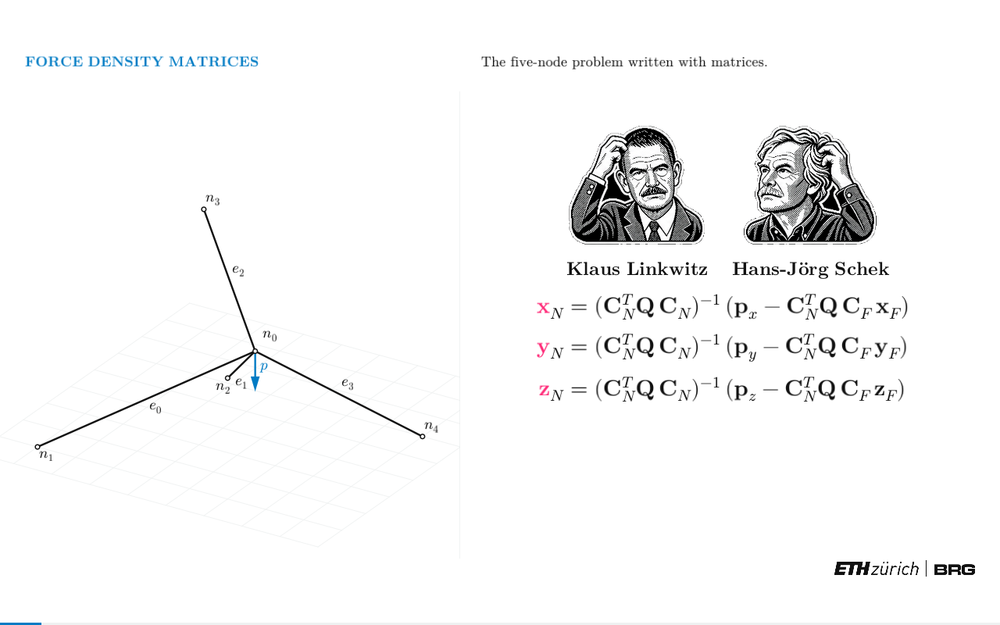
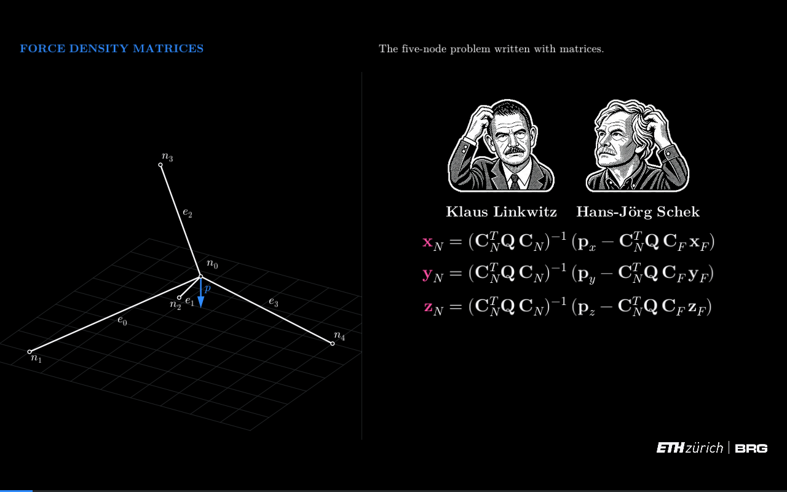
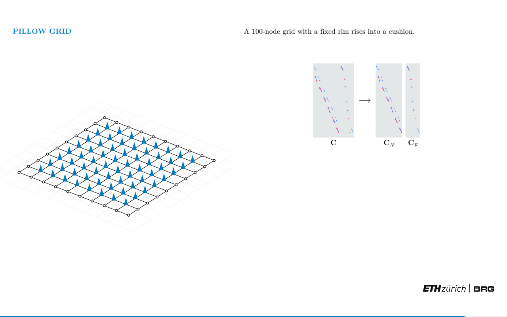
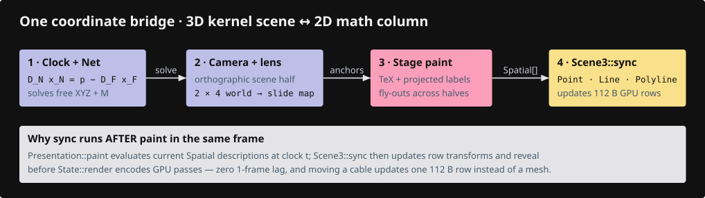
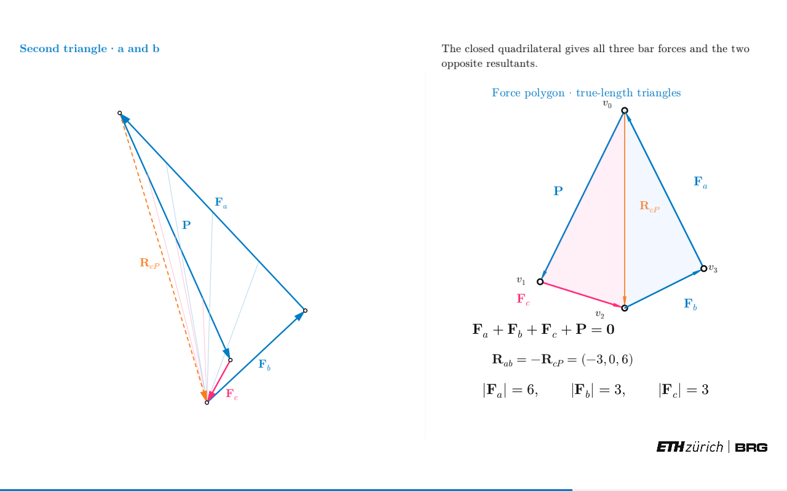
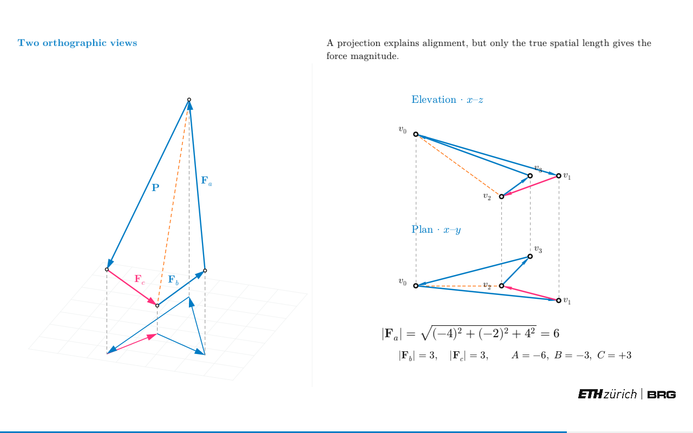
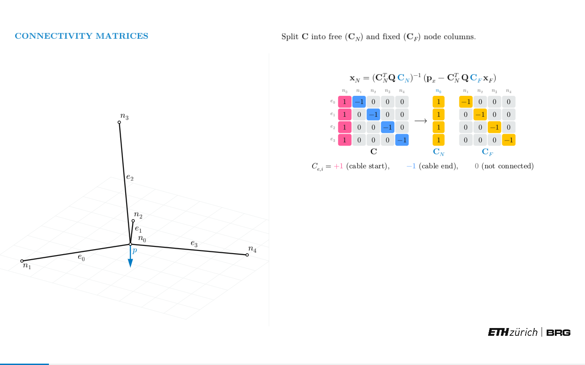
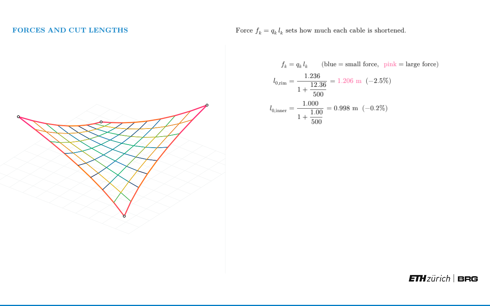
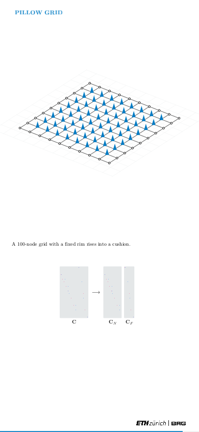

# Mathematics in the real scene

Synchronize `3D` `session_rust` open-ring nodes, elongated `24×0.30` force vectors, auxiliary planes and force-density nets (`D_N x_N = p - D_F x_F`) with Tutorial 3's `1600×900` TeX, matrix and `2D` orthographic `drawing:` stage through one orthographic camera lens.









## Prerequisites and ownership

Chapter `9.8` of [9. Run the application](completion-application.md) (`application` checkpoint). Connects Tutorial 3's `Presentation` to `State` across `6` modules in `src/app/stage/` (`geometry.rs`, `view.rs`, `net.rs`, `mode.rs`, `spatial.rs`, `application.rs`) without modifying the `2D` TeX, matrix and `flat.rs` core.

## Build

### Geometry descriptions become kernel objects

`src/app/stage/geometry.rs` evaluates named `3D` points at clock `t`, emits `Spatial` descriptors (`Point`, `Line`, `Polyline`, `12`-edge cuboids, stroke width, `scale.powf(0.3)` pen scaling, dash and reveal), and places `16`-direction collision-scored anchor labels (`+15` hysteresis bonus).

```rust
--8<-- "session_viewer/src/app/stage/spatial.rs:stage-kernel-geometry"
```

### Order one scene frame & sync GPU rows

- `src/app/stage/mode.rs` runs each frame in strict order: tick stage clock -> apply orthographic camera -> derive `2×4` world-to-slide `lens` -> `Presentation::paint` (emitting current `Spatial` list) -> `Scene3::sync` -> return `egui::FullOutput`.
- `src/app/stage/spatial.rs` (`Scene3`) sets `state.scene.arrowhead_pens = 24.0` for elongated `0.30`-aspect heads, bakes each `3D` `Point` as an outer `ink` disc plus a `0.58`-scale `bg` paper-centre disc, and maps stage IDs to non-pickable `112 B` GPU rows updated in place.

```rust
--8<-- "session_viewer/src/app/stage/mode.rs:stage-frame-order"
```

```rust
--8<-- "session_viewer/src/app/stage/spatial.rs:stage-scene-rows"
```

### Spatial graphic statics and 2D orthographic constructions




In [examples/stage/foppl-spatial-joint/03-force-polygon.yaml](../../examples/stage/foppl-spatial-joint/03-force-polygon.yaml) and [04-projections.yaml](../../examples/stage/foppl-spatial-joint/04-projections.yaml), `3D` `arrow:` / `line:` / `point:` objects on the WebGPU side pair directly with `2D` `drawing:` constructions (`flat.rs`) on the column side — sharing the exact `24.0 × 0.30` arrowhead proportions, open-ring vertices and `pink_band` / `blue_band` washes:

```yaml
--8<-- "session_viewer/examples/stage/foppl-spatial-joint/03-force-polygon.yaml:15:25"
```

### The scene camera also projects labels

`src/app/stage/view.rs` frames the `3D` points orthographically inside the slide's scene half (side-by-side on desktop, top half via `Frame::stacked` on upright screens) so `spatial::lens` projects node labels and `fill`/`fly` animations from live orbited coordinates.

```rust
--8<-- "session_viewer/src/app/stage/spatial.rs:stage-camera-projection"
```

```rust
--8<-- "session_viewer/src/app/stage/view.rs:stage-camera-fit"
```

### Build and solve the cable-net matrices




`src/app/stage/net.rs` constructs free/fixed branch-node incidence matrices `(C_N, C_F)`, assembles `D = C^T Q C`, solves `D_N x_N = p - D_F x_F` across `XYZ` for anchored positive-density nets, and exposes `Net::matrix` directly to the slide column.

```rust
--8<-- "session_viewer/src/app/stage/net.rs:stage-net-equilibrium"
```

### Input and portrait layout



`src/app/stage/application.rs` (`StageApp`) routes `?stage=...` index/chapter/picture/font prefetches, keyboard steps/chapters/themes (`T`), scene-half mouse orbit/zoom/double-click reset, column-click advance, and touch gestures across desktop and `Frame::stacked` upright layouts.

```rust
--8<-- "session_viewer/src/app/stage/application.rs:stage-touch"
```

### Author and serve a multi-chapter deck (`?stage=...&data=off`)

Opening `http://127.0.0.1:8080/?stage=decks/force-density-matrices/index.yaml&data=off` runs any of the `6` shipped multi-chapter YAML decks (`27` chapters across `equilibrium`, `force-density`, `force-density-matrices`, `force-density-derivation`, `force-density-materialization` and `foppl-spatial-joint`) directly from `examples/stage/` without viewer UI chrome:

| Layer | Contract |
| --- | --- |
| Trunk copy & preload | [index.html](../../index.html) copies `assets/stage -> stage/` (`4` `NewCM*.otf` faces + `ETH` and `BRG` marks) and `examples/stage -> decks/`, removes `#viewer-docs`, and prefetches fonts, `index.yaml` and every chapter `.yaml` ahead of `.wasm`. |
| `&data=off` vs R2 | `?stage=force-density-matrices` resolves `stage/force-density-matrices/index.yaml` on Cloudflare R2; appending `&data=off` sets the data root to `""` so local `trunk serve` loads `decks/.../index.yaml` with hot reload on YAML save and skips remote scene fetches. |
| Address flags & keys | `&chapter=1..7&step=N` jumps to a 1-based chapter and settled step; `&theme=light` or `&theme=dark` (or `T`) sets the ground; `Space`/`→`/`←` step, `↓`/`↑` jump slides, `1..9` switch chapters and `R` (or `2×` click on the `3D` half) resets the camera. |
| Named `net:` matrices & verbs | `Net::matrix` provides `C, CN, CF, q, Q, DN, DF, xF, p, b, xN, l, L, f, U` (auto-switching `> 14` rows/cols to sparse `pattern` squares); `show: net`, `show: [cables, fixed, loads]`, `show: forces`, `solve`, `reveal`, `fill`, `multiply`, `eliminate`, `node`, `project`, `walk` and `fly` (`with: true` for parallel actions) synchronize `3D` cables/nodes with `2D` matrix slices. |

Deck manifest ([examples/stage/force-density-matrices/index.yaml](../../examples/stage/force-density-matrices/index.yaml)) and Chapter 1 setup ([01-givens.yaml](../../examples/stage/force-density-matrices/01-givens.yaml)):

```yaml
--8<-- "session_viewer/examples/stage/force-density-matrices/index.yaml:6:14"
```

```yaml
--8<-- "session_viewer/examples/stage/force-density-matrices/01-givens.yaml:6:35"
```

Chapter 2 ([02-matrices.yaml](../../examples/stage/force-density-matrices/02-matrices.yaml)) pins a reusable `balance` equation block with `{{...}}` sub-parts, lights each `3D` cable `e0..e3` in `yellow` as its row in `Cm` appears, and flies columns into `CNs` and `CFs`:

```yaml
--8<-- "session_viewer/examples/stage/force-density-matrices/02-matrices.yaml:16:62"
```

## Run and observe

Serve `production.html` and open `/?stage=decks/force-density-matrices/index.yaml&data=off&chapter=7&step=1`:

- Opens on the default white paper ground with the flat `10×10` open-ring grid (`36` fixed boundary nodes, `64` free interior nodes with upward `#007bc4` load arrows) beside `C -> CN, CF`.
- Press `ArrowRight` through equilibrium solve (`z_max = 2.025`) and the runnable SciPy Cholesky script; drag the left half to orbit (labels track nodes live) and press `T` to swap white and black grounds.

## Predict and try

In `examples/stage/force-density-matrices/07-pillow.yaml`, double `load: [0, 0, 0.35]` to `[0, 0, 0.7]`: predict `z_max` (`4.05` — linear in `p` for fixed `D_N`), then restore `load`, double `q: 1` to `q: 2` (`z_max = 1.0125`), and press `ArrowLeft` to verify flat-grid replay.

## Question and answer

**Why compute `spatial::lens` from the live `Camera` *after* user orbit rather than from the YAML deck's authored camera?**
Orbiting rotates `3D` cables and nodes on the GPU; projecting TeX node labels and matrix `fly` trajectories through the live `Camera` keeps `2D` labels locked onto their orbited `3D` vertices.

## Validation

Verified by `24` passing native application stage tests and [the stage reconciliation receipt](release/completion-stage-reconciliation-windows-20261118c.json) covering all `27` chapters of all `6` shipped decks (`equilibrium`, `force-density`, `force-density-matrices`, `force-density-derivation`, `force-density-materialization`, `foppl-spatial-joint`) at `1280×800` and `390×844` (`54` cases, `220` forward step checks, backward replay, white/dark swaps, `0` settled overlaps and `85` reviewed captures), plus `6` injected font/chapter/picture error checks. Physical-phone touch hardware remains separate.
