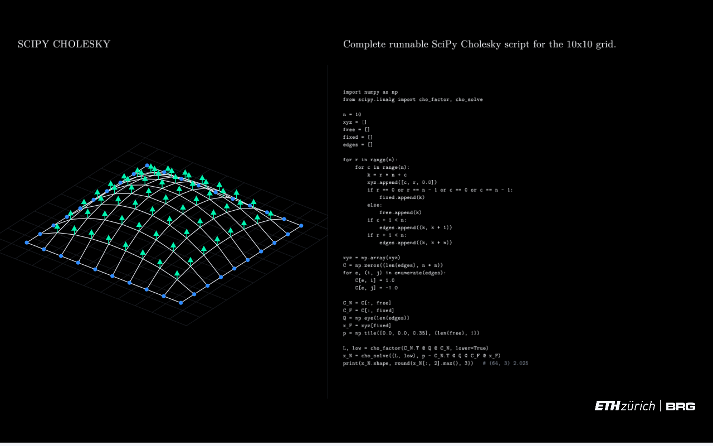
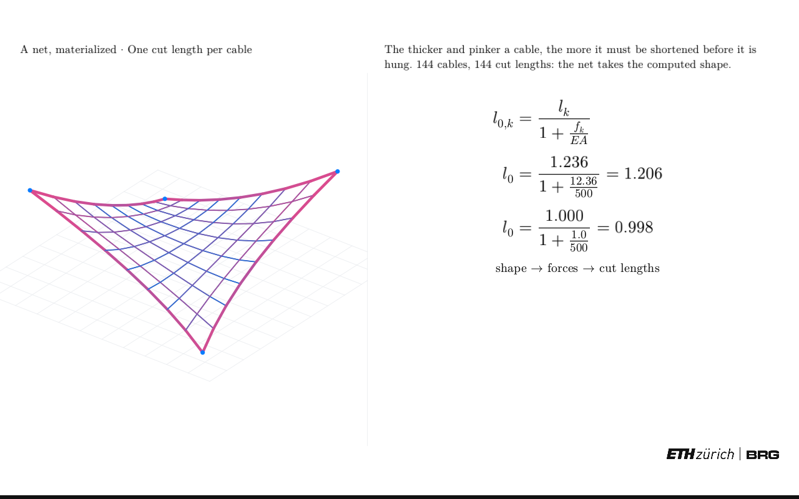

# Mathematics in the real scene

Synchronize `3D` `session_rust` points, cables and force-density nets (`D_N x_N = p - D_F x_F`) with Tutorial 3's `1600×900` TeX/matrix stage through a single orthographic camera lens.





## Prerequisites and ownership

Chapter `9.8` of [9. Run the application](completion-application.md) (`application` checkpoint). Connects Tutorial 3's `Presentation` to `State` across `6` modules in `src/app/stage/` (`geometry.rs`, `view.rs`, `net.rs`, `mode.rs`, `spatial.rs`, `application.rs`) without modifying the `2D` TeX/matrix core.

## Build

### Geometry descriptions become kernel objects

`src/app/stage/geometry.rs` evaluates named `3D` points at clock `t`, emits `Spatial` descriptors (`Point`, `Line`, `Polyline`, `12`-edge cuboids, stroke width, `scale.powf(0.3)` pen scaling, dash and reveal), and places `16`-direction collision-scored anchor labels (`+15` hysteresis bonus).

```rust
--8<-- "session_viewer/src/app/stage/spatial.rs:stage-kernel-geometry"
```

### Order one scene frame & sync GPU rows

- `src/app/stage/mode.rs` runs each frame in strict order: tick stage clock -> apply orthographic camera -> derive `2×4` world-to-slide `lens` -> `Presentation::paint` (emitting current `Spatial` list) -> `Scene3::sync` -> return `egui::FullOutput`.
- `src/app/stage/spatial.rs` (`Scene3`) maps authored stage IDs to non-pickable `112 B` GPU rows, updating point/segment `Xform`s, RGBA tints and reveal in place (rebuilding rows only on polyline shape/width/dash changes or `> 2%` slide-scale resets).

```rust
--8<-- "session_viewer/src/app/stage/mode.rs:stage-frame-order"
```

```rust
--8<-- "session_viewer/src/app/stage/spatial.rs:stage-scene-rows"
```

### The scene camera also projects labels



`src/app/stage/view.rs` frames the `3D` points orthographically inside the slide's scene half (side-by-side on desktop, top half via `Frame::stacked` on upright screens) so `spatial::lens` projects node labels and `fill`/`fly` animations from live orbited coordinates.

```rust
--8<-- "session_viewer/src/app/stage/spatial.rs:stage-camera-projection"
```

```rust
--8<-- "session_viewer/src/app/stage/view.rs:stage-camera-fit"
```

### Build and solve the cable-net matrices

`src/app/stage/net.rs` constructs free/fixed branch-node incidence matrices `(C_N, C_F)`, assembles `D = C^T Q C`, solves `D_N x_N = p - D_F x_F` across `XYZ` for anchored positive-density nets, and exposes `Net::matrix` directly to the slide column.

```rust
--8<-- "session_viewer/src/app/stage/net.rs:stage-net-equilibrium"
```

### Input and portrait layout

`src/app/stage/application.rs` (`StageApp`) routes keyboard steps/chapters/themes, scene-half mouse orbit/zoom/double-click reset, column-click step advance, and single-finger touch gestures (short tap, horizontal swipe step, hold-to-orbit) across desktop and `Frame::stacked` upright layouts.

```rust
--8<-- "session_viewer/src/app/stage/application.rs:stage-touch"
```

## Run and observe

Serve `production.html` and open `/?stage=decks/force-density-matrices/index.yaml&data=off&chapter=7&step=1`:

- Opens on the dark default ground with the flat `10×10` grid (`36` fixed boundary nodes, `64` free interior nodes) beside `C -> CN, CF`.
- Press `ArrowRight` through equilibrium solve (`z_max = 2.025`) and the runnable SciPy Cholesky script; drag the left half to orbit (labels track nodes live) and press `T` to toggle dark/light ground.

## Predict and try

In `examples/stage/force-density-matrices/07-pillow.yaml`, double `load: [0, 0, 0.35]` to `[0, 0, 0.7]`: predict `z_max` (`4.05` — linear in `p` for fixed `D_N`), then restore `load`, double `q: 1` to `q: 2` (`z_max = 1.0125`), and press `ArrowLeft` to verify flat-grid replay.

## Question and answer

**Why compute `spatial::lens` from the live `Camera` *after* user orbit rather than from the YAML deck's authored camera?**
Orbiting rotates `3D` cables and nodes on the GPU; projecting TeX node labels and matrix `fly` trajectories through the live `Camera` keeps `2D` labels locked onto their orbited `3D` vertices.

## Validation

Verified by `20` native application stage tests and [the stage reconciliation receipt](release/completion-stage-reconciliation-windows-20261118.json) covering all 22 chapters of all five decks at `1280×800` and `390×844` (`44` cases, `176` forward step checks, backward replay, light/dark swaps, `0` settled overlaps and `68` reviewed captures), plus `6` injected font/chapter/picture error checks. Physical-phone touch hardware remains separate.
