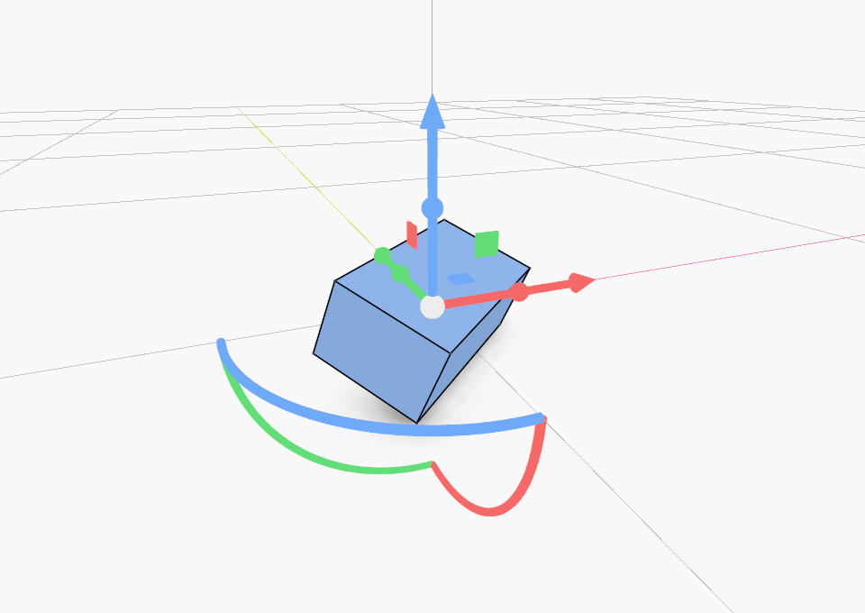
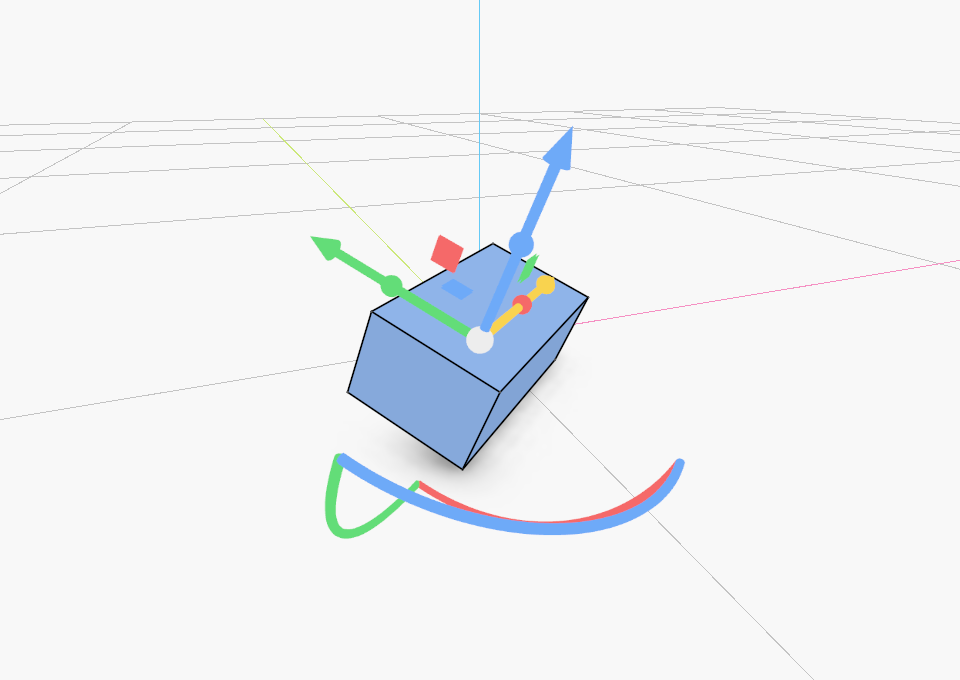
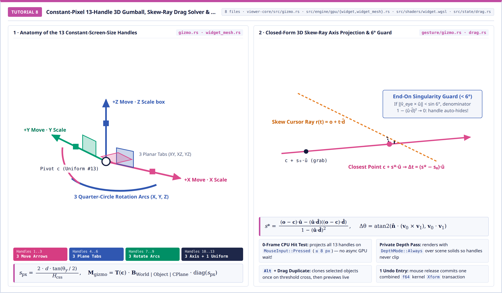

# Tutorial 8 · Gumball widget and interactive handles

## Goal

Render a screen-constant 13-handle 3D gumball (`World`, `Object`, or `CPlane` aligned, with custom pivot) in a private `DepthMode::Always` pass, hit-test handles instantaneously on the CPU, and commit axis/plane/arc/scale drags as single transactions.

 

**What we achieve:** A constant-pixel 13-handle 3D Gumball (`Translate 0..=2`, `Rotate 3..=5`, `Scale 6..=8`, `ScaleUniform 9`, `TranslatePlane 10..=12`) supporting `World`, `Object`, and `CPlane` alignment, numeric entry, and `Alt`-duplicate dragging.

## How it works

`gizmo.rs` hit-tests all 13 handles instantaneously on the CPU (`GRAB = 8.0 px`), solves axis drags in closed form via `line_line_parameters` with end-on singularity fading and `SCALE_SOFTENING = 0.5`, renders always-on-top via `widget.wgsl`, and commits one combined `f64` `Xform` on mouse release.



## Compilable checkpoint slice

The pure-Rust `gizmo.rs` math and `widget.wgsl` GPU pass compile starting at `geometry` (`174` files), with `Gumball` verb and `State` drag handlers joining in `application`.

Lines marked `+` show the exact module declarations unlocked between `rows` (`80` files) and `geometry` (`174` files):

```rust
// viewer-core/src/lib.rs (rows -> geometry)
  pub mod camera;
+ pub mod gizmo;
+ pub mod interactions;
+ pub mod knobs;
  pub mod rows;
  pub mod sink;
+ pub mod walk;
  pub use crate as app;
  pub use sink as core;
  pub use sink::GpuSink;

// src/engine/mod.rs (rows -> geometry)
  pub mod diagnostics;
  pub mod gpu;
  pub mod performance;
  pub mod pipelines;
+ pub mod text; // register:text

// src/engine/gpu/mod.rs (rows -> geometry)
+ pub mod arena; // register:arena
+ pub mod backdrop; // register:backdrop
  pub mod buffers; // register:buffers
+ pub mod clip; // register:clip
+ pub mod cloud; // register:cloud
  pub mod device; // register:device
+ pub mod faces; // register:faces
+ pub mod frame; // register:frame
+ pub mod glyphs; // register:glyphs
  pub mod hull; // register:hull
  pub mod instance; // register:instance
+ pub mod instanced; // register:instanced
+ pub mod lod; // register:lod
  pub mod objects;
+ pub mod slots; // register:slots
+ pub mod lane; // register:lane
+ #[cfg(target_arch = "wasm32")]
+ mod pacing;
+ pub mod pass; // register:pass
+ pub(crate) mod patch; // register:patch
+ pub mod pick; // register:pick
+ pub mod planes; // register:planes
+ pub mod present; // register:present
+ pub mod render; // register:render
+ pub mod segments; // register:segments
+ pub mod splat; // register:splat
+ mod ssao; // register:ssao
+ pub mod surface_outline; // register:surface_outline
+ pub mod targets; // register:targets
+ pub mod text; // register:text
+ pub mod text_outline; // register:text_outline
+ pub mod timing; // register:timing
+ mod triangle_tiles; // register:triangle_tiles
  pub mod ui; // register:ui
+ pub mod upload; // register:upload
+ pub mod vectors; // register:vectors
+ pub mod view; // register:view
+ mod widget; // register:widget
+ mod widget_mesh; // register:widget_mesh
+ mod context;
+ mod sink;
+ pub use context::Gpu;
+ #[cfg(test)]
+ pub(crate) use context::lane_shaders;
+ #[allow(unused_imports)]
+ pub use cloud::{CloudDraw, LodNode, NO_NORMALS}; // register:clouds
+ pub use frame::FrameInput;
+ pub use glyphs::GlyphPoint; // register:markers
+ pub use instance::Instance;
+ #[allow(unused_imports)]
+ pub use objects::{ObjectRow, Rebase};
+ pub use pick::Pick; // register:shell
+ pub use segments::CylinderSegment; // register:strokes
+ pub use upload::Upload;
+ pub use view::View;

// src/app/mod.rs (rows -> geometry)
+ pub use viewer_core::gizmo; // register:gizmo
+ pub use viewer_core::interactions; // register:interactions
+ pub use viewer_core::knobs; // register:knobs
  #[cfg(target_arch = "wasm32")]
  pub mod launch;
  pub mod mode; // register:mode
  pub mod stage;
+ pub use viewer_core::walk; // register:walk

// examples/course/registration.rs (rows -> geometry)
  // --8<-- [start:course-registration]
  #[path = "canvas.rs"]
  mod canvas;
  #[path = "frame.rs"]
  mod frame;
  #[path = "painting.rs"]
  mod painting;
  #[path = "mathematics.rs"]
  mod mathematics;
  #[path = "dock.rs"]
  mod dock;
  #[path = "camera.rs"]
  mod camera;
  #[path = "rows.rs"]
  mod rows;
+ #[path = "geometry.rs"]
+ mod geometry;
  type Start = fn() -> Result<(), wasm_bindgen::JsValue>;
  pub(super) const STARTS: &[(&str, Start)] = &[
      ("frame", frame::start),
      ("painting", painting::start),
      ("mathematics", mathematics::start),
      ("dock", dock::start),
      ("camera", camera::start),
      ("rows", rows::start),
+     ("geometry", geometry::start),
  ];
  // --8<-- [end:course-registration]
```

## Core code walkthrough

### Pivot conjugation & 13 `Handle` indices (`viewer-core/src/gizmo.rs:44:92`)

```rust
--8<-- "session_viewer/viewer-core/src/gizmo.rs:44:92"
```

`centred_about` (lines `44–51`) conjugates any local rotation or scale `inner` by `T(p) · inner · T(−p)` so custom gumball pivots never drift. `Handle` (lines `55–74`) maps all 13 interactive parts to contiguous shader IDs `0..=12`: `Translate(X,Y,Z) -> 0..=2`, `Rotate(X,Y,Z) -> 3..=5`, `Scale(X,Y,Z) -> 6..=8`, `ScaleUniform -> 9`, and two-axis `TranslatePlane(YZ,XZ,XY) -> 10..=12`.

### Offscreen MSAA tile & active-handle highlight (`src/shaders/widget.wgsl:1:61`)

```wgsl
--8<-- "session_viewer/src/shaders/widget.wgsl:1:61"
```

`widget.wgsl` renders the gumball into a small private MSAA tile (`vs_main`/`fs_main`, lines `20–37`), turning whichever handle matches `widget.settings.x` bright amber `(0.95, 0.65, 0.08)` on hover/drag. `vs_composite`/`fs_composite` (lines `47–61`) then un-premultiplies `pixel.rgb / max(pixel.a, 1e-5)` and alpha-blends that tile onto `widget.rect` over the finished 3D scene so handles stay occluded among themselves yet always visible through solids.

## Prerequisites and files

Requires [Tutorial 7](tutorial-seven-picking.md). Owns `viewer-core/src/gizmo.rs`, `verbs/gumball.rs`, `src/engine/gpu/{widget_mesh,widget}.rs`, `src/shaders/widget.wgsl`, `src/app/gesture/{gizmo,control}.rs`, and `src/state/drag.rs`.

**Core files to type inline (6 files):**

1. `viewer-core/src/gizmo.rs`
2. `src/engine/gpu/widget_mesh.rs`
3. `src/engine/gpu/widget.rs`
4. `src/shaders/widget.wgsl`
5. `src/app/gesture/gizmo.rs`
6. `src/state/drag.rs`

**Reference catalog & test files (2 files, folded below):** `viewer-core/src/command/verbs/gumball.rs`, `src/app/gesture/control.rs`.

## Build

### Step 1 · `viewer-core/src/gizmo.rs`

Computes `3`-axis arrow, quarter-ring arc and scale-ball `Xform` deltas from ray-axis closest points, plane angles (`90°` snap) and pivot reach.

```rust
--8<-- "session_viewer/viewer-core/src/gizmo.rs"
```

### Step 2 · `src/engine/gpu/widget_mesh.rs`

`src/engine/gpu/widget_mesh.rs` (158 lines) defines `struct Vertex`, `vertices()`, `COLORS`, `SIDES`. It provides `orient()`, `lathe()`, `sphere()`.

```rust
--8<-- "session_viewer/src/engine/gpu/widget_mesh.rs"
```

### Step 3 · `src/engine/gpu/widget.rs`

Renders the gumball into a private depth-tested tile (`96 B` uniform) and composites it over the scene so solids never bury active handles.

```rust
--8<-- "session_viewer/src/engine/gpu/widget.rs"
```

### Step 4 · `src/shaders/widget.wgsl`

`src/shaders/widget.wgsl` shades the `13`-handle manipulation gumball inside its own depth-tested tile (`widget.rect`) so handles occlude each other cleanly in `3D` while floating unobstructed above scene solids.

```wgsl
--8<-- "session_viewer/src/shaders/widget.wgsl"
```

### Step 5 · `src/app/gesture/gizmo.rs`

Claims gumball handle presses: a click without motion opens the floating `number_box`, whereas a drag previews on GPU rows and commits once on release.

```rust
--8<-- "session_viewer/src/app/gesture/gizmo.rs"
```

### Step 6 · `src/state/drag.rs`

Bins snap `Targets` in screen cells (invalidated on camera change) and retains early mouse-release state in `ObjectDrag` until delayed GPU pick readback resolves.

```rust
--8<-- "session_viewer/src/state/drag.rs"
```

## Reference catalog and test files (2 files)

The 6 core files above implement the complete mechanism for this lesson. Expand this reference section whenever you want to inspect or copy the remaining 2 sibling verbs, adapters, and unit-test suites (`Step 7`–`Step 8`).

### Step 7 · `viewer-core/src/command/verbs/gumball.rs`

`viewer-core/src/command/verbs/gumball.rs` (62 lines) registers the `Gumball` command (`Gumball <World | Object | CPlane | Pivot x,y,z | Reset>: align or relocate the gumball`). Its `Action::run` handler exposes option chips `Gumball World`, `Gumball Object`, `Gumball CPlane`, `Gumball Reset` and dispatches through `host.set_gizmo_align()`, `host.set_gizmo_pivot()` after validating arguments so invalid CLI or interactive input leaves undo history untouched.

```rust
--8<-- "session_viewer/viewer-core/src/command/verbs/gumball.rs"
```

### Step 8 · `src/app/gesture/control.rs`

Claims control-point presses, cancelling sub-threshold clicks cleanly while committing true vertex/CV drags on release.

```rust
--8<-- "session_viewer/src/app/gesture/control.rs"
```

## Integration

`gesture/mod.rs` tries `control` and `gizmo` before `object` and `box_select` so pressing an active handle starts `GizmoDrag` synchronously on mouse-down without waiting a frame for an async GPU pick. `Gumball World|Object|CPlane|Pivot x,y,z|Reset` updates `SelectionState`'s gumball alignment and custom pivot.

## Run and observe

Run all `14` 3D Gumball handle, end-on grazing guard, quarter-turn snap, and drag-commit tests:

```sh
cargo xtest -p viewer-core gizmo::tests
cargo xtest -p session_viewer widget_mesh::tests
cargo xtest -p session_viewer state::drag::tests
```

Select any rotated solid in the viewer and run `Gumball Object` vs `Gumball World` (or `Alt`-drag an arrow handle to duplicate in one undoable transaction).

## Predict and try

Predict what happens when you view the gumball straight down its `+X` axis (`eye - pivot` nearly parallel to `+X`) and drag near the `+X` shaft: projecting a cursor delta onto a nearly-parallel ray explodes world distance to infinity, so `gizmo.rs` (`an_axis_seen_end_on_is_not_grabbable`) hides and disables end-on axis handles below the grazing sine threshold.

## Question and answer

**Why test gumball handle hits on the CPU in projected CSS pixels instead of drawing the 13 handles into `Pick`'s GPU `Rg32Uint` ID pass?**

??? tip "Think first — click to reveal how to work it out and the answer"
    **How to work it out:** Compare synchronous press dispatch in `winit` (`MouseInput::Pressed`) against `wgpu` buffer mapping (`Picker::request` -> next frame render -> `map_async` completion).

    **The answer:** A drag gesture must decide on the exact `Pressed` event whether the pointer grabbed a gumball handle or began orbiting/box-selecting the scene; waiting for an asynchronous GPU readback would leak the initial drag frames into camera orbit, and `State::touch` during the drag would cancel in-flight GPU picks. Projecting 13 analytic handles on the CPU takes microseconds, obeys an exact `8 CSS px` aperture, and agrees with the always-on-top `widget.wgsl` draw rule.

## Validation

Verified via `cargo xtest -p viewer-core gizmo::tests` (`14/14` passed), `widget_mesh::tests::mesh_is_bounded_finite_and_covers_all_handles`, and `state::drag::tests` (`3/3` passed).
