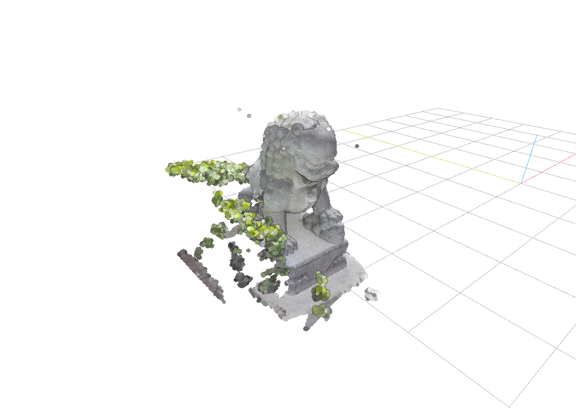
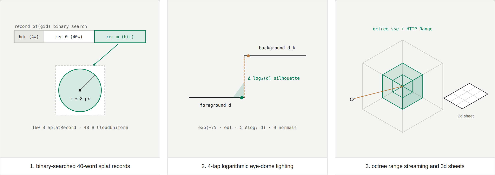

# Tutorial 11 · Point clouds, octree LOD and sheets

## Goal

Traverse precomputed `LodNode` point-cloud octrees with 8-corner clip-space frustum culling and `2.0 px` screen-spacing cutoffs, shade splats with Eye-Dome Lighting (EDL), stream `250k`-point chunks, and query cloud/sheet elements lazily.

 

**What we achieve:** Million-point LiDAR/photogrammetry rendering (`splat.wgsl` + `splat_resolve.wgsl`) with normal-free Eye-Dome Lighting, out-of-core HTTP `Range` octree streaming (`lod.rs`), exact `fixed32` point queries, and 3D-placed CAD drawing sheets.

## How it works

`splat.wgsl` binary-searches cumulative point counts across `40`-word (`160 B`) `SplatRecord` headers (`record_of(gid)`) to project SoA `positions`/`colors`/`normals` with clamped screen radii `[r_min, 8 px]`, `splat_resolve.wgsl` shades 4-neighbour `log2` depth steps (`max(exp(-75 · edl · sum), 0.25)`), and `cloud_query.rs` / `sheet_query.rs` stream paged picks and side-table metadata.



## Compilable checkpoint slice

Octree LOD (`lod.rs`), splat/EDL shaders (`splat.wgsl`, `splat_resolve.wgsl`), and resident cloud/sheet walks compile starting at `geometry` (`174` files).

Lines marked `+` show the exact module declarations unlocked between `rows` (`80` files) and `geometry` (`174` files):

```rust
// viewer-core/src/lib.rs (rows -> geometry)
  pub mod camera;
+ pub mod gizmo;
+ pub mod interactions;
+ pub mod knobs;
  pub mod rows;
  pub mod sink;
+ pub mod walk;
  pub use crate as app;
  pub use sink as core;
  pub use sink::GpuSink;

// src/engine/mod.rs (rows -> geometry)
  pub mod diagnostics;
  pub mod gpu;
  pub mod performance;
  pub mod pipelines;
+ pub mod text; // register:text

// src/engine/gpu/mod.rs (rows -> geometry)
+ pub mod arena; // register:arena
+ pub mod backdrop; // register:backdrop
  pub mod buffers; // register:buffers
+ pub mod clip; // register:clip
+ pub mod cloud; // register:cloud
  pub mod device; // register:device
+ pub mod faces; // register:faces
+ pub mod frame; // register:frame
+ pub mod glyphs; // register:glyphs
  pub mod hull; // register:hull
  pub mod instance; // register:instance
+ pub mod instanced; // register:instanced
+ pub mod lod; // register:lod
  pub mod objects;
+ pub mod slots; // register:slots
+ pub mod lane; // register:lane
+ #[cfg(target_arch = "wasm32")]
+ mod pacing;
+ pub mod pass; // register:pass
+ pub(crate) mod patch; // register:patch
+ pub mod pick; // register:pick
+ pub mod planes; // register:planes
+ pub mod present; // register:present
+ pub mod render; // register:render
+ pub mod segments; // register:segments
+ pub mod splat; // register:splat
+ mod ssao; // register:ssao
+ pub mod surface_outline; // register:surface_outline
+ pub mod targets; // register:targets
+ pub mod text; // register:text
+ pub mod text_outline; // register:text_outline
+ pub mod timing; // register:timing
+ mod triangle_tiles; // register:triangle_tiles
  pub mod ui; // register:ui
+ pub mod upload; // register:upload
+ pub mod vectors; // register:vectors
+ pub mod view; // register:view
+ mod widget; // register:widget
+ mod widget_mesh; // register:widget_mesh
+ mod context;
+ mod sink;
+ pub use context::Gpu;
+ #[cfg(test)]
+ pub(crate) use context::lane_shaders;
+ #[allow(unused_imports)]
+ pub use cloud::{CloudDraw, LodNode, NO_NORMALS}; // register:clouds
+ pub use frame::FrameInput;
+ pub use glyphs::GlyphPoint; // register:markers
+ pub use instance::Instance;
+ #[allow(unused_imports)]
+ pub use objects::{ObjectRow, Rebase};
+ pub use pick::Pick; // register:shell
+ pub use segments::CylinderSegment; // register:strokes
+ pub use upload::Upload;
+ pub use view::View;

// src/app/mod.rs (rows -> geometry)
+ pub use viewer_core::gizmo; // register:gizmo
+ pub use viewer_core::interactions; // register:interactions
+ pub use viewer_core::knobs; // register:knobs
  #[cfg(target_arch = "wasm32")]
  pub mod launch;
  pub mod mode; // register:mode
  pub mod stage;
+ pub use viewer_core::walk; // register:walk

// examples/course/registration.rs (rows -> geometry)
  // --8<-- [start:course-registration]
  #[path = "canvas.rs"]
  mod canvas;
  #[path = "frame.rs"]
  mod frame;
  #[path = "painting.rs"]
  mod painting;
  #[path = "mathematics.rs"]
  mod mathematics;
  #[path = "dock.rs"]
  mod dock;
  #[path = "camera.rs"]
  mod camera;
  #[path = "rows.rs"]
  mod rows;
+ #[path = "geometry.rs"]
+ mod geometry;
  type Start = fn() -> Result<(), wasm_bindgen::JsValue>;
  pub(super) const STARTS: &[(&str, Start)] = &[
      ("frame", frame::start),
      ("painting", painting::start),
      ("mathematics", mathematics::start),
      ("dock", dock::start),
      ("camera", camera::start),
      ("rows", rows::start),
+     ("geometry", geometry::start),
  ];
  // --8<-- [end:course-registration]
```

## Core code walkthrough

### Frustum-culled octree `LodWalk` (`src/engine/gpu/lod.rs:24:75`)

```rust
--8<-- "session_viewer/src/engine/gpu/lod.rs:24:75"
```

Clouds under `LOD_MIN_POINTS = 2,000,000` points draw in a single unsplit `Range` (lines `58–66`). Above `2M` points, `LodWalk::select_frustum` reuses its scratch `stack` and `visits` vectors every frame (zero heap allocations during orbit), scales node point spacings by `Xform::uniform_scale()` (line `70`), culls octants outside `mvp_model`, and stops splitting whenever projected node spacing drops below `lod_px` (`2.0 px`).

### Normal-free 4-tap logarithmic Eye-Dome Lighting (`src/shaders/splat_resolve.wgsl:40:90`)

```wgsl
--8<-- "session_viewer/src/shaders/splat_resolve.wgsl:40:90"
```

Raw LiDAR scans often carry `XYZ + RGB` with no surface normals. `log_depth` (lines `40–42`) maps reverse-Z depth `d` to `-log2(max(d, 10⁻⁷))` so relative depth steps stay scale-invariant across distance. Lines `61–83` sum positive depth jumps `max(0, me − log_depth(nd))` across the 4 cardinal neighbours and multiply splat colour by `max(exp(-75 · edl · sum), 0.25)`, carving crisp dark silhouettes around foreground edges.

## Prerequisites and files

Requires [Tutorial 10](tutorial-ten-display.md). Owns `engine/gpu/{cloud,lod,splat,splat/cloud_witness*}.rs`, `shaders/{splat,splat_resolve}.wgsl`, `walk/{cloud*,sheet}.rs`, and `{viewer-core,app,state}/{cloud_query,sheet_query}.rs`.

**Core files to type inline (6 files):**

1. `src/engine/gpu/cloud.rs`
2. `src/engine/gpu/lod.rs`
3. `src/engine/gpu/splat.rs`
4. `src/shaders/splat.wgsl`
5. `src/shaders/splat_resolve.wgsl`
6. `viewer-core/src/cloud_query.rs`

**Reference catalog & test files (11 files, folded below):** `viewer-core/src/walk/cloud.rs`, `viewer-core/src/walk/cloud/resident.rs`, `viewer-core/src/walk/cloud/stream.rs`, `src/app/cloud_query.rs`, `src/state/cloud_query.rs`, `viewer-core/src/walk/sheet.rs`, `viewer-core/src/sheet_query.rs`, `src/app/sheet_query.rs`, `src/state/sheet_query.rs`, `src/engine/gpu/splat/cloud_witness.rs`, `src/engine/gpu/splat/cloud_witness/lod.rs`.

## Build

### Step 1 · `src/engine/gpu/cloud.rs`

Maps source point intervals to GPU `Chunk` offsets (`row_of` -> `None` when non-resident) with independent octree and normal bases.

```rust
--8<-- "session_viewer/src/engine/gpu/cloud.rs"
```

### Step 2 · `src/engine/gpu/lod.rs`

Traverses resident octree nodes against projected pixel spacing, camera distance and scale, clamping selected spans to uploaded residency.

```rust
--8<-- "session_viewer/src/engine/gpu/lod.rs"
```

### Step 3 · `src/engine/gpu/splat.rs`

Emits `160 B` (`40`-word) splat draw records cached by camera/LOD/revision key into dedicated `1×` colour and reverse-Z depth targets.

```rust
--8<-- "session_viewer/src/engine/gpu/splat.rs"
```

### Step 4 · `src/shaders/splat.wgsl`

`src/shaders/splat.wgsl`: Point cloud settings, 48 bytes; matches CloudUniform in Rust. Defines entry points `@vertex fn vs_point`, `@fragment fn fs_point`, `@fragment fn fs_point_id`, `@vertex fn vs_point_aa`; bindings `@group(0) @binding(0) cloud`, `@group(0) @binding(1) clipping`, `@group(1) @binding(0) table`, `@group(1) @binding(1) positions`; including `clip.wgsl`; keep struct layouts and binding indices aligned with their Rust `bytemuck` mirrors and Naga validation tests.

```wgsl
--8<-- "session_viewer/src/shaders/splat.wgsl"
```

### Step 5 · `src/shaders/splat_resolve.wgsl`

`src/shaders/splat_resolve.wgsl`: Point cloud settings, 48 bytes; matches CloudUniform in Rust. Defines entry points `@vertex fn vs_main`, `@fragment fn fs_main`, `@fragment fn fs_main_aa`; bindings `@group(0) @binding(0) cloud`, `@group(1) @binding(0) sdepth`, `@group(1) @binding(1) scolor`, `@group(1) @binding(2) sdepth_aa`; keep struct layouts and binding indices aligned with their Rust `bytemuck` mirrors and Naga validation tests.

```wgsl
--8<-- "session_viewer/src/shaders/splat_resolve.wgsl"
```

### Step 6 · `viewer-core/src/cloud_query.rs`

`viewer-core/src/cloud_query.rs` (503 lines) defines `struct QueryView`, `struct Candidate`, `struct Query`, `original_id()`, `project()`. It provides `clip()`, `intersects()`, `invalid_clip()`, `PAGE_POINTS`; and locked by `cargo xtest` (`original_fixed32_ids_preserve_all_bits_and_reject_partial_ranges`, `nodes_after_six_million_remain_eligible_and_uncovered_rows_are_scanned`, `cube_eligibility_uses_the_same_pixel_center_as_candidate_projection` (+3 more)).

```rust
--8<-- "session_viewer/viewer-core/src/cloud_query.rs"
```

## Reference catalog and test files (11 files)

The 6 core files above implement the complete mechanism for this lesson. Expand this reference section whenever you want to inspect or copy the remaining 11 sibling verbs, adapters, and unit-test suites (`Step 7`–`Step 17`).

### Step 7 · `viewer-core/src/walk/cloud.rs`

Declares the additive module boundary re-exporting `walk_cloud` now and registering `stream.rs` in checkpoint `application`.

```rust
--8<-- "session_viewer/viewer-core/src/walk/cloud.rs"
```

### Step 8 · `viewer-core/src/walk/cloud/resident.rs`

Packs kernel `PointCloud` positions, colours and complete normal arrays (`NO_NORMALS` when absent) with file-level `point_size` override.

```rust
--8<-- "session_viewer/viewer-core/src/walk/cloud/resident.rs"
```

### Step 9 · `viewer-core/src/walk/cloud/stream.rs`

`src/app/walk/cloud/stream.rs` appends streamed position, colour (black-padded when absent) and complete normal slices into GPU chunks, installing the octree table once on the first slice while preserving `(source_offset, gpu_offset)`.

```rust
--8<-- "session_viewer/viewer-core/src/walk/cloud/stream.rs"
```

### Step 10 · `src/app/cloud_query.rs`

`src/app/cloud_query.rs` (174 lines) defines `fetch_page()`, `resolve_id()`. It provides `source_request()`, `source_position()`, `page_candidates()`.

```rust
--8<-- "session_viewer/src/app/cloud_query.rs"
```

### Step 11 · `src/state/cloud_query.rs`

Assigns a monotonic generation to streamed-cloud control picks, ranking `65,536`-point pages on the GPU and discarding results if camera or selection changes.

```rust
--8<-- "session_viewer/src/state/cloud_query.rs"
```

### Step 12 · `viewer-core/src/walk/sheet.rs`

Walks flat `6`-float segment slices into the dedicated sheet lane with scene-unit half-widths and preserved `(source_offset, gpu_row)` spans.

```rust
--8<-- "session_viewer/viewer-core/src/walk/sheet.rs"
```

### Step 13 · `viewer-core/src/sheet_query.rs`

`viewer-core/src/sheet_query.rs` (161 lines) defines `struct EntityMeta`, `struct SheetTable`, `struct Query`, `table_count()`, `record()`. It provides `drop()`, `table()`, `HEAD_BYTES`, `RECORD_BYTES`; and locked by `cargo xtest` (`side_table_head_records_and_blobs_parse_from_a_hand_built_buffer`, `dropping_a_query_cancels_its_token`).

```rust
--8<-- "session_viewer/viewer-core/src/sheet_query.rs"
```

### Step 14 · `src/app/sheet_query.rs`

`src/app/sheet_query.rs` (96 lines) defines `fetch_entity()`, `read_entity()`. It connects `fetch_range`, `post`, `Cell`, `Rc` within `app` across native and `wasm32` targets.

```rust
--8<-- "session_viewer/src/app/sheet_query.rs"
```

### Step 15 · `src/state/sheet_query.rs`

Highlights picked sheet entities immediately on the parent row and resolves optional `.meta` side-table names under a generation token.

```rust
--8<-- "session_viewer/src/state/sheet_query.rs"
```

### Step 16 · `src/engine/gpu/splat/cloud_witness.rs`

Verifies the CPU DX12 `Microsoft Basic Render Driver` (`WARP`) before capturing cloud splat/EDL pixels, uploaded byte counts and shader text.

```rust
--8<-- "session_viewer/src/engine/gpu/splat/cloud_witness.rs"
```

### Step 17 · `src/engine/gpu/splat/cloud_witness/lod.rs`

Runs `LodWalk::select` on CPU cloud metadata to inspect chosen octree `(first, count, spacing, tile)` spans independently of shaders.

```rust
--8<-- "session_viewer/src/engine/gpu/splat/cloud_witness/lod.rs"
```

## Integration

`splat.rs` activates `lod_px = 2.0` automatically for clouds with `>= 2,000,000` points (overridable via `?lod=`), logs a one-time warning if draw runs hit `MAX_RECORDS`, and invalidates cached draw records whenever row visibility or camera frustum changes.

## Run and observe

Run the octree clip-frustum LOD (`lod_px = 2.0`), paged `fixed32` point-cloud query, and 3D drawing-sheet chunk mapping tests:

```sh
cargo xtest -p session_viewer engine::gpu::lod::tests
cargo xtest -p session_viewer sheet_chunks_map_global_ribbon_rows_to_segments_and_ids
cargo xtest -p viewer-core cloud_query::tests
cargo xtest -p viewer-core sheet_query::tests
```

## Predict and try

Predict what happens when you zoom out on a `20,000,000`-point lidar scan with `lod_px = 2.0` vs `lod_px = 0.0`: `lod::select_runs` halts recursion at coarse octree nodes as soon as projected point spacing drops below `2.0 px` and rejects off-screen octants via 8-corner clip outcodes, cutting splat vertex invocations by orders of magnitude (`octree_lod_splits_coarse_nodes_propagates_spacing_and_culls_outside_frustum`).

## Question and answer

**How does `splat_resolve.wgsl` give depth cues and surface relief on uncoloured or normal-free lidar point clouds without computing k-nearest-neighbour normals?**

??? tip "Think first — click to reveal how to work it out and the answer"
    **How to work it out:** Examine the inputs available in `splat_resolve.wgsl` after `splat.wgsl` rasterizes camera-facing point discs into the colour and linear/reverse-Z depth buffers.

    **The answer:** Eye-Dome Lighting (EDL) samples neighboring texels' log-depths around each splat pixel and darkens silhouettes where depth jumps abruptly toward the background, synthesizing crisp ambient-like contour shading in a single screen-space pass with zero normal vectors stored per point.

## Validation

Verified via `lod::tests` (`2/2` octree split, spacing propagation, and frustum culling tests), `cloud_query::tests` (`5/5` cancellation and cube-eligibility tests), and `sheet_query::tests` (`2/2`).
