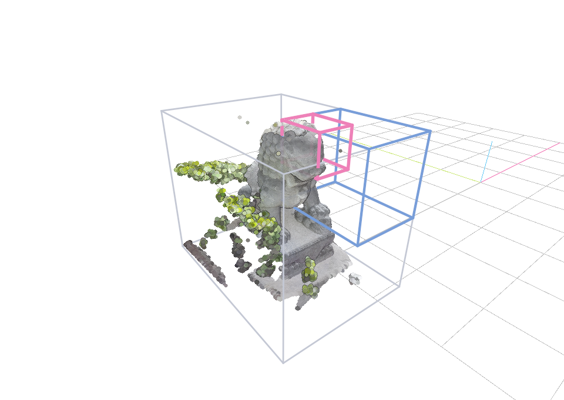

# Tutorial 11 · Point clouds, octree LOD and sheets

## Goal

Traverse precomputed `LodNode` point-cloud octrees with 8-corner clip-space frustum culling and `2.0 px` screen-spacing cutoffs, shade splats with Eye-Dome Lighting (EDL), stream `250k`-point chunks, and query cloud/sheet elements lazily.


**What we achieve:** Interactive million-point LiDAR and photogrammetry rendering with Eye-Dome Lighting (`EDL`) surface relief and out-of-core octree level-of-detail streaming.

## How it works

`splats.wgsl` expands each `16`-byte packed point (`xyz + rgba8`) into a circular screen-space quad writing radial depth, `edl.wgsl` shades logarithmic neighbour depth jumps `∑ max(0, log₂ z_c − log₂ z_i)` without requiring normals, and `cloud_stream` refines visible octree cells whose screen-space error `ρ = (r_k · H) / (2 · d · tan(θ / 2))` exceeds threshold.



## Prerequisites and files

Requires [Tutorial 10](tutorial-ten-display.md). Owns `engine/gpu/{cloud,lod,splat,splat/cloud_witness*}.rs`, `shaders/{splat,splat_resolve}.wgsl`, `walk/{cloud*,sheet}.rs`, and `{viewer-core,app,state}/{cloud_query,sheet_query}.rs`.

Owned files in build order (`17` files):

1. `src/engine/gpu/cloud.rs`
2. `src/engine/gpu/lod.rs`
3. `src/engine/gpu/splat.rs`
4. `src/shaders/splat.wgsl`
5. `src/shaders/splat_resolve.wgsl`
6. `viewer-core/src/walk/cloud.rs`
7. `viewer-core/src/walk/cloud/resident.rs`
8. `viewer-core/src/walk/cloud/stream.rs`
9. `viewer-core/src/cloud_query.rs`
10. `src/app/cloud_query.rs`
11. `src/state/cloud_query.rs`
12. `viewer-core/src/walk/sheet.rs`
13. `viewer-core/src/sheet_query.rs`
14. `src/app/sheet_query.rs`
15. `src/state/sheet_query.rs`
16. `src/engine/gpu/splat/cloud_witness.rs`
17. `src/engine/gpu/splat/cloud_witness/lod.rs`

## Build

### Step 1 · `src/engine/gpu/cloud.rs`

Maps source point intervals to GPU `Chunk` offsets (`row_of` -> `None` when non-resident) with independent octree and normal bases.

```rust
--8<-- "session_viewer/src/engine/gpu/cloud.rs"
```

### Step 2 · `src/engine/gpu/lod.rs`

Traverses resident octree nodes against projected pixel spacing, camera distance and scale, clamping selected spans to uploaded residency.

```rust
--8<-- "session_viewer/src/engine/gpu/lod.rs"
```

### Step 3 · `src/engine/gpu/splat.rs`

Emits `160 B` (`40`-word) splat draw records cached by camera/LOD/revision key into dedicated `1×` colour and reverse-Z depth targets.

```rust
--8<-- "session_viewer/src/engine/gpu/splat.rs"
```

### Step 4 · `src/shaders/splat.wgsl`

`src/shaders/splat.wgsl`: Point cloud settings, 48 bytes; matches CloudUniform in Rust. Defines entry points `@vertex fn vs_point`, `@fragment fn fs_point`, `@fragment fn fs_point_id`, `@vertex fn vs_point_aa`; bindings `@group(0) @binding(0) cloud`, `@group(0) @binding(1) clipping`, `@group(1) @binding(0) table`, `@group(1) @binding(1) positions`; including `clip.wgsl`; keep struct layouts and binding indices aligned with their Rust `bytemuck` mirrors and Naga validation tests.

```wgsl
--8<-- "session_viewer/src/shaders/splat.wgsl"
```

### Step 5 · `src/shaders/splat_resolve.wgsl`

`src/shaders/splat_resolve.wgsl`: Point cloud settings, 48 bytes; matches CloudUniform in Rust. Defines entry points `@vertex fn vs_main`, `@fragment fn fs_main`, `@fragment fn fs_main_aa`; bindings `@group(0) @binding(0) cloud`, `@group(1) @binding(0) sdepth`, `@group(1) @binding(1) scolor`, `@group(1) @binding(2) sdepth_aa`; keep struct layouts and binding indices aligned with their Rust `bytemuck` mirrors and Naga validation tests.

```wgsl
--8<-- "session_viewer/src/shaders/splat_resolve.wgsl"
```

### Step 6 · `viewer-core/src/walk/cloud.rs`

Declares the additive module boundary re-exporting `walk_cloud` now and registering `stream.rs` in checkpoint `application`.

```rust
--8<-- "session_viewer/viewer-core/src/walk/cloud.rs"
```

### Step 7 · `viewer-core/src/walk/cloud/resident.rs`

Packs kernel `PointCloud` positions, colours and complete normal arrays (`NO_NORMALS` when absent) with file-level `point_size` override.

```rust
--8<-- "session_viewer/viewer-core/src/walk/cloud/resident.rs"
```

### Step 8 · `viewer-core/src/walk/cloud/stream.rs`

`src/app/walk/cloud/stream.rs` appends streamed position, colour (black-padded when absent) and complete normal slices into GPU chunks, installing the octree table once on the first slice while preserving `(source_offset, gpu_offset)`.

```rust
--8<-- "session_viewer/viewer-core/src/walk/cloud/stream.rs"
```

### Step 9 · `viewer-core/src/cloud_query.rs`

`viewer-core/src/cloud_query.rs` (503 lines) defines `struct QueryView`, `struct Candidate`, `struct Query`, `original_id()`, `project()`. It implements internal helpers `clip()`, `intersects()`, `invalid_clip()`, `PAGE_POINTS`; and verified by `cargo xtest` (`original_fixed32_ids_preserve_all_bits_and_reject_partial_ranges`, `nodes_after_six_million_remain_eligible_and_uncovered_rows_are_scanned`, `cube_eligibility_uses_the_same_pixel_center_as_candidate_projection` (+3 more)).

```rust
--8<-- "session_viewer/viewer-core/src/cloud_query.rs"
```

### Step 10 · `src/app/cloud_query.rs`

`src/app/cloud_query.rs` (174 lines) defines `fetch_page()`, `resolve_id()`. It implements internal helpers `source_request()`, `source_position()`, `page_candidates()`.

```rust
--8<-- "session_viewer/src/app/cloud_query.rs"
```

### Step 11 · `src/state/cloud_query.rs`

Assigns a monotonic generation to streamed-cloud control picks, ranking `65,536`-point pages on the GPU and discarding results if camera or selection changes.

```rust
--8<-- "session_viewer/src/state/cloud_query.rs"
```

### Step 12 · `viewer-core/src/walk/sheet.rs`

Walks flat `6`-float segment slices into the dedicated sheet lane with scene-unit half-widths and preserved `(source_offset, gpu_row)` spans.

```rust
--8<-- "session_viewer/viewer-core/src/walk/sheet.rs"
```

### Step 13 · `viewer-core/src/sheet_query.rs`

`viewer-core/src/sheet_query.rs` (161 lines) defines `struct EntityMeta`, `struct SheetTable`, `struct Query`, `table_count()`, `record()`. It implements internal helpers `drop()`, `table()`, `side_table_head_records_and_blobs_parse_from_a_hand_built_buffer()`, `HEAD_BYTES`; and verified by `cargo xtest` (`side_table_head_records_and_blobs_parse_from_a_hand_built_buffer`, `dropping_a_query_cancels_its_token`).

```rust
--8<-- "session_viewer/viewer-core/src/sheet_query.rs"
```

### Step 14 · `src/app/sheet_query.rs`

`src/app/sheet_query.rs` (96 lines) defines `fetch_entity()`, `read_entity()`. It wires ``, `fetch_range`, `post`, `Cell` without introducing cyclic `app` dependencies.

```rust
--8<-- "session_viewer/src/app/sheet_query.rs"
```

### Step 15 · `src/state/sheet_query.rs`

Highlights picked sheet entities immediately on the parent row and resolves optional `.meta` side-table names under a generation token.

```rust
--8<-- "session_viewer/src/state/sheet_query.rs"
```

### Step 16 · `src/engine/gpu/splat/cloud_witness.rs`

Verifies the CPU DX12 `Microsoft Basic Render Driver` (`WARP`) before capturing cloud splat/EDL pixels, uploaded byte counts and shader text.

```rust
--8<-- "session_viewer/src/engine/gpu/splat/cloud_witness.rs"
```

### Step 17 · `src/engine/gpu/splat/cloud_witness/lod.rs`

Runs `LodWalk::select` on CPU cloud metadata to inspect chosen octree `(first, count, spacing, tile)` spans independently of shaders.

```rust
--8<-- "session_viewer/src/engine/gpu/splat/cloud_witness/lod.rs"
```

## Integration

`splat.rs` activates `lod_px = 2.0` automatically for clouds with `>= 2,000,000` points (overridable via `?lod=`), logs a one-time warning if draw runs hit `MAX_RECORDS`, and invalidates cached draw records whenever row visibility or camera frustum changes.

## Run and observe

Run `cargo xtest -p session_viewer engine::gpu::lod::tests`, `segments::tests::sheet_chunks_map_global_ribbon_rows_to_segments_and_ids`, and `cargo xtest -p viewer-core cloud_query::tests` + `sheet_query::tests` + `walk::sheet::tests`: all pass.

## Predict and try

Predict what happens when you zoom out on a `20,000,000`-point lidar scan with `lod_px = 2.0` vs `lod_px = 0.0`: `lod::select_runs` halts recursion at coarse octree nodes as soon as projected point spacing drops below `2.0 px` and rejects off-screen octants via 8-corner clip outcodes, cutting splat vertex invocations by orders of magnitude (`octree_lod_splits_coarse_nodes_propagates_spacing_and_culls_outside_frustum`).

## Question and answer

**How does `splat_resolve.wgsl` give depth cues and surface relief on uncoloured or normal-free lidar point clouds without computing k-nearest-neighbour normals?**

??? tip "Think first — click to reveal how to work it out and the answer"
    **How to work it out:** Examine the inputs available in `splat_resolve.wgsl` after `splat.wgsl` rasterizes camera-facing point discs into the colour and linear/reverse-Z depth buffers.

    **The answer:** Eye-Dome Lighting (EDL) samples neighboring texels' log-depths around each splat pixel and darkens silhouettes where depth jumps abruptly toward the background, synthesizing crisp ambient-like contour shading in a single screen-space pass with zero normal vectors stored per point.

## Validation

Verified via `lod::tests` (`2/2` octree split, spacing propagation, and frustum culling tests), `cloud_query::tests` (`5/5` cancellation and cube-eligibility tests), and `sheet_query::tests` (`2/2`).
