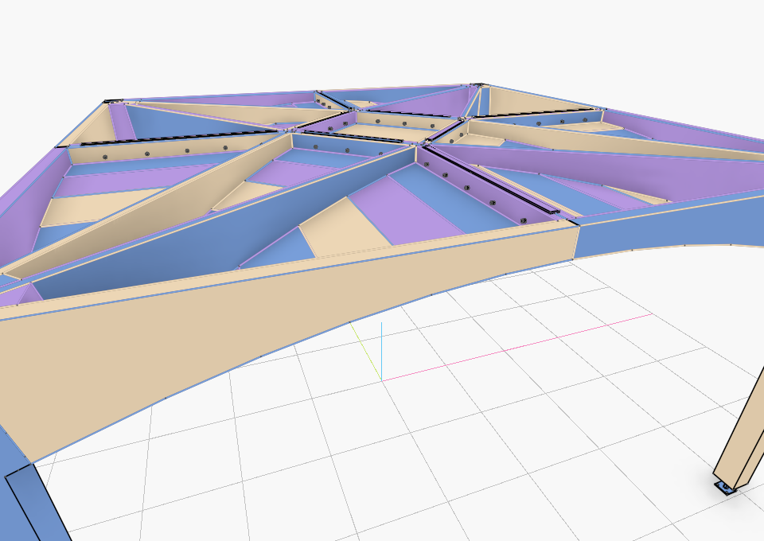
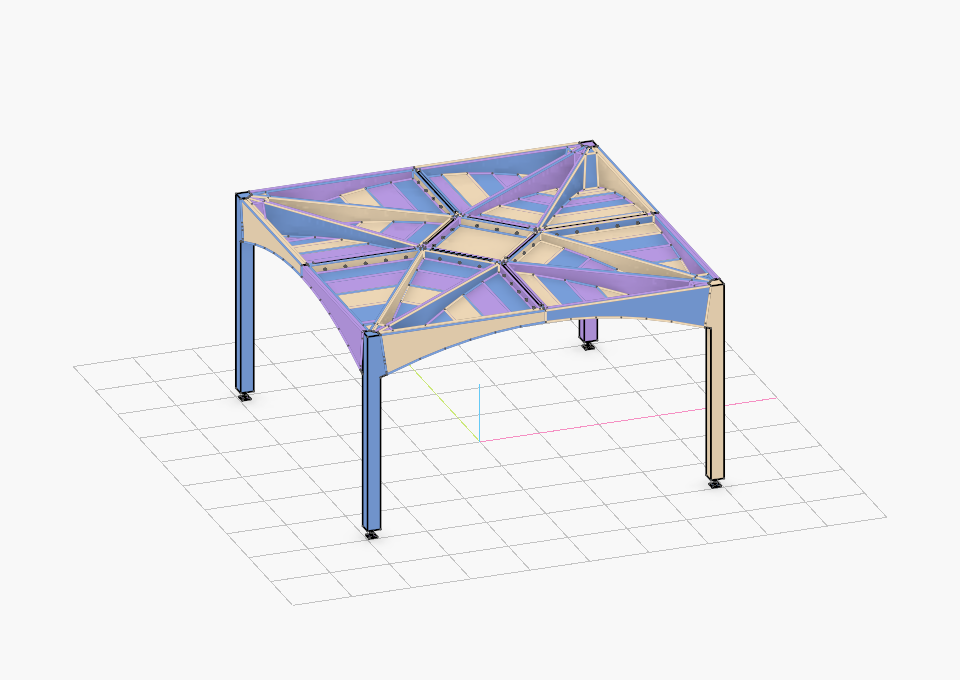

# Tutorial 5 · Camera and navigation

## Goal

Drive a reverse-Z perspective and orthographic `Camera` (stored in `f64` metres over a millimetre scene) from mouse, wheel, multi-touch, and keyboard input, and wire the central `State` and `app/runtime.rs` hubs.



**What we achieve:** Smooth turntable/trackball orbit, cursor-pinned zoom, Bounds-Fit (`F`), and seamless switching between foreshortened Perspective and true-scale Orthographic views.

## How it works

Both projections share the same `target` and `distance` so toggling `Orthographic` preserves framing (`ortho_half_h = distance * tan(fov_y / 2)`). Infinite reverse-Z perspective maps the near plane `z_n` to `1.0` and `+∞` to `0.0`, distributing IEEE-754 mantissa precision evenly across architectural and city-scale spans.



## Prerequisites and files

Requires [Tutorial 4](tutorial-four-geometry.md). Introduces `viewer-core/src/{camera,coords}.rs` alongside `src/state.rs`, `src/state/features.rs`, `src/app/runtime.rs`, and `src/app/{input,touch,keys,gesture/mod}.rs`.

Owned files in build order (`10` files):

1. `viewer-core/src/camera.rs`
2. `viewer-core/src/coords.rs`
3. `src/state.rs`
4. `src/state/features.rs`
5. `src/app/runtime.rs`
6. `src/app/input.rs`
7. `src/app/touch.rs`
8. `src/app/keys.rs`
9. `src/app/gesture/mod.rs`
10. `examples/course/camera.rs`

## Build

### Step 1 · `viewer-core/src/camera.rs`

`src/camera.rs` implements quaternion `orbit` (world-up yaw + right-axis pitch), distance-scaled `pan`, world `ray` unprojection, `fit_in` across all `8` `AABB` corners inside `frame`, and cursor-locked `zoom_at`, which shifts `target` by `(1 - k)` times the cursor's offset on the target plane so the point under the cursor never drifts.

```rust
--8<-- "session_viewer/viewer-core/src/camera.rs"
```

### Step 2 · `viewer-core/src/coords.rs`

`src/app/coords.rs` parses absolute `x,y,z`, relative `@dx,dy,dz`, polar `@r<deg`, direction-locked distances and explicit `w` world prefixes before projecting through the active `CPlane`.

```rust
--8<-- "session_viewer/viewer-core/src/coords.rs"
```

### Step 3 · `src/state.rs`

`src/state.rs` holds `Arc<Window>`, `Gpu`, `Camera`, `Scene` and `Selection` in one struct mutated exclusively on the event loop thread via `EventLoopProxy<Msg>`, preserving user camera navigation if `State::append` finishes after the camera moved from its load-start pose.

```rust
--8<-- "session_viewer/src/state.rs"
```

### Step 4 · `src/state/features.rs`

`src/state/features.rs` stores cross-frame interaction state (`Draft`, `ObjectDrag`, pending splits, cloud/sheet query generations, `Snap` and `Hierarchy`) and dispatches ordered `TAKE_PICK` hooks so active drags claim delayed GPU picks before ordinary selection runs.

```rust
--8<-- "session_viewer/src/state/features.rs"
```

### Step 5 · `src/app/runtime.rs`

`src/app/runtime.rs` implements `ApplicationHandler<Msg>`: panels consume events before scene shortcuts, `Box<dyn Mode<State>>` temporarily moves out during callbacks to avoid double mutable borrows, `FramePacing` prevents submission backlogs, and `State::resize` throttles target rebuilds to `100 ms`.

```rust
--8<-- "session_viewer/src/app/runtime.rs"
```

### Step 6 · `src/app/input.rs`

Enforces `> 10 CSS px` (or `> 4 px` held `200 ms`) drag hysteresis, distinguishes right-click repeat from right-drag orbit, and cancels touch edits when a second finger lands.

```rust
--8<-- "session_viewer/src/app/input.rs"
```

### Step 7 · `src/app/touch.rs`

`src/app/touch.rs` tracks active touch IDs (`1` finger orbits, `2` fingers pan by midpoint and clamped pinch-zoom, double-tap fits bounds) while resetting span baselines whenever finger count changes.

```rust
--8<-- "session_viewer/src/app/touch.rs"
```

### Step 8 · `src/app/keys.rs`

Maps unfocused canvas keys (`Escape`, `Enter`, `Delete`, `F`, `H`, `S`, `Ctrl/Cmd+Z/Y/A`) through the shared command dispatcher after text-focus checks.

```rust
--8<-- "session_viewer/src/app/keys.rs"
```

### Step 9 · `src/app/gesture/mod.rs`

`src/app/gesture/mod.rs` tests registered handlers in priority order (`control` -> `gizmo` -> `object` -> `box_select`), converting CSS thresholds into physical pixels with wider touch hit radii so clicks never accidentally drag geometry.

```rust
--8<-- "session_viewer/src/app/gesture/mod.rs"
```

### Step 10 · `examples/course/camera.rs`

`examples/course/camera.rs` runs the Tutorial 5 camera checkpoint (`?tutorial=camera`), wiring reverse-Z perspective/orthographic projection, orbit/pan/zoom gestures, ray unprojection, and `F` bounds fitting. Trap: keep `Camera::target` and `distance` in metres while converting scene millimetres through `unit.to_meters()` at the ray/frustum boundary.

```rust
--8<-- "session_viewer/examples/course/camera.rs"
```

## Integration

`src/state.rs` owns `window`, `gpu`, `camera`, `scene`, `selection`, and `features`, while `src/app/runtime.rs` routes `winit` `WindowEvent`s and `Msg` variants (plus `wasm32` `execute_op` through a safe thread-local `Weak<RefCell<Option<State>>>`). Later tutorials register into `state/features.rs` hook slices (`BEFORE_PICKS`, `AFTER_PICKS`, `TAKE_PICK`, `CLICK_ROWS`) and `// register:TAG` lines.

## Run and observe

Run `cargo xtest -p viewer-core camera::` and `cargo xtest -p viewer-core coords::` plus `cargo xtest -p session_viewer app::input::` and `app::keys::`: orbit, cursor-anchored wheel zoom, `4 mm` distant orthographic depth separation, `4 px` click wobble tolerance, and `F`/`H`/`S`/`Ctrl+Z` shortcuts all pass.

## Predict and try

Predict what happens if a CAD survey model sits at Swiss national coordinates `(2_600_000_000 mm, 1_200_000_000 mm, 450_000 mm)` and vertices are cast directly to `f32`: `f32` ULP at `2.6e9` is `256 mm`, turning beams into staircases! Subtracting `gpu.objects.anchor()` (`f64` near `camera.target`) before casting keeps GPU coordinates near `0.0` with sub-micron precision (`the_anchor_is_what_keeps_a_small_move`).

## Question and answer

**Why does `input.rs` suppress `repaint` on bare `CursorMoved` over the 3D canvas unless a panel edge is crossed, a drag is active, or the `>= 50 ms` hover-pick timer elapses?**

??? tip "Think first — click to reveal how to work it out and the answer"
    **How to work it out:** High-polling gaming mice and trackpads emit `120–1,000` `CursorMoved` events per second even when the user is merely moving the pointer across the screen without orbiting or dragging.

    **The answer:** Re-rendering a million-triangle scene on every raw pointer event wastes GPU power and competes with UI responsiveness. Checking `!over_panel && !was_over_panel && !ui_drag && !egui_is_using_pointer()` keeps idle canvas motion at `0` scene redraws while firing non-cancelling hover picks at most once every `50 ms`.

## Validation

Verified via `cargo xtest -p viewer-core camera::` (`14/14` passed), `coords::` (`7/7` passed), `app::input::tests::a_quick_wobble_is_a_click`, `app::gesture::tests::gestures_are_tried_control_then_gizmo_then_object_then_box`, and `app::keys::tests`.
