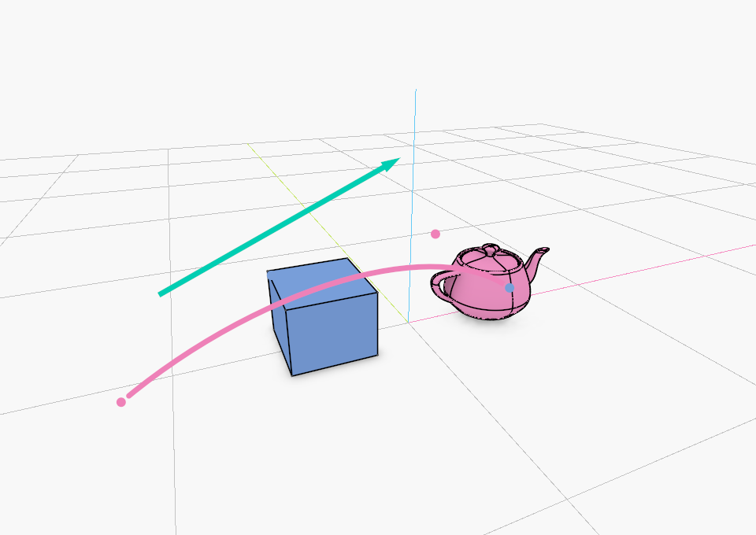
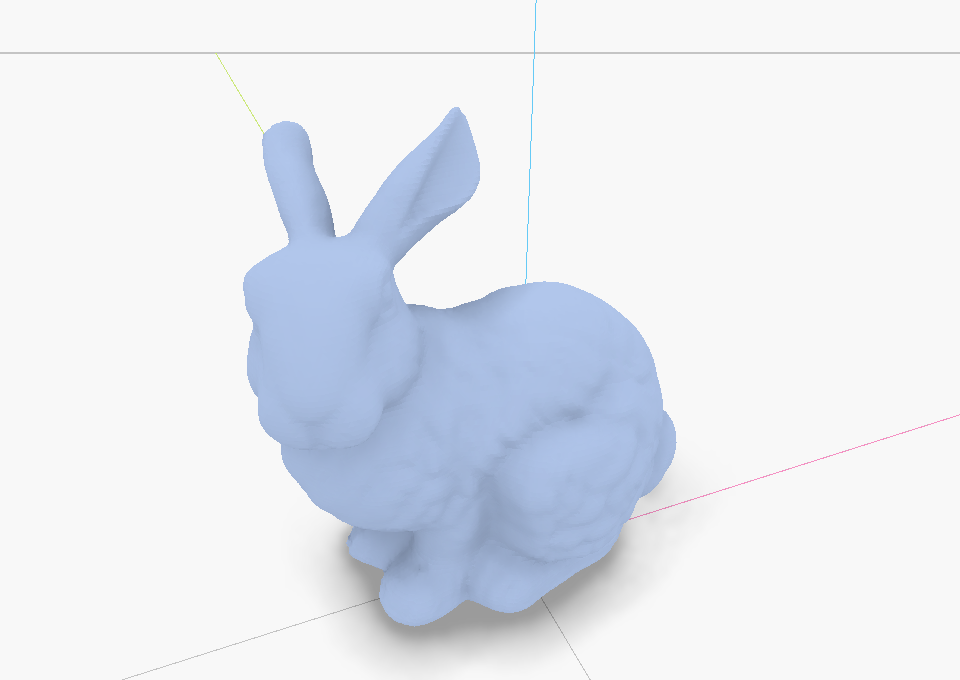
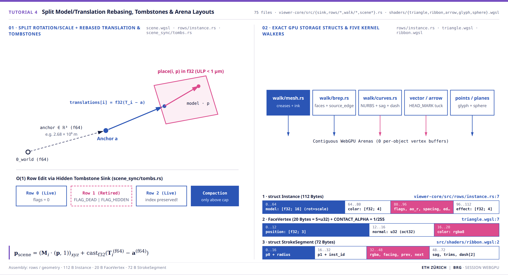

# Tutorial 4 · Geometry and scene data structures

## Goal

Walk `session_rust` meshes, BReps, curves, vectors, points, and planes into `20`-byte packed vertices, slot-addressed arenas, screen-space ribbons/arrows, and `112`-byte `Instance` rows synchronized incrementally by `(doc, guid)` identity.

 

**What we achieve:** All five `session_rust` geometry walkers (`walk/{mesh,brep,curves,points,plane}.rs`) streaming through `GpuSink` into contiguous GPU storage arenas (`triangle.wgsl`, `ribbon.wgsl`, `arrow.wgsl`, `vector.wgsl`, `glyph.wgsl`, `sphere.wgsl`).

## How it works

World translations rebase against the `f64` camera anchor (`translations[i] = f32(T_i − anchor)`) separately from the `112`-byte `Instance` rotation/scale matrix (`rows/instance.rs`), deleted rows retire in `O(1)` to hidden tombstones (`FLAG_DEAD | FLAG_HIDDEN`), and curves pack `72`-byte `StrokeSegment` records carrying adjacent face normals (`facing`), `sag` slack, arrowhead trims, and dash state.



## Prerequisites and files

Requires [Tutorial 3](tutorial-three-rendering.md). Introduces `viewer-core/src/{sink,rows/*,walk/*,knobs,interactions,scene,scene_rows,scene_sync/*}` and their GPU lane counterparts in `src/engine/gpu/` and `src/shaders/`.

Owned files in build order (`75` files):

1. `viewer-core/src/sink.rs`
2. `viewer-core/src/rows/mod.rs`
3. `viewer-core/src/rows/encode.rs`
4. `viewer-core/src/rows/gizmo.rs`
5. `viewer-core/src/rows/hull.rs`
6. `viewer-core/src/rows/instance.rs`
7. `viewer-core/src/rows/lanes.rs`
8. `viewer-core/src/rows/objects.rs`
9. `viewer-core/src/rows/patch.rs`
10. `viewer-core/src/rows/upload.rs`
11. `src/engine/gpu/sink.rs`
12. `src/engine/gpu/buffers.rs`
13. `src/engine/gpu/upload.rs`
14. `src/engine/gpu/instance.rs`
15. `src/engine/gpu/instance/layout.rs`
16. `src/engine/gpu/instance/validation.rs`
17. `src/engine/gpu/objects.rs`
18. `src/engine/gpu/objects/table.rs`
19. `src/engine/gpu/objects/lane.rs`
20. `src/engine/gpu/objects/ink.rs`
21. `src/engine/gpu/objects/gpu_tests.rs`
22. `src/engine/gpu/hull.rs`
23. `src/engine/gpu/patch.rs`
24. `src/engine/gpu/arena.rs`
25. `src/engine/gpu/slots.rs`
26. `src/shaders/slot_table.wgsl`
27. `src/engine/gpu/faces.rs`
28. `src/shaders/triangle.wgsl`
29. `src/engine/gpu/segments.rs`
30. `src/shaders/ribbon.wgsl`
31. `src/shaders/arrow.wgsl`
32. `src/engine/gpu/vectors.rs`
33. `src/shaders/vector.wgsl`
34. `src/engine/gpu/glyphs.rs`
35. `src/shaders/glyph.wgsl`
36. `src/shaders/sphere.wgsl`
37. `src/engine/gpu/planes.rs`
38. `src/shaders/plane.wgsl`
39. `viewer-core/src/knobs.rs`
40. `viewer-core/src/interactions.rs`
41. `viewer-core/src/walk/mod.rs`
42. `viewer-core/src/walk/encode.rs`
43. `viewer-core/src/walk/bounds.rs`
44. `viewer-core/src/walk/mesh.rs`
45. `viewer-core/src/walk/mesh_topology.rs`
46. `viewer-core/src/walk/mesh_ink.rs`
47. `viewer-core/src/walk/brep.rs`
48. `viewer-core/src/walk/brep_orient.rs`
49. `viewer-core/src/walk/brep_shapes.rs`
50. `viewer-core/src/walk/brep_edges.rs`
51. `viewer-core/src/walk/curves.rs`
52. `viewer-core/src/walk/plane.rs`
53. `viewer-core/src/walk/points.rs`
54. `viewer-core/src/walk/frames.rs`
55. `viewer-core/src/walk/display.rs`
56. `viewer-core/src/walk/display_features.rs`
57. `viewer-core/src/walk/application_tests.rs`
58. `viewer-core/src/walk/brep/application_tests.rs`
59. `viewer-core/src/scene.rs`
60. `viewer-core/src/scene_rows.rs`
61. `viewer-core/src/scene_sync.rs`
62. `viewer-core/src/scene_sync/allocation.rs`
63. `viewer-core/src/scene_sync/compaction.rs`
64. `viewer-core/src/scene_sync/nodes.rs`
65. `viewer-core/src/scene_sync/notes.rs`
66. `viewer-core/src/scene_sync/tombs.rs`
67. `viewer-core/src/scene_sync/testing.rs`
68. `viewer-core/src/scene_sync/tests.rs`
69. `src/engine/gpu/scene_gpu_tests/mod.rs`
70. `src/engine/gpu/scene_gpu_tests/contacts.rs`
71. `src/engine/gpu/scene_gpu_tests/frames.rs`
72. `src/engine/gpu/scene_gpu_tests/instances.rs`
73. `src/engine/gpu/scene_gpu_tests/split.rs`
74. `examples/course/rows.rs`
75. `examples/course/geometry.rs`

## Build

### Step 1 · `viewer-core/src/sink.rs`

`viewer-core/src/sink.rs` (51 lines) defines `trait GpuSink`. It provides `canvas_size()`, `geometry_revision()`, `object_row()`.

```rust
--8<-- "session_viewer/viewer-core/src/sink.rs"
```

### Step 2 · `viewer-core/src/rows/mod.rs`

`viewer-core/src/rows/mod.rs` (20 lines) declares and re-exports module tree `encode`, `gizmo`, `hull`, `instance`, `lanes`, `objects`. It keeps `mod` deterministic across native `cargo xtest` and `wasm32-unknown-unknown` builds.

```rust
--8<-- "session_viewer/viewer-core/src/rows/mod.rs"
```

### Step 3 · `viewer-core/src/rows/encode.rs`

`viewer-core/src/rows/encode.rs` (78 lines) defines `struct Pen`, `encode_width()`, `pack_rgba()`, `oct16()`, `BLACK`. It provides `quant8()`, `sign_not_zero()`, `quant_snorm8()`, `FACING_UNKNOWN`.

```rust
--8<-- "session_viewer/viewer-core/src/rows/encode.rs"
```

### Step 4 · `viewer-core/src/rows/gizmo.rs`

`viewer-core/src/rows/gizmo.rs` (14 lines) defines `ARM`, `BALL_AT`. It keeps `gizmo` deterministic across native `cargo xtest` and `wasm32-unknown-unknown` builds.

```rust
--8<-- "session_viewer/viewer-core/src/rows/gizmo.rs"
```

### Step 5 · `viewer-core/src/rows/hull.rs`

`viewer-core/src/rows/hull.rs` (392 lines) defines `type Hull`, `struct Points`, `of()`, `extreme_points()`, `placed_box()`. It provides `volume()`, `sub()`, `dot()`, `ABOVE`; and locked by `cargo xtest` (`a_turned_beam_is_boxed_by_its_extreme_points`, `every_direction_peaks_on_a_kept_point`, `a_round_set_gives_up` (+1 more)).

```rust
--8<-- "session_viewer/viewer-core/src/rows/hull.rs"
```

### Step 6 · `viewer-core/src/rows/instance.rs`

`viewer-core/src/rows/instance.rs` (93 lines) defines `struct Instance`, `placeholder()`, `FLAG_SELECTED`, `FLAG_HIDDEN`. It connects `Xform` within `rows` across native and `wasm32` targets.

```rust
--8<-- "session_viewer/viewer-core/src/rows/instance.rs"
```

### Step 7 · `viewer-core/src/rows/lanes.rs`

`viewer-core/src/rows/lanes.rs` (557 lines) defines `struct Pick`, `enum PickMode`, `struct FaceSource`, `drop_rows()`, `is_silhouette()`. It provides `plated()`, `lane_rows_by_type()`, `FACE_TAG`, `SILHOUETTE_SAG`; and locked by `cargo xtest` (`lane_rows_by_type`).

```rust
--8<-- "session_viewer/viewer-core/src/rows/lanes.rs"
```

### Step 8 · `viewer-core/src/rows/objects.rs`

`viewer-core/src/rows/objects.rs` (50 lines) defines `struct ObjectRow`, `struct ObjectRows`, `world_box()`, `placed_bounds()`. It connects `hull`, `session_rust` within `rows` across native and `wasm32` targets.

```rust
--8<-- "session_viewer/viewer-core/src/rows/objects.rs"
```

### Step 9 · `viewer-core/src/rows/patch.rs`

`viewer-core/src/rows/patch.rs` (224 lines) defines `struct RowSpec`, `enum LaneId`, `struct Counts`, `all()`, `stride()`. It provides `vector_rows_in()`, `vector_merge()`, `plane_rows_in()`, `ROW_REGISTRY`; and exposes cumulative checkpoint seams `register:markers`, `register:meshes`, `register:strokes`.

```rust
--8<-- "session_viewer/viewer-core/src/rows/patch.rs"
```

### Step 10 · `viewer-core/src/rows/upload.rs`

`viewer-core/src/rows/upload.rs` (173 lines) defines `struct Upload`, `drop_uploaded()`, `merge()`, `shift_vertices()`. It provides `merge_arena()`; and exposes cumulative checkpoint seams `register:clouds`, `register:markers`, `register:meshes`, `register:strokes`.

```rust
--8<-- "session_viewer/viewer-core/src/rows/upload.rs"
```

### Step 11 · `src/engine/gpu/sink.rs`

`src/engine/gpu/sink.rs` (188 lines) implements `sink` (`canvas_size()`, `geometry_revision()`, `object_row()`) inside `gpu`. It connects `Gpu`, `rows`, `session_rust`, `GpuSink` within `gpu` across native and `wasm32` targets.

```rust
--8<-- "session_viewer/src/engine/gpu/sink.rs"
```

### Step 12 · `src/engine/gpu/buffers.rs`

`src/engine/gpu/buffers.rs` provides `GpuCtx`, `Template`, and `GrowBuf` (`append`, `reserve`, `WRITE_CHUNK`-bounded `fill`, `fits` against device/storage limits, `reset`, `release`, and GPU-copied `packed`), rebuilding bind groups whenever growth swaps an underlying `wgpu::Buffer`.

```rust
--8<-- "session_viewer/src/engine/gpu/buffers.rs"
```

### Step 13 · `src/engine/gpu/upload.rs`

Stages CPU lane vectors, rebases vertex indices and valid face IDs on merge, and frees host vectors via `drop_uploaded` after GPU transfer.

```rust
--8<-- "session_viewer/src/engine/gpu/upload.rs"
```

### Step 14 · `src/engine/gpu/instance.rs`

`src/engine/gpu/instance.rs` (6 lines) declares and re-exports module tree `layout`, `validation`. It keeps `instance` deterministic across native `cargo xtest` and `wasm32-unknown-unknown` builds.

```rust
--8<-- "session_viewer/src/engine/gpu/instance.rs"
```

### Step 15 · `src/engine/gpu/instance/layout.rs`

`src/engine/gpu/instance/layout.rs` defines the `#[repr(C)]` `Pod` `Instance` struct pinned to `112` bytes: `model` (`64 B` rotation + scale), `color` (`16 B`), `flags`, `ao_radius`, `spacing`, the `u32` word following `spacing` carries the packed edge colour, and `effect` (`16 B`) stores `[reveal, point_scale, 0.0, 0.0]`.

```rust
--8<-- "session_viewer/src/engine/gpu/instance/layout.rs"
```

### Step 16 · `src/engine/gpu/instance/validation.rs`

Parses WGSL struct declarations and verifies exact field order and `112 B` / `80 B` byte sizes against Rust `Instance` and `LineUniform`.

```rust
--8<-- "session_viewer/src/engine/gpu/instance/validation.rs"
```

### Step 17 · `src/engine/gpu/objects.rs`

`src/engine/gpu/objects.rs` (9 lines) declares and re-exports module tree `gpu_tests`, `ink`, `lane`, `table`. It keeps `objects` deterministic across native `cargo xtest` and `wasm32-unknown-unknown` builds.

```rust
--8<-- "session_viewer/src/engine/gpu/objects.rs"
```

### Step 18 · `src/engine/gpu/objects/table.rs`

`src/engine/gpu/objects/table.rs` (`InstanceTable` / `ObjectRows`) mirrors CPU rows alongside `instances` (`N × 112 B`) and `translations` (`N × 16 B`), keeping any gizmo widget row last and uploading single-row edits via `write_at`.

```rust
--8<-- "session_viewer/src/engine/gpu/objects/table.rs"
```

### Step 19 · `src/engine/gpu/objects/lane.rs`

`src/engine/gpu/objects/lane.rs` (17 lines) implements `lane` (`on_reset()`, `on_release()`, `bytes()`) inside `objects`. It connects `InstanceTable`, `GpuCtx`, `Layouts` within `objects` across native and `wasm32` targets.

```rust
--8<-- "session_viewer/src/engine/gpu/objects/lane.rs"
```

### Step 20 · `src/engine/gpu/objects/ink.rs`

Builds `@group(2)` ink bind groups combining object rows, translations, `1×`/`4×` depth and primitive-ID views, projected triangles and tile lists.

```rust
--8<-- "session_viewer/src/engine/gpu/objects/ink.rs"
```

### Step 21 · `src/engine/gpu/objects/gpu_tests.rs`

Adapter-gated headless GPU test verifying neighbour row isolation, scale-updated `ao_radius` and widget-last ordering.

```rust
--8<-- "session_viewer/src/engine/gpu/objects/gpu_tests.rs"
```

### Step 22 · `src/engine/gpu/hull.rs`

`src/engine/gpu/hull.rs` (2 lines) implements `hull` (module state) inside `gpu`. It keeps `hull` deterministic across native `cargo xtest` and `wasm32-unknown-unknown` builds.

```rust
--8<-- "session_viewer/src/engine/gpu/hull.rs"
```

### Step 23 · `src/engine/gpu/patch.rs`

Tracks per-lane `Counts` and `Span` offsets (including CPU source-ID mirrors) so edits test in-place fit across all lanes simultaneously.

```rust
--8<-- "session_viewer/src/engine/gpu/patch.rs"
```

### Step 24 · `src/engine/gpu/arena.rs`

Packs vertices into `20 B` (`xyz` `f32`, octahedral normal `u32`, RGBA `u32`) with separate ordinary, printed-fill and text-outline index streams.

```rust
--8<-- "session_viewer/src/engine/gpu/arena.rs"
```

### Step 25 · `src/engine/gpu/slots.rs`

Maps shared definition meshes to placed instances via `8 B` `(object_row, tri_id_base)` entries (`slot 0 = OWN_ROW`) and a `1024`-wide lookup texture.

```rust
--8<-- "session_viewer/src/engine/gpu/slots.rs"
```

### Step 26 · `src/shaders/slot_table.wgsl`

Binary-searches `placed_triangle` across the `1024`-texel slot texture so shared definition triangles resolve to each instance's own row and unique triangle ID.

```wgsl
--8<-- "session_viewer/src/shaders/slot_table.wgsl"
```

### Step 27 · `src/engine/gpu/faces.rs`

Maps drawn triangles to source faces and binds physical, opaque, clipped, object-ID, face-pick, highlight and mask pipelines.

```rust
--8<-- "session_viewer/src/engine/gpu/faces.rs"
```

### Step 28 · `src/shaders/triangle.wgsl`

`src/shaders/triangle.wgsl` transforms arena and slot-instanced vertices (`slot_row`), preserves unlit opaque contact fills pulled forward via `depth_layer`, detects mirrored transforms (`det(model) < 0`), and writes `PhysicalColor` (`color` + `2×u16` `primitive`).

```wgsl
--8<-- "session_viewer/src/shaders/triangle.wgsl"
```

### Step 29 · `src/engine/gpu/segments.rs`

Expands `40 B` CPU segments into `72 B` `StrokeSegment` records across pipe, ribbon and sheet tables while keeping source entity intervals separate from GPU offsets.

```rust
--8<-- "session_viewer/src/engine/gpu/segments.rs"
```

### Step 30 · `src/shaders/ribbon.wgsl`

`src/shaders/ribbon.wgsl` reads each `72 B` `StrokeSegment`, tests adjacent face normals (`edge_faces_camera`), and bisects consecutive screen directions in `join_plane` so chained curve segments meet at clean mitered corners without overlapping alpha.

```wgsl
--8<-- "session_viewer/src/shaders/ribbon.wgsl"
```

### Step 31 · `src/shaders/arrow.wgsl`

`src/shaders/arrow.wgsl`: An arrow's corners and ink: what the vector and plane lanes share; each adds its rows and its vertex entry. Defines entry points `@fragment fn fs_main`, `@fragment fn fs_id`; keep struct layouts and binding indices aligned with their Rust `bytemuck` mirrors and Naga validation tests.

```wgsl
--8<-- "session_viewer/src/shaders/arrow.wgsl"
```

### Step 32 · `src/engine/gpu/vectors.rs`

Registers `VectorLane` (`64 B` `VectorRow` stride, `18` generated vertices per arrow) with matching colour and object-ID pipelines.

```rust
--8<-- "session_viewer/src/engine/gpu/vectors.rs"
```

### Step 33 · `src/shaders/vector.wgsl`

`src/shaders/vector.wgsl`: Vectors: one instance per VectorRow, its corners from arrow.wgsl. Defines entry points `@vertex fn vs_main`; bindings `@group(3) @binding(0) vectors`; including `arrow.wgsl`; keep struct layouts and binding indices aligned with their Rust `bytemuck` mirrors and Naga validation tests.

```wgsl
--8<-- "session_viewer/src/shaders/vector.wgsl"
```

### Step 34 · `src/engine/gpu/glyphs.rs`

Stores `48 B` `GlyphPoint` records (position, signed radius, colour, row and up to `6` packed face normals) for dots and vertex markers.

```rust
--8<-- "session_viewer/src/engine/gpu/glyphs.rs"
```

### Step 35 · `src/shaders/glyph.wgsl`

`src/shaders/glyph.wgsl`: One marker or dot, 48 bytes; matches GlyphPoint in Rust. Defines entry points `@fragment fn fs_main`, `@fragment fn fs_id`, `@vertex fn vs_main`, `@vertex fn vs_source`; bindings `@group(3) @binding(0) glyphs`; keep struct layouts and binding indices aligned with their Rust `bytemuck` mirrors and Naga validation tests.

```wgsl
--8<-- "session_viewer/src/shaders/glyph.wgsl"
```

### Step 36 · `src/shaders/sphere.wgsl`

`src/shaders/sphere.wgsl`: One marker or dot, 48 bytes; matches GlyphPoint in Rust. Defines entry points `@vertex fn vs_main`, `@vertex fn vs_front`, `@fragment fn fs_main`, `@fragment fn fs_id`; bindings `@group(3) @binding(0) glyphs`; keep struct layouts and binding indices aligned with their Rust `bytemuck` mirrors and Naga validation tests.

```wgsl
--8<-- "session_viewer/src/shaders/sphere.wgsl"
```

### Step 37 · `src/engine/gpu/planes.rs`

Registers `PlaneLane` (`48 B` stride, `1` instanced draw -> `22` grid lines + `3` axis arrows) with atomic `f64` global plane-size scaling.

```rust
--8<-- "session_viewer/src/engine/gpu/planes.rs"
```

### Step 38 · `src/shaders/plane.wgsl`

`src/shaders/plane.wgsl` synthesizes `22` grid segments (`132` vertices) plus `3` RGB `XYZ` arrows (`54` vertices) per `48 B` `PlaneRow` by calling `arrow_corner`.

```wgsl
--8<-- "session_viewer/src/shaders/plane.wgsl"
```

### Step 39 · `viewer-core/src/knobs.rs`

Latches diagnostic `VIEWER_*` environment switches once via `OnceLock` for profiling, edge/dot suppression, coplanar edges and BRep refinement.

```rust
--8<-- "session_viewer/viewer-core/src/knobs.rs"
```

### Step 40 · `viewer-core/src/interactions.rs`

Separates contact, joint, cut and drill edge interactions from owned element features in deterministic graph-edge creation order.

```rust
--8<-- "session_viewer/viewer-core/src/interactions.rs"
```

### Step 41 · `viewer-core/src/walk/mod.rs`

Splits mutable `Upload` borrows via `Walk::solid` and threads `WalkCx` (`row`, `cloud_px`, `arrowhead_pens` override) so converters append faces, edges and dots without cloning tables.

```rust
--8<-- "session_viewer/viewer-core/src/walk/mod.rs"
```

### Step 42 · `viewer-core/src/walk/encode.rs`

Packs RGBA bytes, maps explicit pixel widths to negative half-widths, and quantizes octahedral normals while reserving `0xffffffff` for unknown facing.

```rust
--8<-- "session_viewer/viewer-core/src/walk/encode.rs"
```

### Step 43 · `viewer-core/src/walk/bounds.rs`

Records pre-append `Baselines`, unions live placed bounds in `file_extent`, and flags `z < 0.001` planar batches as `0.5`-unit drawing sheets.

```rust
--8<-- "session_viewer/viewer-core/src/walk/bounds.rs"
```

### Step 44 · `viewer-core/src/walk/mesh.rs`

Applies `MeshOpts` (ordinary, smooth sampled, or closed element), estimates spacing from `diag / sqrt(V)`, and drops raw wireframe above `200,000` triangles.

```rust
--8<-- "session_viewer/viewer-core/src/walk/mesh.rs"
```

### Step 45 · `viewer-core/src/walk/mesh_topology.rs`

Maps vertex keys to dense or hash slots, computes Newell polygon normals, and pairs shared edges with hole rings oriented against outer borders.

```rust
--8<-- "session_viewer/viewer-core/src/walk/mesh_topology.rs"
```

### Step 46 · `viewer-core/src/walk/mesh_ink.rs`

Suppresses coplanar diagonals, retains borders and creases above `25°`, marks smooth silhouette seams, and switches wireframes above `10,000` edges to black.

```rust
--8<-- "session_viewer/viewer-core/src/walk/mesh_ink.rs"
```

### Step 47 · `viewer-core/src/walk/brep.rs`

Reuses congruent shapes or requests per-face display meshes, retains `(u, v)` samples and face IDs, and sets smooth/open/closed row flags without mutating the BRep.

```rust
--8<-- "session_viewer/viewer-core/src/walk/brep.rs"
```

### Step 48 · `viewer-core/src/walk/brep_orient.rs`

Traverses shared-edge BFS components on closed shells and flips connected components by signed volume so solid normals point outward reproducibly.

```rust
--8<-- "session_viewer/viewer-core/src/walk/brep_orient.rs"
```

### Step 49 · `viewer-core/src/walk/brep_shapes.rs`

Scopes thread-local `SharedWalks` to one document walk so congruent shapes replay recorded vertex/edge ranges under distinct placed object rows.

```rust
--8<-- "session_viewer/viewer-core/src/walk/brep_shapes.rs"
```

### Step 50 · `viewer-core/src/walk/brep_edges.rs`

Evaluates exact `3D` trim/seam curves, unwraps closed seams, and stores each chord's geometric sag above its facet so curved ink stays visible without global depth bias.

```rust
--8<-- "session_viewer/viewer-core/src/walk/brep_edges.rs"
```

### Step 51 · `viewer-core/src/walk/curves.rs`

Emits chained polyline/NURBS segments with cumulative arc-length dash offsets, `arrowhead_pens`-scaled terminal `VectorRow`s landing on exact endpoints, and marker-aware trims.

```rust
--8<-- "session_viewer/viewer-core/src/walk/curves.rs"
```

### Step 52 · `viewer-core/src/walk/plane.rs`

Emits `48 B` `Plane` frame rows (`12`-edge ribbons for `OBB`s) and separates clipping-plane rectangles + cut arrows from orientation grids, triggering solid-mesh verification on first cut.

```rust
--8<-- "session_viewer/viewer-core/src/walk/plane.rs"
```

### Step 53 · `viewer-core/src/walk/points.rs`

Appends one signed-distance dot per `Point` (`-3 px` default radius) while keeping scene bounds restricted to the world point centre.

```rust
--8<-- "session_viewer/viewer-core/src/walk/points.rs"
```

### Step 54 · `viewer-core/src/walk/frames.rs`

Converts coordinate frames and vectors into compact `48 B` plane and `64 B` `VectorRow` GPU records instead of tessellated arrow meshes.

```rust
--8<-- "session_viewer/viewer-core/src/walk/frames.rs"
```

### Step 55 · `viewer-core/src/walk/display.rs`

Quantizes `Quality::for_error` in half-octave steps and subdivides knot spans up to depth `16` and `4,096` segments with a drop-guarded candidate state.

```rust
--8<-- "session_viewer/viewer-core/src/walk/display.rs"
```

### Step 56 · `viewer-core/src/walk/display_features.rs`

Caps element annotations at `256` features and `4,096` finite points, copying lean display polylines so hidden kernel caches are not retained.

```rust
--8<-- "session_viewer/viewer-core/src/walk/display_features.rs"
```

### Step 57 · `viewer-core/src/walk/application_tests.rs`

Verifies element feature/contact polygon ribbons, dots and parent-row ID inheritance when element annotations toggle on/off.

```rust
--8<-- "session_viewer/viewer-core/src/walk/application_tests.rs"
```

### Step 58 · `viewer-core/src/walk/brep/application_tests.rs`

Verifies rational cylindrical NURBS border-to-face vertex sharing, preserved source `.pb` bytes and exact `Δz` surface-preview pipe offsets.

```rust
--8<-- "session_viewer/viewer-core/src/walk/brep/application_tests.rs"
```

### Step 59 · `viewer-core/src/scene.rs`

`src/app/scene.rs` wraps `Rc<Session>` inside `FileDoc` (name, file `Xform`, `point_size`, shell flag) so two placements can share one kernel `Session` while `(doc_idx, GUID)` maps each placed object to its own GPU display row.

```rust
--8<-- "session_viewer/viewer-core/src/scene.rs"
```

### Step 60 · `viewer-core/src/scene_rows.rs`

Separates `(doc_idx, GUID)` row identity (plus text/free/sink/tomb sentinels) from `Footprint` (`One`, `Many`, `Cloud`, `None`) lane spans.

```rust
--8<-- "session_viewer/viewer-core/src/scene_rows.rs"
```

### Step 61 · `viewer-core/src/scene_sync.rs`

Drains change notes, deduplicates identities, expands `SUBTREE` descendants and emits ordered `Staged` GPU updates (`retire`, `bury`, `patch`, `geometry`, `place`).

```rust
--8<-- "session_viewer/viewer-core/src/scene_sync.rs"
```

### Step 62 · `viewer-core/src/scene_sync/allocation.rs`

Reuses an identity's grave when all lane counts match, pads drag previews by ~`50%`, and routes retired tails to the hidden sink row.

```rust
--8<-- "session_viewer/viewer-core/src/scene_sync/allocation.rs"
```

### Step 63 · `viewer-core/src/scene_sync/compaction.rs`

`viewer-core/src/scene_sync/compaction.rs` (174 lines) defines `compaction_due()`, `purge_step()`, `cloud_compaction_due()`. It exposes cumulative checkpoint seams `register:editing`, `register:instancing`.

```rust
--8<-- "session_viewer/viewer-core/src/scene_sync/compaction.rs"
```

### Step 64 · `viewer-core/src/scene_sync/nodes.rs`

Resolves affected tree nodes via weak caches and batched per-document searches, multiplying file `Xform` by root-to-node transforms.

```rust
--8<-- "session_viewer/viewer-core/src/scene_sync/nodes.rs"
```

### Step 65 · `viewer-core/src/scene_sync/notes.rs`

Translates forward and reverse kernel transaction ops into `GEOMETRY`, `PLACE`, `PRESENCE` and `SUBTREE` invalidation flags without rebuilding untouched objects.

```rust
--8<-- "session_viewer/viewer-core/src/scene_sync/notes.rs"
```

### Step 66 · `viewer-core/src/scene_sync/tombs.rs`

Retains up to `256 MiB` of deleted lane spans keyed by weak kernel tomb pointers so `Undo` unburies rows without re-tessellating geometry.

```rust
--8<-- "session_viewer/viewer-core/src/scene_sync/tombs.rs"
```

### Step 67 · `viewer-core/src/scene_sync/testing.rs`

Models `settle` upload bookkeeping on the CPU and compares incremental edits bit-for-bit against a fresh multi-document walk (`verify`).

```rust
--8<-- "session_viewer/viewer-core/src/scene_sync/testing.rs"
```

### Step 68 · `viewer-core/src/scene_sync/tests.rs`

Runs `150`-step seeded random edit sequences (including a `4,096 B` tomb cap and cache on/off parity) against the fresh-scene oracle.

```rust
--8<-- "session_viewer/viewer-core/src/scene_sync/tests.rs"
```

### Step 69 · `src/engine/gpu/scene_gpu_tests/mod.rs`

`src/engine/gpu/scene_gpu_tests/mod.rs` (4 lines) declares and re-exports module tree `contacts`, `frames`, `instances`, `split`. It keeps `mod` deterministic across native `cargo xtest` and `wasm32-unknown-unknown` builds.

```rust
--8<-- "session_viewer/src/engine/gpu/scene_gpu_tests/mod.rs"
```

### Step 70 · `src/engine/gpu/scene_gpu_tests/contacts.rs`

`src/engine/gpu/scene_gpu_tests/contacts.rs` (102 lines) implements `contacts` (`contacts_on_their_face_draw_in_front_of_it()`) inside `scene_gpu_tests`. It connects `ElementFeature`, `session_rust`, `scene`, `Camera` within `scene_gpu_tests` across native and `wasm32` targets.

```rust
--8<-- "session_viewer/src/engine/gpu/scene_gpu_tests/contacts.rs"
```

### Step 71 · `src/engine/gpu/scene_gpu_tests/frames.rs`

`src/engine/gpu/scene_gpu_tests/frames.rs` (222 lines) verifies `authored_line_widths_reach_the_pixels`. It provides `top_view()`, `count()`, `grey()`; and locked by `cargo xtest` (`authored_line_widths_reach_the_pixels`).

```rust
--8<-- "session_viewer/src/engine/gpu/scene_gpu_tests/frames.rs"
```

### Step 72 · `src/engine/gpu/scene_gpu_tests/instances.rs`

`src/engine/gpu/scene_gpu_tests/instances.rs` (409 lines) implements `instances` (`file()`, `placed()`, `turned_grid()`) inside `scene_gpu_tests`. It connects `scene`, `Camera`, `gpu`, `ElementFeature` within `scene_gpu_tests` across native and `wasm32` targets.

```rust
--8<-- "session_viewer/src/engine/gpu/scene_gpu_tests/instances.rs"
```

### Step 73 · `src/engine/gpu/scene_gpu_tests/split.rs`

`src/engine/gpu/scene_gpu_tests/split.rs` (758 lines) implements `split` (`file()`, `p()`, `arc()`) inside `scene_gpu_tests`. It connects `clipping`, `verbs`, `Interval`, `scene` within `scene_gpu_tests` across native and `wasm32` targets.

```rust
--8<-- "session_viewer/src/engine/gpu/scene_gpu_tests/split.rs"
```

### Step 74 · `examples/course/rows.rs`

`examples/course/rows.rs` runs the Tutorial 4 row-table checkpoint (`?tutorial=rows`), uploading `112`-byte `Instance` records and camera-anchored `16`-byte translations through `InstanceTable` and validating the 6 shared WGSL headers. Trap: subtract the `f64` camera anchor before casting world coordinates to `f32`, or objects far from the origin jitter during orbit.

```rust
--8<-- "session_viewer/examples/course/rows.rs"
```

### Step 75 · `examples/course/geometry.rs`

`examples/course/geometry.rs` runs the Tutorial 4 geometry checkpoint (`?tutorial=geometry`), walking a kernel `Mesh` cube, a `BRep` solid, and an arrowed `NurbsCurve` into GPU lanes (with no 3D matrix lane). Trap: BRep trim loops and crease edges must carry their original face normals into `SegTable` so hidden-line ink visibility agrees with solid shading.

```rust
--8<-- "session_viewer/examples/course/geometry.rs"
```

## Integration

`viewer-core/src/lib.rs` exports `rows`, `sink` (`GpuSink`), `knobs`, `interactions`, `walk`, and `scene`, while `src/engine/gpu/sink.rs` implements `GpuSink` for `Gpu`. `Scene::upload_to` pushes `Upload` batches across that trait boundary without `viewer-core` ever importing `wgpu`.

## Run and observe

Run `cargo xtest -j8 packed_vertex_is_twenty_bytes`, `octahedral_normals_round_trip`, `instance_mirror`, `arrow_is_exactly_as_long_as_its_line`, `teapot_boundary_ink_follows_authored_patch_curves`, and `edits_write_only_their_own_slots`: all pass with worst arrow-tip error `0.010 px` and `0` base-seam pixels.

## Predict and try

Predict how many bytes upload to the GPU when you translate one `50,000`-triangle mesh by `[100, 0, 0]`: `0` vertex bytes and `0` model-matrix bytes—`InstanceTable` updates only that row's `16`-byte `[f32; 4]` camera-anchored translation entry (`a_move_goes_into_the_translation_not_the_matrix`).

## Question and answer

**Why does deleting an object park its GPU slots in `tombs.rs` instead of immediately compacting `Arena` and `SegTable`?**

??? tip "Think first — click to reveal how to work it out and the answer"
    **How to work it out:** Consider pressing `Delete` on a `200,000`-triangle solid and immediately pressing `Ctrl+Z` (`Undo`): immediate compaction would shift every subsequent object's buffer range and discard the uploaded triangles.

    **The answer:** Parking deleted ranges in `tombs.rs` (`MAX_TOMBS` cap) hides the row in `O(1)` via `FLAG_HIDDEN` so `Undo` restores the exact row ID and GPU vertices with zero re-walk or upload; `compaction.rs` reclaims dead arena space only when tomb bytes cross the high-water budget or redo history drops unreachable graves.

## Validation

Verified via `cargo xtest -p viewer-core walk::` (`59` walk tests), `cargo xtest -p viewer-core scene::` (`46` scene/sync tests), and `cargo xtest -p session_viewer engine::gpu::` (`packed_vertex_is_twenty_bytes`, `arrow_is_exactly_as_long_as_its_line`, `frustum_outcode_culls_offscreen_boxes_and_keeps_visible_ones`).
