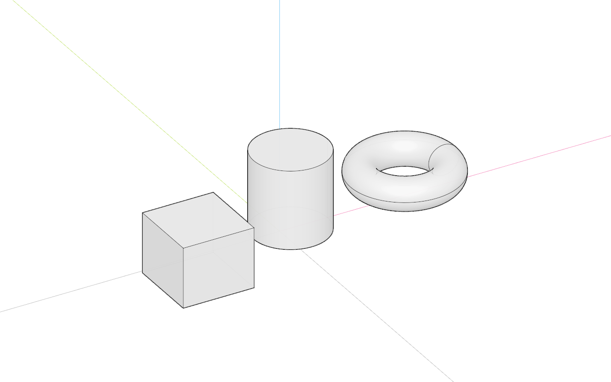
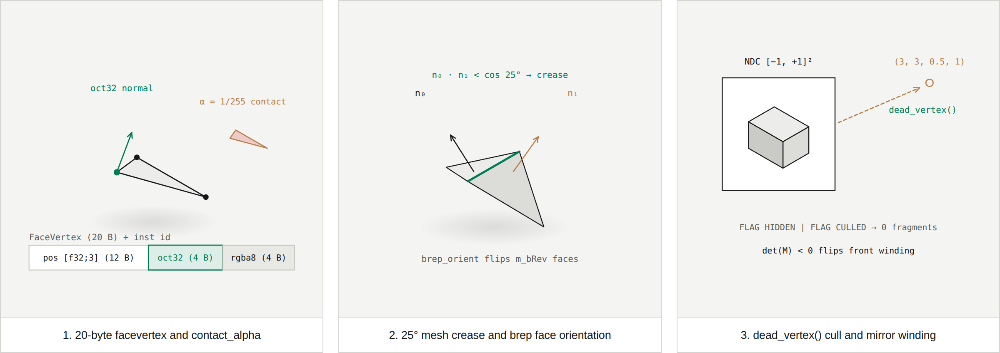

# Tutorial 4.1 · Mesh and BRep solid walkers

## Goal

Stream `session_rust::Mesh` and trimmed `BRep` solids into contiguous `20`-byte `FaceVertex` GPU arenas (`arena.rs`, `faces.rs`, `triangle.wgsl`), orient reversed BRep faces, extract `25°` crease edges, and map shared-definition slots (`slot_table.wgsl`).



**What we achieve:** Sub-allocator backed `20`-byte `FaceVertex` arenas (`[f32; 3]` position + `oct32` normal + `rgba8` colour), topological crease & boundary extraction (`walk/mesh.rs`, `walk/brep.rs`), and two-sided/mirrored CAD face shading in `triangle.wgsl` (`?tutorial=geometry`).

## How it works

`walk/mesh.rs` merges coplanar facets (`dot > 1 − 10⁻⁹`) and emits crease strokes past `25°`, `walk/brep_orient.rs` flips `m_bRev` faces and transfers true NURBS trim loops with curved `sag` slack, and `triangle.wgsl` skips hidden/culled rows in the vertex shader via `dead_vertex()` while reversing lighting normals when `det(M) < 0`.



## Compilable checkpoint slice

Tutorials 4.1 and 4.2 unlock the `geometry` assembly (`174` files, `?tutorial=geometry`) on top of `rows`.

Lines marked `+` show the exact module declarations unlocked between `rows` (`80` files) and `geometry` (`174` files):

```rust
// viewer-core/src/lib.rs (rows -> geometry)
  pub mod camera;
+ pub mod gizmo;
+ pub mod interactions;
+ pub mod knobs;
  pub mod rows;
  pub mod sink;
+ pub mod walk;
  pub use crate as app;
  pub use sink as core;
  pub use sink::GpuSink;

// src/engine/mod.rs (rows -> geometry)
  pub mod diagnostics;
  pub mod gpu;
  pub mod performance;
  pub mod pipelines;
+ pub mod text; // register:text

// src/engine/gpu/mod.rs (rows -> geometry)
+ pub mod arena; // register:arena
+ pub mod backdrop; // register:backdrop
  pub mod buffers; // register:buffers
+ pub mod clip; // register:clip
+ pub mod cloud; // register:cloud
  pub mod device; // register:device
+ pub mod faces; // register:faces
+ pub mod frame; // register:frame
+ pub mod glyphs; // register:glyphs
  pub mod hull; // register:hull
  pub mod instance; // register:instance
+ pub mod instanced; // register:instanced
+ pub mod lod; // register:lod
  pub mod objects;
+ pub mod slots; // register:slots
+ pub mod lane; // register:lane
+ #[cfg(target_arch = "wasm32")]
+ mod pacing;
+ pub mod pass; // register:pass
+ pub(crate) mod patch; // register:patch
+ pub mod pick; // register:pick
+ pub mod planes; // register:planes
+ pub mod present; // register:present
+ pub mod render; // register:render
+ pub mod segments; // register:segments
+ pub mod splat; // register:splat
+ mod ssao; // register:ssao
+ pub mod surface_outline; // register:surface_outline
+ pub mod targets; // register:targets
+ pub mod text; // register:text
+ pub mod text_outline; // register:text_outline
+ pub mod timing; // register:timing
+ mod triangle_tiles; // register:triangle_tiles
  pub mod ui; // register:ui
+ pub mod upload; // register:upload
+ pub mod vectors; // register:vectors
+ pub mod view; // register:view
+ mod widget; // register:widget
+ mod widget_mesh; // register:widget_mesh
+ mod context;
+ mod sink;
+ pub use context::Gpu;
+ #[cfg(test)]
+ pub(crate) use context::lane_shaders;
+ #[allow(unused_imports)]
+ pub use cloud::{CloudDraw, LodNode, NO_NORMALS}; // register:clouds
+ pub use frame::FrameInput;
+ pub use glyphs::GlyphPoint; // register:markers
+ pub use instance::Instance;
+ #[allow(unused_imports)]
+ pub use objects::{ObjectRow, Rebase};
+ pub use pick::Pick; // register:shell
+ pub use segments::CylinderSegment; // register:strokes
+ pub use upload::Upload;
+ pub use view::View;

// src/app/mod.rs (rows -> geometry)
+ pub use viewer_core::gizmo; // register:gizmo
+ pub use viewer_core::interactions; // register:interactions
+ pub use viewer_core::knobs; // register:knobs
  #[cfg(target_arch = "wasm32")]
  pub mod launch;
  pub mod mode; // register:mode
  pub mod stage;
+ pub use viewer_core::walk; // register:walk

// examples/course/registration.rs (rows -> geometry)
  // --8<-- [start:course-registration]
  #[path = "canvas.rs"]
  mod canvas;
  #[path = "frame.rs"]
  mod frame;
  #[path = "painting.rs"]
  mod painting;
  #[path = "mathematics.rs"]
  mod mathematics;
  #[path = "dock.rs"]
  mod dock;
  #[path = "camera.rs"]
  mod camera;
  #[path = "rows.rs"]
  mod rows;
+ #[path = "geometry.rs"]
+ mod geometry;
  type Start = fn() -> Result<(), wasm_bindgen::JsValue>;
  pub(super) const STARTS: &[(&str, Start)] = &[
      ("frame", frame::start),
      ("painting", painting::start),
      ("mathematics", mathematics::start),
      ("dock", dock::start),
      ("camera", camera::start),
      ("rows", rows::start),
+     ("geometry", geometry::start),
  ];
  // --8<-- [end:course-registration]
```

## Core code walkthrough

### Mesh crease angle & raw-triangle threshold (`viewer-core/src/walk/mesh.rs:10:55`)

```rust
--8<-- "session_viewer/viewer-core/src/walk/mesh.rs:10:55"
```

Walking a `session_rust::Mesh` balances CAD crispness against dense-scan speed: above `MESH_RAW_MIN = 200,000` triangles (line `11`), automatic edge extraction is skipped unless `with_wireframe_edges(true, ...)` forces it; coplanar facets (`dot > 1 − 10⁻⁹`, line `37`) merge interior seams, while smooth-shaded surfaces emit crease strokes wherever adjacent face normals diverge past `25°` (`CREASE_COS = cos 25° ≈ 0.9063`, line `40`).

### `dead_vertex()` culling & `CONTACT_ALPHA` (`src/shaders/triangle.wgsl:34:70`)

```wgsl
--8<-- "session_viewer/src/shaders/triangle.wgsl:34:70"
```

Because all meshes share one contiguous `Arena` vertex buffer, hiding or frustum-culling one object cannot remove its vertices from the draw call. Instead, `transform_vertex` checks `(inst.flags & (FLAG_HIDDEN | FLAG_CULLED)) != 0u` (line `47`) and emits `dead_vertex()` at NDC `(3, 3, 0.5, 1)` outside `[-1, 1]²`, which the GPU rasterizer discards in zero fragment invocations. Lines `58–68` preserve `CONTACT_ALPHA = 1/255` red timber-joint contact facets unlit even when hovered.

## Prerequisites and files

Sub-chapter `4.1` of [Tutorial 4](tutorial-four-geometry.md). Pairs with [Tutorial 4.2 (Curve ribbons, arrows & glyphs)](tutorial-four-strokes.md) to complete the `geometry` assembly.

**Core files to type inline (6 files):**

1. `src/engine/gpu/arena.rs`
2. `src/engine/gpu/faces.rs`
3. `src/shaders/triangle.wgsl`
4. `viewer-core/src/walk/mesh.rs`
5. `viewer-core/src/walk/brep.rs`
6. `examples/course/geometry.rs`

**Reference catalog & test files (19 files, folded below):** `src/engine/gpu/slots.rs`, `src/shaders/slot_table.wgsl`, `viewer-core/src/walk/mod.rs`, `viewer-core/src/walk/encode.rs`, `viewer-core/src/walk/bounds.rs`, `viewer-core/src/walk/mesh_topology.rs`, `viewer-core/src/walk/mesh_ink.rs`, `viewer-core/src/walk/brep_orient.rs`, `viewer-core/src/walk/brep_shapes.rs`, `viewer-core/src/walk/brep_edges.rs`, `viewer-core/src/walk/display.rs`, `viewer-core/src/walk/display_features.rs`, `viewer-core/src/walk/application_tests.rs`, `viewer-core/src/walk/brep/application_tests.rs`, `src/engine/gpu/scene_gpu_tests/mod.rs`, `src/engine/gpu/scene_gpu_tests/contacts.rs`, `src/engine/gpu/scene_gpu_tests/frames.rs`, `src/engine/gpu/scene_gpu_tests/instances.rs`, `src/engine/gpu/scene_gpu_tests/split.rs`.

## Build

### Step 1 · `src/engine/gpu/arena.rs`

Packs vertices into `20 B` (`xyz` `f32`, octahedral normal `u32`, RGBA `u32`) with separate ordinary, printed-fill and text-outline index streams.

```rust
--8<-- "session_viewer/src/engine/gpu/arena.rs"
```

### Step 2 · `src/engine/gpu/faces.rs`

Maps drawn triangles to source faces and binds physical, opaque, clipped, object-ID, face-pick, highlight and mask pipelines.

```rust
--8<-- "session_viewer/src/engine/gpu/faces.rs"
```

### Step 3 · `src/shaders/triangle.wgsl`

`src/shaders/triangle.wgsl` transforms arena and slot-instanced vertices (`slot_row`), preserves unlit opaque contact fills pulled forward via `depth_layer`, detects mirrored transforms (`det(model) < 0`), and writes `PhysicalColor` (`color` + `2×u16` `primitive`).

```wgsl
--8<-- "session_viewer/src/shaders/triangle.wgsl"
```

### Step 4 · `viewer-core/src/walk/mesh.rs`

Applies `MeshOpts` (ordinary, smooth sampled, or closed element), estimates spacing from `diag / sqrt(V)`, and drops raw wireframe above `200,000` triangles.

```rust
--8<-- "session_viewer/viewer-core/src/walk/mesh.rs"
```

### Step 5 · `viewer-core/src/walk/brep.rs`

Reuses congruent shapes or requests per-face display meshes, retains `(u, v)` samples and face IDs, and sets smooth/open/closed row flags without mutating the BRep.

```rust
--8<-- "session_viewer/viewer-core/src/walk/brep.rs"
```

### Step 6 · `examples/course/geometry.rs`

`examples/course/geometry.rs` runs the Tutorial 4 geometry checkpoint (`?tutorial=geometry`), walking a kernel `Mesh` cube, a `BRep` solid, and an arrowed `NurbsCurve` into GPU lanes (with no 3D matrix lane). Trap: BRep trim loops and crease edges must carry their original face normals into `SegTable` so hidden-line ink visibility agrees with solid shading.

```rust
--8<-- "session_viewer/examples/course/geometry.rs"
```

## Reference catalog and test files (19 files)

The 6 core files above implement the complete mechanism for this lesson. Expand this reference section whenever you want to inspect or copy the remaining 19 sibling verbs, adapters, and unit-test suites (`Step 7`–`Step 25`).

### Step 7 · `src/engine/gpu/slots.rs`

Maps shared definition meshes to placed instances via `8 B` `(object_row, tri_id_base)` entries (`slot 0 = OWN_ROW`) and a `1024`-wide lookup texture.

```rust
--8<-- "session_viewer/src/engine/gpu/slots.rs"
```

### Step 8 · `src/shaders/slot_table.wgsl`

Binary-searches `placed_triangle` across the `1024`-texel slot texture so shared definition triangles resolve to each instance's own row and unique triangle ID.

```wgsl
--8<-- "session_viewer/src/shaders/slot_table.wgsl"
```

### Step 9 · `viewer-core/src/walk/mod.rs`

Splits mutable `Upload` borrows via `Walk::solid` and threads `WalkCx` (`row`, `cloud_px`, `arrowhead_pens` override) so converters append faces, edges and dots without cloning tables.

```rust
--8<-- "session_viewer/viewer-core/src/walk/mod.rs"
```

### Step 10 · `viewer-core/src/walk/encode.rs`

Packs RGBA bytes, maps explicit pixel widths to negative half-widths, and quantizes octahedral normals while reserving `0xffffffff` for unknown facing.

```rust
--8<-- "session_viewer/viewer-core/src/walk/encode.rs"
```

### Step 11 · `viewer-core/src/walk/bounds.rs`

Records pre-append `Baselines`, unions live placed bounds in `file_extent`, and flags `z < 0.001` planar batches as `0.5`-unit drawing sheets.

```rust
--8<-- "session_viewer/viewer-core/src/walk/bounds.rs"
```

### Step 12 · `viewer-core/src/walk/mesh_topology.rs`

Maps vertex keys to dense or hash slots, computes Newell polygon normals, and pairs shared edges with hole rings oriented against outer borders.

```rust
--8<-- "session_viewer/viewer-core/src/walk/mesh_topology.rs"
```

### Step 13 · `viewer-core/src/walk/mesh_ink.rs`

Suppresses coplanar diagonals, retains borders and creases above `25°`, marks smooth silhouette seams, and switches wireframes above `10,000` edges to black.

```rust
--8<-- "session_viewer/viewer-core/src/walk/mesh_ink.rs"
```

### Step 14 · `viewer-core/src/walk/brep_orient.rs`

Traverses shared-edge BFS components on closed shells and flips connected components by signed volume so solid normals point outward reproducibly.

```rust
--8<-- "session_viewer/viewer-core/src/walk/brep_orient.rs"
```

### Step 15 · `viewer-core/src/walk/brep_shapes.rs`

Scopes thread-local `SharedWalks` to one document walk so congruent shapes replay recorded vertex/edge ranges under distinct placed object rows.

```rust
--8<-- "session_viewer/viewer-core/src/walk/brep_shapes.rs"
```

### Step 16 · `viewer-core/src/walk/brep_edges.rs`

Evaluates exact `3D` trim/seam curves, unwraps closed seams, and stores each chord's geometric sag above its facet so curved ink stays visible without global depth bias.

```rust
--8<-- "session_viewer/viewer-core/src/walk/brep_edges.rs"
```

### Step 17 · `viewer-core/src/walk/display.rs`

Quantizes `Quality::for_error` in half-octave steps and subdivides knot spans up to depth `16` and `4,096` segments with a drop-guarded candidate state.

```rust
--8<-- "session_viewer/viewer-core/src/walk/display.rs"
```

### Step 18 · `viewer-core/src/walk/display_features.rs`

Caps element annotations at `256` features and `4,096` finite points, copying lean display polylines so hidden kernel caches are not retained.

```rust
--8<-- "session_viewer/viewer-core/src/walk/display_features.rs"
```

### Step 19 · `viewer-core/src/walk/application_tests.rs`

Verifies element feature/contact polygon ribbons, dots and parent-row ID inheritance when element annotations toggle on/off.

```rust
--8<-- "session_viewer/viewer-core/src/walk/application_tests.rs"
```

### Step 20 · `viewer-core/src/walk/brep/application_tests.rs`

Verifies rational cylindrical NURBS border-to-face vertex sharing, preserved source `.pb` bytes and exact `Δz` surface-preview pipe offsets.

```rust
--8<-- "session_viewer/viewer-core/src/walk/brep/application_tests.rs"
```

### Step 21 · `src/engine/gpu/scene_gpu_tests/mod.rs`

`src/engine/gpu/scene_gpu_tests/mod.rs` (4 lines) declares and re-exports module tree `contacts`, `frames`, `instances`, `split`. It keeps `mod` deterministic across native `cargo xtest` and `wasm32-unknown-unknown` builds.

```rust
--8<-- "session_viewer/src/engine/gpu/scene_gpu_tests/mod.rs"
```

### Step 22 · `src/engine/gpu/scene_gpu_tests/contacts.rs`

`src/engine/gpu/scene_gpu_tests/contacts.rs` (102 lines) implements `contacts` (`contacts_on_their_face_draw_in_front_of_it()`) inside `scene_gpu_tests`. It connects `ElementFeature`, `session_rust`, `scene`, `Camera` within `scene_gpu_tests` across native and `wasm32` targets.

```rust
--8<-- "session_viewer/src/engine/gpu/scene_gpu_tests/contacts.rs"
```

### Step 23 · `src/engine/gpu/scene_gpu_tests/frames.rs`

`src/engine/gpu/scene_gpu_tests/frames.rs` (222 lines) verifies `authored_line_widths_reach_the_pixels`. It provides `top_view()`, `count()`, `grey()`; and locked by `cargo xtest` (`authored_line_widths_reach_the_pixels`).

```rust
--8<-- "session_viewer/src/engine/gpu/scene_gpu_tests/frames.rs"
```

### Step 24 · `src/engine/gpu/scene_gpu_tests/instances.rs`

`src/engine/gpu/scene_gpu_tests/instances.rs` (409 lines) implements `instances` (`file()`, `placed()`, `turned_grid()`) inside `scene_gpu_tests`. It connects `scene`, `Camera`, `gpu`, `ElementFeature` within `scene_gpu_tests` across native and `wasm32` targets.

```rust
--8<-- "session_viewer/src/engine/gpu/scene_gpu_tests/instances.rs"
```

### Step 25 · `src/engine/gpu/scene_gpu_tests/split.rs`

`src/engine/gpu/scene_gpu_tests/split.rs` (758 lines) implements `split` (`file()`, `p()`, `arc()`) inside `scene_gpu_tests`. It connects `clipping`, `verbs`, `Interval`, `scene` within `scene_gpu_tests` across native and `wasm32` targets.

```rust
--8<-- "session_viewer/src/engine/gpu/scene_gpu_tests/split.rs"
```

## Integration

`viewer-core/src/walk/mod.rs` dispatches `Geometry::Mesh`, `Geometry::BRep`, and `Geometry::Element` into `walk::mesh` and `walk::brep`, appending `20 B` `FaceVertex` slices into `engine::gpu::arena::Arena` and binding `faces::Faces` into `pass::PASSES`.

## Run and observe

Run the `20`-byte `FaceVertex`, octahedral normal round-trip, BRep patch boundary, and mirrored-winding tests, or render the multi-solid scene via `session-viewer-cli`:

```sh
cargo xtest -j8 packed_vertex_is_twenty_bytes
cargo xtest -j8 octahedral_normals_round_trip
cargo xtest -j8 teapot_boundary_ink_follows_authored_patch_curves
cargo run --target x86_64-unknown-linux-gnu --bin session-viewer-cli -- exec \
  --cmd "Box 0,0,0 80 80 80" --cmd "Cylinder 120,0,0 38 90" --cmd "Torus 250,0,40 48 16" \
  --cmd "Select All" --cmd "View Isometric" --cmd "Fit" --cmd "Escape" --render target/meshes.png
```

## Predict and try

Predict what happens to back-face shading when a CAD solid is mirrored across the `YZ` plane (`Xform::scale_xyz(-1.0, 1.0, 1.0)`): `det(model) < 0` reverses triangle screen winding! Inspect `triangle.wgsl` (`mirrored` flat interpolant): XORing `@builtin(front_facing)` with `mirrored != 0u` keeps outward normals lit white/grey instead of painting the mirrored solid `BACKFACE_COLOR` red.

## Question and answer

**Why does `triangle.wgsl` discard hidden or frustum-culled objects by returning `dead_vertex()` at `(3.0, 3.0, 0.5, 1.0)` instead of rebuilding the GPU index buffer?**

??? tip "Think first — click to reveal how to work it out and the answer"
    **How to work it out:** Consider a `500,000`-triangle architectural model in a single shared `Arena` buffer when the user toggles a layer lamp or orbits past off-screen bays at `60 Hz`.

    **The answer:** Rebuilding and uploading megabytes of index ranges on every camera orbit frame would stall the CPU-GPU bus. Checking `(inst.flags & (FLAG_HIDDEN | FLAG_CULLED)) != 0u` per vertex and placing all three corners at identical NDC `(3, 3)` outside `[-1, 1]²` lets hardware clip-culling drop the triangle in zero rasterized pixels while keeping one static arena buffer.

## Validation

Verified via `packed_vertex_is_twenty_bytes`, `octahedral_normals_round_trip`, `instance_mirror`, `teapot_boundary_ink_follows_authored_patch_curves`, and `scene_gpu_tests` (`contacts`, `frames`, `instances`, `split`).
