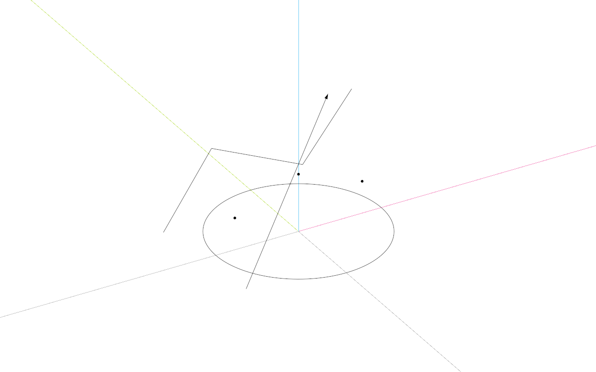
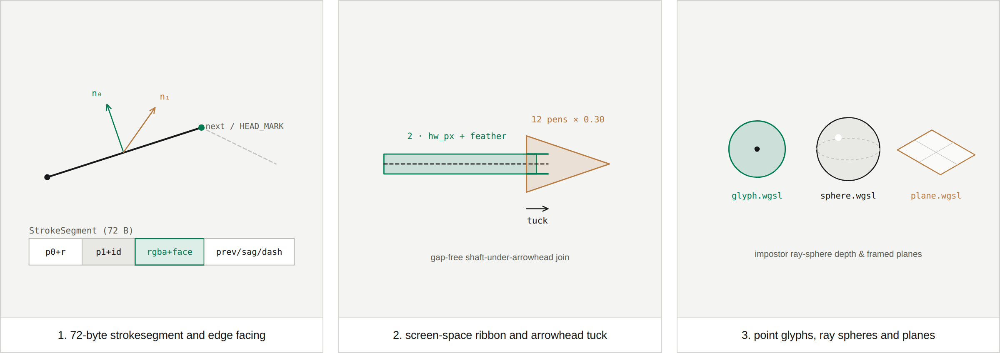

# Tutorial 4.2 · Curve ribbons, arrows, vectors and point glyphs

## Goal

Extrude `72`-byte `StrokeSegment` records into antialiased screen-space curve ribbons (`ribbon.wgsl`), join `12 × 0.30` arrowheads without seam gaps (`arrow.wgsl`, `vector.wgsl`), and render crisp point discs, ray-cast spheres, and reference planes.



**What we achieve:** Screen-space mitered/beveled curve ribbons (`segments.rs`, `ribbon.wgsl`) with continuous arc-length dashes, gap-free `HEAD_MARK` arrowheads (`arrow.wgsl`, `vectors.rs`), `glyph.wgsl` point markers, analytical ray-traced `sphere.wgsl` impostors, and `plane.wgsl` frames.

## How it works

Each `StrokeSegment` (`72 B`) carries `previous`/`next` segment indices so `ribbon.wgsl` miters corners in screen pixels and `tuck()` slides terminal shafts `1..1.25 px` under `HEAD_MARK` arrowheads; meanwhile `sphere.wgsl` solves exact ray-sphere intersections per fragment on a 2-triangle billboard quad, writing true reverse-Z sphere depth.



## Compilable checkpoint slice

Completes all stroke, vector, glyph, sphere, and plane GPU lanes in the `geometry` assembly (`174` files).

Lines marked `+` show the exact module declarations unlocked between `rows` (`80` files) and `geometry` (`174` files):

```rust
// viewer-core/src/lib.rs (rows -> geometry)
  pub mod camera;
+ pub mod gizmo;
+ pub mod interactions;
+ pub mod knobs;
  pub mod rows;
  pub mod sink;
+ pub mod walk;
  pub use crate as app;
  pub use sink as core;
  pub use sink::GpuSink;

// src/engine/mod.rs (rows -> geometry)
  pub mod diagnostics;
  pub mod gpu;
  pub mod performance;
  pub mod pipelines;
+ pub mod text; // register:text

// src/engine/gpu/mod.rs (rows -> geometry)
+ pub mod arena; // register:arena
+ pub mod backdrop; // register:backdrop
  pub mod buffers; // register:buffers
+ pub mod clip; // register:clip
+ pub mod cloud; // register:cloud
  pub mod device; // register:device
+ pub mod faces; // register:faces
+ pub mod frame; // register:frame
+ pub mod glyphs; // register:glyphs
  pub mod hull; // register:hull
  pub mod instance; // register:instance
+ pub mod instanced; // register:instanced
+ pub mod lod; // register:lod
  pub mod objects;
+ pub mod slots; // register:slots
+ pub mod lane; // register:lane
+ #[cfg(target_arch = "wasm32")]
+ mod pacing;
+ pub mod pass; // register:pass
+ pub(crate) mod patch; // register:patch
+ pub mod pick; // register:pick
+ pub mod planes; // register:planes
+ pub mod present; // register:present
+ pub mod render; // register:render
+ pub mod segments; // register:segments
+ pub mod splat; // register:splat
+ mod ssao; // register:ssao
+ pub mod surface_outline; // register:surface_outline
+ pub mod targets; // register:targets
+ pub mod text; // register:text
+ pub mod text_outline; // register:text_outline
+ pub mod timing; // register:timing
+ mod triangle_tiles; // register:triangle_tiles
  pub mod ui; // register:ui
+ pub mod upload; // register:upload
+ pub mod vectors; // register:vectors
+ pub mod view; // register:view
+ mod widget; // register:widget
+ mod widget_mesh; // register:widget_mesh
+ mod context;
+ mod sink;
+ pub use context::Gpu;
+ #[cfg(test)]
+ pub(crate) use context::lane_shaders;
+ #[allow(unused_imports)]
+ pub use cloud::{CloudDraw, LodNode, NO_NORMALS}; // register:clouds
+ pub use frame::FrameInput;
+ pub use glyphs::GlyphPoint; // register:markers
+ pub use instance::Instance;
+ #[allow(unused_imports)]
+ pub use objects::{ObjectRow, Rebase};
+ pub use pick::Pick; // register:shell
+ pub use segments::CylinderSegment; // register:strokes
+ pub use upload::Upload;
+ pub use view::View;

// src/app/mod.rs (rows -> geometry)
+ pub use viewer_core::gizmo; // register:gizmo
+ pub use viewer_core::interactions; // register:interactions
+ pub use viewer_core::knobs; // register:knobs
  #[cfg(target_arch = "wasm32")]
  pub mod launch;
  pub mod mode; // register:mode
  pub mod stage;
+ pub use viewer_core::walk; // register:walk

// examples/course/registration.rs (rows -> geometry)
  // --8<-- [start:course-registration]
  #[path = "canvas.rs"]
  mod canvas;
  #[path = "frame.rs"]
  mod frame;
  #[path = "painting.rs"]
  mod painting;
  #[path = "mathematics.rs"]
  mod mathematics;
  #[path = "dock.rs"]
  mod dock;
  #[path = "camera.rs"]
  mod camera;
  #[path = "rows.rs"]
  mod rows;
+ #[path = "geometry.rs"]
+ mod geometry;
  type Start = fn() -> Result<(), wasm_bindgen::JsValue>;
  pub(super) const STARTS: &[(&str, Start)] = &[
      ("frame", frame::start),
      ("painting", painting::start),
      ("mathematics", mathematics::start),
      ("dock", dock::start),
      ("camera", camera::start),
      ("rows", rows::start),
+     ("geometry", geometry::start),
  ];
  // --8<-- [end:course-registration]
```

## Core code walkthrough

### `72`-byte `StrokeSegment` & arrowhead `tuck()` (`src/shaders/ribbon.wgsl:1:70`)

```wgsl
--8<-- "session_viewer/src/shaders/ribbon.wgsl:1:70"
```

`StrokeSegment` (`18 × 4 B = 72 B`, lines `2–20`) packs endpoints `p0`/`p1`, signed `radius` (`0` = pen width, `> 0` = world mm, `< 0` = pen multiple), packed `oct16` adjacent face normals (`facing`), chain neighbours (`previous`/`next` or `HEAD_MARK = 0xfffffffe`), curved-chord `sag`, and dash phase. Where a curve ends in an arrowhead, `tuck()` (lines `67–69`) extends the shaft `1.0..1.25 px` underneath the arrowhead base so antialiased seams never show a hairline gap.

### Cumulative polyline dash phase & head rows (`viewer-core/src/walk/curves.rs:23:75`)

```rust
--8<-- "session_viewer/viewer-core/src/walk/curves.rs:23:75"
```

If dash patterns restarted at `0.0` on every tessellated NURBS chord, densely sampled curves would turn solid! `push_polyline` (lines `23–62`) accumulates Euclidean chord length into `offset` and writes `[dash_on, dash_off, offset]` per segment alongside `ribbon_chains` (`first..end`) so dashes flow smoothly around corners, while `head_row` (lines `67–75`) emits a `HEAD_ONLY` `VectorRow` aligned with the terminal chord.

## Prerequisites and files

Sub-chapter `4.2` of [Tutorial 4](tutorial-four-geometry.md), building on [Tutorial 4.1](tutorial-four-meshes.md).

**Core files to type inline (6 files):**

1. `src/engine/gpu/segments.rs`
2. `src/shaders/ribbon.wgsl`
3. `src/shaders/arrow.wgsl`
4. `viewer-core/src/walk/curves.rs`
5. `viewer-core/src/walk/points.rs`
6. `src/shaders/sphere.wgsl`

**Reference catalog & test files (8 files, folded below):** `src/engine/gpu/vectors.rs`, `src/shaders/vector.wgsl`, `src/engine/gpu/glyphs.rs`, `src/shaders/glyph.wgsl`, `src/engine/gpu/planes.rs`, `src/shaders/plane.wgsl`, `viewer-core/src/walk/plane.rs`, `viewer-core/src/walk/frames.rs`.

## Build

### Step 1 · `src/engine/gpu/segments.rs`

Expands `40 B` CPU segments into `72 B` `StrokeSegment` records across pipe, ribbon and sheet tables while keeping source entity intervals separate from GPU offsets.

```rust
--8<-- "session_viewer/src/engine/gpu/segments.rs"
```

### Step 2 · `src/shaders/ribbon.wgsl`

`src/shaders/ribbon.wgsl` reads each `72 B` `StrokeSegment`, tests adjacent face normals (`edge_faces_camera`), and bisects consecutive screen directions in `join_plane` so chained curve segments meet at clean mitered corners without overlapping alpha.

```wgsl
--8<-- "session_viewer/src/shaders/ribbon.wgsl"
```

### Step 3 · `src/shaders/arrow.wgsl`

`src/shaders/arrow.wgsl`: An arrow's corners and ink: what the vector and plane lanes share; each adds its rows and its vertex entry. Defines entry points `@fragment fn fs_main`, `@fragment fn fs_id`; keep struct layouts and binding indices aligned with their Rust `bytemuck` mirrors and Naga validation tests.

```wgsl
--8<-- "session_viewer/src/shaders/arrow.wgsl"
```

### Step 4 · `viewer-core/src/walk/curves.rs`

Emits chained polyline/NURBS segments with cumulative arc-length dash offsets, `arrowhead_pens`-scaled terminal `VectorRow`s landing on exact endpoints, and marker-aware trims.

```rust
--8<-- "session_viewer/viewer-core/src/walk/curves.rs"
```

### Step 5 · `viewer-core/src/walk/points.rs`

Appends one signed-distance dot per `Point` (`-3 px` default radius) while keeping scene bounds restricted to the world point centre.

```rust
--8<-- "session_viewer/viewer-core/src/walk/points.rs"
```

### Step 6 · `src/shaders/sphere.wgsl`

`src/shaders/sphere.wgsl`: One marker or dot, 48 bytes; matches GlyphPoint in Rust. Defines entry points `@vertex fn vs_main`, `@vertex fn vs_front`, `@fragment fn fs_main`, `@fragment fn fs_id`; bindings `@group(3) @binding(0) glyphs`; keep struct layouts and binding indices aligned with their Rust `bytemuck` mirrors and Naga validation tests.

```wgsl
--8<-- "session_viewer/src/shaders/sphere.wgsl"
```

## Reference catalog and test files (8 files)

The 6 core files above implement the complete mechanism for this lesson. Expand this reference section whenever you want to inspect or copy the remaining 8 sibling verbs, adapters, and unit-test suites (`Step 7`–`Step 14`).

### Step 7 · `src/engine/gpu/vectors.rs`

Registers `VectorLane` (`64 B` `VectorRow` stride, `18` generated vertices per arrow) with matching colour and object-ID pipelines.

```rust
--8<-- "session_viewer/src/engine/gpu/vectors.rs"
```

### Step 8 · `src/shaders/vector.wgsl`

`src/shaders/vector.wgsl`: Vectors: one instance per VectorRow, its corners from arrow.wgsl. Defines entry points `@vertex fn vs_main`; bindings `@group(3) @binding(0) vectors`; including `arrow.wgsl`; keep struct layouts and binding indices aligned with their Rust `bytemuck` mirrors and Naga validation tests.

```wgsl
--8<-- "session_viewer/src/shaders/vector.wgsl"
```

### Step 9 · `src/engine/gpu/glyphs.rs`

Stores `48 B` `GlyphPoint` records (position, signed radius, colour, row and up to `6` packed face normals) for dots and vertex markers.

```rust
--8<-- "session_viewer/src/engine/gpu/glyphs.rs"
```

### Step 10 · `src/shaders/glyph.wgsl`

`src/shaders/glyph.wgsl`: One marker or dot, 48 bytes; matches GlyphPoint in Rust. Defines entry points `@fragment fn fs_main`, `@fragment fn fs_id`, `@vertex fn vs_main`, `@vertex fn vs_source`; bindings `@group(3) @binding(0) glyphs`; keep struct layouts and binding indices aligned with their Rust `bytemuck` mirrors and Naga validation tests.

```wgsl
--8<-- "session_viewer/src/shaders/glyph.wgsl"
```

### Step 11 · `src/engine/gpu/planes.rs`

Registers `PlaneLane` (`48 B` stride, `1` instanced draw -> `22` grid lines + `3` axis arrows) with atomic `f64` global plane-size scaling.

```rust
--8<-- "session_viewer/src/engine/gpu/planes.rs"
```

### Step 12 · `src/shaders/plane.wgsl`

`src/shaders/plane.wgsl` synthesizes `22` grid segments (`132` vertices) plus `3` RGB `XYZ` arrows (`54` vertices) per `48 B` `PlaneRow` by calling `arrow_corner`.

```wgsl
--8<-- "session_viewer/src/shaders/plane.wgsl"
```

### Step 13 · `viewer-core/src/walk/plane.rs`

Emits `48 B` `Plane` frame rows (`12`-edge ribbons for `OBB`s) and separates clipping-plane rectangles + cut arrows from orientation grids, triggering solid-mesh verification on first cut.

```rust
--8<-- "session_viewer/viewer-core/src/walk/plane.rs"
```

### Step 14 · `viewer-core/src/walk/frames.rs`

Converts coordinate frames and vectors into compact `48 B` plane and `64 B` `VectorRow` GPU records instead of tessellated arrow meshes.

```rust
--8<-- "session_viewer/viewer-core/src/walk/frames.rs"
```

## Integration

`segments::SegTable`, `vectors::VectorTable`, `glyphs::GlyphTable`, and `planes::PlaneTable` register in `lane::REGISTRY` so colour rendering, silhouette masks, and cropped `19×19` GPU ID picks all draw strokes through the same storage buffers.

## Run and observe

Run the arrowhead exact-tip, curve dash-chain, and impostor sphere/glyph tests, then render curves, polylines, arrows, and points headlessly:

```sh
cargo xtest -p session_viewer arrow_is_exactly_as_long_as_its_line
cargo xtest -p viewer-core walk::curves::
cargo run --target x86_64-unknown-linux-gnu --bin session-viewer-cli -- exec \
  --cmd "NurbsCurveCircle 0,0,0 90" --cmd "Arrow -80,-60,0 80,60,90" --cmd "Point 0,0,45" \
  --cmd "Select All" --cmd "View Isometric" --cmd "Fit" --cmd "Escape" --render target/strokes.png
```

Inspect `target/strokes.png` (and the unit test assertions): arrow tips land within `0.010 px` of their geometric endpoint with `0` shaft-to-head seam gaps.

## Predict and try

Predict what happens at the base of a `50%` translucent or antialiased arrow if the shaft stops flush at the arrowhead base line (`tuck = 0`): two `50%`-coverage antialiased pixel fringes multiply to `1 − (1 − 0.5)² = 75%` (or leave a `1 px` notch at oblique angles)! `tuck()` in `ribbon.wgsl` extends the shaft `1.0..1.25 px` inside the opaque head triangle so `0` seam pixels appear.

## Question and answer

**Why render 3D `Point` spheres in `sphere.wgsl` as a 4-vertex screen-aligned quad with per-fragment ray-sphere depth instead of tessellating icosahedron meshes?**

??? tip "Think first — click to reveal how to work it out and the answer"
    **How to work it out:** Count the vertices needed to make `100,000` control points or joint spheres look circular when zoomed in (`>= 160` triangles per sphere = `16,000,000` triangles).

    **The answer:** A 4-vertex billboard quad (`2` triangles per sphere) solving the quadratic ray-sphere equation in `sphere.wgsl` has a perfectly smooth silhouette at *any* zoom level, writes exact per-pixel reverse-Z `@builtin(frag_depth)` for clean solid intersections, and uses `80×` less vertex memory.

## Validation

Verified via `arrow_is_exactly_as_long_as_its_line` (`<= 0.010 px` tip error, `0` seam pixels), `walk::curves` dash/arrow tests, and `walk::points` / `walk::plane` unit suites.
