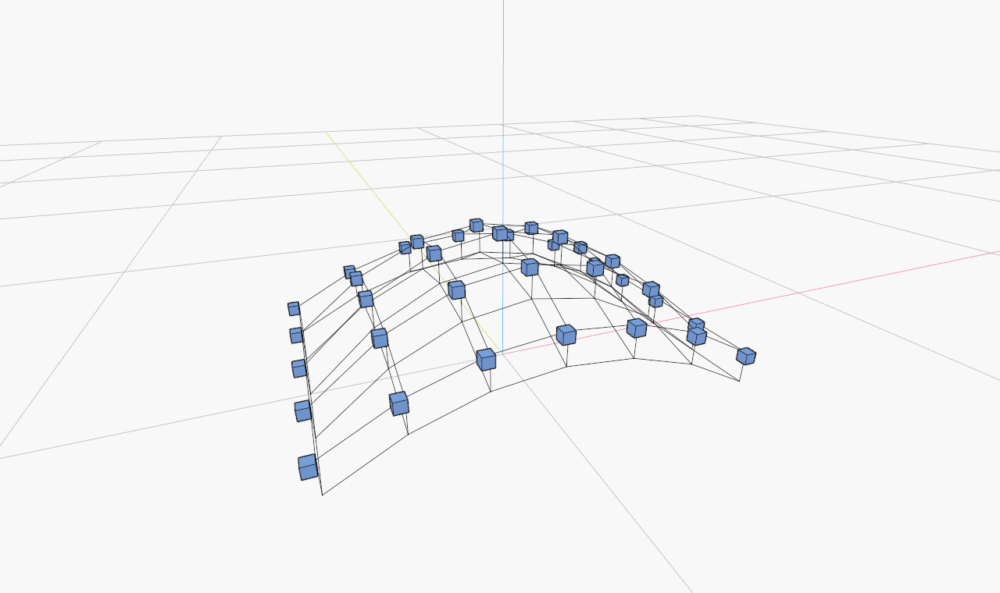
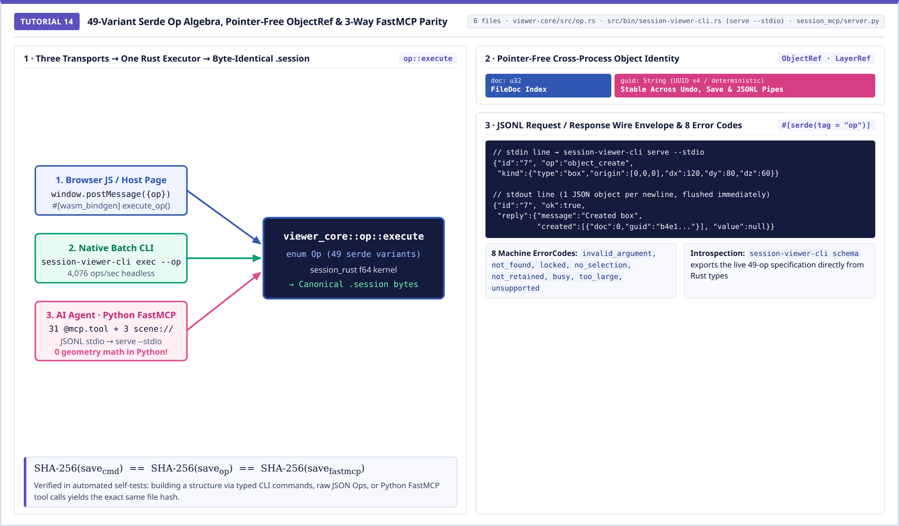

# Tutorial 14 · Shared `Op` API, browser `execute_op` and FastMCP server

## Goal

Unify typed JSON operations (`49` `Op` variants addressed by stable `(doc, guid)` `ObjectRef` and `(doc, name)` `LayerRef`) across `CommandHost`, browser `#[wasm_bindgen] execute_op` + `postMessage`, `session-viewer-cli serve --stdio`, and the Python `session_mcp` FastMCP server.



**What we achieve:** Typed `49`-variant JSON `Op` automation (`viewer-core/src/op.rs`) shared across browser `execute_op` (`postMessage`), native CLI, and the Python `session_mcp` FastMCP server (`test_mcp_parity.py`).

## How it works

`viewer_core::op::execute` runs against `&mut dyn CommandHost` (`src/state/host.rs` in WASM vs `HeadlessHost` in CLI/stdio), addressing objects by pointer-free `ObjectRef { doc, guid }`, classifying failures into 8 machine `ErrorCode`s, and producing SHA-256-identical `.session` state across CLI, JSON Ops, and Python FastMCP tools.



## Compilable checkpoint slice

`CommandHost` (`host.rs`), `viewer-core/src/op.rs`, browser `execute_op`, and the Python `session_mcp` package unite interactive, CLI, and MCP automation at `application`.

Lines marked `+` show the exact module declarations unlocked between `decoding` (`179` files) and `application` (`398` files):

```rust
// viewer-core/src/lib.rs (decoding -> application)
+ //! UI- and GPU-independent core of Session Viewer.
+ //!
+ //! Zero dependencies on `wgpu`, `winit`, `egui`, `web-sys`, `wasm-bindgen`, or `glyphon`.
  pub mod camera;
+ pub mod clipping;
+ pub mod cloud_query;
+ pub mod command;
+ pub mod coords;
+ pub mod cplane;
  pub mod decode;
+ pub mod deform;
+ pub mod edit;
  pub mod gizmo;
+ pub mod hierarchy;
  pub mod interactions;
  pub mod knobs;
+ pub mod layers;
+ pub mod live_revision;
+ pub mod manifest;
+ pub mod mesh_preview;
+ pub mod modeling;
+ pub mod op;
+ pub mod range_gate;
  pub mod rows;
+ pub mod scene;
+ pub mod selection;
+ pub mod session_io;
+ pub mod sheet_query;
  pub mod sink;
+ pub mod snap;
+ pub mod splitting;
+ pub mod stream;
+ pub mod surface_preview;
  pub mod validate;
  pub mod walk;
  pub use crate as app;
  pub use sink as core;
  pub use sink::GpuSink;

// src/lib.rs (decoding -> application)
  /// A WGSL file from src/shaders as build.rs wrote it: no comments, indentation or blank lines.
  macro_rules! shader {
      ($name:literal) => {
          include_str!(concat!(env!("OUT_DIR"), "/shaders/", $name))
      };
  }
  mod engine;
  pub use viewer_core as core;
+ pub use viewer_core::op;
  pub use viewer_core::rows;
  pub use viewer_core::camera;
  pub mod command_dock;
  pub mod app;
+ #[cfg(target_arch = "wasm32")]
+ pub mod text_quality;
+ mod state;
+ pub use state::State;
+ #[cfg(target_arch = "wasm32")]
+ pub(crate) use app::runtime::desired_canvas_size;
+ #[cfg(target_arch = "wasm32")]
+ pub use app::runtime::{App, execute_op, run_web};
+ pub use app::runtime::{CloudChunk, Msg, SheetChunk};
+ #[cfg(not(target_arch = "wasm32"))]
+ pub mod selftest;
  #[cfg(all(target_arch = "wasm32", feature = "tutorial"))]
  #[path = "../examples/course/entry.rs"]
  mod course;

// src/engine/gpu/mod.rs (decoding -> application)
  pub mod arena; // register:arena
  pub mod backdrop; // register:backdrop
  pub mod buffers; // register:buffers
  pub mod clip; // register:clip
  pub mod cloud; // register:cloud
  pub mod device; // register:device
  pub mod faces; // register:faces
  pub mod frame; // register:frame
  pub mod glyphs; // register:glyphs
  pub mod hull; // register:hull
  pub mod instance; // register:instance
  pub mod instanced; // register:instanced
  pub mod lod; // register:lod
  pub mod objects;
  pub mod slots; // register:slots
  pub mod lane; // register:lane
  #[cfg(target_arch = "wasm32")]
  mod pacing;
  pub mod pass; // register:pass
  pub(crate) mod patch; // register:patch
  pub mod pick; // register:pick
  pub mod planes; // register:planes
  pub mod present; // register:present
  pub mod render; // register:render
  pub mod segments; // register:segments
  pub mod splat; // register:splat
  mod ssao; // register:ssao
  pub mod surface_outline; // register:surface_outline
  pub mod targets; // register:targets
  pub mod text; // register:text
  pub mod text_outline; // register:text_outline
  pub mod timing; // register:timing
  mod triangle_tiles; // register:triangle_tiles
  pub mod ui; // register:ui
  pub mod upload; // register:upload
  pub mod vectors; // register:vectors
  pub mod view; // register:view
  mod widget; // register:widget
  mod widget_mesh; // register:widget_mesh
  mod context;
  mod sink;
  pub use context::Gpu;
  #[cfg(test)]
  pub(crate) use context::lane_shaders;
  #[allow(unused_imports)]
  pub use cloud::{CloudDraw, LodNode, NO_NORMALS}; // register:clouds
  pub use frame::FrameInput;
  pub use glyphs::GlyphPoint; // register:markers
  pub use instance::Instance;
  #[allow(unused_imports)]
  pub use objects::{ObjectRow, Rebase};
  pub use pick::Pick; // register:shell
  pub use segments::CylinderSegment; // register:strokes
  pub use upload::Upload;
  pub use view::View;
+ #[cfg(all(test, not(target_arch = "wasm32")))] // register:application-tests
+ mod scene_gpu_tests; // register:application-tests

// src/app/mod.rs (decoding -> application)
+ #[cfg(target_arch = "wasm32")] // register:agent
+ pub mod agent; // register:agent
+ pub use viewer_core::clipping; // register:clipping
+ pub mod cloud_query; // register:cloud_query
+ pub use viewer_core::command; // register:command
+ pub use viewer_core::coords; // register:coords
+ pub use viewer_core::cplane; // register:cplane
  #[cfg(any(target_arch = "wasm32", test))] // register:decode
  pub mod decode; // register:decode
+ pub use viewer_core::deform; // register:deform
+ pub use viewer_core::edit; // register:edit
+ pub mod feedback; // register:feedback
+ #[cfg(target_arch = "wasm32")] // register:fetch
+ pub mod fetch; // register:fetch
+ pub mod fonts; // register:fonts
+ pub mod gesture; // register:gesture
  pub use viewer_core::gizmo; // register:gizmo
+ pub use viewer_core::hierarchy; // register:hierarchy
+ pub mod input; // register:input
+ #[cfg(any(target_arch = "wasm32", test))] // register:inspection
+ pub mod inspection; // register:inspection
  pub use viewer_core::interactions; // register:interactions
+ pub mod keys; // register:keys
  pub use viewer_core::knobs; // register:knobs
  #[cfg(target_arch = "wasm32")]
  pub mod launch;
+ pub use viewer_core::layers; // register:layers
+ #[cfg(target_arch = "wasm32")] // register:live
+ pub mod live; // register:live
+ #[cfg(any(target_arch = "wasm32", test))]
+ pub use viewer_core::live_revision;
+ #[cfg(target_arch = "wasm32")] // register:loader
+ pub mod loader; // register:loader
+ pub use viewer_core::manifest; // register:manifest
+ pub use viewer_core::mesh_preview; // register:mesh_preview
+ pub use viewer_core::modeling; // register:modeling
+ pub use viewer_core::op;
  pub mod mode; // register:mode
  pub mod stage;
+ #[cfg(any(target_arch = "wasm32", test))] // register:range_gate
+ pub use viewer_core::range_gate; // register:range_gate
+ #[cfg(target_arch = "wasm32")] // register:route
+ pub mod route; // register:route
+ pub(crate) mod runtime;
+ pub use viewer_core::scene; // register:scene
+ pub use viewer_core::selection; // register:selection
+ pub mod session_io; // register:session_io
+ pub mod sheet_query; // register:sheet_query
+ pub use viewer_core::snap; // register:snap
+ pub use viewer_core::splitting; // register:splitting
+ pub mod stream; // register:stream
+ pub use viewer_core::surface_preview; // register:surface_preview
+ pub mod touch; // register:touch
+ #[cfg(any(target_arch = "wasm32", test))] // register:ui
+ pub mod ui; // register:ui
  pub use viewer_core::validate; // register:validate
  pub use viewer_core::walk; // register:walk
  #[cfg(target_arch = "wasm32")]
  pub mod yielding;

// src/app/stage/mod.rs (decoding -> application)
  mod actions;
  mod check;
  pub mod deck;
  mod draw;
  pub mod eval;
  mod flat;
  pub mod font;
  mod geometry;
  mod layout;
  mod math_mode;
  mod matrix;
+ mod mode;
  mod morph;
  pub mod net;
  mod object;
  pub mod paint;
  pub mod presentation;
  #[cfg(test)]
  mod presentation_tests;
  pub mod run;
+ pub mod spatial;
  #[cfg(test)]
  mod tests;
  pub mod tex;
  mod tween;
  mod view;
+ mod application;
+ pub use application::{Loaded, StageApp};
+ #[cfg(target_arch = "wasm32")]
+ pub use application::{open, route};

// examples/course/registration.rs (decoding -> application)
  // --8<-- [start:course-registration]
  #[path = "canvas.rs"]
  mod canvas;
  #[path = "frame.rs"]
  mod frame;
  #[path = "painting.rs"]
  mod painting;
  #[path = "mathematics.rs"]
  mod mathematics;
  #[path = "dock.rs"]
  mod dock;
  #[path = "camera.rs"]
  mod camera;
  #[path = "rows.rs"]
  mod rows;
  #[path = "geometry.rs"]
  mod geometry;
  #[path = "decoding.rs"]
  mod decoding;
  type Start = fn() -> Result<(), wasm_bindgen::JsValue>;
  pub(super) const STARTS: &[(&str, Start)] = &[
      ("frame", frame::start),
      ("painting", painting::start),
      ("mathematics", mathematics::start),
      ("dock", dock::start),
      ("camera", camera::start),
      ("rows", rows::start),
      ("geometry", geometry::start),
      ("decoding", decoding::start),
+     ("application", crate::run_web),
  ];
  // --8<-- [end:course-registration]
```

## Core code walkthrough

### Transport-neutral `Request` / `Response` & 8 `ErrorCode`s (`viewer-core/src/op.rs:26:99`)

```rust
--8<-- "session_viewer/viewer-core/src/op.rs:26:99"
```

`Request` uses `#[serde(flatten)] pub op: Op` (lines `28–33`) so JSON callers write `{"id":"1", "op":"create_box", ...}` directly without extra nesting. Every outcome serializes into `Response` carrying created/changed `ObjectRef { doc, guid }` handles (`Reply`, lines `49–57`) or one of 8 machine-actionable `ErrorCode`s (`invalid_argument`, `not_found`, `locked`, `no_selection`, `not_retained`, `busy`, `too_large`, `unsupported`) so Python MCP agents can recover programmatically.

### Authoritative `DisplaySettings` & `CommandHost` (`viewer-core/src/command/host.rs:20:60`)

```rust
--8<-- "session_viewer/viewer-core/src/command/host.rs:20:60"
```

`ViewFlag` and `DisplaySettings` (lines `22–56`) mirror every visual switch (`ssao`, `wireframe`, `show_outlines`, `opacity`, `clipping_enabled`, `gizmo_align`, `gizmo_pivot`) in pure Rust inside `viewer-core`! That is why headless `session-viewer-cli serve --stdio` (with no GPU window open) can toggle `Arctic`, `Wireframe`, or `Gumball Object` via MCP and persist the exact display state into a `.session` archive.

## Prerequisites and files

Requires [Tutorial 13](tutorial-thirteen-commands.md). Owns `viewer-core/src/command/{host,headless_tests}.rs`, `src/state/host.rs`, `viewer-core/src/op.rs`, and the complete `session_mcp/` Python package.

**Core files to type inline (5 files):**

1. `viewer-core/src/command/host.rs`
2. `src/state/host.rs`
3. `viewer-core/src/op.rs`
4. `../session_mcp/src/session_mcp/client.py`
5. `../session_mcp/src/session_mcp/server.py`

**Reference catalog & test files (5 files, folded below):** `viewer-core/src/command/headless_tests.rs`, `../session_mcp/pyproject.toml`, `../session_mcp/README.md`, `../session_mcp/src/session_mcp/__init__.py`, `../session_mcp/tests/test_mcp_parity.py`.

## Build

### Step 1 · `viewer-core/src/command/host.rs`

`viewer-core/src/command/host.rs` (1830 lines) defines `enum ViewFlag`, `struct DisplaySettings`, `struct SelectionState`, `selected_rows()`, `ordered_rows()`. It provides `scene()`, `scene_mut()`, `camera()`.

```rust
--8<-- "session_viewer/viewer-core/src/command/host.rs"
```

### Step 2 · `src/state/host.rs`

`src/state/host.rs` (566 lines) implements `host` (`scene()`, `scene_mut()`, `camera()`) inside `state`. It connects `State`, `Mode`, `host`, `Tool` within `state` across native and `wasm32` targets.

```rust
--8<-- "session_viewer/src/state/host.rs"
```

### Step 3 · `viewer-core/src/op.rs`

`viewer-core/src/op.rs` defines the serde-serializable `Op` API (`Request`, `Response`, `Reply`, `OpError`, `ObjectRef`, `LayerRef` and `execute`) shared by typed command verbs, browser `execute_op`, the native CLI and the Python FastMCP server.

~~~~rust
--8<-- "session_viewer/viewer-core/src/op.rs"
~~~~

### Step 4 · `../session_mcp/src/session_mcp/client.py`

`session_mcp/src/session_mcp/client.py` manages a persistent `session-viewer-cli serve --stdio` child process, framing `Request` dicts as single-line JSON and raising `ViewerOpError` with structured `ErrorCode`s on failure. Trap: flush `stdin` after every JSONL line and close `stdin` cleanly in `close()` so the Rust headless host exits without zombie subprocesses.

```python
--8<-- "session_mcp/src/session_mcp/client.py"
```

### Step 5 · `../session_mcp/src/session_mcp/server.py`

`session_mcp/src/session_mcp/server.py` exposes 31 typed `@mcp.tool()` geometry/layer/view/I/O operations and 3 `scene://` resources (`inspect`, `objects`, `perf`) over `ViewerCliClient`, falling back to `_BuiltinFastMCP` when `fastmcp` is absent. Trap: never duplicate geometry math in Python—every tool forwards a typed `Op` dictionary to `viewer_core::op::execute` so CLI, browser, and MCP stay bit-identical.

```python
--8<-- "session_mcp/src/session_mcp/server.py"
```

## Reference catalog and test files (5 files)

The 5 core files above implement the complete mechanism for this lesson. Expand this reference section whenever you want to inspect or copy the remaining 5 sibling verbs, adapters, and unit-test suites (`Step 6`–`Step 10`).

### Step 6 · `viewer-core/src/command/headless_tests.rs`

`viewer-core/src/command/headless_tests.rs` (321 lines) verifies `headless_host_executes_every_registered_verb_without_gpu_or_window`. It provides `run()`, `run_follow()`; and locked by `cargo xtest` (`headless_host_executes_every_registered_verb_without_gpu_or_window`).

```rust
--8<-- "session_viewer/viewer-core/src/command/headless_tests.rs"
```

### Step 7 · `../session_mcp/pyproject.toml`

`session_mcp/pyproject.toml` defines the Python >= 3.11 package metadata, the `session-mcp` console entry point (`session_mcp.server:main`), and optional `fastmcp` + `pytest` dependencies. Trap: keep core runtime imports stdlib-compatible so `session_mcp` runs offline inside `uvsession` even when external wheels are unavailable.

```toml
--8<-- "session_mcp/pyproject.toml"
```

### Step 8 · `../session_mcp/README.md`

`session_mcp/README.md` documents launching `session-mcp` over stdio, overriding `SESSION_VIEWER_CLI`, and verifying 3-way `.session` parity with `pytest`. Trap: MCP stdio servers must reserve `stdout` strictly for newline-delimited JSON-RPC 2.0 frames and send any diagnostic logs to `stderr`.

~~~~markdown
--8<-- "session_mcp/README.md"
~~~~

### Step 9 · `../session_mcp/src/session_mcp/__init__.py`

`session_mcp/src/session_mcp/__init__.py` exports `ViewerCliClient`, `ViewerOpError`, `find_cli_binary`, `create_server`, and `main` as the public Python package surface. Trap: keep package import side-effect-free so importing `session_mcp` in unit tests never spawns `session-viewer-cli` until a `ViewerCliClient` context opens.

```python
--8<-- "session_mcp/src/session_mcp/__init__.py"
```

### Step 10 · `../session_mcp/tests/test_mcp_parity.py`

`session_mcp/tests/test_mcp_parity.py` verifies MCP JSON-RPC `initialize`/`tools/list`/`tools/call`/`resources/read`, `session_py` `.pb` round-tripping, and 3-way byte-identical `.session` saves across `--cmd`, `--op`, and FastMCP tools. Trap: compare raw `.session` byte slices by index rather than letting `pytest` diff multi-megabyte binary blobs on failure.

```python
--8<-- "session_mcp/tests/test_mcp_parity.py"
```

## Integration

Typed command-line actions (`Delete`, `Undo`, `Redo`, `Move`, `Copy`) delegate directly to `viewer_core::op::execute`, `src/app/runtime.rs` exports `#[wasm_bindgen] pub fn execute_op(request_json: &str) -> String`, `index.html` bridges `{type: "session-viewer:op", id, request}` -> `session-viewer:op-reply`, and `session-viewer-cli schema --markdown` generates `docs/operations.md` directly from `op_catalog()`.

## Run and observe

Run the `4,000+ ops/s` headless `Op` benchmark, all `86` headless verb specs, and the 3-way CLI / JSON-Op / Python FastMCP byte-parity test suite:

```sh
cargo xtest -p viewer-core op::tests -- --nocapture
cargo xtest -p viewer-core command::headless_tests
PYTHONPATH=../session_mcp/src python3 -m pytest ../session_mcp/tests/test_mcp_parity.py -v
```

## Predict and try

Predict what happens if an MCP client sends `{"id":"99","op":"object_delete","targets":"selection"}` when nothing is selected: `execute_json` never panics or mutates the scene—it returns `{"id":"99","ok":false,"error":{"code":"no_selection","message":"nothing is selected"}}`, which `ViewerCliClient` raises as a typed `ViewerOpError`.

## Question and answer

**Why address objects by `ObjectRef { doc: DocRef, guid: String }` in `Op` instead of passing `u32` GPU row indices across MCP and `postMessage`?**

??? tip "Think first — click to reveal how to work it out and the answer"
    **How to work it out:** Trace what happens to `u32` row indices after `LayerDelete`, `SceneImport`, `Explode`, or `Scene::rebuild` compacts tombstoned rows.

    **The answer:** `u32` row indices are transient internal GPU table slots that renumber on compaction or rebuild, and raw GUID strings alone can collide when the same `.pb` component is imported into two documents. Addressing every `Op` target by `(DocRef, guid)` resolves unambiguously through `Scene::row_of(doc, &guid)` across undo/redo, `.session` save/open, and multi-document assemblies.

## Validation

Verified via `cargo xtest -p viewer-core op::tests` (`4/4` catalog, CRUD/transform/measure/undo, 2-way `.session` byte parity, and `4,076 ops/s` throughput benchmark), `command::headless_tests` (`86/86` specs headless), and `pytest test_mcp_parity.py` (`3/3` passed in `6.25 s`).
