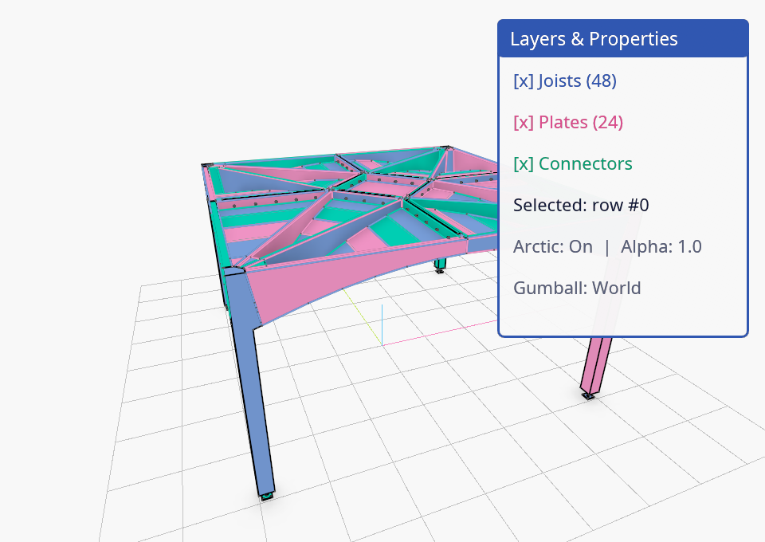
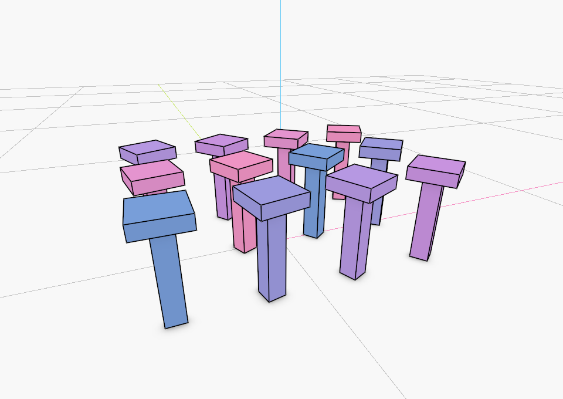
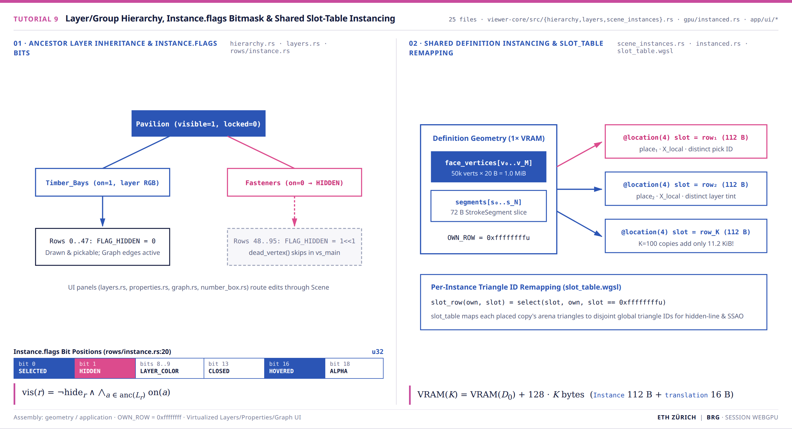

# Tutorial 9 · Layers, hierarchy, panels and instancing

## Goal

Index per-document layer trees, type buckets, and element graphs once per load, render virtualized `Layers`, `Graph`, `Properties`, and numeric-entry `egui` panels, record undoable appearance edits, and instance shared definitions.

 

**What we achieve:** Hierarchical layer/group visibility, lock, and colour inheritance (`hierarchy.rs`, `layers.rs`), `Layers`/`Properties`/`Graph` inspector panels, and `O(1)` VRAM shared-definition instancing (`instanced.rs`).

## How it works

Ancestor layer state compiles into per-row `Instance.flags` bits (`FLAG_SELECTED`, `FLAG_HIDDEN`, `FLAG_COLOR`, `FLAG_EDGE_COLOR`, `FLAG_HOVERED`), while repeated `FileDoc` / assembly placements bind `@location(4) slot: u32` (`OWN_ROW = 0xffffffff`) and `slot_table.wgsl` so one shared mesh/segment slice draws across `K` distinct pickable instances.



## Compilable checkpoint slice

Shared-definition GPU instancing (`instanced.rs`, `slots.rs`) compiles at `geometry`, while `hierarchy.rs`, `layers.rs`, and virtualized `egui` panels join in `application`.

Lines marked `+` show the exact module declarations unlocked between `decoding` (`179` files) and `application` (`398` files):

```rust
// viewer-core/src/lib.rs (decoding -> application)
+ //! UI- and GPU-independent core of Session Viewer.
+ //!
+ //! Zero dependencies on `wgpu`, `winit`, `egui`, `web-sys`, `wasm-bindgen`, or `glyphon`.
  pub mod camera;
+ pub mod clipping;
+ pub mod cloud_query;
+ pub mod command;
+ pub mod coords;
+ pub mod cplane;
  pub mod decode;
+ pub mod deform;
+ pub mod edit;
  pub mod gizmo;
+ pub mod hierarchy;
  pub mod interactions;
  pub mod knobs;
+ pub mod layers;
+ pub mod live_revision;
+ pub mod manifest;
+ pub mod mesh_preview;
+ pub mod modeling;
+ pub mod op;
+ pub mod range_gate;
  pub mod rows;
+ pub mod scene;
+ pub mod selection;
+ pub mod session_io;
+ pub mod sheet_query;
  pub mod sink;
+ pub mod snap;
+ pub mod splitting;
+ pub mod stream;
+ pub mod surface_preview;
  pub mod validate;
  pub mod walk;
  pub use crate as app;
  pub use sink as core;
  pub use sink::GpuSink;

// src/lib.rs (decoding -> application)
  /// A WGSL file from src/shaders as build.rs wrote it: no comments, indentation or blank lines.
  macro_rules! shader {
      ($name:literal) => {
          include_str!(concat!(env!("OUT_DIR"), "/shaders/", $name))
      };
  }
  mod engine;
  pub use viewer_core as core;
+ pub use viewer_core::op;
  pub use viewer_core::rows;
  pub use viewer_core::camera;
  pub mod command_dock;
  pub mod app;
+ #[cfg(target_arch = "wasm32")]
+ pub mod text_quality;
+ mod state;
+ pub use state::State;
+ #[cfg(target_arch = "wasm32")]
+ pub(crate) use app::runtime::desired_canvas_size;
+ #[cfg(target_arch = "wasm32")]
+ pub use app::runtime::{App, execute_op, run_web};
+ pub use app::runtime::{CloudChunk, Msg, SheetChunk};
+ #[cfg(not(target_arch = "wasm32"))]
+ pub mod selftest;
  #[cfg(all(target_arch = "wasm32", feature = "tutorial"))]
  #[path = "../examples/course/entry.rs"]
  mod course;

// src/engine/gpu/mod.rs (decoding -> application)
  pub mod arena; // register:arena
  pub mod backdrop; // register:backdrop
  pub mod buffers; // register:buffers
  pub mod clip; // register:clip
  pub mod cloud; // register:cloud
  pub mod device; // register:device
  pub mod faces; // register:faces
  pub mod frame; // register:frame
  pub mod glyphs; // register:glyphs
  pub mod hull; // register:hull
  pub mod instance; // register:instance
  pub mod instanced; // register:instanced
  pub mod lod; // register:lod
  pub mod objects;
  pub mod slots; // register:slots
  pub mod lane; // register:lane
  #[cfg(target_arch = "wasm32")]
  mod pacing;
  pub mod pass; // register:pass
  pub(crate) mod patch; // register:patch
  pub mod pick; // register:pick
  pub mod planes; // register:planes
  pub mod present; // register:present
  pub mod render; // register:render
  pub mod segments; // register:segments
  pub mod splat; // register:splat
  mod ssao; // register:ssao
  pub mod surface_outline; // register:surface_outline
  pub mod targets; // register:targets
  pub mod text; // register:text
  pub mod text_outline; // register:text_outline
  pub mod timing; // register:timing
  mod triangle_tiles; // register:triangle_tiles
  pub mod ui; // register:ui
  pub mod upload; // register:upload
  pub mod vectors; // register:vectors
  pub mod view; // register:view
  mod widget; // register:widget
  mod widget_mesh; // register:widget_mesh
  mod context;
  mod sink;
  pub use context::Gpu;
  #[cfg(test)]
  pub(crate) use context::lane_shaders;
  #[allow(unused_imports)]
  pub use cloud::{CloudDraw, LodNode, NO_NORMALS}; // register:clouds
  pub use frame::FrameInput;
  pub use glyphs::GlyphPoint; // register:markers
  pub use instance::Instance;
  #[allow(unused_imports)]
  pub use objects::{ObjectRow, Rebase};
  pub use pick::Pick; // register:shell
  pub use segments::CylinderSegment; // register:strokes
  pub use upload::Upload;
  pub use view::View;
+ #[cfg(all(test, not(target_arch = "wasm32")))] // register:application-tests
+ mod scene_gpu_tests; // register:application-tests

// src/app/mod.rs (decoding -> application)
+ #[cfg(target_arch = "wasm32")] // register:agent
+ pub mod agent; // register:agent
+ pub use viewer_core::clipping; // register:clipping
+ pub mod cloud_query; // register:cloud_query
+ pub use viewer_core::command; // register:command
+ pub use viewer_core::coords; // register:coords
+ pub use viewer_core::cplane; // register:cplane
  #[cfg(any(target_arch = "wasm32", test))] // register:decode
  pub mod decode; // register:decode
+ pub use viewer_core::deform; // register:deform
+ pub use viewer_core::edit; // register:edit
+ pub mod feedback; // register:feedback
+ #[cfg(target_arch = "wasm32")] // register:fetch
+ pub mod fetch; // register:fetch
+ pub mod fonts; // register:fonts
+ pub mod gesture; // register:gesture
  pub use viewer_core::gizmo; // register:gizmo
+ pub use viewer_core::hierarchy; // register:hierarchy
+ pub mod input; // register:input
+ #[cfg(any(target_arch = "wasm32", test))] // register:inspection
+ pub mod inspection; // register:inspection
  pub use viewer_core::interactions; // register:interactions
+ pub mod keys; // register:keys
  pub use viewer_core::knobs; // register:knobs
  #[cfg(target_arch = "wasm32")]
  pub mod launch;
+ pub use viewer_core::layers; // register:layers
+ #[cfg(target_arch = "wasm32")] // register:live
+ pub mod live; // register:live
+ #[cfg(any(target_arch = "wasm32", test))]
+ pub use viewer_core::live_revision;
+ #[cfg(target_arch = "wasm32")] // register:loader
+ pub mod loader; // register:loader
+ pub use viewer_core::manifest; // register:manifest
+ pub use viewer_core::mesh_preview; // register:mesh_preview
+ pub use viewer_core::modeling; // register:modeling
+ pub use viewer_core::op;
  pub mod mode; // register:mode
  pub mod stage;
+ #[cfg(any(target_arch = "wasm32", test))] // register:range_gate
+ pub use viewer_core::range_gate; // register:range_gate
+ #[cfg(target_arch = "wasm32")] // register:route
+ pub mod route; // register:route
+ pub(crate) mod runtime;
+ pub use viewer_core::scene; // register:scene
+ pub use viewer_core::selection; // register:selection
+ pub mod session_io; // register:session_io
+ pub mod sheet_query; // register:sheet_query
+ pub use viewer_core::snap; // register:snap
+ pub use viewer_core::splitting; // register:splitting
+ pub mod stream; // register:stream
+ pub use viewer_core::surface_preview; // register:surface_preview
+ pub mod touch; // register:touch
+ #[cfg(any(target_arch = "wasm32", test))] // register:ui
+ pub mod ui; // register:ui
  pub use viewer_core::validate; // register:validate
  pub use viewer_core::walk; // register:walk
  #[cfg(target_arch = "wasm32")]
  pub mod yielding;

// src/app/stage/mod.rs (decoding -> application)
  mod actions;
  mod check;
  pub mod deck;
  mod draw;
  pub mod eval;
  mod flat;
  pub mod font;
  mod geometry;
  mod layout;
  mod math_mode;
  mod matrix;
+ mod mode;
  mod morph;
  pub mod net;
  mod object;
  pub mod paint;
  pub mod presentation;
  #[cfg(test)]
  mod presentation_tests;
  pub mod run;
+ pub mod spatial;
  #[cfg(test)]
  mod tests;
  pub mod tex;
  mod tween;
  mod view;
+ mod application;
+ pub use application::{Loaded, StageApp};
+ #[cfg(target_arch = "wasm32")]
+ pub use application::{open, route};

// examples/course/registration.rs (decoding -> application)
  // --8<-- [start:course-registration]
  #[path = "canvas.rs"]
  mod canvas;
  #[path = "frame.rs"]
  mod frame;
  #[path = "painting.rs"]
  mod painting;
  #[path = "mathematics.rs"]
  mod mathematics;
  #[path = "dock.rs"]
  mod dock;
  #[path = "camera.rs"]
  mod camera;
  #[path = "rows.rs"]
  mod rows;
  #[path = "geometry.rs"]
  mod geometry;
  #[path = "decoding.rs"]
  mod decoding;
  type Start = fn() -> Result<(), wasm_bindgen::JsValue>;
  pub(super) const STARTS: &[(&str, Start)] = &[
      ("frame", frame::start),
      ("painting", painting::start),
      ("mathematics", mathematics::start),
      ("dock", dock::start),
      ("camera", camera::start),
      ("rows", rows::start),
      ("geometry", geometry::start),
      ("decoding", decoding::start),
+     ("application", crate::run_web),
  ];
  // --8<-- [end:course-registration]
```

## Core code walkthrough

### Flattened `Hierarchy` DFS ranges & `(doc, guid)` lamps (`viewer-core/src/hierarchy.rs:24:65`)

```rust
--8<-- "session_viewer/viewer-core/src/hierarchy.rs:24:65"
```

`Node` (lines `25–35`) flattens arbitrary `Session` object trees into a pre-order `Vec<Node>` where `end` points one past the node's last descendant—turning subtree skip when a folder is collapsed into an `O(1)` index jump (`i = node.end`) during `egui` virtual scrolling! `Hierarchy.off` (line `57`) records which `(doc, guid)` identities each switched-off ancestor lamp hid so toggling a parent lamp restores child lamp states faithfully.

### Binary-searched `slot_table` instancing (`src/shaders/slot_table.wgsl:12:45`)

```wgsl
--8<-- "session_viewer/src/shaders/slot_table.wgsl:12:45"
```

When `1,000` placed fasteners share one definition mesh in `Arena`, silhouettes and SSAO still need a unique global `PhysicalId` per fastener triangle. `placed_triangle` (lines `15–45`) keeps direct arena triangles in `1..=head.y` (`SLOT_OWN_ROW`) and binary-searches `slot_table` (`1024`-wide `Rgba32Uint` texture) in `O(log K)` steps to map each instanced triangle ID back to `(definition_triangle, instance_row)`.

## Prerequisites and files

Requires [Tutorial 8](tutorial-eight-gumball.md). Owns `hierarchy`, `layers`, `scene_display`, `scene_instances`, `instanced`, `app/ui/{mod,theme,pointer,overlay,layers,graph,number_box,properties}`, `state/{panel,number_box}`, and 9 layer/appearance verbs.

**Core files to type inline (6 files):**

1. `viewer-core/src/hierarchy.rs`
2. `viewer-core/src/layers.rs`
3. `viewer-core/src/scene_instances.rs`
4. `src/engine/gpu/instanced.rs`
5. `src/app/ui/layers.rs`
6. `src/app/ui/properties.rs`

**Reference catalog & test files (19 files, folded below):** `viewer-core/src/scene_display.rs`, `src/app/ui/mod.rs`, `src/app/ui/theme.rs`, `src/app/ui/pointer.rs`, `src/app/ui/overlay.rs`, `src/app/ui/graph.rs`, `src/app/ui/number_box.rs`, `src/state/panel.rs`, `src/state/number_box.rs`, `viewer-core/src/command/verbs/layers.rs`, `viewer-core/src/command/verbs/add_group.rs`, `viewer-core/src/command/verbs/add_edge.rs`, `viewer-core/src/command/verbs/hide.rs`, `viewer-core/src/command/verbs/show.rs`, `viewer-core/src/command/verbs/delete.rs`, `viewer-core/src/command/verbs/lock.rs`, `viewer-core/src/command/verbs/properties.rs`, `viewer-core/src/command/verbs/interactions.rs`, `viewer-core/src/scene_sync/panel_tests.rs`.

## Build

### Step 1 · `viewer-core/src/hierarchy.rs`

`viewer-core/src/hierarchy.rs` flattens document trees into pre-order node slices (`depth`, `subtree_end`, row range, `128`-node UI pages and `truncated` flag) refreshed on `row_revision` while keeping graph edges separate.

```rust
--8<-- "session_viewer/viewer-core/src/hierarchy.rs"
```

### Step 2 · `viewer-core/src/layers.rs`

`viewer-core/src/layers.rs` validates editable targets, deduplicates `(doc_idx, GUID)` pairs, drops descendants already carried by a selected ancestor, and moves tree nodes into the destination layer.

```rust
--8<-- "session_viewer/viewer-core/src/layers.rs"
```

### Step 3 · `viewer-core/src/scene_instances.rs`

Walks each shared definition once into a hidden row and assigns monotonic batch keys across clears for placed instances.

```rust
--8<-- "session_viewer/viewer-core/src/scene_instances.rs"
```

### Step 4 · `src/engine/gpu/instanced.rs`

Synchronizes face/stroke instance draw ranges and slot buffers after arena growth, invalidating projected triangle tile lists on change.

```rust
--8<-- "session_viewer/src/engine/gpu/instanced.rs"
```

### Step 5 · `src/app/ui/layers.rs`

Draws the collapsible layer tree, inline rename field and graph toggle, deferring tree mutations until the `egui` pass finishes.

```rust
--8<-- "session_viewer/src/app/ui/layers.rs"
```

### Step 6 · `src/app/ui/properties.rs`

Displays selection GUID, geometry kind, document/layer, dimensions, editable face/edge RGB, per-object alpha, gumball alignment and viewport display toggles.

```rust
--8<-- "session_viewer/src/app/ui/properties.rs"
```

## Reference catalog and test files (19 files)

The 6 core files above implement the complete mechanism for this lesson. Expand this reference section whenever you want to inspect or copy the remaining 19 sibling verbs, adapters, and unit-test suites (`Step 7`–`Step 25`).

### Step 7 · `viewer-core/src/scene_display.rs`

Scans up to `128` visible rows per idle frame under bounded source/refinement caches, refining only live or revision-matched geometry.

```rust
--8<-- "session_viewer/viewer-core/src/scene_display.rs"
```

### Step 8 · `src/app/ui/mod.rs`

Runs registered `Panel`s (`fill` -> `draw` -> `apply`) in one `egui` pass, ordering `number_box` ahead of `command_line` for `Escape` priority.

```rust
--8<-- "session_viewer/src/app/ui/mod.rs"
```

### Step 9 · `src/app/ui/theme.rs`

Re-exports `command_dock` `Visuals` and orders static `Noto Sans` + `Symbols` subsets so UI and scene labels share one initial font allocation.

```rust
--8<-- "session_viewer/src/app/ui/theme.rs"
```

### Step 10 · `src/app/ui/pointer.rs`

`src/app/ui/pointer.rs` checks live `egui` panel and popup rectangles on press so panel drags stay inside UI, scene drags released over panels cancel cleanly, and wheel/touch events respect the canvas rect.

```rust
--8<-- "session_viewer/src/app/ui/pointer.rs"
```

### Step 11 · `src/app/ui/overlay.rs`

Converts physical preview pixels once into `egui` points to draw rubber-band lines, dashed crossing boxes, snap squares and padded measurement chips.

```rust
--8<-- "session_viewer/src/app/ui/overlay.rs"
```

### Step 12 · `src/app/ui/graph.rs`

Virtualizes bidirectional relationship-graph rows via `show_rows`, returning clicked endpoint pairs for selection without mutating documents.

```rust
--8<-- "session_viewer/src/app/ui/graph.rs"
```

### Step 13 · `src/app/ui/number_box.rs`

Paints the floating gizmo numeric entry field, retains focus until `Enter` or `Escape`, and closes automatically if the handle projects behind the eye.

```rust
--8<-- "session_viewer/src/app/ui/number_box.rs"
```

### Step 14 · `src/state/panel.rs`

`src/state/panel.rs` decodes layer-panel clicks into `(doc_idx, GUID)` face and edge colour override maps (restricting edge overrides to rows with faces) and refreshes GPU rows.

```rust
--8<-- "session_viewer/src/state/panel.rs"
```

### Step 15 · `src/state/number_box.rs`

Projects the active gizmo handle into CSS coordinates and commits valid typed distances, angles or scale factors as one labelled transaction.

```rust
--8<-- "session_viewer/src/state/number_box.rs"
```

### Step 16 · `viewer-core/src/command/verbs/layers.rs`

`viewer-core/src/command/verbs/layers.rs` (44 lines) registers the `Layers` command (`Layers (On Off All): show or hide the layer panel; All shows it with every row expanded`). Its `Action::run` handler exposes option chips `Layers On`, `Layers Off`, `Layers All` after validating arguments so invalid CLI or interactive input leaves undo history untouched.

```rust
--8<-- "session_viewer/viewer-core/src/command/verbs/layers.rs"
```

### Step 17 · `viewer-core/src/command/verbs/add_group.rs`

Reparents selected single-document objects under their deepest shared layer while rebasing local transforms so world positions stay fixed.

```rust
--8<-- "session_viewer/viewer-core/src/command/verbs/add_group.rs"
```

### Step 18 · `viewer-core/src/command/verbs/add_edge.rs`

Connects two editable objects in the relationship graph and pairs an `EdgeStep` with a marker transform so `Undo` removes added graph vertices.

```rust
--8<-- "session_viewer/viewer-core/src/command/verbs/add_edge.rs"
```

### Step 19 · `viewer-core/src/command/verbs/hide.rs`

`viewer-core/src/command/verbs/hide.rs` (23 lines) defines the `hide` command specification (`Spec`). It validates arguments before mutating `&mut dyn CommandHost` so invalid CLI or interactive input leaves undo history untouched.

```rust
--8<-- "session_viewer/viewer-core/src/command/verbs/hide.rs"
```

### Step 20 · `viewer-core/src/command/verbs/show.rs`

`viewer-core/src/command/verbs/show.rs` (23 lines) defines the `show` command specification (`Spec`). It validates arguments before mutating `&mut dyn CommandHost` so invalid CLI or interactive input leaves undo history untouched.

```rust
--8<-- "session_viewer/viewer-core/src/command/verbs/show.rs"
```

### Step 21 · `viewer-core/src/command/verbs/delete.rs`

`viewer-core/src/command/verbs/delete.rs` (34 lines) defines the `delete` command specification (`Spec`). It validates arguments before mutating `&mut dyn CommandHost` so invalid CLI or interactive input leaves undo history untouched.

```rust
--8<-- "session_viewer/viewer-core/src/command/verbs/delete.rs"
```

### Step 22 · `viewer-core/src/command/verbs/lock.rs`

`viewer-core/src/command/verbs/lock.rs` (30 lines) registers the `Lock` command (`Lock [Off | Unlock]: lock selected objects against selection/edits, or unlock all`). Its `Action::run` handler exposes option chips `Lock`, `Lock Off`, `Lock Unlock` and dispatches through `host.lock_selected()` after validating arguments so invalid CLI or interactive input leaves undo history untouched.

```rust
--8<-- "session_viewer/viewer-core/src/command/verbs/lock.rs"
```

### Step 23 · `viewer-core/src/command/verbs/properties.rs`

`viewer-core/src/command/verbs/properties.rs` (33 lines) registers the `Properties` command (`Properties [On | Off]: toggle the object properties and display settings panel`). Its `Action::run` handler exposes option chips `Properties On`, `Properties Off` and dispatches through `host.set_properties_panel()` after validating arguments so invalid CLI or interactive input leaves undo history untouched.

```rust
--8<-- "session_viewer/viewer-core/src/command/verbs/properties.rs"
```

### Step 24 · `viewer-core/src/command/verbs/interactions.rs`

`viewer-core/src/command/verbs/interactions.rs` (34 lines) registers the `Element Interactions` command (`Element Interactions (On Off): draw or remove what other elements do to each element, its contacts, joints and cuts`). Its `Action::run` handler exposes option chips `Element Interactions On`, `Element Interactions Off` after validating arguments so invalid CLI or interactive input leaves undo history untouched.

```rust
--8<-- "session_viewer/viewer-core/src/command/verbs/interactions.rs"
```

### Step 25 · `viewer-core/src/scene_sync/panel_tests.rs`

`viewer-core/src/scene_sync/panel_tests.rs` (38 lines) verifies `hierarchy_follows_edits`. It provides `hierarchy_follows_edits()`; and locked by `cargo xtest` (`hierarchy_follows_edits`).

```rust
--8<-- "session_viewer/viewer-core/src/scene_sync/panel_tests.rs"
```

## Integration

`app/ui/layers.rs` uses `egui::ScrollArea::show_rows` so laying out a `56,889`-row scene touches only the ~35 visible rows per frame. `Scene` records lamp, lock, RGB colour, and per-object alpha changes on its `APPEARANCE` undo/redo stacks alongside geometry transactions.

## Run and observe

Run the hierarchical layer lamp, `(doc, guid)` appearance-undo, and shared-definition `InstanceRef` tests:

```sh
cargo xtest -p viewer-core hierarchy::tests
cargo xtest -p viewer-core layers::tests
cargo xtest -p viewer-core scene::instances::tests
cargo xtest -p viewer-core appearance_history_tests
```

## Predict and try

Predict what happens if `Scene.hidden` stored `u32` GPU row indices instead of `(doc_index, Rc<str>)` GUID pairs when a user reparents a layer or deletes and re-adds rows: a full `Scene` rebuild renumbers contiguous row runs, which would silently hide the wrong objects! Keying `hidden`, `locked`, `colors`, and `alphas` on `(doc, guid)` survives any row renumbering (`hidden_and_colored_objects_keep_their_flags`).

## Question and answer

**How does `scene_instances.rs` render `1,000` placed fasteners (`InstanceRef`) without walking or uploading `1,000` copies of the fastener's `BRep` mesh?**

??? tip "Think first — click to reveal how to work it out and the answer"
    **How to work it out:** Follow `Session.definitions` into `scene_instances.rs` and `engine/gpu/instanced.rs`: compare definition-space vertices against per-instance world transforms and feature cuts.

    **The answer:** Each unfeatured `InstanceRef` shares the single `Arena` vertex/triangle/segment range walked once from `Session.definitions`, allocating only its own `112`-byte `Instance` row (model matrix, colour, flags) and `16`-byte anchored translation; only instances carrying per-instance `ElementFeature` outlines replay their own feature strokes.

## Validation

Verified via `hierarchy::tests` (`7/7`), `layers::tests` (`20/20`), `add_group::tests` (`8/8`), `add_edge::tests` (`3/3`), `appearance_history_tests` (`1/1`), and `scene::instances::tests` (`8/8`). Note: the opt-in `#[ignore]` GPU parity test `instanced_frames_match_the_baked_scene` retains a documented 31-pixel 3-level shading delta on turned instances.
