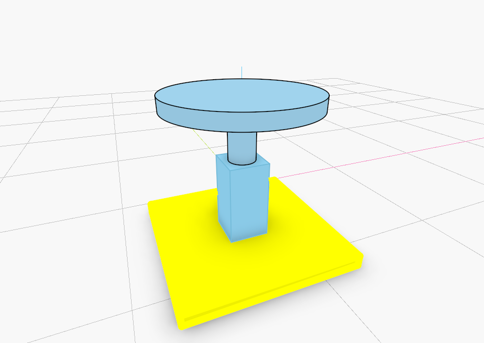
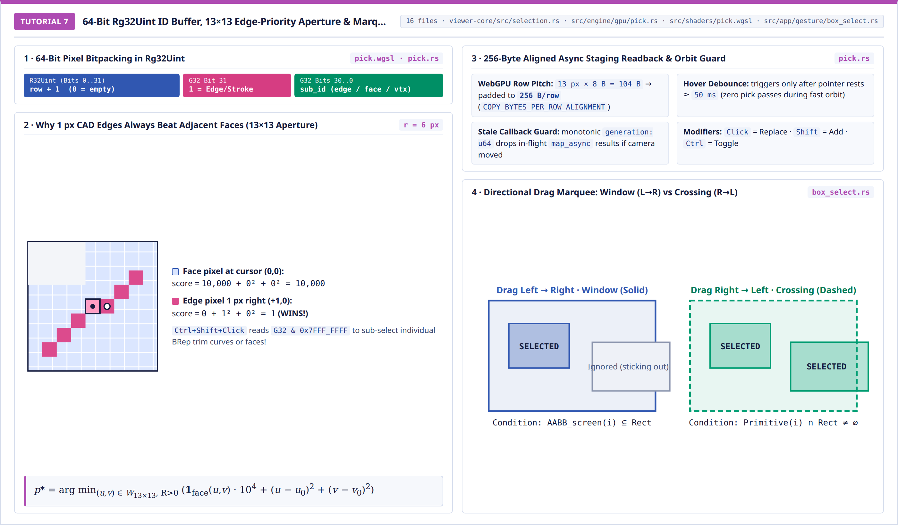

# Tutorial 7 · Picking and selection

## Goal

Read a generation-stamped `(row + 1, sub)` GPU ID window around the cursor for hover pre-selection and click picks, and unify object, face, edge, control-point, window/crossing box, lasso, name, and size selection in `SelectionState`.

 

**What we achieve:** Pixel-exact single-click, sub-object (`Ctrl+Shift`), and crossing/window marquee selection powered by an offscreen `Rg32Uint` GPU ID pass.

## How it works

Instead of approximate CPU bounding-box raycasts, an on-demand `Rg32Uint` pass renders `(row + 1, sub_id)` at exact cursor or marquee pixels, biasing stroke depth slightly forward so boundary curves win cleanly over their adjacent faces and returning `0` on empty background.



## Prerequisites and files

Requires [Tutorial 6](tutorial-six-modeling.md). Owns `src/engine/gpu/pick.rs`, `viewer-core/src/selection.rs`, `src/app/gesture/{object,box_select}.rs`, `src/state/box_select.rs`, and the 9 selection verbs.

Owned files in build order (`14` files):

1. `src/engine/gpu/pick.rs`
2. `viewer-core/src/selection.rs`
3. `src/app/gesture/object.rs`
4. `src/app/gesture/box_select.rs`
5. `src/state/box_select.rs`
6. `viewer-core/src/command/verbs/selecting.rs`
7. `viewer-core/src/command/verbs/select_all.rs`
8. `viewer-core/src/command/verbs/select_by_name.rs`
9. `viewer-core/src/command/verbs/select_lasso.rs`
10. `viewer-core/src/command/verbs/select_small.rs`
11. `viewer-core/src/command/verbs/object.rs`
12. `viewer-core/src/command/verbs/edge.rs`
13. `viewer-core/src/command/verbs/face.rs`
14. `viewer-core/src/command/verbs/controls.rs`

## Build

### Step 1 · `src/engine/gpu/pick.rs`

Renders a cropped cursor window (`+3 px` visibility halo, `256 B`-aligned readback row) tagged by a monotonic generation counter for non-blocking `poll`.

```rust
--8<-- "session_viewer/src/engine/gpu/pick.rs"
```

### Step 2 · `viewer-core/src/selection.rs`

Separates parent row ID from `SelectionMode` (`Object`, `Edge`, `Face`, `ControlId`), building finite control cages while keeping cloud points GPU-resident.

```rust
--8<-- "session_viewer/viewer-core/src/selection.rs"
```

### Step 3 · `src/app/gesture/object.rs`

Activates only after mouse motion exceeds the drag threshold, pairing delayed GPU pick results with ground/vertical-plane translation or falling back to box select on miss.

```rust
--8<-- "session_viewer/src/app/gesture/object.rs"
```

### Step 4 · `src/app/gesture/box_select.rs`

Tracks mouse-drag rectangles without touching geometry, delegating window (left-to-right) and crossing (right-to-left) resolution on release.

```rust
--8<-- "session_viewer/src/app/gesture/box_select.rs"
```

### Step 5 · `src/state/box_select.rs`

Applies `Ctrl`-remove before `Shift`-add on release (solid window left-to-right, dashed crossing right-to-left) and refuses start during active drawing/splitting.

```rust
--8<-- "session_viewer/src/state/box_select.rs"
```

### Step 6 · `viewer-core/src/command/verbs/selecting.rs`

Filters ascending selectable, unhidden rows and runs budgeted even-odd scanline crossings for window vs crossing region picks.

```rust
--8<-- "session_viewer/viewer-core/src/command/verbs/selecting.rs"
```

### Step 7 · `viewer-core/src/command/verbs/select_all.rs`

`viewer-core/src/command/verbs/select_all.rs` (41 lines) registers the `Select All` command (`Select All · selects every visible object that is not locked; an element's attributes stay out · Ctrl+A`). It validates arguments before mutating `&mut dyn CommandHost` so invalid CLI or interactive input leaves undo history untouched.

```rust
--8<-- "session_viewer/viewer-core/src/command/verbs/select_all.rs"
```

### Step 8 · `viewer-core/src/command/verbs/select_by_name.rs`

`viewer-core/src/command/verbs/select_by_name.rs` (95 lines) registers the `Select By Name` command (`Select By Name text · selects visible objects whose name contains the text, any case · Example: Select By Name beam`). It validates arguments before mutating `&mut dyn CommandHost` so invalid CLI or interactive input leaves undo history untouched.

```rust
--8<-- "session_viewer/viewer-core/src/command/verbs/select_by_name.rs"
```

### Step 9 · `viewer-core/src/command/verbs/select_lasso.rs`

`viewer-core/src/command/verbs/select_lasso.rs` (411 lines) registers the `Select Lasso` command (`Select Lasso · drag a loop around objects · Shift adds · Ctrl removes · Esc cancels`). It validates arguments before mutating `&mut dyn CommandHost` so invalid CLI or interactive input leaves undo history untouched.

```rust
--8<-- "session_viewer/viewer-core/src/command/verbs/select_lasso.rs"
```

### Step 10 · `viewer-core/src/command/verbs/select_small.rs`

`viewer-core/src/command/verbs/select_small.rs` (96 lines) registers the `Select Small` command (`Select Small length · selects visible objects whose bounding-box diagonal is shorter, in scene units · Example: Select Small 10`). It validates arguments before mutating `&mut dyn CommandHost` so invalid CLI or interactive input leaves undo history untouched.

```rust
--8<-- "session_viewer/viewer-core/src/command/verbs/select_small.rs"
```

### Step 11 · `viewer-core/src/command/verbs/object.rs`

`viewer-core/src/command/verbs/object.rs` (26 lines) defines the `object` command specification (`Spec`). It validates arguments before mutating `&mut dyn CommandHost` so invalid CLI or interactive input leaves undo history untouched.

```rust
--8<-- "session_viewer/viewer-core/src/command/verbs/object.rs"
```

### Step 12 · `viewer-core/src/command/verbs/edge.rs`

`viewer-core/src/command/verbs/edge.rs` (26 lines) defines the `edge` command specification (`Spec`). It validates arguments before mutating `&mut dyn CommandHost` so invalid CLI or interactive input leaves undo history untouched.

```rust
--8<-- "session_viewer/viewer-core/src/command/verbs/edge.rs"
```

### Step 13 · `viewer-core/src/command/verbs/face.rs`

`viewer-core/src/command/verbs/face.rs` (26 lines) defines the `face` command specification (`Spec`). It validates arguments before mutating `&mut dyn CommandHost` so invalid CLI or interactive input leaves undo history untouched.

```rust
--8<-- "session_viewer/viewer-core/src/command/verbs/face.rs"
```

### Step 14 · `viewer-core/src/command/verbs/controls.rs`

`viewer-core/src/command/verbs/controls.rs` (24 lines) defines the `controls` command specification (`Spec`). It validates arguments before mutating `&mut dyn CommandHost` so invalid CLI or interactive input leaves undo history untouched.

```rust
--8<-- "session_viewer/viewer-core/src/command/verbs/controls.rs"
```

## Integration

`State.selection` holds one `viewer_core::selection::SelectionState` shared across `CommandHost` methods (`selected_rows`, `select_rows`, `escape_selection`, `enable_controls`). Hover pre-selection uses `Picker::request_hover` and `poll_tagged`, setting `FLAG_HOVERED` cyan tint only when the hovered row actually changes.

## Run and observe

Run `cargo xtest -p session_viewer engine::gpu::pick::tests`, `state::box_select::tests`, `state::order_tests`, and `cargo xtest -p viewer-core selection::tests` + `select_lasso::tests`: ink strokes win over faces within the `6 CSS px` pick window, left-to-right drags run window containment while right-to-left drags run crossing intersection, and `Select Lasso` agrees with ray-casting.

## Predict and try

Predict what happens if you click a complex scene and immediately orbit the camera before WebGPU finishes `map_async` on the pick buffer: `State::touch` increments the pick generation counter, so `Picker::poll_tagged` discards the stale readback instead of selecting whatever used to sit under the cursor (`canceled_completion_is_discarded_and_next_pick_still_completes`).

## Question and answer

**Why separate `Picker::request_hover` from `Picker::request` (click pick) instead of sharing one pending request slot?**

??? tip "Think first — click to reveal how to work it out and the answer"
    **How to work it out:** Consider a user moving the mouse (`CursorMoved` schedules a hover pick) and clicking `20 ms` later while the hover `map_async` buffer is still mapped in flight.

    **The answer:** A click pick is authoritative user intent and must never be dropped because a speculative hover readback owns the staging buffer, nor should pointer hover cancel an in-flight click pick. `request_hover` yields immediately if a click pick is pending, while `request` preempts any in-flight hover request and tags completions with `PickKind::Click` vs `PickKind::Hover`.

## Validation

Verified via `pick::tests::ink_first_then_nearest`, `pick::tests::window_clamps`, `selection::tests::switching_parent_replaces_specialized_selection_and_escape_retains_parent`, `state::order_tests::the_selection_keeps_pick_order`, and `select_lasso::tests::the_scanline_index_agrees_with_ray_casting`.
