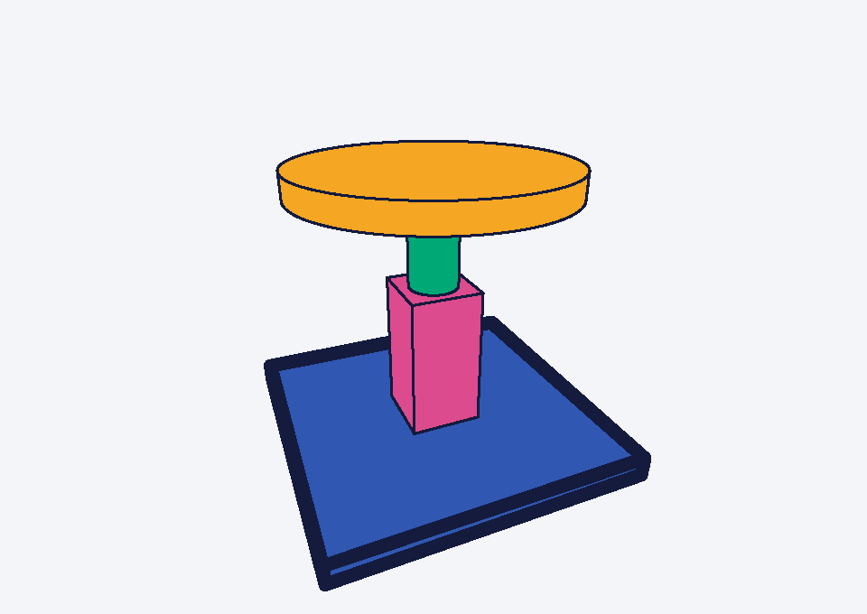

# Tutorial 7 · Picking and selection

## Goal

Read a generation-stamped `(row + 1, sub)` GPU ID window around the cursor for hover pre-selection and click picks, and unify object, face, edge, control-point, window/crossing box, lasso, name, and size selection in `SelectionState`.

 

**What we achieve:** Sub-millisecond pixel-exact hover, click, sub-object (`Edge`/`Face`/`Point`), lasso, and directional Window (`L→R`) / Crossing (`R→L`) marquee selection.

## How it works

`Picker` (`src/engine/gpu/pick.rs`) zooms clip space via `PickView::clip_transform` onto only the `(2·PICK_RADIUS + 1 + 2·PICK_HALO)² = 19×19 px` cursor neighbourhood (`PICK_RADIUS = 6`, `PICK_HALO = 3`), draws `(object_row + 1, (sub_id + 1) | FACE_TAG)` into cropped `IdTargets`, and guards `256`-byte aligned `map_async` readbacks with a monotonic `generation: u64` counter.


## Compilable checkpoint slice

Picking (`pick.rs`) compiles at `geometry` (`174` files), while `selection.rs` and marquee/lasso verbs join in `application`.

Lines marked `+` show the exact module declarations unlocked between `decoding` (`179` files) and `application` (`398` files):

```rust
// viewer-core/src/lib.rs (decoding -> application)
+ //! UI- and GPU-independent core of Session Viewer.
+ //!
+ //! Zero dependencies on `wgpu`, `winit`, `egui`, `web-sys`, `wasm-bindgen`, or `glyphon`.
  pub mod camera;
+ pub mod clipping;
+ pub mod cloud_query;
+ pub mod command;
+ pub mod coords;
+ pub mod cplane;
  pub mod decode;
+ pub mod deform;
+ pub mod edit;
  pub mod gizmo;
+ pub mod hierarchy;
  pub mod interactions;
  pub mod knobs;
+ pub mod layers;
+ pub mod live_revision;
+ pub mod manifest;
+ pub mod mesh_preview;
+ pub mod modeling;
+ pub mod op;
+ pub mod range_gate;
  pub mod rows;
+ pub mod scene;
+ pub mod selection;
+ pub mod session_io;
+ pub mod sheet_query;
  pub mod sink;
+ pub mod snap;
+ pub mod splitting;
+ pub mod stream;
+ pub mod surface_preview;
  pub mod validate;
  pub mod walk;
  pub use crate as app;
  pub use sink as core;
  pub use sink::GpuSink;

// src/lib.rs (decoding -> application)
  /// A WGSL file from src/shaders as build.rs wrote it: no comments, indentation or blank lines.
  macro_rules! shader {
      ($name:literal) => {
          include_str!(concat!(env!("OUT_DIR"), "/shaders/", $name))
      };
  }
  mod engine;
  pub use viewer_core as core;
+ pub use viewer_core::op;
  pub use viewer_core::rows;
  pub use viewer_core::camera;
  pub mod command_dock;
  pub mod app;
+ #[cfg(target_arch = "wasm32")]
+ pub mod text_quality;
+ mod state;
+ pub use state::State;
+ #[cfg(target_arch = "wasm32")]
+ pub(crate) use app::runtime::desired_canvas_size;
+ #[cfg(target_arch = "wasm32")]
+ pub use app::runtime::{App, execute_op, run_web};
+ pub use app::runtime::{CloudChunk, Msg, SheetChunk};
+ #[cfg(not(target_arch = "wasm32"))]
+ pub mod selftest;
  #[cfg(all(target_arch = "wasm32", feature = "tutorial"))]
  #[path = "../examples/course/entry.rs"]
  mod course;

// src/engine/gpu/mod.rs (decoding -> application)
  pub mod arena; // register:arena
  pub mod backdrop; // register:backdrop
  pub mod buffers; // register:buffers
  pub mod clip; // register:clip
  pub mod cloud; // register:cloud
  pub mod device; // register:device
  pub mod faces; // register:faces
  pub mod frame; // register:frame
  pub mod glyphs; // register:glyphs
  pub mod hull; // register:hull
  pub mod instance; // register:instance
  pub mod instanced; // register:instanced
  pub mod lod; // register:lod
  pub mod objects;
  pub mod slots; // register:slots
  pub mod lane; // register:lane
  #[cfg(target_arch = "wasm32")]
  mod pacing;
  pub mod pass; // register:pass
  pub(crate) mod patch; // register:patch
  pub mod pick; // register:pick
  pub mod planes; // register:planes
  pub mod present; // register:present
  pub mod render; // register:render
  pub mod segments; // register:segments
  pub mod splat; // register:splat
  mod ssao; // register:ssao
  pub mod surface_outline; // register:surface_outline
  pub mod targets; // register:targets
  pub mod text; // register:text
  pub mod text_outline; // register:text_outline
  pub mod timing; // register:timing
  mod triangle_tiles; // register:triangle_tiles
  pub mod ui; // register:ui
  pub mod upload; // register:upload
  pub mod vectors; // register:vectors
  pub mod view; // register:view
  mod widget; // register:widget
  mod widget_mesh; // register:widget_mesh
  mod context;
  mod sink;
  pub use context::Gpu;
  #[cfg(test)]
  pub(crate) use context::lane_shaders;
  #[allow(unused_imports)]
  pub use cloud::{CloudDraw, LodNode, NO_NORMALS}; // register:clouds
  pub use frame::FrameInput;
  pub use glyphs::GlyphPoint; // register:markers
  pub use instance::Instance;
  #[allow(unused_imports)]
  pub use objects::{ObjectRow, Rebase};
  pub use pick::Pick; // register:shell
  pub use segments::CylinderSegment; // register:strokes
  pub use upload::Upload;
  pub use view::View;
+ #[cfg(all(test, not(target_arch = "wasm32")))] // register:application-tests
+ mod scene_gpu_tests; // register:application-tests

// src/app/mod.rs (decoding -> application)
+ #[cfg(target_arch = "wasm32")] // register:agent
+ pub mod agent; // register:agent
+ pub use viewer_core::clipping; // register:clipping
+ pub mod cloud_query; // register:cloud_query
+ pub use viewer_core::command; // register:command
+ pub use viewer_core::coords; // register:coords
+ pub use viewer_core::cplane; // register:cplane
  #[cfg(any(target_arch = "wasm32", test))] // register:decode
  pub mod decode; // register:decode
+ pub use viewer_core::deform; // register:deform
+ pub use viewer_core::edit; // register:edit
+ pub mod feedback; // register:feedback
+ #[cfg(target_arch = "wasm32")] // register:fetch
+ pub mod fetch; // register:fetch
+ pub mod fonts; // register:fonts
+ pub mod gesture; // register:gesture
  pub use viewer_core::gizmo; // register:gizmo
+ pub use viewer_core::hierarchy; // register:hierarchy
+ pub mod input; // register:input
+ #[cfg(any(target_arch = "wasm32", test))] // register:inspection
+ pub mod inspection; // register:inspection
  pub use viewer_core::interactions; // register:interactions
+ pub mod keys; // register:keys
  pub use viewer_core::knobs; // register:knobs
  #[cfg(target_arch = "wasm32")]
  pub mod launch;
+ pub use viewer_core::layers; // register:layers
+ #[cfg(target_arch = "wasm32")] // register:live
+ pub mod live; // register:live
+ #[cfg(any(target_arch = "wasm32", test))]
+ pub use viewer_core::live_revision;
+ #[cfg(target_arch = "wasm32")] // register:loader
+ pub mod loader; // register:loader
+ pub use viewer_core::manifest; // register:manifest
+ pub use viewer_core::mesh_preview; // register:mesh_preview
+ pub use viewer_core::modeling; // register:modeling
+ pub use viewer_core::op;
  pub mod mode; // register:mode
  pub mod stage;
+ #[cfg(any(target_arch = "wasm32", test))] // register:range_gate
+ pub use viewer_core::range_gate; // register:range_gate
+ #[cfg(target_arch = "wasm32")] // register:route
+ pub mod route; // register:route
+ pub(crate) mod runtime;
+ pub use viewer_core::scene; // register:scene
+ pub use viewer_core::selection; // register:selection
+ pub mod session_io; // register:session_io
+ pub mod sheet_query; // register:sheet_query
+ pub use viewer_core::snap; // register:snap
+ pub use viewer_core::splitting; // register:splitting
+ pub mod stream; // register:stream
+ pub use viewer_core::surface_preview; // register:surface_preview
+ pub mod touch; // register:touch
+ #[cfg(any(target_arch = "wasm32", test))] // register:ui
+ pub mod ui; // register:ui
  pub use viewer_core::validate; // register:validate
  pub use viewer_core::walk; // register:walk
  #[cfg(target_arch = "wasm32")]
  pub mod yielding;

// src/app/stage/mod.rs (decoding -> application)
  mod actions;
  mod check;
  pub mod deck;
  mod draw;
  pub mod eval;
  mod flat;
  pub mod font;
  mod geometry;
  mod layout;
  mod math_mode;
  mod matrix;
+ mod mode;
  mod morph;
  pub mod net;
  mod object;
  pub mod paint;
  pub mod presentation;
  #[cfg(test)]
  mod presentation_tests;
  pub mod run;
+ pub mod spatial;
  #[cfg(test)]
  mod tests;
  pub mod tex;
  mod tween;
  mod view;
+ mod application;
+ pub use application::{Loaded, StageApp};
+ #[cfg(target_arch = "wasm32")]
+ pub use application::{open, route};

// examples/course/registration.rs (decoding -> application)
  // --8<-- [start:course-registration]
  #[path = "canvas.rs"]
  mod canvas;
  #[path = "frame.rs"]
  mod frame;
  #[path = "painting.rs"]
  mod painting;
  #[path = "mathematics.rs"]
  mod mathematics;
  #[path = "dock.rs"]
  mod dock;
  #[path = "camera.rs"]
  mod camera;
  #[path = "rows.rs"]
  mod rows;
  #[path = "geometry.rs"]
  mod geometry;
  #[path = "decoding.rs"]
  mod decoding;
  type Start = fn() -> Result<(), wasm_bindgen::JsValue>;
  pub(super) const STARTS: &[(&str, Start)] = &[
      ("frame", frame::start),
      ("painting", painting::start),
      ("mathematics", mathematics::start),
      ("dock", dock::start),
      ("camera", camera::start),
      ("rows", rows::start),
      ("geometry", geometry::start),
      ("decoding", decoding::start),
+     ("application", crate::run_web),
  ];
  // --8<-- [end:course-registration]
```

## Core code walkthrough

### Clamped `13×13` cursor `Window` + `3 px` halo (`src/engine/gpu/pick.rs:36:85`)

```rust
--8<-- "session_viewer/src/engine/gpu/pick.rs:36:85"
```

Instead of rendering a full `4K` ID attachment on every click or `50 ms` hover tick, `Window::with_radius` (lines `54–69`) builds a `(2·6 + 1)² = 13×13 px` box clamped inside the canvas, and `Window::view` (lines `72–84`) expands it by `PICK_HALO = 3 px` (`19×19 px` max) so `PickView::clip_transform` zooms the projection matrix onto just those pixels while keeping finite-triangle visibility accurate at the window border.

### Sub-object `SelectionMode` & `ControlId` (`viewer-core/src/selection.rs:5:65`)

```rust
--8<-- "session_viewer/viewer-core/src/selection.rs:5:65"
```

`SelectionMode` (lines `16–33`) models whole-object (`Object`) and sub-object (`Edge`, `Face`, `Controls`) modes as a single sum type rather than independent booleans that could desynchronize. Pressing `Escape` steps cleanly from `Controls`/`Edge`/`Face` back to the parent `Object` row (`parent()`, lines `37–44`), while `ControlId` addresses mesh vertices, `(curve, point)`, `(surface, u, v)`, and point-cloud indices uniformly.

## Prerequisites and files

Requires [Tutorial 6](tutorial-six-modeling.md). Owns `src/engine/gpu/pick.rs`, `viewer-core/src/selection.rs`, `src/app/gesture/{object,box_select}.rs`, `src/state/box_select.rs`, and the 9 selection verbs.

**Core files to type inline (5 files):**

1. `src/engine/gpu/pick.rs`
2. `viewer-core/src/selection.rs`
3. `src/app/gesture/object.rs`
4. `src/app/gesture/box_select.rs`
5. `src/state/box_select.rs`

**Reference catalog & test files (9 files, folded below):** `viewer-core/src/command/verbs/selecting.rs`, `viewer-core/src/command/verbs/select_all.rs`, `viewer-core/src/command/verbs/select_by_name.rs`, `viewer-core/src/command/verbs/select_lasso.rs`, `viewer-core/src/command/verbs/select_small.rs`, `viewer-core/src/command/verbs/object.rs`, `viewer-core/src/command/verbs/edge.rs`, `viewer-core/src/command/verbs/face.rs`, `viewer-core/src/command/verbs/controls.rs`.

## Build

### Step 1 · `src/engine/gpu/pick.rs`

Renders a cropped cursor window (`+3 px` visibility halo, `256 B`-aligned readback row) tagged by a monotonic generation counter for non-blocking `poll`.

```rust
--8<-- "session_viewer/src/engine/gpu/pick.rs"
```

### Step 2 · `viewer-core/src/selection.rs`

Separates parent row ID from `SelectionMode` (`Object`, `Edge`, `Face`, `ControlId`), building finite control cages while keeping cloud points GPU-resident.

```rust
--8<-- "session_viewer/viewer-core/src/selection.rs"
```

### Step 3 · `src/app/gesture/object.rs`

Activates only after mouse motion exceeds the drag threshold, pairing delayed GPU pick results with ground/vertical-plane translation or falling back to box select on miss.

```rust
--8<-- "session_viewer/src/app/gesture/object.rs"
```

### Step 4 · `src/app/gesture/box_select.rs`

Tracks mouse-drag rectangles without touching geometry, delegating window (left-to-right) and crossing (right-to-left) resolution on release.

```rust
--8<-- "session_viewer/src/app/gesture/box_select.rs"
```

### Step 5 · `src/state/box_select.rs`

Applies `Ctrl`-remove before `Shift`-add on release (solid window left-to-right, dashed crossing right-to-left) and refuses start during active drawing/splitting.

```rust
--8<-- "session_viewer/src/state/box_select.rs"
```

## Reference catalog and test files (9 files)

The 5 core files above implement the complete mechanism for this lesson. Expand this reference section whenever you want to inspect or copy the remaining 9 sibling verbs, adapters, and unit-test suites (`Step 6`–`Step 14`).

### Step 6 · `viewer-core/src/command/verbs/selecting.rs`

Filters ascending selectable, unhidden rows and runs budgeted even-odd scanline crossings for window vs crossing region picks.

```rust
--8<-- "session_viewer/viewer-core/src/command/verbs/selecting.rs"
```

### Step 7 · `viewer-core/src/command/verbs/select_all.rs`

`viewer-core/src/command/verbs/select_all.rs` (41 lines) registers the `Select All` command (`Select All · selects every visible object that is not locked; an element's attributes stay out · Ctrl+A`). It validates arguments before mutating `&mut dyn CommandHost` so invalid CLI or interactive input leaves undo history untouched.

```rust
--8<-- "session_viewer/viewer-core/src/command/verbs/select_all.rs"
```

### Step 8 · `viewer-core/src/command/verbs/select_by_name.rs`

`viewer-core/src/command/verbs/select_by_name.rs` (95 lines) registers the `Select By Name` command (`Select By Name text · selects visible objects whose name contains the text, any case · Example: Select By Name beam`). It validates arguments before mutating `&mut dyn CommandHost` so invalid CLI or interactive input leaves undo history untouched.

```rust
--8<-- "session_viewer/viewer-core/src/command/verbs/select_by_name.rs"
```

### Step 9 · `viewer-core/src/command/verbs/select_lasso.rs`

`viewer-core/src/command/verbs/select_lasso.rs` (411 lines) registers the `Select Lasso` command (`Select Lasso · drag a loop around objects · Shift adds · Ctrl removes · Esc cancels`). It validates arguments before mutating `&mut dyn CommandHost` so invalid CLI or interactive input leaves undo history untouched.

```rust
--8<-- "session_viewer/viewer-core/src/command/verbs/select_lasso.rs"
```

### Step 10 · `viewer-core/src/command/verbs/select_small.rs`

`viewer-core/src/command/verbs/select_small.rs` (96 lines) registers the `Select Small` command (`Select Small length · selects visible objects whose bounding-box diagonal is shorter, in scene units · Example: Select Small 10`). It validates arguments before mutating `&mut dyn CommandHost` so invalid CLI or interactive input leaves undo history untouched.

```rust
--8<-- "session_viewer/viewer-core/src/command/verbs/select_small.rs"
```

### Step 11 · `viewer-core/src/command/verbs/object.rs`

`viewer-core/src/command/verbs/object.rs` (26 lines) defines the `object` command specification (`Spec`). It validates arguments before mutating `&mut dyn CommandHost` so invalid CLI or interactive input leaves undo history untouched.

```rust
--8<-- "session_viewer/viewer-core/src/command/verbs/object.rs"
```

### Step 12 · `viewer-core/src/command/verbs/edge.rs`

`viewer-core/src/command/verbs/edge.rs` (26 lines) defines the `edge` command specification (`Spec`). It validates arguments before mutating `&mut dyn CommandHost` so invalid CLI or interactive input leaves undo history untouched.

```rust
--8<-- "session_viewer/viewer-core/src/command/verbs/edge.rs"
```

### Step 13 · `viewer-core/src/command/verbs/face.rs`

`viewer-core/src/command/verbs/face.rs` (26 lines) defines the `face` command specification (`Spec`). It validates arguments before mutating `&mut dyn CommandHost` so invalid CLI or interactive input leaves undo history untouched.

```rust
--8<-- "session_viewer/viewer-core/src/command/verbs/face.rs"
```

### Step 14 · `viewer-core/src/command/verbs/controls.rs`

`viewer-core/src/command/verbs/controls.rs` (24 lines) defines the `controls` command specification (`Spec`). It validates arguments before mutating `&mut dyn CommandHost` so invalid CLI or interactive input leaves undo history untouched.

```rust
--8<-- "session_viewer/viewer-core/src/command/verbs/controls.rs"
```

## Integration

`State.selection` holds one `viewer_core::selection::SelectionState` shared across `CommandHost` methods (`selected_rows`, `select_rows`, `escape_selection`, `enable_controls`). Hover pre-selection uses `Picker::request_hover` and `poll_tagged`, setting `FLAG_HOVERED` cyan tint only when the hovered row actually changes.

## Run and observe

Verify cropped `Rg32Uint` edge-over-face priority, stale-generation cancellation, Window (`L→R`) vs Crossing (`R→L`) marquees, and scanline `Select Lasso`:

```sh
cargo xtest -p session_viewer engine::gpu::pick::tests
cargo xtest -p session_viewer state::box_select::tests
cargo xtest -p viewer-core selection::tests
cargo xtest -p viewer-core select_lasso::tests
```

## Predict and try

Predict what happens if you click a complex scene and immediately orbit the camera before WebGPU finishes `map_async` on the pick buffer: `State::touch` increments the pick generation counter, so `Picker::poll_tagged` discards the stale readback instead of selecting whatever used to sit under the cursor (`canceled_completion_is_discarded_and_next_pick_still_completes`).

## Question and answer

**Why separate `Picker::request_hover` from `Picker::request` (click pick) instead of sharing one pending request slot?**

??? tip "Think first — click to reveal how to work it out and the answer"
    **How to work it out:** Consider a user moving the mouse (`CursorMoved` schedules a hover pick) and clicking `20 ms` later while the hover `map_async` buffer is still mapped in flight.

    **The answer:** A click pick is authoritative user intent and must never be dropped because a speculative hover readback owns the staging buffer, nor should pointer hover cancel an in-flight click pick. `request_hover` yields immediately if a click pick is pending, while `request` preempts any in-flight hover request and tags completions with `PickKind::Click` vs `PickKind::Hover`.

## Validation

Verified via `pick::tests::ink_first_then_nearest`, `pick::tests::window_clamps`, `selection::tests::switching_parent_replaces_specialized_selection_and_escape_retains_parent`, `state::order_tests::the_selection_keeps_pick_order`, and `select_lasso::tests::the_scanline_index_agrees_with_ray_casting`.
