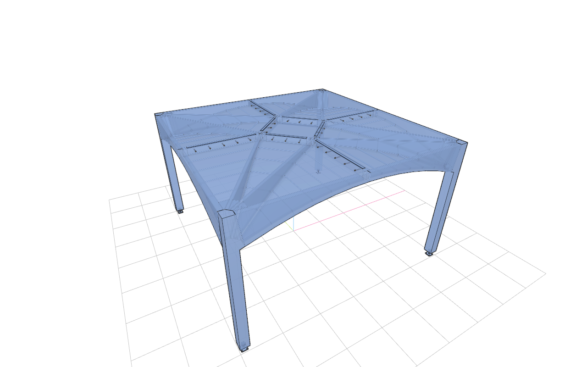
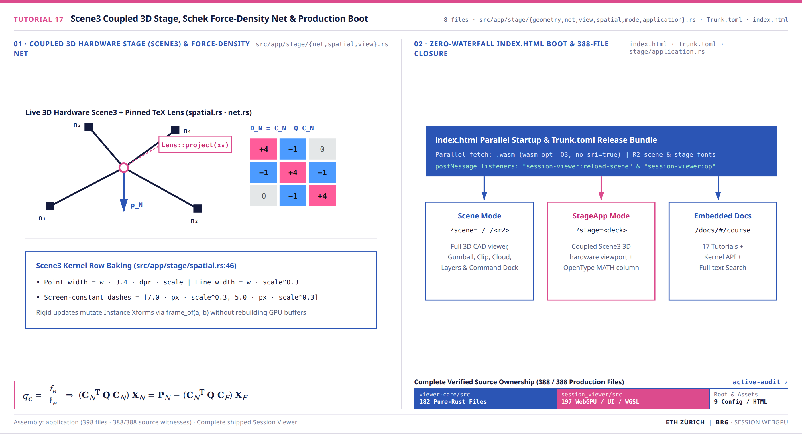

# Tutorial 17 · Complete application reconstruction and real-scene stage

## Goal

Connect `StageApp` to real 3D kernel geometry rows through `spatial::Scene3` and camera-projected 2D TeX lenses, wire the production `Trunk.toml` and `index.html` entry shell, and verify 100% parity across all `388` production files.



**What we achieve:** The complete `388`-file shipped `session_viewer` uniting full 3D CAD (`SceneApp`), the coupled 3D hardware math stage (`StageApp` + `spatial::Scene3` + `net.rs` force-density solver), zero-waterfall `index.html` R2 prefetch, and embedded `/docs/`.

## How it works

`spatial.rs` bakes stage `Point`/`Line`/`Arrow`/`Polyline` primitives into live `Scene` rows (`scale.powf(0.3)` line widths and screen-constant dashes), `net.rs` solves `(C_Nᵀ Q C_N) x_N = p_N − (C_Nᵀ Q C_F) x_F` in real time while `view.rs` pins OpenType `MATH` labels to 3D nodes, and `index.html` + `Trunk.toml` (`wasm-opt -O3`, `no_sri = true`) ship the complete single-binary web application.



## Compilable checkpoint slice

Tutorial 17 closes the final `application` assembly (`388` verified production & support files), uniting `StageApp + spatial::Scene3` with `Trunk.toml` and `index.html`.

Lines marked `+` show the exact module declarations unlocked between `decoding` (`179` files) and `application` (`398` files):

```rust
// viewer-core/src/lib.rs (decoding -> application)
+ //! UI- and GPU-independent core of Session Viewer.
+ //!
+ //! Zero dependencies on `wgpu`, `winit`, `egui`, `web-sys`, `wasm-bindgen`, or `glyphon`.
  pub mod camera;
+ pub mod clipping;
+ pub mod cloud_query;
+ pub mod command;
+ pub mod coords;
+ pub mod cplane;
  pub mod decode;
+ pub mod deform;
+ pub mod edit;
  pub mod gizmo;
+ pub mod hierarchy;
  pub mod interactions;
  pub mod knobs;
+ pub mod layers;
+ pub mod live_revision;
+ pub mod manifest;
+ pub mod mesh_preview;
+ pub mod modeling;
+ pub mod op;
+ pub mod range_gate;
  pub mod rows;
+ pub mod scene;
+ pub mod selection;
+ pub mod session_io;
+ pub mod sheet_query;
  pub mod sink;
+ pub mod snap;
+ pub mod splitting;
+ pub mod stream;
+ pub mod surface_preview;
  pub mod validate;
  pub mod walk;
  pub use crate as app;
  pub use sink as core;
  pub use sink::GpuSink;

// src/lib.rs (decoding -> application)
  /// A WGSL file from src/shaders as build.rs wrote it: no comments, indentation or blank lines.
  macro_rules! shader {
      ($name:literal) => {
          include_str!(concat!(env!("OUT_DIR"), "/shaders/", $name))
      };
  }
  mod engine;
  pub use viewer_core as core;
+ pub use viewer_core::op;
  pub use viewer_core::rows;
  pub use viewer_core::camera;
  pub mod command_dock;
  pub mod app;
+ #[cfg(target_arch = "wasm32")]
+ pub mod text_quality;
+ mod state;
+ pub use state::State;
+ #[cfg(target_arch = "wasm32")]
+ pub(crate) use app::runtime::desired_canvas_size;
+ #[cfg(target_arch = "wasm32")]
+ pub use app::runtime::{App, execute_op, run_web};
+ pub use app::runtime::{CloudChunk, Msg, SheetChunk};
+ #[cfg(not(target_arch = "wasm32"))]
+ pub mod selftest;
  #[cfg(all(target_arch = "wasm32", feature = "tutorial"))]
  #[path = "../examples/course/entry.rs"]
  mod course;

// src/engine/gpu/mod.rs (decoding -> application)
  pub mod arena; // register:arena
  pub mod backdrop; // register:backdrop
  pub mod buffers; // register:buffers
  pub mod clip; // register:clip
  pub mod cloud; // register:cloud
  pub mod device; // register:device
  pub mod faces; // register:faces
  pub mod frame; // register:frame
  pub mod glyphs; // register:glyphs
  pub mod hull; // register:hull
  pub mod instance; // register:instance
  pub mod instanced; // register:instanced
  pub mod lod; // register:lod
  pub mod objects;
  pub mod slots; // register:slots
  pub mod lane; // register:lane
  #[cfg(target_arch = "wasm32")]
  mod pacing;
  pub mod pass; // register:pass
  pub(crate) mod patch; // register:patch
  pub mod pick; // register:pick
  pub mod planes; // register:planes
  pub mod present; // register:present
  pub mod render; // register:render
  pub mod segments; // register:segments
  pub mod splat; // register:splat
  mod ssao; // register:ssao
  pub mod surface_outline; // register:surface_outline
  pub mod targets; // register:targets
  pub mod text; // register:text
  pub mod text_outline; // register:text_outline
  pub mod timing; // register:timing
  mod triangle_tiles; // register:triangle_tiles
  pub mod ui; // register:ui
  pub mod upload; // register:upload
  pub mod vectors; // register:vectors
  pub mod view; // register:view
  mod widget; // register:widget
  mod widget_mesh; // register:widget_mesh
  mod context;
  mod sink;
  pub use context::Gpu;
  #[cfg(test)]
  pub(crate) use context::lane_shaders;
  #[allow(unused_imports)]
  pub use cloud::{CloudDraw, LodNode, NO_NORMALS}; // register:clouds
  pub use frame::FrameInput;
  pub use glyphs::GlyphPoint; // register:markers
  pub use instance::Instance;
  #[allow(unused_imports)]
  pub use objects::{ObjectRow, Rebase};
  pub use pick::Pick; // register:shell
  pub use segments::CylinderSegment; // register:strokes
  pub use upload::Upload;
  pub use view::View;
+ #[cfg(all(test, not(target_arch = "wasm32")))] // register:application-tests
+ mod scene_gpu_tests; // register:application-tests

// src/app/mod.rs (decoding -> application)
+ #[cfg(target_arch = "wasm32")] // register:agent
+ pub mod agent; // register:agent
+ pub use viewer_core::clipping; // register:clipping
+ pub mod cloud_query; // register:cloud_query
+ pub use viewer_core::command; // register:command
+ pub use viewer_core::coords; // register:coords
+ pub use viewer_core::cplane; // register:cplane
  #[cfg(any(target_arch = "wasm32", test))] // register:decode
  pub mod decode; // register:decode
+ pub use viewer_core::deform; // register:deform
+ pub use viewer_core::edit; // register:edit
+ pub mod feedback; // register:feedback
+ #[cfg(target_arch = "wasm32")] // register:fetch
+ pub mod fetch; // register:fetch
+ pub mod fonts; // register:fonts
+ pub mod gesture; // register:gesture
  pub use viewer_core::gizmo; // register:gizmo
+ pub use viewer_core::hierarchy; // register:hierarchy
+ pub mod input; // register:input
+ #[cfg(any(target_arch = "wasm32", test))] // register:inspection
+ pub mod inspection; // register:inspection
  pub use viewer_core::interactions; // register:interactions
+ pub mod keys; // register:keys
  pub use viewer_core::knobs; // register:knobs
  #[cfg(target_arch = "wasm32")]
  pub mod launch;
+ pub use viewer_core::layers; // register:layers
+ #[cfg(target_arch = "wasm32")] // register:live
+ pub mod live; // register:live
+ #[cfg(any(target_arch = "wasm32", test))]
+ pub use viewer_core::live_revision;
+ #[cfg(target_arch = "wasm32")] // register:loader
+ pub mod loader; // register:loader
+ pub use viewer_core::manifest; // register:manifest
+ pub use viewer_core::mesh_preview; // register:mesh_preview
+ pub use viewer_core::modeling; // register:modeling
+ pub use viewer_core::op;
  pub mod mode; // register:mode
  pub mod stage;
+ #[cfg(any(target_arch = "wasm32", test))] // register:range_gate
+ pub use viewer_core::range_gate; // register:range_gate
+ #[cfg(target_arch = "wasm32")] // register:route
+ pub mod route; // register:route
+ pub(crate) mod runtime;
+ pub use viewer_core::scene; // register:scene
+ pub use viewer_core::selection; // register:selection
+ pub mod session_io; // register:session_io
+ pub mod sheet_query; // register:sheet_query
+ pub use viewer_core::snap; // register:snap
+ pub use viewer_core::splitting; // register:splitting
+ pub mod stream; // register:stream
+ pub use viewer_core::surface_preview; // register:surface_preview
+ pub mod touch; // register:touch
+ #[cfg(any(target_arch = "wasm32", test))] // register:ui
+ pub mod ui; // register:ui
  pub use viewer_core::validate; // register:validate
  pub use viewer_core::walk; // register:walk
  #[cfg(target_arch = "wasm32")]
  pub mod yielding;

// src/app/stage/mod.rs (decoding -> application)
  mod actions;
  mod check;
  pub mod deck;
  mod draw;
  pub mod eval;
  mod flat;
  pub mod font;
  mod geometry;
  mod layout;
  mod math_mode;
  mod matrix;
+ mod mode;
  mod morph;
  pub mod net;
  mod object;
  pub mod paint;
  pub mod presentation;
  #[cfg(test)]
  mod presentation_tests;
  pub mod run;
+ pub mod spatial;
  #[cfg(test)]
  mod tests;
  pub mod tex;
  mod tween;
  mod view;
+ mod application;
+ pub use application::{Loaded, StageApp};
+ #[cfg(target_arch = "wasm32")]
+ pub use application::{open, route};

// examples/course/registration.rs (decoding -> application)
  // --8<-- [start:course-registration]
  #[path = "canvas.rs"]
  mod canvas;
  #[path = "frame.rs"]
  mod frame;
  #[path = "painting.rs"]
  mod painting;
  #[path = "mathematics.rs"]
  mod mathematics;
  #[path = "dock.rs"]
  mod dock;
  #[path = "camera.rs"]
  mod camera;
  #[path = "rows.rs"]
  mod rows;
  #[path = "geometry.rs"]
  mod geometry;
  #[path = "decoding.rs"]
  mod decoding;
  type Start = fn() -> Result<(), wasm_bindgen::JsValue>;
  pub(super) const STARTS: &[(&str, Start)] = &[
      ("frame", frame::start),
      ("painting", painting::start),
      ("mathematics", mathematics::start),
      ("dock", dock::start),
      ("camera", camera::start),
      ("rows", rows::start),
      ("geometry", geometry::start),
      ("decoding", decoding::start),
+     ("application", crate::run_web),
  ];
  // --8<-- [end:course-registration]
```

## Core code walkthrough

### Direct Gaussian elimination of Schek cable nets (`src/app/stage/net.rs:3:40`)

```rust
--8<-- "session_viewer/src/app/stage/net.rs:3:40"
```

In Schek's (1974) Force Density Method, prescribing force-to-length ratios `q_e = f_e / l_e` turns non-linear 3D cable-net equilibrium into the linear system `(C_Nᵀ Q C_N) X_N = P_N − C_Nᵀ Q C_F X_F` simultaneously across `[x, y, z]`. `eliminate()` (lines `15–40`) factors `a` (`C_Nᵀ Q C_N`) once in place and solves all `d ∈ 0..3` right-hand-side coordinate columns in a single forward-elimination and back-substitution pass.

### Scale-aware 3D stage-to-kernel row baking (`src/app/stage/spatial.rs:46:65`)

```rust
--8<-- "session_viewer/src/app/stage/spatial.rs:46:65"
```

`geometry()` (lines `46–65`) bridges declarative stage `Spatial` primitives into real `session_rust::Geometry` rows rendered by the hardware WebGPU pipeline: point markers scale linearly with slide size (`3.4 * dpr * scale`), line widths scale gently by `scale.powf(0.3)` so shrunk split-screen viewports never lose thin cables, and world-space dash lengths multiply by `px` (world units per pixel) so dashed construction rays stay screen-constant during 3D orbit.

## Prerequisites and files

Requires [Tutorials 1–16](tutorial-one-startup.md), uniting the 2D mathematics engine from [Tutorial 3.2](tutorial-three-mathematics.md) with the 3D `Scene` and `Camera` from Tutorials 4–16.

**Core files to type inline (6 files):**

1. `src/app/stage/net.rs`
2. `src/app/stage/spatial.rs`
3. `src/app/stage/mode.rs`
4. `src/app/stage/application.rs`
5. `Trunk.toml`
6. `index.html`

**Reference catalog & test files (2 files, folded below):** `src/app/stage/geometry.rs`, `src/app/stage/view.rs`.

## Build

### Step 1 · `src/app/stage/net.rs`

`src/app/stage/net.rs` constructs free/fixed branch-node incidence matrices `(C_N, C_F)`, assembles `D = C^T Q C`, solves `D_N x_N = p - D_F x_F` across `XYZ` for anchored positive-density nets, and exposes `Net::matrix` directly to the slide column.

```rust
--8<-- "session_viewer/src/app/stage/net.rs"
```

### Step 2 · `src/app/stage/spatial.rs`

`src/app/stage/spatial.rs` (`Scene3`) sets `state.scene.arrowhead_pens = 24.0` for elongated `0.30`-aspect heads, bakes each `3D` `Point` as an outer `ink` disc plus a `0.58`-scale `bg` paper-centre disc, and maps stage IDs to non-pickable `112 B` GPU rows updated in place.

```rust
--8<-- "session_viewer/src/app/stage/spatial.rs"
```

### Step 3 · `src/app/stage/mode.rs`

`src/app/stage/mode.rs` runs each frame in strict order: tick stage clock -> apply orthographic camera -> derive `2×4` world-to-slide `lens` -> `Presentation::paint` (emitting current `Spatial` list) -> `Scene3::sync` -> return `egui::FullOutput`.

```rust
--8<-- "session_viewer/src/app/stage/mode.rs"
```

### Step 4 · `src/app/stage/application.rs`

`src/app/stage/application.rs` (`StageApp`) routes `?stage=...` index/chapter/picture/font prefetches, keyboard steps/chapters/themes (`T`), scene-half mouse orbit/zoom/double-click reset, column-click advance, and touch gestures across desktop and `Frame::stacked` upright layouts.

```rust
--8<-- "session_viewer/src/app/stage/application.rs"
```

### Step 5 · `Trunk.toml`

`Trunk.toml` configures release WASM bundling (`public_url = "./"`, `no_sri = true`), runs `build-viewer-docs.cjs` in `pre_build` so `dist/docs/` ships beside the viewer, and serves locally on `127.0.0.1:8770` with `Cache-Control: no-store`. Trap: `no_sri = true` is required because CI rewrites `*_bg.wasm` in place with `wasm-opt -O3` after Trunk emits `dist/index.html`.

```toml
--8<-- "session_viewer/Trunk.toml"
```

### Step 6 · `index.html`

`index.html` prefetches Cloudflare R2 scene manifests or stage fonts in parallel with `.wasm` download, mounts `#canvas`, `#command-agent` (16 px mobile IME), and `#viewer-docs`, and bridges `postMessage` (`session-viewer:reload-scene` and `session-viewer:op`). Trap: keep `touch-action: none` on `canvas` and `font-size: 16px` on `#command-agent` so iOS Safari neither steals pinch-zoom nor auto-zooms the viewport on command focus.

```html
--8<-- "session_viewer/index.html"
```

## Reference catalog and test files (2 files)

The 6 core files above implement the complete mechanism for this lesson. Expand this reference section whenever you want to inspect or copy the remaining 2 sibling verbs, adapters, and unit-test suites (`Step 7`–`Step 8`).

### Step 7 · `src/app/stage/geometry.rs`

`src/app/stage/geometry.rs` evaluates named `3D` points at clock `t`, emits `Spatial` descriptors (`Point`, `Line`, `Polyline`, `12`-edge cuboids, stroke width, `scale.powf(0.3)` pen scaling, dash and reveal), and places `16`-direction collision-scored anchor labels (`+15` hysteresis bonus).

```rust
--8<-- "session_viewer/src/app/stage/geometry.rs"
```

### Step 8 · `src/app/stage/view.rs`

`src/app/stage/view.rs` frames the `3D` points orthographically inside the slide's scene half (side-by-side on desktop, top half via `Frame::stacked` on upright screens) so `spatial::lens` projects node labels and `fill`/`fly` animations from live orbited coordinates.

```rust
--8<-- "session_viewer/src/app/stage/view.rs"
```

## Integration

`StageApp` implements `Mode<State>` (`src/app/stage/mode.rs`): on every frame it advances `stage.tick(now)`, updates `state.camera` for the left-hand 3D split (`Scene3::camera`), projects 3D points through `Scene3::lens` so 2D haloed TeX labels track 3D nodes without distortion, and syncs kernel `Point`/`Line`/`Polyline` rows via `Scene3::sync`.

## Run and observe

Build and verify the complete `388`-file production viewer across `wasm32`, all native CPU + GPU test suites, and `Trunk`:

```sh
cargo check --target wasm32-unknown-unknown -j8
cargo xtest -j8
trunk serve --open
```

Open `http://127.0.0.1:8770/` for the full 3D CAD viewer, or `http://127.0.0.1:8770/?stage=fd` to interact with the coupled 3D Schek force-density cable-net stage and live 2D OpenType `MATH` equations.

## Predict and try

Predict why `spatial::Scene3` renders stage node/vector labels (`P_0`, `\mathbf{F}_1`) through `Scene3::lens` on the 2D `egui` slide painter instead of placing 3D textured quads in world space: orbiting or zooming a 3D quad foreshortens or blurs mathematical subscripts, whereas projecting the 3D anchor to 2D slide coordinates keeps every TeX formula upright, crisp, and halo-outlined at `24 px` across any camera orbit.

## Question and answer

**Why must `StageApp::frame` (`src/app/stage/mode.rs`) compute `Scene3::camera` and `Scene3::lens` *before* `context.run_ui` paints the 2D slide, and run `Scene3::sync` immediately *after*?**

??? tip "Think first — click to reveal how to work it out and the answer"
    **How to work it out:** Follow one step transition (`ArrowRight` or `solve: true`) where a cable-net node animates to a new 3D equilibrium coordinate while carrying an attached TeX label.

    **The answer:** `stage.tick(now)` updates animated 3D node positions first; updating `state.camera` and capturing `Scene3::lens` *before* `paint()` ensures 2D TeX labels project through the exact current frame's camera matrix (zero 1-frame label lag), and running `Scene3::sync` before `State::render` encodes GPU passes uploads the matching 3D cable/arrow row positions for the very same WebGPU submission.

## Validation

Verified via `cargo check --target wasm32-unknown-unknown -j8` (`0` warnings), `cargo xtest -j8` (`626` passed: `484` `viewer-core` + `142` `session_viewer`, `0` failed), `pytest ../session_mcp/tests/test_mcp_parity.py` (`3/3` passed), `course -- active-audit` (`passed: true`), `course -- teaching` (`388/388`, `0` errors), and `DOCS_STRICT_LINKS=1` Vite build (`0` errors). Hardware browser WebGPU capture and physical mobile device checks remain pending an environment with a non-black browser WebGPU adapter.
