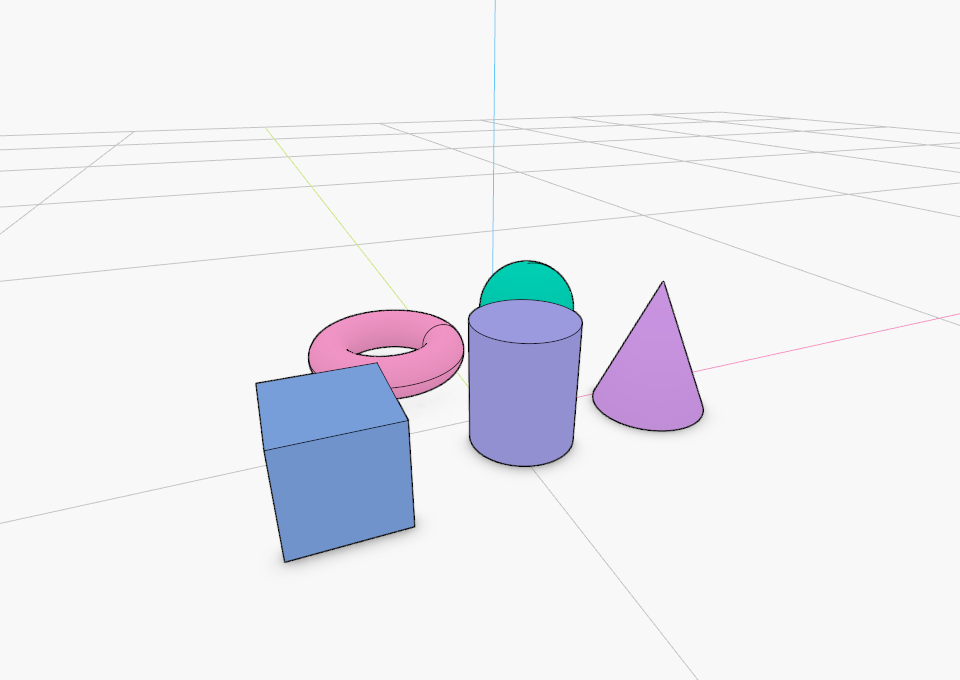
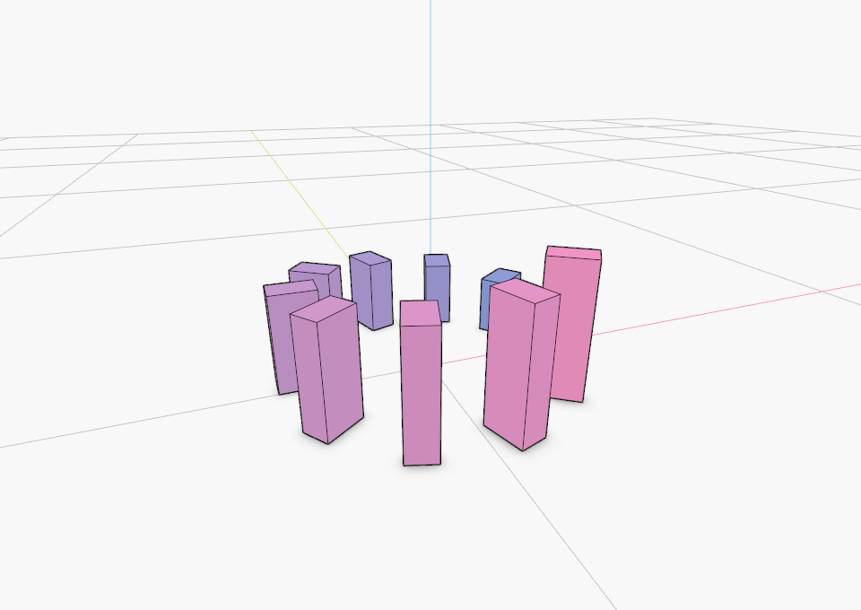

# Tutorial 6 · Object creation and transformations

## Goal

Register declarative `Spec` commands and interactive multi-point `Tool`s on construction planes (`CPlane`) with object snaps (`OSnap`), live zero-history previews, and atomic undoable creation, transform, surfacing, cutting, and measurement verbs.



**What we achieve:** Direct 3D CAD primitive construction (`Box`, `Cylinder`, `Cone`, `Torus`, `Sphere`), surfacing (`Extrude`, `Revolve`, `Loft`), and exact `f64` `Move`/`Rotate`/`Scale`/`Array` transforms.

## How it works

Cursor rays intersect the active construction plane (`CPlane`) at `t = ((o_c − o_r) · n_c) / (d_r · n_c)` and pass through 6-priority object snaps (`Endpoint`, `Midpoint`, `Center`, `Intersection`, `Perp`, `Grid`) before constructing `session_rust` solids and appending reversible command-history entries.



## Prerequisites and files

Requires [Tutorial 5](tutorial-five-camera.md). Owns the command registry core (`viewer-core/src/command/{mod,tool*,verbs/mod,verbs/geometry}.rs`), `cplane`, `snap`, `edit`, `modeling`, `deform`, `splitting`, previews, and 59 modeling/analysis verbs.

Owned files in build order (`79` files):

1. `viewer-core/src/command/mod.rs`
2. `viewer-core/src/command/tool.rs`
3. `viewer-core/src/command/tool/options.rs`
4. `viewer-core/src/command/tool/choices.rs`
5. `viewer-core/src/command/tool/gather.rs`
6. `viewer-core/src/command/tool/shape.rs`
7. `viewer-core/src/command/tool/surfacing.rs`
8. `viewer-core/src/command/tool/cut.rs`
9. `viewer-core/src/command/verbs/mod.rs`
10. `viewer-core/src/command/verbs/geometry.rs`
11. `src/state/tool.rs`
12. `src/state/drawing.rs`
13. `src/state/edit.rs`
14. `src/state/splitting.rs`
15. `viewer-core/src/cplane.rs`
16. `viewer-core/src/snap.rs`
17. `viewer-core/src/edit.rs`
18. `viewer-core/src/modeling.rs`
19. `viewer-core/src/deform.rs`
20. `viewer-core/src/splitting.rs`
21. `viewer-core/src/mesh_preview.rs`
22. `viewer-core/src/surface_preview.rs`
23. `viewer-core/src/scene_sync/preview.rs`
24. `viewer-core/src/scene_sync/commands_tests.rs`
25. `viewer-core/src/scene_sync/editing_tests.rs`
26. `viewer-core/src/scene_sync/split_tests.rs`
27. `viewer-core/src/command/verbs/construction_plane.rs`
28. `viewer-core/src/command/verbs/grid_snap.rs`
29. `viewer-core/src/command/verbs/snap.rs`
30. `viewer-core/src/command/verbs/point.rs`
31. `viewer-core/src/command/verbs/line.rs`
32. `viewer-core/src/command/verbs/polyline.rs`
33. `viewer-core/src/command/verbs/curve.rs`
34. `viewer-core/src/command/verbs/arrow.rs`
35. `viewer-core/src/command/verbs/box.rs`
36. `viewer-core/src/command/verbs/sphere.rs`
37. `viewer-core/src/command/verbs/cone.rs`
38. `viewer-core/src/command/verbs/cylinder.rs`
39. `viewer-core/src/command/verbs/capsule.rs`
40. `viewer-core/src/command/verbs/torus.rs`
41. `viewer-core/src/command/verbs/pyramid.rs`
42. `viewer-core/src/command/verbs/quad_sphere.rs`
43. `viewer-core/src/command/verbs/tetrahedron.rs`
44. `viewer-core/src/command/verbs/octahedron.rs`
45. `viewer-core/src/command/verbs/dodecahedron.rs`
46. `viewer-core/src/command/verbs/icosahedron.rs`
47. `viewer-core/src/command/verbs/block_with_hole.rs`
48. `viewer-core/src/command/verbs/bounding_box.rs`
49. `viewer-core/src/command/verbs/length_bounding_box.rs`
50. `viewer-core/src/command/verbs/nurbs_curve_arc.rs`
51. `viewer-core/src/command/verbs/nurbs_curve_circle.rs`
52. `viewer-core/src/command/verbs/nurbs_curve_ellipse.rs`
53. `viewer-core/src/command/verbs/nurbs_curve_parabola.rs`
54. `viewer-core/src/command/verbs/move.rs`
55. `viewer-core/src/command/verbs/rotate.rs`
56. `viewer-core/src/command/verbs/scale.rs`
57. `viewer-core/src/command/verbs/copy.rs`
58. `viewer-core/src/command/verbs/orient_3_points.rs`
59. `viewer-core/src/command/verbs/project_to_plane.rs`
60. `viewer-core/src/command/verbs/extrude.rs`
61. `viewer-core/src/command/verbs/loft.rs`
62. `viewer-core/src/command/verbs/nurbs_surface_4_points.rs`
63. `viewer-core/src/command/verbs/nurbs_surface_loft.rs`
64. `viewer-core/src/command/verbs/nurbs_surface_network.rs`
65. `viewer-core/src/command/verbs/nurbs_surface_revolve.rs`
66. `viewer-core/src/command/verbs/nurbs_surface_sweep1.rs`
67. `viewer-core/src/command/verbs/nurbs_surface_sweep2.rs`
68. `viewer-core/src/command/verbs/trim.rs`
69. `viewer-core/src/command/verbs/trim/parts.rs`
70. `viewer-core/src/command/verbs/extend.rs`
71. `viewer-core/src/command/verbs/extend/reach.rs`
72. `viewer-core/src/command/verbs/split.rs`
73. `viewer-core/src/command/verbs/explode.rs`
74. `viewer-core/src/command/verbs/area.rs`
75. `viewer-core/src/command/verbs/length.rs`
76. `viewer-core/src/command/verbs/measure.rs`
77. `viewer-core/src/command/verbs/measure_distance.rs`
78. `viewer-core/src/command/verbs/volume.rs`
79. `viewer-core/src/command/verbs/arrowhead.rs`

## Build

### Step 1 · `viewer-core/src/command/mod.rs`

`src/app/command/mod.rs` defines `Spec`, `Action` and `Draw`, matching longest space/case-insensitive command prefixes, canonicalizing verbs/options, rejecting non-finite numbers and returning `Result<Box<dyn Action>, String>` without mutating `State`.

```rust
--8<-- "session_viewer/viewer-core/src/command/mod.rs"
```

### Step 2 · `viewer-core/src/command/tool.rs`

Defines `Tool` (`Next::More`, `Repeat`, `Done`), temporarily moving out of `State` during callbacks to satisfy exclusive mutable borrows.

```rust
--8<-- "session_viewer/viewer-core/src/command/tool.rs"
```

### Step 3 · `viewer-core/src/command/tool/options.rs`

Matches multi-word options case- and space-insensitively while reserving empty `Enter` and `Escape` for tool continuation.

```rust
--8<-- "session_viewer/viewer-core/src/command/tool/options.rs"
```

### Step 4 · `viewer-core/src/command/tool/choices.rs`

Turns a bare command's options into clickable dock chips that dispatch full canonical command lines (cancelling on `Enter`).

```rust
--8<-- "session_viewer/viewer-core/src/command/tool/choices.rs"
```

### Step 5 · `viewer-core/src/command/tool/gather.rs`

Runs `Recipe` step queues (points, numbers, distance vectors, ordered curve groups and inline options) and commits multi-object `Made` results in one transaction.

```rust
--8<-- "session_viewer/viewer-core/src/command/tool/gather.rs"
```

### Step 6 · `viewer-core/src/command/tool/shape.rs`

Provides the shared local-frame primitive builder (`Brep`/`Mesh` toggle, rubber-band distances and signed-height upright frame reversal).

```rust
--8<-- "session_viewer/viewer-core/src/command/tool/shape.rs"
```

### Step 7 · `viewer-core/src/command/tool/surfacing.rs`

Checks scale-relative Newell area and planarity, aligns open/closed section directions and seams, and requires `>= 3` sections for closed lofts.

```rust
--8<-- "session_viewer/viewer-core/src/command/tool/surfacing.rs"
```

### Step 8 · `viewer-core/src/command/tool/cut.rs`

Converts lines/polylines to degree-`1` NURBS and transforms cutting planes/rays by `3` points / `2` points so non-uniform target scales stay exact.

```rust
--8<-- "session_viewer/viewer-core/src/command/tool/cut.rs"
```

### Step 9 · `viewer-core/src/command/verbs/mod.rs`

`src/app/command/verbs/mod.rs` expands `verbs!` into `REGISTRY` so every command registers completion, option chips, help and parsing in one place without editing the dock widget.

```rust
--8<-- "session_viewer/viewer-core/src/command/verbs/mod.rs"
```

### Step 10 · `viewer-core/src/command/verbs/geometry.rs`

`src/app/command/verbs/geometry.rs` (`Create::run`) validates finite coordinates within scene bounds, invokes the verb's constructor, commits the created object to `Scene`, syncs GPU rows, and selects the new row (leaving document and row counts untouched on error).

```rust
--8<-- "session_viewer/viewer-core/src/command/verbs/geometry.rs"
```

### Step 11 · `src/state/tool.rs`

Snapshots original row placements before tool previews so `Escape` restores exact GPU placements with zero history entries.

```rust
--8<-- "session_viewer/src/state/tool.rs"
```

### Step 12 · `src/state/drawing.rs`

Owns `Draft` points, hover preview and `CPlane`, serializing completed picks with explicit `w` world prefixes into `run_command` so typed and picked geometry share one undo path.

```rust
--8<-- "session_viewer/src/state/drawing.rs"
```

### Step 13 · `src/state/edit.rs`

Coordinates command dispatch, gumball drag preview/restore, whole-object vs subobject commits and single-click `number_box` activation.

```rust
--8<-- "session_viewer/src/state/edit.rs"
```

### Step 14 · `src/state/splitting.rs`

`src/state/splitting.rs` (193 lines) defines `struct Pending`, `split_status()`, `split_command()`, `cancel_split()`. It implements internal helpers `finish_split()`.

```rust
--8<-- "session_viewer/src/state/splitting.rs"
```

### Step 15 · `viewer-core/src/cplane.rs`

`src/app/cplane.rs` (`CPlane::from_3_points`) builds right-handed orthonormal frames (rejecting collinear triples) and maps square-on named views to their facing planes with grazing-ray fallbacks.

```rust
--8<-- "session_viewer/viewer-core/src/cplane.rs"
```

### Step 16 · `viewer-core/src/snap.rs`

`src/app/snap.rs` evaluates prioritized `SnapKind` candidates (endpoints, vertices, midpoints, centres, perpendiculars, near curves) and rounds local `CPlane` `(u, v)` grid coordinates under per-move CSS-pixel and time budgets.

```rust
--8<-- "session_viewer/viewer-core/src/snap.rs"
```

### Step 17 · `viewer-core/src/edit.rs`

`src/app/edit.rs` (`Scene::transform_rows`) converts world-space `Xform` deltas into each writable object's local parent frame, detaching shared `Rc<Session>` copies on write and skipping selected descendants of selected ancestors.

```rust
--8<-- "session_viewer/viewer-core/src/edit.rs"
```

### Step 18 · `viewer-core/src/modeling.rs`

Inserts constructed `Made` objects into the active editable layer (creating `Created` on demand) and compensates for parent/document transforms.

```rust
--8<-- "session_viewer/viewer-core/src/modeling.rs"
```

### Step 19 · `viewer-core/src/deform.rs`

Deforms selected mesh vertices, first-appearance edges (including hole rims) and checked `(u, v)` NURBS control points without altering whole-object placement.

```rust
--8<-- "session_viewer/viewer-core/src/deform.rs"
```

### Step 20 · `viewer-core/src/splitting.rs`

`viewer-core/src/splitting.rs` (405 lines) defines `is_cutter()`, `face_index()`, `split_rows()`. It implements internal helpers `brep_face()`, `curve()`, `top()`; and verified by `cargo xtest` (`split_preserves_tree_placement_and_other_shared_documents_and_undo`, `split_face_keeps_solid_joined_and_invalid_cut_preserves_source`).

```rust
--8<-- "session_viewer/viewer-core/src/splitting.rs"
```

### Step 21 · `viewer-core/src/mesh_preview.rs`

`viewer-core/src/mesh_preview.rs` (325 lines) defines `struct MeshPreview`, `struct Gesture`, `mesh()`, `capture()`, `begin()`. It implements internal helpers `large_mesh_gesture_only_patches_local_neighborhood()`; and verified by `cargo xtest` (`large_mesh_gesture_only_patches_local_neighborhood`).

```rust
--8<-- "session_viewer/viewer-core/src/mesh_preview.rs"
```

### Step 22 · `viewer-core/src/surface_preview.rs`

Retains per-vertex `(surface_idx, u, v)` and pipe endpoint indices so CV drags re-evaluate only modified NURBS faces in place.

```rust
--8<-- "session_viewer/viewer-core/src/surface_preview.rs"
```

### Step 23 · `viewer-core/src/scene_sync/preview.rs`

Captures single-object vertex/pipe spans during interactive drags so surface/mesh edits patch GPU buffers in place without full rewalks.

```rust
--8<-- "session_viewer/viewer-core/src/scene_sync/preview.rs"
```

### Step 24 · `viewer-core/src/scene_sync/commands_tests.rs`

Bounds `200`-frame growing-curve previews to `<= 16` reallocations and checks `100,000`-object vs `1,000`-object incremental edit scaling.

```rust
--8<-- "session_viewer/viewer-core/src/scene_sync/commands_tests.rs"
```

### Step 25 · `viewer-core/src/scene_sync/editing_tests.rs`

Verifies `100`-point cloud tomb burial/unbury, forced tomb-cap release, post-compaction `Undo` rebuild and multi-document single-step deletion.

```rust
--8<-- "session_viewer/viewer-core/src/scene_sync/editing_tests.rs"
```

### Step 26 · `viewer-core/src/scene_sync/split_tests.rs`

`viewer-core/src/scene_sync/split_tests.rs` (454 lines) houses regression tests `incremental_matches_fresh_oracle`, `tombs_under_a_small_cap_match_fresh_oracle`, `hints_and_node_cache_are_only_a_cache`, `touch_all_keeps_a_synced_scene`. It implements internal helpers `edit()`, `incremental_matches_fresh_oracle()`, `tombs_under_a_small_cap_match_fresh_oracle()`; and verified by `cargo xtest` (`incremental_matches_fresh_oracle`, `tombs_under_a_small_cap_match_fresh_oracle`, `hints_and_node_cache_are_only_a_cache` (+6 more)).

```rust
--8<-- "session_viewer/viewer-core/src/scene_sync/split_tests.rs"
```

### Step 27 · `viewer-core/src/command/verbs/construction_plane.rs`

`viewer-core/src/command/verbs/construction_plane.rs` (230 lines) registers the `NAME` command (`Construction Plane XY / XZ / YZ fixes the plane points land on and the grid lies on · 3 Point picks its origin, a point on its x axis and one on its y side · View follows the view again · Example: Construction Plane 3 Point 0,0,0 1000,0,1000 0,1000,0`). Its `Action::run` handler exposes option chips `Construction Plane XY`, `Construction Plane XZ`, `Construction Plane YZ`, `Construction Plane 3 Point` after validating arguments so invalid CLI or interactive input leaves undo history untouched.

```rust
--8<-- "session_viewer/viewer-core/src/command/verbs/construction_plane.rs"
```

### Step 28 · `viewer-core/src/command/verbs/grid_snap.rs`

`viewer-core/src/command/verbs/grid_snap.rs` (93 lines) registers the `Grid Snap` command (`Grid Snap (On Off) or a spacing: a point off every object lands on the grid of the construction plane, 1000 apart at start like the ground grid's cells · Example: Grid Snap 50`). Its `Action::run` handler exposes option chips `Grid Snap On`, `Grid Snap Off` after validating arguments so invalid CLI or interactive input leaves undo history untouched.

```rust
--8<-- "session_viewer/viewer-core/src/command/verbs/grid_snap.rs"
```

### Step 29 · `viewer-core/src/command/verbs/snap.rs`

`viewer-core/src/command/verbs/snap.rs` (68 lines) registers the `Snap` command (`Snap (On Off): snapping · Snap End / Near / Mid / Center / Perp toggles one kind`). Its `Action::run` handler exposes option chips `Snap On`, `Snap Off`, `Snap End`, `Snap Near` after validating arguments so invalid CLI or interactive input leaves undo history untouched.

```rust
--8<-- "session_viewer/viewer-core/src/command/verbs/snap.rs"
```

### Step 30 · `viewer-core/src/command/verbs/point.rs`

`viewer-core/src/command/verbs/point.rs` (22 lines) registers the `Point` command (`Point · Enter then click or type x,y,z`). It validates arguments before mutating `&mut dyn CommandHost` so invalid CLI or interactive input leaves undo history untouched.

```rust
--8<-- "session_viewer/viewer-core/src/command/verbs/point.rs"
```

### Step 31 · `viewer-core/src/command/verbs/line.rs`

Requires `2` endpoints separated by `> 1e-12`, rejecting coincident endpoints before constructing `session_rust::Line`.

```rust
--8<-- "session_viewer/viewer-core/src/command/verbs/line.rs"
```

### Step 32 · `viewer-core/src/command/verbs/polyline.rs`

Collects variable point counts (`Enter` to finish) and exposes planar rectangle and polygon sub-modes through the `Tool` path.

```rust
--8<-- "session_viewer/viewer-core/src/command/verbs/polyline.rs"
```

### Step 33 · `viewer-core/src/command/verbs/curve.rs`

Builds clamped NURBS curves (`degree <= 3`) from control points, switching to periodic closed construction when `>= 4` points repeat the start.

```rust
--8<-- "session_viewer/viewer-core/src/command/verbs/curve.rs"
```

### Step 34 · `viewer-core/src/command/verbs/arrow.rs`

`viewer-core/src/command/verbs/arrow.rs` (28 lines) registers the `Arrow` command (`Arrow · Enter then click or type start and tip · Example: Arrow 0,0,0 100,0,0`). It validates arguments before mutating `&mut dyn CommandHost` so invalid CLI or interactive input leaves undo history untouched.

```rust
--8<-- "session_viewer/viewer-core/src/command/verbs/arrow.rs"
```

### Step 35 · `viewer-core/src/command/verbs/box.rs`

`viewer-core/src/command/verbs/box.rs` (217 lines) registers the `Box` command (`Box (Brep Mesh): base center, corner or length and width, height · Example: Box 0,0,0 100 50 30`). Its `Action::run` handler exposes option chips `Box Brep`, `Box Mesh` after validating arguments so invalid CLI or interactive input leaves undo history untouched.

```rust
--8<-- "session_viewer/viewer-core/src/command/verbs/box.rs"
```

### Step 36 · `viewer-core/src/command/verbs/sphere.rs`

`viewer-core/src/command/verbs/sphere.rs` (79 lines) registers the `Sphere` command (`Sphere (Brep Mesh): center, radius · Example: Sphere 0,0,0 10`). Its `Action::run` handler exposes option chips `Sphere Brep`, `Sphere Mesh` after validating arguments so invalid CLI or interactive input leaves undo history untouched.

```rust
--8<-- "session_viewer/viewer-core/src/command/verbs/sphere.rs"
```

### Step 37 · `viewer-core/src/command/verbs/cone.rs`

`viewer-core/src/command/verbs/cone.rs` (90 lines) registers the `Cone` command (`Cone (Brep Mesh): base center, radius, height to the apex · Example: Cone 0,0,0 5 20`). Its `Action::run` handler exposes option chips `Cone Brep`, `Cone Mesh` after validating arguments so invalid CLI or interactive input leaves undo history untouched.

```rust
--8<-- "session_viewer/viewer-core/src/command/verbs/cone.rs"
```

### Step 38 · `viewer-core/src/command/verbs/cylinder.rs`

`viewer-core/src/command/verbs/cylinder.rs` (129 lines) registers the `Cylinder` command (`Cylinder (Brep Mesh): base center, radius, height · Example: Cylinder 0,0,0 5 20`). Its `Action::run` handler exposes option chips `Cylinder Brep`, `Cylinder Mesh` after validating arguments so invalid CLI or interactive input leaves undo history untouched.

```rust
--8<-- "session_viewer/viewer-core/src/command/verbs/cylinder.rs"
```

### Step 39 · `viewer-core/src/command/verbs/capsule.rs`

`viewer-core/src/command/verbs/capsule.rs` (111 lines) registers the `Capsule` command (`Capsule (Mesh): base center, radius, total height · Example: Capsule 0,0,0 5 30`). Its `Action::run` handler exposes option chips `Capsule Mesh` after validating arguments so invalid CLI or interactive input leaves undo history untouched.

```rust
--8<-- "session_viewer/viewer-core/src/command/verbs/capsule.rs"
```

### Step 40 · `viewer-core/src/command/verbs/torus.rs`

`viewer-core/src/command/verbs/torus.rs` (130 lines) registers the `Torus` command (`Torus (Brep Mesh): center, major radius, minor radius · Example: Torus 0,0,0 20 5`). Its `Action::run` handler exposes option chips `Torus Brep`, `Torus Mesh` after validating arguments so invalid CLI or interactive input leaves undo history untouched.

```rust
--8<-- "session_viewer/viewer-core/src/command/verbs/torus.rs"
```

### Step 41 · `viewer-core/src/command/verbs/pyramid.rs`

`viewer-core/src/command/verbs/pyramid.rs` (148 lines) registers the `Pyramid` command (`Pyramid (Brep Mesh): base center, corner or edge length, height · Example: Pyramid 0,0,0 10 15`). Its `Action::run` handler exposes option chips `Pyramid Brep`, `Pyramid Mesh` after validating arguments so invalid CLI or interactive input leaves undo history untouched.

```rust
--8<-- "session_viewer/viewer-core/src/command/verbs/pyramid.rs"
```

### Step 42 · `viewer-core/src/command/verbs/quad_sphere.rs`

`viewer-core/src/command/verbs/quad_sphere.rs` (71 lines) registers the `Quad Sphere` command (`Quad Sphere (Mesh): center, radius · six patches of 8 × 8 quads · Example: Quad Sphere 0,0,0 10`). Its `Action::run` handler exposes option chips `Quad Sphere Mesh` after validating arguments so invalid CLI or interactive input leaves undo history untouched.

```rust
--8<-- "session_viewer/viewer-core/src/command/verbs/quad_sphere.rs"
```

### Step 43 · `viewer-core/src/command/verbs/tetrahedron.rs`

`viewer-core/src/command/verbs/tetrahedron.rs` (72 lines) registers the `Tetrahedron` command (`Tetrahedron (Brep Mesh): center, radius to the corners · Example: Tetrahedron 0,0,0 10`). Its `Action::run` handler exposes option chips `Tetrahedron Brep`, `Tetrahedron Mesh` after validating arguments so invalid CLI or interactive input leaves undo history untouched.

```rust
--8<-- "session_viewer/viewer-core/src/command/verbs/tetrahedron.rs"
```

### Step 44 · `viewer-core/src/command/verbs/octahedron.rs`

`viewer-core/src/command/verbs/octahedron.rs` (72 lines) registers the `Octahedron` command (`Octahedron (Brep Mesh): center, radius to the corners · Example: Octahedron 0,0,0 10`). Its `Action::run` handler exposes option chips `Octahedron Brep`, `Octahedron Mesh` after validating arguments so invalid CLI or interactive input leaves undo history untouched.

```rust
--8<-- "session_viewer/viewer-core/src/command/verbs/octahedron.rs"
```

### Step 45 · `viewer-core/src/command/verbs/dodecahedron.rs`

`viewer-core/src/command/verbs/dodecahedron.rs` (72 lines) registers the `Dodecahedron` command (`Dodecahedron (Brep Mesh): center, radius to the corners · Example: Dodecahedron 0,0,0 10`). Its `Action::run` handler exposes option chips `Dodecahedron Brep`, `Dodecahedron Mesh` after validating arguments so invalid CLI or interactive input leaves undo history untouched.

```rust
--8<-- "session_viewer/viewer-core/src/command/verbs/dodecahedron.rs"
```

### Step 46 · `viewer-core/src/command/verbs/icosahedron.rs`

`viewer-core/src/command/verbs/icosahedron.rs` (72 lines) registers the `Icosahedron` command (`Icosahedron (Brep Mesh): center, radius to the corners · Example: Icosahedron 0,0,0 10`). Its `Action::run` handler exposes option chips `Icosahedron Brep`, `Icosahedron Mesh` after validating arguments so invalid CLI or interactive input leaves undo history untouched.

```rust
--8<-- "session_viewer/viewer-core/src/command/verbs/icosahedron.rs"
```

### Step 47 · `viewer-core/src/command/verbs/block_with_hole.rs`

`viewer-core/src/command/verbs/block_with_hole.rs` (121 lines) registers the `Block With Hole` command (`Block With Hole (Brep Mesh): base center, corner or length and width, height, hole radius · Example: Block With Hole 0,0,0 40 30 20 5`). Its `Action::run` handler exposes option chips `Block With Hole Brep`, `Block With Hole Mesh` after validating arguments so invalid CLI or interactive input leaves undo history untouched.

```rust
--8<-- "session_viewer/viewer-core/src/command/verbs/block_with_hole.rs"
```

### Step 48 · `viewer-core/src/command/verbs/bounding_box.rs`

`viewer-core/src/command/verbs/bounding_box.rs` (115 lines) registers the `BoundingBox` command (`BoundingBox · create a world axis aligned box around the selection`). It validates arguments before mutating `&mut dyn CommandHost` so invalid CLI or interactive input leaves undo history untouched.

```rust
--8<-- "session_viewer/viewer-core/src/command/verbs/bounding_box.rs"
```

### Step 49 · `viewer-core/src/command/verbs/length_bounding_box.rs`

`viewer-core/src/command/verbs/length_bounding_box.rs` (39 lines) registers the `Length BoundingBox` command (`Length BoundingBox · world X, Y and Z extents of the selection`). It validates arguments before mutating `&mut dyn CommandHost` so invalid CLI or interactive input leaves undo history untouched.

```rust
--8<-- "session_viewer/viewer-core/src/command/verbs/length_bounding_box.rs"
```

### Step 50 · `viewer-core/src/command/verbs/nurbs_curve_arc.rs`

`viewer-core/src/command/verbs/nurbs_curve_arc.rs` (330 lines) registers the `Nurbs Curve Arc` command (`Nurbs Curve Arc (Center 3 Points): center, start or radius, end or angle · Example: Nurbs Curve Arc 0,0,0 10 90`). Its `Action::run` handler exposes option chips `Nurbs Curve Arc Center`, `Nurbs Curve Arc 3 Points` after validating arguments so invalid CLI or interactive input leaves undo history untouched.

```rust
--8<-- "session_viewer/viewer-core/src/command/verbs/nurbs_curve_arc.rs"
```

### Step 51 · `viewer-core/src/command/verbs/nurbs_curve_circle.rs`

`viewer-core/src/command/verbs/nurbs_curve_circle.rs` (91 lines) registers the `Nurbs Curve Circle` command (`Nurbs Curve Circle: center, radius · Example: Nurbs Curve Circle 0,0,0 10`). It validates arguments before mutating `&mut dyn CommandHost` so invalid CLI or interactive input leaves undo history untouched.

```rust
--8<-- "session_viewer/viewer-core/src/command/verbs/nurbs_curve_circle.rs"
```

### Step 52 · `viewer-core/src/command/verbs/nurbs_curve_ellipse.rs`

`viewer-core/src/command/verbs/nurbs_curve_ellipse.rs` (114 lines) registers the `Nurbs Curve Ellipse` command (`Nurbs Curve Ellipse: center, end of the first axis or its radius, second radius · Example: Nurbs Curve Ellipse 0,0,0 20 10`). It validates arguments before mutating `&mut dyn CommandHost` so invalid CLI or interactive input leaves undo history untouched.

```rust
--8<-- "session_viewer/viewer-core/src/command/verbs/nurbs_curve_ellipse.rs"
```

### Step 53 · `viewer-core/src/command/verbs/nurbs_curve_parabola.rs`

`viewer-core/src/command/verbs/nurbs_curve_parabola.rs` (152 lines) registers the `Nurbs Curve Parabola` command (`Nurbs Curve Parabola: start, end or length, apex or height · Example: Nurbs Curve Parabola 0,0,0 100 40`). It validates arguments before mutating `&mut dyn CommandHost` so invalid CLI or interactive input leaves undo history untouched.

```rust
--8<-- "session_viewer/viewer-core/src/command/verbs/nurbs_curve_parabola.rs"
```

### Step 54 · `viewer-core/src/command/verbs/move.rs`

`viewer-core/src/command/verbs/move.rs` (125 lines) registers the `Move` command (`Move · pick a base point, then the target point · Move 10,0,0 moves by a typed offset`). It validates arguments before mutating `&mut dyn CommandHost` so invalid CLI or interactive input leaves undo history untouched.

```rust
--8<-- "session_viewer/viewer-core/src/command/verbs/move.rs"
```

### Step 55 · `viewer-core/src/command/verbs/rotate.rs`

`viewer-core/src/command/verbs/rotate.rs` (242 lines) registers the `Rotate` command (`Rotate · pick the center, then type an angle or pick two reference points · Rotate z 45 turns about a world axis`). Its `Action::run` handler exposes option chips `Rotate x`, `Rotate y`, `Rotate z` after validating arguments so invalid CLI or interactive input leaves undo history untouched.

```rust
--8<-- "session_viewer/viewer-core/src/command/verbs/rotate.rs"
```

### Step 56 · `viewer-core/src/command/verbs/scale.rs`

`viewer-core/src/command/verbs/scale.rs` (323 lines) registers the `Scale` command (`Scale · pick the origin, then type a factor or pick two reference points · 1D, 2D or 3D · Scale 2 scales at once`). It validates arguments before mutating `&mut dyn CommandHost` so invalid CLI or interactive input leaves undo history untouched.

```rust
--8<-- "session_viewer/viewer-core/src/command/verbs/scale.rs"
```

### Step 57 · `viewer-core/src/command/verbs/copy.rs`

`viewer-core/src/command/verbs/copy.rs` (371 lines) registers the `Copy` command (`Copy · pick a base point, then as many target points as copies · Enter finishes · Copy 10,0,0 copies once`). It validates arguments before mutating `&mut dyn CommandHost` so invalid CLI or interactive input leaves undo history untouched.

```rust
--8<-- "session_viewer/viewer-core/src/command/verbs/copy.rs"
```

### Step 58 · `viewer-core/src/command/verbs/orient_3_points.rs`

`viewer-core/src/command/verbs/orient_3_points.rs` (274 lines) registers the `Orient 3 Points` command (`Orient 3 Points · pick three reference points, then three target points · the selection moves rigidly`). It validates arguments before mutating `&mut dyn CommandHost` so invalid CLI or interactive input leaves undo history untouched.

```rust
--8<-- "session_viewer/viewer-core/src/command/verbs/orient_3_points.rs"
```

### Step 59 · `viewer-core/src/command/verbs/project_to_plane.rs`

`project_to_plane.rs` flattens points, curves and meshes via `place^-1 * P_world * place`, clearing invalidated mesh normals and skipping degenerate collapses.

```rust
--8<-- "session_viewer/viewer-core/src/command/verbs/project_to_plane.rs"
```

### Step 60 · `viewer-core/src/command/verbs/extrude.rs`

`viewer-core/src/command/verbs/extrude.rs` (521 lines) registers the `Extrude` command (`Extrude (Cap On Cap Off): curves, Enter, then a distance or x,y,z · Example: select curves, then Extrude 25`). Its `Action::run` handler exposes option chips `Extrude Cap On`, `Extrude Cap Off` after validating arguments so invalid CLI or interactive input leaves undo history untouched.

```rust
--8<-- "session_viewer/viewer-core/src/command/verbs/extrude.rs"
```

### Step 61 · `viewer-core/src/command/verbs/loft.rs`

`viewer-core/src/command/verbs/loft.rs` (111 lines) registers the `Loft` command (`Loft (Open Closed): click curves in section order, Enter lofts · Example: select curves, then Loft Closed`). Its `Action::run` handler exposes option chips `Loft Open`, `Loft Closed` after validating arguments so invalid CLI or interactive input leaves undo history untouched.

```rust
--8<-- "session_viewer/viewer-core/src/command/verbs/loft.rs"
```

### Step 62 · `viewer-core/src/command/verbs/nurbs_surface_4_points.rs`

`viewer-core/src/command/verbs/nurbs_surface_4_points.rs` (95 lines) registers the `Nurbs Surface 4 Points` command (`Nurbs Surface 4 Points: four corners in order · Example: Nurbs Surface 4 Points 0,0,0 10,0,0 10,10,3 0,10,0`). It validates arguments before mutating `&mut dyn CommandHost` so invalid CLI or interactive input leaves undo history untouched.

```rust
--8<-- "session_viewer/viewer-core/src/command/verbs/nurbs_surface_4_points.rs"
```

### Step 63 · `viewer-core/src/command/verbs/nurbs_surface_loft.rs`

`viewer-core/src/command/verbs/nurbs_surface_loft.rs` (49 lines) registers the `Nurbs Surface Loft` command (`Nurbs Surface Loft (Smooth Straight): click curves in section order, Enter lofts`). Its `Action::run` handler exposes option chips `Nurbs Surface Loft Smooth`, `Nurbs Surface Loft Straight` after validating arguments so invalid CLI or interactive input leaves undo history untouched.

```rust
--8<-- "session_viewer/viewer-core/src/command/verbs/nurbs_surface_loft.rs"
```

### Step 64 · `viewer-core/src/command/verbs/nurbs_surface_network.rs`

`viewer-core/src/command/verbs/nurbs_surface_network.rs` (425 lines) registers the `Nurbs Surface Network` command (`Nurbs Surface Network: click curves of both directions in any order, Enter builds the surface through them`). It validates arguments before mutating `&mut dyn CommandHost` so invalid CLI or interactive input leaves undo history untouched.

```rust
--8<-- "session_viewer/viewer-core/src/command/verbs/nurbs_surface_network.rs"
```

### Step 65 · `viewer-core/src/command/verbs/nurbs_surface_revolve.rs`

`viewer-core/src/command/verbs/nurbs_surface_revolve.rs` (116 lines) registers the `Nurbs Surface Revolve` command (`Nurbs Surface Revolve: profile curves, Enter, axis start, axis end, angle · Example: Nurbs Surface Revolve 0,0,0 0,0,1 90`). It validates arguments before mutating `&mut dyn CommandHost` so invalid CLI or interactive input leaves undo history untouched.

```rust
--8<-- "session_viewer/viewer-core/src/command/verbs/nurbs_surface_revolve.rs"
```

### Step 66 · `viewer-core/src/command/verbs/nurbs_surface_sweep1.rs`

`viewer-core/src/command/verbs/nurbs_surface_sweep1.rs` (224 lines) registers the `Nurbs Surface Sweep1` command (`Nurbs Surface Sweep1: the rail, then profile curves, Enter sweeps`). It validates arguments before mutating `&mut dyn CommandHost` so invalid CLI or interactive input leaves undo history untouched.

```rust
--8<-- "session_viewer/viewer-core/src/command/verbs/nurbs_surface_sweep1.rs"
```

### Step 67 · `viewer-core/src/command/verbs/nurbs_surface_sweep2.rs`

`viewer-core/src/command/verbs/nurbs_surface_sweep2.rs` (135 lines) registers the `Nurbs Surface Sweep2` command (`Nurbs Surface Sweep2: first rail, second rail, shape curves, Enter sweeps`). It validates arguments before mutating `&mut dyn CommandHost` so invalid CLI or interactive input leaves undo history untouched.

```rust
--8<-- "session_viewer/viewer-core/src/command/verbs/nurbs_surface_sweep2.rs"
```

### Step 68 · `viewer-core/src/command/verbs/trim.rs`

`viewer-core/src/command/verbs/trim.rs` (721 lines) registers the `Trim` command (`Trim · pick objects, Enter, pick cutters, Enter, click the parts to remove · Esc cancels · Trim 0.2 0.8 keeps that part of a curve`). It validates arguments before mutating `&mut dyn CommandHost` so invalid CLI or interactive input leaves undo history untouched.

```rust
--8<-- "session_viewer/viewer-core/src/command/verbs/trim.rs"
```

### Step 69 · `viewer-core/src/command/verbs/trim/parts.rs`

`viewer-core/src/command/verbs/trim/parts.rs` (1475 lines) defines the `parts` command specification (`Spec`). It validates arguments before mutating `&mut dyn CommandHost` so invalid CLI or interactive input leaves undo history untouched.

```rust
--8<-- "session_viewer/viewer-core/src/command/verbs/trim/parts.rs"
```

### Step 70 · `viewer-core/src/command/verbs/extend.rs`

`viewer-core/src/command/verbs/extend.rs` (781 lines) registers the `Extend` command (`Extend · pick boundaries, Enter, click near curve ends · Extend Distance 5 grows ends by a length · Extend -0.2 1.2 extends a curve's domain`). Its `Action::run` handler exposes option chips `Extend Distance` after validating arguments so invalid CLI or interactive input leaves undo history untouched.

```rust
--8<-- "session_viewer/viewer-core/src/command/verbs/extend.rs"
```

### Step 71 · `viewer-core/src/command/verbs/extend/reach.rs`

`viewer-core/src/command/verbs/extend/reach.rs` (500 lines) defines the `reach` command specification (`Spec`). It validates arguments before mutating `&mut dyn CommandHost` so invalid CLI or interactive input leaves undo history untouched.

```rust
--8<-- "session_viewer/viewer-core/src/command/verbs/extend/reach.rs"
```

### Step 72 · `viewer-core/src/command/verbs/split.rs`

`viewer-core/src/command/verbs/split.rs` (31 lines) registers the `Split` command (`Select a curve or face · Split · choose cutter curves · Enter confirms · Esc cancels`). It validates arguments before mutating `&mut dyn CommandHost` so invalid CLI or interactive input leaves undo history untouched.

```rust
--8<-- "session_viewer/viewer-core/src/command/verbs/split.rs"
```

### Step 73 · `viewer-core/src/command/verbs/explode.rs`

`viewer-core/src/command/verbs/explode.rs` (540 lines) registers the `Explode` command (`Explode · a polyline into lines, a BRep into faces, a mesh into faces, a point cloud into points`). It validates arguments before mutating `&mut dyn CommandHost` so invalid CLI or interactive input leaves undo history untouched.

```rust
--8<-- "session_viewer/viewer-core/src/command/verbs/explode.rs"
```

### Step 74 · `viewer-core/src/command/verbs/area.rs`

`viewer-core/src/command/verbs/area.rs` (243 lines) registers the `Area` command (`Area · surface area of the selected meshes, BReps, NURBS surfaces and elements, or of one selected face`). It validates arguments before mutating `&mut dyn CommandHost` so invalid CLI or interactive input leaves undo history untouched.

```rust
--8<-- "session_viewer/viewer-core/src/command/verbs/area.rs"
```

### Step 75 · `viewer-core/src/command/verbs/length.rs`

`viewer-core/src/command/verbs/length.rs` (100 lines) registers the `Length` command (`Length · total length of the selected lines, polylines and NURBS curves`). It validates arguments before mutating `&mut dyn CommandHost` so invalid CLI or interactive input leaves undo history untouched.

```rust
--8<-- "session_viewer/viewer-core/src/command/verbs/length.rs"
```

### Step 76 · `viewer-core/src/command/verbs/measure.rs`

`viewer-core/src/command/verbs/measure.rs` (301 lines) defines the `measure` command specification (`Spec`). It validates arguments before mutating `&mut dyn CommandHost` so invalid CLI or interactive input leaves undo history untouched.

```rust
--8<-- "session_viewer/viewer-core/src/command/verbs/measure.rs"
```

### Step 77 · `viewer-core/src/command/verbs/measure_distance.rs`

`viewer-core/src/command/verbs/measure_distance.rs` (191 lines) registers the `Measure Distance` command (`Measure Distance · pick two points, snaps on · or type Measure Distance 0,0,0 100,0,0`). It validates arguments before mutating `&mut dyn CommandHost` so invalid CLI or interactive input leaves undo history untouched.

```rust
--8<-- "session_viewer/viewer-core/src/command/verbs/measure_distance.rs"
```

### Step 78 · `viewer-core/src/command/verbs/volume.rs`

`viewer-core/src/command/verbs/volume.rs` (222 lines) registers the `Volume` command (`Volume · volume of the selected closed meshes, solid BReps and elements; open ones are refused`). It validates arguments before mutating `&mut dyn CommandHost` so invalid CLI or interactive input leaves undo history untouched.

```rust
--8<-- "session_viewer/viewer-core/src/command/verbs/volume.rs"
```

### Step 79 · `viewer-core/src/command/verbs/arrowhead.rs`

`viewer-core/src/command/verbs/arrowhead.rs` (205 lines) registers the `Arrowhead` command (`Arrowhead: heads on the selected lines, polylines and curves · None, Start, End or Both · Example: Arrowhead End`). Its `Action::run` handler exposes option chips `Arrowhead None`, `Arrowhead Start`, `Arrowhead End`, `Arrowhead Both` after validating arguments so invalid CLI or interactive input leaves undo history untouched.

```rust
--8<-- "session_viewer/viewer-core/src/command/verbs/arrowhead.rs"
```

## Integration

`viewer-core/src/command/verbs/mod.rs` expands the `verbs!` macro into `REGISTRY` in strict alphabetical order, and every `Action::run` takes `&mut dyn CommandHost` so identical verb code executes inside browser `State` (`src/state/host.rs`), `HeadlessHost` (`viewer-core`), and `session-viewer-cli`.

## Run and observe

Run `./target/x86_64-unknown-linux-gnu/debug/session-viewer-cli exec --cmd "Box 0,0,0 100 200 50" --cmd "Select All" --cmd "Move 25,50,10" --cmd "Volume"`: the CLI creates a solid BRep box on `Created`, translates it in one undo step, and prints its exact world volume (`1,000,000 mm^3`).

## Predict and try

Predict what happens when two placements share one `Rc<Session>` document and you `Move` an object in only the first placement (`an_edit_must_split_a_session_two_placements_share`): `Scene` clones-on-write (`Rc::make_mut`) only the edited document so the second placement stays untouched at its original coordinates.

## Question and answer

**Why does `ControlDrag` (`state/edit.rs`) cache `from_local` and patch local mesh neighborhoods through `mesh_preview.rs` during pointer motion instead of calling `Scene::replace_rows` every frame?**

??? tip "Think first — click to reveal how to work it out and the answer"
    **How to work it out:** Measure what `Scene::replace_rows` does on a `100,000`-vertex mesh: cloning the whole `Mesh`, rebuilding topology, walking all edges, and recording an undo transaction on every `16 ms` mouse move.

    **The answer:** `mesh_preview.rs` identifies the `1`-ring neighborhood incident to the dragged vertex/edge/face once on press and patches only those GPU vertex slots per frame (`O(local valence)`), recording zero undo steps during the drag and committing a single `Session` transaction on mouse release (or restoring cleanly on `Escape`).

## Validation

Verified via `cargo xtest -p viewer-core command::` (`160+` verb, tool, surfacing, and trim tests), `modeling::tests`, `deform::tests`, `snap::tests`, `cplane::tests`, and `edit::tests`.
