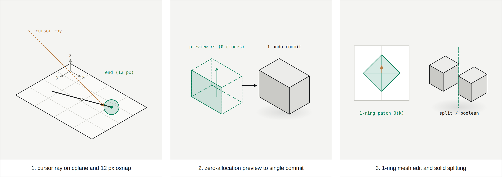

# Tutorial 6 · Construction planes, OSnap and interactive tools

## Goal

Intersect cursor rays with world or 3-point construction planes (`CPlane`), rank 6-priority `OSnap` candidates within `12 CSS px`, and drive interactive `Tool` state machines with zero-history `1`-ring mesh previews and atomic `Undo` commits.

 

**What we achieve:** The interactive CAD foundation (`cplane.rs`, `snap.rs`, `command/mod.rs`, `command/tool.rs`, `gather.rs`, `mesh_preview.rs`) powering every shape, transform, and surfacing command in [Tutorial 6.1](tutorial-six-primitives.md) and [Tutorial 6.2](tutorial-six-surfacing.md).

## How it works

Cursor rays resolve through `snap.rs` (`End > Vertex > Mid > Center > Perp > Near > Grid` within `12 px`) onto `CPlane` (`cplane.rs`), while `Tool` (`tool.rs`) streams ephemeral rubber-band and `O(valence)` 1-ring `mesh_preview.rs` GPU patches during pointer motion before committing one undoable `Session` edit on click/Enter.



## Compilable checkpoint slice

Tutorials 6, 6.1, and 6.2 register `cplane`, `snap`, `command`, `edit`, `modeling`, `mesh_preview`, `surface_preview`, and `splitting` in `viewer-core/src/lib.rs` as part of the `application` assembly.

Lines marked `+` show the exact module declarations unlocked between `decoding` (`179` files) and `application` (`398` files):

```rust
// viewer-core/src/lib.rs (decoding -> application)
+ //! UI- and GPU-independent core of Session Viewer.
+ //!
+ //! Zero dependencies on `wgpu`, `winit`, `egui`, `web-sys`, `wasm-bindgen`, or `glyphon`.
  pub mod camera;
+ pub mod clipping;
+ pub mod cloud_query;
+ pub mod command;
+ pub mod coords;
+ pub mod cplane;
  pub mod decode;
+ pub mod deform;
+ pub mod edit;
  pub mod gizmo;
+ pub mod hierarchy;
  pub mod interactions;
  pub mod knobs;
+ pub mod layers;
+ pub mod live_revision;
+ pub mod manifest;
+ pub mod mesh_preview;
+ pub mod modeling;
+ pub mod op;
+ pub mod range_gate;
  pub mod rows;
+ pub mod scene;
+ pub mod selection;
+ pub mod session_io;
+ pub mod sheet_query;
  pub mod sink;
+ pub mod snap;
+ pub mod splitting;
+ pub mod stream;
+ pub mod surface_preview;
  pub mod validate;
  pub mod walk;
  pub use crate as app;
  pub use sink as core;
  pub use sink::GpuSink;

// src/lib.rs (decoding -> application)
  /// A WGSL file from src/shaders as build.rs wrote it: no comments, indentation or blank lines.
  macro_rules! shader {
      ($name:literal) => {
          include_str!(concat!(env!("OUT_DIR"), "/shaders/", $name))
      };
  }
  mod engine;
  pub use viewer_core as core;
+ pub use viewer_core::op;
  pub use viewer_core::rows;
  pub use viewer_core::camera;
  pub mod command_dock;
  pub mod app;
+ #[cfg(target_arch = "wasm32")]
+ pub mod text_quality;
+ mod state;
+ pub use state::State;
+ #[cfg(target_arch = "wasm32")]
+ pub(crate) use app::runtime::desired_canvas_size;
+ #[cfg(target_arch = "wasm32")]
+ pub use app::runtime::{App, execute_op, run_web};
+ pub use app::runtime::{CloudChunk, Msg, SheetChunk};
+ #[cfg(not(target_arch = "wasm32"))]
+ pub mod selftest;
  #[cfg(all(target_arch = "wasm32", feature = "tutorial"))]
  #[path = "../examples/course/entry.rs"]
  mod course;

// src/engine/gpu/mod.rs (decoding -> application)
  pub mod arena; // register:arena
  pub mod backdrop; // register:backdrop
  pub mod buffers; // register:buffers
  pub mod clip; // register:clip
  pub mod cloud; // register:cloud
  pub mod device; // register:device
  pub mod faces; // register:faces
  pub mod frame; // register:frame
  pub mod glyphs; // register:glyphs
  pub mod hull; // register:hull
  pub mod instance; // register:instance
  pub mod instanced; // register:instanced
  pub mod lod; // register:lod
  pub mod objects;
  pub mod slots; // register:slots
  pub mod lane; // register:lane
  #[cfg(target_arch = "wasm32")]
  mod pacing;
  pub mod pass; // register:pass
  pub(crate) mod patch; // register:patch
  pub mod pick; // register:pick
  pub mod planes; // register:planes
  pub mod present; // register:present
  pub mod render; // register:render
  pub mod segments; // register:segments
  pub mod splat; // register:splat
  mod ssao; // register:ssao
  pub mod surface_outline; // register:surface_outline
  pub mod targets; // register:targets
  pub mod text; // register:text
  pub mod text_outline; // register:text_outline
  pub mod timing; // register:timing
  mod triangle_tiles; // register:triangle_tiles
  pub mod ui; // register:ui
  pub mod upload; // register:upload
  pub mod vectors; // register:vectors
  pub mod view; // register:view
  mod widget; // register:widget
  mod widget_mesh; // register:widget_mesh
  mod context;
  mod sink;
  pub use context::Gpu;
  #[cfg(test)]
  pub(crate) use context::lane_shaders;
  #[allow(unused_imports)]
  pub use cloud::{CloudDraw, LodNode, NO_NORMALS}; // register:clouds
  pub use frame::FrameInput;
  pub use glyphs::GlyphPoint; // register:markers
  pub use instance::Instance;
  #[allow(unused_imports)]
  pub use objects::{ObjectRow, Rebase};
  pub use pick::Pick; // register:shell
  pub use segments::CylinderSegment; // register:strokes
  pub use upload::Upload;
  pub use view::View;
+ #[cfg(all(test, not(target_arch = "wasm32")))] // register:application-tests
+ mod scene_gpu_tests; // register:application-tests

// src/app/mod.rs (decoding -> application)
+ #[cfg(target_arch = "wasm32")] // register:agent
+ pub mod agent; // register:agent
+ pub use viewer_core::clipping; // register:clipping
+ pub mod cloud_query; // register:cloud_query
+ pub use viewer_core::command; // register:command
+ pub use viewer_core::coords; // register:coords
+ pub use viewer_core::cplane; // register:cplane
  #[cfg(any(target_arch = "wasm32", test))] // register:decode
  pub mod decode; // register:decode
+ pub use viewer_core::deform; // register:deform
+ pub use viewer_core::edit; // register:edit
+ pub mod feedback; // register:feedback
+ #[cfg(target_arch = "wasm32")] // register:fetch
+ pub mod fetch; // register:fetch
+ pub mod fonts; // register:fonts
+ pub mod gesture; // register:gesture
  pub use viewer_core::gizmo; // register:gizmo
+ pub use viewer_core::hierarchy; // register:hierarchy
+ pub mod input; // register:input
+ #[cfg(any(target_arch = "wasm32", test))] // register:inspection
+ pub mod inspection; // register:inspection
  pub use viewer_core::interactions; // register:interactions
+ pub mod keys; // register:keys
  pub use viewer_core::knobs; // register:knobs
  #[cfg(target_arch = "wasm32")]
  pub mod launch;
+ pub use viewer_core::layers; // register:layers
+ #[cfg(target_arch = "wasm32")] // register:live
+ pub mod live; // register:live
+ #[cfg(any(target_arch = "wasm32", test))]
+ pub use viewer_core::live_revision;
+ #[cfg(target_arch = "wasm32")] // register:loader
+ pub mod loader; // register:loader
+ pub use viewer_core::manifest; // register:manifest
+ pub use viewer_core::mesh_preview; // register:mesh_preview
+ pub use viewer_core::modeling; // register:modeling
+ pub use viewer_core::op;
  pub mod mode; // register:mode
  pub mod stage;
+ #[cfg(any(target_arch = "wasm32", test))] // register:range_gate
+ pub use viewer_core::range_gate; // register:range_gate
+ #[cfg(target_arch = "wasm32")] // register:route
+ pub mod route; // register:route
+ pub(crate) mod runtime;
+ pub use viewer_core::scene; // register:scene
+ pub use viewer_core::selection; // register:selection
+ pub mod session_io; // register:session_io
+ pub mod sheet_query; // register:sheet_query
+ pub use viewer_core::snap; // register:snap
+ pub use viewer_core::splitting; // register:splitting
+ pub mod stream; // register:stream
+ pub use viewer_core::surface_preview; // register:surface_preview
+ pub mod touch; // register:touch
+ #[cfg(any(target_arch = "wasm32", test))] // register:ui
+ pub mod ui; // register:ui
  pub use viewer_core::validate; // register:validate
  pub use viewer_core::walk; // register:walk
  #[cfg(target_arch = "wasm32")]
  pub mod yielding;

// src/app/stage/mod.rs (decoding -> application)
  mod actions;
  mod check;
  pub mod deck;
  mod draw;
  pub mod eval;
  mod flat;
  pub mod font;
  mod geometry;
  mod layout;
  mod math_mode;
  mod matrix;
+ mod mode;
  mod morph;
  pub mod net;
  mod object;
  pub mod paint;
  pub mod presentation;
  #[cfg(test)]
  mod presentation_tests;
  pub mod run;
+ pub mod spatial;
  #[cfg(test)]
  mod tests;
  pub mod tex;
  mod tween;
  mod view;
+ mod application;
+ pub use application::{Loaded, StageApp};
+ #[cfg(target_arch = "wasm32")]
+ pub use application::{open, route};

// examples/course/registration.rs (decoding -> application)
  // --8<-- [start:course-registration]
  #[path = "canvas.rs"]
  mod canvas;
  #[path = "frame.rs"]
  mod frame;
  #[path = "painting.rs"]
  mod painting;
  #[path = "mathematics.rs"]
  mod mathematics;
  #[path = "dock.rs"]
  mod dock;
  #[path = "camera.rs"]
  mod camera;
  #[path = "rows.rs"]
  mod rows;
  #[path = "geometry.rs"]
  mod geometry;
  #[path = "decoding.rs"]
  mod decoding;
  type Start = fn() -> Result<(), wasm_bindgen::JsValue>;
  pub(super) const STARTS: &[(&str, Start)] = &[
      ("frame", frame::start),
      ("painting", painting::start),
      ("mathematics", mathematics::start),
      ("dock", dock::start),
      ("camera", camera::start),
      ("rows", rows::start),
      ("geometry", geometry::start),
      ("decoding", decoding::start),
+     ("application", crate::run_web),
  ];
  // --8<-- [end:course-registration]
```

## Core code walkthrough

### 3-point `CPlane` orthonormal frame (`viewer-core/src/cplane.rs:9:79`)

```rust
--8<-- "session_viewer/viewer-core/src/cplane.rs:9:79"
```

`CPlane` (lines `11–20`) represents either a cardinal world plane (`Xy`, `Yz`, `Xz`) or an arbitrary 3D `Frame { origin, x, y }`. `from_3_points` (lines `24–34`) Gram-Schmidt orthonormalizes `x = unit(on_x − origin)`, `z = unit(x × (in_plane − origin))`, and `y = z × x` (returning `None` if collinear), so `local()` and `world()` convert cursor hits between 3D world space and `(u, v, height)` plane coordinates.

### Ranked `SnapKind` bitmask & grid rounding (`viewer-core/src/snap.rs:12:80`)

```rust
--8<-- "session_viewer/viewer-core/src/snap.rs:12:80"
```

`SnapKind`'s declaration order (`End < Vertex < Mid < Center < Perp < Near < Grid`, lines `13–21`) defines `Ord` priority: within the `12 px` snap aperture, an exact endpoint (`End`) always beats a generic edge (`Near`) hit. When no object snap matches and `Snapping.grid` is enabled, `on_grid` (lines `55–58`) rounds `(u, v)` to multiples of `grid_step` (`1000 mm`) while preserving height `w`.

## Prerequisites and files

Requires [Tutorial 5](tutorial-five-camera.md). Followed by [Tutorial 6.1 (Primitives, transforms & measurements)](tutorial-six-primitives.md) and [Tutorial 6.2 (NURBS surfacing & Split/Trim/Extend)](tutorial-six-surfacing.md).

**Core files to type inline (6 files):**

1. `viewer-core/src/cplane.rs`
2. `viewer-core/src/snap.rs`
3. `viewer-core/src/command/mod.rs`
4. `viewer-core/src/command/tool.rs`
5. `viewer-core/src/command/tool/gather.rs`
6. `viewer-core/src/mesh_preview.rs`

**Reference catalog & test files (17 files, folded below):** `viewer-core/src/command/tool/options.rs`, `viewer-core/src/command/tool/choices.rs`, `viewer-core/src/command/verbs/mod.rs`, `viewer-core/src/command/verbs/geometry.rs`, `src/state/tool.rs`, `src/state/drawing.rs`, `src/state/edit.rs`, `viewer-core/src/edit.rs`, `viewer-core/src/modeling.rs`, `viewer-core/src/deform.rs`, `viewer-core/src/scene_sync/preview.rs`, `viewer-core/src/scene_sync/commands_tests.rs`, `viewer-core/src/scene_sync/editing_tests.rs`, `viewer-core/src/command/verbs/construction_plane.rs`, `viewer-core/src/command/verbs/grid_snap.rs`, `viewer-core/src/command/verbs/snap.rs`, `viewer-core/src/command/verbs/arrowhead.rs`.

## Build

### Step 1 · `viewer-core/src/cplane.rs`

`viewer-core/src/cplane.rs` (`CPlane::from_3_points`) builds right-handed orthonormal frames (rejecting collinear triples) and maps square-on named views to their facing planes with grazing-ray fallbacks.

```rust
--8<-- "session_viewer/viewer-core/src/cplane.rs"
```

### Step 2 · `viewer-core/src/snap.rs`

`viewer-core/src/snap.rs` evaluates prioritized `SnapKind` candidates (endpoints, vertices, midpoints, centres, perpendiculars, near curves) and rounds local `CPlane` `(u, v)` grid coordinates under per-move CSS-pixel and time budgets.

```rust
--8<-- "session_viewer/viewer-core/src/snap.rs"
```

### Step 3 · `viewer-core/src/command/mod.rs`

`viewer-core/src/command/mod.rs` defines `Spec`, `Action` and `Draw`, matching longest space/case-insensitive command prefixes, canonicalizing verbs/options, rejecting non-finite numbers and returning `Result<Box<dyn Action>, String>` without mutating `State`.

```rust
--8<-- "session_viewer/viewer-core/src/command/mod.rs"
```

### Step 4 · `viewer-core/src/command/tool.rs`

Defines `Tool` (`Next::More`, `Repeat`, `Done`), temporarily moving out of `State` during callbacks to satisfy exclusive mutable borrows.

```rust
--8<-- "session_viewer/viewer-core/src/command/tool.rs"
```

### Step 5 · `viewer-core/src/command/tool/gather.rs`

Runs `Recipe` step queues (points, numbers, distance vectors, ordered curve groups and inline options) and commits multi-object `Made` results in one transaction.

```rust
--8<-- "session_viewer/viewer-core/src/command/tool/gather.rs"
```

### Step 6 · `viewer-core/src/mesh_preview.rs`

`viewer-core/src/mesh_preview.rs` (325 lines) defines `struct MeshPreview`, `struct Gesture`, `mesh()`, `capture()`, `begin()`. It locked by `cargo xtest` (`large_mesh_gesture_only_patches_local_neighborhood`).

```rust
--8<-- "session_viewer/viewer-core/src/mesh_preview.rs"
```

## Reference catalog and test files (17 files)

The 6 core files above implement the complete mechanism for this lesson. Expand this reference section whenever you want to inspect or copy the remaining 17 sibling verbs, adapters, and unit-test suites (`Step 7`–`Step 23`).

### Step 7 · `viewer-core/src/command/tool/options.rs`

Matches multi-word options case- and space-insensitively while reserving empty `Enter` and `Escape` for tool continuation.

```rust
--8<-- "session_viewer/viewer-core/src/command/tool/options.rs"
```

### Step 8 · `viewer-core/src/command/tool/choices.rs`

Turns a bare command's options into clickable dock chips that dispatch full canonical command lines (cancelling on `Enter`).

```rust
--8<-- "session_viewer/viewer-core/src/command/tool/choices.rs"
```

### Step 9 · `viewer-core/src/command/verbs/mod.rs`

`viewer-core/src/command/verbs/mod.rs` expands `verbs!` into `REGISTRY` so every command registers completion, option chips, help and parsing in one place without editing the dock widget.

```rust
--8<-- "session_viewer/viewer-core/src/command/verbs/mod.rs"
```

### Step 10 · `viewer-core/src/command/verbs/geometry.rs`

`viewer-core/src/command/verbs/geometry.rs` (`Create::run`) validates finite coordinates within scene bounds, invokes the verb's constructor, commits the created object to `Scene`, syncs GPU rows, and selects the new row (leaving document and row counts untouched on error).

```rust
--8<-- "session_viewer/viewer-core/src/command/verbs/geometry.rs"
```

### Step 11 · `src/state/tool.rs`

Snapshots original row placements before tool previews so `Escape` restores exact GPU placements with zero history entries.

```rust
--8<-- "session_viewer/src/state/tool.rs"
```

### Step 12 · `src/state/drawing.rs`

Owns `Draft` points, hover preview and `CPlane`, serializing completed picks with explicit `w` world prefixes into `run_command` so typed and picked geometry share one undo path.

```rust
--8<-- "session_viewer/src/state/drawing.rs"
```

### Step 13 · `src/state/edit.rs`

Coordinates command dispatch, gumball drag preview/restore, whole-object vs subobject commits and single-click `number_box` activation.

```rust
--8<-- "session_viewer/src/state/edit.rs"
```

### Step 14 · `viewer-core/src/edit.rs`

`src/app/edit.rs` (`Scene::transform_rows`) converts world-space `Xform` deltas into each writable object's local parent frame, detaching shared `Rc<Session>` copies on write and skipping selected descendants of selected ancestors.

```rust
--8<-- "session_viewer/viewer-core/src/edit.rs"
```

### Step 15 · `viewer-core/src/modeling.rs`

Inserts constructed `Made` objects into the active editable layer (creating `Created` on demand) and compensates for parent/document transforms.

```rust
--8<-- "session_viewer/viewer-core/src/modeling.rs"
```

### Step 16 · `viewer-core/src/deform.rs`

Deforms selected mesh vertices, first-appearance edges (including hole rims) and checked `(u, v)` NURBS control points without altering whole-object placement.

```rust
--8<-- "session_viewer/viewer-core/src/deform.rs"
```

### Step 17 · `viewer-core/src/scene_sync/preview.rs`

Captures single-object vertex/pipe spans during interactive drags so surface/mesh edits patch GPU buffers in place without full rewalks.

```rust
--8<-- "session_viewer/viewer-core/src/scene_sync/preview.rs"
```

### Step 18 · `viewer-core/src/scene_sync/commands_tests.rs`

Bounds `200`-frame growing-curve previews to `<= 16` reallocations and checks `100,000`-object vs `1,000`-object incremental edit scaling.

```rust
--8<-- "session_viewer/viewer-core/src/scene_sync/commands_tests.rs"
```

### Step 19 · `viewer-core/src/scene_sync/editing_tests.rs`

Verifies `100`-point cloud tomb burial/unbury, forced tomb-cap release, post-compaction `Undo` rebuild and multi-document single-step deletion.

```rust
--8<-- "session_viewer/viewer-core/src/scene_sync/editing_tests.rs"
```

### Step 20 · `viewer-core/src/command/verbs/construction_plane.rs`

`viewer-core/src/command/verbs/construction_plane.rs` (230 lines) registers the `NAME` command (`Construction Plane XY / XZ / YZ fixes the plane points land on and the grid lies on · 3 Point picks its origin, a point on its x axis and one on its y side · View follows the view again · Example: Construction Plane 3 Point 0,0,0 1000,0,1000 0,1000,0`). Its `Action::run` handler exposes option chips `Construction Plane XY`, `Construction Plane XZ`, `Construction Plane YZ`, `Construction Plane 3 Point` after validating arguments so invalid CLI or interactive input leaves undo history untouched.

```rust
--8<-- "session_viewer/viewer-core/src/command/verbs/construction_plane.rs"
```

### Step 21 · `viewer-core/src/command/verbs/grid_snap.rs`

`viewer-core/src/command/verbs/grid_snap.rs` (93 lines) registers the `Grid Snap` command (`Grid Snap (On Off) or a spacing: a point off every object lands on the grid of the construction plane, 1000 apart at start like the ground grid's cells · Example: Grid Snap 50`). Its `Action::run` handler exposes option chips `Grid Snap On`, `Grid Snap Off` after validating arguments so invalid CLI or interactive input leaves undo history untouched.

```rust
--8<-- "session_viewer/viewer-core/src/command/verbs/grid_snap.rs"
```

### Step 22 · `viewer-core/src/command/verbs/snap.rs`

`viewer-core/src/command/verbs/snap.rs` (68 lines) registers the `Snap` command (`Snap (On Off): snapping · Snap End / Near / Mid / Center / Perp toggles one kind`). Its `Action::run` handler exposes option chips `Snap On`, `Snap Off`, `Snap End`, `Snap Near` after validating arguments so invalid CLI or interactive input leaves undo history untouched.

```rust
--8<-- "session_viewer/viewer-core/src/command/verbs/snap.rs"
```

### Step 23 · `viewer-core/src/command/verbs/arrowhead.rs`

`viewer-core/src/command/verbs/arrowhead.rs` (205 lines) registers the `Arrowhead` command (`Arrowhead: heads on the selected lines, polylines and curves · None, Start, End or Both · Example: Arrowhead End`). Its `Action::run` handler exposes option chips `Arrowhead None`, `Arrowhead Start`, `Arrowhead End`, `Arrowhead Both` after validating arguments so invalid CLI or interactive input leaves undo history untouched.

```rust
--8<-- "session_viewer/viewer-core/src/command/verbs/arrowhead.rs"
```

## Integration

`viewer-core/src/command/verbs/mod.rs` expands the `verbs!` macro into `REGISTRY` in strict alphabetical order, and every `Action::run` takes `&mut dyn CommandHost` so identical verb code executes inside browser `State` (`src/state/host.rs`), `HeadlessHost` (`viewer-core`), and `session-viewer-cli`.

## Run and observe

Run the `CPlane`, 6-tier `OSnap`, local 1-ring `mesh_preview`, and shared-session copy-on-write editing tests:

```sh
cargo xtest -p viewer-core cplane::tests
cargo xtest -p viewer-core snap::tests
cargo xtest -p viewer-core an_edit_must_split_a_session_two_placements_share
```

In the live viewer (`trunk serve`), activate `CPlane 3Point`, toggle `OSnap` chips (`End`, `Mid`, `Center`, `Perp`), and drag a mesh vertex in `Controls` mode (`PointsOn`) to see `O(valence)` 1-ring preview updates commit as a single `Ctrl+Z` step.

## Predict and try

Predict what happens when two placements share one `Rc<Session>` document and you `Move` an object in only the first placement (`an_edit_must_split_a_session_two_placements_share`): `Scene` clones-on-write (`Rc::make_mut`) only the edited document so the second placement stays untouched at its original coordinates.

## Question and answer

**Why does `ControlDrag` (`state/edit.rs`) cache `from_local` and patch local mesh neighborhoods through `mesh_preview.rs` during pointer motion instead of calling `Scene::replace_rows` every frame?**

??? tip "Think first — click to reveal how to work it out and the answer"
    **How to work it out:** Measure what `Scene::replace_rows` does on a `100,000`-vertex mesh: cloning the whole `Mesh`, rebuilding topology, walking all edges, and recording an undo transaction on every `16 ms` mouse move.

    **The answer:** `mesh_preview.rs` identifies the `1`-ring neighborhood incident to the dragged vertex/edge/face once on press and patches only those GPU vertex slots per frame (`O(local valence)`), recording zero undo steps during the drag and committing a single `Session` transaction on mouse release (or restoring cleanly on `Escape`).

## Validation

Verified via `cplane::tests`, `snap::tests`, `edit::tests`, `modeling::tests`, `deform::tests`, and `scene_sync::{commands_tests,editing_tests}`.
