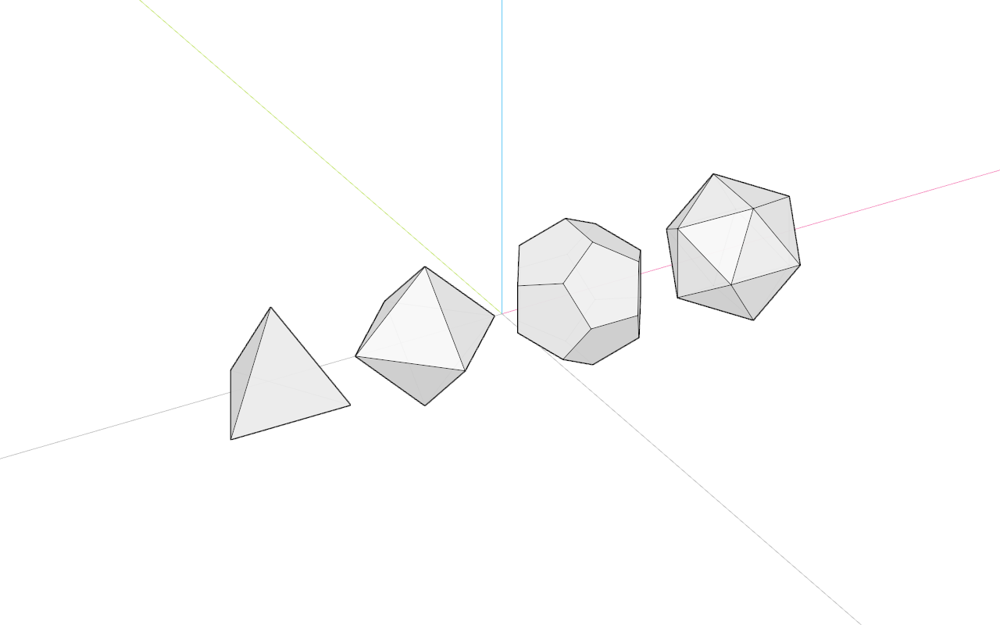
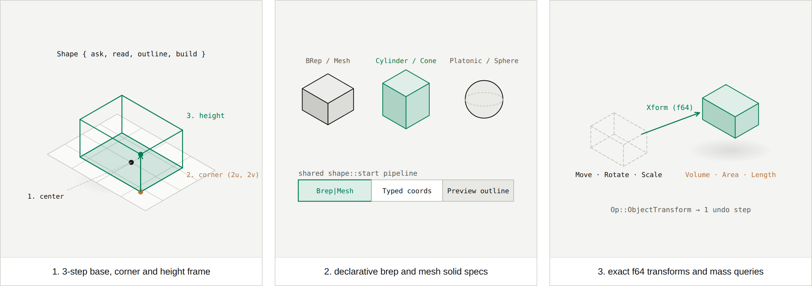

# Tutorial 6.1 · Parametric CAD primitives, rigid transforms and mass queries

## Goal

Build the shared `Shape { ask, read, outline, build }` solid generator (`shape.rs`), construct BRep/Mesh primitives, conic/NURBS curves, Platonic solids, and `Move`/`Rotate`/`Scale`/`Copy`/`Orient3Points` transforms, and compute exact `Volume`, `Area`, and `Length`.



**What we achieve:** `36` cohesive construction, transform, and measurement modules driven by one `260`-line `shape.rs` state machine—so typing `Box`, `Cylinder`, `Move`, and `Volume` teaches the exact pattern used across all remaining primitives in the folded catalog.

## How it works

`shape::start` parses any inline arguments up front (running immediately in CLI/scripts when all sizes are supplied, or entering an interactive `Tool` prompt with live `outline` polylines in the viewport), while transform verbs (`Move`, `Rotate`, `Scale`, `Copy`, `Orient3Points`) apply exact `f64` `Xform` matrices through `op::execute`.



## Compilable checkpoint slice

All primitive, transform, and measurement verbs register alphabetically inside `viewer-core/src/command/verbs/mod.rs` (`verbs!` macro).

Lines marked `+` show the exact module declarations unlocked between `decoding` (`179` files) and `application` (`398` files):

```rust
// viewer-core/src/lib.rs (decoding -> application)
+ //! UI- and GPU-independent core of Session Viewer.
+ //!
+ //! Zero dependencies on `wgpu`, `winit`, `egui`, `web-sys`, `wasm-bindgen`, or `glyphon`.
  pub mod camera;
+ pub mod clipping;
+ pub mod cloud_query;
+ pub mod command;
+ pub mod coords;
+ pub mod cplane;
  pub mod decode;
+ pub mod deform;
+ pub mod edit;
  pub mod gizmo;
+ pub mod hierarchy;
  pub mod interactions;
  pub mod knobs;
+ pub mod layers;
+ pub mod live_revision;
+ pub mod manifest;
+ pub mod mesh_preview;
+ pub mod modeling;
+ pub mod op;
+ pub mod range_gate;
  pub mod rows;
+ pub mod scene;
+ pub mod selection;
+ pub mod session_io;
+ pub mod sheet_query;
  pub mod sink;
+ pub mod snap;
+ pub mod splitting;
+ pub mod stream;
+ pub mod surface_preview;
  pub mod validate;
  pub mod walk;
  pub use crate as app;
  pub use sink as core;
  pub use sink::GpuSink;

// src/lib.rs (decoding -> application)
  /// A WGSL file from src/shaders as build.rs wrote it: no comments, indentation or blank lines.
  macro_rules! shader {
      ($name:literal) => {
          include_str!(concat!(env!("OUT_DIR"), "/shaders/", $name))
      };
  }
  mod engine;
  pub use viewer_core as core;
+ pub use viewer_core::op;
  pub use viewer_core::rows;
  pub use viewer_core::camera;
  pub mod command_dock;
  pub mod app;
+ #[cfg(target_arch = "wasm32")]
+ pub mod text_quality;
+ mod state;
+ pub use state::State;
+ #[cfg(target_arch = "wasm32")]
+ pub(crate) use app::runtime::desired_canvas_size;
+ #[cfg(target_arch = "wasm32")]
+ pub use app::runtime::{App, execute_op, run_web};
+ pub use app::runtime::{CloudChunk, Msg, SheetChunk};
+ #[cfg(not(target_arch = "wasm32"))]
+ pub mod selftest;
  #[cfg(all(target_arch = "wasm32", feature = "tutorial"))]
  #[path = "../examples/course/entry.rs"]
  mod course;

// src/engine/gpu/mod.rs (decoding -> application)
  pub mod arena; // register:arena
  pub mod backdrop; // register:backdrop
  pub mod buffers; // register:buffers
  pub mod clip; // register:clip
  pub mod cloud; // register:cloud
  pub mod device; // register:device
  pub mod faces; // register:faces
  pub mod frame; // register:frame
  pub mod glyphs; // register:glyphs
  pub mod hull; // register:hull
  pub mod instance; // register:instance
  pub mod instanced; // register:instanced
  pub mod lod; // register:lod
  pub mod objects;
  pub mod slots; // register:slots
  pub mod lane; // register:lane
  #[cfg(target_arch = "wasm32")]
  mod pacing;
  pub mod pass; // register:pass
  pub(crate) mod patch; // register:patch
  pub mod pick; // register:pick
  pub mod planes; // register:planes
  pub mod present; // register:present
  pub mod render; // register:render
  pub mod segments; // register:segments
  pub mod splat; // register:splat
  mod ssao; // register:ssao
  pub mod surface_outline; // register:surface_outline
  pub mod targets; // register:targets
  pub mod text; // register:text
  pub mod text_outline; // register:text_outline
  pub mod timing; // register:timing
  mod triangle_tiles; // register:triangle_tiles
  pub mod ui; // register:ui
  pub mod upload; // register:upload
  pub mod vectors; // register:vectors
  pub mod view; // register:view
  mod widget; // register:widget
  mod widget_mesh; // register:widget_mesh
  mod context;
  mod sink;
  pub use context::Gpu;
  #[cfg(test)]
  pub(crate) use context::lane_shaders;
  #[allow(unused_imports)]
  pub use cloud::{CloudDraw, LodNode, NO_NORMALS}; // register:clouds
  pub use frame::FrameInput;
  pub use glyphs::GlyphPoint; // register:markers
  pub use instance::Instance;
  #[allow(unused_imports)]
  pub use objects::{ObjectRow, Rebase};
  pub use pick::Pick; // register:shell
  pub use segments::CylinderSegment; // register:strokes
  pub use upload::Upload;
  pub use view::View;
+ #[cfg(all(test, not(target_arch = "wasm32")))] // register:application-tests
+ mod scene_gpu_tests; // register:application-tests

// src/app/mod.rs (decoding -> application)
+ #[cfg(target_arch = "wasm32")] // register:agent
+ pub mod agent; // register:agent
+ pub use viewer_core::clipping; // register:clipping
+ pub mod cloud_query; // register:cloud_query
+ pub use viewer_core::command; // register:command
+ pub use viewer_core::coords; // register:coords
+ pub use viewer_core::cplane; // register:cplane
  #[cfg(any(target_arch = "wasm32", test))] // register:decode
  pub mod decode; // register:decode
+ pub use viewer_core::deform; // register:deform
+ pub use viewer_core::edit; // register:edit
+ pub mod feedback; // register:feedback
+ #[cfg(target_arch = "wasm32")] // register:fetch
+ pub mod fetch; // register:fetch
+ pub mod fonts; // register:fonts
+ pub mod gesture; // register:gesture
  pub use viewer_core::gizmo; // register:gizmo
+ pub use viewer_core::hierarchy; // register:hierarchy
+ pub mod input; // register:input
+ #[cfg(any(target_arch = "wasm32", test))] // register:inspection
+ pub mod inspection; // register:inspection
  pub use viewer_core::interactions; // register:interactions
+ pub mod keys; // register:keys
  pub use viewer_core::knobs; // register:knobs
  #[cfg(target_arch = "wasm32")]
  pub mod launch;
+ pub use viewer_core::layers; // register:layers
+ #[cfg(target_arch = "wasm32")] // register:live
+ pub mod live; // register:live
+ #[cfg(any(target_arch = "wasm32", test))]
+ pub use viewer_core::live_revision;
+ #[cfg(target_arch = "wasm32")] // register:loader
+ pub mod loader; // register:loader
+ pub use viewer_core::manifest; // register:manifest
+ pub use viewer_core::mesh_preview; // register:mesh_preview
+ pub use viewer_core::modeling; // register:modeling
+ pub use viewer_core::op;
  pub mod mode; // register:mode
  pub mod stage;
+ #[cfg(any(target_arch = "wasm32", test))] // register:range_gate
+ pub use viewer_core::range_gate; // register:range_gate
+ #[cfg(target_arch = "wasm32")] // register:route
+ pub mod route; // register:route
+ pub(crate) mod runtime;
+ pub use viewer_core::scene; // register:scene
+ pub use viewer_core::selection; // register:selection
+ pub mod session_io; // register:session_io
+ pub mod sheet_query; // register:sheet_query
+ pub use viewer_core::snap; // register:snap
+ pub use viewer_core::splitting; // register:splitting
+ pub mod stream; // register:stream
+ pub use viewer_core::surface_preview; // register:surface_preview
+ pub mod touch; // register:touch
+ #[cfg(any(target_arch = "wasm32", test))] // register:ui
+ pub mod ui; // register:ui
  pub use viewer_core::validate; // register:validate
  pub use viewer_core::walk; // register:walk
  #[cfg(target_arch = "wasm32")]
  pub mod yielding;

// src/app/stage/mod.rs (decoding -> application)
  mod actions;
  mod check;
  pub mod deck;
  mod draw;
  pub mod eval;
  mod flat;
  pub mod font;
  mod geometry;
  mod layout;
  mod math_mode;
  mod matrix;
+ mod mode;
  mod morph;
  pub mod net;
  mod object;
  pub mod paint;
  pub mod presentation;
  #[cfg(test)]
  mod presentation_tests;
  pub mod run;
+ pub mod spatial;
  #[cfg(test)]
  mod tests;
  pub mod tex;
  mod tween;
  mod view;
+ mod application;
+ pub use application::{Loaded, StageApp};
+ #[cfg(target_arch = "wasm32")]
+ pub use application::{open, route};

// examples/course/registration.rs (decoding -> application)
  // --8<-- [start:course-registration]
  #[path = "canvas.rs"]
  mod canvas;
  #[path = "frame.rs"]
  mod frame;
  #[path = "painting.rs"]
  mod painting;
  #[path = "mathematics.rs"]
  mod mathematics;
  #[path = "dock.rs"]
  mod dock;
  #[path = "camera.rs"]
  mod camera;
  #[path = "rows.rs"]
  mod rows;
  #[path = "geometry.rs"]
  mod geometry;
  #[path = "decoding.rs"]
  mod decoding;
  type Start = fn() -> Result<(), wasm_bindgen::JsValue>;
  pub(super) const STARTS: &[(&str, Start)] = &[
      ("frame", frame::start),
      ("painting", painting::start),
      ("mathematics", mathematics::start),
      ("dock", dock::start),
      ("camera", camera::start),
      ("rows", rows::start),
      ("geometry", geometry::start),
      ("decoding", decoding::start),
+     ("application", crate::run_web),
  ];
  // --8<-- [end:course-registration]
```

## Core code walkthrough

### Declarative 3-step `Box` `Shape` state machine (`viewer-core/src/command/verbs/box.rs:18:81`)

```rust
--8<-- "session_viewer/viewer-core/src/command/verbs/box.rs:18:81"
```

Every parametric solid (`Box`, `Cylinder`, `Cone`, `Torus`, `Pyramid`) plugs 4 pure functions (`ask`, `read`, `outline`, `build`) into `Shape` (lines `18–26`). In `box.rs`, `ask` (lines `34–42`) prompts for `Base center`, then accepts *either* a 3D corner click (computing `2|u|` and `2|v|` at once in lines `50–55`) *or* typed `Length` + `Width` numbers, followed by signed extrusion `Height`—driving live wireframe previews (`outline`) with zero heap clones until the final step.

### Dual immediate vs interactive `Move` verb (`viewer-core/src/command/verbs/move.rs:7:75`)

```rust
--8<-- "session_viewer/viewer-core/src/command/verbs/move.rs:7:75"
```

`Move` demonstrates how every verb serves both CLI scripts and mouse interaction from one `SPEC`: if arguments follow (`Move 10,0,0`), `parse` returns immediate `Move(delta)` delegating straight to `op::execute(Op::ObjectTransform { ... })` (lines `30–40`); if invoked bare (`Move`), `parse` starts the two-click `Moving` `Tool` whose `preview()` (lines `74–75`) streams live `Xform::translation` matrices during mouse motion.

## Prerequisites and files

Sub-chapter `6.1` of [Tutorial 6](tutorial-six-modeling.md). Followed by [Tutorial 6.2 (NURBS surfacing & Split/Trim/Extend)](tutorial-six-surfacing.md).

**Core files to type inline (6 files):**

1. `viewer-core/src/command/tool/shape.rs`
2. `viewer-core/src/command/verbs/box.rs`
3. `viewer-core/src/command/verbs/cylinder.rs`
4. `viewer-core/src/command/verbs/polyline.rs`
5. `viewer-core/src/command/verbs/move.rs`
6. `viewer-core/src/command/verbs/volume.rs`

**Reference catalog & test files (30 files, folded below):** `viewer-core/src/command/verbs/point.rs`, `viewer-core/src/command/verbs/line.rs`, `viewer-core/src/command/verbs/curve.rs`, `viewer-core/src/command/verbs/arrow.rs`, `viewer-core/src/command/verbs/sphere.rs`, `viewer-core/src/command/verbs/cone.rs`, `viewer-core/src/command/verbs/capsule.rs`, `viewer-core/src/command/verbs/torus.rs`, `viewer-core/src/command/verbs/pyramid.rs`, `viewer-core/src/command/verbs/quad_sphere.rs`, `viewer-core/src/command/verbs/tetrahedron.rs`, `viewer-core/src/command/verbs/octahedron.rs`, `viewer-core/src/command/verbs/dodecahedron.rs`, `viewer-core/src/command/verbs/icosahedron.rs`, `viewer-core/src/command/verbs/block_with_hole.rs`, `viewer-core/src/command/verbs/bounding_box.rs`, `viewer-core/src/command/verbs/length_bounding_box.rs`, `viewer-core/src/command/verbs/nurbs_curve_arc.rs`, `viewer-core/src/command/verbs/nurbs_curve_circle.rs`, `viewer-core/src/command/verbs/nurbs_curve_ellipse.rs`, `viewer-core/src/command/verbs/nurbs_curve_parabola.rs`, `viewer-core/src/command/verbs/rotate.rs`, `viewer-core/src/command/verbs/scale.rs`, `viewer-core/src/command/verbs/copy.rs`, `viewer-core/src/command/verbs/orient_3_points.rs`, `viewer-core/src/command/verbs/project_to_plane.rs`, `viewer-core/src/command/verbs/area.rs`, `viewer-core/src/command/verbs/length.rs`, `viewer-core/src/command/verbs/measure.rs`, `viewer-core/src/command/verbs/measure_distance.rs`.

## Build

### Step 1 · `viewer-core/src/command/tool/shape.rs`

Provides the shared local-frame primitive builder (`Brep`/`Mesh` toggle, rubber-band distances and signed-height upright frame reversal).

```rust
--8<-- "session_viewer/viewer-core/src/command/tool/shape.rs"
```

### Step 2 · `viewer-core/src/command/verbs/box.rs`

`viewer-core/src/command/verbs/box.rs` (217 lines) registers the `Box` command (`Box (Brep Mesh): base center, corner or length and width, height · Example: Box 0,0,0 100 50 30`). Its `Action::run` handler exposes option chips `Box Brep`, `Box Mesh` after validating arguments so invalid CLI or interactive input leaves undo history untouched.

```rust
--8<-- "session_viewer/viewer-core/src/command/verbs/box.rs"
```

### Step 3 · `viewer-core/src/command/verbs/cylinder.rs`

`viewer-core/src/command/verbs/cylinder.rs` (129 lines) registers the `Cylinder` command (`Cylinder (Brep Mesh): base center, radius, height · Example: Cylinder 0,0,0 5 20`). Its `Action::run` handler exposes option chips `Cylinder Brep`, `Cylinder Mesh` after validating arguments so invalid CLI or interactive input leaves undo history untouched.

```rust
--8<-- "session_viewer/viewer-core/src/command/verbs/cylinder.rs"
```

### Step 4 · `viewer-core/src/command/verbs/polyline.rs`

Collects variable point counts (`Enter` to finish) and exposes planar rectangle and polygon sub-modes through the `Tool` path.

```rust
--8<-- "session_viewer/viewer-core/src/command/verbs/polyline.rs"
```

### Step 5 · `viewer-core/src/command/verbs/move.rs`

`viewer-core/src/command/verbs/move.rs` (125 lines) registers the `Move` command (`Move · pick a base point, then the target point · Move 10,0,0 moves by a typed offset`). It validates arguments before mutating `&mut dyn CommandHost` so invalid CLI or interactive input leaves undo history untouched.

```rust
--8<-- "session_viewer/viewer-core/src/command/verbs/move.rs"
```

### Step 6 · `viewer-core/src/command/verbs/volume.rs`

`viewer-core/src/command/verbs/volume.rs` (222 lines) registers the `Volume` command (`Volume · volume of the selected closed meshes, solid BReps and elements; open ones are refused`). It validates arguments before mutating `&mut dyn CommandHost` so invalid CLI or interactive input leaves undo history untouched.

```rust
--8<-- "session_viewer/viewer-core/src/command/verbs/volume.rs"
```

## Reference catalog and test files (30 files)

The 6 core files above implement the complete mechanism for this lesson. Expand this reference section whenever you want to inspect or copy the remaining 30 sibling verbs, adapters, and unit-test suites (`Step 7`–`Step 36`).

### Step 7 · `viewer-core/src/command/verbs/point.rs`

`viewer-core/src/command/verbs/point.rs` (22 lines) registers the `Point` command (`Point · Enter then click or type x,y,z`). It validates arguments before mutating `&mut dyn CommandHost` so invalid CLI or interactive input leaves undo history untouched.

```rust
--8<-- "session_viewer/viewer-core/src/command/verbs/point.rs"
```

### Step 8 · `viewer-core/src/command/verbs/line.rs`

Requires `2` endpoints separated by `> 1e-12`, rejecting coincident endpoints before constructing `session_rust::Line`.

```rust
--8<-- "session_viewer/viewer-core/src/command/verbs/line.rs"
```

### Step 9 · `viewer-core/src/command/verbs/curve.rs`

Builds clamped NURBS curves (`degree <= 3`) from control points, switching to periodic closed construction when `>= 4` points repeat the start.

```rust
--8<-- "session_viewer/viewer-core/src/command/verbs/curve.rs"
```

### Step 10 · `viewer-core/src/command/verbs/arrow.rs`

`viewer-core/src/command/verbs/arrow.rs` (28 lines) registers the `Arrow` command (`Arrow · Enter then click or type start and tip · Example: Arrow 0,0,0 100,0,0`). It validates arguments before mutating `&mut dyn CommandHost` so invalid CLI or interactive input leaves undo history untouched.

```rust
--8<-- "session_viewer/viewer-core/src/command/verbs/arrow.rs"
```

### Step 11 · `viewer-core/src/command/verbs/sphere.rs`

`viewer-core/src/command/verbs/sphere.rs` (79 lines) registers the `Sphere` command (`Sphere (Brep Mesh): center, radius · Example: Sphere 0,0,0 10`). Its `Action::run` handler exposes option chips `Sphere Brep`, `Sphere Mesh` after validating arguments so invalid CLI or interactive input leaves undo history untouched.

```rust
--8<-- "session_viewer/viewer-core/src/command/verbs/sphere.rs"
```

### Step 12 · `viewer-core/src/command/verbs/cone.rs`

`viewer-core/src/command/verbs/cone.rs` (90 lines) registers the `Cone` command (`Cone (Brep Mesh): base center, radius, height to the apex · Example: Cone 0,0,0 5 20`). Its `Action::run` handler exposes option chips `Cone Brep`, `Cone Mesh` after validating arguments so invalid CLI or interactive input leaves undo history untouched.

```rust
--8<-- "session_viewer/viewer-core/src/command/verbs/cone.rs"
```

### Step 13 · `viewer-core/src/command/verbs/capsule.rs`

`viewer-core/src/command/verbs/capsule.rs` (111 lines) registers the `Capsule` command (`Capsule (Mesh): base center, radius, total height · Example: Capsule 0,0,0 5 30`). Its `Action::run` handler exposes option chips `Capsule Mesh` after validating arguments so invalid CLI or interactive input leaves undo history untouched.

```rust
--8<-- "session_viewer/viewer-core/src/command/verbs/capsule.rs"
```

### Step 14 · `viewer-core/src/command/verbs/torus.rs`

`viewer-core/src/command/verbs/torus.rs` (130 lines) registers the `Torus` command (`Torus (Brep Mesh): center, major radius, minor radius · Example: Torus 0,0,0 20 5`). Its `Action::run` handler exposes option chips `Torus Brep`, `Torus Mesh` after validating arguments so invalid CLI or interactive input leaves undo history untouched.

```rust
--8<-- "session_viewer/viewer-core/src/command/verbs/torus.rs"
```

### Step 15 · `viewer-core/src/command/verbs/pyramid.rs`

`viewer-core/src/command/verbs/pyramid.rs` (148 lines) registers the `Pyramid` command (`Pyramid (Brep Mesh): base center, corner or edge length, height · Example: Pyramid 0,0,0 10 15`). Its `Action::run` handler exposes option chips `Pyramid Brep`, `Pyramid Mesh` after validating arguments so invalid CLI or interactive input leaves undo history untouched.

```rust
--8<-- "session_viewer/viewer-core/src/command/verbs/pyramid.rs"
```

### Step 16 · `viewer-core/src/command/verbs/quad_sphere.rs`

`viewer-core/src/command/verbs/quad_sphere.rs` (71 lines) registers the `Quad Sphere` command (`Quad Sphere (Mesh): center, radius · six patches of 8 × 8 quads · Example: Quad Sphere 0,0,0 10`). Its `Action::run` handler exposes option chips `Quad Sphere Mesh` after validating arguments so invalid CLI or interactive input leaves undo history untouched.

```rust
--8<-- "session_viewer/viewer-core/src/command/verbs/quad_sphere.rs"
```

### Step 17 · `viewer-core/src/command/verbs/tetrahedron.rs`

`viewer-core/src/command/verbs/tetrahedron.rs` (72 lines) registers the `Tetrahedron` command (`Tetrahedron (Brep Mesh): center, radius to the corners · Example: Tetrahedron 0,0,0 10`). Its `Action::run` handler exposes option chips `Tetrahedron Brep`, `Tetrahedron Mesh` after validating arguments so invalid CLI or interactive input leaves undo history untouched.

```rust
--8<-- "session_viewer/viewer-core/src/command/verbs/tetrahedron.rs"
```

### Step 18 · `viewer-core/src/command/verbs/octahedron.rs`

`viewer-core/src/command/verbs/octahedron.rs` (72 lines) registers the `Octahedron` command (`Octahedron (Brep Mesh): center, radius to the corners · Example: Octahedron 0,0,0 10`). Its `Action::run` handler exposes option chips `Octahedron Brep`, `Octahedron Mesh` after validating arguments so invalid CLI or interactive input leaves undo history untouched.

```rust
--8<-- "session_viewer/viewer-core/src/command/verbs/octahedron.rs"
```

### Step 19 · `viewer-core/src/command/verbs/dodecahedron.rs`

`viewer-core/src/command/verbs/dodecahedron.rs` (72 lines) registers the `Dodecahedron` command (`Dodecahedron (Brep Mesh): center, radius to the corners · Example: Dodecahedron 0,0,0 10`). Its `Action::run` handler exposes option chips `Dodecahedron Brep`, `Dodecahedron Mesh` after validating arguments so invalid CLI or interactive input leaves undo history untouched.

```rust
--8<-- "session_viewer/viewer-core/src/command/verbs/dodecahedron.rs"
```

### Step 20 · `viewer-core/src/command/verbs/icosahedron.rs`

`viewer-core/src/command/verbs/icosahedron.rs` (72 lines) registers the `Icosahedron` command (`Icosahedron (Brep Mesh): center, radius to the corners · Example: Icosahedron 0,0,0 10`). Its `Action::run` handler exposes option chips `Icosahedron Brep`, `Icosahedron Mesh` after validating arguments so invalid CLI or interactive input leaves undo history untouched.

```rust
--8<-- "session_viewer/viewer-core/src/command/verbs/icosahedron.rs"
```

### Step 21 · `viewer-core/src/command/verbs/block_with_hole.rs`

`viewer-core/src/command/verbs/block_with_hole.rs` (121 lines) registers the `Block With Hole` command (`Block With Hole (Brep Mesh): base center, corner or length and width, height, hole radius · Example: Block With Hole 0,0,0 40 30 20 5`). Its `Action::run` handler exposes option chips `Block With Hole Brep`, `Block With Hole Mesh` after validating arguments so invalid CLI or interactive input leaves undo history untouched.

```rust
--8<-- "session_viewer/viewer-core/src/command/verbs/block_with_hole.rs"
```

### Step 22 · `viewer-core/src/command/verbs/bounding_box.rs`

`viewer-core/src/command/verbs/bounding_box.rs` (115 lines) registers the `BoundingBox` command (`BoundingBox · create a world axis aligned box around the selection`). It validates arguments before mutating `&mut dyn CommandHost` so invalid CLI or interactive input leaves undo history untouched.

```rust
--8<-- "session_viewer/viewer-core/src/command/verbs/bounding_box.rs"
```

### Step 23 · `viewer-core/src/command/verbs/length_bounding_box.rs`

`viewer-core/src/command/verbs/length_bounding_box.rs` (39 lines) registers the `Length BoundingBox` command (`Length BoundingBox · world X, Y and Z extents of the selection`). It validates arguments before mutating `&mut dyn CommandHost` so invalid CLI or interactive input leaves undo history untouched.

```rust
--8<-- "session_viewer/viewer-core/src/command/verbs/length_bounding_box.rs"
```

### Step 24 · `viewer-core/src/command/verbs/nurbs_curve_arc.rs`

`viewer-core/src/command/verbs/nurbs_curve_arc.rs` (330 lines) registers the `Nurbs Curve Arc` command (`Nurbs Curve Arc (Center 3 Points): center, start or radius, end or angle · Example: Nurbs Curve Arc 0,0,0 10 90`). Its `Action::run` handler exposes option chips `Nurbs Curve Arc Center`, `Nurbs Curve Arc 3 Points` after validating arguments so invalid CLI or interactive input leaves undo history untouched.

```rust
--8<-- "session_viewer/viewer-core/src/command/verbs/nurbs_curve_arc.rs"
```

### Step 25 · `viewer-core/src/command/verbs/nurbs_curve_circle.rs`

`viewer-core/src/command/verbs/nurbs_curve_circle.rs` (91 lines) registers the `Nurbs Curve Circle` command (`Nurbs Curve Circle: center, radius · Example: Nurbs Curve Circle 0,0,0 10`). It validates arguments before mutating `&mut dyn CommandHost` so invalid CLI or interactive input leaves undo history untouched.

```rust
--8<-- "session_viewer/viewer-core/src/command/verbs/nurbs_curve_circle.rs"
```

### Step 26 · `viewer-core/src/command/verbs/nurbs_curve_ellipse.rs`

`viewer-core/src/command/verbs/nurbs_curve_ellipse.rs` (114 lines) registers the `Nurbs Curve Ellipse` command (`Nurbs Curve Ellipse: center, end of the first axis or its radius, second radius · Example: Nurbs Curve Ellipse 0,0,0 20 10`). It validates arguments before mutating `&mut dyn CommandHost` so invalid CLI or interactive input leaves undo history untouched.

```rust
--8<-- "session_viewer/viewer-core/src/command/verbs/nurbs_curve_ellipse.rs"
```

### Step 27 · `viewer-core/src/command/verbs/nurbs_curve_parabola.rs`

`viewer-core/src/command/verbs/nurbs_curve_parabola.rs` (152 lines) registers the `Nurbs Curve Parabola` command (`Nurbs Curve Parabola: start, end or length, apex or height · Example: Nurbs Curve Parabola 0,0,0 100 40`). It validates arguments before mutating `&mut dyn CommandHost` so invalid CLI or interactive input leaves undo history untouched.

```rust
--8<-- "session_viewer/viewer-core/src/command/verbs/nurbs_curve_parabola.rs"
```

### Step 28 · `viewer-core/src/command/verbs/rotate.rs`

`viewer-core/src/command/verbs/rotate.rs` (242 lines) registers the `Rotate` command (`Rotate · pick the center, then type an angle or pick two reference points · Rotate z 45 turns about a world axis`). Its `Action::run` handler exposes option chips `Rotate x`, `Rotate y`, `Rotate z` after validating arguments so invalid CLI or interactive input leaves undo history untouched.

```rust
--8<-- "session_viewer/viewer-core/src/command/verbs/rotate.rs"
```

### Step 29 · `viewer-core/src/command/verbs/scale.rs`

`viewer-core/src/command/verbs/scale.rs` (323 lines) registers the `Scale` command (`Scale · pick the origin, then type a factor or pick two reference points · 1D, 2D or 3D · Scale 2 scales at once`). It validates arguments before mutating `&mut dyn CommandHost` so invalid CLI or interactive input leaves undo history untouched.

```rust
--8<-- "session_viewer/viewer-core/src/command/verbs/scale.rs"
```

### Step 30 · `viewer-core/src/command/verbs/copy.rs`

`viewer-core/src/command/verbs/copy.rs` (371 lines) registers the `Copy` command (`Copy · pick a base point, then as many target points as copies · Enter finishes · Copy 10,0,0 copies once`). It validates arguments before mutating `&mut dyn CommandHost` so invalid CLI or interactive input leaves undo history untouched.

```rust
--8<-- "session_viewer/viewer-core/src/command/verbs/copy.rs"
```

### Step 31 · `viewer-core/src/command/verbs/orient_3_points.rs`

`viewer-core/src/command/verbs/orient_3_points.rs` (274 lines) registers the `Orient 3 Points` command (`Orient 3 Points · pick three reference points, then three target points · the selection moves rigidly`). It validates arguments before mutating `&mut dyn CommandHost` so invalid CLI or interactive input leaves undo history untouched.

```rust
--8<-- "session_viewer/viewer-core/src/command/verbs/orient_3_points.rs"
```

### Step 32 · `viewer-core/src/command/verbs/project_to_plane.rs`

`project_to_plane.rs` flattens points, curves and meshes via `place^-1 * P_world * place`, clearing invalidated mesh normals and skipping degenerate collapses.

```rust
--8<-- "session_viewer/viewer-core/src/command/verbs/project_to_plane.rs"
```

### Step 33 · `viewer-core/src/command/verbs/area.rs`

`viewer-core/src/command/verbs/area.rs` (243 lines) registers the `Area` command (`Area · surface area of the selected meshes, BReps, NURBS surfaces and elements, or of one selected face`). It validates arguments before mutating `&mut dyn CommandHost` so invalid CLI or interactive input leaves undo history untouched.

```rust
--8<-- "session_viewer/viewer-core/src/command/verbs/area.rs"
```

### Step 34 · `viewer-core/src/command/verbs/length.rs`

`viewer-core/src/command/verbs/length.rs` (100 lines) registers the `Length` command (`Length · total length of the selected lines, polylines and NURBS curves`). It validates arguments before mutating `&mut dyn CommandHost` so invalid CLI or interactive input leaves undo history untouched.

```rust
--8<-- "session_viewer/viewer-core/src/command/verbs/length.rs"
```

### Step 35 · `viewer-core/src/command/verbs/measure.rs`

`viewer-core/src/command/verbs/measure.rs` (301 lines) defines the `measure` command specification (`Spec`). It validates arguments before mutating `&mut dyn CommandHost` so invalid CLI or interactive input leaves undo history untouched.

```rust
--8<-- "session_viewer/viewer-core/src/command/verbs/measure.rs"
```

### Step 36 · `viewer-core/src/command/verbs/measure_distance.rs`

`viewer-core/src/command/verbs/measure_distance.rs` (191 lines) registers the `Measure Distance` command (`Measure Distance · pick two points, snaps on · or type Measure Distance 0,0,0 100,0,0`). It validates arguments before mutating `&mut dyn CommandHost` so invalid CLI or interactive input leaves undo history untouched.

```rust
--8<-- "session_viewer/viewer-core/src/command/verbs/measure_distance.rs"
```

## Integration

Every file in `viewer-core/src/command/verbs/` exports `pub const SPEC: Spec`, collected once in alphabetical order by `verbs/mod.rs` so `Tab` completion, `session-viewer-cli exec --cmd`, and interactive prompts never drift.

## Run and observe

Create parametric primitives, apply an exact `f64` `Move`, and query solid `Volume` and `Area` directly through `session-viewer-cli`:

```sh
cargo xtest -p viewer-core command::verbs::box_cmd
cargo run --target x86_64-unknown-linux-gnu --bin session-viewer-cli -- exec \
  --cmd "Box 0,0,0 100 200 50" --cmd "Select All" --cmd "Move 25,50,10" --cmd "Volume" --cmd "Area"
```

The CLI constructs a watertight BRep box (`100 × 200 × 50 mm`), translates it in one undoable `Op::ObjectTransform`, and reports exact volume `1,000,000 mm³` and area `70,000 mm²`.

## Predict and try

Predict what happens if you type `Box 0,0,0 100` (giving only base center and length) and press `Enter` twice in the command dock: inspect `box.rs` lines `38–39` (`Ask::size("Width").or(length)` and `Ask::height("Height").or(width)`)—defaulting `Width` to `Length` and `Height` to `Width` constructs an exact `100 × 100 × 100 mm` cube!

## Question and answer

**Why do `Box`, `Cylinder`, `Cone`, `Torus`, and `Sphere` offer both `Brep` and `Mesh` options (`BREP_MESH`) instead of always emitting triangle meshes?**

??? tip "Think first — click to reveal how to work it out and the answer"
    **How to work it out:** Compare downstream CAD operations (`Face` sub-selection, `Split`, exact NURBS `Trim`, curved `sag` boundary edges, and `Volume` integration) on a tessellated `Mesh` cylinder vs an exact `BRep` cylinder.

    **The answer:** `BRep` primitives retain exact analytic/NURBS surfaces and topological trim loops—enabling smooth silhouette `sag` curves, exact `Face`/`Edge` sub-picks, and NURBS `Split`—whereas `Mesh` mode creates lightweight faceted polyhedra directly when polygon topology or `Controls` vertex dragging is desired.

## Validation

Verified via `cargo xtest -p viewer-core command::verbs::` across all primitive, conic, transform, and measurement verbs (`0` failures).
