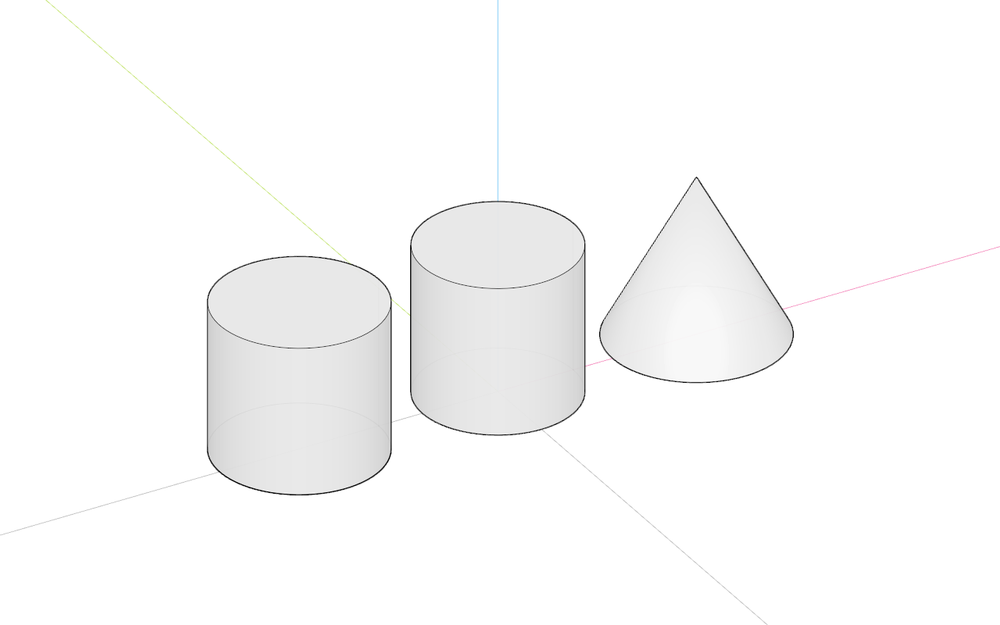
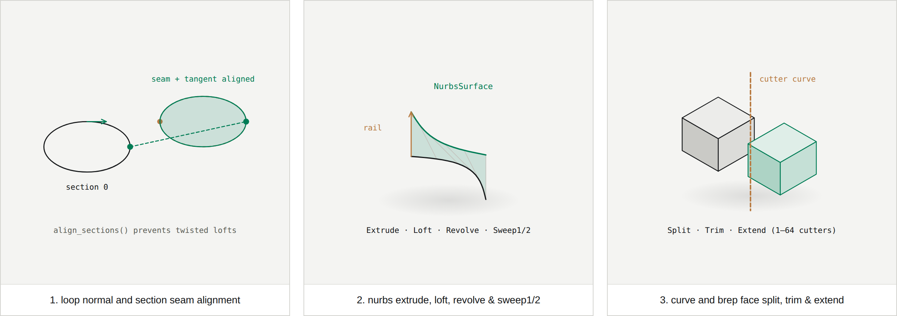

# Tutorial 6.2 · NURBS surfacing and Split, Trim and Extend

## Goal

Align open/closed section curves (`surfacing.rs`), stream live `NurbsSurface` previews (`surface_preview.rs`), construct `Extrude`, `Loft`, `Revolve`, `Sweep1`, `Sweep2`, `Network`, and `4Point` surfaces, and cut curves or BRep faces with `Split`, `Trim`, `Extend`, and `Explode`.



**What we achieve:** Complete freeform NURBS surface construction and boolean-style curve/face cutting (`Split`, `Trim`, `Extend`, `Explode`) backed by `session_rust::Primitives` and `session_rust::split`.

## How it works

`surfacing.rs` validates curve compatibility and aligns closed-loop seams + tangent directions before calling `Primitives::{extrude,loft,revolve,sweep1,sweep2}`, `surface_preview.rs` tessellates transient preview meshes directly into `GpuSink` while dragging extrusion height or revolve angle, and `splitting.rs` / `trim.rs` / `extend.rs` slice curves and BRep faces cleanly.



## Compilable checkpoint slice

Completes the modeling, surfacing, and cutting subsystem (`splitting.rs`, `surface_preview.rs`, and surfacing/cutting verbs) inside `application`.

Lines marked `+` show the exact module declarations unlocked between `decoding` (`179` files) and `application` (`398` files):

```rust
// viewer-core/src/lib.rs (decoding -> application)
+ //! UI- and GPU-independent core of Session Viewer.
+ //!
+ //! Zero dependencies on `wgpu`, `winit`, `egui`, `web-sys`, `wasm-bindgen`, or `glyphon`.
  pub mod camera;
+ pub mod clipping;
+ pub mod cloud_query;
+ pub mod command;
+ pub mod coords;
+ pub mod cplane;
  pub mod decode;
+ pub mod deform;
+ pub mod edit;
  pub mod gizmo;
+ pub mod hierarchy;
  pub mod interactions;
  pub mod knobs;
+ pub mod layers;
+ pub mod live_revision;
+ pub mod manifest;
+ pub mod mesh_preview;
+ pub mod modeling;
+ pub mod op;
+ pub mod range_gate;
  pub mod rows;
+ pub mod scene;
+ pub mod selection;
+ pub mod session_io;
+ pub mod sheet_query;
  pub mod sink;
+ pub mod snap;
+ pub mod splitting;
+ pub mod stream;
+ pub mod surface_preview;
  pub mod validate;
  pub mod walk;
  pub use crate as app;
  pub use sink as core;
  pub use sink::GpuSink;

// src/lib.rs (decoding -> application)
  /// A WGSL file from src/shaders as build.rs wrote it: no comments, indentation or blank lines.
  macro_rules! shader {
      ($name:literal) => {
          include_str!(concat!(env!("OUT_DIR"), "/shaders/", $name))
      };
  }
  mod engine;
  pub use viewer_core as core;
+ pub use viewer_core::op;
  pub use viewer_core::rows;
  pub use viewer_core::camera;
  pub mod command_dock;
  pub mod app;
+ #[cfg(target_arch = "wasm32")]
+ pub mod text_quality;
+ mod state;
+ pub use state::State;
+ #[cfg(target_arch = "wasm32")]
+ pub(crate) use app::runtime::desired_canvas_size;
+ #[cfg(target_arch = "wasm32")]
+ pub use app::runtime::{App, execute_op, run_web};
+ pub use app::runtime::{CloudChunk, Msg, SheetChunk};
+ #[cfg(not(target_arch = "wasm32"))]
+ pub mod selftest;
  #[cfg(all(target_arch = "wasm32", feature = "tutorial"))]
  #[path = "../examples/course/entry.rs"]
  mod course;

// src/engine/gpu/mod.rs (decoding -> application)
  pub mod arena; // register:arena
  pub mod backdrop; // register:backdrop
  pub mod buffers; // register:buffers
  pub mod clip; // register:clip
  pub mod cloud; // register:cloud
  pub mod device; // register:device
  pub mod faces; // register:faces
  pub mod frame; // register:frame
  pub mod glyphs; // register:glyphs
  pub mod hull; // register:hull
  pub mod instance; // register:instance
  pub mod instanced; // register:instanced
  pub mod lod; // register:lod
  pub mod objects;
  pub mod slots; // register:slots
  pub mod lane; // register:lane
  #[cfg(target_arch = "wasm32")]
  mod pacing;
  pub mod pass; // register:pass
  pub(crate) mod patch; // register:patch
  pub mod pick; // register:pick
  pub mod planes; // register:planes
  pub mod present; // register:present
  pub mod render; // register:render
  pub mod segments; // register:segments
  pub mod splat; // register:splat
  mod ssao; // register:ssao
  pub mod surface_outline; // register:surface_outline
  pub mod targets; // register:targets
  pub mod text; // register:text
  pub mod text_outline; // register:text_outline
  pub mod timing; // register:timing
  mod triangle_tiles; // register:triangle_tiles
  pub mod ui; // register:ui
  pub mod upload; // register:upload
  pub mod vectors; // register:vectors
  pub mod view; // register:view
  mod widget; // register:widget
  mod widget_mesh; // register:widget_mesh
  mod context;
  mod sink;
  pub use context::Gpu;
  #[cfg(test)]
  pub(crate) use context::lane_shaders;
  #[allow(unused_imports)]
  pub use cloud::{CloudDraw, LodNode, NO_NORMALS}; // register:clouds
  pub use frame::FrameInput;
  pub use glyphs::GlyphPoint; // register:markers
  pub use instance::Instance;
  #[allow(unused_imports)]
  pub use objects::{ObjectRow, Rebase};
  pub use pick::Pick; // register:shell
  pub use segments::CylinderSegment; // register:strokes
  pub use upload::Upload;
  pub use view::View;
+ #[cfg(all(test, not(target_arch = "wasm32")))] // register:application-tests
+ mod scene_gpu_tests; // register:application-tests

// src/app/mod.rs (decoding -> application)
+ #[cfg(target_arch = "wasm32")] // register:agent
+ pub mod agent; // register:agent
+ pub use viewer_core::clipping; // register:clipping
+ pub mod cloud_query; // register:cloud_query
+ pub use viewer_core::command; // register:command
+ pub use viewer_core::coords; // register:coords
+ pub use viewer_core::cplane; // register:cplane
  #[cfg(any(target_arch = "wasm32", test))] // register:decode
  pub mod decode; // register:decode
+ pub use viewer_core::deform; // register:deform
+ pub use viewer_core::edit; // register:edit
+ pub mod feedback; // register:feedback
+ #[cfg(target_arch = "wasm32")] // register:fetch
+ pub mod fetch; // register:fetch
+ pub mod fonts; // register:fonts
+ pub mod gesture; // register:gesture
  pub use viewer_core::gizmo; // register:gizmo
+ pub use viewer_core::hierarchy; // register:hierarchy
+ pub mod input; // register:input
+ #[cfg(any(target_arch = "wasm32", test))] // register:inspection
+ pub mod inspection; // register:inspection
  pub use viewer_core::interactions; // register:interactions
+ pub mod keys; // register:keys
  pub use viewer_core::knobs; // register:knobs
  #[cfg(target_arch = "wasm32")]
  pub mod launch;
+ pub use viewer_core::layers; // register:layers
+ #[cfg(target_arch = "wasm32")] // register:live
+ pub mod live; // register:live
+ #[cfg(any(target_arch = "wasm32", test))]
+ pub use viewer_core::live_revision;
+ #[cfg(target_arch = "wasm32")] // register:loader
+ pub mod loader; // register:loader
+ pub use viewer_core::manifest; // register:manifest
+ pub use viewer_core::mesh_preview; // register:mesh_preview
+ pub use viewer_core::modeling; // register:modeling
+ pub use viewer_core::op;
  pub mod mode; // register:mode
  pub mod stage;
+ #[cfg(any(target_arch = "wasm32", test))] // register:range_gate
+ pub use viewer_core::range_gate; // register:range_gate
+ #[cfg(target_arch = "wasm32")] // register:route
+ pub mod route; // register:route
+ pub(crate) mod runtime;
+ pub use viewer_core::scene; // register:scene
+ pub use viewer_core::selection; // register:selection
+ pub mod session_io; // register:session_io
+ pub mod sheet_query; // register:sheet_query
+ pub use viewer_core::snap; // register:snap
+ pub use viewer_core::splitting; // register:splitting
+ pub mod stream; // register:stream
+ pub use viewer_core::surface_preview; // register:surface_preview
+ pub mod touch; // register:touch
+ #[cfg(any(target_arch = "wasm32", test))] // register:ui
+ pub mod ui; // register:ui
  pub use viewer_core::validate; // register:validate
  pub use viewer_core::walk; // register:walk
  #[cfg(target_arch = "wasm32")]
  pub mod yielding;

// src/app/stage/mod.rs (decoding -> application)
  mod actions;
  mod check;
  pub mod deck;
  mod draw;
  pub mod eval;
  mod flat;
  pub mod font;
  mod geometry;
  mod layout;
  mod math_mode;
  mod matrix;
+ mod mode;
  mod morph;
  pub mod net;
  mod object;
  pub mod paint;
  pub mod presentation;
  #[cfg(test)]
  mod presentation_tests;
  pub mod run;
+ pub mod spatial;
  #[cfg(test)]
  mod tests;
  pub mod tex;
  mod tween;
  mod view;
+ mod application;
+ pub use application::{Loaded, StageApp};
+ #[cfg(target_arch = "wasm32")]
+ pub use application::{open, route};

// examples/course/registration.rs (decoding -> application)
  // --8<-- [start:course-registration]
  #[path = "canvas.rs"]
  mod canvas;
  #[path = "frame.rs"]
  mod frame;
  #[path = "painting.rs"]
  mod painting;
  #[path = "mathematics.rs"]
  mod mathematics;
  #[path = "dock.rs"]
  mod dock;
  #[path = "camera.rs"]
  mod camera;
  #[path = "rows.rs"]
  mod rows;
  #[path = "geometry.rs"]
  mod geometry;
  #[path = "decoding.rs"]
  mod decoding;
  type Start = fn() -> Result<(), wasm_bindgen::JsValue>;
  pub(super) const STARTS: &[(&str, Start)] = &[
      ("frame", frame::start),
      ("painting", painting::start),
      ("mathematics", mathematics::start),
      ("dock", dock::start),
      ("camera", camera::start),
      ("rows", rows::start),
      ("geometry", geometry::start),
      ("decoding", decoding::start),
+     ("application", crate::run_web),
  ];
  // --8<-- [end:course-registration]
```

## Core code walkthrough

### Newell loop normal & loft seam alignment (`viewer-core/src/command/tool/surfacing.rs:9:75`)

```rust
--8<-- "session_viewer/viewer-core/src/command/tool/surfacing.rs:9:75"
```

Before capping or lofting arbitrary 3D curves, `loop_normal` (lines `9–31`) computes Newell's area-weighted polygon normal (robust even on non-convex or nearly collinear point loops) and `planar` (lines `53–61`) checks planarity within `10⁻⁶ · diagonal`. `align_sections` (lines `64–75`) ensures all loft profiles are consistently open or closed and aligns orientations/seams so `Loft` never twists a cylinder into an hourglass.

### Guarded BRep face & curve `split_rows` (`viewer-core/src/splitting.rs:15:79`)

```rust
--8<-- "session_viewer/viewer-core/src/splitting.rs:15:79"
```

`face_index` and `brep_face` (lines `16–41`) allow splitting curves, single-face surfaces, or a `Ctrl+Shift`-selected face of a multi-face `BRep` (keeping the solid's remaining faces joined). `Scene::split_rows` (lines `59–79`) enforces `1..=64` cutters, rejects locked or `display_only` documents up front, converts lines/polylines to degree-1 `NurbsCurve`s, and records the replacement pieces as one atomic undo step.

## Prerequisites and files

Sub-chapter `6.2` of [Tutorial 6](tutorial-six-modeling.md), building on [Tutorial 6.1](tutorial-six-primitives.md).

**Core files to type inline (6 files):**

1. `viewer-core/src/command/tool/surfacing.rs`
2. `viewer-core/src/surface_preview.rs`
3. `viewer-core/src/command/verbs/extrude.rs`
4. `viewer-core/src/command/verbs/loft.rs`
5. `viewer-core/src/splitting.rs`
6. `viewer-core/src/command/verbs/split.rs`

**Reference catalog & test files (14 files, folded below):** `viewer-core/src/command/tool/cut.rs`, `src/state/splitting.rs`, `viewer-core/src/scene_sync/split_tests.rs`, `viewer-core/src/command/verbs/nurbs_surface_4_points.rs`, `viewer-core/src/command/verbs/nurbs_surface_loft.rs`, `viewer-core/src/command/verbs/nurbs_surface_network.rs`, `viewer-core/src/command/verbs/nurbs_surface_revolve.rs`, `viewer-core/src/command/verbs/nurbs_surface_sweep1.rs`, `viewer-core/src/command/verbs/nurbs_surface_sweep2.rs`, `viewer-core/src/command/verbs/trim.rs`, `viewer-core/src/command/verbs/trim/parts.rs`, `viewer-core/src/command/verbs/extend.rs`, `viewer-core/src/command/verbs/extend/reach.rs`, `viewer-core/src/command/verbs/explode.rs`.

## Build

### Step 1 · `viewer-core/src/command/tool/surfacing.rs`

Checks scale-relative Newell area and planarity, aligns open/closed section directions and seams, and requires `>= 3` sections for closed lofts.

```rust
--8<-- "session_viewer/viewer-core/src/command/tool/surfacing.rs"
```

### Step 2 · `viewer-core/src/surface_preview.rs`

Retains per-vertex `(surface_idx, u, v)` and pipe endpoint indices so CV drags re-evaluate only modified NURBS faces in place.

```rust
--8<-- "session_viewer/viewer-core/src/surface_preview.rs"
```

### Step 3 · `viewer-core/src/command/verbs/extrude.rs`

`viewer-core/src/command/verbs/extrude.rs` (521 lines) registers the `Extrude` command (`Extrude (Cap On Cap Off): curves, Enter, then a distance or x,y,z · Example: select curves, then Extrude 25`). Its `Action::run` handler exposes option chips `Extrude Cap On`, `Extrude Cap Off` after validating arguments so invalid CLI or interactive input leaves undo history untouched.

```rust
--8<-- "session_viewer/viewer-core/src/command/verbs/extrude.rs"
```

### Step 4 · `viewer-core/src/command/verbs/loft.rs`

`viewer-core/src/command/verbs/loft.rs` (111 lines) registers the `Loft` command (`Loft (Open Closed): click curves in section order, Enter lofts · Example: select curves, then Loft Closed`). Its `Action::run` handler exposes option chips `Loft Open`, `Loft Closed` after validating arguments so invalid CLI or interactive input leaves undo history untouched.

```rust
--8<-- "session_viewer/viewer-core/src/command/verbs/loft.rs"
```

### Step 5 · `viewer-core/src/splitting.rs`

`viewer-core/src/splitting.rs` (405 lines) defines `is_cutter()`, `face_index()`, `split_rows()`. It provides `brep_face()`, `curve()`, `top()`; and locked by `cargo xtest` (`split_preserves_tree_placement_and_other_shared_documents_and_undo`, `split_face_keeps_solid_joined_and_invalid_cut_preserves_source`).

```rust
--8<-- "session_viewer/viewer-core/src/splitting.rs"
```

### Step 6 · `viewer-core/src/command/verbs/split.rs`

`viewer-core/src/command/verbs/split.rs` (31 lines) registers the `Split` command (`Select a curve or face · Split · choose cutter curves · Enter confirms · Esc cancels`). It validates arguments before mutating `&mut dyn CommandHost` so invalid CLI or interactive input leaves undo history untouched.

```rust
--8<-- "session_viewer/viewer-core/src/command/verbs/split.rs"
```

## Reference catalog and test files (14 files)

The 6 core files above implement the complete mechanism for this lesson. Expand this reference section whenever you want to inspect or copy the remaining 14 sibling verbs, adapters, and unit-test suites (`Step 7`–`Step 20`).

### Step 7 · `viewer-core/src/command/tool/cut.rs`

Converts lines/polylines to degree-`1` NURBS and transforms cutting planes/rays by `3` points / `2` points so non-uniform target scales stay exact.

```rust
--8<-- "session_viewer/viewer-core/src/command/tool/cut.rs"
```

### Step 8 · `src/state/splitting.rs`

`src/state/splitting.rs` (193 lines) defines `struct Pending`, `split_status()`, `split_command()`, `cancel_split()`. It provides `finish_split()`.

```rust
--8<-- "session_viewer/src/state/splitting.rs"
```

### Step 9 · `viewer-core/src/scene_sync/split_tests.rs`

`viewer-core/src/scene_sync/split_tests.rs` (454 lines) verifies `incremental_matches_fresh_oracle`, `tombs_under_a_small_cap_match_fresh_oracle`, `hints_and_node_cache_are_only_a_cache`, `touch_all_keeps_a_synced_scene`. It provides `edit()`, `incremental_matches_fresh_oracle()`; and locked by `cargo xtest` (`incremental_matches_fresh_oracle`, `tombs_under_a_small_cap_match_fresh_oracle`, `hints_and_node_cache_are_only_a_cache` (+6 more)).

```rust
--8<-- "session_viewer/viewer-core/src/scene_sync/split_tests.rs"
```

### Step 10 · `viewer-core/src/command/verbs/nurbs_surface_4_points.rs`

`viewer-core/src/command/verbs/nurbs_surface_4_points.rs` (95 lines) registers the `Nurbs Surface 4 Points` command (`Nurbs Surface 4 Points: four corners in order · Example: Nurbs Surface 4 Points 0,0,0 10,0,0 10,10,3 0,10,0`). It validates arguments before mutating `&mut dyn CommandHost` so invalid CLI or interactive input leaves undo history untouched.

```rust
--8<-- "session_viewer/viewer-core/src/command/verbs/nurbs_surface_4_points.rs"
```

### Step 11 · `viewer-core/src/command/verbs/nurbs_surface_loft.rs`

`viewer-core/src/command/verbs/nurbs_surface_loft.rs` (49 lines) registers the `Nurbs Surface Loft` command (`Nurbs Surface Loft (Smooth Straight): click curves in section order, Enter lofts`). Its `Action::run` handler exposes option chips `Nurbs Surface Loft Smooth`, `Nurbs Surface Loft Straight` after validating arguments so invalid CLI or interactive input leaves undo history untouched.

```rust
--8<-- "session_viewer/viewer-core/src/command/verbs/nurbs_surface_loft.rs"
```

### Step 12 · `viewer-core/src/command/verbs/nurbs_surface_network.rs`

`viewer-core/src/command/verbs/nurbs_surface_network.rs` (425 lines) registers the `Nurbs Surface Network` command (`Nurbs Surface Network: click curves of both directions in any order, Enter builds the surface through them`). It validates arguments before mutating `&mut dyn CommandHost` so invalid CLI or interactive input leaves undo history untouched.

```rust
--8<-- "session_viewer/viewer-core/src/command/verbs/nurbs_surface_network.rs"
```

### Step 13 · `viewer-core/src/command/verbs/nurbs_surface_revolve.rs`

`viewer-core/src/command/verbs/nurbs_surface_revolve.rs` (116 lines) registers the `Nurbs Surface Revolve` command (`Nurbs Surface Revolve: profile curves, Enter, axis start, axis end, angle · Example: Nurbs Surface Revolve 0,0,0 0,0,1 90`). It validates arguments before mutating `&mut dyn CommandHost` so invalid CLI or interactive input leaves undo history untouched.

```rust
--8<-- "session_viewer/viewer-core/src/command/verbs/nurbs_surface_revolve.rs"
```

### Step 14 · `viewer-core/src/command/verbs/nurbs_surface_sweep1.rs`

`viewer-core/src/command/verbs/nurbs_surface_sweep1.rs` (224 lines) registers the `Nurbs Surface Sweep1` command (`Nurbs Surface Sweep1: the rail, then profile curves, Enter sweeps`). It validates arguments before mutating `&mut dyn CommandHost` so invalid CLI or interactive input leaves undo history untouched.

```rust
--8<-- "session_viewer/viewer-core/src/command/verbs/nurbs_surface_sweep1.rs"
```

### Step 15 · `viewer-core/src/command/verbs/nurbs_surface_sweep2.rs`

`viewer-core/src/command/verbs/nurbs_surface_sweep2.rs` (135 lines) registers the `Nurbs Surface Sweep2` command (`Nurbs Surface Sweep2: first rail, second rail, shape curves, Enter sweeps`). It validates arguments before mutating `&mut dyn CommandHost` so invalid CLI or interactive input leaves undo history untouched.

```rust
--8<-- "session_viewer/viewer-core/src/command/verbs/nurbs_surface_sweep2.rs"
```

### Step 16 · `viewer-core/src/command/verbs/trim.rs`

`viewer-core/src/command/verbs/trim.rs` (721 lines) registers the `Trim` command (`Trim · pick objects, Enter, pick cutters, Enter, click the parts to remove · Esc cancels · Trim 0.2 0.8 keeps that part of a curve`). It validates arguments before mutating `&mut dyn CommandHost` so invalid CLI or interactive input leaves undo history untouched.

```rust
--8<-- "session_viewer/viewer-core/src/command/verbs/trim.rs"
```

### Step 17 · `viewer-core/src/command/verbs/trim/parts.rs`

`viewer-core/src/command/verbs/trim/parts.rs` (1475 lines) defines the `parts` command specification (`Spec`). It validates arguments before mutating `&mut dyn CommandHost` so invalid CLI or interactive input leaves undo history untouched.

```rust
--8<-- "session_viewer/viewer-core/src/command/verbs/trim/parts.rs"
```

### Step 18 · `viewer-core/src/command/verbs/extend.rs`

`viewer-core/src/command/verbs/extend.rs` (781 lines) registers the `Extend` command (`Extend · pick boundaries, Enter, click near curve ends · Extend Distance 5 grows ends by a length · Extend -0.2 1.2 extends a curve's domain`). Its `Action::run` handler exposes option chips `Extend Distance` after validating arguments so invalid CLI or interactive input leaves undo history untouched.

```rust
--8<-- "session_viewer/viewer-core/src/command/verbs/extend.rs"
```

### Step 19 · `viewer-core/src/command/verbs/extend/reach.rs`

`viewer-core/src/command/verbs/extend/reach.rs` (500 lines) defines the `reach` command specification (`Spec`). It validates arguments before mutating `&mut dyn CommandHost` so invalid CLI or interactive input leaves undo history untouched.

```rust
--8<-- "session_viewer/viewer-core/src/command/verbs/extend/reach.rs"
```

### Step 20 · `viewer-core/src/command/verbs/explode.rs`

`viewer-core/src/command/verbs/explode.rs` (540 lines) registers the `Explode` command (`Explode · a polyline into lines, a BRep into faces, a mesh into faces, a point cloud into points`). It validates arguments before mutating `&mut dyn CommandHost` so invalid CLI or interactive input leaves undo history untouched.

```rust
--8<-- "session_viewer/viewer-core/src/command/verbs/explode.rs"
```

## Integration

`State.splitting` (`src/state/splitting.rs`) and `Tool::Gather` (`gather.rs`) route multi-object curve/cutter picks through `Picker` into `Scene::split_rows`, `trim`, and `extend`, preserving layer assignments and recording single undo transactions.

## Run and observe

Run the NURBS surfacing (`Extrude`, `Loft`, `Revolve`, `Sweep1/2`) and `Split`/`Trim`/`Extend` test suites, then build a surfaced scene from the CLI:

```sh
cargo xtest -p viewer-core scene_sync::split_tests
cargo xtest -p viewer-core command::verbs::trim
cargo xtest -p viewer-core command::verbs::extend
cargo run --target x86_64-unknown-linux-gnu --bin session-viewer-cli -- exec \
  --cmd "NurbsCurveCircle 0,0,0 60" --cmd "Select All" --cmd "Extrude 90" \
  --cmd "View Isometric" --cmd "Fit" --render target/surfacing.png
```

## Predict and try

Predict what happens when you `Loft` two closed circles whose parametric directions run opposite ways (one clockwise, one counter-clockwise) without `align_sections`: every ruling crosses through the center axis, pinching the surface to a singular point at mid-height! `align_sections` reverses opposing curves and shifts closed seam parameters so rulings run straight.

## Question and answer

**Why does `Split` on a multi-face `BRep` require `Ctrl+Shift`-selecting a specific face first (`brep_face`), keeping the rest of the solid joined?**

??? tip "Think first — click to reveal how to work it out and the answer"
    **How to work it out:** Contrast splitting a single curve with a point/curve against projecting or intersecting a planar/3D curve across a closed 6-face box.

    **The answer:** An unoriented cutter curve in 3D is ambiguous across front and back faces of a closed solid unless a cutting surface or target face is named. Selecting the target BRep face via `Ctrl+Shift+Click` (`SelectionMode::Face`) tells `session_rust::split` exactly which parametric surface patch to divide while keeping topological adjacency across the solid's untouched faces.

## Validation

Verified via `scene_sync::split_tests`, `command::verbs::{extrude,loft,trim,extend,split,explode}`, and `surface_preview` tests.
