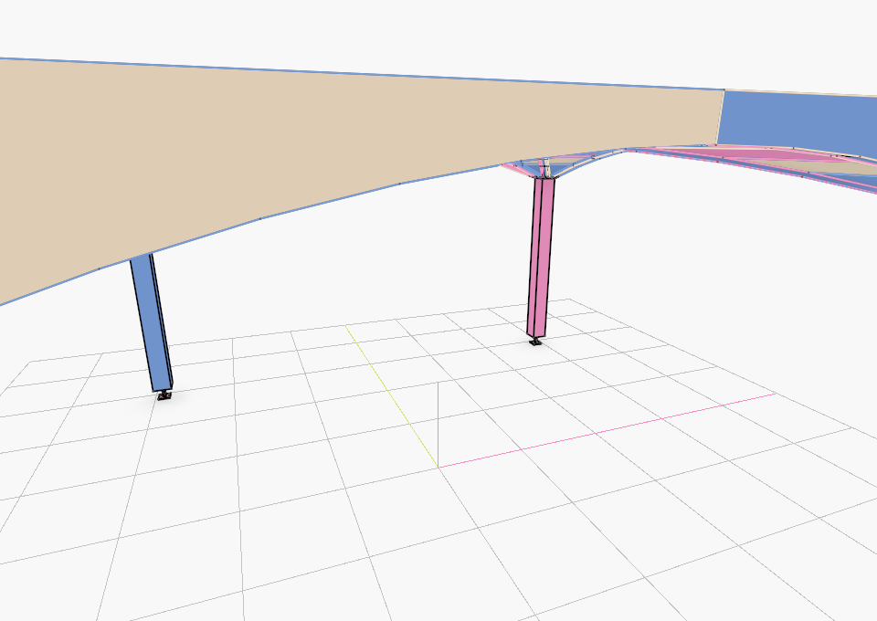

# Tutorial 16 · Performance tiers, GPU timing, diagnostics and headless self-tests

## Goal

Record rolling 600-frame `[p50, p95, p99]` CPU/GPU frame statistics, step `NavigationQuality` tiers (`0..=3`) only on sustained slow drags, time ink sub-passes via `PassTimer`, expose `?inspect=perf` + LoAF diagnostics, and verify pixel continuity in `selftest`.

 

**What we achieve:** Quantitative GPU `PassTimer` profiling, adaptive frame-budget tiering (`Tier 0..3`), zero idle redraws on bare pointer hover, and automated headless pixel/edge-continuity regression oracles.

## How it works

Hardware timestamp queries measure per-pass GPU milliseconds while `performance.rs` sheds secondary passes (GTAO, MSAA sample count, splat budget) only during heavy orbit spikes and restores full `Tier 0` quality on camera rest; `selftest.rs` locks stroke culling (`-66%` offscreen segment work) and BRep edge ID continuity in `cargo xtest`.

![Rolling `FrameStats [p50, p95, p99]`, `NavigationQuality` hysteresis tiers, `PassTimer` GPU timestamps, and `selftest::oracle` edge-continuity harness (1600x900 Session Viewer stage plate)](../../examples/stage/tutorials-systems/16-performance.png)

Interactive stage source: [`16-performance.yaml`](../../examples/stage/tutorials-systems/16-performance.yaml).

## Prerequisites and files

Requires [Tutorial 15](tutorial-fifteen-formats.md). Owns `src/engine/performance.rs`, `src/engine/gpu/timing.rs`, `src/app/inspection.rs`, `src/app/inspection/source_memory.rs`, `src/app/feedback.rs`, `assets/diagnostics.js`, and `src/selftest*`.

Owned files in build order (`11` files):

1. `src/engine/performance.rs`
2. `src/engine/gpu/timing.rs`
3. `src/app/inspection.rs`
4. `src/app/inspection/source_memory.rs`
5. `src/app/feedback.rs`
6. `assets/diagnostics.js`
7. `src/selftest.rs`
8. `src/selftest/oracle.rs`
9. `src/selftest/lifecycle.rs`
10. `src/selftest/profile.rs`
11. `src/selftest/stroke_witness.rs`

## Build

### Step 1 · `src/engine/performance.rs`

Separates wheel/drag interaction bursts from resting frames using median frame times and hysteresis before adjusting quality tiers.

```rust
--8<-- "session_viewer/src/engine/performance.rs"
```

### Step 2 · `src/engine/gpu/timing.rs`

`src/engine/gpu/timing.rs` (127 lines) defines `struct PassTimer`, `mark()`, `resolve()`, `collect()`. It maintains explicit buffer capacities, bind-group layouts, and frame-submission ordering for WebGPU.

```rust
--8<-- "session_viewer/src/engine/gpu/timing.rs"
```

### Step 3 · `src/app/inspection.rs`

Serializes live camera matrices, row counts, selection, lane capacities and timing counters onto `#viewer[data-viewer-inspection]` when `?inspect=1`.

```rust
--8<-- "session_viewer/src/app/inspection.rs"
```

### Step 4 · `src/app/inspection/source_memory.rs`

Sums unique `Rc<Session>` geometry vectors, strings, maps and history capacities via weak pointers to report scoped `known_bytes`.

```rust
--8<-- "session_viewer/src/app/inspection/source_memory.rs"
```

### Step 5 · `src/app/feedback.rs`

Routes status text, non-clobbering download progress, canonical command history and fatal error reveals between `State`, DOM and native logs.

```rust
--8<-- "session_viewer/src/app/feedback.rs"
```

### Step 6 · `assets/diagnostics.js`

Records bounded startup, adapter, viewport, phase-timing and first-fatal-error JSON reports in `localStorage` + download, marking `ready` at first on-screen geometry.

```javascript
--8<-- "session_viewer/assets/diagnostics.js"
```

### Step 7 · `src/selftest.rs`

Boots a headless `Gpu`, settles bounded display refinement, and exports offscreen `PPM` (`RGB`) renders controlled by `VIEWER_*` env vars.

```rust
--8<-- "session_viewer/src/selftest.rs"
```

### Step 8 · `src/selftest/oracle.rs`

Casts independent CPU rays from stroke samples against placed triangles (with coplanar clearance) to verify GPU hidden-line occlusion.

```rust
--8<-- "session_viewer/src/selftest/oracle.rs"
```

### Step 9 · `src/selftest/lifecycle.rs`

`src/selftest/lifecycle.rs` (346 lines): Check that resize, a second walk, edits undone and reload draw the same pixels and ids. It exposes `run()`.

```rust
--8<-- "session_viewer/src/selftest/lifecycle.rs"
```

### Step 10 · `src/selftest/profile.rs`

Times CPU `walk` stages by geometry kind (separating BRep meshing, edge chains and shell orientation) ahead of GPU submission.

```rust
--8<-- "session_viewer/src/selftest/profile.rs"
```

### Step 11 · `src/selftest/stroke_witness.rs`

Captures deterministic sheet/stroke pixels, pick IDs, expanded WGSL and adapter metadata on a verified software renderer.

```rust
--8<-- "session_viewer/src/selftest/stroke_witness.rs"
```

## Integration

`State::render` records `CpuSplit` (`setup_ms`, `ui_ms`, `render_ms`, `encode_ms`), `RedrawCauses`, and lock-free `AtomicU64` `on_submitted_work_done` latency, publishing lightweight telemetry to `window.viewerFrames` and `?inspect=perf` without paying `source_memory` walk overhead during benchmarks.

## Run and observe

Run `cargo xtest -p session_viewer engine::performance::`, `app::inspection::source_memory::tests`, and `selftest::oracle::`: percentile rings and hysteresis tiers pass, `source_memory` avoids double-counting shared `Rc` documents, and `selftest::oracle` verifies `100.0000%` visible edge ink continuity across phone (`824x1830`) and desktop (`1200x800`) viewports.

## Predict and try

Predict why measuring `performance.now()` around `queue.submit(...)` alone misreports GPU frame cost (`geometry_submission_is_not_gpu_completion`): `queue.submit` returns as soon as command buffers are marshalled on the CPU! Pairing `PassTimer` hardware timestamp queries (native) with `queue.on_submitted_work_done` (`AtomicU64` latency) reveals the true `ink.strokes` bottleneck (`99.4%` of GPU time before M2's `atomicMax` tile fix).

## Question and answer

**Why does `NavigationQuality` require a consecutive run of slow top-tier drag frames before stepping down quality, and refuse to step back up mid-drag just because the cheaper tier rendered fast?**

**How to work it out:** Trace the feedback loop if Tier 1 (`10 ms`) immediately promoted back to Tier 0 (`28 ms`) on the very next frame of an orbit drag.

**The answer:** Promoting immediately when a lower tier renders under `16.7 ms` causes `Tier 0 <-> Tier 1` oscillation every second frame (visible flashing and `28 ms` frame spikes). Holding the demoted tier until interaction ends—then settling one crisp Tier 0 resting frame (`rough_settle`)—keeps orbit smooth and eliminates oscillation (`cheaper_frames_do_not_immediately_retry_expensive_navigation`).

## Validation

Verified via `engine::performance` (`8/8` tests), `source_memory::tests` (`3/3`), `selftest::refinement_tests` (`2/2`), `selftest::oracle` (`5/5` headless GPU pixel-continuity suites), and `python3 tests/native-benchmark.py` (`view_local.yaml` rest ink `17.398 -> 7.056 ms`, orbit p95 `29.20 -> 10.50 ms`).
