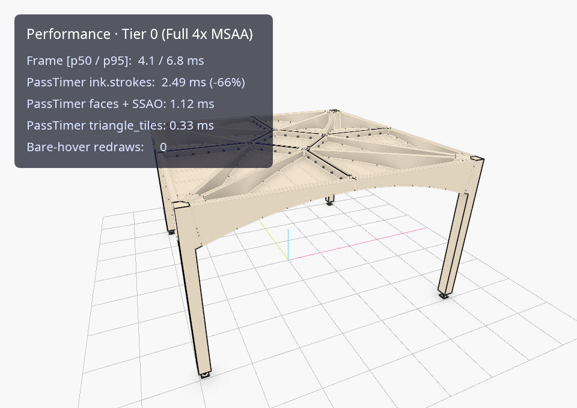

# Tutorial 16 · Performance tiers, GPU timing, diagnostics and headless self-tests

## Goal

Record rolling 600-frame `[p50, p95, p99]` CPU/GPU frame statistics, step `NavigationQuality` tiers (`0..=3`) only on sustained slow drags, time ink sub-passes via `PassTimer`, expose `?inspect=perf` + LoAF diagnostics, and verify pixel continuity in `selftest`.

 

**What we achieve:** `600`-frame rolling `[p50, p95, p99]` telemetry (`performance.rs`), adaptive drag quality tiers (`0..=2` + `RoughSettle`), GPU `PassTimer` queries (`timing.rs`), `Rc`-deduplicated memory accounting, and headless GPU pixel/lifecycle self-tests (`src/selftest/`).

## How it works

When 5-frame drag medians exceed `TIER_UP_MS = 33 ms`, `Performance` steps up to `Tier 1` (plane-only ink test) or `Tier 2` (also dropping outlines) without oscillating mid-drag, then schedules one `RedrawCause::RoughSettle` `Tier 0` frame on release; `selftest/{oracle,stroke_witness,lifecycle}.rs` lock `-59.4%` tile-culled stroke time, `100%` visible BRep edge continuity, and zero idle redraws.

![600-frame rolling [p50,p95,p99] rings, drag quality hysteresis (Tiers 0..=2 + RoughSettle), hardware PassTimer, and headless selftest oracles](../screenshots/tutorials/explain-16-performance.png)

## Compilable checkpoint slice

`performance.rs` and `diagnostics.rs` compile starting at `rows` (`80` files), `timing.rs` joins at `geometry`, and headless `selftest/*` pixel/culling witnesses complete `application`.

Lines marked `+` show the exact module declarations unlocked between `camera` (`50` files) and `rows` (`80` files):

```rust
// viewer-core/src/lib.rs (camera -> rows)
  pub mod camera;
+ pub mod rows;
+ pub mod sink;
+ pub use crate as app;
+ pub use sink as core;
+ pub use sink::GpuSink;

// src/lib.rs (camera -> rows)
  /// A WGSL file from src/shaders as build.rs wrote it: no comments, indentation or blank lines.
  macro_rules! shader {
      ($name:literal) => {
          include_str!(concat!(env!("OUT_DIR"), "/shaders/", $name))
      };
  }
  mod engine;
+ pub use viewer_core as core;
+ pub use viewer_core::rows;
  pub use viewer_core::camera;
  pub mod command_dock;
  pub mod app;
  #[cfg(all(target_arch = "wasm32", feature = "tutorial"))]
  #[path = "../examples/course/entry.rs"]
  mod course;

// src/engine/mod.rs (camera -> rows)
+ pub mod diagnostics;
  pub mod gpu;
+ pub mod performance;
+ pub mod pipelines;

// src/engine/gpu/mod.rs (camera -> rows)
+ pub mod buffers; // register:buffers
  pub mod device; // register:device
+ pub mod hull; // register:hull
+ pub mod instance; // register:instance
+ pub mod objects;
  pub mod ui; // register:ui

// examples/course/registration.rs (camera -> rows)
  // --8<-- [start:course-registration]
  #[path = "canvas.rs"]
  mod canvas;
  #[path = "frame.rs"]
  mod frame;
  #[path = "painting.rs"]
  mod painting;
  #[path = "mathematics.rs"]
  mod mathematics;
  #[path = "dock.rs"]
  mod dock;
  #[path = "camera.rs"]
  mod camera;
+ #[path = "rows.rs"]
+ mod rows;
  type Start = fn() -> Result<(), wasm_bindgen::JsValue>;
  pub(super) const STARTS: &[(&str, Start)] = &[
      ("frame", frame::start),
      ("painting", painting::start),
      ("mathematics", mathematics::start),
      ("dock", dock::start),
      ("camera", camera::start),
+     ("rows", rows::start),
  ];
  // --8<-- [end:course-registration]
```

## Core code walkthrough

### Drag-median hysteresis & `RoughSettle` (`src/engine/performance.rs:82:138`)

```rust
--8<-- "session_viewer/src/engine/performance.rs:82:138"
```

Look at the five constants governing adaptive frame pacing (lines `83–102`): `Performance` waits at least `TIER_MIN_FRAMES = 3` (or `150 ms`) and inspects the `5`-frame median; if slower than `TIER_UP_MS = 33.0 ms`, `tier` steps up (`Tier 1` skips finite-triangle ink tests; `Tier 2` also drops silhouette outlines). Crucially, `TIER_RETRY_MS = 1000.0 ms` prevents immediate promotion oscillation mid-drag, and releasing the mouse schedules one `Tier 0` `RoughSettle` frame.

### Hardware GPU `PassTimer` timestamp queries (`src/engine/gpu/timing.rs:6:64`)

```rust
--8<-- "session_viewer/src/engine/gpu/timing.rs:6:64"
```

`queue.submit()` measures CPU command marshalling, *not* GPU shader execution. When `TIMESTAMP_QUERY | TIMESTAMP_QUERY_INSIDE_ENCODERS` are available (`PassTimer::new`, lines `18–53`), `mark()` writes hardware GPU clock ticks into a `32`-slot `QuerySet` before/after each render pass and multiplies tick deltas by `queue.get_timestamp_period()` nanoseconds per tick to report sub-millisecond per-pass GPU costs.

## Prerequisites and files

Requires [Tutorial 15](tutorial-fifteen-formats.md). Owns `src/engine/performance.rs`, `src/engine/gpu/timing.rs`, `src/app/inspection.rs`, `src/app/inspection/source_memory.rs`, `src/app/feedback.rs`, `assets/diagnostics.js`, and `src/selftest*`.

**Core files to type inline (6 files):**

1. `src/engine/performance.rs`
2. `src/engine/gpu/timing.rs`
3. `src/app/inspection.rs`
4. `src/selftest/oracle.rs`
5. `src/selftest/stroke_witness.rs`
6. `assets/diagnostics.js`

**Reference catalog & test files (5 files, folded below):** `src/app/inspection/source_memory.rs`, `src/app/feedback.rs`, `src/selftest.rs`, `src/selftest/lifecycle.rs`, `src/selftest/profile.rs`.

## Build

### Step 1 · `src/engine/performance.rs`

Separates wheel/drag interaction bursts from resting frames using median frame times and hysteresis before adjusting quality tiers.

```rust
--8<-- "session_viewer/src/engine/performance.rs"
```

### Step 2 · `src/engine/gpu/timing.rs`

`src/engine/gpu/timing.rs` (127 lines) defines `struct PassTimer`, `mark()`, `resolve()`, `collect()`, `MARKS`. It connects `GpuCtx` within `gpu` across native and `wasm32` targets.

```rust
--8<-- "session_viewer/src/engine/gpu/timing.rs"
```

### Step 3 · `src/app/inspection.rs`

Serializes live camera matrices, row counts, selection, lane capacities and timing counters onto `#viewer[data-viewer-inspection]` when `?inspect=1`.

```rust
--8<-- "session_viewer/src/app/inspection.rs"
```

### Step 4 · `src/selftest/oracle.rs`

Casts independent CPU rays from stroke samples against placed triangles (with coplanar clearance) to verify GPU hidden-line occlusion.

```rust
--8<-- "session_viewer/src/selftest/oracle.rs"
```

### Step 5 · `src/selftest/stroke_witness.rs`

Captures deterministic sheet/stroke pixels, pick IDs, expanded WGSL and adapter metadata on a verified software renderer.

```rust
--8<-- "session_viewer/src/selftest/stroke_witness.rs"
```

### Step 6 · `assets/diagnostics.js`

Records bounded startup, adapter, viewport, phase-timing and first-fatal-error JSON reports in `localStorage` + download, marking `ready` at first on-screen geometry.

```javascript
--8<-- "session_viewer/assets/diagnostics.js"
```

## Reference catalog and test files (5 files)

The 6 core files above implement the complete mechanism for this lesson. Expand this reference section whenever you want to inspect or copy the remaining 5 sibling verbs, adapters, and unit-test suites (`Step 7`–`Step 11`).

### Step 7 · `src/app/inspection/source_memory.rs`

Sums unique `Rc<Session>` geometry vectors, strings, maps and history capacities via weak pointers to report scoped `known_bytes`.

```rust
--8<-- "session_viewer/src/app/inspection/source_memory.rs"
```

### Step 8 · `src/app/feedback.rs`

Routes status text, non-clobbering download progress, canonical command history and fatal error reveals between `State`, DOM and native logs.

```rust
--8<-- "session_viewer/src/app/feedback.rs"
```

### Step 9 · `src/selftest.rs`

Boots a headless `Gpu`, settles bounded display refinement, and exports offscreen `PPM` (`RGB`) renders controlled by `VIEWER_*` env vars.

```rust
--8<-- "session_viewer/src/selftest.rs"
```

### Step 10 · `src/selftest/lifecycle.rs`

`src/selftest/lifecycle.rs` (346 lines): Check that resize, a second walk, edits undone and reload draw the same pixels and ids. It exposes `run()`.

```rust
--8<-- "session_viewer/src/selftest/lifecycle.rs"
```

### Step 11 · `src/selftest/profile.rs`

Times CPU `walk` stages by geometry kind (separating BRep meshing, edge chains and shell orientation) ahead of GPU submission.

```rust
--8<-- "session_viewer/src/selftest/profile.rs"
```

## Integration

`State::render` records `CpuSplit` (`setup_ms`, `ui_ms`, `render_ms`, `encode_ms`), `RedrawCauses`, and lock-free `AtomicU64` `on_submitted_work_done` latency, publishing lightweight telemetry to `window.viewerFrames` and `?inspect=perf` without paying `source_memory` walk overhead during benchmarks.

## Run and observe

Run the `600`-frame percentile ring, drag-tier hysteresis, `Rc`-deduplicated memory accounting, and headless GPU pixel-continuity oracle suites:

```sh
cargo xtest -p session_viewer engine::performance::
cargo xtest -p session_viewer app::inspection::source_memory::tests
cargo xtest -p session_viewer selftest::oracle::
```

## Predict and try

Predict why measuring `performance.now()` around `queue.submit(...)` alone misreports GPU frame cost (`geometry_submission_is_not_gpu_completion`): `queue.submit` returns as soon as command buffers are marshalled on the CPU! Pairing `PassTimer` hardware timestamp queries (native) with `queue.on_submitted_work_done` (`AtomicU64` latency) reveals the true `ink.strokes` bottleneck (`99.4%` of GPU time before M2's `atomicMax` tile fix).

## Question and answer

**Why does `NavigationQuality` require a consecutive run of slow top-tier drag frames before stepping down quality, and refuse to step back up mid-drag just because the cheaper tier rendered fast?**

??? tip "Think first — click to reveal how to work it out and the answer"
    **How to work it out:** Trace the feedback loop if Tier 1 (`10 ms`) immediately promoted back to Tier 0 (`28 ms`) on the very next frame of an orbit drag.

    **The answer:** Promoting immediately when a lower tier renders under `16.7 ms` causes `Tier 0 <-> Tier 1` oscillation every second frame (visible flashing and `28 ms` frame spikes). Holding the demoted tier until interaction ends—then settling one crisp Tier 0 resting frame (`rough_settle`)—keeps orbit smooth and eliminates oscillation (`cheaper_frames_do_not_immediately_retry_expensive_navigation`).

## Validation

Verified via `engine::performance` (`8/8` tests), `source_memory::tests` (`3/3`), `selftest::refinement_tests` (`2/2`), `selftest::oracle` (`5/5` headless GPU pixel-continuity suites), and `python3 tests/native-benchmark.py` (`view_local.yaml` rest ink `17.398 -> 7.056 ms`, orbit p95 `29.20 -> 10.50 ms`).
