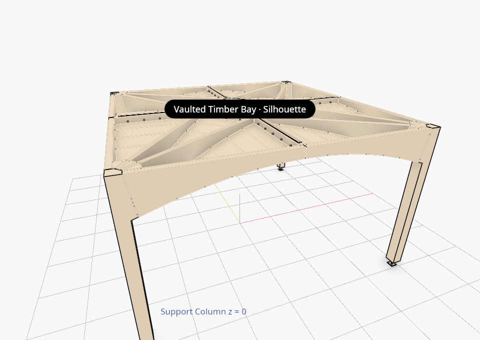

# Tutorial 10 · Display modes: outlines, Arctic SSAO, attributes and scene text

## Goal

Switch seamlessly between shaded CAD edges, dilated coverage-mask silhouettes (`Outline`), horizon-integrated GTAO clay shading (`Arctic`), toggleable element `Attributes`, and shaped `glyphon` world-plane, screen-plate, and outlined text.

 

**What we achieve:** Dual global + selection coverage silhouettes (`surface_outline.wgsl`), half-resolution temporal horizon SSAO (`ssao.wgsl`, `Arctic` mode), and three crisp GPU scene-text lanes (`text_plane`, `text_plate`, `text_outline`).

## How it works

`face_coverage.wgsl` measures per-pixel MSAA solid coverage from `physical` triangle IDs, `surface_outline.wgsl` max-pools and `3×3`-dilates coarse blocks to skip empty/interior tiles before walking `512` distance-sorted radial `Taps` with early exit, `ssao.wgsl` integrates horizon occlusion scaled by `objects[id].ao_radius`, and `fonts.rs` cascades bundled Noto subsets with on-demand full fonts.

![Coarse-dilated Taps[512] coverage outlines, half-res temporal horizon SSAO, and 3-lane GPU scene text (text_plane, text_plate, text_outline)](../screenshots/tutorials/explain-10-display.png)

## Compilable checkpoint slice

Silhouette outlines (`surface_outline`), horizon SSAO (`ssao`), and `glyphon` scene text (`engine/text.rs`, `gpu/text.rs`) compile starting at `geometry` (`174` files).

Lines marked `+` show the exact module declarations unlocked between `rows` (`80` files) and `geometry` (`174` files):

```rust
// viewer-core/src/lib.rs (rows -> geometry)
  pub mod camera;
+ pub mod gizmo;
+ pub mod interactions;
+ pub mod knobs;
  pub mod rows;
  pub mod sink;
+ pub mod walk;
  pub use crate as app;
  pub use sink as core;
  pub use sink::GpuSink;

// src/engine/mod.rs (rows -> geometry)
  pub mod diagnostics;
  pub mod gpu;
  pub mod performance;
  pub mod pipelines;
+ pub mod text; // register:text

// src/engine/gpu/mod.rs (rows -> geometry)
+ pub mod arena; // register:arena
+ pub mod backdrop; // register:backdrop
  pub mod buffers; // register:buffers
+ pub mod clip; // register:clip
+ pub mod cloud; // register:cloud
  pub mod device; // register:device
+ pub mod faces; // register:faces
+ pub mod frame; // register:frame
+ pub mod glyphs; // register:glyphs
  pub mod hull; // register:hull
  pub mod instance; // register:instance
+ pub mod instanced; // register:instanced
+ pub mod lod; // register:lod
  pub mod objects;
+ pub mod slots; // register:slots
+ pub mod lane; // register:lane
+ #[cfg(target_arch = "wasm32")]
+ mod pacing;
+ pub mod pass; // register:pass
+ pub(crate) mod patch; // register:patch
+ pub mod pick; // register:pick
+ pub mod planes; // register:planes
+ pub mod present; // register:present
+ pub mod render; // register:render
+ pub mod segments; // register:segments
+ pub mod splat; // register:splat
+ mod ssao; // register:ssao
+ pub mod surface_outline; // register:surface_outline
+ pub mod targets; // register:targets
+ pub mod text; // register:text
+ pub mod text_outline; // register:text_outline
+ pub mod timing; // register:timing
+ mod triangle_tiles; // register:triangle_tiles
  pub mod ui; // register:ui
+ pub mod upload; // register:upload
+ pub mod vectors; // register:vectors
+ pub mod view; // register:view
+ mod widget; // register:widget
+ mod widget_mesh; // register:widget_mesh
+ mod context;
+ mod sink;
+ pub use context::Gpu;
+ #[cfg(test)]
+ pub(crate) use context::lane_shaders;
+ #[allow(unused_imports)]
+ pub use cloud::{CloudDraw, LodNode, NO_NORMALS}; // register:clouds
+ pub use frame::FrameInput;
+ pub use glyphs::GlyphPoint; // register:markers
+ pub use instance::Instance;
+ #[allow(unused_imports)]
+ pub use objects::{ObjectRow, Rebase};
+ pub use pick::Pick; // register:shell
+ pub use segments::CylinderSegment; // register:strokes
+ pub use upload::Upload;
+ pub use view::View;

// src/app/mod.rs (rows -> geometry)
+ pub use viewer_core::gizmo; // register:gizmo
+ pub use viewer_core::interactions; // register:interactions
+ pub use viewer_core::knobs; // register:knobs
  #[cfg(target_arch = "wasm32")]
  pub mod launch;
  pub mod mode; // register:mode
  pub mod stage;
+ pub use viewer_core::walk; // register:walk

// examples/course/registration.rs (rows -> geometry)
  // --8<-- [start:course-registration]
  #[path = "canvas.rs"]
  mod canvas;
  #[path = "frame.rs"]
  mod frame;
  #[path = "painting.rs"]
  mod painting;
  #[path = "mathematics.rs"]
  mod mathematics;
  #[path = "dock.rs"]
  mod dock;
  #[path = "camera.rs"]
  mod camera;
  #[path = "rows.rs"]
  mod rows;
+ #[path = "geometry.rs"]
+ mod geometry;
  type Start = fn() -> Result<(), wasm_bindgen::JsValue>;
  pub(super) const STARTS: &[(&str, Start)] = &[
      ("frame", frame::start),
      ("painting", painting::start),
      ("mathematics", mathematics::start),
      ("dock", dock::start),
      ("camera", camera::start),
      ("rows", rows::start),
+     ("geometry", geometry::start),
  ];
  // --8<-- [end:course-registration]
```

## Core code walkthrough

### Coarse-dilated `Taps[512]` early-exit outline (`src/shaders/surface_outline.wgsl:28:70`)

```wgsl
--8<-- "session_viewer/src/shaders/surface_outline.wgsl:28:70"
```

Evaluating `512` radial taps at every pixel of a `4K` viewport would burn `4 billion` texture fetches per frame. Lines `36–41` short-circuit in **two** ways: pixels completely inside a solid (`center >= 0.999`) *and* pixels whose `3×3`-dilated `coarse` tile is empty (`!near_any_coverage`) return `0.0` immediately! For the thin band of true silhouette pixels, `taps.at` is sorted nearest-first with monotonically decreasing weights `tap.z`, so lines `50–52` `break` as soon as `min(first, second) >= tap.z`.

### Reverse-Z world reconstruction for horizon SSAO (`src/shaders/ssao.wgsl:38:64`)

```wgsl
--8<-- "session_viewer/src/shaders/ssao.wgsl:38:64"
```

`world(pixel, z)` (lines `38–42`) unprojects half-resolution depth samples through `ambient.inverse_mvp`, flipping WebGPU's top-down `uv.y` (`1.0 − uv.y * 2.0`). When `z == 0.0` (reverse-Z infinity on the ground plane), `surface_at_depth` (lines `55–61`) intersects the analytically interpolated camera ray (`ray_origin + ray_direction * t`) against the ground height `ambient.params.x` so Arctic contact shadows land cleanly on the ground beneath floating solids.

## Prerequisites and files

Requires [Tutorial 9](tutorial-nine-layers.md). Owns `surface_outline*`, `ssao*`, `ambient_warm`, 6 outline/ambient shaders, `fonts`, `engine/text*`, `gpu/text*`, 3 text shaders, `scene_text`, `state/text`, `text_quality`, `assets/text-quality.html`, and 4 verbs.

**Core files to type inline (6 files):**

1. `src/shaders/face_coverage.wgsl`
2. `src/shaders/surface_outline.wgsl`
3. `src/engine/gpu/surface_outline.rs`
4. `src/shaders/ssao.wgsl`
5. `src/engine/text.rs`
6. `src/shaders/text_plane.wgsl`

**Reference catalog & test files (24 files, folded below):** `src/engine/gpu/surface_outline/tests.rs`, `src/engine/gpu/ssao.rs`, `src/engine/gpu/ssao/pipelines.rs`, `src/engine/gpu/ssao/tests.rs`, `src/engine/gpu/ambient_warm.rs`, `src/shaders/ambient_depth.wgsl`, `src/shaders/ambient_geometry.wgsl`, `src/shaders/ambient_composite.wgsl`, `viewer-core/src/command/verbs/arctic.rs`, `viewer-core/src/command/verbs/outline.rs`, `viewer-core/src/command/verbs/attributes.rs`, `src/app/fonts.rs`, `src/engine/text/application_tests.rs`, `src/engine/gpu/text.rs`, `src/engine/gpu/text_plane.rs`, `src/engine/gpu/text_plate.rs`, `src/engine/gpu/text_outline.rs`, `src/shaders/text_plate.wgsl`, `src/shaders/text_outline.wgsl`, `viewer-core/src/scene_text.rs`, `src/state/text.rs`, `viewer-core/src/command/verbs/text.rs`, `src/text_quality.rs`, `assets/text-quality.html`.

## Build

### Step 1 · `src/shaders/face_coverage.wgsl`

`src/shaders/face_coverage.wgsl` inspects the `2×u16` `physical` attachment across all `SAMPLES` to emit fractional solid coverage (`fs_fraction`).

```wgsl
--8<-- "session_viewer/src/shaders/face_coverage.wgsl"
```

### Step 2 · `src/shaders/surface_outline.wgsl`

`src/shaders/surface_outline.wgsl` composites crisp silhouettes and selection outlines from a bounded `512`-tap offset ring (`Taps`), exiting immediately via `near_any_coverage` on interior (`center >= 0.999`) or empty blocks.

```wgsl
--8<-- "session_viewer/src/shaders/surface_outline.wgsl"
```

### Step 3 · `src/engine/gpu/surface_outline.rs`

`src/engine/gpu/surface_outline.rs` builds resolved, coarse and dilated coverage masks so empty screen tiles skip border work while separating selection halos from surface silhouettes.

```rust
--8<-- "session_viewer/src/engine/gpu/surface_outline.rs"
```

### Step 4 · `src/shaders/ssao.wgsl`

`src/shaders/ssao.wgsl` integrates cosine-weighted GTAO horizon arcs `arc(h, n)` across `6` quadratic screen-space steps per side with mip-level selection, spatial-temporal noise phase, bilateral `X`/`Y` denoising and depth-clamped temporal history.

```wgsl
--8<-- "session_viewer/src/shaders/ssao.wgsl"
```

### Step 5 · `src/engine/text.rs`

`src/engine/text.rs` defines `5` `TextPlacement` modes (screen, depth-tested anchored, overlay nameplate, world-plane and billboard) and validates `TextDocument::set_labels` atomically so moving or recolouring labels reuses shaped `glyphon` buffers while font upgrades advance `font_revision`.

```rust
--8<-- "session_viewer/src/engine/text.rs"
```

### Step 6 · `src/shaders/text_plane.wgsl`

`src/shaders/text_plane.wgsl`: What the vertex shader hands the fragment shader. Defines entry points `@vertex fn vs_main`, `@vertex fn vs_id`, `@fragment fn fs_main`, `@fragment fn fs_id`; bindings `@group(0) @binding(0) coverage_texture`, `@group(0) @binding(1) coverage_sampler`, `@group(1) @binding(0) pick`; keep struct layouts and binding indices aligned with their Rust `bytemuck` mirrors and Naga validation tests.

```wgsl
--8<-- "session_viewer/src/shaders/text_plane.wgsl"
```

## Reference catalog and test files (24 files)

The 6 core files above implement the complete mechanism for this lesson. Expand this reference section whenever you want to inspect or copy the remaining 24 sibling verbs, adapters, and unit-test suites (`Step 7`–`Step 30`).

### Step 7 · `src/engine/gpu/surface_outline/tests.rs`

Verifies that yellow selected CAD edges never paint over black curved silhouette borders across views, MSAA counts and DPRs.

```rust
--8<-- "session_viewer/src/engine/gpu/surface_outline/tests.rs"
```

### Step 8 · `src/engine/gpu/ssao.rs`

Owns half-res depth, radius, normal, occlusion and temporal-history textures keyed by `(frame_uniforms, geometry_revision)`.

```rust
--8<-- "session_viewer/src/engine/gpu/ssao.rs"
```

### Step 9 · `src/engine/gpu/ssao/pipelines.rs`

Builds the `8`-stage depth-mip, occupancy, normal, horizon-SSAO, bilateral-filter, history and MSAA-aware composite pipeline family.

```rust
--8<-- "session_viewer/src/engine/gpu/ssao/pipelines.rs"
```

### Step 10 · `src/engine/gpu/ssao/tests.rs`

Checks `1×`/`4×` MSAA contact darkening, zero distant-ground halo, first-vs-settled frame agreement and `Ssao` byte accounting.

```rust
--8<-- "session_viewer/src/engine/gpu/ssao/tests.rs"
```

### Step 11 · `src/engine/gpu/ambient_warm.rs`

Schedules `1×` and `4×` SSAO pipeline compilation inside browser `requestIdleCallback` (`50 ms` fallback) after first geometry presentation.

```rust
--8<-- "session_viewer/src/engine/gpu/ambient_warm.rs"
```

### Step 12 · `src/shaders/ambient_depth.wgsl`

`src/shaders/ambient_depth.wgsl` reduces `2×2` linear depth + `ao_radius` (`fs_reduce`) and marks `5×5` active occupancy tiles (`fs_occupancy`).

```wgsl
--8<-- "session_viewer/src/shaders/ambient_depth.wgsl"
```

### Step 13 · `src/shaders/ambient_geometry.wgsl`

`src/shaders/ambient_geometry.wgsl` resolves each pixel's `2×u16` primitive ID through `placed_triangle` to reconstruct exact world-space triangle cross-product normals (falling back to discontinuity-aware neighbour depth differences on non-triangle pixels).

```wgsl
--8<-- "session_viewer/src/shaders/ambient_geometry.wgsl"
```

### Step 14 · `src/shaders/ambient_composite.wgsl`

`src/shaders/ambient_composite.wgsl` darkens interior pixels in one fullscreen pass (`fs_main`) and refines `16×16` MSAA silhouette tiles per sample (`vs_edges` / `fs_edges`).

```wgsl
--8<-- "session_viewer/src/shaders/ambient_composite.wgsl"
```

### Step 15 · `viewer-core/src/command/verbs/arctic.rs`

`viewer-core/src/command/verbs/arctic.rs` (31 lines) registers the `Arctic` command (`Arctic (On Off): soft contact shading, studio lighting and outlines`). Its `Action::run` handler exposes option chips `Arctic On`, `Arctic Off` after validating arguments so invalid CLI or interactive input leaves undo history untouched.

```rust
--8<-- "session_viewer/viewer-core/src/command/verbs/arctic.rs"
```

### Step 16 · `viewer-core/src/command/verbs/outline.rs`

`viewer-core/src/command/verbs/outline.rs` (30 lines) registers the `Outline` command (`Outline (On Off): black silhouette around solids`). Its `Action::run` handler exposes option chips `Outline On`, `Outline Off` after validating arguments so invalid CLI or interactive input leaves undo history untouched.

```rust
--8<-- "session_viewer/viewer-core/src/command/verbs/outline.rs"
```

### Step 17 · `viewer-core/src/command/verbs/attributes.rs`

`viewer-core/src/command/verbs/attributes.rs` (34 lines) registers the `Element Attributes` command (`Element Attributes (On Off): show or hide the objects hung under each element, such as its base plane`). Its `Action::run` handler exposes option chips `Element Attributes On`, `Element Attributes Off` after validating arguments so invalid CLI or interactive input leaves undo history untouched.

```rust
--8<-- "session_viewer/viewer-core/src/command/verbs/attributes.rs"
```

### Step 18 · `src/app/fonts.rs`

Checks bundled `Subset` glyph coverage (`need` / `need_names`) and triggers one async HTTP fetch posting `Msg::Fonts` when a codepoint (e.g. `Ω`) is missing.

```rust
--8<-- "session_viewer/src/app/fonts.rs"
```

### Step 19 · `src/engine/text/application_tests.rs`

`src/engine/text/application_tests.rs` (34 lines) verifies `bundled_subsets_cover_the_viewer_and_whole_fonts_the_rest`. It locked by `cargo xtest` (`bundled_subsets_cover_the_viewer_and_whole_fonts_the_rest`).

```rust
--8<-- "session_viewer/src/engine/text/application_tests.rs"
```

### Step 20 · `src/engine/gpu/text.rs`

Keys `TextLane::prepare` by `(doc_revision, font_revision, camera_or_canvas)` so static frames and pure screen-label views skip redundant GPU uploads.

```rust
--8<-- "session_viewer/src/engine/gpu/text.rs"
```

### Step 21 · `src/engine/gpu/text_plane.rs`

Caches per-label world-plane textures keyed by raster inputs, freeing GPU textures automatically when a plane label drops.

```rust
--8<-- "session_viewer/src/engine/gpu/text_plane.rs"
```

### Step 22 · `src/engine/gpu/text_plate.rs`

Emits `6`-vertex rounded label backing quads (depth-tested before overlays) preserving pre-clip centre, half-size and corner radius.

```rust
--8<-- "session_viewer/src/engine/gpu/text_plate.rs"
```

### Step 23 · `src/engine/gpu/text_outline.rs`

Draws pre-triangulated arena sheet lettering with flat colour and object-ID picking without reshaping strings through `glyphon`.

```rust
--8<-- "session_viewer/src/engine/gpu/text_outline.rs"
```

### Step 24 · `src/shaders/text_plate.wgsl`

`src/shaders/text_plate.wgsl`: What the vertex shader hands the fragment shader. Defines entry points `@vertex fn vs_main`, `@vertex fn vs_id`, `@fragment fn fs_main`, `@fragment fn fs_id`; bindings `@group(0) @binding(0) pick`; keep struct layouts and binding indices aligned with their Rust `bytemuck` mirrors and Naga validation tests.

```wgsl
--8<-- "session_viewer/src/shaders/text_plate.wgsl"
```

### Step 25 · `src/shaders/text_outline.wgsl`

`src/shaders/text_outline.wgsl`: One mesh vertex, as the arena stores it. Defines entry points `@vertex fn vs_main`, `@fragment fn fs_main`, `@fragment fn fs_physical_id`, `@fragment fn fs_id`; keep struct layouts and binding indices aligned with their Rust `bytemuck` mirrors and Naga validation tests.

```wgsl
--8<-- "session_viewer/src/shaders/text_outline.wgsl"
```

### Step 26 · `viewer-core/src/scene_text.rs`

`viewer-core/src/scene_text.rs` (228 lines) defines `struct SceneText`, `set_texts()`, `set_document_title()`, `register_text()`, `CREATED_TEXT`. It exposes cumulative checkpoint seams `register:editing`.

```rust
--8<-- "session_viewer/viewer-core/src/scene_text.rs"
```

### Step 27 · `src/state/text.rs`

`src/state/text.rs` (203 lines): the box around the new BReps and surfaces. It exposes `annotate_document()`, `add_text()`, `use_fonts()`.

```rust
--8<-- "session_viewer/src/state/text.rs"
```

### Step 28 · `viewer-core/src/command/verbs/text.rs`

Validates `1..80`-char strings, orients `CPlane` axes toward the eye, and commits an undoable world-plane white-on-black label.

```rust
--8<-- "session_viewer/viewer-core/src/command/verbs/text.rs"
```

### Step 29 · `src/text_quality.rs`

Exports the `wasm_bindgen` `TextQuality` harness driving the production `TextLane` across DPRs, sizes, accents and selection states.

```rust
--8<-- "session_viewer/src/text_quality.rs"
```

### Step 30 · `assets/text-quality.html`

Loads the current built `.wasm` bundle and aligns same-font DOM reference specimens over GPU labels to measure sub-pixel width agreement.

```html
--8<-- "session_viewer/assets/text-quality.html"
```

## Integration

`View` flags (`arctic`, `show_outlines`, `wireframe`, `cull_backfaces`) and `Scene.attributes` switch render-pass participation in `render.rs` and `SavedView` metadata in `.session` archives. `ambient_warm.rs` prewarms SSAO pipelines once so pressing `A` (`Arctic`) causes zero shader compilation stutter.

## Run and observe

Validate the dual-mask silhouette shader, both `1×`/`4×` SSAO pipelines, and `glyphon` Unicode ligature/fallback shaping, then render an `Arctic` clay frame:

```sh
cargo xtest -p session_viewer surface_outline::tests
cargo xtest -p session_viewer ssao::tests
cargo xtest -p session_viewer engine::text::tests
cargo run --target x86_64-unknown-linux-gnu --bin session-viewer-cli -- exec \
  tests/fixtures/timber-floor.pb --cmd "Arctic" --cmd "View Isometric" --cmd "Fit" --render target/arctic.png
```

## Predict and try

Predict what happens if `face_coverage.wgsl` (the silhouette mask pass) forgets to call `clip_discard(world_pos)` when a section plane cuts half a beam away: `surface_outline.wgsl` would draw a floating black silhouette ring in empty air around the cut-away half! Including `PRELUDE` in `face_coverage.wgsl` clips the coverage mask identically to the faces.

## Question and answer

**Why draw selection and `Outline` silhouettes by dilating a 2D coverage mask (`face_coverage.wgsl` -> `surface_outline.wgsl`) instead of extruding inverted back-face hulls along vertex normals?**

??? tip "Think first — click to reveal how to work it out and the answer"
    **How to work it out:** Test inverted-hull extrusion on CAD boxes with sharp `90-degree` hard-edge normals and on two overlapping beams whose union should share one outer contour.

    **The answer:** Unwelded CAD face normals split apart at sharp cube corners (leaving triangular gaps at every vertex) and draw internal outlines where two selected solids touch. Rendering all selected/outlined faces into one binary coverage mask and dilating in screen space produces a watertight, constant-pixel-width outer contour across curved, sharp, and overlapping solids alike.

## Validation

Verified via `ssao::tests`, `surface_outline::tests`, `engine::text::tests` (`5/5` shaping/fallback/reuse tests), `gpu::text::tests` (`3/3` scale/anchor/plate tests), and `verbs::text::tests` (`4/4`).
