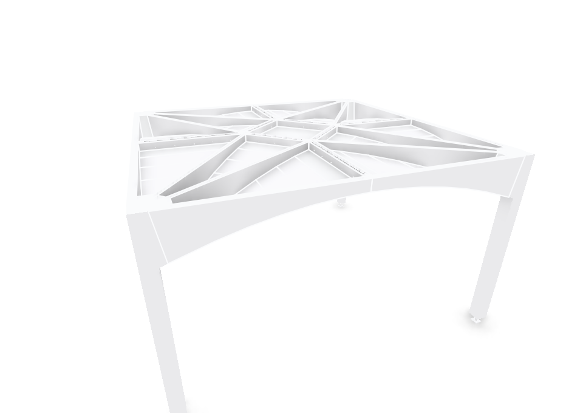

# Tutorial 10 · Display modes: outlines, Arctic SSAO, attributes and scene text

## Goal

Switch seamlessly between shaded CAD edges, dilated coverage-mask silhouettes (`Outline`), horizon-integrated GTAO clay shading (`Arctic`), toggleable element `Attributes`, and shaped `glyphon` world-plane, screen-plate, and outlined text.

 

**What we achieve:** Four studio display presets (`Shaded`, `Wireframe`, `Arctic`, `Ghost`), Ground-Truth Ambient Occlusion (`GTAO`), Jump-Flood selection silhouettes, and crisp `glyphon` 3D scene annotations.

## How it works

GTAO integrates horizon angles `(θ_1, θ_2)` in half-resolution linear view-space depth and filters bilaterally across creases; Jump-Flood (`jfa.wgsl`) propagates selected-mask seeds at strides `N/2, …, 1` for constant-cost outlines; and `glyphon` snaps projected 3D `Nameplate` and `Anchor` labels to physical pixels.


Interactive stage source: [`10-display.yaml`](../../examples/stage/tutorials-interaction/10-display.yaml).

## Prerequisites and files

Requires [Tutorial 9](tutorial-nine-layers.md). Owns `surface_outline*`, `ssao*`, `ambient_warm`, 6 outline/ambient shaders, `fonts`, `engine/text*`, `gpu/text*`, 3 text shaders, `scene_text`, `state/text`, `text_quality`, `assets/text-quality.html`, and 4 verbs.

Owned files in build order (`30` files):

1. `src/engine/gpu/surface_outline.rs`
2. `src/engine/gpu/surface_outline/tests.rs`
3. `src/shaders/face_coverage.wgsl`
4. `src/shaders/surface_outline.wgsl`
5. `src/engine/gpu/ssao.rs`
6. `src/engine/gpu/ssao/pipelines.rs`
7. `src/engine/gpu/ssao/tests.rs`
8. `src/engine/gpu/ambient_warm.rs`
9. `src/shaders/ambient_depth.wgsl`
10. `src/shaders/ambient_geometry.wgsl`
11. `src/shaders/ssao.wgsl`
12. `src/shaders/ambient_composite.wgsl`
13. `viewer-core/src/command/verbs/arctic.rs`
14. `viewer-core/src/command/verbs/outline.rs`
15. `viewer-core/src/command/verbs/attributes.rs`
16. `src/app/fonts.rs`
17. `src/engine/text.rs`
18. `src/engine/text/application_tests.rs`
19. `src/engine/gpu/text.rs`
20. `src/engine/gpu/text_plane.rs`
21. `src/engine/gpu/text_plate.rs`
22. `src/engine/gpu/text_outline.rs`
23. `src/shaders/text_plane.wgsl`
24. `src/shaders/text_plate.wgsl`
25. `src/shaders/text_outline.wgsl`
26. `viewer-core/src/scene_text.rs`
27. `src/state/text.rs`
28. `viewer-core/src/command/verbs/text.rs`
29. `src/text_quality.rs`
30. `assets/text-quality.html`

## Build

### Step 1 · `src/engine/gpu/surface_outline.rs`

`src/engine/gpu/surface_outline.rs` builds resolved, coarse and dilated coverage masks so empty screen tiles skip border work while separating selection halos from surface silhouettes.

```rust
--8<-- "session_viewer/src/engine/gpu/surface_outline.rs"
```

### Step 2 · `src/engine/gpu/surface_outline/tests.rs`

Verifies that yellow selected CAD edges never paint over black curved silhouette borders across views, MSAA counts and DPRs.

```rust
--8<-- "session_viewer/src/engine/gpu/surface_outline/tests.rs"
```

### Step 3 · `src/shaders/face_coverage.wgsl`

2. **`src/shaders/face_coverage.wgsl`** inspects the `2×u16` `physical` attachment across all `SAMPLES` to emit fractional solid coverage (`fs_fraction`).

```wgsl
--8<-- "session_viewer/src/shaders/face_coverage.wgsl"
```

### Step 4 · `src/shaders/surface_outline.wgsl`

`src/shaders/surface_outline.wgsl` composites crisp silhouettes and selection outlines from a bounded `512`-tap offset ring (`Taps`), exiting immediately via `near_any_coverage` on interior (`center >= 0.999`) or empty blocks.

```wgsl
--8<-- "session_viewer/src/shaders/surface_outline.wgsl"
```

### Step 5 · `src/engine/gpu/ssao.rs`

Owns half-res depth, radius, normal, occlusion and temporal-history textures keyed by `(frame_uniforms, geometry_revision)`.

```rust
--8<-- "session_viewer/src/engine/gpu/ssao.rs"
```

### Step 6 · `src/engine/gpu/ssao/pipelines.rs`

Builds the `8`-stage depth-mip, occupancy, normal, horizon-SSAO, bilateral-filter, history and MSAA-aware composite pipeline family.

```rust
--8<-- "session_viewer/src/engine/gpu/ssao/pipelines.rs"
```

### Step 7 · `src/engine/gpu/ssao/tests.rs`

Checks `1×`/`4×` MSAA contact darkening, zero distant-ground halo, first-vs-settled frame agreement and `Ssao` byte accounting.

```rust
--8<-- "session_viewer/src/engine/gpu/ssao/tests.rs"
```

### Step 8 · `src/engine/gpu/ambient_warm.rs`

Schedules `1×` and `4×` SSAO pipeline compilation inside browser `requestIdleCallback` (`50 ms` fallback) after first geometry presentation.

```rust
--8<-- "session_viewer/src/engine/gpu/ambient_warm.rs"
```

### Step 9 · `src/shaders/ambient_depth.wgsl`

2. **`src/shaders/ambient_depth.wgsl`** reduces `2×2` linear depth + `ao_radius` (`fs_reduce`) and marks `5×5` active occupancy tiles (`fs_occupancy`).

```wgsl
--8<-- "session_viewer/src/shaders/ambient_depth.wgsl"
```

### Step 10 · `src/shaders/ambient_geometry.wgsl`

3. **`src/shaders/ambient_geometry.wgsl`** resolves each pixel's `2×u16` primitive ID through `placed_triangle` to reconstruct exact world-space triangle cross-product normals (falling back to discontinuity-aware neighbour depth differences on non-triangle pixels).

```wgsl
--8<-- "session_viewer/src/shaders/ambient_geometry.wgsl"
```

### Step 11 · `src/shaders/ssao.wgsl`

4. **`src/shaders/ssao.wgsl`** integrates cosine-weighted GTAO horizon arcs `arc(h, n)` across `6` quadratic screen-space steps per side with mip-level selection, spatial-temporal noise phase, bilateral `X`/`Y` denoising and depth-clamped temporal history.

```wgsl
--8<-- "session_viewer/src/shaders/ssao.wgsl"
```

### Step 12 · `src/shaders/ambient_composite.wgsl`

5. **`src/shaders/ambient_composite.wgsl`** darkens interior pixels in one fullscreen pass (`fs_main`) and refines `16×16` MSAA silhouette tiles per sample (`vs_edges` / `fs_edges`).

```wgsl
--8<-- "session_viewer/src/shaders/ambient_composite.wgsl"
```

### Step 13 · `viewer-core/src/command/verbs/arctic.rs`

`viewer-core/src/command/verbs/arctic.rs` implements the `arctic` command verb: executes its typed command specification Validates arguments against `&mut dyn CommandHost` before mutating scene or view state so invalid interactive or CLI input leaves undo history untouched.

```rust
--8<-- "session_viewer/viewer-core/src/command/verbs/arctic.rs"
```

### Step 14 · `viewer-core/src/command/verbs/outline.rs`

`viewer-core/src/command/verbs/outline.rs` implements the `outline` command verb: executes its typed command specification Validates arguments against `&mut dyn CommandHost` before mutating scene or view state so invalid interactive or CLI input leaves undo history untouched.

```rust
--8<-- "session_viewer/viewer-core/src/command/verbs/outline.rs"
```

### Step 15 · `viewer-core/src/command/verbs/attributes.rs`

`viewer-core/src/command/verbs/attributes.rs` implements the `attributes` command verb: executes its typed command specification Validates arguments against `&mut dyn CommandHost` before mutating scene or view state so invalid interactive or CLI input leaves undo history untouched.

```rust
--8<-- "session_viewer/viewer-core/src/command/verbs/attributes.rs"
```

### Step 16 · `src/app/fonts.rs`

Checks bundled `Subset` glyph coverage (`need` / `need_names`) and triggers one async HTTP fetch posting `Msg::Fonts` when a codepoint (e.g. `Ω`) is missing.

```rust
--8<-- "session_viewer/src/app/fonts.rs"
```

### Step 17 · `src/engine/text.rs`

`src/engine/text.rs` defines `5` `TextPlacement` modes (screen, depth-tested anchored, overlay nameplate, world-plane and billboard) and validates `TextDocument::set_labels` atomically so moving or recolouring labels reuses shaped `glyphon` buffers while font upgrades advance `font_revision`.

```rust
--8<-- "session_viewer/src/engine/text.rs"
```

### Step 18 · `src/engine/text/application_tests.rs`

`src/engine/text/application_tests.rs` (34 lines) houses regression tests `bundled_subsets_cover_the_viewer_and_whole_fonts_the_rest`. It verified by `cargo xtest` (`bundled_subsets_cover_the_viewer_and_whole_fonts_the_rest`).

```rust
--8<-- "session_viewer/src/engine/text/application_tests.rs"
```

### Step 19 · `src/engine/gpu/text.rs`

Keys `TextLane::prepare` by `(doc_revision, font_revision, camera_or_canvas)` so static frames and pure screen-label views skip redundant GPU uploads.

```rust
--8<-- "session_viewer/src/engine/gpu/text.rs"
```

### Step 20 · `src/engine/gpu/text_plane.rs`

Caches per-label world-plane textures keyed by raster inputs, freeing GPU textures automatically when a plane label drops.

```rust
--8<-- "session_viewer/src/engine/gpu/text_plane.rs"
```

### Step 21 · `src/engine/gpu/text_plate.rs`

Emits `6`-vertex rounded label backing quads (depth-tested before overlays) preserving pre-clip centre, half-size and corner radius.

```rust
--8<-- "session_viewer/src/engine/gpu/text_plate.rs"
```

### Step 22 · `src/engine/gpu/text_outline.rs`

Draws pre-triangulated arena sheet lettering with flat colour and object-ID picking without reshaping strings through `glyphon`.

```rust
--8<-- "session_viewer/src/engine/gpu/text_outline.rs"
```

### Step 23 · `src/shaders/text_plane.wgsl`

`src/shaders/text_plane.wgsl`: What the vertex shader hands the fragment shader. Defines entry points `@vertex fn vs_main`, `@vertex fn vs_id`, `@fragment fn fs_main`, `@fragment fn fs_id`; bindings `@group(0) @binding(0) coverage_texture`, `@group(0) @binding(1) coverage_sampler`, `@group(1) @binding(0) pick`; keep struct layouts and binding indices aligned with their Rust `bytemuck` mirrors and Naga validation tests.

```wgsl
--8<-- "session_viewer/src/shaders/text_plane.wgsl"
```

### Step 24 · `src/shaders/text_plate.wgsl`

`src/shaders/text_plate.wgsl`: What the vertex shader hands the fragment shader. Defines entry points `@vertex fn vs_main`, `@vertex fn vs_id`, `@fragment fn fs_main`, `@fragment fn fs_id`; bindings `@group(0) @binding(0) pick`; keep struct layouts and binding indices aligned with their Rust `bytemuck` mirrors and Naga validation tests.

```wgsl
--8<-- "session_viewer/src/shaders/text_plate.wgsl"
```

### Step 25 · `src/shaders/text_outline.wgsl`

`src/shaders/text_outline.wgsl`: One mesh vertex, as the arena stores it. Defines entry points `@vertex fn vs_main`, `@fragment fn fs_main`, `@fragment fn fs_physical_id`, `@fragment fn fs_id`; keep struct layouts and binding indices aligned with their Rust `bytemuck` mirrors and Naga validation tests.

```wgsl
--8<-- "session_viewer/src/shaders/text_outline.wgsl"
```

### Step 26 · `viewer-core/src/scene_text.rs`

`viewer-core/src/scene_text.rs` (228 lines) defines `struct SceneText`, `set_texts()`, `set_document_title()`, `register_text()`, `CREATED_TEXT`. It uses additive registration seams `register:editing`.

```rust
--8<-- "session_viewer/viewer-core/src/scene_text.rs"
```

### Step 27 · `src/state/text.rs`

`src/state/text.rs` (203 lines): the box around the new BReps and surfaces. It exposes `annotate_document()`, `add_text()`, `use_fonts()`.

```rust
--8<-- "session_viewer/src/state/text.rs"
```

### Step 28 · `viewer-core/src/command/verbs/text.rs`

Validates `1..80`-char strings, orients `CPlane` axes toward the eye, and commits an undoable world-plane white-on-black label.

```rust
--8<-- "session_viewer/viewer-core/src/command/verbs/text.rs"
```

### Step 29 · `src/text_quality.rs`

Exports the `wasm_bindgen` `TextQuality` harness driving the production `TextLane` across DPRs, sizes, accents and selection states.

```rust
--8<-- "session_viewer/src/text_quality.rs"
```

### Step 30 · `assets/text-quality.html`

Loads the current built `.wasm` bundle and aligns same-font DOM reference specimens over GPU labels to measure sub-pixel width agreement.

```html
--8<-- "session_viewer/assets/text-quality.html"
```

## Integration

`View` flags (`arctic`, `show_outlines`, `wireframe`, `cull_backfaces`) and `Scene.attributes` switch render-pass participation in `render.rs` and `SavedView` metadata in `.session` archives. `ambient_warm.rs` prewarms SSAO pipelines once so pressing `A` (`Arctic`) causes zero shader compilation stutter.

## Run and observe

Run `cargo xtest -p session_viewer ssao::tests::shader_validates_for_both_depth_sample_counts`, `surface_outline::tests::face_coverage_shader_validates`, `engine::text::tests::ligatures_accents_spaces_and_symbols_are_shaped`, and `gpu::text::tests::scene_anchor_preserves_rebased_depth_and_culls_near_plane`: all pass.

## Predict and try

Predict what happens if `face_coverage.wgsl` (the silhouette mask pass) forgets to call `clip_discard(world_pos)` when a section plane cuts half a beam away: `surface_outline.wgsl` would draw a floating black silhouette ring in empty air around the cut-away half! Including `PRELUDE` in `face_coverage.wgsl` clips the coverage mask identically to the faces.

## Question and answer

**Why draw selection and `Outline` silhouettes by dilating a 2D coverage mask (`face_coverage.wgsl` -> `surface_outline.wgsl`) instead of extruding inverted back-face hulls along vertex normals?**

**How to work it out:** Test inverted-hull extrusion on CAD boxes with sharp `90-degree` hard-edge normals and on two overlapping beams whose union should share one outer contour.

**The answer:** Unwelded CAD face normals split apart at sharp cube corners (leaving triangular gaps at every vertex) and draw internal outlines where two selected solids touch. Rendering all selected/outlined faces into one binary coverage mask and dilating in screen space produces a watertight, constant-pixel-width outer contour across curved, sharp, and overlapping solids alike.

## Validation

Verified via `ssao::tests`, `surface_outline::tests`, `engine::text::tests` (`5/5` shaping/fallback/reuse tests), `gpu::text::tests` (`3/3` scale/anchor/plate tests), and `verbs::text::tests` (`4/4`).
