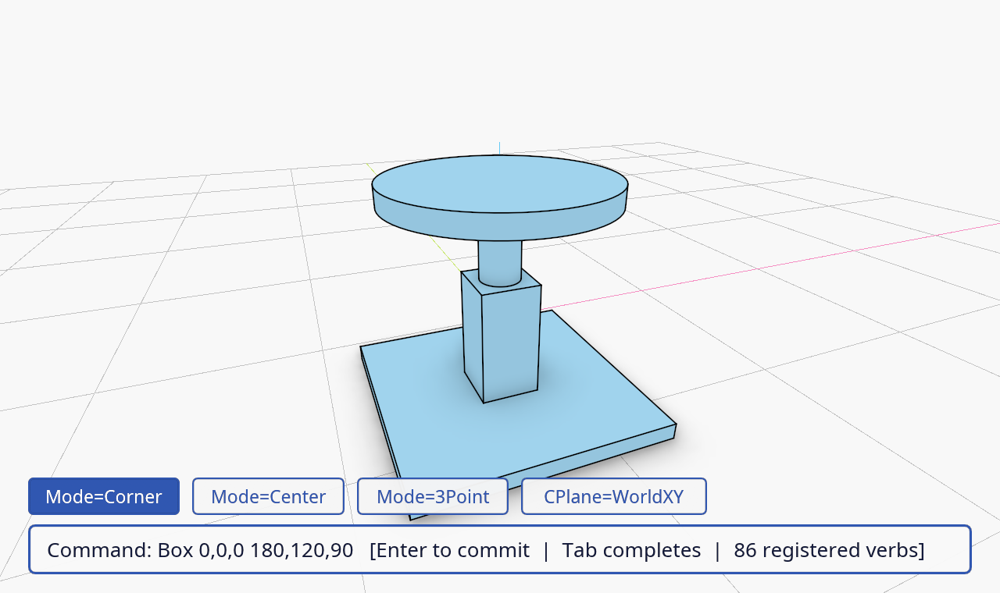
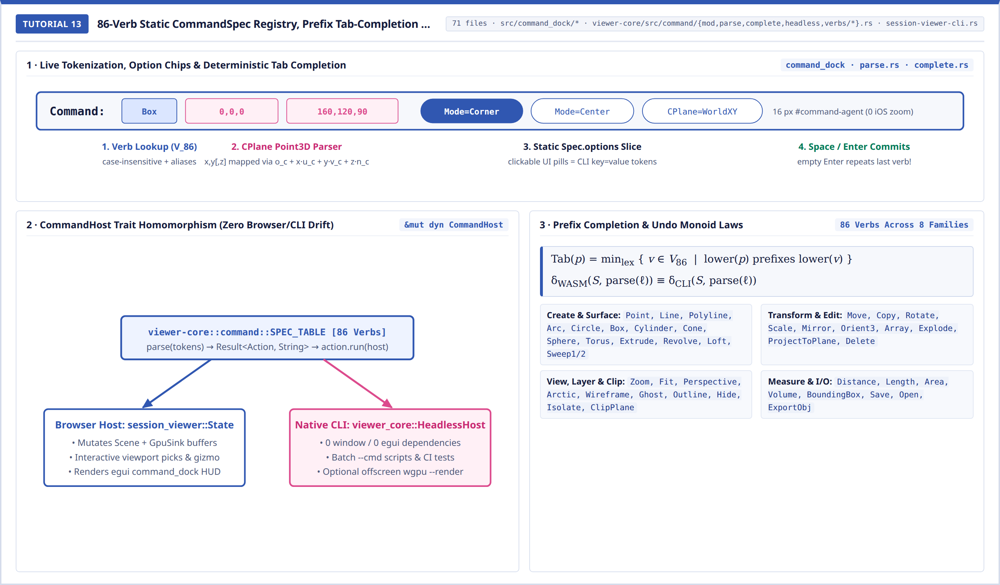

# Tutorial 13 · Command dock, completion, history and native CLI

## Goal

Mount the decoupled `command_dock` widget (`Commands` trait, inline completion suffix, option chips, 200-line history, mobile IME proxy) and ship the native `session-viewer-cli` binary (`exec`, `serve --stdio`, `schema`, `render-stage`).



**What we achieve:** A Rhino-style modeless `command_dock` with prefix `Tab` completion, clickable option chips, mobile `16 px` `#command-agent` IME bridging (`agent.rs`), `Undo`/`Redo`, and the native `session-viewer-cli` binary.

## How it works

Static `CommandSpec` registrations in `viewer_core::command` drive both interactive browser prompts (`command_line.rs`, `phone.rs`) and headless `session-viewer-cli` (`--cmd` batch scripts, `--render` offscreen PNGs, and `serve --stdio`), guaranteeing zero behavioural drift.



## Compilable checkpoint slice

`src/command_dock/` + `examples/course/dock.rs` form the standalone `dock` assembly (`48` files, `?tutorial=dock`) right on top of `mathematics`, while `agent.rs` and `session-viewer-cli.rs` join in `application`.

Lines marked `+` show the exact module declarations unlocked between `mathematics` (`44` files) and `dock` (`48` files):

```rust
// src/lib.rs (mathematics -> dock)
  /// A WGSL file from src/shaders as build.rs wrote it: no comments, indentation or blank lines.
  macro_rules! shader {
      ($name:literal) => {
          include_str!(concat!(env!("OUT_DIR"), "/shaders/", $name))
      };
  }
  mod engine;
+ pub mod command_dock;
  pub mod app;
  #[cfg(all(target_arch = "wasm32", feature = "tutorial"))]
  #[path = "../examples/course/entry.rs"]
  mod course;

// examples/course/registration.rs (mathematics -> dock)
  // --8<-- [start:course-registration]
  #[path = "canvas.rs"]
  mod canvas;
  #[path = "frame.rs"]
  mod frame;
  #[path = "painting.rs"]
  mod painting;
  #[path = "mathematics.rs"]
  mod mathematics;
+ #[path = "dock.rs"]
+ mod dock;
  type Start = fn() -> Result<(), wasm_bindgen::JsValue>;
  pub(super) const STARTS: &[(&str, Start)] = &[
      ("frame", frame::start),
      ("painting", painting::start),
      ("mathematics", mathematics::start),
+     ("dock", dock::start),
  ];
  // --8<-- [end:course-registration]
```

## Core code walkthrough

### Trait-decoupled `egui` command dock (`src/command_dock/view.rs:1:61`)

```rust
--8<-- "session_viewer/src/command_dock/view.rs:1:61"
```

`panel()` (lines `2–16`) switches cleanly between a compact `30 pt` single-line bar and a resizable history drawer (`default_size(104.0)` up to `75%` viewport height). In `field()` (lines `32–60`), `TextEdit::singleline` reserves `option_width + 28 pt` on the right for clickable option chips and explicitly paints a `14 pt` vertical cursor bar (lines `52–59`) when focused and empty so the user always sees keyboard readiness.

### `#command-agent` mobile IME bridge (`src/app/agent.rs:12:65`)

```rust
--8<-- "session_viewer/src/app/agent.rs:12:65"
```

Mobile Safari and Chrome refuse to open the virtual keyboard unless a real HTML `<input>` holds DOM focus. `CommandAgent::new` (lines `39–65`) attaches `input`, `keydown`, `compositionstart/end`, and `pointerdown` closures to `#command-agent`, translating mobile `keyCode == 13` / `Enter`, `Tab`, `Escape`, and history arrows into `Msg::Agent(AgentEvent)` events sent straight into the `winit` loop.

## Prerequisites and files

Requires [Tutorial 6](tutorial-six-modeling.md) and [Tutorial 12](tutorial-twelve-visibility.md). Owns `src/command_dock/*`, `app/ui/{command_line*,phone}.rs`, `app/agent.rs`, `command/tests.rs`, 7 session verbs, `src/bin/session-viewer-cli.rs`, and `examples/course/dock.rs`.

**Core files to type inline (6 files):**

1. `src/command_dock/mod.rs`
2. `src/command_dock/view.rs`
3. `src/app/ui/command_line.rs`
4. `src/app/agent.rs`
5. `src/bin/session-viewer-cli.rs`
6. `examples/course/dock.rs`

**Reference catalog & test files (11 files, folded below):** `src/command_dock/theme.rs`, `src/app/ui/command_line/tests.rs`, `src/app/ui/phone.rs`, `viewer-core/src/command/tests.rs`, `viewer-core/src/command/verbs/undo.rs`, `viewer-core/src/command/verbs/redo.rs`, `viewer-core/src/command/verbs/escape.rs`, `viewer-core/src/command/verbs/close.rs`, `viewer-core/src/command/verbs/report.rs`, `viewer-core/src/command/verbs/fit.rs`, `viewer-core/src/command/verbs/view.rs`.

## Build

### Step 1 · `src/command_dock/mod.rs`

Create `src/command_dock/mod.rs` and declare `mod command_dock;` in `src/lib.rs`. `src/command_dock/mod.rs` separates persistent `CommandLine` state (`command` buffer, `200`-entry `VecDeque` history, character-indexed prefix completion, option buttons and focus flags) from the one-frame `Option<String>` returned when `Enter` or an option chip commits, while `Escape` cancels pending input without executing it.

```rust
--8<-- "session_viewer/src/command_dock/mod.rs"
```

### Step 2 · `src/command_dock/view.rs`

`src/command_dock/view.rs` builds a `30 pt` folded bottom bar or a resizable `64..0.75 * height` history panel in logical points, drawing an explicit caret on empty focused fields and recording `Control` hit rectangles for deterministic browser automation.

```rust
--8<-- "session_viewer/src/command_dock/view.rs"
```

### Step 3 · `src/app/ui/command_line.rs`

`src/app/ui/command_line.rs` binds `CommandLine` to `REGISTRY` completions, active `Tool` prompts/chips and `Escape` priority, returning keyboard focus to the canvas after command execution.

```rust
--8<-- "session_viewer/src/app/ui/command_line.rs"
```

### Step 4 · `src/app/agent.rs`

`src/app/agent.rs` (`CommandAgent`) manages the hidden mobile `<input>`, forwarding full-string replacements, tracking IME `compositionstart`/`compositionend` so active compositions are never clobbered, and detaching all DOM closures on `Drop`.

```rust
--8<-- "session_viewer/src/app/agent.rs"
```

### Step 5 · `src/bin/session-viewer-cli.rs`

`src/bin/session-viewer-cli.rs` builds the native `session-viewer-cli` binary supporting `exec`, persistent `serve --stdio` JSONL dispatch, headless PPM `render_frame` capture and Markdown schema generation.

```rust
--8<-- "session_viewer/src/bin/session-viewer-cli.rs"
```

### Step 6 · `examples/course/dock.rs`

`examples/course/dock.rs` runs the Tutorial 13 command-dock checkpoint (`?tutorial=dock`), exercising `command_dock::CommandLine` tab completion, inline suffixes, option chips, and 200-entry history over a standalone `Commands` vocabulary. Trap: gate single-key viewport shortcuts whenever the dock `TextEdit` holds keyboard focus so typing `f` or `h` enters characters instead of firing hotkeys.

```rust
--8<-- "session_viewer/examples/course/dock.rs"
```

## Reference catalog and test files (11 files)

The 6 core files above implement the complete mechanism for this lesson. Expand this reference section whenever you want to inspect or copy the remaining 11 sibling verbs, adapters, and unit-test suites (`Step 7`–`Step 17`).

### Step 7 · `src/command_dock/theme.rs`

`src/command_dock/theme.rs` registers `Noto Sans` plus both `Noto Sans Symbols` fallbacks across proportional and monospace families and sets `text_cursor.blink = false` so idle focused frames schedule zero repaints.

```rust
--8<-- "session_viewer/src/command_dock/theme.rs"
```

### Step 8 · `src/app/ui/command_line/tests.rs`

`src/app/ui/command_line/tests.rs` drives character-by-character `egui` frame sequences verifying preserved spaces (`Orient 3 Points`), `Down`/`Up` option cycling (`Snap Off` -> `Snap End`) and `Enter` commit rules.

```rust
--8<-- "session_viewer/src/app/ui/command_line/tests.rs"
```

### Step 9 · `src/app/ui/phone.rs`

Routes `CommandAgent` text/keys to the topmost open panel field ahead of the dock, skipping inline completion suffixes and active IME compositions.

```rust
--8<-- "session_viewer/src/app/ui/phone.rs"
```

### Step 10 · `viewer-core/src/command/tests.rs`

Verifies sorted unique `REGISTRY` completions, readable labels, and identical `Action` parsing across aliases and canonical spellings.

```rust
--8<-- "session_viewer/viewer-core/src/command/tests.rs"
```

### Step 11 · `viewer-core/src/command/verbs/undo.rs`

`viewer-core/src/command/verbs/undo.rs` (24 lines) defines the `undo` command specification (`Spec`). It validates arguments before mutating `&mut dyn CommandHost` so invalid CLI or interactive input leaves undo history untouched.

```rust
--8<-- "session_viewer/viewer-core/src/command/verbs/undo.rs"
```

### Step 12 · `viewer-core/src/command/verbs/redo.rs`

`viewer-core/src/command/verbs/redo.rs` (24 lines) defines the `redo` command specification (`Spec`). It validates arguments before mutating `&mut dyn CommandHost` so invalid CLI or interactive input leaves undo history untouched.

```rust
--8<-- "session_viewer/viewer-core/src/command/verbs/redo.rs"
```

### Step 13 · `viewer-core/src/command/verbs/escape.rs`

`viewer-core/src/command/verbs/escape.rs` (33 lines) defines the `escape` command specification (`Spec`). It validates arguments before mutating `&mut dyn CommandHost` so invalid CLI or interactive input leaves undo history untouched.

```rust
--8<-- "session_viewer/viewer-core/src/command/verbs/escape.rs"
```

### Step 14 · `viewer-core/src/command/verbs/close.rs`

Preserves the active `Draft` during dispatch and appends the start point via `close_drawing` to finish open polylines and curves.

```rust
--8<-- "session_viewer/viewer-core/src/command/verbs/close.rs"
```

### Step 15 · `viewer-core/src/command/verbs/report.rs`

`viewer-core/src/command/verbs/report.rs` (23 lines) registers the `Report` command (`Report · download the viewer report: this run and the last failed or interrupted one`). It validates arguments before mutating `&mut dyn CommandHost` so invalid CLI or interactive input leaves undo history untouched.

```rust
--8<-- "session_viewer/viewer-core/src/command/verbs/report.rs"
```

### Step 16 · `viewer-core/src/command/verbs/fit.rs`

`viewer-core/src/command/verbs/fit.rs` (27 lines) registers the `Fit` command (`Fit zooms to the selection, or the whole scene when nothing is selected`). It validates arguments before mutating `&mut dyn CommandHost` so invalid CLI or interactive input leaves undo history untouched.

```rust
--8<-- "session_viewer/viewer-core/src/command/verbs/fit.rs"
```

### Step 17 · `viewer-core/src/command/verbs/view.rs`

Applies named orientations, perspective/orthographic switches, `Xray` and positive point/plane sizes without cancelling active drafts or splits.

```rust
--8<-- "session_viewer/viewer-core/src/command/verbs/view.rs"
```

## Integration

Cargo automatically discovers `src/bin/session-viewer-cli.rs` as the `session-viewer-cli` binary target without needing a `[[bin]]` override in `Cargo.toml` (so earlier checkpoints without `src/bin/` share the exact same `Cargo.toml`). Both the `egui` dock in `app/ui/command_line.rs` and `--cmd <line>` in `session-viewer-cli exec` call `viewer_core::command::parse` and `Action::run(&mut dyn CommandHost)`.

## Run and observe

Verify `command_dock` keystroke completion (`?tutorial=dock`), alphabetical `REGISTRY` invariants, and headless `session-viewer-cli` rendering:

```sh
cargo xtest -p viewer-core command::tests
cargo xtest -p session_viewer app::ui::command_line::tests
cargo run --target x86_64-unknown-linux-gnu --bin session-viewer-cli -- exec \
  tests/fixtures/timber-floor.pb --cmd "Select All" --cmd "View Isometric" --cmd "Fit" --render target/cli-floor.png
trunk serve --features tutorial --open /?tutorial=dock
```

## Predict and try

Predict what happens on a mobile browser when a user taps the `egui` command dock without `agent.rs` and `ui/phone.rs`: because a `<canvas>` is not an HTML text field, iOS/Android never raise the soft keyboard! Focusing the hidden offscreen DOM `<input>` in `agent.rs` raises the native mobile IME and forwards composition/backspace events into `CommandLine`.

## Question and answer

**Why does `src/command_dock/` define its own `pub trait Commands` instead of calling `viewer_core::command::completions` directly?**

??? tip "Think first — click to reveal how to work it out and the answer"
    **How to work it out:** Inspect `examples/course/dock.rs` (`?tutorial=dock`), which compiles at checkpoint 4 before `viewer-core`'s 86-verb `command` module and `Scene` exist.

    **The answer:** Inverting the dependency through the 5-method `Commands` trait (`canonical`, `choosing_option`, `accept`, `completions`, `browse`) keeps `command_dock` 100% free of `crate::` and `viewer_core` imports, so the exact production `egui` widget runs unchanged against a 4-verb tutorial table in `dock.rs` and against the 86-verb `REGISTRY` in `app/ui/command_line.rs`.

## Validation

Verified via `cargo xtest -p viewer-core command::tests` (`15/15` alphabetical, title-case, alias, and option tests), `cargo xtest -p session_viewer app::ui::command_line::tests` (`3/3` `egui` keystroke tests), and `session-viewer-cli exec` / `schema --markdown`.
