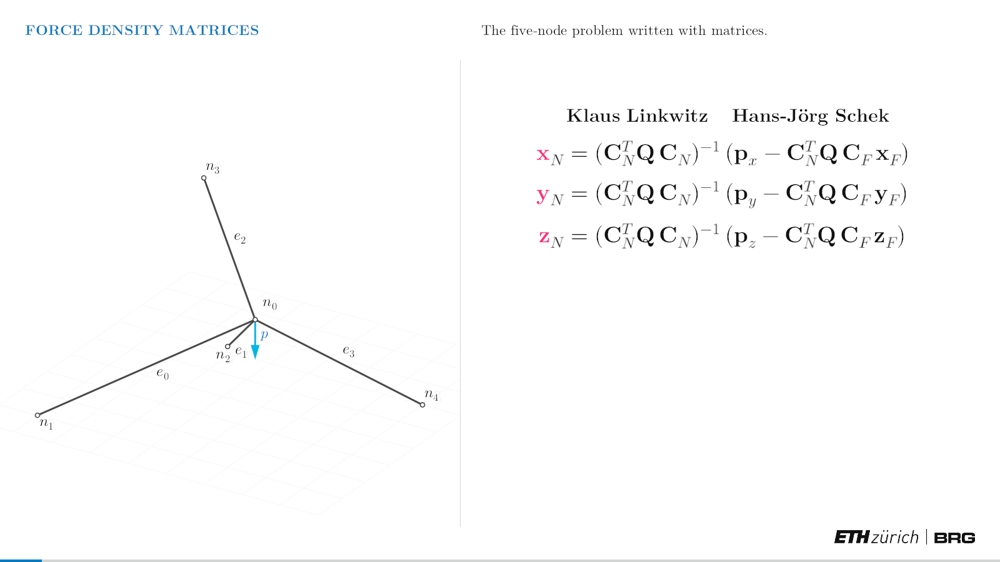

# Tutorial 3.2 · Laying out and animating 2D mathematics

## Goal

Parse declarative YAML stage decks, typeset OpenType MATH formulas, rounded sign-coloured 2D matrices, and `24x0.30` flat vector constructions on a `1600x900` frame, and animate symbol morphs with zero-overlap verification.



**What we achieve:** Publication-grade OpenType MATH typesetting (`LatinModernMath`) and sign-coloured matrix tables synchronized step-by-step with 2D and 3D geometric constructions.

## How it works

`tex.rs` parses TeX expressions into nested `Boxed` nodes (`width`, `ascent`, `descent`) measured directly from `LatinModernMath-Regular.otf` glyph metrics, while `matrix.rs` aligns column widths and tints positive, negative, and zero entries so algebraic structure (`K_f = C_fᵀ Q C_f`) reads visually alongside the geometry.

![YAML stage deck parser, OpenType MATH layout engine, rounded 2D stage matrix (`[[2, -1], [-1, 2]]`), and overlap checker (1600x900 Session Viewer stage plate)](../../examples/stage/tutorials-foundations/03b-mathematics.png)

Interactive stage source: [`03b-mathematics.yaml`](../../examples/stage/tutorials-foundations/03b-mathematics.yaml).

## Prerequisites and files

Sub-chapter `3.2` of [Tutorial 3](tutorial-three-rendering.md), building directly on [Tutorial 3.1](tutorial-three-painting.md). Introduces `app/mode.rs` and the 20 pure-2D `app/stage/*` modules (the 3D scene adapter arrives in [Tutorial 17](tutorial-seventeen-application.md)).

Owned files in build order (`23` files):

1. `src/app/mode.rs`
2. `src/app/stage/mod.rs`
3. `src/app/stage/font.rs`
4. `src/app/stage/tex.rs`
5. `src/app/stage/layout.rs`
6. `src/app/stage/flat.rs`
7. `src/app/stage/matrix.rs`
8. `src/app/stage/draw.rs`
9. `src/app/stage/paint.rs`
10. `src/app/stage/object.rs`
11. `src/app/stage/eval.rs`
12. `src/app/stage/actions.rs`
13. `src/app/stage/morph.rs`
14. `src/app/stage/tween.rs`
15. `src/app/stage/run.rs`
16. `src/app/stage/presentation.rs`
17. `src/app/stage/math_mode.rs`
18. `src/app/stage/deck.rs`
19. `src/app/stage/check.rs`
20. `src/app/stage/tests.rs`
21. `src/app/stage/presentation_tests.rs`
22. `examples/course/index.yaml`
23. `examples/course/mathematics.rs`

## Build

### Step 1 · `src/app/mode.rs`

Create `src/app/mode.rs` to define `Frame`, `Mode<Host>` and `Loaded<Host>` so an active presentation receives viewport metrics, millisecond timestamps and keyboard events while returning `egui::FullOutput` without owning `wgpu::Device` or `Surface`.

```rust
--8<-- "session_viewer/src/app/mode.rs"
```

### Step 2 · `src/app/stage/mod.rs`

`src/app/stage/mod.rs` is the additive module index for the stage engine: checkpoint `mathematics` registers the `22` host-independent modules above, and checkpoint `application` appends `mode`, `spatial` and `application` without editing earlier stage files.

```rust
--8<-- "session_viewer/src/app/stage/mod.rs"
```

### Step 3 · `src/app/stage/font.rs`

`src/app/stage/font.rs` parses `ttf-parser` glyph advances, ink bounds and OpenType `MATH` constants (`axis_height`, fraction numerator/denominator shifts, radical rules and extensible delimiter parts) normalized by `units_per_em` so layout stays independent of screen DPI.

```rust
--8<-- "session_viewer/src/app/stage/font.rs"
```

### Step 4 · `src/app/stage/tex.rs`

`src/app/stage/tex.rs` lexes TeX commands, braces, `{{...}}` named sub-parts and `_`/`^` scripts into an immutable `Expr` of `em`-space `Prim` shapes (`Glyph`, `Rect`, `Stroke`, `Image`) with `w`, `h`, `d` and optional `=` alignment offset (`Expr::align`), plus inline `$...$` prose and `NewCMMono10` code blocks.

```rust
--8<-- "session_viewer/src/app/stage/tex.rs"
```

### Step 5 · `src/app/stage/layout.rs`

`src/app/stage/layout.rs` stacks column blocks inside `[split * W + 33.6, W - 56]` (`TOP = 150..830`), computes uniform overflow fit scale, aligns equation stacks on each expression's `Expr::align` (`=`) column, and centres any row item with an explicit `width` in `em` inside that fixed slot.

```rust
--8<-- "session_viewer/src/app/stage/layout.rs"
```

### Step 6 · `src/app/stage/flat.rs`

`src/app/stage/flat.rs` (`flat_draws`) renders `2D` orthographic constructions (`drawing:` + `at: [x, y]`) directly in `1600×900` slide coordinates: `point` draws a `5.5 px` open ring filled with `bg` paper, and `arrow` trims its shaft behind an elongated `24.0 × 0.30` solid head landing on the exact vector tip.

```rust
--8<-- "session_viewer/src/app/stage/flat.rs"
```

### Step 7 · `src/app/stage/matrix.rs`

`src/app/stage/matrix.rs` measures every entry before sizing uniform rounded cells, fills signed pills (`pos` `#ff5c9a`, `neg` `#4c9bff`, `cell` `#e4e7e8`), chooses whichever of `ink` or `bg` has higher BT.601 luminance contrast (`0.299R + 0.587G + 0.114B`), and switches large or `pattern: true` matrices to compact sparsity squares.

```rust
--8<-- "session_viewer/src/app/stage/matrix.rs"
```

### Step 8 · `src/app/stage/draw.rs`

`src/app/stage/draw.rs` (`prims_of` and `snapshot`) samples positions, colours, `flat_draws` paths and fade alpha into slide pixels and neutralizes matrix cell fills to `faint` whenever all glyphs in that cell are hidden.

```rust
--8<-- "session_viewer/src/app/stage/draw.rs"
```

### Step 9 · `src/app/stage/paint.rs`

`src/app/stage/paint.rs` maps the authored `1600×900` slide into letterboxed desktop points (`Frame::new`) or stacked upright halves (`Frame::stacked` when `screen.height() >= 1.1 * screen.width()`), draws the `split = 0.46` (`x = 736`) `1 px` `faint` divider, clips spatial ink to `[0, split * W]`, cross-rises `650 ms` `say:` sentences without overlap, and paints the `ETH Zürich | BRG` marks and `4 px` whole-deck `accent` progress bar.

```rust
--8<-- "session_viewer/src/app/stage/paint.rs"
```

### Step 10 · `src/app/stage/object.rs`

`src/app/stage/object.rs` separates immutable `Rc<Expr>` primitives and `Content::Drawing` shapes from animated `Tween` channels (`pos`, `dim`, per-glyph colour) and `hidden` index sets, assigning optical sizes (`Tex` `36 px`, `Matrix`/`Row` `30 px`, `Text` `25 px`, `Label` `24 px`, `Code` `19 px`).

```rust
--8<-- "session_viewer/src/app/stage/object.rs"
```

### Step 11 · `src/app/stage/eval.rs`

`src/app/stage/eval.rs` evaluates scalar and `3D` `Val` expressions (`+`, `-`, `*`, `/`) by recursive descent against named `Points`, rejecting invalid point-times-point products.

```rust
--8<-- "session_viewer/src/app/stage/eval.rs"
```

### Step 12 · `src/app/stage/actions.rs`

`src/app/stage/actions.rs` executes identical state transitions during animated forward steps and instant backward replay, co-highlighting matching equation parts and `matrix_name_key` titles/headers in `accent` blue while keeping numeric cell `entries` in dark `ink`.

```rust
--8<-- "session_viewer/src/app/stage/actions.rs"
```

### Step 13 · `src/app/stage/morph.rs`

`src/app/stage/morph.rs` (`match_prims`) pairs explicit `map:` keys first, shared `{{part}}` tags second and longest-common-subsequence glyph identifiers (`(font << 16) | gid`) third without mutating `Rc<Expr>`: matched pairs tween position and scale, unmatched source glyphs fade out, and unmatched target glyphs fade in.

```rust
--8<-- "session_viewer/src/app/stage/morph.rs"
```

### Step 14 · `src/app/stage/tween.rs`

`src/app/stage/tween.rs` samples `Tween<T>` analytically at `now` via quintic smootherstep `s(t) = t³(10(1 − t)² + 5(1 − t)t + t²)` and retargets mid-flight from `self.at(now)` rather than accumulating per-frame deltas.

```rust
--8<-- "session_viewer/src/app/stage/tween.rs"
```

### Step 15 · `src/app/stage/run.rs`

`src/app/stage/run.rs` flattens slide steps into a linear timeline with default `3.2 px` geometric pens (`split = 0.46`): `next` finishes active tweens before starting the next step, while `prev` resets chapter state and replays steps `0..=g-1` deterministically with `animate = false`.

```rust
--8<-- "session_viewer/src/app/stage/run.rs"
```

### Step 16 · `src/app/stage/presentation.rs`

Add `src/app/stage/presentation.rs` to pair `run::Stage` with `paint::Atlas` and the current `Frame`, assigning picture IDs once and clearing `changed` only after checking whether animations or atlas overflow require another repaint.

```rust
--8<-- "session_viewer/src/app/stage/presentation.rs"
```

### Step 17 · `src/app/stage/math_mode.rs`

Add `src/app/stage/math_mode.rs` to implement `Mode<Host>` for any `Host` (`ArrowRight`, `ArrowLeft`, `ArrowUp`, `ArrowDown`, `T`), and wire `?tutorial=mathematics` in `examples/course/mathematics.rs`.

```rust
--8<-- "session_viewer/src/app/stage/math_mode.rs"
```

### Step 18 · `src/app/stage/deck.rs`

`src/app/stage/deck.rs` parses index and chapter YAML, defaults to the white paper ground (`Theme::Light`) when `theme` is omitted, parses fixed-width row slots in `em` and `drawing:` shapes, builds the `6`-stop `show: forces` rank ramp, and merges step options via `object_with_options` with chapter/step error context.

```rust
--8<-- "session_viewer/src/app/stage/deck.rs"
```

### Step 19 · `src/app/stage/check.rs`

`src/app/stage/check.rs` computes laid-out glyph, cell, stroke and picture ink boxes after clock sampling and reports block/label pairs overlapping by more than `1` slide unit on both axes.

```rust
--8<-- "session_viewer/src/app/stage/check.rs"
```

### Step 20 · `src/app/stage/tests.rs`

`src/app/stage/tests.rs` verifies math-axis fractions, fixed-width row-slot centring, `object_with_options` merging, vivid matrix sign fills, `yellow`/`accent` co-highlighting with `#111111` digits, white-default ground swaps, deterministic backward replay and ink-overlap checks against all `7` shipped decks.

```rust
--8<-- "session_viewer/src/app/stage/tests.rs"
```

### Step 21 · `src/app/stage/presentation_tests.rs`

`src/app/stage/presentation_tests.rs` verifies `Presentation` picture aspect ratios, reversible `1600×900` coordinate round trips at desktop/upright viewports, repaint settling on static frames, and host-untouched `math_mode` white-to-black theme and step transitions.

```rust
--8<-- "session_viewer/src/app/stage/presentation_tests.rs"
```

### Step 22 · `examples/course/index.yaml`

`examples/course/index.yaml` declares the minimal single-chapter stage deck manifest embedded by `examples/course/mathematics.rs` for the standalone 2D mathematics checkpoint. Trap: keep TeX strings single-quoted in YAML so backslashes in `\frac` and `\mathbf` are never consumed as YAML escapes.

```yaml
--8<-- "session_viewer/examples/course/index.yaml"
```

### Step 23 · `examples/course/mathematics.rs`

`examples/course/mathematics.rs` runs the Tutorial 3.2 checkpoint (`?tutorial=mathematics`), loading the bundled OpenType MATH fonts and driving `Presentation` across keyboard and touch navigation without 3D scene rows. Trap: run a second layout pass whenever `stage.changed` sets new atlas glyphs so settled coordinates are what reach `egui`.

```rust
--8<-- "session_viewer/examples/course/mathematics.rs"
```

## Integration

`src/app/mod.rs` registers `pub mod mode; // register:mode` and `pub mod stage;`. `Presentation` implements `Mode<H>` generically for *any* host `H` without touching `Scene` or `State`, so standalone 2D mathematical decks run in `?tutorial=mathematics` long before 3D scene rows exist.

## Run and observe

Run `cargo xtest -p session_viewer app::stage::`: all `24` stage and presentation unit tests pass (`fraction_rule_sits_on_the_math_axis`, `flat_arrowheads_are_elongated_and_end_at_the_vector_tip`, `matrix_cells_use_vivid_sign_fills`, `decks_play_through`, `decks_rest_cleanly_at_every_step`), plus `tutorial_stage_diagrams_play_cleanly_without_overlaps_or_errors`.

## Predict and try

Predict what happens when you add an unknown TeX macro like `\lfloor` or two overlapping `at: [x, y]` labels to a stage chapter and run `session-viewer-cli render-stage`: `Stage::typeset` records `unknown TeX command \lfloor` in `stage.errors`, `Stage::overlaps` flags any pair of bounding boxes intersecting by `> 1 px`, and both `decks_play_through` and `render-stage` fail immediately naming the exact chapter and step.

## Question and answer

**Why keep `src/app/stage/matrix.rs` (2D rounded cells on slides) while removing the old 3D `Matrix` GPU lane (`walk/matrix.rs`, `matrices.rs`, `matrix.wgsl`)?**

**How to work it out:** Contrast how numerical matrices are read in Force Density Method and Thrust Network Analysis lectures (`D_N x_N = p - D_F x_F`) against 3D world geometry (`Mesh`, `BRep`, `NurbsCurve`).

**The answer:** A numerical matrix is 2D algebraic notation, not a 3D spatial solid: rendering `7`-segment digits on a 3D quad with black `1 px` borders cluttered the 3D scene and duplicated shader pipelines, whereas `stage/matrix.rs` typesets true OpenType MATH entries inside sign-tinted rounded cells (pink positive, blue negative, yellow active highlight) synchronized with 3D cable-net highlights.

## Validation

Verified via `cargo xtest -p session_viewer app::stage::` (`24/24` passed, `0` failed across all `11` scientific decks + `3` tutorial diagram decks = `14` decks total) and native `1280x720` PNG rendering via `session-viewer-cli render-stage`.
