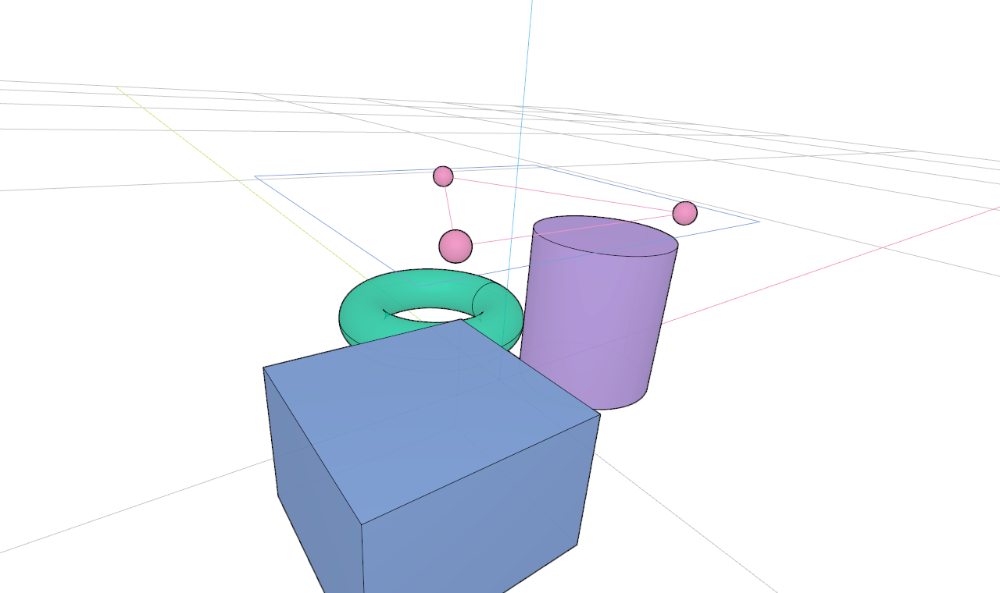

# Tutorial 3.1 · Compositing `egui` shapes and text

## Goal

Composite tessellated `egui` 2D primitives and font/image textures over the 3D WebGPU colour attachment using `LoadOp::Load` without disturbing scene depth or leaking GPU textures.


**What we achieve:** Crisp 2D vector painting and font-atlas compositing (`egui` over `wgpu`) on top of the 3D swapchain, forming the foundation for HUD panels, command bars, and overlays.

## How it works

Immediate-mode UI emits logical-point `ClippedPrimitive` meshes plus an alpha coverage atlas (`textures_delta`). Multiplying logical coordinates by `pixels_per_point` produces physical scissor rectangles and crisp glyph stems, uploaded before the single-sample `LoadOp::Load` UI pass and freed only after `queue.submit` completes.



## Prerequisites and files

Sub-chapter `3.1` of [Tutorial 3](tutorial-three-rendering.md). Must precede [Tutorial 3.2 (2D mathematics)](tutorial-three-mathematics.md), the layer/properties panels (Tutorial 9), and the command dock (Tutorial 13).

Owned files in build order (`2` files):

1. `src/engine/gpu/ui.rs`
2. `examples/course/painting.rs`

## Build

### Step 1 · `src/engine/gpu/ui.rs`

Create `src/engine/gpu/ui.rs` and declare `pub mod ui;` in `src/engine/gpu/mod.rs`. `Ui::prepare` frees textures retired by the *previous* frame (`free_last_frame`), uploads `textures_delta.set`, tessellates `output.shapes` at `pixels_per_point`, and uploads vertex/index buffers before `Ui::draw` opens a second render pass with `LoadOp::Load` so Tutorial 1's cleared white canvas survives underneath.

```rust
--8<-- "session_viewer/src/engine/gpu/ui.rs"
```

### Step 2 · `examples/course/painting.rs`

`examples/course/painting.rs` runs the Tutorial 3.1 checkpoint (`?tutorial=painting`), tessellating an `egui` pink triangle and bottom-left label onto the cleared WebGPU surface via `engine::gpu::ui::Ui`. Trap: upload `textures_delta.set` before recording the render pass and defer `textures_delta.free` until the next frame.

```rust
--8<-- "session_viewer/examples/course/painting.rs"
```

## Integration

`src/engine/gpu/mod.rs` adds `pub mod ui; // register:ui`, `Gpu` (`context.rs`) holds `pub ui: Option<ui::Ui>`, and `render.rs` invokes `ui.draw(encoder, view)` as the final colour overlay pass after 3D geometry and ink.

## Run and observe

Materialize `painting` (`npm --prefix ../session_tests run course -- checkpoint painting target/learn-painting`) and check with `cargo check --target wasm32-unknown-unknown -j8`: `ui.rs` compiles cleanly against `egui =0.34.3` and `egui-wgpu =0.34.3`, drawing a crisp pink triangle and crisp proportional Noto label in `?tutorial=painting`.

## Predict and try

Predict what happens if `ui.rs` calls `renderer.free_texture(id)` *before* `renderer.render(...)` in the same frame using `output.textures_delta.free`. If a widget drew its final frame with that texture and dropped its handle on the same pass, freeing immediately destroys a texture still referenced by `self.jobs`—storing `self.free = output.textures_delta.free` and draining at the *top* of the next `prepare()` avoids use-after-free.

## Question and answer

**Why does `Ui::draw` attach `depth_stencil_attachment: None` and `LoadOp::Load` on the resolved single-sample colour view rather than the 4x MSAA target?**

??? tip "Think first — click to reveal how to work it out and the answer"
    **How to work it out:** Compare 2D UI primitives against 3D scene triangles: `egui` already analytically antialiases feathered polygon fringes and subpixel font coverage in screen pixels, and UI panels always sit above the 3D viewport.

    **The answer:** Drawing `egui` after MSAA resolve with `LoadOp::Load` and `depth_stencil_attachment: None` preserves the finished 3D frame beneath translucent panels, avoids 4x fragment bandwidth on crisp 2D text atlases, and prevents 3D depth values from occluding HUD labels or panels.

## Validation

Verified via `cargo check --target wasm32-unknown-unknown -j8`, `selftest::render_stage_deck_ppms` (which drives `Ui::new`, `Ui::prepare`, and `Ui::draw` on headless Vulkan across all 19 tutorial diagrams), and `course -- active-audit`.
