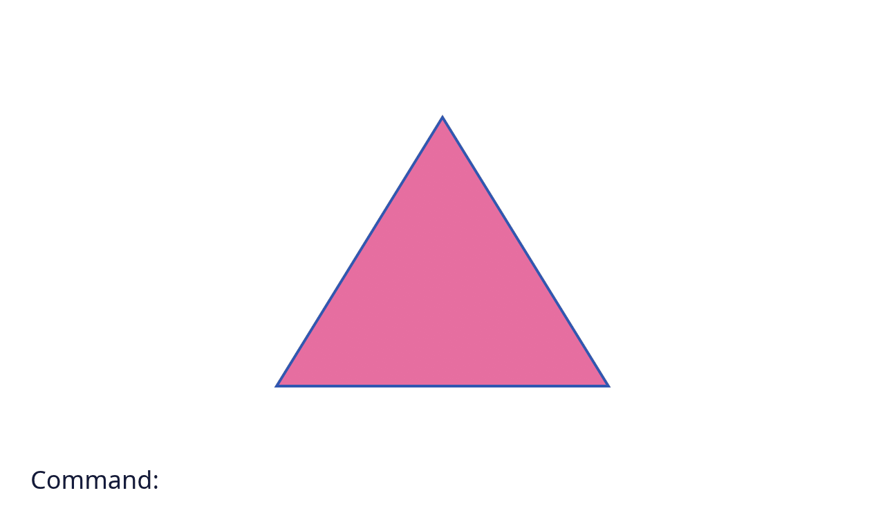
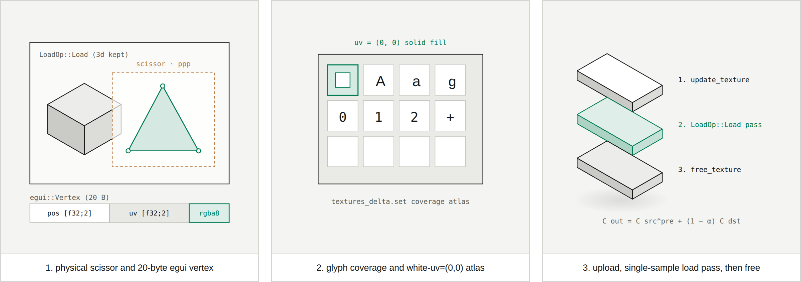

# Tutorial 3.1 · Compositing `egui` shapes and text

## Goal

Composite tessellated `egui` 2D primitives and font/image textures over the 3D WebGPU colour attachment using `LoadOp::Load` without disturbing scene depth or leaking GPU textures.



**What we achieve:** Crisp 2D vector painting and font-atlas compositing (`src/engine/gpu/ui.rs`) over the resolved `1×` swapchain, forming the foundation for HUD panels, command bars, and math stages.

## How it works

Immediate-mode `egui` emits logical-point `ClippedPrimitive` meshes plus font-atlas coverage patches (`textures_delta`). Scaling by `pixels_per_point` yields physical scissor rectangles uploaded before the single-sample `LoadOp::Load` pass (`depth: None`), while evicted `textures_delta.free` IDs retire only after draw encoding finishes.



## Compilable checkpoint slice

Tutorial 3.1 forms the standalone `painting` assembly (`17` files), adding `ui.rs` and `examples/course/painting.rs` directly onto `frame`.

Lines marked `+` show the exact module declarations unlocked between `frame` (`15` files) and `painting` (`17` files):

```rust
// src/engine/gpu/mod.rs (frame -> painting)
  pub mod device; // register:device
+ pub mod ui; // register:ui

// examples/course/registration.rs (frame -> painting)
  // --8<-- [start:course-registration]
  #[path = "canvas.rs"]
  mod canvas;
  #[path = "frame.rs"]
  mod frame;
+ #[path = "painting.rs"]
+ mod painting;
  type Start = fn() -> Result<(), wasm_bindgen::JsValue>;
  pub(super) const STARTS: &[(&str, Start)] = &[
      ("frame", frame::start),
+     ("painting", painting::start),
  ];
  // --8<-- [end:course-registration]
```

## Core code walkthrough

### Three-phase `egui` texture & vertex lifecycle (`src/engine/gpu/ui.rs:30:95`)

```rust
--8<-- "session_viewer/src/engine/gpu/ui.rs:30:95"
```

Follow the exact ordering inside `Ui::prepare` and `Ui::draw`: lines `39–42` free *last* frame's evicted textures (`self.free.drain(..)`), lines `45–48` upload this frame's glyph/image deltas (`textures_delta.set`), and line `50` defers `output.textures_delta.free` until next frame so a widget that drew its final frame and dropped its `TextureHandle` never triggers a GPU use-after-free. Lines `79–94` then composite over the `1×` swapchain view with `LoadOp::Load` and `depth_stencil_attachment: None`.

### Logical-point screen rect vs physical DPR (`examples/course/painting.rs:39:65`)

```rust
--8<-- "session_viewer/examples/course/painting.rs:39:65"
```

`egui` lays out widgets in device-independent points (`screen_rect = [width / scale, height / scale]`, lines `48–56`), while `wgpu` scissor rectangles clip in physical framebuffer pixels. Passing `scale` (`devicePixelRatio`) to both `context.set_pixels_per_point(scale)` and `ScreenDescriptor` keeps `14 pt` Noto Sans stems sharp on `2×` Retina displays without changing layout coordinates.

## Prerequisites and files

Sub-chapter `3.1` of [Tutorial 3](tutorial-three-rendering.md). Must precede [Tutorial 3.2 (2D mathematics)](tutorial-three-mathematics.md), the layer/properties panels (Tutorial 9), and the command dock (Tutorial 13).

**Core files in build order (2 files):**

1. `src/engine/gpu/ui.rs`
2. `examples/course/painting.rs`

## Build

### Step 1 · `src/engine/gpu/ui.rs`

Create `src/engine/gpu/ui.rs` and declare `pub mod ui;` in `src/engine/gpu/mod.rs`. `Ui::prepare` frees textures retired by the *previous* frame (`free_last_frame`), uploads `textures_delta.set`, tessellates `output.shapes` at `pixels_per_point`, and uploads vertex/index buffers before `Ui::draw` opens a second render pass with `LoadOp::Load` so Tutorial 1's cleared white canvas survives underneath.

```rust
--8<-- "session_viewer/src/engine/gpu/ui.rs"
```

### Step 2 · `examples/course/painting.rs`

`examples/course/painting.rs` runs the Tutorial 3.1 checkpoint (`?tutorial=painting`), tessellating an `egui` pink triangle and bottom-left label onto the cleared WebGPU surface via `engine::gpu::ui::Ui`. Trap: upload `textures_delta.set` before recording the render pass and defer `textures_delta.free` until the next frame.

```rust
--8<-- "session_viewer/examples/course/painting.rs"
```

## Integration

`src/engine/gpu/mod.rs` adds `pub mod ui; // register:ui`, `Gpu` (`context.rs`) holds `pub ui: Option<ui::Ui>`, and `render.rs` invokes `ui.draw(encoder, view)` as the final colour overlay pass after 3D geometry and ink.

## Run and observe

Compile and open the standalone `painting` checkpoint (`17` files total) in your browser or run its native headless check:

```sh
cargo check --target wasm32-unknown-unknown --features tutorial -j8
trunk serve --features tutorial --open /?tutorial=painting
```

Observe the antialiased pink triangle and crisp `NotoSans` label composited via `LoadOp::Load` over the cleared WebGPU frame, with `textures_delta.free` deferred safely across frames.

## Predict and try

Predict what happens if `ui.rs` calls `renderer.free_texture(id)` *before* `renderer.render(...)` in the same frame using `output.textures_delta.free`. If a widget drew its final frame with that texture and dropped its handle on the same pass, freeing immediately destroys a texture still referenced by `self.jobs`—storing `self.free = output.textures_delta.free` and draining at the *top* of the next `prepare()` avoids use-after-free.

## Question and answer

**Why does `Ui::draw` attach `depth_stencil_attachment: None` and `LoadOp::Load` on the resolved single-sample colour view rather than the 4x MSAA target?**

??? tip "Think first — click to reveal how to work it out and the answer"
    **How to work it out:** Compare 2D UI primitives against 3D scene triangles: `egui` already analytically antialiases feathered polygon fringes and subpixel font coverage in screen pixels, and UI panels always sit above the 3D viewport.

    **The answer:** Drawing `egui` after MSAA resolve with `LoadOp::Load` and `depth_stencil_attachment: None` preserves the finished 3D frame beneath translucent panels, avoids 4x fragment bandwidth on crisp 2D text atlases, and prevents 3D depth values from occluding HUD labels or panels.

## Validation

Verified via `cargo check --target wasm32-unknown-unknown -j8`, `selftest::render_stage_deck_ppms` (which drives `Ui::new`, `Ui::prepare`, and `Ui::draw` on headless Vulkan across all 19 tutorial diagrams), and `course -- active-audit`.
