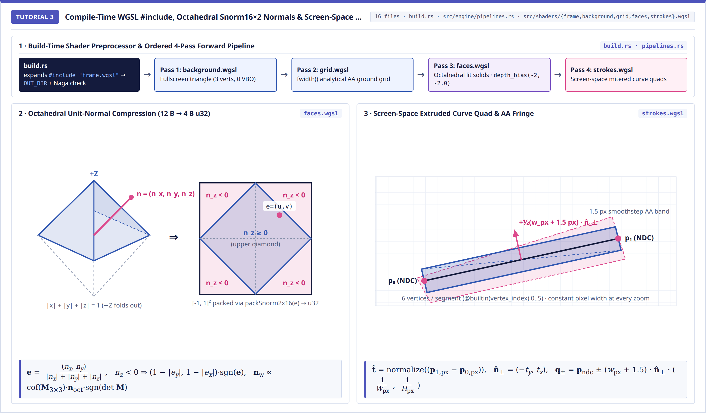

# Tutorial 3 · Rendering engine and shared shaders

## Goal

Preprocess WGSL `#include` headers at build time through `build.rs`, establish bind-group layouts `0..=3` and lazy `OnceLock` pipeline compilation, and execute the ordered frame render passes with background and construction-plane grid shaders.

 

**What we achieve:** A unified two-pass CAD forward renderer combining octahedral-normal solid shading (`faces.wgsl`) with constant-pixel-width antialiased curve and boundary strokes (`strokes.wgsl`).

## How it works

Surface triangles decode 2-component octahedral unit normals for hemisphere lighting while pushing depth slightly away from the eye (`depth_bias`), allowing screen-space mitered stroke quads `q_i = p_ndc ± (w / 2) · n_⊥ · (2 / viewport)` to sit cleanly on top of coplanar faces without z-fighting.



## Prerequisites and files

Requires [Tutorial 2](tutorial-two-wgpu.md). Followed immediately by [Tutorial 3.1 (`egui` painting)](tutorial-three-painting.md) and [Tutorial 3.2 (2D mathematics stage)](tutorial-three-mathematics.md).

Owned files in build order (`19` files):

1. `build.rs`
2. `src/engine/pipelines/mod.rs`
3. `src/engine/pipelines/bindings.rs`
4. `src/engine/pipelines/layouts.rs`
5. `src/engine/pipelines/core.rs`
6. `src/engine/pipelines/geometry.rs`
7. `src/shaders/scene.wgsl`
8. `src/shaders/clip.wgsl`
9. `src/shaders/physical.wgsl`
10. `src/shaders/normals.wgsl`
11. `src/shaders/projected_triangle.wgsl`
12. `src/shaders/ink_visibility.wgsl`
13. `src/engine/gpu/lane.rs`
14. `src/engine/gpu/pass.rs`
15. `src/engine/gpu/render.rs`
16. `src/engine/gpu/backdrop.rs`
17. `src/engine/gpu/backdrop/application_tests.rs`
18. `src/shaders/background.wgsl`
19. `src/shaders/grid.wgsl`

## Build

### Step 1 · `build.rs`

`build.rs` (61 lines) implements `build` helpers (`expand()`, `minify()`) under `session_viewer`. It wires `fs`, `Path` without introducing cyclic `session_viewer` dependencies.

```rust
--8<-- "session_viewer/build.rs"
```

### Step 2 · `src/engine/pipelines/mod.rs`

`src/engine/pipelines/mod.rs` (7 lines) coordinates submodules `bindings`, `layouts`, `core`, `geometry`. It keeps `mod` self-contained and deterministic across native and `wasm32` targets.

```rust
--8<-- "session_viewer/src/engine/pipelines/mod.rs"
```

### Step 3 · `src/engine/pipelines/bindings.rs`

`src/engine/pipelines/bindings.rs` constructs typed uniform, read-only storage and `2D`/multisampled texture `BindGroupLayoutEntry` descriptors without allocating GPU memory.

```rust
--8<-- "session_viewer/src/engine/pipelines/bindings.rs"
```

### Step 4 · `src/engine/pipelines/layouts.rs`

`src/engine/pipelines/layouts.rs` assembles `Layouts`: camera `mvp` (`@group(0)`), `LineUniform` + `ClipUniform` (`@group(1)`), and `instances` + `translations` (`@group(2)`), plus depth/ID/tile bindings for ink visibility.

```rust
--8<-- "session_viewer/src/engine/pipelines/layouts.rs"
```

### Step 5 · `src/engine/pipelines/core.rs`

`src/engine/pipelines/core.rs` wraps shaders and pipelines in `Lazy<T>` (`Rc<LazyCell<...>>`) inside `Cache`, keying render pipelines by entry points, layouts, topology, sample count, target format and `CLIPPING` specialization so unused variants never compile.

```rust
--8<-- "session_viewer/src/engine/pipelines/core.rs"
```

### Step 6 · `src/engine/pipelines/geometry.rs`

`src/engine/pipelines/geometry.rs` (71 lines) defines `vertex_layout()`. It implements internal helpers `pipelines_compile_on_first_use_and_once_per_target()`.

```rust
--8<-- "session_viewer/src/engine/pipelines/geometry.rs"
```

### Step 7 · `src/shaders/scene.wgsl`

`src/shaders/scene.wgsl` mirrors the `112 B` `Instance` and `80 B` `LineUniform` structs, resolves selection/tint/edge colours, offsets coplanar contact layers along the view ray (`depth_layer`), and places vertices via `place(i, p) = (instances[i].model * vec4(p, 1.0)).xyz + translations[i].xyz`.

```wgsl
--8<-- "session_viewer/src/shaders/scene.wgsl"
```

### Step 8 · `src/shaders/clip.wgsl`

`src/shaders/clip.wgsl` declares the `448 B` `ClipUniform` (`6` world/screen section planes, hatch numerators/denominators, `CLIP_OFFSETS` for `4×` MSAA, scale-aware `CLIP_SLACK = 2^-17` for faces, `8`-epsilon dot-product rounding for on-plane ink, and `override CLIPPING: bool`).

```wgsl
--8<-- "session_viewer/src/shaders/clip.wgsl"
```

### Step 9 · `src/shaders/physical.wgsl`

`src/shaders/physical.wgsl` splits `32`-bit triangle IDs across two `16`-bit halves (`rg16uint`) alongside colour and `(object, subobject)` pick outputs because WebGPU forbids `4×` MSAA on `r32uint` attachments.

```wgsl
--8<-- "session_viewer/src/shaders/physical.wgsl"
```

### Step 10 · `src/shaders/normals.wgsl`

`src/shaders/normals.wgsl` transforms normals by the cofactor inverse-transpose matrix (preserving perpendicularity under non-uniform scale and flipping sign when `det(M) < 0`) and decodes octahedral `16`-bit and `32`-bit normals while reserving `0x80008000` for absent normals.

```wgsl
--8<-- "session_viewer/src/shaders/normals.wgsl"
```

### Step 11 · `src/shaders/projected_triangle.wgsl`

`src/shaders/projected_triangle.wgsl` defines the `96 B` `ProjectedTriangle` screen-space record (`edge0..3` inward line equations, reference point, linear depth gradient and pixel bounds) and evaluates exact point-in-triangle depth across at most `262,144` adaptive screen tiles.

```wgsl
--8<-- "session_viewer/src/shaders/projected_triangle.wgsl"
```

### Step 12 · `src/shaders/ink_visibility.wgsl`

`src/shaders/ink_visibility.wgsl` carries neighbour depth along verified planar surfaces (`ink_pair_planar`) and adds `ink_sag_slack(sag, gradient)` when testing tile triangles so curved BRep edges rising above grazing facets stay unbroken while rear edges disappear cleanly.

```wgsl
--8<-- "session_viewer/src/shaders/ink_visibility.wgsl"
```

### Step 13 · `src/engine/gpu/lane.rs`

`src/engine/gpu/lane.rs` defines `Lane` (`reset` vs `release`, `retarget`, `append`, `draw`, `bytes`) and `RowLane` (`Registered` table descriptors retiring edited rows to the hidden sink instead of shifting offsets).

```rust
--8<-- "session_viewer/src/engine/gpu/lane.rs"
```

### Step 14 · `src/engine/gpu/pass.rs`

Defines `Pass` lifecycle hooks (`PASSES`: instancing, clipping, SSAO, outlines), swapping each pass with `Nothing` during mutable `Gpu` borrows.

```rust
--8<-- "session_viewer/src/engine/gpu/pass.rs"
```

### Step 15 · `src/engine/gpu/render.rs`

Encodes one frame in strict order: pass prep + triangle tiles + splats -> backdrop, caps, faces & splat resolve -> SSAO & outlines -> ink, lanes, markers, text & gizmo.

```rust
--8<-- "session_viewer/src/engine/gpu/render.rs"
```

### Step 16 · `src/engine/gpu/backdrop.rs`

Renders the fullscreen background triangle and anchor-rebased `f64` construction grid without rebuilding vertex buffers on pan/orbit.

```rust
--8<-- "session_viewer/src/engine/gpu/backdrop.rs"
```

### Step 17 · `src/engine/gpu/backdrop/application_tests.rs`

`src/engine/gpu/backdrop/application_tests.rs` (165 lines) implements `application_tests` helpers (`grey_from_above()`, `actual_grid_pixels_keep_far_fractions_and_return_to_the_same_near_frame()`, `the_grid_lies_on_the_construction_plane()`) under `backdrop`. It wires `CPlane`, ``, ``, `` without introducing cyclic `backdrop` dependencies.

```rust
--8<-- "session_viewer/src/engine/gpu/backdrop/application_tests.rs"
```

### Step 18 · `src/shaders/background.wgsl`

`src/shaders/background.wgsl`: One vertex of the fullscreen triangle. Defines entry points `@vertex fn vs_main`, `@fragment fn fs_main`; keep struct layouts and binding indices aligned with their Rust `bytemuck` mirrors and Naga validation tests.

```wgsl
--8<-- "session_viewer/src/shaders/background.wgsl"
```

### Step 19 · `src/shaders/grid.wgsl`

`src/shaders/grid.wgsl`: Floor line color. Defines entry points `@vertex fn vs_main`, `@fragment fn fs_main`; bindings `@group(2) @binding(0) grid_frame`; keep struct layouts and binding indices aligned with their Rust `bytemuck` mirrors and Naga validation tests.

```wgsl
--8<-- "session_viewer/src/shaders/grid.wgsl"
```

## Integration

`src/engine/mod.rs` adds `pub mod pipelines;`, while `src/engine/gpu/mod.rs` registers `lane`, `pass`, `render`, and `backdrop`. Every geometry and ink lane in Tutorials 4–12 compiles against `pipelines::core::PRELUDE` (`scene.wgsl` + `clip.wgsl`) and registers in `lane::REGISTRY` and `pass::PASSES` without reopening `render.rs`.

## Run and observe

Run `cargo xtest -p session_viewer lazy_objects_are_made_once_on_first_use`, `only_stroke_picks_read_the_tables`, and `grid_uniform_keeps_far_world_fractions_across_anchor_returns`: Naga validates every assembled shader in `OUT_DIR/shaders/`, lazy pipelines compile at most once per MSAA sample count, and the ground grid remains phase-locked across camera anchor rebases.

## Predict and try

Predict what happens if you edit a `.wgsl` header (`src/shaders/clip.wgsl`) without `cargo:rerun-if-changed` on `src/shaders`: `OUT_DIR/shaders/` would keep stale expanded WGSL. Inspect `build.rs` to verify it watches both `src/shaders` and everyindividual `.wgsl` file while stripping comments and blank lines.

## Question and answer

**Why compile `scene.wgsl` and `clip.wgsl` into every lane through `PRELUDE` instead of giving each shader its own camera and clipping uniforms?**

??? tip "Think first — click to reveal how to work it out and the answer"
    **How to work it out:** Count the stages that must agree on world-to-clip projection and section-plane discarding: solid faces, ribbons, vector arrowheads, marker spheres/discs, point-cloud splats, world-plane text, silhouette coverage masks, and the GPU ID picking pass.

    **The answer:** Sharing one `PRELUDE` and fixed bind groups (`group(0)` frame camera, `group(1)` line/clip uniform, `group(2)` `Instance` + anchored `translations`) makes divergence impossible: `place(i, p)` rebases every vertex identically, and `clip_discard(world)` cuts faces, strokes, masks, and ID picks on the exact same fragment boundary.

## Validation

Verified via `cargo xtest -p session_viewer pipelines::core::tests::lazy_objects_are_made_once_on_first_use`, `render::tests::only_stroke_picks_read_the_tables`, `backdrop::precision_tests::grid_uniform_keeps_far_world_fractions_across_anchor_returns`, and `instance::validation::tiles_tests::shader_validation_and_layouts`.
