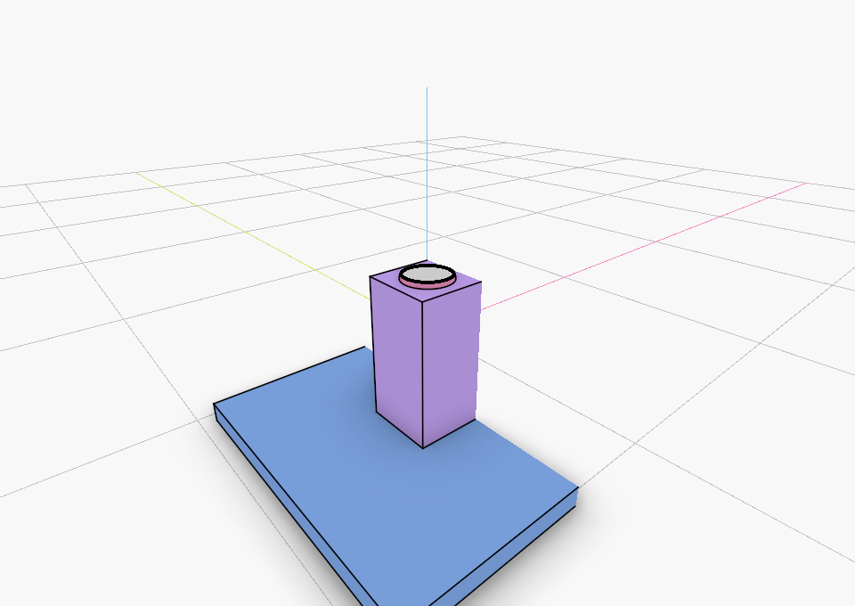
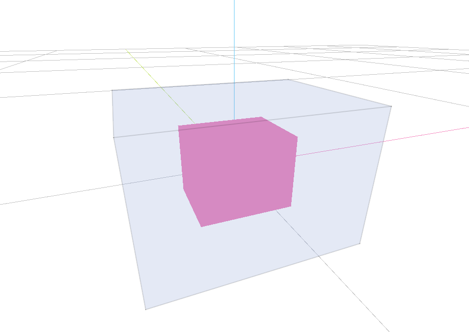
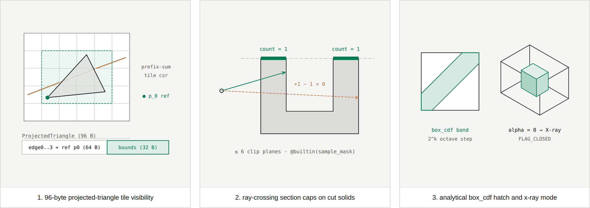

# Tutorial 12 · Transparency, finite-triangle tile visibility and section caps

## Goal

Bin projected scene triangles into screen tiles with prefix-sum offsets and `atomicMax` per-tile depth bounds for fast hidden-line stroke visibility, render global `Opacity` and per-object `Alpha`, and fill section-plane cuts with watertight stencil caps.

 

**What we achieve:** Exact finite-triangle hidden-line curve visibility (`triangle_tiles.rs`), up to 6 interactive clipping planes sealed with analytical octave-hatched section caps (`cap.wgsl`), and per-object alpha / X-ray transparency.

## How it works

`project_triangles.wgsl` writes `96`-byte `ProjectedTriangle` records (inward edge half-planes + local-corner depth gradient) and `scan_triangle_tiles.wgsl` prefix-sums them into `<= 262,144` screen tiles for exact curve occlusion; `clip.rs` and `cap.wgsl` count signed ray-solid crossings (`count_at > 0.5`), trim sample masks against all other clip planes, and antialias power-of-two hatch lines via exact pixel-square `box_cdf` integration.



## Compilable checkpoint slice

Finite-triangle screen-tile visibility (`triangle_tiles.rs`) and ray-crossing section caps (`clip.rs`, `cap.wgsl`) compile starting at `geometry` (`174` files).

Lines marked `+` show the exact module declarations unlocked between `rows` (`80` files) and `geometry` (`174` files):

```rust
// viewer-core/src/lib.rs (rows -> geometry)
  pub mod camera;
+ pub mod gizmo;
+ pub mod interactions;
+ pub mod knobs;
  pub mod rows;
  pub mod sink;
+ pub mod walk;
  pub use crate as app;
  pub use sink as core;
  pub use sink::GpuSink;

// src/engine/mod.rs (rows -> geometry)
  pub mod diagnostics;
  pub mod gpu;
  pub mod performance;
  pub mod pipelines;
+ pub mod text; // register:text

// src/engine/gpu/mod.rs (rows -> geometry)
+ pub mod arena; // register:arena
+ pub mod backdrop; // register:backdrop
  pub mod buffers; // register:buffers
+ pub mod clip; // register:clip
+ pub mod cloud; // register:cloud
  pub mod device; // register:device
+ pub mod faces; // register:faces
+ pub mod frame; // register:frame
+ pub mod glyphs; // register:glyphs
  pub mod hull; // register:hull
  pub mod instance; // register:instance
+ pub mod instanced; // register:instanced
+ pub mod lod; // register:lod
  pub mod objects;
+ pub mod slots; // register:slots
+ pub mod lane; // register:lane
+ #[cfg(target_arch = "wasm32")]
+ mod pacing;
+ pub mod pass; // register:pass
+ pub(crate) mod patch; // register:patch
+ pub mod pick; // register:pick
+ pub mod planes; // register:planes
+ pub mod present; // register:present
+ pub mod render; // register:render
+ pub mod segments; // register:segments
+ pub mod splat; // register:splat
+ mod ssao; // register:ssao
+ pub mod surface_outline; // register:surface_outline
+ pub mod targets; // register:targets
+ pub mod text; // register:text
+ pub mod text_outline; // register:text_outline
+ pub mod timing; // register:timing
+ mod triangle_tiles; // register:triangle_tiles
  pub mod ui; // register:ui
+ pub mod upload; // register:upload
+ pub mod vectors; // register:vectors
+ pub mod view; // register:view
+ mod widget; // register:widget
+ mod widget_mesh; // register:widget_mesh
+ mod context;
+ mod sink;
+ pub use context::Gpu;
+ #[cfg(test)]
+ pub(crate) use context::lane_shaders;
+ #[allow(unused_imports)]
+ pub use cloud::{CloudDraw, LodNode, NO_NORMALS}; // register:clouds
+ pub use frame::FrameInput;
+ pub use glyphs::GlyphPoint; // register:markers
+ pub use instance::Instance;
+ #[allow(unused_imports)]
+ pub use objects::{ObjectRow, Rebase};
+ pub use pick::Pick; // register:shell
+ pub use segments::CylinderSegment; // register:strokes
+ pub use upload::Upload;
+ pub use view::View;

// src/app/mod.rs (rows -> geometry)
+ pub use viewer_core::gizmo; // register:gizmo
+ pub use viewer_core::interactions; // register:interactions
+ pub use viewer_core::knobs; // register:knobs
  #[cfg(target_arch = "wasm32")]
  pub mod launch;
  pub mod mode; // register:mode
  pub mod stage;
+ pub use viewer_core::walk; // register:walk

// examples/course/registration.rs (rows -> geometry)
  // --8<-- [start:course-registration]
  #[path = "canvas.rs"]
  mod canvas;
  #[path = "frame.rs"]
  mod frame;
  #[path = "painting.rs"]
  mod painting;
  #[path = "mathematics.rs"]
  mod mathematics;
  #[path = "dock.rs"]
  mod dock;
  #[path = "camera.rs"]
  mod camera;
  #[path = "rows.rs"]
  mod rows;
+ #[path = "geometry.rs"]
+ mod geometry;
  type Start = fn() -> Result<(), wasm_bindgen::JsValue>;
  pub(super) const STARTS: &[(&str, Start)] = &[
      ("frame", frame::start),
      ("painting", painting::start),
      ("mathematics", mathematics::start),
      ("dock", dock::start),
      ("camera", camera::start),
      ("rows", rows::start),
+     ("geometry", geometry::start),
  ];
  // --8<-- [end:course-registration]
```

## Core code walkthrough

### Adaptive `TileLayout` & `262,144`-tile cap (`src/engine/gpu/triangle_tiles.rs:16:75`)

```rust
--8<-- "session_viewer/src/engine/gpu/triangle_tiles.rs:16:75"
```

Each projected front-facing triangle occupies `PROJECTED_BYTES = 96` bytes (`3` inward edge half-planes + reference vertex `p0` + depth gradient). `TileLayout::new` (lines `43–55`) starts at `4×4 px` tiles and doubles `span` (`8, 16, ...`) only if `width * height` would exceed `MAX_TILES = 262,144`, while `header_records` (lines `63–66`) reserves a 3-level `256`-wide hierarchical prefix-sum pyramid ahead of the flat `(tri_idx, depth)` pool.

### Analytical `box_cdf` octave section hatching (`src/shaders/cap.wgsl:36:71`)

```wgsl
--8<-- "session_viewer/src/shaders/cap.wgsl:36:71"
```

Standard procedural hatch shaders alias into moiré patterns as you zoom out. `hatch_ink` (lines `47–59`) computes `level = log2(clipping.spacing * rate)` from screen-space partial derivatives `slope = (dpdx(u), dpdy(u))`, spaces lines at exact powers of two `step = exp2(floor(level))`, smoothly fades odd subdivisions across the upper half-octave (`fract(level) ∈ [0.5, 1.0]`), and integrates exact pixel-square line overlap via `band_area` (`box_cdf`).

## Prerequisites and files

Requires [Tutorial 11](tutorial-eleven-clouds.md) and builds on the shared `clip.wgsl` and `ink_visibility.wgsl` headers from [Tutorial 3](tutorial-three-rendering.md).

**Core files to type inline (6 files):**

1. `src/engine/gpu/triangle_tiles.rs`
2. `src/shaders/project_triangles.wgsl`
3. `src/shaders/scan_triangle_tiles.wgsl`
4. `src/engine/gpu/clip.rs`
5. `src/shaders/cap.wgsl`
6. `viewer-core/src/clipping.rs`

**Reference catalog & test files (8 files, folded below):** `src/shaders/triangle_tiles.wgsl`, `src/engine/gpu/clip/pipelines.rs`, `src/engine/gpu/clip/tests.rs`, `src/engine/gpu/clip/editing_tests.rs`, `src/state/clipping.rs`, `viewer-core/src/command/verbs/clipping_plane.rs`, `viewer-core/src/command/verbs/opacity.rs`, `viewer-core/src/command/verbs/alpha.rs`.

## Build

### Step 1 · `src/engine/gpu/triangle_tiles.rs`

Manages projected-triangle buffers, tile headers and the shared reference pool, polling async overflow readbacks to grow capacity up to ceiling.

```rust
--8<-- "session_viewer/src/engine/gpu/triangle_tiles.rs"
```

### Step 2 · `src/shaders/project_triangles.wgsl`

`src/shaders/project_triangles.wgsl` runs a `64`-thread compute pass (`PROJECT_ROW_GROUPS` `2D` dispatch above `65,535` groups) that resolves each triangle via `placed_triangle`, clips against the near plane, fits inward edge equations `equations[0..3]`, and chooses a local corner reference on small far triangles so homogeneous depth extrapolation never suffers cancellation.

```wgsl
--8<-- "session_viewer/src/shaders/project_triangles.wgsl"
```

### Step 3 · `src/shaders/scan_triangle_tiles.wgsl`

`src/shaders/scan_triangle_tiles.wgsl` executes a `256`-lane Hillis-Steele / Blelloch workgroup prefix sum (`scan_tiles` -> `scan_blocks` -> `finish_offsets`) between `fs_count` and `fs_fill`, saturating at buffer capacity instead of wrapping on overflow.

```wgsl
--8<-- "session_viewer/src/shaders/scan_triangle_tiles.wgsl"
```

### Step 4 · `src/engine/gpu/clip.rs`

Tests placed object bounds against active half-spaces with precision slack and builds per-plane cap resources only for verified closed solids.

```rust
--8<-- "session_viewer/src/engine/gpu/clip.rs"
```

### Step 5 · `src/shaders/cap.wgsl`

`src/shaders/cap.wgsl` evaluates plane depth `clip_plane_depth`, trims against every other active section plane sample-by-sample, tests whether back-minus-front crossings behind the plane exceed `0.5` (`count_at`), and outputs `45°` `box_cdf`-filtered hatches plus `CAP_PRIMITIVE`.

```wgsl
--8<-- "session_viewer/src/shaders/cap.wgsl"
```

### Step 6 · `viewer-core/src/clipping.rs`

Derives GPU half-space normals by crossing transformed in-plane axes (handling non-uniform scale) and anchors hatch direction to the plane frame.

```rust
--8<-- "session_viewer/viewer-core/src/clipping.rs"
```

## Reference catalog and test files (8 files)

The 6 core files above implement the complete mechanism for this lesson. Expand this reference section whenever you want to inspect or copy the remaining 8 sibling verbs, adapters, and unit-test suites (`Step 7`–`Step 14`).

### Step 7 · `src/shaders/triangle_tiles.wgsl`

`src/shaders/triangle_tiles.wgsl` rasterizes one quad over each projected triangle's tile bounding box, discards uncovered tiles via `covered_tile`, atomically counts hits in `fs_count`, and packs `(primitive, nearest_depth_bound)` pairs in `fs_fill`.

```wgsl
--8<-- "session_viewer/src/shaders/triangle_tiles.wgsl"
```

### Step 8 · `src/engine/gpu/clip/pipelines.rs`

`src/engine/gpu/clip/pipelines.rs` (208 lines) defines `cap_source()`, `pick_pipelines()`, `pick_placed_pipelines()`, `SAMPLES`. It provides `count_at()`, `primitive_at()`, `cap_texture_entry()`.

```rust
--8<-- "session_viewer/src/engine/gpu/clip/pipelines.rs"
```

### Step 9 · `src/engine/gpu/clip/tests.rs`

Parses WGSL via `naga` to verify `ClipUniform` byte offsets against `offset_of!` and tests closed-cube section hatches on GPU.

```rust
--8<-- "session_viewer/src/engine/gpu/clip/tests.rs"
```

### Step 10 · `src/engine/gpu/clip/editing_tests.rs`

`src/engine/gpu/clip/editing_tests.rs` (1146 lines) defines `SIZE`, `GREY`. It provides `block()`, `solids()`, `cut()`.

```rust
--8<-- "session_viewer/src/engine/gpu/clip/editing_tests.rs"
```

### Step 11 · `src/state/clipping.rs`

Reads live GPU row placements so dragging a plane updates the cut immediately, keeping cuts active when the plane border is hidden and verifying closed meshes on first cut.

```rust
--8<-- "session_viewer/src/state/clipping.rs"
```

### Step 12 · `viewer-core/src/command/verbs/clipping_plane.rs`

Creates scene-sized section planes or toggles `On`/`Off`, `Flip` and `Hatch`/`Solid` fill modes within the `6`-plane GPU cap.

```rust
--8<-- "session_viewer/viewer-core/src/command/verbs/clipping_plane.rs"
```

### Step 13 · `viewer-core/src/command/verbs/opacity.rs`

`viewer-core/src/command/verbs/opacity.rs` (32 lines) registers the `Opacity` command (`Opacity 0..1: how solid the faces are · 0 is x-ray, 1 solid · Example: Opacity 0.5`). Its `Action::run` handler exposes option chips `Opacity 1`, `Opacity 0.7`, `Opacity 0.4`, `Opacity 0` after validating arguments so invalid CLI or interactive input leaves undo history untouched.

```rust
--8<-- "session_viewer/viewer-core/src/command/verbs/opacity.rs"
```

### Step 14 · `viewer-core/src/command/verbs/alpha.rs`

`viewer-core/src/command/verbs/alpha.rs` (35 lines) registers the `Alpha` (aliases `Object Alpha`) command (`Alpha <0..1 | Reset>: set or reset per-object transparency on the selection`). Its `Action::run` handler exposes option chips `Alpha 0.5`, `Alpha 1.0`, `Alpha Reset` and dispatches through `host.set_object_alpha()` after validating arguments so invalid CLI or interactive input leaves undo history untouched.

```rust
--8<-- "session_viewer/viewer-core/src/command/verbs/alpha.rs"
```

## Integration

`triangle_tiles.rs` dynamically doubles its tile-entry pool when `map_report` observes saturation (up to the storage ceiling) and reuses its `R8Unorm` tile target across growths. `Alpha <0..1|Reset>` sets per-object `FLAG_ALPHA` in `InstanceTable` (`has_transparent`), blending translucent faces while keeping opaque strokes readable.

## Run and observe

Run the finite-triangle screen-tile binning, `atomicMax` frontmost depth early-out, and ray-crossing section-cap tests:

```sh
cargo xtest -p session_viewer triangle_tiles::tests
cargo xtest -p session_viewer clip::tests
cargo xtest -p session_viewer edges_behind_another_solid_stay_hidden
```

## Predict and try

Predict how much GPU frame time drops on `assets/view_local.yaml` (`127k` triangles, `147k` strokes) when `TileRecord.values[3]` stores `atomicMax` frontmost tile depth for `O(1)` early-out in `ink_visibility.wgsl`: measured resting ink pass time drops from `17.40 ms` to `7.06 ms` (`-59.4%`), and orbit p95 drops from `29.20 ms` to `10.50 ms` (`-64.0%`).

## Question and answer

**Why isn't reading the hardware `Depth32Float` buffer sufficient to decide whether a thick CAD edge stroke is visible or occluded?**

??? tip "Think first — click to reveal how to work it out and the answer"
    **How to work it out:** Consider a `4 px`-wide silhouette edge along the front corner of a beam: half of the ribbon quad's fragments overhang empty background pixels beside the beam, while the other half step onto the beam's own sloping face.

    **The answer:** Sampling `Depth32Float` at an overhanging stroke fragment reads background depth (`0.0`) even when another solid sits directly in front of the stroke's centerline, or self-occludes against the beam's own sloped face. Testing the stroke's projected axis point against finite binned triangles in `ink_visibility.wgsl` (short-circuited by `atomicMax` tile depth when the stroke is strictly in front of the entire tile) keeps silhouette strokes crisp without hidden-edge leaks.

## Validation

Verified via `triangle_tiles::tests` (`9/9` passed), `clip::tests` (`10/10` passed), `clipping::tests` (`6/6` passed), `clipping_plane::tests` (`2/2` passed), and `selftest::oracle` (`close_up_edges_preserve_visibility_across_views_and_samples`, `edges_behind_another_solid_stay_hidden`).
