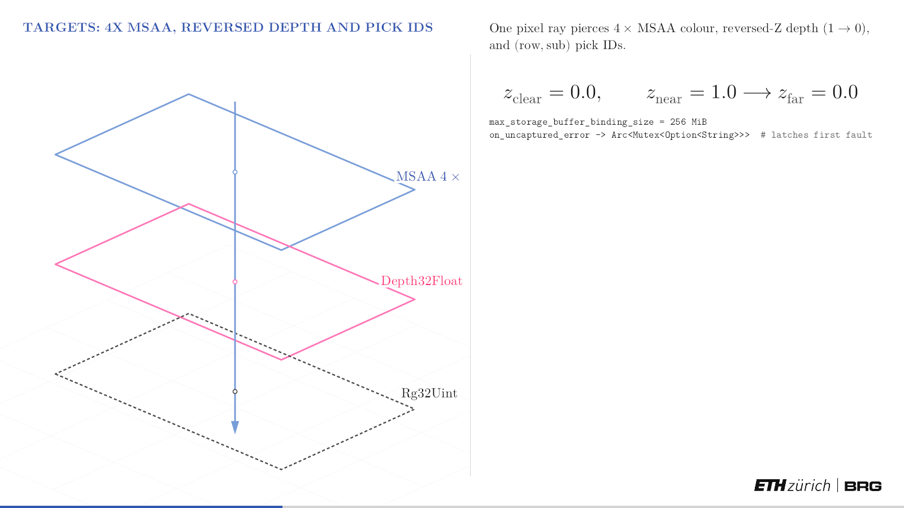

# Tutorial 2 · WebGPU and `wgpu` initialization

## Goal

Acquire a WebGPU adapter and bounded device (`256 MiB` storage buffer cap, first-error latch), configure MSAA, reverse-Z `Depth32Float`, and `Rg32Uint` pick targets, and present a paced white frame across viewport resizes.

## Diagram



Stage deck source: [`02-wgpu.yaml`](../../examples/stage/tutorials-foundations/02-wgpu.yaml).

## Prerequisites and files

Requires [Tutorial 1](tutorial-one-startup.md). Introduces `device`, `diagnostics`, `view`, `targets`, `present`, `frame`, `pacing`, `context`, and `examples/course/frame.rs`.

Owned files in build order (`9` files):

1. `src/engine/gpu/device.rs`
2. `src/engine/diagnostics.rs`
3. `src/engine/gpu/view.rs`
4. `src/engine/gpu/targets.rs`
5. `src/engine/gpu/present.rs`
6. `src/engine/gpu/frame.rs`
7. `src/engine/gpu/pacing.rs`
8. `src/engine/gpu/context.rs`
9. `examples/course/frame.rs`

## Build

### Step 1 · `src/engine/gpu/device.rs`

Write `src/engine/gpu/device.rs` to select `BROWSER_WEBGPU` on wasm or `PRIMARY` natively, cap `max_storage_buffer_binding_size` at `256 MiB`, prefer an sRGB surface format, and store the first uncaptured GPU error or device loss in `Arc<Mutex<Option<String>>>`.

```rust
--8<-- "session_viewer/src/engine/gpu/device.rs"
```

### Step 2 · `src/engine/diagnostics.rs`

Forwards optional `viewerDiagnostic` events and query-stripped `phase` load durations/bytes on `wasm32` while remaining a zero-cost no-op natively.

```rust
--8<-- "session_viewer/src/engine/diagnostics.rs"
```

### Step 3 · `src/engine/gpu/view.rs`

Stores view flags (`0.95` desktop face opacity, `1.0` coarse-pointer default, Arctic auto-outlines, and DPR cap `<= 2`).

```rust
--8<-- "session_viewer/src/engine/gpu/view.rs"
```

### Step 4 · `src/engine/gpu/targets.rs`

Allocates reverse-Z depth, optional `4×` MSAA colour, `2×u16` triangle-ID attachments and `1×1` sample-type-matched placeholders.

```rust
--8<-- "session_viewer/src/engine/gpu/targets.rs"
```

### Step 5 · `src/engine/gpu/present.rs`

`src/engine/gpu/present.rs` updates frame uniforms, widgets and text, reconfigures suboptimal/outdated surfaces, submits the encoded frame, and schedules idle post-present pipeline warming.

```rust
--8<-- "session_viewer/src/engine/gpu/present.rs"
```

### Step 6 · `src/engine/gpu/frame.rs`

Packs `FrameInput`, `FrameCx` and the checked `80 B` `LineUniform`, installing `@group(0..2)` bindings via `Binds::set`.

```rust
--8<-- "session_viewer/src/engine/gpu/frame.rs"
```

### Step 7 · `src/engine/gpu/pacing.rs`

`src/engine/gpu/pacing.rs` (`FramePacing`) gates redraws behind an `Arc` acquire/release queue-completion callback so slow frames never build an unbounded submission backlog.

```rust
--8<-- "session_viewer/src/engine/gpu/pacing.rs"
```

### Step 8 · `src/engine/gpu/context.rs`

Owns `Gpu` (`device`, `queue`, `Targets`, `ObjectRows`, fixed/registered `Lane`s via `lane_list!`, `Pass`es, `Picker` and `PassTimer`).

```rust
--8<-- "session_viewer/src/engine/gpu/context.rs"
```

### Step 9 · `examples/course/frame.rs`

`examples/course/frame.rs` runs the Tutorial 2 browser checkpoint (`?tutorial=frame`), opening the WebGPU device, configuring the `#canvas` surface, and clearing to solid white across resizes. Trap: clone `EventLoopProxy` before spawning `wasm_bindgen_futures::spawn_local` so the async adapter/device handshake delivers the initialized GPU back into `winit`.

```rust
--8<-- "session_viewer/examples/course/frame.rs"
```

## Integration

`src/engine/gpu/mod.rs` activates `device`, `view`, `targets`, `present`, `frame`, `pacing`, and `context` (`pub use context::Gpu; pub use frame::FrameInput; pub use view::View;`). `Gpu` (`context.rs`) is constructed once per session (`Gpu::new` on web, `Gpu::new_headless` in native tests) and owns all device-lifetime targets and lazy pipeline caches.

## Run and observe

Run `cargo xtest -p session_viewer first_gpu_error_survives_follow_on_submission_errors` and `cargo xtest -p session_viewer phones_start_solid_and_desktops_keep_nearly_solid_faces`: both unit tests pass, and `cargo run --example course_frame --target x86_64-unknown-linux-gnu` writes a solid `640x480` white `lesson.ppm` via `Gpu::new_headless`.

## Predict and try

Predict which error `DeviceError` keeps when an invalid shader compilation is immediately followed by three cascading command-buffer submission errors. Inspect `device.rs` (`first_gpu_error_survives_follow_on_submission_errors`): `Mutex<Option<String>>::get_or_insert` latches the *first* root-cause error and ignores noisy follow-on submission failures.

## Question and answer

**Why does `Targets` clear the `Depth32Float` attachment to `0.0` with `CompareFunction::GreaterEqual` instead of the textbook `1.0` with `LessEqual`?**

**How to work it out:** IEEE-754 `f32` has 24 significand bits whose exponent spacing is finest near `0.0` and coarsest near `1.0`. Under standard `[0, 1]` perspective (`z_near -> 0`, `z_far -> 1`), `1/z` nonlinearity clusters almost the entire scene near `1.0`, wasting exponent precision.

**The answer:** Mapping `z_near -> 1.0` and `z_far -> 0.0` (reverse-Z) cancels the `1/z` perspective compression against `f32`'s exponent distribution near `0.0`. That preserves sub-millimetre depth separation across multi-kilometre architectural models without z-fighting on coplanar beams and strokes, provided every depth attachment clears to `0.0` and compares with `Greater` or `GreaterEqual`.

## Validation

Verified via `cargo xtest -p session_viewer device::` (`first_gpu_error_survives_follow_on_submission_errors`), `targets::tests::msaa_follows_the_adapter`, `view::phones_start_solid_and_desktops_keep_nearly_solid_faces`, and `frame::tests::pick_view_clip_transform`. Browser resize checks (`first-frame-browser.cjs`) require a hardware WebGPU browser.
