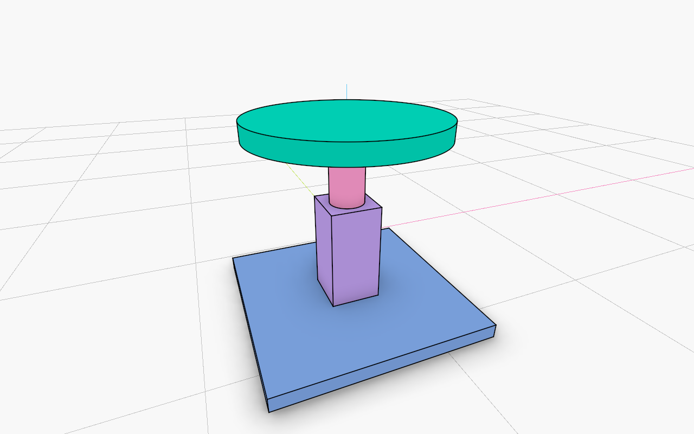
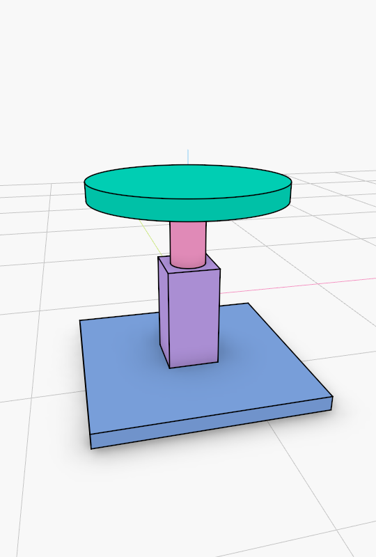
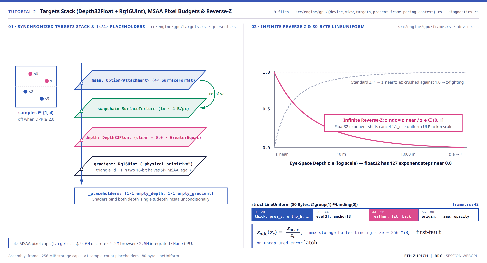

# Tutorial 2 · WebGPU and `wgpu` initialization

## Goal

Acquire a WebGPU adapter and bounded device (`256 MiB` storage buffer cap, first-error latch), configure MSAA, reverse-Z `Depth32Float`, and `Rg32Uint` pick targets, and present a paced white frame across viewport resizes.

 

**What we achieve:** An asynchronous WebGPU device (`256 MiB` storage cap, first-error latch) and synchronized `Targets` stack (`msaa`, `Depth32Float`, and `Rg16Uint` triangle-ID attachments) that survives live desktop and portrait resizes without stretching or zero-size surface panics.

## How it works

`Targets::new` allocates `Depth32Float` (`clear = 0.0`, `GreaterEqual`), optional `4×` MSAA colour (bounded by GPU pixel budgets and turned off at `DPR >= 2.0`), and `Rg16Uint` (`physical.primitive`, storing `triangle_id + 1` in two 16-bit halves) alongside `1×1` placeholder views so shaders bind both `1×` and `4×` textures unconditionally while `frame.rs` packs the `80`-byte `LineUniform`.



## Compilable checkpoint slice

Completes the `frame` assembly (`15` files) started in Tutorial 1 so `cargo check --target wasm32-unknown-unknown --features tutorial` and `trunk serve --features tutorial --open /?tutorial=frame` run standalone.

When typing from an empty folder (`session_viewer/` + `viewer-core/`), start with these **minimal `frame` module roots** (`15` files total in the `frame` checkpoint) instead of the final 388-file `lib.rs`/`mod.rs` indexes below—that way `cargo check --target wasm32-unknown-unknown` compiles immediately at Tutorial 1:

```rust
// viewer-core/src/lib.rs (empty at checkpoint `frame`)

// src/lib.rs (at checkpoint `frame`)
/// A WGSL file from src/shaders as build.rs wrote it: no comments, indentation or blank lines.
macro_rules! shader {
    ($name:literal) => {
        include_str!(concat!(env!("OUT_DIR"), "/shaders/", $name))
    };
}

mod engine;
pub mod app;
#[cfg(all(target_arch = "wasm32", feature = "tutorial"))]
#[path = "../examples/course/entry.rs"]
mod course;

// src/engine/mod.rs
pub mod gpu;

// src/engine/gpu/mod.rs
pub mod device; // register:device

// src/app/mod.rs
#[cfg(target_arch = "wasm32")]
pub mod launch;

// examples/course/registration.rs
// --8<-- [start:course-registration]
#[path = "canvas.rs"]
mod canvas;
#[path = "frame.rs"]
mod frame;

type Start = fn() -> Result<(), wasm_bindgen::JsValue>;
pub(super) const STARTS: &[(&str, Start)] = &[
    ("frame", frame::start),
];
// --8<-- [end:course-registration]
```

## Core code walkthrough

### Adapter selection & `256 MiB` storage limit (`src/engine/gpu/device.rs:20:65`)

```rust
--8<-- "session_viewer/src/engine/gpu/device.rs:20:65"
```

`DeviceSetup` (lines `21–28`) pairs `surface: Option<Surface<'static>>` (`None` in headless CLI/tests, `Some` in browser) with `failure: Arc<Mutex<Option<String>>>` so the first uncaptured WebGPU validation error latches once without being overwritten by cascading submission failures. Lines `58–64` raise `max_storage_buffer_binding_size` from WebGPU's conservative `128 MiB` default up to `adapter.limits().min(256 MiB)` so million-triangle arenas bind in a single storage slab.

### Synchronized `1×` / `4×` `Targets` & `1×1` stubs (`src/engine/gpu/targets.rs:16:88`)

```rust
--8<-- "session_viewer/src/engine/gpu/targets.rs:16:88"
```

Post-processing passes (SSAO, silhouettes, ink occlusion) bind *both* `texture_depth_2d` (`depth_single`) and `texture_depth_multisampled_2d` (`depth_msaa`) in one shared bind-group layout. Rather than recompiling shader layouts whenever MSAA switches between `1×` (Retina phones at `DPR >= 2.0`) and `4×` (desktop), lines `48–76` allocate tiny `(1, 1)` placeholder textures (`_placeholders`) for the inactive sample count, alongside `Rg16Uint` (`physical.primitive`, storing `triangle_index + 1` split across two 16-bit channels).

## Prerequisites and files

Requires [Tutorial 1](tutorial-one-startup.md). Introduces `device`, `diagnostics`, `view`, `targets`, `present`, `frame`, `pacing`, `context`, and `examples/course/frame.rs`.

**Core files to type inline (5 files):**

1. `src/engine/gpu/device.rs`
2. `src/engine/gpu/targets.rs`
3. `src/engine/gpu/frame.rs`
4. `src/engine/gpu/present.rs`
5. `examples/course/frame.rs`

**Reference catalog & test files (4 files, folded below):** `src/engine/diagnostics.rs`, `src/engine/gpu/view.rs`, `src/engine/gpu/pacing.rs`, `src/engine/gpu/context.rs`.

## Build

### Step 1 · `src/engine/gpu/device.rs`

Write `src/engine/gpu/device.rs` to select `BROWSER_WEBGPU` on wasm or `PRIMARY` natively, cap `max_storage_buffer_binding_size` at `256 MiB`, prefer an sRGB surface format, and store the first uncaptured GPU error or device loss in `Arc<Mutex<Option<String>>>`.

```rust
--8<-- "session_viewer/src/engine/gpu/device.rs"
```

### Step 2 · `src/engine/gpu/targets.rs`

Allocates reverse-Z depth, optional `4×` MSAA colour, `2×u16` triangle-ID attachments and `1×1` sample-type-matched placeholders.

```rust
--8<-- "session_viewer/src/engine/gpu/targets.rs"
```

### Step 3 · `src/engine/gpu/frame.rs`

Packs `FrameInput`, `FrameCx` and the checked `80 B` `LineUniform`, installing `@group(0..2)` bindings via `Binds::set`.

```rust
--8<-- "session_viewer/src/engine/gpu/frame.rs"
```

### Step 4 · `src/engine/gpu/present.rs`

`src/engine/gpu/present.rs` updates frame uniforms, widgets and text, reconfigures suboptimal/outdated surfaces, submits the encoded frame, and schedules idle post-present pipeline warming.

```rust
--8<-- "session_viewer/src/engine/gpu/present.rs"
```

### Step 5 · `examples/course/frame.rs`

`examples/course/frame.rs` runs the Tutorial 2 browser checkpoint (`?tutorial=frame`), opening the WebGPU device, configuring the `#canvas` surface, and clearing to solid white across resizes. Trap: clone `EventLoopProxy` before spawning `wasm_bindgen_futures::spawn_local` so the async adapter/device handshake delivers the initialized GPU back into `winit`.

```rust
--8<-- "session_viewer/examples/course/frame.rs"
```

## Reference catalog and test files (4 files)

The 5 core files above implement the complete mechanism for this lesson. Expand this reference section whenever you want to inspect or copy the remaining 4 sibling verbs, adapters, and unit-test suites (`Step 6`–`Step 9`).

### Step 6 · `src/engine/diagnostics.rs`

Forwards optional `viewerDiagnostic` events and query-stripped `phase` load durations/bytes on `wasm32` while remaining a zero-cost no-op natively.

```rust
--8<-- "session_viewer/src/engine/diagnostics.rs"
```

### Step 7 · `src/engine/gpu/view.rs`

Stores view flags (`0.95` desktop face opacity, `1.0` coarse-pointer default, Arctic auto-outlines, and DPR cap `<= 2`).

```rust
--8<-- "session_viewer/src/engine/gpu/view.rs"
```

### Step 8 · `src/engine/gpu/pacing.rs`

`src/engine/gpu/pacing.rs` (`FramePacing`) gates redraws behind an `Arc` acquire/release queue-completion callback so slow frames never build an unbounded submission backlog.

```rust
--8<-- "session_viewer/src/engine/gpu/pacing.rs"
```

### Step 9 · `src/engine/gpu/context.rs`

Owns `Gpu` (`device`, `queue`, `Targets`, `ObjectRows`, fixed/registered `Lane`s via `lane_list!`, `Pass`es, `Picker` and `PassTimer`).

```rust
--8<-- "session_viewer/src/engine/gpu/context.rs"
```

## Integration

`src/engine/gpu/mod.rs` activates `device`, `view`, `targets`, `present`, `frame`, `pacing`, and `context` (`pub use context::Gpu; pub use frame::FrameInput; pub use view::View;`). `Gpu` (`context.rs`) is constructed once per session (`Gpu::new` on web, `Gpu::new_headless` in native tests) and owns all device-lifetime targets and lazy pipeline caches.

## Run and observe

Run the native unit tests for the first-error latch, MSAA pixel budgets, and cropped pick-view transforms, then serve the live `?tutorial=frame` WebGPU checkpoint:

```sh
cargo xtest -p session_viewer first_gpu_error_survives_follow_on_submission_errors
cargo xtest -p session_viewer msaa_follows_the_adapter
trunk serve --features tutorial --open /?tutorial=frame
```

Resize the browser window between landscape and narrow portrait aspect ratios: `Targets` rebuilds `Depth32Float`, `4×` MSAA, and `Rg16Uint` attachments cleanly with zero zero-dimension `Surface::configure` panics.

## Predict and try

Predict which error `DeviceError` keeps when an invalid shader compilation is immediately followed by three cascading command-buffer submission errors. Inspect `device.rs` (`first_gpu_error_survives_follow_on_submission_errors`): `Mutex<Option<String>>::get_or_insert` latches the *first* root-cause error and ignores noisy follow-on submission failures.

## Question and answer

**Why does `Targets` clear the `Depth32Float` attachment to `0.0` with `CompareFunction::GreaterEqual` instead of the textbook `1.0` with `LessEqual`?**

??? tip "Think first — click to reveal how to work it out and the answer"
    **How to work it out:** IEEE-754 `f32` has 24 significand bits whose exponent spacing is finest near `0.0` and coarsest near `1.0`. Under standard `[0, 1]` perspective (`z_near -> 0`, `z_far -> 1`), `1/z` nonlinearity clusters almost the entire scene near `1.0`, wasting exponent precision.

    **The answer:** Mapping `z_near -> 1.0` and `z_far -> 0.0` (reverse-Z) cancels the `1/z` perspective compression against `f32`'s exponent distribution near `0.0`. That preserves sub-millimetre depth separation across multi-kilometre architectural models without z-fighting on coplanar beams and strokes, provided every depth attachment clears to `0.0` and compares with `Greater` or `GreaterEqual`.

## Validation

Verified via `cargo xtest -p session_viewer device::` (`first_gpu_error_survives_follow_on_submission_errors`), `targets::tests::msaa_follows_the_adapter`, `view::phones_start_solid_and_desktops_keep_nearly_solid_faces`, and `frame::tests::pick_view_clip_transform`. Browser resize checks (`first-frame-browser.cjs`) require a hardware WebGPU browser.
