# Review visual correctness before advancing

**Visual acceptance is incomplete.** A successful build, aggregate pixel count or loaded image does not prove that the lesson shows its claimed result. Review each lesson’s instructions, source changes, exact fixture, observable behavior and captured scene together. Keep native rendering, browser interaction and critical image review separate.

## CAD bore covered by a second surface

The archived browser image for [Connect current pages to the browser renderer](68ac-connect-current-pages-to-the-browser-renderer.md) combines the CAD bore and a same-colored NURBS roof at the same origin. The roof covers the opening. It also fails to show the promised colored streaming pages clearly. It is not accepted feature evidence.

A diagnostic executed on 2026-10-15 against the recorded 68ac browser bundle used `Close`, `Layers Off`, `View Grid Off`, `Example CAD`, `Fit`, `View Isometric`, then `Example Surface`. The CAD alone has an open hole; adding the roof covers it. This isolates a misleading overlapping fixture rather than demonstrating a BRep triangulation defect. It does not establish fresh acceptance of the current checkpoint.

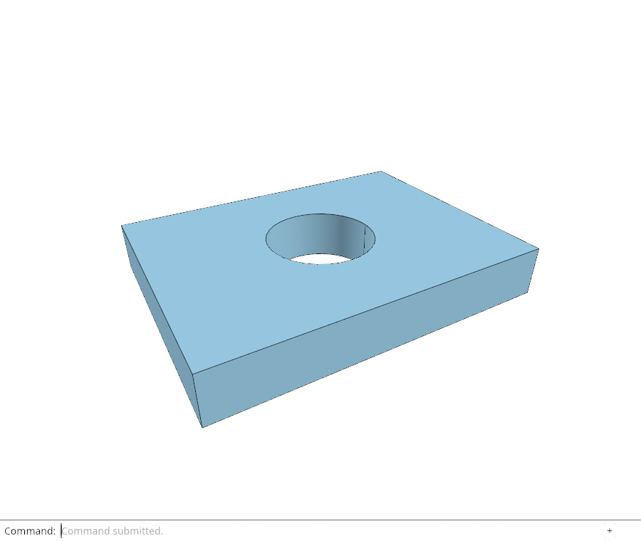

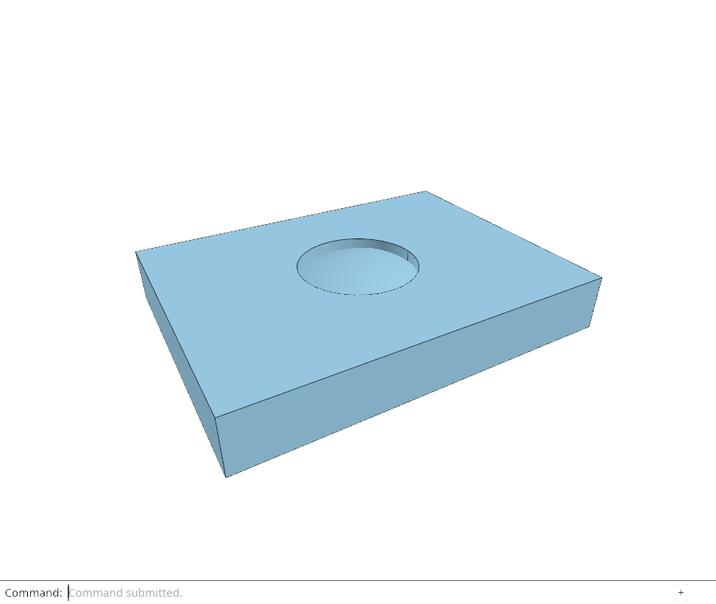

The existing native streaming reference separates the CAD and surface and includes red and blue page samples and a yellow original-point marker. It remains available as a separate native reference, with freshness labeled separately. The corrected browser checker now keeps the actual asserted feature scene on the main page for capture. Fresh canonical builds, all 462 native tests and the full inherited Chrome acceptance suite passed. The final scene was also checked and critically inspected at DPR 2. The white bore center and a contrasting neighboring CAD face are explicit pixel controls; the two cloud instances retain one original source, distinct owners and placements, bounded ranged requests and visible colored pages. Their dense planar blue source is different data from the four-point red/blue native reference.

[Additional actual DPR 2 capture](../screenshots/journey/review/68ac-separated-streaming-dpr2-2026-10-15.png) · [Archived overlapping capture](../screenshots/journey/review/68ac-overlap-before-visual-review-2026-10-15.png).

The review record binds this approval to the current source, checker and image bytes. A change makes it pending again.

## Faint original curves on a network surface

[Read original projection planes](80za-read-original-projection-planes.md) inherits the network example: six original input lines, a network surface and a corner patch. These lines are not a complete set of NURBS isocurves. The image has faint or interrupted interior curves. Its native fixture only checks aggregate filled/dark pixel counts and independent surface coverage; those checks cannot establish visible curve continuity or contrast.

The early image remains an intermediate rendering limitation, not an accepted demonstration of curve visibility. The existing later [fitted-surface stroke implementation](96zy-connect-fitted-surfaces-and-exact-stroke-occlusion.md) already corrects this scene; a second algorithm or an extra tutorial is unnecessary.

A 2026-10-15 diagnostic renders the same network geometry with the learner at the viewing-ray checkpoint and the maintained native viewer at 640×480, with matched isometric orthographic target and distance, opaque surfaces, no ambient occlusion or grid, and one sample. Both show continuous interior curves. At that earlier checkpoint, surface shading differed: the learner applied directional shading, while maintained unlit fill kept the source color. The later flat/Arctic frame lesson below corrects that scoped color difference. This comparison accepts neither complete lighting parity nor every hidden-line case.

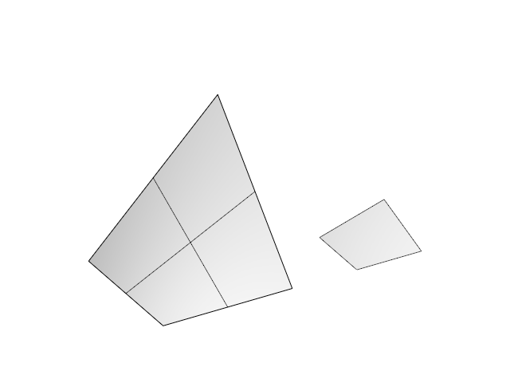

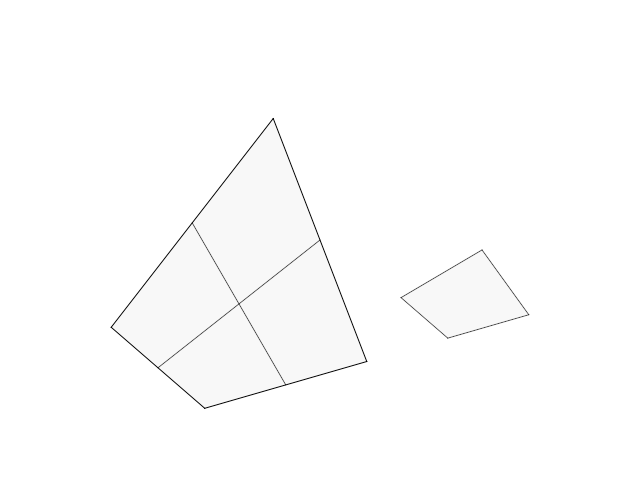

The earlier browser diagnostic also loads the original archive and draws both surfaces and all six input lines. At DPR 1 and 2, both interior curves have contrasting pixels at all 82 sampled positions per curve, excluding ends and their crossing; camera-only movement retains the geometry uploads and produces no page errors. Critical inspection confirms continuous visible curves in these captures. These focused checks do not establish exact stroke width or hidden-line behavior in every view.

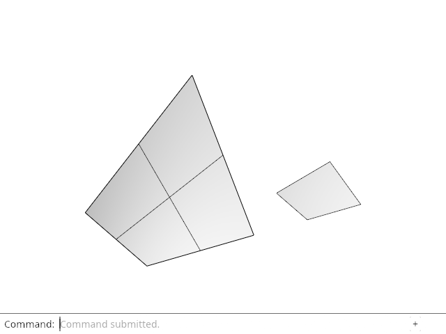

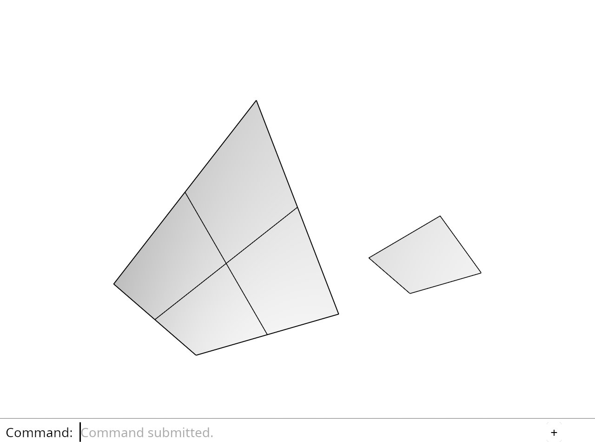

## Whole-course review

The chapter contents now reports automated browser freshness separately from critical visual acceptance. The remaining chapter references are awaiting critical review. Existing generic browser captures are retained as historical artifacts; their presence is not feature-specific visual approval. Continue the full viewer implementation while resolving each current lesson’s correctness, ownership, architecture and measured performance before advancing.

## Shared ray and construction-plane depth

The revised [viewing-ray lesson](96zzzzzzd-build-viewing-rays-without-matrix-inversion.md) includes the current depth policy in the same helper, avoiding an extra tutorial. All 945 native tests and the full inherited browser acceptance pass. These are actual asserted feature scenes, with no replacement by a generic calibration picture.

The top-view Box is intentionally a square: its original coordinates place it below XY. Grid off/on keeps the exact camera matrix and opaque face pixels, restores the hidden-grid frame exactly and selects the original GPU owner. Point placement in each projection remains under the actual pointer and keeps its original coordinates through Undo/Redo. These assertions and direct inspection cover both DPR 1 and 2. The images establish this camera behavior; they do not establish complete lighting or rendering parity.

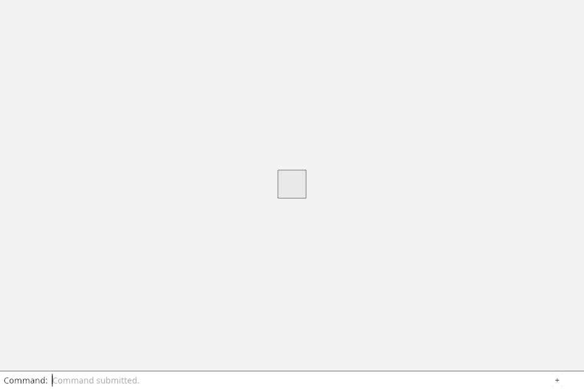

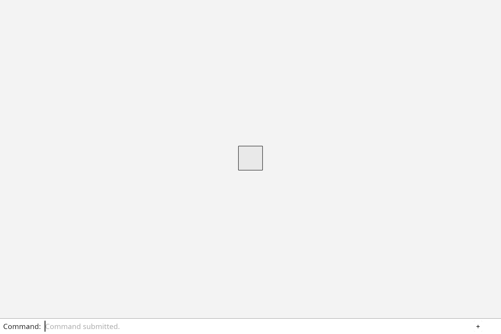

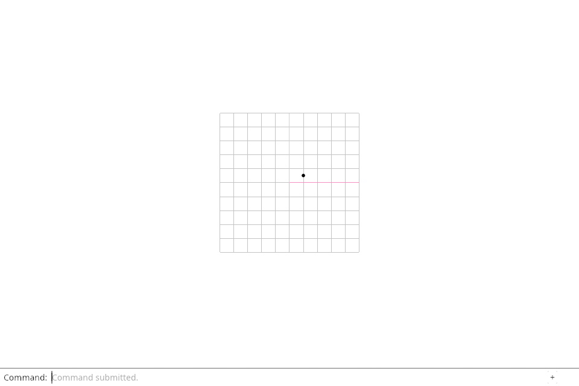

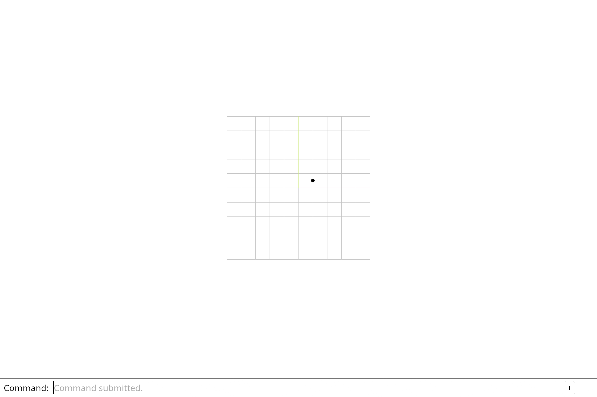

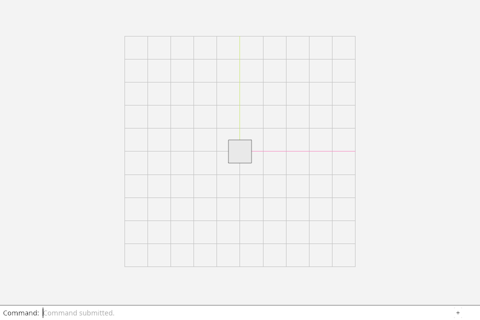

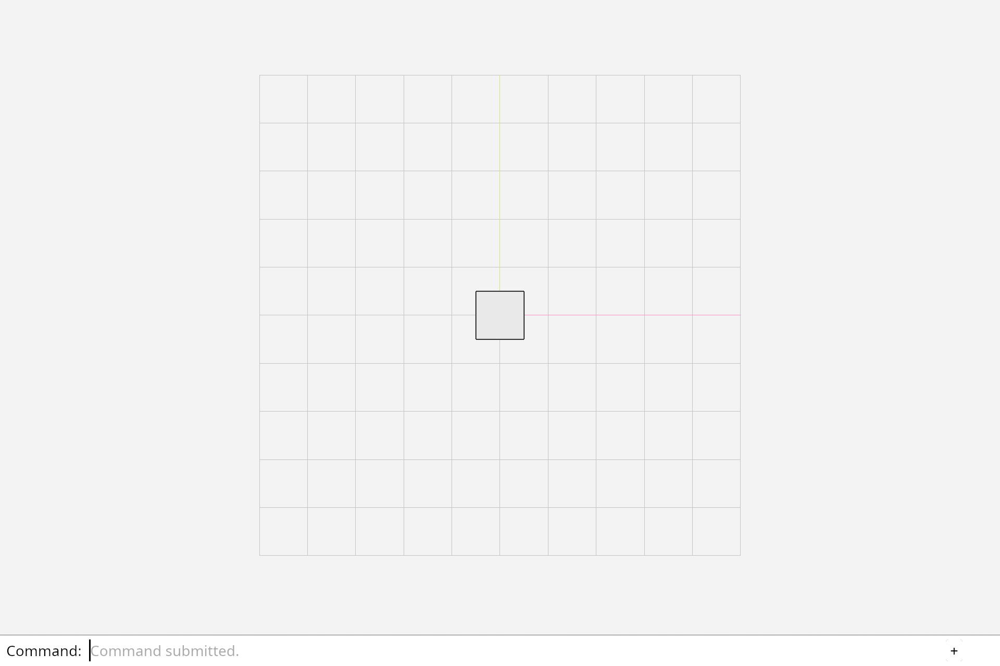

## Late originals and cached camera extent

The [cached camera extent lesson](96zzzzzze-grow-camera-depth-from-cached-world-bounds.md) uses a Box whose base is at Z = −20,000 scene units. The declared sequence resets the three-metre view, selects Top/Orthographic and hides the grid, without Fit. The preceding1321 bundle clips the original; the revised viewer draws and picks it. These captures use the same Box recipe and pose, with separately created source identities.

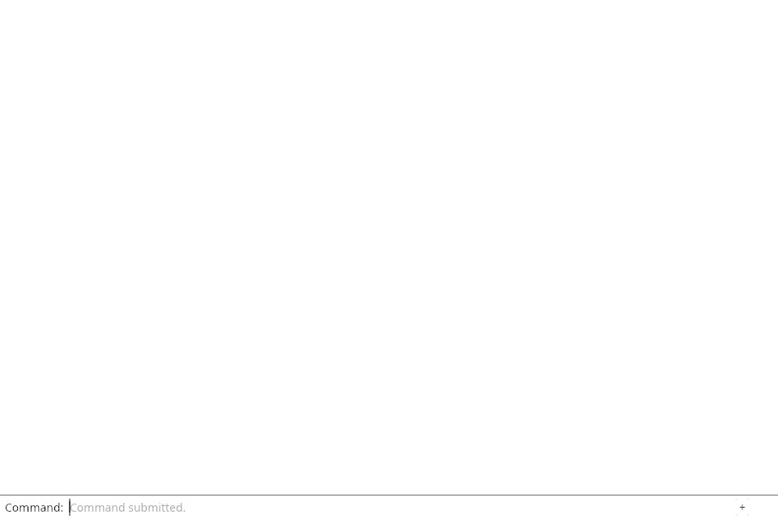

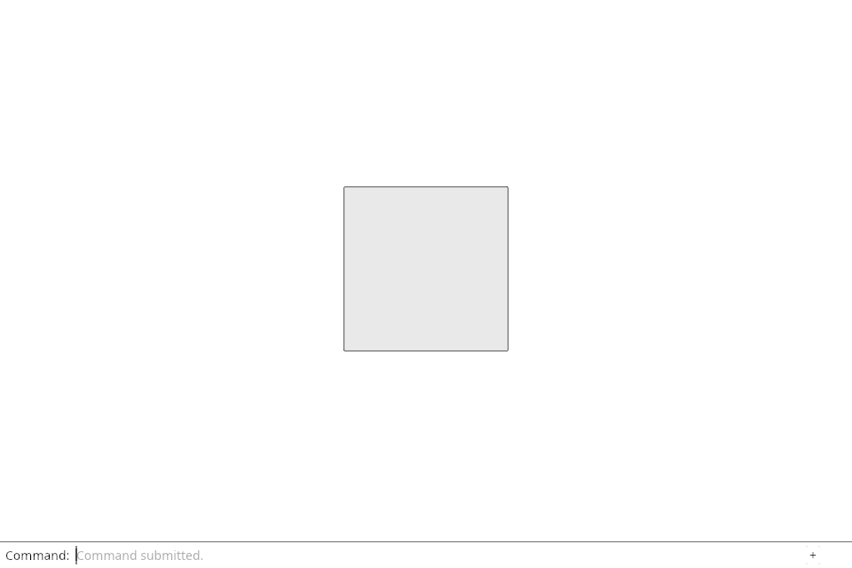

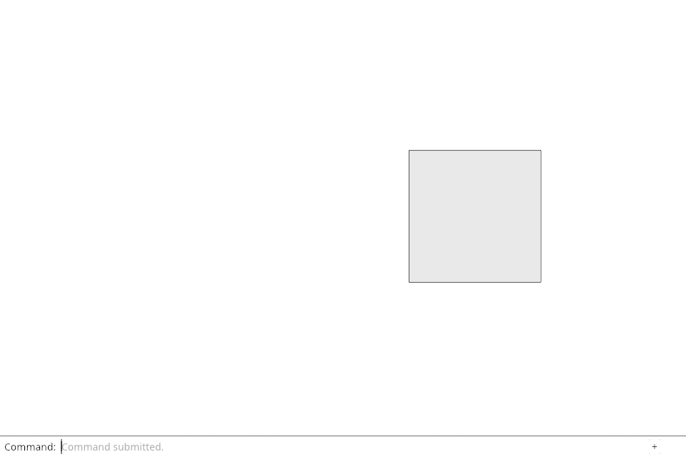

The top view is intentionally a square. Both pixel densities pass actual depth, contrasting-face and GPU-owner checks, exact Zoom/Undo/Redo restoration and unchanged original geometry uploads. [Actual DPR 2 original](../screenshots/journey/review/96zzzzzze-grow-camera-depth-from-cached-world-bounds-dpr2.png) · [Actual DPR 2 moved original](../screenshots/journey/review/96zzzzzze-grow-camera-depth-from-cached-world-bounds-moved-dpr2.png). The separate native preview fixture checks derived text metrics; this is not a network-font browser acceptance claim.

The cache retains only numeric bounds. Native weak-owner controls verify that original geometry can be released while the renderer survives. Camera-only updates use eight corners; no measured FPS improvement is claimed. The radius grows monotonically, while the first positive scene extent can replace the empty-scene distance fallback and change depth coefficients. The inherited ray comparison declares a real offscreen Box to hold that extent fixed; every original matrix, coordinate, pixel and history assertion remains. Ancestor checks leave earlier reviewed images untouched.

## Wheel input and visible projection framing

The [navigation lesson](96zzzzzzf-match-wheel-input-and-framed-projection.md) uses a six-metre-wide Box and an actual original Line on its upper face. Top/Orthographic intentionally crops the Box while keeping both line endpoints visible. Switching to perspective fits the projected corners of the visible rectangle. The previous bundle cuts off the line endpoints; the current viewer preserves them. These captures use the same recipes and pose with separately created source identities.

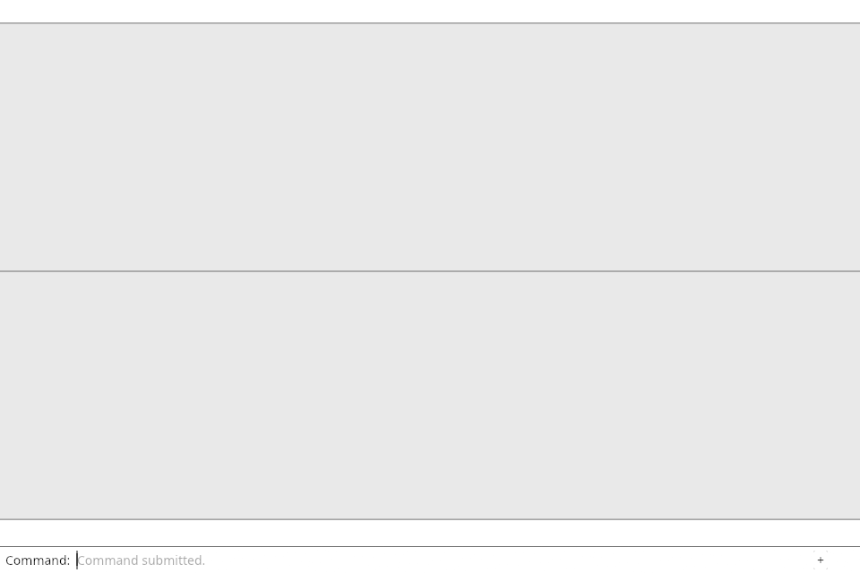

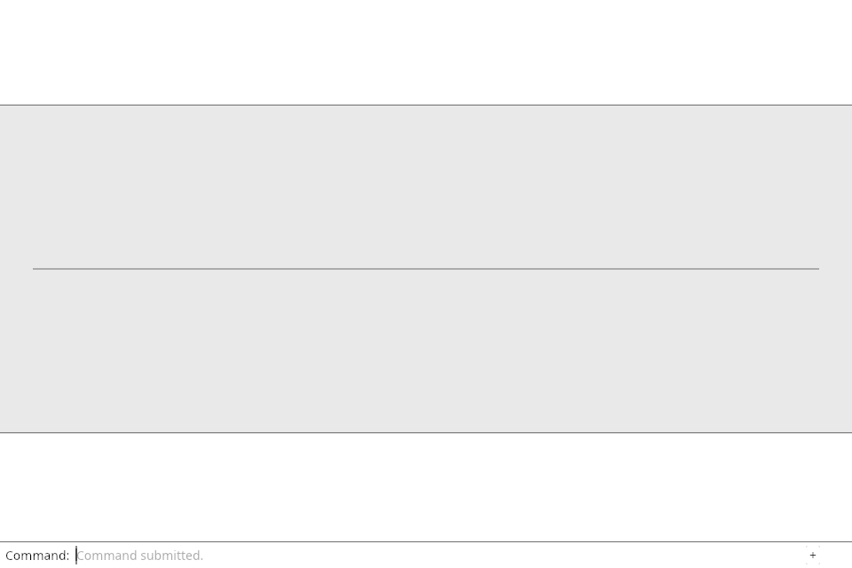

The full sequence checks actual endpoint pixels, active-mode no-op, reverse target-plane framing, exact reset/repeated images and unchanged original geometry uploads at DPR 1, 2 and 3. [Actual DPR 2 perspective](../screenshots/journey/review/96zzzzzzf-match-wheel-input-and-framed-projection-perspective-dpr2.png) · [Actual DPR 3 perspective](../screenshots/journey/review/96zzzzzzf-match-wheel-input-and-framed-projection-perspective-dpr3.png). The line is continuous; pixel coverage differs with antialiasing. The current density cap remains two at DPR 3. This is not complete renderer acceptance.

The separate [wheel scene](../screenshots/journey/review/96zzzzzzf-match-wheel-input-and-framed-projection-wheel-dpr2.png) records actual trusted DOM deltas before computing the expected physical amount. Synthetic events separately check explicit logical-pixel, line, page and overflow domains. Wheel zoom retains target-plane anchoring and original geometry. Both new regression assertions fail against the preceding bundle. No loading-time or frame-rate improvement is claimed. Bounds are evaluated only on an actual orthographic-to-perspective command; camera-only zoom keeps the numeric cache and existing owners.

## Flat fill, Arctic sky and wide ambient cameras

The [flat/Arctic frame lesson](96zzzzzzg-share-current-surface-lighting-and-camera-uniforms.md) keeps the original six input lines and two NURBS surfaces from the same saved archive used by the maintained-native diagnostic above. The flat-mode interior samples now match its actual source color reference of RGB (248, 248, 248). This is a controlled color comparison; the browser free frame can differ from the native viewport, so these are not whole-frame parity images.

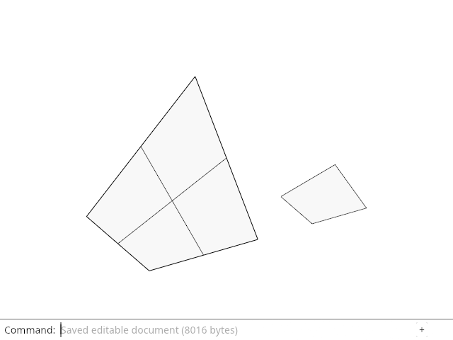

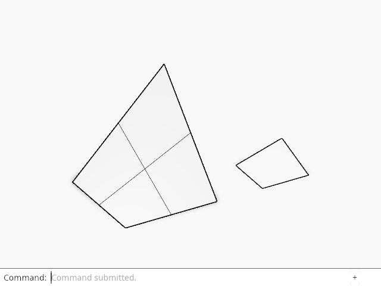

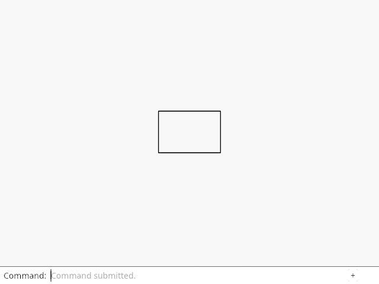

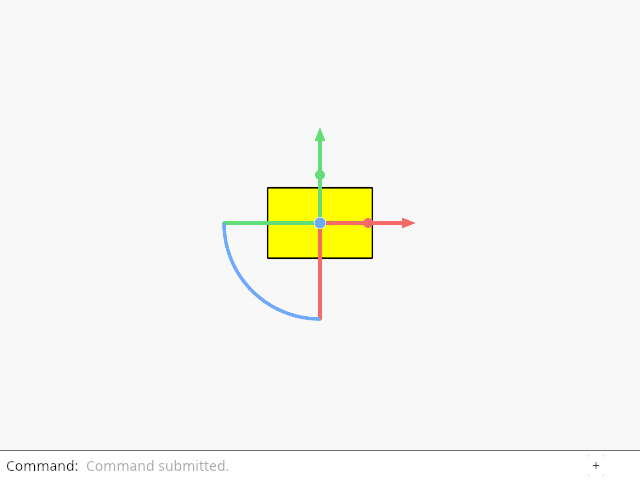

At DPR 1 and 2, all 82 samples on each interior original input curve remain visible. Four interior samples on the separate original corner patch match the maintained-native flat reference. Arctic changes actual surface interiors independently of its background. Explicit Arctic Off and Outline Off restore exact flat pixels; two actual Save downloads retain identical original archive bytes. The final main page repeats the asserted Arctic scene. These are original input curves, not a complete NURBS isocurve grid.

**Scoped review:** Single-sample Arctic outlines remain an intermediate result; multisampling, boundary policy, production ambient inputs, headlight and backface controls still require implementation and visual review. The visible jagged outlines have not been accepted as complete Arctic rendering quality. [DPR2 flat](../screenshots/journey/review/96zzzzzzg-share-current-surface-lighting-and-camera-uniforms-flat-dpr2.png) · [DPR2 Arctic](../screenshots/journey/review/96zzzzzzg-share-current-surface-lighting-and-camera-uniforms-arctic-dpr2.png) · [DPR2 wide zoom](../screenshots/journey/review/96zzzzzzg-share-current-surface-lighting-and-camera-uniforms-wide-dpr2.png).

The wide-camera control uses a centered Box with width 6000, depth 4000 and height 1000 scene units, Top/Orthographic and three twofold Zoom Out commands. The [preceding bundle](../screenshots/journey/review/surface-lighting-before-wide-1323.png) reports an invalid ambient camera inverse; the current viewer keeps actual ambient passes and contrasting original pixels. Actual GPU picking selects the original owner and produces a yellow interior face pixel; clearing selection restores the exact wide image. Zooming back restores exact matrices, pixels and saved archive bytes. These Box captures use the same recipe and declared pose, with separately generated source identities. The six-level depth pyramid is separately exercised through its native API; it is not enabled by this browser fixture.

The inherited extent evidence retains every depth, matrix, GPU-owner, history, source and geometry-upload assertion. Its old brightness threshold assumed Lambert shading; a descendant-only checker now verifies exact current unlit RGB (248, 248, 248) against the declared white RGB (255, 255, 255). Earlier accepted checkers and images stay unchanged. The same row-scaled inverse already used by clipping now serves both camera consumers. One frame size and stack encoder feeds shared surface drawing and original picks, while ink/sheet lanes keep their own existing frame owners. No original geometry is copied for a view change. The encoder removes transient byte-vector allocations in those three paths; no measured loading-time or frame-rate gain is claimed.
An inherited horizontal-line check also assumed the darker Lambert fill. The actual current learner and [independently rendered maintained native reference](../screenshots/journey/review/surface-line-maintained-native-2026-10-15.png) both produce RGB (183, 183, 183) on the two half-covered pixel rows over RGB (248, 248, 248). The descendant check now uses that measured one-sample DPR1 reference instead of the obsolete cutoff 180; its existing dense-DPR contrast and every geometry/framing/restoration assertion remain. The native capture uses the same Box/Line recipe and aligns the line row through the declared camera target; this is a coverage/color comparison, with separately generated source identities, not whole-frame parity.

## Current headlight and original backfaces

The [headlight/backface lesson](96zzzzzzh-connect-headlight-and-backface-controls.md) uses one original mesh with two planar patches of opposite winding. The same saved archive is independently rendered by the maintained native viewer and imported by Chrome. Original coordinates span 1400 × 1000 mm; Isometric/Fit shows the whole mesh for the headlight comparison. Framing can differ between the native full viewport and the browser command-dock free frame, so this compares actual interior colors and behavior, not whole-frame parity.

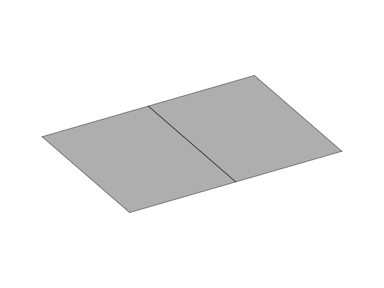

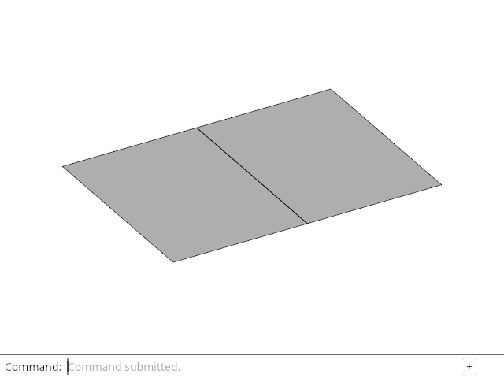

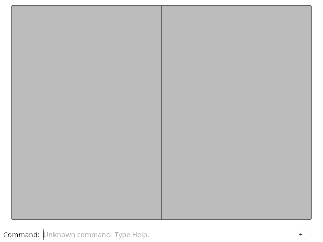

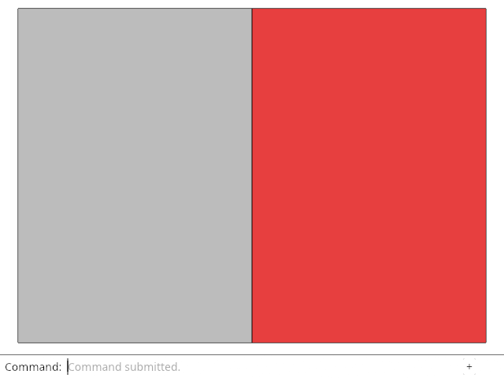

At DPR 1 and 2, flat interior colors match sRGB (188,188,188), wrapped headlight matches (174,174,174), and the reversed patch matches backface red (231,63,63) while the front patch stays gray. Headlight Off and Backfaces Off each restore exact drawing pixels. Arctic sky takes precedence over optional headlight. Presentation commands retain a pending original line point; source placements and geometry uploads stay unchanged. Native checks separately cover both projections, mirrored original orientation and exact shared/fallback surface records. [Flat DPR1](../screenshots/journey/review/96zzzzzzh-connect-headlight-and-backface-controls-flat-dpr1.png) · [headlight DPR2](../screenshots/journey/review/96zzzzzzh-connect-headlight-and-backface-controls-headlight-dpr2.png) · [backfaces DPR2](../screenshots/journey/review/96zzzzzzh-connect-headlight-and-backface-controls-backfaces-dpr2.png) · [maintained flat](../screenshots/journey/review/surface-controls-maintained-native-flat-mm-2026-10-15.png) · [maintained backfaces](../screenshots/journey/review/surface-controls-maintained-native-backfaces-mm-2026-10-15.png).

Raw mesh archive bytes can differ even between two immediate unchanged saves: the protobuf mesh vertex, face and triangulation maps have unspecified entry order. An independent native control checks complete decoded protobuf equality and presentation metadata. The browser comparison preserves every record and normalizes only those three map orders; it does not discard coordinates, winding, identities, colors or attributes. This is exact original-record preservation, without a raw-byte determinism claim. Earlier tiny or cropped fixtures were rejected before acceptance; current comparisons show the whole original at the declared physical scale. Contact fill/boundary depth, current ambient inputs, pass order, multisampling and adaptive quality still require implementation and visual review. No loading-time or frame-rate improvement is claimed.

## Shared color and ink frame

The [shared-frame lesson](96zzzzzzi-share-one-frame-across-color-and-ink.md) imports exactly the same saved six-line/two-NURBS scene plus one original point as the accepted preceding implementation. At DPR 1 and 2, every drawing pixel matches that preceding scene. The viewport, density and opacity prefix is shared by ordinary ink; surface settings and the existing kernel-derived eye follow it. Integer picking borrows its own captured request frame.

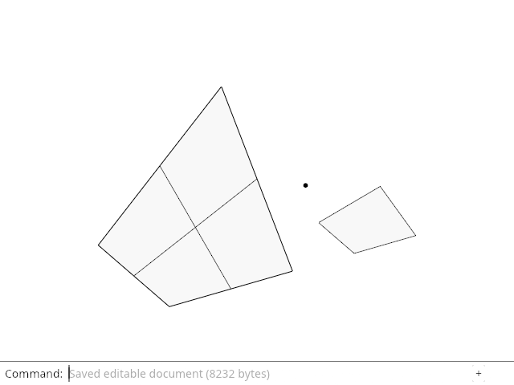

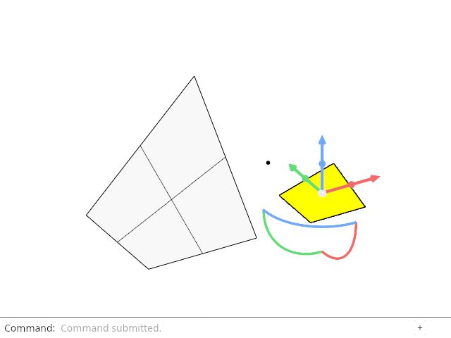

Real GPUDevice/GPUQueue API observations at both densities show 13 separate ink uniforms totaling 1,040 bytes disappear. The existing color and pick frames each grow by 16 bytes, leaving a net saving of 1,008 static uniform-buffer bytes. Bindings borrow the existing owners; no additional camera or Scene is retained.

The measured Zoom Out/Zoom In command pair produces 42 color frames, including typed-command UI redraws. These are actual scoped buffer writes:

| Frame writes | Preceding implementation | Shared frame |
| --- | ---: | ---: |
| Color frame | 42 × 96 bytes | 42 × 112 bytes |
| Three active ordinary ink lanes | 126 × 80 bytes | 0 |
| Calibrated sheet frame | 42 × 80 bytes | 42 × 80 bytes |

The separate sheet value is a projection scale used by world-radius strokes, rather than ordinary ink opacity. Its frame stays independent. Text, cloud and widget domains also retain their existing owners where their fields differ. Native tests retain exact pixels and original picks while a later color camera differs from the in-flight request, across both projections and densities. The original archive, placements and geometry uploads remain unchanged after navigation and selection. [DPR2 originals](../screenshots/journey/review/96zzzzzzi-share-one-frame-across-color-and-ink-originals-dpr2.png) · [DPR2 original pick](../screenshots/journey/review/96zzzzzzi-share-one-frame-across-color-and-ink-selected-dpr2.png) · [preceding DPR1](../screenshots/journey/review/shared-view-before-1325-dpr1.png) · [preceding DPR2](../screenshots/journey/review/shared-view-before-1325-dpr2.png).

This is a measured resource/write reduction with exact behavior preservation. It does not establish a loading-time or GPU frame-rate gain. Contact fills/boundary depth, production ambient inputs/order, multisampling and adaptive quality remain unfinished.

## Original contact polygons

The [contact lesson](96zzzzzzj-fill-original-contact-polygons.md) imports exactly the same saved original Element as the maintained-native comparison. Its nine-edge contact has three initially collinear corners and a concave open notch. Full-ring normals and the existing kernel triangulation retain that original area. The one derived mesh keeps Parts, so the existing mesh-ink collector draws the black1px perimeter without a second boundary Polyline.

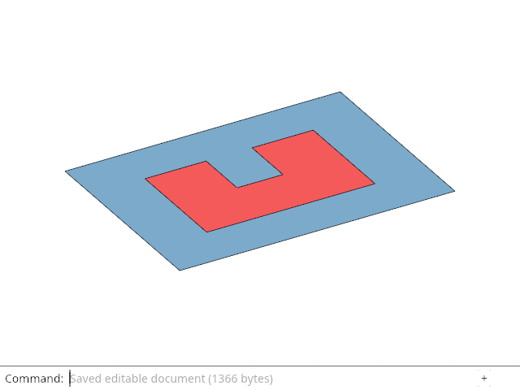

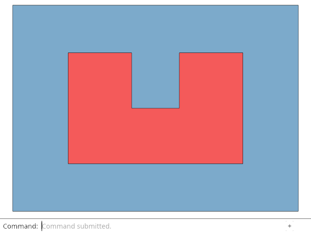

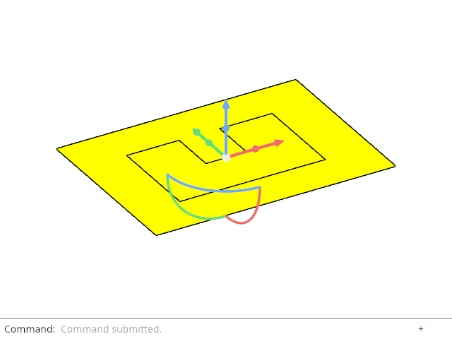

At actual DPR1 and2, Top and Isometric fill colors match the independently rendered maintained original: red RGB244/90/90 and blue host RGB124/170/203 in the sRGB image. These are actual screenshot colors; native unorm GPU fixture values are a separate domain. [Maintained Top](../screenshots/journey/review/contact-fill-maintained-native-top-2026-10-15.png) · [maintained Isometric](../screenshots/journey/review/contact-fill-maintained-native-iso-2026-10-15.png) · [current DPR2 Top](../screenshots/journey/review/96zzzzzzj-fill-original-contact-polygons-originals-top-dpr2.png) · [current DPR2 Isometric](../screenshots/journey/review/96zzzzzzj-fill-original-contact-polygons-originals-isometric-dpr2.png) · [current DPR2 original pick](../screenshots/journey/review/96zzzzzzj-fill-original-contact-polygons-selected-isometric-dpr2.png). Camera framing differs; full-frame parity is not claimed.

Real GPU selection returns the original Element rather than a generated mesh. Clear selection, zoom, lighting/backfaces, interaction visibility and one original-parent Move/Undo restore exact drawing pixels. Every decoded archive field is retained, including the embedded original mesh and feature metadata. The comparison normalizes only known protobuf Mesh map-entry order; it does not claim byte-deterministic serialization. Independent native controls compare all original Element fields and the complete decoded Mesh.

Native actual depth-texture readback verifies that the color contact is closer than its coplanar host, within the current bounded depth layer. A real nearer original surface still wins both color and integer picking. Original coordinates and the source-projection compute remain on the original plane. The preceding implementation correctly fails the new missing-fill control and displays only the original outline. Full contact boundary depth, source-face feature policy, current ambient inputs/order, multisampling and adaptive quality remain unfinished.

## Broadcast original ink metadata

The [metadata lesson](96zzzzzzk-broadcast-ordinary-ink-metadata.md) loads two frozen original polylines with 8,192 points each. Their 16,382 segments remain continuous in Top and Isometric at both display densities. They are source polylines, not a NURBS isocurve grid. The existing ordinary path batch uses one four-byte clipping flag on CPU and GPU; selected path ink adds one more four-byte record.

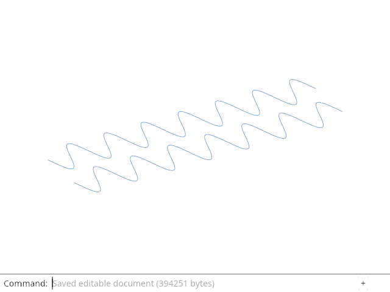

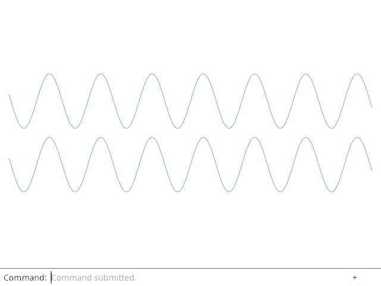

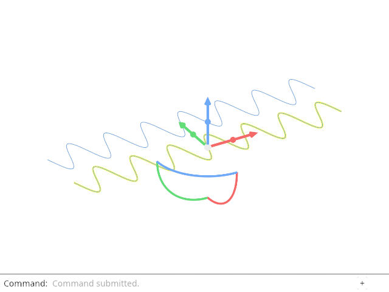

Actual GPU picks at first, middle and last sampled positions of each original work at DPR1/2 and on the final main page. Clearing, zoom and Delete/Undo restore exact drawing pixels, source coordinates, original tree placement, complete decoded archive fields and geometry counters. Empty-scene metadata drops to zero. The preceding viewer fails the intended 65,528 versus 4 byte allocation assertion on this identical source. [Current DPR2 Top](../screenshots/journey/review/96zzzzzzk-broadcast-ordinary-ink-metadata-originals-top-dpr2.png) · [current DPR2 Isometric](../screenshots/journey/review/96zzzzzzk-broadcast-ordinary-ink-metadata-originals-isometric-dpr2.png) · [current DPR2 original pick](../screenshots/journey/review/96zzzzzzk-broadcast-ordinary-ink-metadata-selected-isometric-dpr2.png).

Independent Native fixtures exercise 8,192 original line, path and marker instances per batch, reducing each metadata allocation from 32,768 to 4 bytes on CPU and GPU. Thirty-two separated original lines all draw and return their actual integer owners at two densities. Indexed mixed clipping flags retain their per-instance records. This is measured metadata memory and GPU addressing; it is not a frame-rate or whole-viewer memory claim. Contact-boundary tolerance, source-face feature policy, current ambient inputs/order, multisampling and adaptive quality remain unfinished.

## Original contact boundary depth

The [contact boundary lesson](96zzzzzzl-layer-original-contact-boundaries.md) keeps the complete original contact perimeter visible at steep angles. The whole host fits in the photographs; the red concave contact retains its empty notch and black perimeter at both display densities. An earlier capture cropped the host and was rejected before installation.

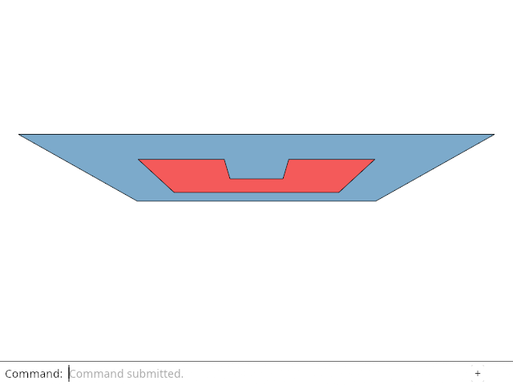

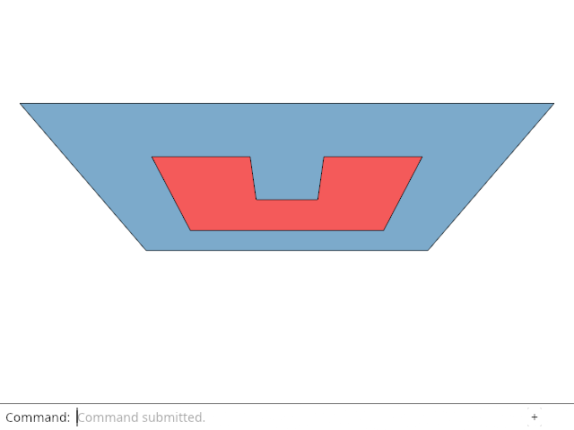

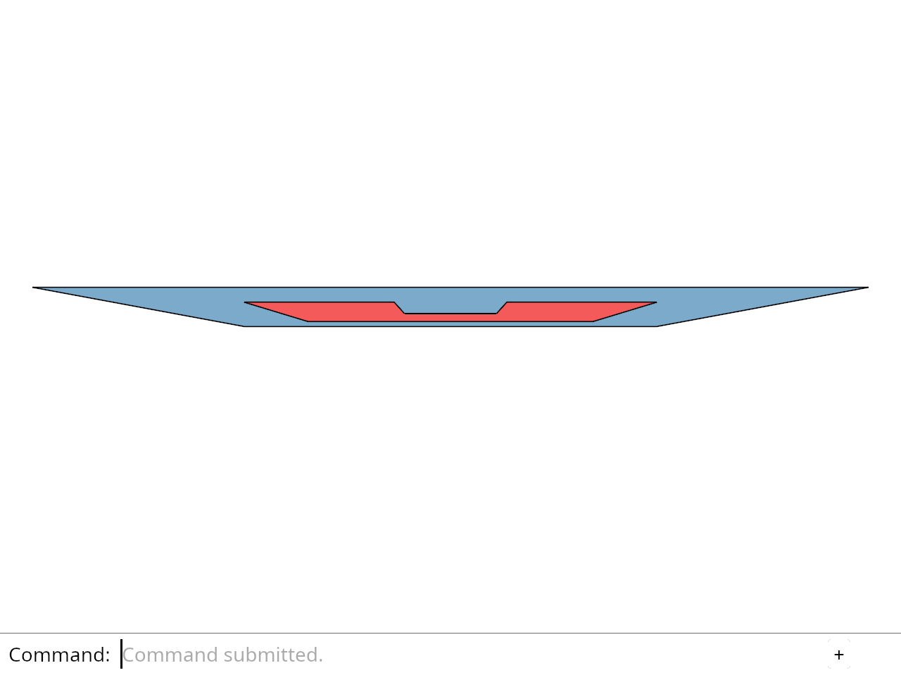

Actual Chrome checks all nine edges at 27 sample positions, both projections, three steep angles and DPR1/2. Intermediate parent Rotate and Move placements are checked before Undo; parent and derived contact follow the same transform. Cropped GPU picks select the original parent. Exact drawing pixels, camera matrices, original coordinates and every decoded archive record return after Undo. [Current DPR1 75°](../screenshots/journey/review/96zzzzzzl-layer-original-contact-boundaries-steep-75-dpr1.png) · [current DPR2 60°](../screenshots/journey/review/96zzzzzzl-layer-original-contact-boundaries-steep-60-dpr2.png) · [current DPR2 75°](../screenshots/journey/review/96zzzzzzl-layer-original-contact-boundaries-steep-75-dpr2.png).

Independent Native tests compare every pixel across the complete transformed contact and a surrounding band, with zero allowed mismatch, for both projections, four angles, mirrored nonuniform placement and two densities. A real 2,048-byte device storage limit exercises physical-depth fallback; all four orthographic full frames match their full-budget counterparts exactly. The preceding viewer loses 134 contact-border pixels in the identical steep perspective fixture, while the full-budget image remains byte-identical. Two unrelated pre-existing host-tip pixels are documented outside the contact comparison domain. Ordinary ink retains its four-byte broadcast metadata; indexed strokes add the explicit normal without a new geometry owner or normal buffer. This is correctness and allocation evidence, not an FPS claim. Original source-face queries under readonly contact overlays, current ambient inputs/order, multisampling, adaptive quality and the final whole-course review remain unfinished.

## Original faces beneath readonly overlays

The [source-face lesson](96zzzzzzm-query-original-faces-under-contact-overlays.md) queries sparse original face keys 17 and 93 beneath a readonly contact. Yellow belongs to the selected original face; the annotation stays red. Face selection and permission to edit a readonly instance are separate.

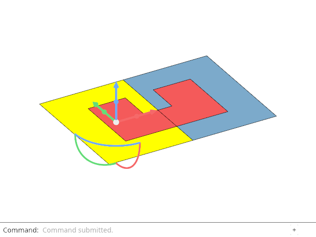

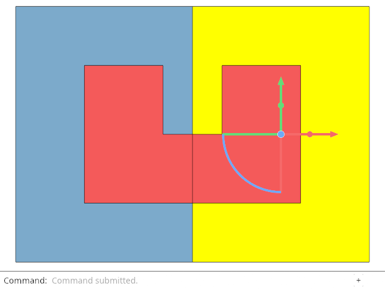

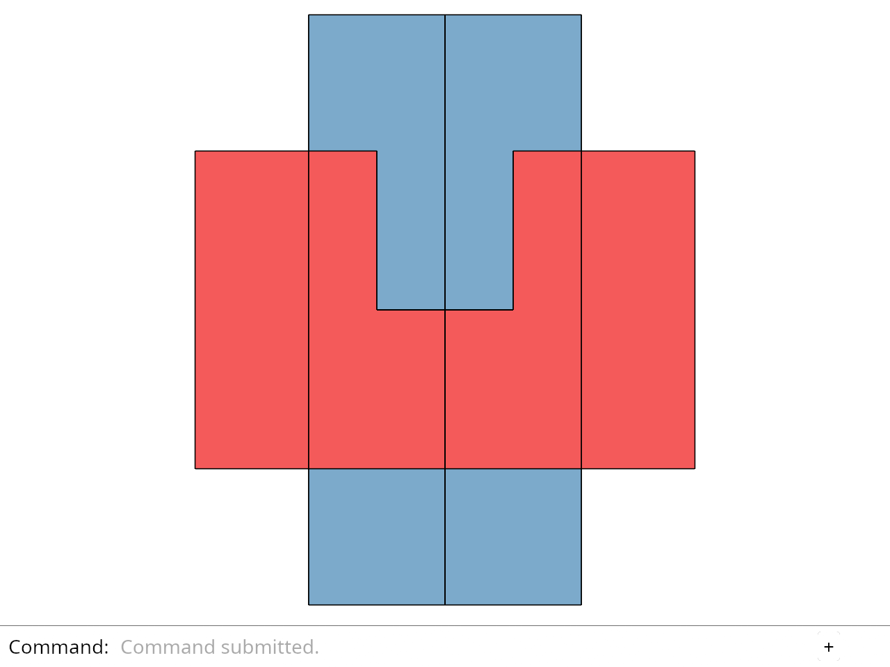

Actual Chrome DPR1/2 and the final main page verify sparse source keys, visible original-face yellow with the red overlay retained, exact clearing/zoom/MoveUndo drawing restoration and complete decoded source/archive records. Outside the host and the existing six-CSS-pixel pick radius, Face selection is empty while Object selection retains the original parent. An original Element BRep also resolves its true top face. [Current DPR2 left face](../screenshots/journey/review/96zzzzzzm-query-original-faces-under-contact-overlays-top-left-face-dpr2.png) · [current DPR2 Isometric face](../screenshots/journey/review/96zzzzzzm-query-original-faces-under-contact-overlays-isometric-left-face-dpr2.png) · [current DPR2 BRep face](../screenshots/journey/review/96zzzzzzm-query-original-faces-under-contact-overlays-brep-source-face-dpr2.png) · [current overhang Object owner](../screenshots/journey/review/96zzzzzzm-query-original-faces-under-contact-overlays-overhang-original-parent-dpr2.png).

The preceding viewer completes the same real GPU query but cannot resolve the original face; the new assertion rejects it directly. Independent Native controls cover mirrored nonuniform placement, both projections/densities, shared and uniform paths, actual shared-definition instances, locked original occlusion and source geometry with no face metadata. Two Native readbacks show the original face highlight below the red contact. Eligibility is a CPU flag in the existing mesh, computed once per row; packed GPU records and source geometry stay unchanged. Existing source wire/pen/facing/vertex display policy is outside this scoped acceptance. Source pen, facing and default vertex-marker policy, current ambient inputs/order, multisampling, remaining view controls, runtime efficiency and final whole-course validation remain unfinished.

## Original edge widths and colors

The [source-pen lesson](96zzzzzzn-respect-original-boundary-pens.md) keeps original edge colors in topology encounter order. The red, green, blue, cyan and orange pens belong to their actual source edges; the hidden edge and coplanar seam are absent.

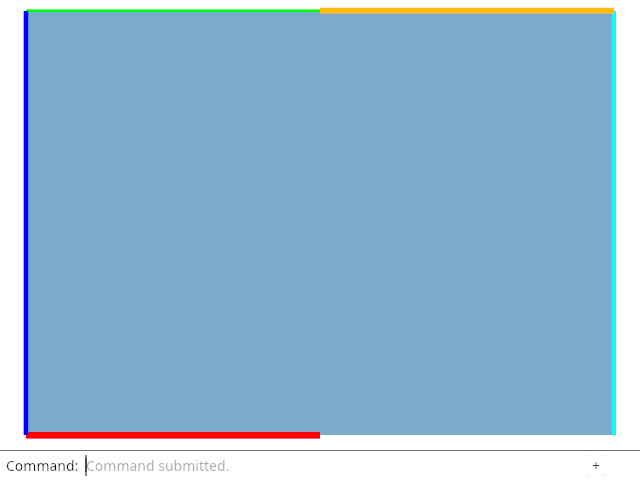

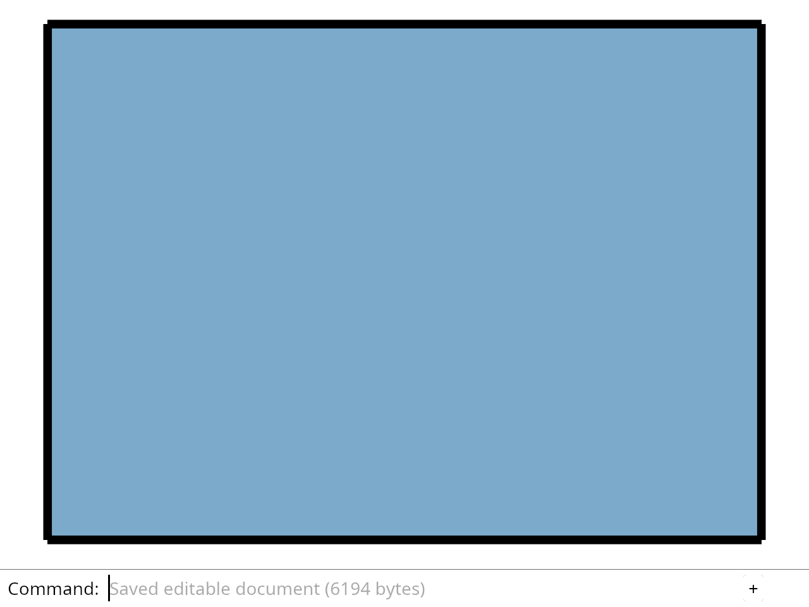

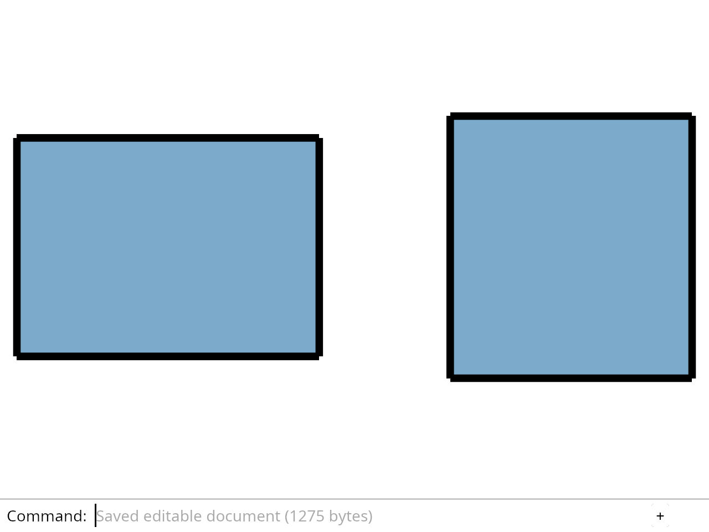

All thirteen current canonical browser pictures and six Native references were directly inspected. The preceding viewer fails the intended width assertion after real rendering. Sparse source GPU queries, exact scene pixels above the independent command dock, full decoded archive records, camera restoration, source release and placement Undo are checked. Browser evidence uses software WebGPU under bounded memory and CPU limits. Native images use Unorm and are separate from browser sRGB comparisons. Preliminary private images retain their original source fingerprint: the only later change bounds-checks a supplied Native test shader. The complete viewer source and optimized Wasm bytes are identical across that correction; these canonical browser pictures are independently fresh. Wide boundary joins still have visible corner gaps. Facing, default mesh vertex spheres, ambient inputs/order, multisampling, remaining view controls, runtime efficiency and final whole-course validation remain unfinished. This is a scoped pen correction; full chapter rendering acceptance remains open until those visible joins are corrected.

## Round original boundaries and source ends

The [original boundary lesson](96zzzzzzo-close-original-boundary-joins.md) closes wide corners and keeps genuine free ends round. Original source addresses remain queryable in both projections and densities.

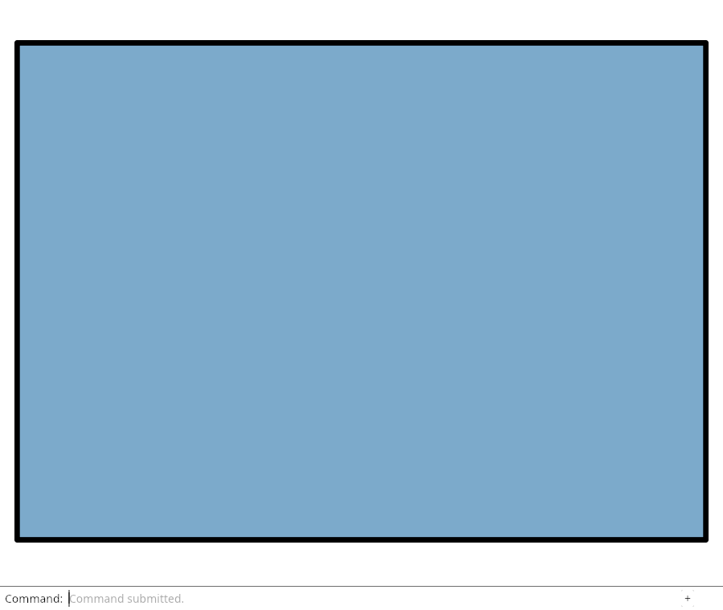

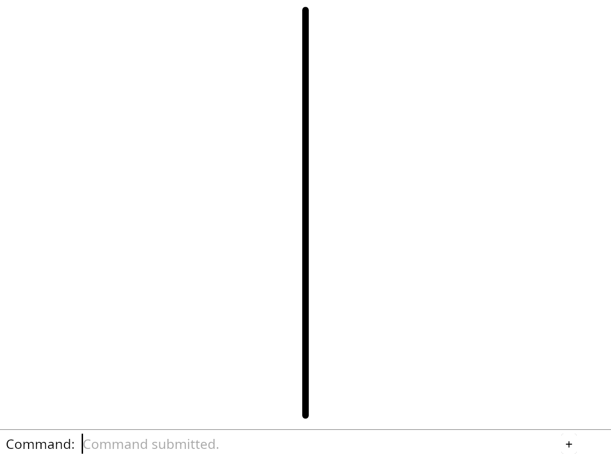

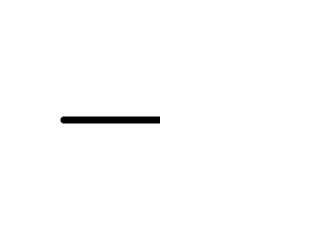

All thirteen canonical browser images and six Native references were individually inspected. Actual preceding Native and Chrome renders fail the intended exterior-corner assertion. Source queries, full decoded archives, exact scene restoration, shared geometry, actual legacy fallback and source release pass. Native near-cut images prove a flat camera cut and unchanged visible body pixels; this is separate from the browser camera checks. The section remains open and red, with zero section fills; its end-on construction-plane normal is now correctly visible. Earlier pen-stage figures retain their dated intermediate corners. Original mesh facing and default vertex spheres, ambient inputs/order, multisampling, remaining view controls, runtime efficiency and final whole-course validation remain unfinished. NURBS boundary sampling still needs the later quality review.

## Original mesh vertex dots

The [mesh vertex lesson](96zzzzzzp-draw-default-mesh-vertex-dots.md) restores tiny default or authored source-vertex dots through the existing point renderer. The default diameter is one CSS pixel, so it stays small beside a wide border.

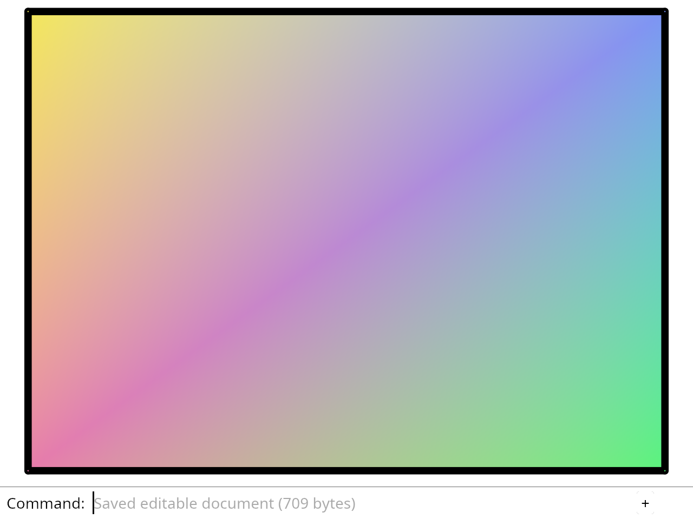

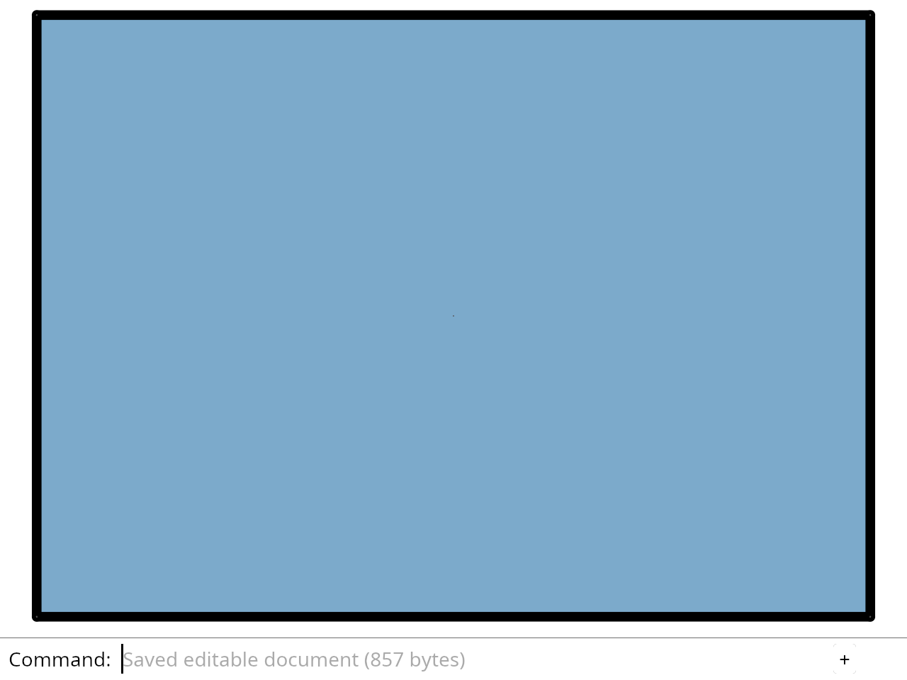

Seven actual current canonical browser pictures and eight Native references were critically inspected. Exact physical-pixel coverage and counts prevent a missing dot from passing a whole-scene photograph. The preceding Native and Chrome viewers fail the intended dot assertion. Full original archives, source component queries, shared mirrored Move/Undo restoration, source unload and production billion-unit rebasing pass. Surface-isolation fixtures suppress both ink and dots while retaining every original surface/grid/cap/source/pick assertion; an explicit eight-marker prefix preserves the original point/control count. A blank shared fixture exposed by image comparison was corrected to restore its camera origin, and now requires both actual original face queries. Earlier stage figures remain historical intermediate states. Original mesh facing and marker crowding, ambient inputs/order, multisampling, remaining view controls, runtime efficiency and final whole-course validation remain unfinished. NURBS boundary sampling still needs the later quality review.

## Crowded original mesh dots

The [crowded mesh lesson](96zzzzzzq-taper-crowded-original-mesh-vertices.md) computes one shared spacing estimate and reuses the existing point renderer. The blue face remains readable where the projected dot spacing permits it; the half-pixel minimum still limits thinning at extreme zoom-out.

Physical-pixel disc coverage now measures the actual fragment pixel from a fixed screen centre. Interpolating the expanded quad offset caused a small rasterizer-dependent error. The corrected browser check selects Top before requesting the projection and asserts the actual camera mode; the earlier order silently reset Perspective to Orthographic. All original source, pick, upload and pixel assertions remain, with the same tolerance of two channel values. An additional DPR 2 case checks a radius strictly between the minimum and default sizes. Control photographs include white margins and restore the exact camera and source pixels afterward. The fresh 984-test native suite, optimized build, actual Chrome checks and all nine native/seven browser pictures pass. No extra geometry buffer, pipeline or radius/padding policy is introduced.

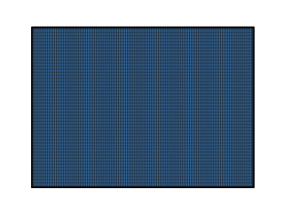

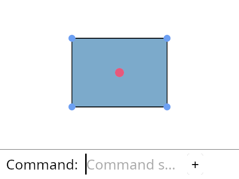

Seven actual canonical browser pictures and nine native references were individually critically inspected. The preceding Chrome renderer fails the independently composited crowding assertion. Complete original archives, both projections/densities, real GPU ownership queries, source unload, shared mirrored Move/Undo restoration and unchanged geometry uploads pass. A separate proposed opaque rear-edge defect did not reproduce, so no redundant facing tutorial or buffer was added. Earlier figures remain historical intermediate states. Ambient inputs/order, multisampling, remaining view controls, runtime efficiency, broader facing/NURBS quality review and final whole-course validation remain unfinished.

## Geometric ambient inputs

The [ambient input lesson](96zzzzzzr-share-geometric-ambient-inputs.md) removes a false dark gradient from a flat face while preserving its authored lighting. Both images below are actual native GPU readbacks at the same 320 × 240 size, top orthographic camera, 3 mm distance, target (0, 0, −0.5) mm and density 1.

**Before: an authored lighting normal incorrectly controls ambient contacts.**

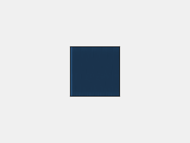

**After: geometric contact shading and authored lighting.**

Five actual final browser pictures and six native references were individually inspected. The prior browser fails the independent sky-color check; the production GPU property readback identifies the wrong normal directly. A separate maintained reference uses the same source and camera; its sRGB transfer function is kept distinct from these native Rgba8Unorm frames. Uniform/storage paths, both projections/densities, complete attributed archives, real object queries, mirrored placement and eligible source hydration pass. Another shared object adds no ambient-owned radius buffer. Existing definition-instance unload rejection is asserted explicitly, and discarding those definitions releases their originals. Ambient pass order, multisampling, remaining view controls, runtime efficiency, independence and final whole-course validation remain unfinished. Broader facing and NURBS quality review also remains required.

## Ambient pass order

The [pass-order lesson](96zzzzzzs-shade-surfaces-before-drawing-ink.md) keeps authored original drawing colours intact over actual ambient contacts and composites the existing independent widget after scene text. These are complete actual current Chrome captures at density 2.

Five current Chrome pictures and eight Native GPU references were individually inspected. Actual preceding Native and Chrome readbacks fail the intended colour checks. Native checks compare every opaque widget pixel with the actual production widget drawn independently, and test original points, lines and paths over measured ground-contact shadows. Complete attributed archives, real object ownership, both projections and densities, eligible source release/hydration and camera/geometry restoration pass. This only moves existing draw calls and introduces no extra GPU resources. Multisampling, remaining view controls, runtime efficiency, independence and final whole-course validation remain unfinished. Broader facing and NURBS quality review also remains required.

## Contact ambient inputs

The [contact ambient-input lesson](96zzzzzzt-keep-contact-ambient-inputs-on-originals.md) restores missing shading on actual original contact fill. These complete current Chrome captures use actual Native-exported Session documents at density 2.

Five Chrome pictures and eight Native GPU references were individually inspected. The preceding browser has zero shaded interior contact pixels in the same ordinary fixture. The private Chrome check measured 928 shaded contact pixels in orthographic view and 919 in perspective. Native readbacks identify the original missing radius and the contact depth shift, then verify exact current source properties in uniform and storage paths. Actual 64 KiB device fallback, locking, mirrored shared definitions, complete source values, original picks and geometry/camera restoration pass. Main derived physical triangles and request-owned original face identities are tested separately. A matched maintained reference uses the exact earlier source and camera; its sRGB transfer is explicitly distinct from the Native learner frame. No additional GPU resource or persistent source/property cache was introduced. Multisampling, remaining view controls, runtime efficiency, independence and final whole-course validation remain unfinished. Broader facing and NURBS quality review also remains required.

## Frame attachments

The [frame attachment checkpoint](96zzzzzzu-keep-depth-and-address-samples-separate.md) keeps the browser scene single-sample while defining coherent one- and four-sample targets. Its actual GPU fixture reads every distinct depth and both integer-address halves, resolves only colour, then verifies that old bound views remain readable after replacement. All 991 Native tests and canonical browser checks pass. The six fresh Native/browser pictures were individually inspected. The existing original contact scenes retain shading, ownership, full sources and Move/Undo restoration at both densities and projections. This does not establish complete viewer multisampling or a frame-rate gain.

### Coherent target reuse

The [integrated target owner](96zzzzzzv-reuse-coherent-frame-targets.md) retains actual depth/primitive views at unchanged extent. The preceding Native API replaced both despite identical pixels; the current witness retains them while preserving complete sources and geometry. In Chrome, real resizes allocate exactly one matching depth/primitive pair, retain original face picks and complete archives, then restore every scene pixel at the original extent. Both densities, all 992 Native tests and canonical checks pass; all ten current Native/browser pictures were individually inspected. The browser already avoided redundant resize calls, so this does not claim a browser frame-rate gain. Main rendering remains single-sample.

### Canvas resolve formats

The [matching base/view formats](96zzzzzzw-match-resolve-base-and-view-formats.md) preserve the output texture format separately from its sRGB rendering view. The supplied actual GPU fixture checks six base/view/sample combinations, linear colour resolution and separate original depth/integer samples. The main browser remains single-sample here; both densities retain original contacts, differently scaled instances, original picks, complete sources and real-resize restoration. All 992 Native tests and fresh canonical checks pass, and all ten current Native/browser pictures were individually inspected. The format correction adds no image or shader pass.

### Cached surface pipelines

The [ordinary and shared surface checkpoint](96zzzzzzx-reuse-count-specific-surface-pipelines.md) moves existing descriptors into factories and keeps one alternate pipeline recipe. The complete browser frame remains single-sample. Its actual Native isolated surface pass compares ordinary and shared drawing at four samples, reads 364 mixed physical sample pixels independently, retains original records and GPU geometry, freshly queries original owners and requires exact return pixels and pipeline identity. Both actual Native pictures below were individually inspected; edge ink and other frame consumers are outside this isolated pass. All 993 Native tests and fresh canonical browser/resize checks pass. Ten current canonical Native/browser images were also individually inspected.

**One sample — actual Native surface pass.**

**Four samples — actual Native surface pass.**

### Finite ink sample inputs

The [sample-aware ink shader checkpoint](96zzzzzzy-generate-ink-for-physical-samples.md) carries the physical sample through original-address, section, grid, line, disc and analytic-plane visibility. Its shader and pipeline descriptors receive the same count. At four samples, coverage coordinates and depth/address reads match the actual sample; the one-sample marker position and independent original-owner queries keep their roles. Existing parser and full Naga assertions validate 21 recipes across six styles, preserving every original input family. Current colour and query owners remain single-sample until their matching bindings are connected. All 993 Native tests and fresh canonical browser/resize checks pass. Ten current canonical Native/browser images were individually inspected. This source checkpoint does not demonstrate a complete four-sample ink or browser frame.

### Cached finite ink resources

The [finite-ink resource checkpoint](96zzzzzzz-cache-ink-pipelines-with-independent-queries.md) shares static vertex attributes and retains one alternate colour pipeline/layout recipe. Matching depth/address bindings follow the colour sample count; fresh integer queries keep their separate one-sample layout. Actual Native GPU fixtures verify all six style paths at zero through four visible physical samples, exact return pixels, cached pipeline identity and binding preservation/release. The query fixture uses real GPU input tuple [17,1], while canonical browser checks cover original document owners. All 995 Native tests and fresh canonical browser/resize checks pass, and ten current canonical pictures were individually inspected. The three unique actual Native pictures below show two of four visible samples; identical pictures share a labelled figure while all six independent assertions and image hashes remain recorded. Complete browser rendering remains single-sample.

**stroke, grid stroke, authored stroke metadata — two of four samples visible.**

**headed chain — two of four samples visible.**

**point, authored point metadata — two of four samples visible.**

### Retargetable overlay lanes

The [overlay checkpoint](96zzzzzzza-retarget-existing-overlay-lanes.md) moves the existing colour descriptor into one factory and retains original vertices, integer IDs, uploads and query pipelines. Empty lanes defer unused recipes; late data and finite owners adopt the requested count. The actual Native test covers both previously invalid empty finite-depth combinations, clearing and all six overlay families, with cached identities and exact return pixels. Existing highlight, preview, measurement and GPU guide owners delegate the count. All 996 Native tests and fresh canonical browser/resize checks pass; ten current canonical pictures were individually inspected. The five unique actual Native pictures below were also individually inspected. The physical grid intentionally renders a thin line-list stroke, while the other families keep their authored widths and shapes. Complete browser rendering remains single-sample.

**stroke, wide overlay — actual four-sample overlay pass.**

**headed chain — actual four-sample overlay pass.**

**point — actual four-sample overlay pass.**

**dashed guide — actual four-sample overlay pass.**

**physical grid — actual four-sample overlay pass.**

### Physical-sample section caps

The [section checkpoint](96zzzzzzzb-read-section-crossings-at-each-sample.md) retains original cap geometry while crossing images and colour/depth use matching physical samples. Crossing counts remain separate; only the final colour resolves. Existing factories take an explicit count and integer queries stay single-sample. One direct fragment calculation handles both counts. The actual Native witness checks grey caps, hatching, yellow selection, complete source records, unchanged GPU geometry, fresh original-owner queries and exact return pixels. All 997 Native tests and fresh canonical browser/resize checks pass. Three Native pictures and ten canonical pictures were individually inspected. Complete browser rendering remains single-sample.

**solid grey section — actual four-sample section pass.**

**hatched section — actual four-sample section pass.**

**selected yellow section — actual four-sample section pass.**

### Coherent cloud colour, depth and original queries

The [coherent cloud checkpoint](96zzzzzzzc-compose-cloud-depth-with-physical-addresses.md) closes actual cloud colour/depth/address and original-owner contradictions. Positive non-mesh depth hides rear ink without discarding a visible wide fringe outside the cropped query halo. Cloud query depth precedes readonly ink, retaining genuinely front original owners. The existing uniform supplies current opaque output and eye-dome shading; exact maintained GPU reference, full source records, caches, actual rear/front/physical/query pixels and placement restoration remain asserted. Current main rendering is single-sample; cached count-specific consumers follow. All 1000 Native tests, WASM/optimized builds, Native frame, canonical Chrome contact/resize checks and stored evidence pass. Ten current canonical Native/browser pictures were individually inspected. Every unique current Native component figure was also individually inspected. Complete physical-sample viewer integration, adaptive quality, remaining view controls, runtime efficiency, Cargo independence and final whole-course feature-picture review remain unfinished. Maintained Session reload camera/base-grid fixes follow the completed course.

**nearer cloud over original face, one sample — actual cloud colour/depth/query check.**

**nearer cloud over original section cap, one sample — actual cloud colour/depth/query check.**

**original source alpha0 retained; opaque output and shading off — actual cloud colour/depth/query check.**

**default eye-dome0.25; exact maintained compositor pixels — actual cloud colour/depth/query check.**

**rear source line hidden by real dense cloud, density2 — actual cloud colour/depth/query check.**

**genuinely front original line retains colour and owner, density2 — actual cloud colour/depth/query check.**

**visible wide source fringe retains original query owner beyond the axis halo, density2 — actual cloud colour/depth/query check.**

### Cached original cloud and sheet sample recipes

The [cloud/sheet cache checkpoint](96zzzzzzzca-cache-cloud-and-sheet-samples.md) selects count-specific colour recipes without re-uploading original point/drawing sources or rebuilding cached point rasters. Immutable point/query layouts and exact sheet descriptors are reused. Existing opaque/eye-dome, physical address, front/rear, wide-fringe and original owner assertions extend to both counts, and an actual sheet/cloud witness checks composition, original geometry/IDs and exact returns. Main rendering remains single-sample until all consumers are connected. All 1001 Native tests, WASM/optimized builds, Native frame, canonical Chrome contact/resize checks and stored evidence pass. Ten current canonical Native/browser pictures were individually inspected. Every unique current Native component figure was also individually inspected. Complete physical-sample outline/ambient/viewer integration, adaptive quality, remaining view controls, runtime efficiency, Cargo independence and final whole-course feature-picture review remain unfinished. Maintained Session reload camera/base-grid fixes follow the completed course.

**cloud occludes original face; four physical samples — actual cached cloud/sheet colour check.**

**cloud occludes original section; four physical samples — actual cached cloud/sheet colour check.**

**original sheet pens with cached cloud; one sample — actual cached cloud/sheet colour check.**

**original sheet pens with cached cloud; four samples — actual cached cloud/sheet colour check.**

**rear original line hidden by cloud; density2/four samples — actual cached cloud/sheet colour check.**

**genuinely front original line keeps colour/owner; density2/four samples — actual cached cloud/sheet colour check.**

### Cached original text colour and rasters

The [cached text checkpoint](96zzzzzzzd-retarget-cached-text.md) selects matching world/nameplate colour recipes, retains source/shaping/font/atlas/world-raster data and adopts the active count on late creation. It explicitly recreates the small Glyphon renderer/initial vertex buffer required by the public API. Actual world/nameplate/screen frames retain original owners and geometry, unchanged cached text usage and exact count-return pixels. Independent integer queries stay one-sample. All 1002 Native tests, WASM/optimized builds, Native frame, canonical Chrome contact/resize checks and stored evidence pass. Ten current canonical Native/browser pictures were individually inspected. Every unique current Native component figure was also individually inspected. Complete physical-sample outline/ambient/viewer integration, adaptive quality, remaining view controls, runtime efficiency, Cargo independence and final whole-course feature-picture review remain unfinished. Maintained Session reload camera/base-grid fixes follow the completed course.

**world/nameplate/screen text; one sample — actual cached text colour check.**

**world/nameplate/screen text; four samples — actual cached text colour check.**

### Cached section coverage and final outline blend

The [outline recipe checkpoint](96zzzzzzze-cache-outline-section-recipes.md) prepares lazy section masks and the final colour blend with the shared sample-count cache. Existing exact descriptors are reused; integer addresses and depth remain physical-sample inputs while one-sample search/alpha inputs retain their meaning. Current selected/global/section masks, CSS widths and the single final black blend retain their actual GPU regressions. The coverage producer is connected in the next lesson. All 1002 Native tests, WASM/optimized builds, Native frame, canonical Chrome contact/resize checks and stored evidence pass. Ten current canonical Native/browser pictures were individually inspected. Complete physical-sample outline/AO/viewer integration, remaining view controls, runtime efficiency, Cargo independence and final whole-course feature-picture review remain unfinished. Maintained Session reload camera/base-grid fixes follow the completed course.

### Resolved float outline coverage

The [outline coverage checkpoint](96zzzzzzzf-resolve-float-outline-coverage.md) renders physical face and section coverage and resolves only the float mask into retained one-sample search images. Integer addresses and depth are read at the matching sample. Selected/global masks agree, the black boundary blends once, only active four-sample coverage adds memory, and original owners/source uploads/geometry remain stable through exact returns. Late owners adopt the count and absent sections avoid unused recipes. All 1003 Native tests, WASM/optimized builds, Native frame, canonical Chrome contact/resize checks and stored evidence pass. Ten current canonical Native/browser pictures were individually inspected. Every unique current Native component figure was also individually inspected. Complete physical-sample ambient inputs/corrections and viewer integration, remaining view controls, runtime efficiency, Cargo independence and final whole-course feature-picture review remain unfinished. Maintained Session reload camera/base-grid fixes follow the completed course.

**selected/global section, one sample — actual outline coverage check.**

**selected/global section, four samples — actual outline coverage check.**

**global section without selection, four samples — actual outline coverage check.**

**full solid without clipping, four samples — actual outline coverage check.**

### Retained original ambient source images

The [original ambient source checkpoint](96zzzzzzzg-retarget-original-ambient-properties.md) prepares matching source recipes for ordinary/shared original face properties and retargets only two full-resolution images. The coarse hierarchy, normals, occupancy, filters and history stay single-sample and retained. Actual original-normal/radius, shared-placement, released-source and cached-contact regressions retain their assertions. Matching consumer shaders and sparse corrections follow. Matching assembled shader declarations and explicit original-property sample reads retain representative sample zero for coarse preparation. Full Naga contracts validate original and both assembled modes before connection. All 1003 Native tests, WASM/optimized builds, Native frame, canonical Chrome contact/resize checks and stored evidence pass. Ten current canonical Native/browser pictures were individually inspected. Complete physical-sample ambient shaders/corrections and viewer integration, remaining view controls, runtime efficiency, Cargo independence and final whole-course feature-picture review remain unfinished. Maintained Session reload camera/base-grid fixes follow the completed course.

### Shared ambient shader modules and bindings

The [ambient recipe checkpoint](96zzzzzzzh-share-ambient-shader-recipes.md) shares three distinct shader modules and one descriptor factory across fullscreen and sparse edge entries. It prepares matching physical input layouts and connects final composition bindings while retaining small current one-sample work buffers. Actual current contact shading, source geometric normals, cache/release and assembled shader validation retain their assertions. Bounded correction allocation and drawing follow together. All 1003 Native tests, WASM/optimized builds, Native frame, canonical Chrome contact/resize checks and stored evidence pass. Ten current canonical Native/browser pictures were individually inspected. Complete physical-sample viewer integration, adaptive quality, remaining view controls, runtime efficiency, Cargo independence and final whole-course feature-picture review remain unfinished. Maintained Session reload camera/base-grid fixes follow the completed course.

### Bounded physical-sample ambient corrections

The [ambient correction checkpoint](96zzzzzzzi-correct-ambient-at-physical-samples.md) retains coarse images and cached recipes while matching every physical original property. Changed frames clear bounded GPU work and draw only actual unique correction tiles through the indirect command. Independent GPU readback verifies source radii/normals/addresses/depth, nonzero bounded work and repeatable counters. Exact return pixels, ordinary/shared equality and original geometry/uploads remain asserted. All 1004 Native tests, WASM/optimized builds, Native frame, canonical Chrome contact/resize checks and stored evidence pass. Ten current canonical Native/browser pictures were individually inspected. Every unique current Native component figure was also individually inspected. Complete physical-sample viewer integration, adaptive quality, remaining view controls, runtime efficiency, Cargo independence and final whole-course feature-picture review remain unfinished. Maintained Session reload camera/base-grid fixes follow the completed course.

**original ambient scene, one sample — actual ambient correction check.**

**original ambient scene, four samples — actual ambient correction check.**

**plain control without ambient, four samples — actual ambient correction check.**

### Cache physical depth-pyramid inputs

The [depth-pyramid checkpoint](96zzzzzzzj-cache-physical-depth-pyramid-inputs.md) caches compatible physical-depth input recipes while retaining six coarse levels and their reduction groups. Representative sample zero feeds the existing single-sample hierarchy. Each nearest-positive depth retains its corresponding encoded radius/pixel address; reduction selects the pair rather than averaging it. Actual Native full-field reductions retain empty/section-depth, encoded-address, resting-cache, resize and release assertions. All 1004 Native tests, WASM/optimized builds, Native frame, canonical Chrome contact/resize checks and stored evidence pass. Ten current canonical Native/browser pictures were individually inspected. Complete physical-sample viewer integration, adaptive quality, remaining view controls, runtime efficiency, Cargo independence and final whole-course feature-picture review remain unfinished. Maintained Session reload camera/base-grid fixes follow the completed course.

### Retarget the complete colour frame

The [complete colour-frame checkpoint](96zzzzzzzk-retarget-the-complete-colour-frame.md) retargets every active colour consumer and matching attachment through one production count API. It reuses current caches and one GPU context, while late-created owners adopt the active count. Repeated choices retain target identity, and pending original-owner queries keep their independent one-sample resources and tickets. Fresh mixed-source Native and Browser frames must pass at both physical counts before acceptance; automatic quality follows next. All 1006 Native tests, WASM/optimized builds, Native frame, canonical Chrome contact/resize checks and stored evidence pass. Ten current canonical Native/browser pictures were individually inspected. Every unique current Native component figure was also individually inspected. Adaptive quality, remaining original display controls and procedural-plane coverage, runtime efficiency, Cargo independence and final whole-course feature-picture review remain unfinished. Maintained Session reload camera/base-grid fixes follow the completed course.

**orthographic original scene; one sample — actual combined original-source GPU frame.**

**orthographic original scene; four samples — actual combined original-source GPU frame.**

**perspective original scene; one sample — actual combined original-source GPU frame.**

**perspective original scene; four samples — actual combined original-source GPU frame.**

**top view with a white open bore and source NURBS iso-curves; four samples — actual combined original-source GPU frame.**

**clipped top view with a white open bore and section hatching; four samples — actual combined original-source GPU frame.**

All 28 fresh current mixed-source Browser pictures were individually inspected at both densities, one/four samples and both projections, including sections, original bore, cloud depth and front ink. All original owner/archive and exact count-return assertions remain required. The separately prompted targeted GPU readback confirms the tiny blue centre at the cloud/slab overlap is genuinely exposed underlying surface at both counts, and the black ring comes from the deliberate visible-surface outline. Outline-off and hidden-cloud controls restore exact original pixels and source archives; all six extra actual pictures were individually inspected. Two representative actual Browser figures are shown; full original-plane appearance and whole-course final feature review remain pending.

**Perspective mixed original scene, four samples, physical density 1 — actual complete-frame browser check.**

**Top projection with an active section, four samples, physical density 2 — actual complete-frame browser check.**

### Bounded actual frame quality and recovery

The [bounded quality checkpoint](96zzzzzzzl-choose-bounded-frame-quality.md) selects the current complete-frame count from active geometry, physical pixels/density and the adapter budget. The retained unsigned URL/diagnostic override and reduced recovery share one policy. Actual canonical browser subcases check automatic/forced counts, GPU descriptors, original sources/owners/archives, repeated choices, resize returns and real device loss with recovery precedence. The separately labelled browser figures are actual frames, not Native substitutes. A separate current-source device-loss run reopens and fits the unchanged original contact document for a readable recovery figure. It checks the first reduced frame before commands, exact original Mesh/Element records, source/owner/archive retention, forced-four recovery precedence, actual resize return and ordinary reload. Import-generated tree container IDs are distinct from original source records. All 1009 Native tests, WASM/optimized builds, Native frame, canonical Chrome contact/resize checks and stored evidence pass. Ten current canonical Native/browser pictures were individually inspected. Original display controls and procedural plane coverage, runtime efficiency, Cargo independence and final whole-course feature-picture review remain unfinished. Maintained Session reload camera/base-grid fixes follow the completed course.

All five current additional quality browser pictures were individually inspected. 4 distinct actual browser figures show the labelled states; exact duplicates share a caption. Actual attachment descriptors and real recovery results are retained with the current source.

**automatic quality at physical density 1; actual count 4; explicit four samples at physical density 1; retained original contact scene — actual source-bound browser quality frame.**

**automatic quality at physical density 2; actual count 1 — actual source-bound browser quality frame.**

**explicit four samples at physical density 2; retained original contact scene — actual source-bound browser quality frame.**

**original contact reopened and fitted after actual GPUDevice loss; browser DPR2, recovered physical density1 and count1 override retained URL `msaa=4` — actual source-bound browser quality frame.**

### Retain visible instance ranges

The [current checkpoint](96zzzzzzzm-retain-visible-instance-ranges.md) develops the original-family display path. Keep absolute original query addresses while filtering existing instance buffers with merged CPU ranges. Whole Native and canonical Chrome checks, source/owner assertions and every actual current picture must be accepted independently. All 1010 Native tests, WASM/optimized builds, Native frame, canonical Chrome contact/resize checks and stored evidence pass. Ten current canonical Native/browser pictures were individually inspected. Procedural original-plane display, complete original CAD wire display, pen/cloud settings, runtime efficiency, Cargo independence and final feature-picture review remain unfinished. Maintained and owned Session reload camera/base-grid fixes follow the completed course.

### Prepare original ink families

The [current checkpoint](96zzzzzzzn-prepare-original-ink-families.md) develops the original-family display path. Classify retained original borders, points and controls once while preserving source query keys and complete buffer bindings. Whole Native and canonical Chrome checks, source/owner assertions and every actual current picture must be accepted independently. All 1010 Native tests, WASM/optimized builds, Native frame, canonical Chrome contact/resize checks and stored evidence pass. Ten current canonical Native/browser pictures were individually inspected. Procedural original-plane display, complete original CAD wire display, pen/cloud settings, runtime efficiency, Cargo independence and final feature-picture review remain unfinished. Maintained and owned Session reload camera/base-grid fixes follow the completed course.

### Show original ink families

The [current checkpoint](96zzzzzzzo-show-original-ink-families.md) develops the original-family display path. Apply one retained visibility owner to actual colour, original queries and selected highlights while preserving active controls and shared sources. Whole Native and canonical Chrome checks, source/owner assertions and every actual current picture must be accepted independently. Object-only borders use the existing ink sentinel, shared with ordinary points. A zero subpart is ranked with surfaces by the bounded picker; reusing the ink sentinel preserves visible-border priority without inventing a MeshEdge or adding metadata. Edge mode still rejects that sentinel before it can hide the genuine source edge behind the frame. The actual GPU fixture checks both modes. Draw the selected edge fringe before ordinary ink, so its original black core remains visible. Size the fringe from the actual mesh, surface or CAD pen width plus two CSS pixels. A fixed three-pixel fringe disappears under a wider source pen; moving it above the source instead would erase the black core. Independent GPU tests check both the wide-pen fringe and the original black center. All 1012 Native tests, WASM/optimized builds, Native frame, canonical Chrome contact/resize checks and stored evidence pass. Ten current canonical Native/browser pictures were individually inspected. Every unique current Native component figure was also individually inspected. Procedural original-plane display, complete original CAD wire display, pen/cloud settings, runtime efficiency, Cargo independence and final feature-picture review remain unfinished. Maintained and owned Session reload camera/base-grid fixes follow the completed course.

**all original ink families visible, one sample — actual Native original-family frame.**

**all original ink families visible, four samples — actual Native original-family frame.**

**Hide Lines: line, curve and sheet pens hidden; active controls retained, four samples — actual Native original-family frame.**

**Hide Edges: shared mesh borders and vertex dots hidden; faces and active controls retained, four samples — actual Native original-family frame.**

**Hide Points: ordinary point hidden; mesh vertex dots and active controls retained, four samples — actual Native original-family frame.**

**Mesh markers disabled: original faces and mesh borders retained, four samples — actual Native original-family frame.**

**Ordinary ink hidden: original faces and active control net/dots retained, four samples — actual Native original-family frame.**

**Selected original edge of the left shared mesh: yellow fringe around retained black source center, four samples — actual Native original-family frame.**

**Selected original edge of the right shared mesh: correct placed highlight with retained black center, four samples — actual Native original-family frame.**

### Semantic original-family view controls

The [semantic view checkpoint](96zzzzzzzp-apply-semantic-view-controls.md) applies one retained presentation state before initial/recovered drawing and after input. The actual command evidence distinguishes selected line ink from the independent editing widget and explicitly warms grow-only world-plane label coverage before exact return checks. All 1014 Native tests, WASM/optimized builds, Native frame, canonical Chrome contact/resize checks and stored evidence pass. Ten current canonical Native/browser pictures were individually inspected. Procedural original-plane display, complete original CAD wire display, pen/cloud settings, runtime efficiency, Cargo independence and final feature-picture review remain unfinished. Maintained and owned Session reload camera/base-grid fixes follow the completed course.

32 current additional browser pictures were individually inspected. 11 representative actual figures show the labelled states; exact duplicate selected pictures share a caption. The full source-bound observations and independent assertions remain in the review evidence.

**default retained view settings retained on an explicitly imported and fitted original mesh; first GPU submission is checked separately before commands; browser DPR 1 — actual source-bound browser presentation frame.**

**presence-based URL view settings retained on an explicitly imported and fitted original mesh; first GPU submission is checked separately before commands; browser DPR 2 — actual source-bound browser presentation frame.**

**same URL settings after actual GPUDevice loss with reduced density; browser DPR 2 — actual source-bound browser presentation frame.**

**all original display families; 4 samples; browser DPR 2 — actual source-bound browser presentation frame.**

**original edges hidden with other families retained; 4 samples; browser DPR 2 — actual source-bound browser presentation frame.**

**original lines hidden with other families retained; 4 samples; browser DPR 2 — actual source-bound browser presentation frame.**

**original points hidden with other families retained; 4 samples; browser DPR 2 — actual source-bound browser presentation frame.**

**original active curve controls with ordinary edges, lines and points hidden; 4 samples; browser DPR 2 — actual source-bound browser presentation frame.**

**original selected-line on state after explicit Fit Selected; independent editing widget distinguished from ordinary line ink, four samples, browser DPR 2 — actual source-bound browser presentation frame.**

**original selected-line hidden state after explicit Fit Selected; independent editing widget distinguished from ordinary line ink, four samples, browser DPR 2 — actual source-bound browser presentation frame.**

**original selected-line cleared state after explicit Fit Selected; independent editing widget distinguished from ordinary line ink, four samples, browser DPR 2 — actual source-bound browser presentation frame.**

