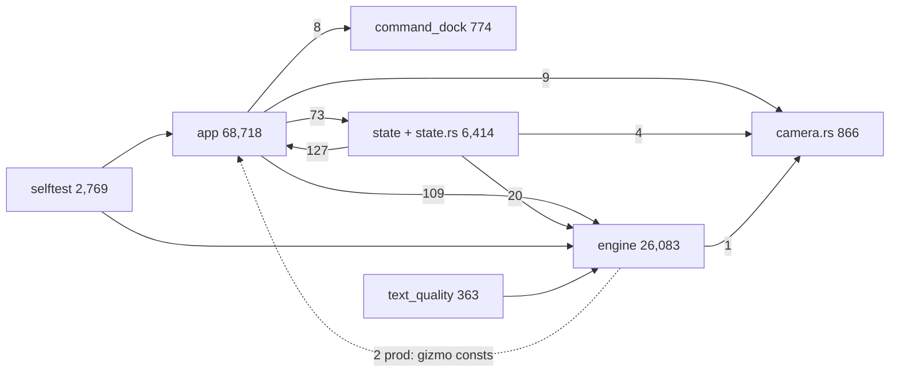
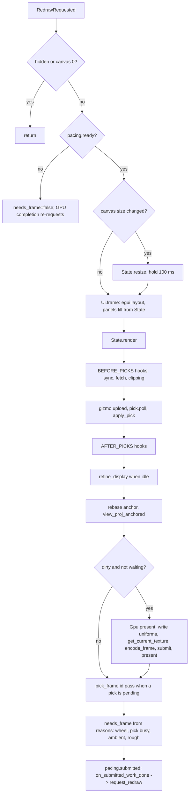
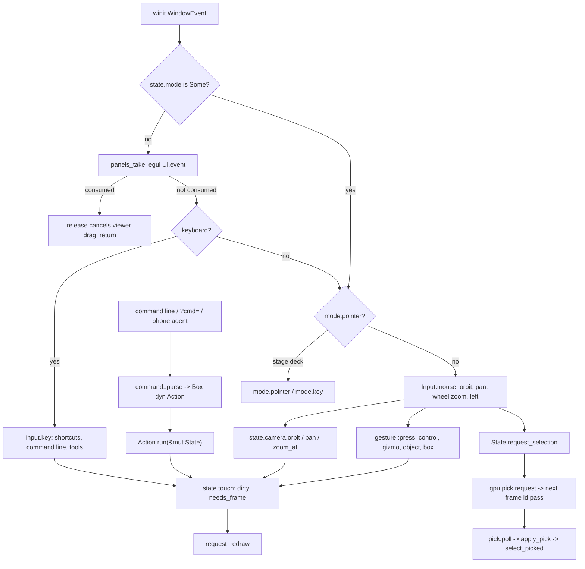
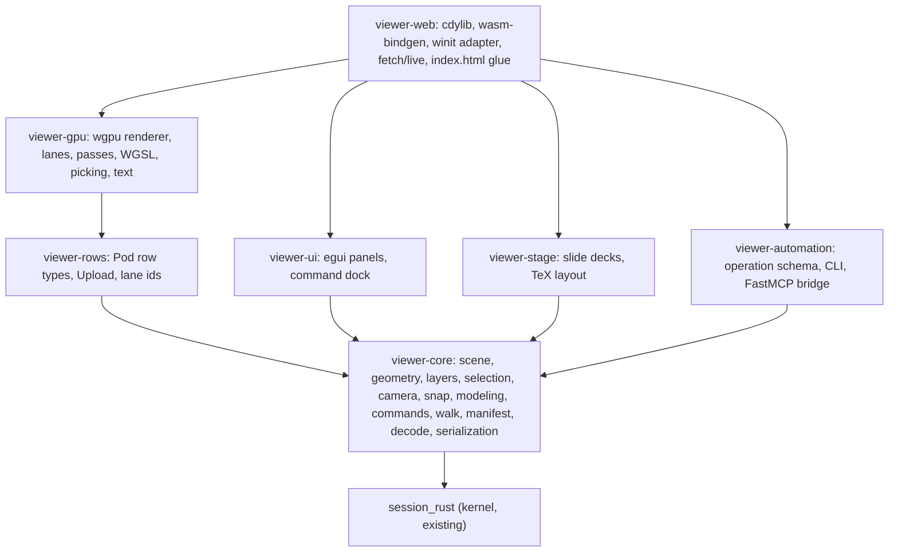

# Session Viewer — architecture audit (Phase 3)

Scope: `session/session_viewer`, source as of 2026-11-19. Read-only audit. *Update 2026-11-19:* the claim that nothing could be built (storage) was wrong; builds, native tests and the headless frame harness were later run on a pristine copy of HEAD, see [REPOSITORY_INSPECTION.md](REPOSITORY_INSPECTION.md#what-was-run). The real working tree does not build (stale `session_proto`). Every number below comes from `wc -l`, `grep`, or reading the cited file. Performance claims are **HYPOTHESIS** unless stated; no timings were measured.

The existing reference [`../ARCHITECTURE.md`](../ARCHITECTURE.md) describes the renderer well (frame passes, depth, memory, bind groups); this document does not repeat it. Where it is stale, see [§12](#12-corrections-to-the-existing-architecturemd).

Mission constraints (`inspection/Session Viewer.txt` §1, §3): modular core independent of UI; CLI-compatible and FastMCP-compatible operations; same core operations reachable from all interfaces. The audit result: **the code does not meet the first constraint today and has no implementation of the other two** (§9, §11).

---

## 1. Module hierarchy

One crate `session_viewer` (`Cargo.toml`, `crate-type = ["cdylib","rlib"]`, no `[workspace]`). 319 `.rs` files, 106,020 lines (`find src -name '*.rs' | xargs wc -l`), plus 33 WGSL files in `src/shaders/`.

`src/lib.rs` (33 lines) only declares modules and re-exports (`State`, `Msg`, `CloudChunk`, `SheetChunk`; wasm-only `App`, `run_web`).

| Top-level module | Files | Lines | Role |
|---|---:|---:|---|
| `app/` | 221 | 68,718 | everything: scene, loading, commands, UI, input, stage, walk |
| `engine/` | 72 | 26,083 | wgpu renderer (`engine/gpu` 62 files / 23,972), pipelines, text, perf |
| `state/` + `state.rs` | 14 + 1 | 5,286 + 1,128 | `State` (window+GPU+camera+scene+selection) and its feature impls |
| `selftest/` + `selftest.rs` | 4 + 1 | 2,062 + 707 | native headless harness (`cfg(not(wasm32))`, `lib.rs:20`) |
| `camera.rs` | 1 | 866 | camera; imports only `session_rust` (`camera.rs:1`) |
| `command_dock/` | 3 | 774 | command-line egui model/theme/view |
| `text_quality.rs` | 1 | 363 | wasm-only fixture page (`lib.rs:14`) |
| `lib.rs` | 1 | 33 | |

### `src/app/` (68,718 lines)

| Subtree / file | Files | Lines | Content |
|---|---:|---:|---|
| `command/` (`verbs/` 86 entries, `tool/`) | 95 | 18,826 | command parser + 67 `impl Action` verbs (80 names in `REGISTRY`, `command/verbs/mod.rs:6-16`) |
| `stage/` | 26 | 10,897 | slide-deck presentation mode: TeX-like layout (`tex.rs` 2,039), deck YAML (`deck.rs` 2,021), egui painter |
| `walk/` | 24 | 8,363 | source geometry → typed `Upload` rows (mesh, brep, curves, cloud, sheet, text) |
| `scene_sync/` | 12 | 3,313 | row allocation, tombs, compaction, preview |
| `ui/` | 10 | 1,983 | egui panels (layers, graph, number box, phone, overlay) |
| `inspection/` + `inspection.rs` | 2 | 931 | `?inspect=1` state publisher |
| `gesture/` | 5 | 122 | press/drag dispatch (control → gizmo → object → box) |
| `scene.rs` / `scene_instances.rs` / `scene_display.rs` / `scene_release.rs` / `scene_rows.rs` / `scene_text.rs` / `scene_sync.rs` | 7 | 1,530 / 1,571 / 934 / 509 / 284 / 240 / 637 | `Scene` document store |
| `layers.rs`, `hierarchy.rs`, `edit.rs`, `modeling.rs` | 4 | 1,802 / 1,155 / 912 / 335 | layer tree, tree/graph index, edit transactions, creation |
| `loader.rs`, `fetch.rs`, `live.rs`, `stream.rs`, `decode.rs`, `manifest.rs`, `validate.rs`, `route.rs`, `range_gate.rs`, `session_io.rs` | 10 | 1,045 / 529 / 476 / 1,264 / 1,011 / 454 / 684 / 224 / 252 / 629 | I/O: fetch, protobuf decode, manifests, URL routing, save/open |
| `input.rs`, `touch.rs`, `keys.rs`, `agent.rs`, `runtime.rs`, `launch.rs` | 6 | 526 / 185 / 77 / 201 / 543 / 12 | winit adapter + `App` |
| `gizmo.rs`, `snap.rs`, `cplane.rs`, `clipping.rs`, `coords.rs`, `deform.rs`, `splitting.rs`, `selection.rs`, `interactions.rs`, … | ~30 | 100–920 each | interaction/model helpers |

### `src/engine/gpu/` (23,972 lines, 62 files)

Largest: `triangle_tiles.rs` 1,187; `text.rs` 1,079; `segments.rs` 1,040; `vectors.rs` 977; `slots.rs` 958; `clip.rs` 929; `surface_outline.rs` 916; `ssao.rs` 886; `text_plane.rs` 791; `pick.rs` 746; `arena.rs` 687; `context.rs` 664 (defines `Gpu`); `splat.rs` 550; `render.rs` 486; `frame.rs` 468. Subdirs: `clip/` 1,785, `objects/` 1,247, `ssao/` 939, `surface_outline/` 646, `hull/` 397, `instance/` 298, `splat/` 224, `backdrop/` 165. `engine/pipelines/` (5 files, 934), `engine/text.rs` 554, `engine/performance.rs` 555, `engine/diagnostics.rs` 28.

### `src/state/` (5,286)

`edit.rs` 1,176 · `drawing.rs` 885 · `drag.rs` 681 · `panel.rs` 662 · `tool.rs` 486 · `cloud_query.rs` 262 · `clipping.rs` 231 · `text.rs` 203 · `splitting.rs` 193 · `hydrate.rs` 159 · `box_select.rs` 106 · `number_box.rs` 93 · `sheet_query.rs` 86 · `features.rs` 63. All are `impl State` blocks (46 `impl State` blocks across 15 files, 205 `fn`s in `state.rs`+`state/`).

### `src/selftest/` (2,062) and `command_dock/` (774)

`selftest/{oracle 839, lifecycle, profile, stroke_witness}.rs`; `command_dock/{mod 17-field CommandLine, theme, view}.rs` (egui only, imports nothing from `crate::`).

---

## 2. Module dependency graph

Method: every `crate::<top>` mention in non-test code (files named `*test*`/`*witness*` and `#[cfg(test)]` blocks excluded by a brace-tracking script; counts are mentions, not distinct items). Grouped imports `use crate::{…}` at `app/runtime.rs:1`, `app/stage/mode.rs:2`, `selftest/lifecycle.rs:3` are not counted (≈ +1 each). `super::` edges are not counted.

| from ↓ / to → | `app` | `engine` | `state` | `camera` | `command_dock` |
|---|---:|---:|---:|---:|---:|
| **`app`** | – | **109** (40 files) | **73** (70 files) | 9 (8) | 8 (3) |
| **`engine`** | **3** (3 files) | – | 0 | 1 (1) | 0 |
| **`state`** | **127** (15 files) | 20 (8) | – | 4 (2) | 0 |
| `camera` | 0 | 0 | 0 | – | 0 |
| `command_dock` | 0 | 0 | 0 | 0 | – |
| `selftest` (native) | 7 (3) | 3 (2) | – | 4 (1) | 0 |
| `text_quality` (wasm) | 0 | 4 (1) | 0 | 0 | 0 |

The three `engine → app` mentions: `engine/gpu/widget_mesh.rs:1` and `engine/gpu/widget.rs:364` (production; both import gizmo constants `ARM`, `BALL_AT`, `HUB` from `app/gizmo.rs:5-17`) and `engine/gpu/splat/cloud_witness/lod.rs:1` (native-only test witness, `engine/gpu/splat.rs:14-15`). Including tests, `engine` imports `app` 20 times in 11 files (scenes/`Scene`/`walk` built inside GPU tests).



### Circular dependencies (computed)

1. **`app` ⇄ `state`** — 73 vs 127 mentions. `State` is the host type: 58 files under `app/command/` alone name `State`; `state/features.rs:1-10` imports `app::{gizmo, hierarchy, snap, command::verbs::measure}` while `app/` imports `State` back. This is the dominant cycle: no `app` module can be compiled or tested without the window-owning `State`.
2. **`engine` → `app`** (2 production edges, gizmo constants) closes `app → engine → app`; trivially fixable (move 3 constants).
3. **Inside `app`** (`crate::app::X` edges, tests stripped, 39 units): three 2-cycles — `layers ⇄ scene` (`layers.rs:1`, `scene.rs:117,149`), `command ⇄ modeling` (`modeling.rs:1` imports `command::verbs::geometry::Draw`; `command/verbs/geometry.rs:4` imports `modeling`), `stream ⇄ walk` (`walk/cloud/stream.rs:6`, `stream.rs:530` via `super::walk`).
4. Not measured: `super::` and `crate::app::<mod>::` deeper-path cycles inside `command/`, `stage/`.

---

## 3. Initialization sequence (wasm)

```mermaid
sequenceDiagram
    participant B as Browser
    participant H as index.html + diagnostics.js
    participant W as wasm run_web (runtime.rs:12)
    participant L as winit EventLoop / App
    participant O as loader::boot (loader.rs:143)
    participant S as State::new / Gpu::build
    B->>H: parse; diagnostics.js (defer) installs window.viewerDiagnostic
    H->>B: inline script: fetch manifest + first file into window.__viewerEarly
    B->>W: wasm start fn: panic hook, mark "wasm entry"
    W->>L: start(): adopt_recovery, App::run, launch::run, spawn_app
    L->>L: resumed(): find canvas#canvas, create winit window
    L->>O: spawn_local(boot(window, proxy))
    O->>S: State::new(window, Scene::new())
    S->>S: device::open: instance BROWSER_WEBGPU, surface, adapter, device, configure
    S->>S: Gpu::from_setup: layouts, uniforms, targets, lanes, passes
    O->>O: resize, prewarm_initial, mark "state ready"
    O->>L: Msg::Ready(Box<State>)
    L->>L: adopt(): resize, egui Ui + egui-wgpu renderer, request_redraw
    O->>L: Msg::Open, File*, StreamedCloud, Texts, Fit, Fonts
    L->>S: state.append -> Scene::add_file -> walk -> upload_to
```

Steps with evidence:

1. `index.html` (282 lines): `<link data-trunk rel="rust" data-wasm-opt="0">` (`:219`), `diagnostics.js` deferred (`:8-9`), inline script starts `fetch` of the manifest and first `.pb` into `window.__viewerEarly` so they download while the 8.9 MB wasm loads (`:12-110`); `src/app/fetch.rs` consumes by URL. If `!navigator.gpu` the page inserts `#no-webgpu` (`:276-279`).
2. `#[wasm_bindgen(start)] run_web()` (`app/runtime.rs:10-21`) → panic hook → `performance::mark("wasm entry")` → `start()` (`:334`): returns early on the text-quality page, applies `route::adopt_recovery()` after a device-loss reload, then `App::run()` (`:73`) → `console_log` → `launch::run` (`launch.rs`, 12 lines: `EventLoop::with_user_event().build()` + `spawn_app`).
3. `ApplicationHandler::resumed` (`runtime.rs:116`): once only; `viewer_canvas()` (`#canvas`), `Window::default_attributes().with_canvas(...)`, `PointerCancellation` listener, `listen_agent`, `spawn_local(loader::boot(window, proxy))`.
4. `loader::boot` (`loader.rs:143`): stores the proxy in a thread-local, starts the manifest prefetch *before* the GPU (`:149-153`), `State::new` (`state.rs:72`) → `Gpu::new(window)` (`context.rs:121`) → `Gpu::build` → `device::open` (`device.rs:38`):
   - `Instance` with `Backends::BROWSER_WEBGPU` on wasm (`device.rs:31-35`), `create_surface(window)`, `choose_adapter` (Firefox forced to `LowPower`, `device.rs:228-238`);
   - limits: `max_storage_buffer_binding_size` capped at 256 MiB, otherwise `Limits::default()` (`:58-64`); **no optional features** on wasm (timestamps only natively, `:67-77`);
   - `on_uncaptured_error` + `set_device_lost_callback` store the first failure in `Arc<Mutex<Option<String>>>` and `request_redraw` (`:84-105`);
   - sRGB surface format preferred, `desired_maximum_frame_latency: 2` (`:107-139`).
   `Gpu::from_setup` (`context.rs:159+`) builds `Layouts`, `FrameUniforms`, `Targets` (MSAA 1x), 13 lanes, registered lanes (`vectors`, `planes`, `matrices`) and 4 `PASSES` (`instanced`, `clip`, `ssao`, `surface_outline`, `pass.rs:101-106`).
5. `Msg::Ready(Box<State>)` → `App::adopt` (`runtime.rs:87`): `gpu_failed()` check, resize to canvas, `adopt_panels` (creates `app::ui::Ui` and `engine::gpu::ui::Ui`), `request_redraw`.
6. Asset loading: `load_route` fetches the manifest and items (`loader.rs:299+`), posting `Msg::Open/File/StreamedCloud/Sheet/Texts/Fit`; `user_event` (`runtime.rs:149`) applies them. Fonts arrive as `Msg::Fonts` and are `Box::leak`ed once for the page life (`runtime.rs:356-363`).
7. Static assets: `assets/pb` (105 MB in the repo, copied to `dist/pb` by Trunk `copy-dir`), `assets/text` fonts, `assets/stage` TeX fonts, `examples/stage` decks → `dist/decks`.

Native init (headless): `Gpu::new_headless` (`context.rs:127`) → same `build`; used by `selftest` and GPU unit tests (`#[ignore = "requires a native GPU adapter"]`, 61 `#[ignore]`s in `src/`).

---

## 4. Application lifecycle

- **Event loop:** winit 0.30 `ApplicationHandler<Msg>` on the browser main loop (`runtime.rs:114`). `Msg` is the single async→loop channel (19 variants, `runtime.rs:24-45`); all loader tasks post through a thread-local `EventLoopProxy` (`loader.rs:103`).
- **Redraw policy:** nothing redraws unless `State.needs_frame` (set by `touch()`, `request_frame()`, or render reasons) → `request_if_needed()` (`runtime.rs:104`) → `window.request_redraw()`.
- **RedrawRequested** (`runtime.rs:205-246`): skip if `page_hidden()` or canvas size 0; if `gpu.pacing.ready()` is false, drop the request (the GPU completion callback re-requests, `pacing.rs:22-33`); resize if the canvas changed (`State::resize` holds one resize per `RESIZE_HOLD_MS = 100`, `state.rs:241`); `ui.frame(state)` (egui layout); `state.render()`; `pacing.submitted(queue, window)`.
- **Device loss / GPU error:** callbacks store the message (`device.rs:84-105`); every entry point calls `State::gpu_failed()` (`state.rs:528`; `runtime.rs:196,160`), which sets `gpu_stopped`, cancels pick/cloud queries, and on wasm calls `route::recover_from_device_loss` (`route.rs:138`): one `location.replace(?…&recovered=<reason>)` reload, then `view::reduced()` (DPR 1, no MSAA) on the reloaded page; a second loss shows the error panel (`feedback::error`). Verified by `tests/device_loss.cjs` (97 lines: `devices[0].destroy()`, asserts `/device lost/`, `outcome == 'failed'`, **no GPU calls after loss**, report downloadable after reload) — *not run in this audit*.
- **Surface errors:** `present()` reconfigures the surface and returns `None` on a non-`Success`/`Suboptimal` texture; `render()` keeps `dirty` and retries (`present.rs:40-47`, `state.rs:~625`).
- **Shutdown:** `CloseRequested → event_loop.exit()`; browser listeners are RAII (`PointerCancellation` removes its listener in `Drop`, `input.rs:491`; `live::Notify` closes the `EventSource`, `live.rs:62`).
- **Diagnostics:** `engine::diagnostics::diagnostic` calls JS `window.viewerDiagnostic` (`engine/diagnostics.rs:7`), implemented by `assets/diagnostics.js` (134 lines: heartbeat report in `localStorage`, downloads JSON on fatal).

### Per-frame loop



`Gpu::encode_frame` order (`engine/gpu/render.rs:6-37`): `Pass::prepare` → `tile_passes` → `point_pass` → `face_passes` → `Pass::after_faces` (SSAO, outline masks) → `ink_pass` → `pending_pick` (id pass) → `widget.draw` (gumball) → `draw_panels` (egui). See `../ARCHITECTURE.md` for pass contents.

---

## 5. Ownership

### Scene ownership

```text
App (runtime.rs:61, wasm only)
 ├─ state: Option<State>           the only owner of the scene
 │    ├─ window: Arc<Window>       winit, shared with FramePacing + device callbacks
 │    ├─ gpu: Gpu                  32 fields, owns device/queue/surface/lanes/passes/picker
 │    ├─ camera: Camera
 │    ├─ scene: Scene              59 fields (2 cfg(test)); docs: Vec<FileDoc>
 │    │    └─ FileDoc.session: Rc<Session>   kernel (session_rust) document, shared if loaded twice
 │    ├─ mode: Option<Box<dyn Mode<State>>>   stage deck takes over input/frame
 │    └─ features: Features        19 fields: drafts, drags, snap, hierarchy, queries
 ├─ input: Input (20 fields)       gestures
 └─ ui: Option<app::ui::Ui>        egui Context + panel state
thread_locals (18 sites): command_line::STATE, layers::STATE, number_box::STATE, loader PROXY/GENERATION/RESIDENT, fonts, coords, …
```

- `Scene` keeps identity maps `(doc index, Rc<str> guid) → row`, `owners`, `order`, `feet` (lane rows per object), weak caches of `session_rust` tree nodes (`nodes: Vec<Weak<RefCell<TreeNode>>>`, `scene.rs:~100`), undo/redo stacks (`undo_steps`, bounded by `MAX_STEPS`, `edit.rs:284`), tombs (capped by `tomb_cap`, `scene_sync/tombs.rs:182`) and `staged: Staged` (GPU work of the last sync).
- `Scene::tables: Upload` (`scene.rs:~75`) holds *engine* row types (`engine/gpu/upload.rs`): the scene stores GPU-layout data, rows dropped after upload by `Upload::drop_uploaded`.
- `Scene::upload_to(&mut Gpu)` (`scene.rs:286`), `refine_display(&mut Gpu, &Camera)`, `Scene::add_matrix_titles(&mut Gpu)` take the renderer directly: 18 `&mut Gpu` parameters in non-test `app/` code, 9 files.

### Geometry ownership: three representations

Documented in `../ARCHITECTURE.md` ("Three representations"): source (f64, `Rc<Session>`), display (typed rows produced by `app/walk`), GPU (object-relative f32 + rebased translations, `Gpu::rebase_anchor`). Additional evidence of ownership ambiguity:

- `Scene` is the owner of *both* source and display rows, and of the CPU-side mirror of GPU allocation (`dead`, `uploaded`, `object_rows`, `graves`, `ids`: `Counts`/`Footprint` mirrors of `Gpu` lane state). `Gpu` also tracks `dead: patch::Counts`, `dead_points` (`context.rs:49-50`). Two mirrors of one allocation state must be kept in sync by `scene_sync`.
- `released` documents (`scene_release.rs`): kernel objects dropped to save CPU memory, rehydrated via re-fetch (`state/hydrate.rs`, `loader::spawn_hydrate`).
- Selection is split: `State.selection`, `selection_order`, `highlighted`, `controls` (state), `Scene.selected`, `Gpu.selection_revision`/`set_selected` (GPU flag). Three places must agree.

### CPU → GPU data flow

```mermaid
flowchart LR
    NET["fetch / ranged reads / live poll"] --> DEC["decode.rs: prost protobuf, gzip"]
    DEC --> DOC["FileDoc: Rc Session, f64"]
    DOC --> WALK["app/walk: mesh, brep, curves, cloud, sheet, text"]
    WALK --> UP["Upload rows: ObjectRows, ArenaRows, SegRows, GlyphRows, CloudRows, LaneRows"]
    UP --> SC["Scene.tables, scene_sync allocation, tombs, compaction"]
    SC --> UPL["Scene.upload_to(&mut Gpu)"]
    UPL --> LANES["Gpu lanes: arena, segments, glyphs, cloud, splat, text, vectors, planes, matrices"]
    LANES --> BUF["wgpu buffers via queue.write_buffer; replace_buffer destroys old"]
    CAM["Camera f64 + anchor rebase"] --> UNI["FrameUniforms mvp f32"]
    BUF --> ENC["encode_frame: tile, point, face, ink passes"]
    UNI --> ENC
    ENC --> TEX["Depth32Float, Rgba16Float meta, MSAA color"]
    TEX --> SURF["canvas surface"]
    ENC --> IDP["id pass: Rg32Uint"] --> RB["readback window"] --> PICK["Picker.poll"] --> SEL["Scene.identity_of -> State.select_picked"]
```



---

## 6. Rendering pipeline summary

Detailed in `../ARCHITECTURE.md`. Structural facts verified here:

- `Gpu` (`engine/gpu/context.rs:25`) is a struct of one field per lane plus `Vec<Box<dyn RowLane>>` (3 registered: `vectors`, `planes`, `matrices`, `lane.rs:85-89`) and `Vec<Box<dyn Pass>>` (4 passes, `pass.rs:101-106`). The `Lane` trait (`lane.rs:24`) is a real extension seam: *"adding one means its impl in one file and one line here"*. The 13 built-in lanes still need a field *and* a line in `lane_list!` (`context.rs:62-78`).
- Shaders: `build.rs` (65 lines) expands `#include "x.wgsl"` and strips comments/indentation into `OUT_DIR/shaders`; loaded via `shader!` macro (`lib.rs:1-6`, 56 use sites). `naga 29.0.4` is a dev-dependency only (validation in tests).
- Backend: **WebGPU only** (`Backends::BROWSER_WEBGPU`, `device.rs:31`); the `webgl` wgpu feature is not enabled (default features of wgpu 29.0.4 include `webgpu`, `gles`, but not `webgl`; `~/.cargo/registry/.../wgpu-29.0.4/Cargo.toml [features]`). No fallback.
- Resource discipline: 16 `create_buffer*` and 4 `create_texture` call sites in `engine/`, 12 `.destroy()` calls, `replace_buffer` destroys the previous buffer (`buffers.rs:289`) because the WebGPU backend frees nothing on drop (`../ARCHITECTURE.md` Memory section).
- Frame pacing for slow GPUs: `FramePacing` (`pacing.rs`, 34 lines) with two atomics; wasm only (`#[cfg(target_arch="wasm32")]`, `context.rs:26-27`).

---

## 7. Input event flow



Sources: `runtime.rs:195-282` (dispatch), `input.rs:96-215` (right = orbit, middle = pan, left → `left()` → `gesture::press` at `:423`, wheel `zoom_at` at `:215`), `gesture/mod.rs:27-49` (press order test name: control → gizmo → object → box), `state.rs:295` (`touch`), `command/mod.rs:11-30,234` (`Action`, `parse`). Touch input in `touch.rs` (185 lines); phone keyboard via the hidden `#command-agent` input (`index.html`, `agent.rs`). Keys are gated on canvas focus (`viewer_focused()`, `runtime.rs:295`).

---

## 8. UI / core dependencies

Counts are files/lines in `src/` that mention the crate path (`grep -E "\b<crate>::|use <crate>\b"`).

| Crate | `app/` files (lines) | `engine/` | `state/`+`state.rs` | `command_dock/` | other |
|---|---|---|---|---|---|
| `egui` | 17 (245 lines) | 1 file (`gpu/ui.rs`) | 0 | 3 files (103 lines) | – |
| `winit` | 15 (44) | 3 (`context.rs`, `device.rs`, `pacing.rs`) | 1 (`state.rs:27,42` window field) | 0 | – |
| `web_sys` | 12 (60) | 4 (9) | 1 (`state.rs:686`) | 0 | – |
| `wasm_bindgen` / `js_sys` | 9 / 7 | 3 / 4 | 0 | 0 | – |
| `wgpu` | 4 (6) — `scene_instances.rs`, tests | 48 files (1,125) | 1 | 0 | `selftest` 2 |
| `glyphon` | 0 | 3 | 1 | 0 | – |
| `session_rust` | 124 (375) | 27 | 8 | 0 | – |

- Files in `app/` naming egui/winit/web-sys/wasm-bindgen/js-sys/wgpu: 35 files = 12,596 lines of 68,939 (18 %). Largest: `loader.rs` 1,045, `stage/paint.rs` 852, `runtime.rs` 543, `fetch.rs` 529, `input.rs` 526, `ui/mod.rs` 429.
- Classifying every `app/` file once, in priority order platform → `State` → `engine` → none: **platform 35 files / 12.6k lines; State-dependent 62 / 12.2k; engine-dependent 29 / 12.4k; none of these 95 files / 31.7k lines (46 %)**. The 95 "free" files may still use `super::` siblings that are not free (not measured), so 46 % is an upper bound for "movable to a core crate with no change".
- `State` is not UI-only-free: it holds `Arc<winit::window::Window>` (`state.rs:42`) and `Gpu`; `Gpu::new` takes a `winit` window (`context.rs:121`). `State::render` calls `app::inspection::publish` (wasm) and reads the DOM for `logical_size` (`state.rs:683-696`).
- `Mode<Host>` (`app/mode.rs`, 27 lines) is the single clean UI/core seam: its signature takes `winit::event::WindowEvent` and `egui::{Context, RawInput, FullOutput}`, so even the seam is typed by the UI libraries.

---

## 9. WebAssembly / browser integration

- **Target:** `.cargo/config.toml` sets `build.target = "wasm32-unknown-unknown"` with `--max-memory=4294967296` (4 GiB) and `xtest` alias for native tests. Its comment ("the code needs no `#[cfg(target_arch = "wasm32")]` gates") is **false**: 253 occurrences in 58 files (`app` 142, `engine` 81, `state` 17; `grep -rn 'target_arch = "wasm32"' src`).
- **Trunk** (`Trunk.toml`): `release = true`, `no_sri`, `public_url = "./"`; `pre_build` hook runs `node ../session_tests/scripts/build-viewer-docs.cjs` (Vue docs site → `target/docs/vue` → `dist/docs`); `watch` set includes `../session_rust/src`; `serve` port 8770, `no-store` header. `index.html` has `data-wasm-opt="0"`; CI optimises with binaryen `wasm-opt -O3` after `trunk build` (`session/.github/workflows/viewer-pages.yml`).
- **`web-sys` features** (`Cargo.toml`, 28 listed): `Document, Window, Element, HtmlCanvasElement, HtmlElement, HtmlInputElement, KeyboardEvent, PointerEvent, EventTarget, Event, Location, MediaQueryList, History, Performance, EventSource, MessageEvent, Request, RequestCache, RequestInit, RequestMode, Response, Headers, AbortController, AbortSignal, ReadableStream, ReadableStreamDefaultReader, ReadableWritablePair, Blob`. `getrandom` `js` feature is declared with no use site (kernel dep `rand 0.8`).
- **Exported JS API** (`#[wasm_bindgen]`): `run_web` (start), `reload_scene(Option<String>)` (`loader.rs:240`, called by `index.html:269` via Trunk's `window.wasmBindings`), `text_quality` page API (`text_quality.rs:31-45`), and imports `downloadSession`/`chooseSession` (inline JS, `session_io.rs:335-357`) and `DecompressionStream` (`fetch.rs:291-297`). **There is no JS-callable command/operation API.**
- **Other automation surfaces that exist:** URL query `?cmd=a;b` runs typed command lines once the first frame is shown (`ui/mod.rs:177,184-199`); `?inspect=1` publishes a JSON state snapshot onto the canvas for Playwright (`inspection.rs:7-60`); `window.viewerDiagnostics.read()` (`diagnostics.js:84`); `postMessage {type:'session-viewer:reload-scene'}` (`index.html:260-272`). Knobs: 20 `VIEWER_*`/query knobs unified in `engine/gpu/view.rs::knob` (env var natively, query string in the browser).
- **JS glue size:** `index.html` 282 lines (prefetch + error panel + WebGPU check), `assets/diagnostics.js` 134, `docs/js/viewer.js` 9. No bundler; Trunk copies assets.
- **Threads/workers:** none (`grep Worker` empty; `Rc` ×92 and `RefCell` ×58 in non-test `app/`; scene types are `!Send`). Decode, walk, and scene sync run on the main thread, yielding with `sleep_ms(0)` (`app/yielding.rs`).
- **Memory ceiling:** 4 GiB wasm memory cap flag; loader budgets `?points=`, `?segments=`, `scene_budget_bytes` (`loader.rs:113-138,672`).

---

## 10. Findings with evidence

### 10.1 God objects / tight coupling

| Object | Evidence |
|---|---|
| `State` | 26 fields (`state.rs:41-69`) + `Features` bag of 19 optional sub-states (`state/features.rs:15-34`); 46 `impl State` blocks in 15 files, 205 methods; owns window, GPU and scene; every command verb takes `&mut State` (67 `fn run(&self, state: &mut State)`; `report.rs:20` is the only other). |
| `Scene` | 59 fields (`scene.rs:73-137`), 31 `impl Scene` blocks across 20 files; mixes documents, identity, GPU allocation mirrors, undo, layers, instancing, streaming. Imports engine row types and takes `&mut Gpu`. |
| `Gpu` | 32 fields (`context.rs:25-60`) plus 13 lanes + 4 passes; `pub` fields everywhere (`gpu.pick`, `gpu.performance`, `gpu.objects`, `gpu.view` mutated from `state.rs`, `app/`). 4 files `impl Gpu`… via `grep`; 18 `&mut Gpu` params in `app/`. |
| `Input` | 20 fields, drives `State` directly (`input.rs:28`). |
| Singletons | 18 `thread_local!` sites incl. UI models `command_line::STATE`, `layers::STATE`, `number_box::STATE` (`app/ui/*.rs`), `loader` generation counters, `app/feedback.rs::status` writes the DOM *and* the command-line thread-local. Hidden coupling; `RefCell` re-borrow panics are possible (HYPOTHESIS, not reproduced). |

### 10.2 Commands are not an operation layer

`command::parse(line) -> Box<dyn Action>` is pure string → value (`command/mod.rs:234`), tested without a GPU. But `Action::run(&self, state: &mut State)` needs the full window+GPU `State`; no verb test runs an action (`command/tests.rs` contains no `run(`). So the same operations are **not** reachable from a CLI or MCP server today. There is no FastMCP/MCP code anywhere in `src/` (`grep -ri mcp src docs index.html` finds only binary fonts/pb). Scene-level creation exists (`Scene::model`, `edit_interval`, `app/modeling.rs`) and is a ready seed, but it names `command::verbs::geometry::Draw` (cycle §2).

### 10.3 Duplicated logic

- `app/command/verbs/{tetrahedron,octahedron,dodecahedron,icosahedron}.rs`: four 72-line files that differ in 8 diff lines after name normalisation; each repeats a `static UNIT: OnceLock<Vec<Vec<[f64;3]>>>` (`:25`).
- `const CLEAR: wgpu::Color` identical in `state.rs:30` and `selftest.rs:17`.
- `device_pixel_ratio()` wrapper forwarding to `engine::gpu::view::device_pixel_ratio()` (`input.rs:509`).
- Canvas lookup by `get_element_by_id("canvas")` in 6 places (`state.rs:688`, `runtime.rs:288`, `stage/application.rs:279`, `inspection.rs:18`, `ui/mod.rs:383`, `feedback.rs:68`); 37 `web_sys::window()` call sites in 16 files.
- `session_viewer/docs/lessons/NN/` holds **44 full snapshots of the crate**: 5,501 `.rs` files / 1.96 M lines, 937 `.wgsl`, 484 `.cjs` (64 k lines) tracked in git (7,979 files). Repeated per lesson, e.g. `docs/lessons/*/tests/trim-extend.cjs` is a 412-line copy of `tests/trim-extend.cjs`. (Course artefacts, but they dominate every "find in repo" and file-count metric.)

### 10.4 Unnecessary / heavy abstractions (candidates, not defects)

- `// register:NAME` comment tags on module declarations and call sites (hundreds) form an out-of-band registry ("one file plus one line"); the compiler does not check them.
- Three registration schemes for extension: `lane_list!` macro, `lane::REGISTRY`, `pass::PASSES`, plus `features::{BEFORE_PICKS, AFTER_PICKS, TAKE_PICK, CLICK_ROWS}` fn-pointer tables over `State`, plus the `verbs!` macro. Reasonable individually; together they mean the true module graph is partly in macros.
- `Mode<Host>` generic is instantiated with one `Host` (`State`) only.
- `app/stage` (10.9k lines, presentation engine with its own TeX layout and deck language) lives inside the viewer's `app` tree and is the hottest path in the last 200 commits (`git log -200 -- session_viewer`: `stage/deck.rs` 25 touches, `paint.rs` 18) — a separate product with one `Mode` seam and 1 `crate::` import of `engine`/`state` outside tests (`stage/spatial.rs`).

### 10.5 Unclear ownership

- Selection and GPU allocation mirrors (see §5). `Scene.selected: Option<u32>` is `pub`, as are most `Scene` fields, so `State`, `Gpu`, `ui` all mutate it.
- `Rc<Session>` shared between documents; `Weak<RefCell<TreeNode>>` caches inside `Scene` pointing into session trees owned by `session_rust` (`scene.rs:~100`, `hints`). Validity relies on `row_revision` bumps.
- `App.ui` (egui `Context`) and `State.gpu.ui` (egui renderer) are created together in `adopt_panels` but owned by different structs.

### 10.6 Potential memory leaks (code review; none measured)

- `Box::leak` of font bytes: once per page in `runtime.rs:360` (bounded, intentional) but **per call** in `stage/font.rs:111` (`Font::new`), i.e. every deck load leaks its 3–4 font faces (~1.2 MB of OTF in `assets/stage`) — bounded by decks opened per page (HYPOTHESIS: matters only for repeated deck reloads).
- JS `Closure`s are stored and removed in `Drop` (`input.rs:481-497`, `live.rs:47-67`, `fetch.rs:426`); `ambient_warm.rs:59` uses `Closure::once_into_js` (freed after call). No leak found in these.
- 18 thread-locals live for the page; `loader` counters are small. Undo stacks bounded (`edit.rs:284`), tombs capped (`tombs.rs:182`). Streamed cloud pages are budgeted (`loader.rs:113-138`).
- GPU: wgpu on WebGPU frees nothing on drop; explicit `destroy()` exists for targets, replaced buffers, widget, SSAO and text-plane textures (12 sites). Any texture/buffer created through a helper not on that list would leak until JS GC: **not audited per call site**. `?inspect=1` exposes `gpu_texture_estimate_bytes`/`gpu_buffer_capacity_bytes` (`../ARCHITECTURE.md`) which is the instrument to verify.

### 10.7 Architectural bottlenecks (HYPOTHESES, nothing measured)

1. Single-threaded: protobuf decode (`decode.rs` 1,011), `walk` (8.4k lines) and `scene_sync` run on the main thread between frames; cooperative yields only (2 `yielding::` uses).
2. `State::render` does CPU work per frame beyond drawing: hooks, `refine_display`, `rebase_anchor`, optional `inspection::publish` (JSON serialisation when `?inspect=1`), `hierarchy` rebuilds.
3. `Ui::frame` lays out egui every redraw and then `Gpu::draw_panels` re-tessellates; both run before/inside the same frame as the scene.
4. `Scene.refine_display` triggers re-walks when idle (LOD), competing with input.
5. wasm: 8.9 MB `.wasm`, `lto="fat"`, `codegen-units=1` (full-program rebuilds are slow; `session_viewer/target` is 201 GB).
Instrumentation that exists: `engine/gpu/timing.rs` (PassTimer, native-only timestamps), `Performance` (`engine/performance.rs`), `?perf` (`gpu.view.perf` → `perf_line`), phase marks → `viewerDiagnostic`. Missing: a CPU frame-time breakdown per `State::render` stage in the browser.

### 10.8 Oversized files (> 800 lines, 36 files, `find src -name '*.rs' | xargs wc -l`)

`app/stage/tex.rs` 2,039 · `app/stage/deck.rs` 2,021 · `app/layers.rs` 1,802 · `app/walk/brep_edges.rs` 1,736 · `app/scene_instances.rs` 1,571 · `app/scene.rs` 1,530 · `app/command/verbs/trim/parts.rs` 1,479 · `app/stream.rs` 1,264 · `engine/gpu/triangle_tiles.rs` 1,187 · `state/edit.rs` 1,176 · `app/hierarchy.rs` 1,155 · `engine/gpu/clip/editing_tests.rs` 1,146 · `state.rs` 1,128 · `engine/gpu/objects/table.rs` 1,095 · `engine/gpu/text.rs` 1,079 · `app/loader.rs` 1,045 · `engine/gpu/segments.rs` 1,040 · `app/command/tool/gather.rs` 1,027 · `app/decode.rs` 1,011 · `app/scene_sync/split_tests.rs` 982 · `app/command/tool/shape.rs` 979 · `engine/gpu/vectors.rs` 977 · `engine/gpu/slots.rs` 958 · `app/walk/brep_shapes.rs` 948 · `app/scene_display.rs` 934 · `engine/gpu/clip.rs` 929 · `app/walk/brep.rs` 923 · `app/snap.rs` 919 · `engine/gpu/surface_outline.rs` 916 · `app/edit.rs` 912 · `engine/gpu/ssao.rs` 886 · `state/drawing.rs` 885 · `camera.rs` 866 · `app/stage/paint.rs` 852 · `selftest/oracle.rs` 839 · `app/walk/display.rs` 828. Three are test-only files (`clip/editing_tests.rs`, `scene_sync/split_tests.rs`, and `selftest/oracle.rs` is native harness).

### 10.9 Other

- `#[cfg(test)]` inline blocks: 208 sites; 677 `#[test]` in `src/` (app 510, engine 135, state 9, selftest 6, top-level files 17). Several large files embed tests in the same file (`layers.rs`, `scene.rs`).
- `mkdocs.yml` nav lists 68 `.md` paths, **44 are absent from `docs/`** (the lesson pages live in `docs/archived/` or `docs/journey/`); consumed by a Vue plugin, so how this resolves is UNVERIFIED.
- Native tests need a GPU for 61 `#[ignore]`d tests; CI `viewer-check.yml` runs `cargo xtest` (so ignored ones do not run on CI).

---

## 11. Target architecture (proposal — not implemented)

Goal: browser-only product (mission §1) with a UI-independent core, one operation layer for UI/CLI/MCP, and renderers/shells as adapters. The crate split also fixes the cycles in §2 and the 253 `cfg(wasm32)` gates by giving each platform dependency one home.



| Crate | Takes (from current tree) | Forbidden dependencies | Notes |
|---|---|---|---|
| `viewer-core` | `camera.rs`, `app/{scene*,layers,hierarchy,edit,modeling,selection,snap,cplane,clipping,coords,deform,splitting,gizmo (math only),interactions,manifest,validate,decode,stream (parse),session_io (encode/decode),range_gate}`, `app/command` parse + registry, selection/undo from `State`/`Features` | `wgpu`, `winit`, `egui`, `web-sys`, `wasm-bindgen`, `glyphon` | Native + wasm. `Scene` stops holding engine row types and `&mut Gpu`. |
| `viewer-rows` (or a module of core) | `engine/gpu/{upload,objects rows,arena rows,segments rows,glyphs rows,cloud rows,lane rows}` structs, `Instance`, `ObjectRow`, `Pick` | `wgpu` | The `walk → Upload` contract (app/walk uses 33+ `engine::gpu::*` paths). `bytemuck` only. |
| `viewer-gpu` | `engine/**`, `shaders/`, `build.rs`; `Gpu::new` takes a surface target (`raw-window-handle` or a canvas handle) and a redraw callback instead of `Arc<winit::Window>` | `winit`, `egui` (move `gpu/ui.rs` to ui adapter), `app::*` | Already has `Gpu::new_headless`/`from_setup` (`context.rs:127,159`) and `DeviceSetup`; `FramePacing` takes a callback not a `Window`. |
| `viewer-ui` | `app/ui`, `command_dock`, `gpu/ui.rs` (egui-wgpu painter) | – | Panels render from a read-only `ViewModel` and emit `Operation`s. |
| `viewer-stage` | `app/stage` (10.9k lines) | `State` | Implements `Mode` against a narrow host trait (`Host::background`, input events as plain structs). |
| `viewer-automation` | operation registry generated from `command::Spec` (names, arity, options) + typed JSON operations (`create`, `select`, `transform`, `layer`, `view`, `export`, `inspect`) | wgpu/winit | CLI binary (native, headless via `viewer-gpu` or core-only), FastMCP bridge as a thin Python server over the CLI/stdio or a WebSocket to a running page. Same `Operation` type used by UI command line. |
| `viewer-web` | `app/{runtime,launch,input,touch,keys,agent,fetch,live,loader,route,feedback,inspection,yielding,fonts}`, `text_quality`, `index.html`, `diagnostics.js` | – | The only crate with `web-sys`/`wasm-bindgen`/`winit`. Owns `App` and the thin `Viewer` that wires `Core + Gpu + Ui`. |

Key interface changes:

1. **`CommandHost` trait** replacing `&mut State` in `Action::run`: selection, scene mutations, camera, status, undo, `request_frame`. `State` implements it in `viewer-web`; a headless host implements it for the CLI/tests. This is the change that makes commands testable and automatable.
2. **Split `State`**: `Session { scene, camera, selection, features-without-GPU }` in core; `Viewer { session, gpu, ui, mode, pacing }` in web. Selection lives only in core; GPU receives a `SelectionDelta`.
3. **Renderer contract:** core emits `Upload`/`RowPatch` (typed rows) and `FrameInput`; the renderer returns `Pick` answers. Remove `Scene::upload_to(&mut Gpu)`, `refine_display(&mut Gpu, …)`; replace with `Scene::drain_changes() -> Vec<RowPatch>` consumed by `Gpu::apply`.
4. **Platform ports** (traits in core): `Fetch`, `Clock`, `Diagnostics`, `Storage`. Browser adapters in `viewer-web`; native adapters in automation. Removes most of the 253 `cfg(wasm32)` gates.

### Migration order (each step must keep `cargo xtest` and the Playwright suite green; run only after storage is back under budget)

| # | Step | Risk | Unblocks |
|---|---|---|---|
| 0 | Record baselines: `?inspect=1` snapshot, `selftest` image set, frame-time per `State::render` stage, wasm size | none | measurable progress |
| 1 | Break cheap cycles: move gizmo constants out of `app/gizmo.rs` (engine→app); move `Draw` out of `command::verbs::geometry` so `modeling` stops importing `command`; fix `layers ⇄ scene`, `stream ⇄ walk` | low | acyclic `app` graph |
| 2 | Introduce `CommandHost`; make the 67 verbs generic over it; implement for `State`; add a headless host and run verbs in native tests | medium (67 files, mechanical) | CLI/MCP, tests |
| 3 | Move row types out of `engine::gpu` into `rows` module; `walk` and `Scene` depend on `rows`, not `engine::gpu::*` | medium | core independent of wgpu |
| 4 | Split `State` into `Session` + `Viewer`; make `Scene` free of `&mut Gpu` (change-set API) | high | core crate |
| 5 | Convert to a Cargo workspace: extract `viewer-core` (pure: native+wasm builds, `session_rust` only) | medium | independent tests, faster incremental builds |
| 6 | Extract `viewer-gpu`; replace `Arc<Window>` with surface + redraw callback; `FramePacing` takes a callback | medium | headless + web reuse |
| 7 | Extract `viewer-ui` and `viewer-stage` behind `Mode`/`Host` traits without `winit` event types | medium | UI replaceable |
| 8 | `viewer-automation`: JSON `Operation` schema from `Spec`; CLI; FastMCP server; wasm-bindgen `execute(operation_json)` in `viewer-web` | medium | mission §3 Automation |
| 9 | Delete the `// register:` convention where the compiler now enforces boundaries; retire `docs/lessons/*` snapshot copies from git in favour of generated checkpoints | low | repo size |

Out of scope here: any change to rendering behaviour, shader, or the matrix-visualisation cleanup (mission §4, Phase 11).

---

## 12. Corrections to the existing `ARCHITECTURE.md`

Proven by reading the source:

| Statement (`../ARCHITECTURE.md`) | Fact |
|---|---|
| Module graph: `lib.rs · App — winit events, Msg handlers` | `lib.rs` is 33 lines of declarations. `App` is `app/runtime.rs:61`, `Msg` is `runtime.rs:24` (re-exported by `lib.rs:18-21`). |
| Owners table: `lib.rs::App` | same: `app/runtime.rs::App`. |
| `engine/gpu/mod.rs::Gpu` | `Gpu` is defined in `engine/gpu/context.rs:25`; `mod.rs` (56 lines) re-exports it (`pub use context::Gpu`). |
| Line 3: link `docs/reference-course.md` | file does not exist (`ls docs/*.md`: 20 files, none with this name); `mkdocs.yml` also lists it. |
| Intro: "winit for input" | accurate for wasm; but `Gpu::new` also requires a `winit::window::Window`, so the renderer is not winit-independent (`context.rs:121`). Not mentioned in the doc. |
| Missing | No mention of `app/stage` (10.9k lines), `command_dock`, `selftest`, the 3 registration seams (`Lane`, `Pass`, `Features` hook tables) as one extensibility story, or the absence of WebGL fallback and of any non-UI operation API. |

Verified consistent (no change needed): frame pass order vs `render.rs:6-37`; MSAA budgets (`targets.rs:4-13`: 9 / 2.5 / 4.2 Mpx); resize hold 100 ms (`state.rs:241`); `DEFAULT_MAX_DPR = 2.0` (`view.rs:63`); `PRELUDE` in `pipelines/core.rs:305`; `scene_sync/*` file list; `clip/pipelines.rs`, `ssao/pipelines.rs` exist.
