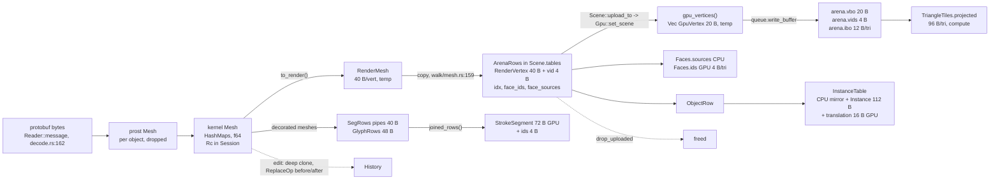
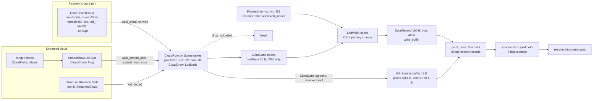

# Session Viewer — data structure inventory (Phase 4)

Scope: `session/session_viewer/src` plus the kernel types it consumes from `../session_rust`, source as of 2026-11-19. Read-only audit: nothing was built, run or measured. Every byte size of a GPU structure is **computed from its field types**; where the code also holds a compile-time `assert!` on the size, that is cited. Performance statements are **HYPOTHESIS** unless marked *verified-by-reading* (meaning: the code path was read, not timed).

Ownership at the `App → State → {Gpu, Camera, Scene}` level, the three representations (source / display / GPU) and the general CPU→GPU flow are in [ARCHITECTURE.md §5](ARCHITECTURE.md#5-ownership) and [`../ARCHITECTURE.md`](../ARCHITECTURE.md) ("Three representations", "Rust ↔ WGSL interfaces"). This document does not repeat them; it goes one level down, to the structs.

Conventions: `file:line` is relative to `src/` unless it starts with `session_rust/`. "Native" = 64-bit host; on `wasm32` `usize` and pointers are 4 bytes.

---

## 1. Kernel source types (owned by `session_rust`, retained by the viewer)

| Structure | Definition | Fields (summary) | Memory notes | Viewer role |
|---|---|---|---|---|
| `Session` | `session_rust/src/session.rs:1114` | `objects: Objects`, `lookup: HashMap<String, Geometry>`, `tree`, `graph`, `xforms: HashMap<String, Xform>`, `definitions`, `instance_lookup`, `history: History`, `bvh: SpatialBVH`, `cached_ray_bvh` | every guid is stored twice as a `String` (object's own `OnceLock<String>` + `lookup` key, inserted at `app/decode.rs:208`) | one per loaded file, held as `Rc<Session>` in `FileDoc.session` (`app/scene.rs:40`) |
| `Geometry` | `session_rust/src/session.rs:58` | enum of `Rc<Mesh>`, `Rc<BRep>`, `Rc<PointCloud>`, … | cloning is an `Rc` bump | passed to every `walk_*` producer |
| `Mesh` | `session_rust/src/mesh.rs:307` | half-edge `HashMap<usize, HashMap<usize, Option<usize>>>`, `vertex: HashMap<usize, VertexData>` (f64 xyz + attribute map), `face: HashMap<usize, Vec<usize>>`, face/edge attribute maps | hash-map-of-hash-maps, f64; the heaviest per-vertex CPU form in the pipeline | source of truth for picking/undo; converted on every walk |
| `RenderMesh` / `RenderVertex` | `session_rust/src/render_mesh.rs:26-37` | `RenderVertex { position: [f32;3], normal: [f32;3], color: [f32;4] }` = **40 B** (computed); `indices: Vec<u32>` | built fresh by `Mesh::to_render()` (`render_mesh.rs:64`), never cached | transient, inside `walk_mesh` |
| `PointCloud` | `session_rust/src/pointcloud.rs:18-53` | `_coords: Vec<f64>`, `_colors: Vec<i32>` (4 × i32 per point), `_normals: Vec<f64>`, `_point_ids: Vec<u32>`, octree `_lod_min/_lod_size/_lod_spacing: Vec<f64>`, `_lod_level/_lod_first/_lod_count/_lod_children: Vec<i32>` | **68 B/point** with normals and ids (24 + 16 + 24 + 4, computed); colours use 16 B where the GPU uses 4 | resident (non-streamed) clouds stay in the kernel after upload unless the document is released |
| `TreeNode` | `session_rust/src/tree.rs:16` | `Rc<RefCell<…>>` tree with parent `Weak`, children, `name`, `color`, `dead`, `tomb` | — | hierarchy, layers, groups; cached by the viewer as `Weak` (`app/scene.rs:90,99`) |
| `History` / `Transaction` / `Op` | `session_rust/src/history.rs:377-384`, `:331`, `:276` | `undo_stack`, `redo_stack: Vec<Transaction>`; `ReplaceOp { before: Item, after: Item }` (`:184`); `XformOp { before, after: Option<Xform> }` (`:205`) | `CAPACITY = 64` transactions (`:20`), `BUDGET = 256 MiB` (`:21`) per session | the only undo payload store (see §8) |
| `Xform`, `Point`, `Vector`, `Quaternion` | `session_rust/src/xform.rs:20`, `point.rs:24`, `vector.rs:29`, `quaternion.rs:23` | value + `guid: OnceLock<String>` + `name: String` | **every constructor allocates a name `String`** (`Xform::from_matrix` → `"my_xform".to_string()`, `xform.rs:55-60`; `Point::new` → `"my_point"`, `point.rs:50-61`; `mul` goes through `Xform::new`, `xform.rs:96`) | used as plain math values on hot paths (§10.3) |

Serialization: protobuf via prost (`session_rust/src/proto/session_proto.rs`, e.g. `Mesh` `:162`, `PointCloud` `:935`); JSON via serde (`Session::jsonload`, `app/decode.rs:693`). Load decodes **one object message at a time** (`Reader::message`, `app/decode.rs:162`; `object!` macro `:203`) into a prost struct, then `from_proto` into the kernel type; the prost struct is dropped per object. Save (`app/session_io.rs:140`) calls `Session::to_proto()` (`session_rust/src/session.rs:2849`), which builds an owned prost tree (e.g. `Mesh::to_proto` allocates new maps, `session_rust/src/mesh.rs:6962-6968`), then `encode_to_vec()` (`session_io.rs:165`): peak = kernel + prost copy + bytes per document (verified-by-reading; size not measured). Viewer metadata is JSON inside the protobuf container (`session_io.rs:22-38`, `:232`).

Spatial index in the kernel: `Session.bvh` / `cached_ray_bvh` exist (`session.rs:1141-1143`) but **no viewer code queries them** (`grep -ri bvh src` finds only `mesh.clear_triangle_bvh()` at `app/deform.rs:178` and an inspection comment).

---

## 2. Scene-side structures (`app/`)

### 2.1 `Scene` and its row tables

`Scene` (`app/scene.rs:73-135`, 59 fields) — see ARCHITECTURE.md §10.1 for the god-object finding. Its fields fall into these groups:

| Group | Fields (line) | Types | Keyed by | Lifetime / update |
|---|---|---|---|---|
| Documents | `docs` (74), `doc_state` (97), `released` (121), `asked` (122) | `Vec<FileDoc>`, `Vec<DocState>`, `HashMap<usize, Released>` | doc index | page; `clear()` (`scene.rs:220`) |
| Row identity | `order` (87), `owners` (88), `nodes` (90), `guid_to_row` (108), `ids` (94), `sink` (95), `empty` (96) | `Vec<Rc<str>>`, `Vec<usize>`, `Vec<Weak<RefCell<TreeNode>>>`, `HashMap<(usize, Rc<str>), u32>` | row id (u32) | row ids are reused through `Ids` (`app/scene_rows.rs:182`); guid `Rc<str>` is shared between `order` and `guid_to_row` (`app/scene_sync.rs:397-416`) |
| Row → lane allocation (CPU mirror of GPU) | `feet` (89), `spans` (91), `caps` (92), `graves` (93), `dead` (101), `dead_points` (102), `object_rows` (109), `uploaded` (110), `edge_sources` (107) | `Vec<Footprint>`, `Spans`, `HashMap<u32, Cap>`, `Counts` | row / pipe index | maintained by `scene_sync`; `edge_sources` is one `(u32,u32)` = 8 B **per edge pipe** |
| Display state | `hidden` (79), `locked` (80), `colors` (81), `edge_colors` (82), `selected` (83), `interactions`, `attributes`, `arrowhead_pens` | `HashSet<(usize, Rc<str>)>`, `HashMap<(usize, Rc<str>), [u8;3]>`, `Option<u32>` | (doc, guid) | mutated by commands/panels; pushed to GPU as `Instance` flags/colour |
| Staging | `tables: Upload` (76), `staged: Staged` (100), `pending` (98), `hints` (99), `loaded` (104), `preview` (105) | engine `Upload`, `Staged` (`scene_rows.rs:92-103`) | — | filled by walks/syncs, drained by `upload_to` (`scene.rs:286-396`) |
| Undo bookkeeping | `undo_steps`, `redo_steps` (111-112), `tombs` (124), `tombed`, `tomb_points`, `burials`, `tomb_cap` (125-128), `edge_steps` (117) | `Vec<Vec<(usize, String)>>` (labels only), `HashMap<(usize, Rc<str>), Tomb>` | — | §8 |
| Streams | `streamed: Vec<StreamedCloud>` (77), `sheets: Vec<SheetBatch>` (78), `stream_ceiling` (123) | §4, §6 | slot index | page |
| Text | `texts: Vec<SceneText>` (75), `text_rows` (119), `matrix_titles` (120) | §7 | — | — |
| Instancing | `instancing: Instancing` (129) | §2.3 | — | — |
| LOD | `display: Display` (130) | §2.4 | — | — |
| Layers/groups | `current_layer` (115), `layer_steps` (116), `groups` (118) | `Option<(usize, String)>`, `HashSet<(usize, Rc<str>)>` | — | §9 |

Supporting row types (`app/scene_rows.rs`):

| Type | Line | Fields | Note |
|---|---|---|---|
| `Footprint` | 28-38 | `None` / `Cloud` / `One { lane: LaneId, start, count }` / `Many(u32)` index into `Spans` | where an object's lane rows sit |
| `Cap` | 43 | `alloc: Counts`, `preview: bool` | rows owned beyond those filled (drag previews reserve slack) |
| `Note` | 57-63 | `guid: Rc<str>`, `what: u8` (GEOMETRY/PLACE/PRESENCE/SUBTREE), `node`, `parent`, `tomb: Option<Weak<history::Tomb>>` | invalidation note of one edit |
| `Tomb` | 79-88 | `row`, `foot`, `record: Weak<history::Tomb>`, `born`, `place`, `points` | deleted object whose GPU rows stay hidden for undo |
| `Staged` | 92-103 | `retire`, `bury`, `unbury`, `clouds`, `kills`, `tails`, `patches: Vec<(Counts, Upload)>`, `rows`, `geometry`, `places` | O(changed) GPU work list; `mem::take` in `upload_to` (`scene.rs:287`) |

`FileDoc` (`scene.rs:37-43`): `name`, `place: Xform`, `session: Rc<Session>`, `point_px`, `display_only`. `Picked`/`PickedPoint` (`scene.rs:47-62`): pick answer mapped to `(doc, guid, row, point, entity)`.

Performance: all per-row tables are dense `Vec`s indexed by row id (O(1)); identity sets are hashed on `(usize, Rc<str>)` (hash of the guid string per lookup). `upload_to` is called from 10 sites (state.rs:76,130; state/edit.rs:413,813; state/text.rs:39; app/runtime.rs:511; app/edit.rs:909; scene_display.rs:391; scene_text.rs:60,71) — not per frame unless something staged work.

### 2.2 Walk producers → `Upload`

| Structure | Definition | Fields | Role |
|---|---|---|---|
| `Walk<'a>` | `app/walk/mod.rs:40-46` | `&mut` borrows of `ArenaRows`, `SegRows`, `GlyphRows`, `CloudRows`, `LaneRows` | one upload's tables during a walk |
| `WalkCx` | `app/walk/mod.rs:73-81` | `quality`, `vert_base`, `cloud_px`, `row`, `interactions`, `attributes`, `arrowhead_pens` | per-object walk context |
| `Row` | `app/walk/mod.rs:84-89` | `bounds: AABB`, `spacing`, `flags`, `faces` | what a producer reports; becomes an `ObjectRow` |
| `Upload` | `engine/gpu/upload.rs:9-17` | `obj: ObjectRows`, `arena: ArenaRows`, `seg: SegRows`, `glyph: GlyphRows`, `cloud: CloudRows`, `lanes: LaneRows`, `bounds` | "rows walked but not yet uploaded"; `drop_uploaded` frees every Vec (`upload.rs:36-44`, `drop_rows` = `*v = Vec::new()` at `:64`) |
| `LaneRows` | `engine/gpu/lane.rs:96` | `tables: Vec<Box<dyn Any>>`, one table per row type, looked up by linear `downcast` (`:102-128`) | rows of registered lanes (vectors, planes, matrices) |

`Upload` contains no wgpu types, so it is the CPU staging form; it is owned by `Scene.tables` and by `Staged.patches`.

### 2.3 Instancing (`app/scene_instances.rs`)

| Structure | Line | Fields | Note |
|---|---|---|---|
| `Walked` | 17-25 | `bounds`, `spacing`, `flags`, `faces`, `spheres: Vec<GlyphPoint>`, `dots: Vec<GlyphPoint>`, `hull` | per-definition result **retained on the CPU**; markers are re-emitted per instance |
| `Batch` | 28-35 | `key`, `doc`, `definition: Rc<str>`, `row` (hidden row holding shared rows), `walked`, `members: Vec<u32>` | one definition drawn once per instance |
| `Instancing` | 39-48 | `batches: Vec<Option<Batch>>`, `by_definition`, `of_row`, `member_at: HashMap`, `dirty`, `full`, `touched` | O(1) join/leave (`:87-114`) |
| GPU side: `Slots`, `Draw`, `SlotTable`, `Run` | `engine/gpu/slots.rs:80-83`, `:17-22`, `:167-170`, `:299-309` | `Slot = [u32; 2]` (row, triangle-id base) = 8 B per instance in a vertex buffer stepped per instance; `SlotTable` = `Rgba32Uint` texture, 1024 texels/row (`:13`) | shared definition rows drawn with `draw_indexed(.., slots)` (`arena.rs:378-385`) |

Congruent BReps are also deduplicated at walk time (`app/walk/brep_shapes.rs`, `Recording` at `:405`, 16 fields), documented in `../ARCHITECTURE.md`.

### 2.4 Display LOD for curved sources (`app/scene_display.rs`)

`Display` (`:49-59`): `quality: HashMap<u32, Quality>` (`Quality { tolerance: f64 }`, `app/walk/display.rs:339`), `sources: HashMap<u32, (Geometry, usize)>` (geometry retained for released documents), `instance_features`, `allocated`, `signature`, `cursor`, `remaining`, `limited`, `limit_reasons`. `refine_display` (`:259`) scans at most `SCAN_ROWS = 128` rows per idle frame (`:18`) and re-walks BRep/element/curve/surface rows whose screen error exceeds their current chord tolerance, within `REFINEMENT_BYTES = 64 MiB` (`:16`), `TRANSIENT_BYTES = 32 MiB` (`:17`) and `OBJECT_BYTES = 16 MiB` per object (`app/walk/display.rs:5`). This is a re-tessellation LOD, not a spatial structure: it walks rows in index order with no visibility test (verified-by-reading `:270-300`; it skips hidden rows only).

### 2.5 Edit previews (`app/mesh_preview.rs`, `app/surface_preview.rs`, `app/scene_sync/preview.rs`)

| Structure | Line | Fields | Purpose |
|---|---|---|---|
| `Previews` | `scene_sync/preview.rs:7-11` | `mesh: Option<MeshPreview>`, `surface: Option<SurfacePreview>`, `span` | captured for the one dragged row by re-walking it (`capture_preview`, `:15-57`) |
| `MeshPreview` | `mesh_preview.rs:10-16` | `vertices: Vec<(usize, RenderVertex)>`, `pipes: Vec<([usize;2], CylinderSegment)>`, `spheres`, `dots` | CPU copy of the dragged mesh's uploaded rows, keyed by kernel vertex key |
| `Gesture` | `mesh_preview.rs:19-24` | `(GPU index, original row, moves)` per vertex/pipe/sphere/dot | rows one drag rewrites in place |
| `SurfacePreview` | `surface_preview.rs:11-19` | `samples: Vec<Sample>`, `vertices: Vec<RenderVertex>`, `controls: Vec<Vec<f64>>`, `pipes`, `pipe_vertices`, `pipe_normals`, `chains` | uv-reprojection preview for BRep/surface drags |

---

## 3. Mesh representation, end to end

| Stage | Structure | Per-vertex bytes | Per-triangle bytes | Lifetime | Evidence |
|---|---|---|---|---|---|
| Source | kernel `Mesh` (hash maps, f64) | not computed (hash-map overhead) | — | document | `session_rust/src/mesh.rs:307` |
| Walk temp | `RenderMesh` | 40 | 12 (indices) | inside `walk_mesh` | `app/walk/mesh.rs:133` |
| Walk temp | `vpos64`, `vpos`, topology (decorated meshes ≤ `MESH_RAW_MIN` triangles only) | 24 + 12 | — | inside `walk_mesh` | `mesh.rs:137-153` |
| Staging | `ArenaRows` (`engine/gpu/arena.rs:88-98`): `verts: Vec<RenderVertex>`, `vids: Vec<u32>`, `idx`, `idx_print`, `idx_text`, `face_ids`, `face_sources: Vec<FaceSource>`, `surface_boundaries`, `surface_samples: Vec<Sample>` | 40 + 4 | 12 + 4 (face id) | until `upload_to` → `drop_uploaded` | copy loop `mesh.rs:159-174` |
| Upload temp | `Vec<GpuVertex>` from `gpu_vertices` | 20 | — | inside `ArenaLane::append` | `arena.rs:82-84`, `:207-216` |
| Upload temp | `Vec<u32>` face ids | — | 4 | inside `Faces::append` | `faces.rs:115-121` |
| GPU | `ArenaLane` (`arena.rs:122-135`): `verts` (`GpuVertex`, vertex+storage), `vids` (u32), `faces` (index+storage), `print`, `text` index buffers, all `GrowBuf` | **24** (20 + 4) | **12** (+4 `Faces.ids`) | until `reset`/`release` | `arena.rs:181-189` |
| GPU derived | `TriangleTiles.projected` (96 B per triangle) + tile reference pool (initial 8 refs × 2 words per triangle + 2 per tile, max 262 144 tiles × 32 × 2 words = 64 MiB) | — | **96** + pool | rebuilt when camera or geometry changes | `engine/gpu/triangle_tiles.rs:16,22-31,79-84,223-238` |
| CPU mirror | `Faces.sources: Vec<FaceSource>` (`u32` + `usize`: 16 B native, 8 B wasm32) | — | per source face | lane lifetime | `faces.rs:14,113`, `arena.rs:649-652` |
| CPU mirror | `Scene.edge_sources` (8 B per edge pipe) | — | — | scene | `scene.rs:107`, filled `scene.rs:331-341` |

`GpuVertex` (`arena.rs:24-30`): `#[repr(C)]`, `bytemuck::Pod`; `position: [f32;3]` @0, `normal: u32` (octahedral snorm16×2, `NO_NORMAL = 0x8000_8000`) @12, `color: u32` (unorm8×4) @16 → **20 B** (computed; matches comment "half the kernel's RenderVertex"). Vertex layout `Float32x3, Uint32, Unorm8x4` (`:33-34`).

Two draw paths read the same buffers: vertex-buffer + index-buffer draws for masks (`draw_run`, `arena.rs:357-388`, `vs_main` with `@location(0..3)` in `shaders/triangle.wgsl:8-11`) and vertex-pulled source-face draws (`Faces::draw`, `faces.rs:215-243`, `@group(3)` storage `face_vertices/face_objects/face_indices/source_faces`, `triangle.wgsl:96-102`). Both are needed; the existing `../ARCHITECTURE.md` describes only the pulled one.

Update mechanism: append-only `GrowBuf` growth (§5.1); in-place edits via `ArenaLane::patch`/`patch_vertices` (`arena.rs:219-233`) at offsets the scene keeps in `Footprint`/`Counts`; deletions hand rows to a hidden `sink` row (`kill`, `arena.rs:237-258`) or degenerate indices (`degenerate`, `:261-285`) instead of compacting; compaction re-walks editable lanes (`app/scene_sync/compaction.rs`). Every mesh mutation calls `tiles.invalidate()`.

---

## 4. Point clouds

| Stage | Structure | Definition | Per-point bytes | Lifetime |
|---|---|---|---|---|
| Source (resident file) | kernel `PointCloud` | `session_rust/src/pointcloud.rs:18-53` | 68 (computed) | document, unless released |
| Source (streamed) | `StreamRows { positions: Vec<f32>, colors: Vec<u32>, normals: Vec<u32> }` decoded from ranged reads | `app/walk/cloud/stream.rs:9-13` | 20 | per slice (`CloudChunk`, `app/runtime.rs:374-378`) |
| Streamed descriptor | `StreamedCloud { name, url, row, lod: CloudLod, fields: CloudFields, place, done_to, total, point_px }` | `app/scene.rs:1059-1069`; `CloudLod` `app/stream.rs:120-128` (`min/size/spacing: Vec<f64>`, `level/first/count/children: Vec<i32>`); `CloudFields` `app/stream.rs:3-15` (byte offsets, ETag) | — (per node: 84 B computed) | scene |
| Staging | `CloudRows { pos: Vec<f32>, col: Vec<u32>, nrm: Vec<u32>, draws: Vec<CloudDraw>, nodes: Vec<LodNode>, expect, expect_normals }` | `engine/gpu/cloud.rs:72-80` | 20 | until `drop_uploaded` |
| Producers | `walk_cloud` (f64→f32, `[i32;4]`→packed u32, `oct16` normals) / `walk_stream_slice` (`extend_from_slice` copies) | `app/walk/cloud/resident.rs:12,48-81`; `app/walk/cloud/stream.rs:26-69` | — | — |
| GPU | `CloudLane { pos, col, nrm: GrowBuf (stride 4), clouds: Vec<Cloud>, buried: Vec<Cloud>, nodes: Vec<LodNode>, point_count }` | `engine/gpu/cloud.rs:106-114` | **20** (12 + 4 + 4; normals only when every point has one) | lane |
| CPU bookkeeping | `Cloud { instance, spacing, node_first, node_count, resident, chunks: Vec<Chunk> }`, `Chunk { from, to, row, nrm }` (16 B) | `cloud.rs:48-55`, `:33-38` | — | lane |
| LOD nodes (CPU only) | `LodNode { center: [f32;3], size, spacing, first, count, children: [i32;8] }` = **60 B** (computed, no padding) | `cloud.rs:22-29` | per node | lane; **never uploaded** — the walk is on the CPU |
| Per-frame draw list | `SplatRecord` `#[repr(C)]` Pod = **160 B** (asserted `splat.rs:46`): `mvp_model: [f32;16]`, `tint`, `first`, `count`, `cum`, `k`, `rot: [f32;12]`, `nrm_first`, `instance`, `flags`, `selected_point` | `engine/gpu/splat.rs:32-44` | per run | rebuilt when `Key` (mvp, size, lod_px, point_count, geometry revision) changes (`splat.rs:290-303`) |
| GPU draw | `Splat` (`splat.rs:134-150`): `record_buf` = 16 B header + `MAX_RECORDS = 4096` × 160 B = 640 KiB fixed (`:18,164-169`); `SplatTargets` depth `Depth32Float` + colour `Rgba8Unorm` at canvas size × samples = 8 B/px/sample (`:72-78,155-159`) | — | — | `targets` recreated on resize/sample change |

LOD / octree: the only octree in the viewer. Nodes come from the file (kernel `lod_*` arrays, or the streamed `CloudLod`), are copied into `LodNode` (`resident.rs:84-104`, `stream.rs:89-…`), and `LodWalk::select` (`engine/gpu/lod.rs:42-113`) descends nodes whose projected spacing exceeds `lod_px`. Facts (verified-by-reading): LOD applies only when `lod_px > 0` **and** the cloud has ≥ `LOD_MIN_POINTS = 2_000_000` resident points (`lod.rs:5,46`); the default `lod_px` is `knob_f32("VIEWER_LOD", "lod", 0.0)` = **off** (`engine/gpu/view.rs:45`); there is **no frustum test** — `projected_spacing` uses distance only (`lod.rs:117-139`), so off-screen nodes are still selected (cross-ref PERFORMANCE_AUDIT H4). `LodWalk` reuses its `ranges/stack/visits` scratch (`lod.rs:33-38`). Records past 4096 are silently skipped (`splat.rs:431`), so a deep LOD cut or many chunks can drop points (verified-by-reading; not reproduced).

Draw: one non-instanced `draw(0..6 × total)` (`splat.rs:329`); each vertex binary-searches the record table (`shaders/splat.wgsl:47`). Points are pulled from `positions: array<f32>` (`splat.wgsl:20`), so there is no padding.

Undo/delete: a deleted cloud is moved to `CloudLane.buried` with its points kept on the GPU (`bury_instance`, `cloud.rs:242-250`); `kill_instance` (`:230-239`) only adds to `dead_points`; space is reclaimed by `compact` (`:264-307`), which builds packed copies with `copy_buffer_to_buffer` then `swap_in` (GPU peak ≈ live + packed).

---

## 5. GPU buffers, lanes and object rows (`engine/gpu/`)

### 5.1 Buffer primitives (`engine/gpu/buffers.rs`)

| Structure | Line | Fields | Behaviour |
|---|---|---|---|
| `GpuCtx` | 5-9 | `device`, `queue`, `cache: pipelines::Cache` | owned by `Gpu.ctx` |
| `GrowBuf` | 41-48 | `buf: wgpu::Buffer`, `len: u32`, `cap: u64` (rows), `stride`, `usage`, `label` | `append` writes at `len` with `queue.write_buffer` (`:66-89`); full → `grow` to `max(need, 1.5·cap)` capped at device limit (`:335-337`), allocates a new buffer, **submits its own command buffer** for `copy_buffer_to_buffer`, then `replace_buffer` destroys the old one (`:104-116`) — transient GPU peak ≈ 2.5 × old size; `reserve` grows exactly (`:92-101`); `fill` allocates a `vec![row; min(4 MiB/stride, count)]` per call (`:133-145`); `reset` keeps capacity, `release` shrinks to one row |
| `Template` | 235-239 | `vbo`, `ibo`, `index_count` | immutable small meshes (`create_buffer_init`) |
| helpers | 274-332 | `zeroed_buffer`, `replace_buffer` (destroy on swap, the WebGPU-leak fix), `uniform_buffer`, `bind_group`, `resource_group` | — |

Callers rebuild bind groups whenever an `append` reports the buffer moved (e.g. `table.rs:349-351`, `segments.rs:397-429`).

### 5.2 GPU row structs (all `#[repr(C)]`, `bytemuck::Pod + Zeroable`)

| Struct | Definition | Size (computed) | Compile-time check | Binding | Rows |
|---|---|---|---|---|---|
| `Instance` | `engine/gpu/instance/layout.rs:7-15` | `model [f32;16]` 64 + `color` 16 + `flags, ao_radius, spacing, _pad`(edge colour) 16 + `effect [f32;4]` 16 = **112 B** | `layout.rs:17`; WGSL mirror `shaders/scene.wgsl:6-14`; offset tests `instance/validation.rs` | group 2 b0 | one per object row |
| translation row | `objects/table.rs:137-144,161` | `[f32;4]` = **16 B** | — | group 2 b1 | one per object row |
| `GpuVertex` | `arena.rs:26-30` | **20 B** | comment only | vertex buffer 0 / group 3 storage | per mesh vertex |
| `CylinderSegment` | `segments.rs:22-29` | `p0` 12 + `radius` 4 + `p1` 12 + `instance_id`, `color`, `facing` 12 = **40 B** | `segments.rs:31` | inside `StrokeSegment` | staging only |
| `StrokeSegment` | `segments.rs:160-169` | 40 + `previous`, `next`, `sag`, `start_trim` 16 + `dash [f32;2]` 8 + `dash_offset`, `end_trim` 8 = **72 B** | `segments.rs:171` | group 3 | per pipe / ribbon / sheet segment |
| `GlyphPoint` | `glyphs.rs:23-30` | 12 + 4 + 16 + 4 + 4 + 8 = **48 B** | `glyphs.rs:32` | group 3 | per marker / dot |
| `VectorRow` | `vectors.rs:22-35` | **64 B** (offset table in source) | `vectors.rs:43` | group 3 | per arrow |
| `PlaneRow` | `planes.rs:36-44` | **48 B** | `planes.rs:46` | group 3 | per plane |
| `SplatRecord` | `splat.rs:32-44` | **160 B** | `splat.rs:46` | point group 1 | per point run |
| widget `Vertex` | `widget_mesh.rs:7-11` | 12 + 4 + 4 = **20 B** | — | gumball vertex buffer | fixed mesh |
| `LineUniform` | `frame.rs:42-57` | **80 B** | `frame.rs:60-67` (size + 5 offsets) | group 1 b0 | 2 (frame, pick) |
| `CloudUniform` | `frame.rs:72-82` | **48 B** | `frame.rs:84-88` | point group 0 | 2 |
| `ClipUniform` | `frame.rs:450-464` | **448 B** (offset table in source) | `frame.rs:466` | group 1 b1 | 1, shared by frame and pick |
| camera `mvp` | `frame.rs:155,319-324` | `[f32;16]` = **64 B** | — | group 0 b0 | 2 (frame, pick) |
| `Slot` | `slots.rs:10` | `[u32;2]` = **8 B** | — | per-instance vertex buffer | per instance |
| projected triangle | `triangle_tiles.rs:16` | **96 B** (six `vec4<f32>`) | constant | group 2 b6 | per triangle |
| matrix words | `matrices.rs:19-41` | `u32` words: 16-word header + 3 words per value | — | group 3 | per displayed math matrix (stage/annotation matrices, **not** camera matrices) |

### 5.3 Lanes (`Gpu` fields, `engine/gpu/context.rs:25-59`)

| Lane | Struct (line) | GPU buffers / textures | CPU mirrors kept |
|---|---|---|---|
| objects | `InstanceTable` (`objects/table.rs:147-165`) | `buffer` (Instance), `translations` | `rows: Vec<Instance>` (full copy, 112 B/row), `translation: Vec<[f64;3]>`, `local_bounds`/`world_bounds: Vec<AABB>` (48 B each), `hulls: Vec<Option<Hull>>` (`Hull = Rc<[[f32;3]]>`, ≤ 8192 points, `hull/geometry.rs:5,11`), `bounded: Vec<BoundedRow>` + `bounded_at`, `clipping`, `closed` (sorted) |
| arena | `ArenaLane` (`arena.rs:122-135`) | `verts`, `vids`, `faces`, `print`, `text`, `Faces.ids`, `Faces.selected` (16 B uniform), `Slots`, `SlotTable`, `TriangleTiles` | `Faces.sources`, `SlotSpace` |
| segments / control_net | `SegmentLane` (`segments.rs:320-331`) | `pipes`, `ribbons`, `sheet_table` (each `SegTable`: StrokeSegment + ids `GrowBuf`), `selection` uniform | `selected_rows: HashSet<u32>`, `sheets: Vec<SegSheet>` with `ids: Vec<u32>` = CPU copy of every sheet segment id (`segments.rs:96-111,133`) |
| glyphs / controls | `GlyphLane` (`glyphs.rs`, `GlyphTable` `:50-54`) | spheres, dots | — |
| cloud + splat | §4 | §4 | `clouds`, `buried`, `nodes` |
| registered | `VectorLane`, `PlaneLane`, `MatrixLane` via `lane::REGISTRY` (`lane.rs:85-89`) | one `GrowBuf` each | `MatrixLane.starts` |
| text | `TextLane` (`text.rs:51-68`) | glyphon atlas + renderers, plates, world-plane R8 textures (32 MiB budget, `text_plane.rs:167-170`) | §7 |
| frame | `FrameUniforms` (`frame.rs:154-176`) | 8 uniform buffers, 8 bind groups | last `line`, `cloud`, `clip`, `mvp_f32`, `eye` |
| targets | `Targets` (`targets.rs:16-26`), `Attachment` (`:257-260`, destroys on drop) | depth, MSAA colour, `Rgba16Float` gradient | — |
| pick | `Picker` (`pick.rs:97-111`), `IdTargets` (`:15-20`) | `Rg32Uint` id + depth + gradient sized to the pick window (≤ 257 + 2·3 px square, `pick.rs:26,29`), readback buffer | `generation`, `window` |

Performance notes (verified-by-reading unless marked):

- **Every object row exists three times**: `ObjectRow` in `Upload` (transient), `InstanceTable.rows` + bounds (CPU, ≈236 B/row native computed from the five per-row Vecs, more with a hull), GPU 128 B. The CPU `rows` copy is what `set_flag`, `update_inside`, `placement` read.
- `InstanceTable::update_inside` runs **every rendered frame** (`present.rs:20-21`) and loops over every bounded row (`table.rs:423-463`); one `write_buffer` per row whose inside flag flips. O(objects with faces) per frame, no allocation.
- `InstanceTable::append` with a gumball row present truncates the table and **re-uploads every existing row** (`self.rows.clone()` + a fresh translation Vec, `table.rs:232-259`). It runs on every `Gpu::set_scene` (`context.rs:256`), including uploads that add no object rows (e.g. streamed cloud slices go through `upload_to` → `set_scene` because `tables_empty` checks `cloud.pos`, `scene.rs:399-407`). Cost: O(all rows) CPU clone + full GPU write per upload while a gumball is shown — HYPOTHESIS on how often that coincides in practice.
- `rebase_anchor` rewrites every translation (`table.rs:395-406`, fresh `Vec<[f32;4]>`), throttled to ≥ 200 ms (`:14`).
- `LaneId::stride` (`patch.rs:41-53`) says "bytes one row holds, on the GPU and in the CPU mirrors", but its values are CPU staging sizes: `Verts = 44` (RenderVertex 40 + vid 4; GPU is 20 + 4 = 24), `Pipes = 60` (GPU StrokeSegment 72 + id 4 + CPU `edge_sources` 8 = 84), `Ribbons = 52` (GPU 76). These feed `Counts::bytes` (`patch.rs:166`), which budgets `TOMB_CAP = 256 MiB` (`app/scene_sync.rs:44`) and the display refinement budgets (`scene_display.rs:367,372`). So the tomb and refinement caps are approximate in both directions.

---

## 6. Sheets (streamed 2D drawings)

`SheetChunk { idx, rows: SheetRows, to }` (`app/runtime.rs:403-407`) → `SheetRows { positions: Vec<f32> (6/segment), colors, widths, ids }` (`app/walk/sheet.rs:6-11`) → `walk_sheet_slice` (`sheet.rs:30-61`) pushes `CylinderSegment` (40 B) + id into `SegRows.sheet_rows/sheet_ids` and one `SegDraw` → `SegmentLane::append` converts to `StrokeSegment` (72 B) in a temporary Vec (`segments.rs:421-429`) → GPU `sheet_table` (72 + 4 B/segment). CPU keeps `SegSheet.ids` (4 B/segment, `segments.rs:100,110,133`) and the scene keeps `SheetBatch { name, url, meta_url, row, fields: SheetFields, place, done_to, total, resolved, table }` (`app/scene.rs:1332-1343`; `SheetFields` `app/stream.rs:19-33`). Entity metadata is never resident: `sheet_query.rs` reads it by range on pick (see `../ARCHITECTURE.md` "Sheets"). The whole sheet is one object row.

---

## 7. Text structures

| Structure | Definition | Fields | Lifetime / update |
|---|---|---|---|
| `TextPlacement` | `engine/text.rs:33` | `Screen`, `Anchor`, `Nameplate`, `WorldPlane`, `WorldBillboard` (world points in f64) | — |
| `TextLabel` | `engine/text.rs:84-93` (serde) | `id`, `object: Option<TextObject>`, `text: String`, `font_size`, `line_height`, `color: [u8;4]`, `placement`, `clip` | serialized in session metadata (`session_io.rs:36`) and manifests |
| `SceneText` | `app/scene_text.rs:10-15` | `label: TextLabel`, `row`, `key: String`, `active` | owned by `Scene.texts` |
| `TextDocument` / `TextRun` | `engine/text.rs:113-120`, `:107-110` | `fonts: FontSystem`, `runs: Vec<TextRun { label, buffer: glyphon::Buffer }>`, revisions | owned by `Gpu.text.document`; `set_labels` validates (256 KiB cap) and reuses runs by id (`:137-167`) |
| `TextFrame` | `engine/gpu/text.rs:18-25` | `mvp`, `origin`, `framebuffer`, `logical`, `ortho_half_height`, `clip` | built per frame (`present.rs:180-187`), plain data |
| `TextLane` | `engine/gpu/text.rs:51-68` | atlas, `overlay`/`anchored` renderers, `plates`, `planes`, `prepared: Option<(u64, u64, TextFrame)>` key, `raster_keys: HashSet` | `prepare` skips when the key matches (`:137-146`) |
| world-plane cache | `engine/gpu/text_plane.rs` `CachedPlane` (built `:205-213`) | `label` (clone), `font_revision`, `em_pixels`, `size`, `texture` (R8), `bind` | per WorldPlane label |

Duplication: each label is held in `SceneText.label`, again in `TextRun.label` (`State::update_label` builds a fresh `Vec<TextLabel>` of clones, `app/scene_text.rs:218-230`, `state/text.rs:61-85`), and a third time in `CachedPlane.label` for world-plane text. Event-driven (selection, text edits), not per frame.

---

## 8. Edit and undo state

| Layer | Structure | What it holds | Bound |
|---|---|---|---|
| Kernel | `History` (`session_rust/src/history.rs:377`) per `Session` | `Transaction { label, ops: Vec<Op>, bytes }`; `ReplaceOp { before: Item, after: Item }` holds **both full geometries** as `Rc` | 64 transactions, 256 MiB (`history.rs:20-21`); purged on save |
| Viewer edit | `deform::transform` (`app/deform.rs:165,182,206,218,249,300`) | builds the edited object as `(**source).clone()` — a deep copy of the whole geometry — and `session.replace` records it (`app/edit.rs:420,814,850`, `app/modeling.rs:191`) | — |
| Viewer step order | `Scene.undo_steps` / `redo_steps` (`app/scene.rs:111-112`) | labels only: `Vec<Vec<(doc, label)>>` | `MAX_STEPS = 4096` (`app/edit.rs:377`) |
| GPU tombs | `Scene.tombs: HashMap<(usize, Rc<str>), Tomb>` (`scene.rs:124`), `Tomb` (`scene_rows.rs:79-88`) | deleted object's lane rows left on the GPU, hidden, so undo is a flag flip | `TOMB_CAP = 256 MiB` of `Counts::bytes` (stride-estimated, §5.3), oldest released first (`app/scene_sync/tombs.rs:182-201`) |
| GPU buried clouds | `CloudLane.buried` (`cloud.rs:111`) | deleted clouds' points | counted in `tomb_points` |
| Reuse | `Scene.graves` (`scene.rs:93`) | last `Footprint` of a removed object | — |
| Gestures | `Features.dragging: Option<GizmoDrag>`, `control_drag`, `object_drag`, `box_select`, `draft` (`state/features.rs:23-28`); `Previews` (§2.5) | per-gesture state; commit once on release | one gesture |
| Graph edits | `Scene.edge_steps: HashMap<(usize, String), EdgeStep>` (`scene.rs:117`, `EdgeStep` `app/layers.rs:796-799`) | edge + vertices one Add Edge step made | — |

---

## 9. Selection, layers, hierarchy, snapping

### 9.1 Selection state (held in ≥ 9 places)

| Owner | Field (line) | Type | Meaning |
|---|---|---|---|
| `State` | `selection` (`state.rs:55`) | `SelectionMode` (`app/selection.rs:16`: `Object`, `Edge{parent,edge}`, `Face{parent,face}`, `Controls{parent,…}`), serde `Serialize` | what is selected inside one object |
| `State` | `selection_tool` (56), `selection_order` (63), `highlighted` (64), `controls: Controls` (57; `selection.rs:84-88`: `points: Vec<Control{id, position: [f64;3]}>`, `links`, `cloud`) | | multi-selection order, F10 controls |
| `Scene` | `selected: Option<u32>` (`scene.rs:83`, `pub`) | | primary selected row |
| `Gpu` | `selection_revision` (`context.rs:45`) | `u64` | bumped by `set_selected` (`context.rs:449-458`) |
| `InstanceTable` | `Instance.flags & FLAG_SELECTED` | | per-row GPU flag + CPU mirror |
| `SegmentLane` | `selected_rows: HashSet<u32>`, `selection` uniform (`segments.rs:326-328`) | | which rows draw selected strokes |
| `SurfaceOutline` (selected kind) | `selected: HashSet<u32>` (`surface_outline.rs:228-238`) | | mask; freed when empty |
| `Faces` | `active: Option<u32>` + `selected` 16 B uniform (`faces.rs:16-18`) | | selected source face |
| `Splat` | `selected_point`, `control_parent` (`splat.rs:135-136`) | | cloud point highlight / LOD-off cloud |
| `TextLabel.object.selected` | `engine/text.rs:77-80` | | label ink colour |

`Gpu::set_selected` fans out to segments, passes, instance flags and splat (`context.rs:449-458`); `State` and `Scene` are updated separately by `State::select*`. No single structure is authoritative (cross-ref ARCHITECTURE.md §10.5).

### 9.2 Layers and hierarchy

No layer object exists in the data model. A panel "layer" is either a kernel `TreeNode` group (`Scene.current_layer`, `groups`) or a derived view: `Layer::Document(usize) | Layer::Kind(Kind)` (`app/layers.rs:11-25`, rows built on demand by `rows()` `:96`). Visibility is `Scene.hidden` (per object) pushed as `FLAG_HIDDEN`; layer colour is `TreeNode.color` applied via `FLAG_COLOR`/`FLAG_EDGE_COLOR` (`scene.rs:441`, `objects/table.rs:853-878`).

| Structure | Definition | Fields | Update |
|---|---|---|---|
| `Hierarchy` | `app/hierarchy.rs:47-58` | `nodes: Vec<Node>`, `rows: Vec<u32>`, `open`, `page`, `truncated`, `edges`, `active`, `revision`, `away`, `off` | rebuilt when `Scene.row_revision` changes (`:62-70`); caps `MAX_NODES = 200 000`, `MAX_ROWS = 1 000 000` (`:12,14`) |
| `Node` | `hierarchy.rs:25-34` | `label: String`, `depth`, `end`, `rows: Range`, `doc`, `name: String`, `path: String` (parents' names joined), `layer`, `pick` | three owned Strings per tree line |
| `LayerRow` | `app/feedback.rs:81-96` (serde) | `key: String`, `label: String`, counts, flags, colours, depth | `refresh_layers` (`state/edit.rs:1100`) copies the rows into the egui model `layers::STATE` (`feedback.rs:147-149`, `rows.to_vec()`) — event-driven, only when the panel is open |
| `ui::layers::Layers` | `app/ui/layers.rs:9-19`, `thread_local STATE` `:21` | `rows: Vec<LayerRow>`, `edges: Vec<EdgeRow>`, rename state | egui panel model |

### 9.3 Snapping and box selection (CPU spatial bins)

`Screen` (`app/snap.rs:405-409`, a `[f64;16]` view matrix + origin) and `Bins` (`snap.rs:497-503`: uniform screen grid `cells: Vec<Vec<u32>>` + `large`) are the only CPU spatial index besides the cloud octree. `drag::Targets` (`state/drag.rs:72-83`) builds three `Bins` lazily per drag ("collected as the drag reaches them"), with reused `near`/`found` scratch.

### 9.4 Spatial structures: what exists and what does not

| Searched (`grep -ri`) | Result |
|---|---|
| octree | cloud LOD nodes only (§4); file-provided, CPU-walked, no frustum test |
| bvh / kd-tree / quadtree | none in the viewer; kernel `Session.bvh` unused |
| frustum / CPU culling | none (0 files match `frustum`); `cull` matches only pipeline `cull_mode: None` (`pipelines/core.rs:561`) and back-face flag comments |
| screen tiles | `TriangleTiles` (GPU compute; per-tile triangle lists for ink visibility, not for draw culling) |
| grids | `snap::Bins` (CPU, drag snapping); ground grid is a shader |
| picking | GPU ID render into a small window (`Picker`), not a CPU ray query |

Consequence (HYPOTHESIS): every draw submits all rows of a lane every frame; off-screen geometry costs vertex work. `ribbon.wgsl` rejects off-screen strokes in the vertex stage (`../ARCHITECTURE.md` "Depth and visible ink"), which is the only view-dependent rejection found.

---

## 10. Camera matrices

| Structure | Definition | Representation | Update |
|---|---|---|---|
| `Camera` | `camera.rs:45-57` | f64, **metres**: `target`, `distance`, `orientation: Quaternion`, `world_up`, `position`, `up`, `perspective`, `unit`, `scene_extent`, `frame`, `grid` | mutated by `orbit/pan/zoom_at/fit` (`camera.rs:111-505`); no dirty flag, `State.dirty/needs_frame` drive redraws |
| `CameraPose` | `camera.rs:61-66` | target, position, up, perspective | equality test for "view changed" |
| view-projection | `Camera::view_proj_anchored` (`camera.rs:328-368`) | `Xform` f64 = `lens · projection · view · scale`, eye and target relative to the anchor, reverse-Z, near = distance × 1e-4 (`:24`) | computed every rendered frame (`state.rs:618-620`) |
| anchor | `InstanceTable.last_origin: Option<Point>` (`table.rs:159`) | scene units, f64 | moves when the camera drifts > clamp(¼ view distance, 1e3, 1e5) (`table.rs:8-14,360-392`) |
| `FrameUniforms.mvp_f32` | `frame.rs:173` | `[f32;16]`, written to `mvp.buffer` | every rendered frame (`frame.rs:318-324`) |
| pick mvp | `frame.rs:379-409` | `clip_transform · mvp` for the pick window, scaled `proj_y`/`ortho_h` | per pick frame |
| per-cloud matrix | `SplatRecord.mvp_model` | `mvp · model` multiplied on the CPU in f64 (`splat.rs:401-403`) | per splat key change |
| text / snap | `TextFrame.mvp` + `origin`; `snap::Screen.matrix` f64 | copies of the same matrix | per frame / per drag |

`engine/gpu/matrices.rs` is the math-matrix display lane, unrelated to the camera.

---

## 11. Allocations and duplication

### 11.1 Geometry held more than once

| # | Data | Copies alive at the same time | Evidence | Status |
|---|---|---|---|---|
| D1 | Mesh vertices | kernel `Mesh` (f64 maps) + GPU 24 B/vertex, always; during walk + `RenderMesh` 40 B + `ArenaRows` 40+4 B; during upload + `GpuVertex` Vec 20 B. Peak CPU ≈ kernel + 104 B/vertex | `walk/mesh.rs:133,159-167`; `arena.rs:82-84,207-216`; `upload.rs:36-44` | verified-by-reading; peak bytes computed, not measured |
| D2 | Mesh triangles | kernel faces + GPU indices 12 B + `Faces.ids` 4 B + `TriangleTiles.projected` 96 B/triangle + tile pool | `triangle_tiles.rs:16,79-84` | verified-by-reading; the derived visibility data is ~8× the index data per triangle (computed) |
| D3 | Edges/strokes | staging `CylinderSegment` 40 B + ids + sags → temporary `StrokeSegment` Vec 72 B + cloned id Vec (`up.pipe_ids.clone()`, `ribbon_ids.clone()`, `sheet_ids.clone()`) → GPU 72+4 B; CPU keeps `Scene.edge_sources` 8 B/pipe and `SegSheet.ids` 4 B/sheet segment | `segments.rs:386-429,96-111`; `scene.rs:331-341` | verified-by-reading |
| D4 | Resident cloud points | kernel 68 B/pt (until release) + GPU 20 B/pt; during upload + `CloudRows` 20 B/pt | `pointcloud.rs:18-53`; `resident.rs:48-81` | verified-by-reading |
| D5 | Streamed cloud slice | `StreamRows` and `CloudRows` both alive while `walk_stream_slice` copies (`extend_from_slice`) → 2 × 20 B/pt on CPU per slice, then GPU | `walk/cloud/stream.rs:26-69` | verified-by-reading |
| D6 | Cloud octree nodes | kernel `lod_*` vectors (resident) or `StreamedCloud.lod: CloudLod` f64 (84 B/node) **and** `CloudLane.nodes: LodNode` (60 B/node), both for the page lifetime | `scene.rs:1063`; `cloud.rs:112,169` | verified-by-reading |
| D7 | Object rows | `ObjectRow` (staging) → `InstanceTable.rows` CPU copy of every `Instance` + f64 translation + 2 AABBs → GPU | `table.rs:147-165,281-326` | verified-by-reading (intended: CPU is the f64 truth) |
| D8 | Undo | every geometry edit deep-clones the full object (`(**source).clone()`) and `History` keeps before **and** after `Rc`s; GPU tombs keep deleted rows resident | `deform.rs:165-305`; `history.rs:184-189`; `scene.rs:124` | verified-by-reading; bounded by 64 tx / 256 MiB / `TOMB_CAP` |
| D9 | Drag previews | `MeshPreview`/`SurfacePreview` hold CPU copies of the dragged object's uploaded vertices/pipes/markers, `Gesture` holds originals | `mesh_preview.rs:10-24`; `surface_preview.rs:11-19` | verified-by-reading; one object at a time |
| D10 | Instanced markers | `Walked.spheres/dots` retained per definition batch on the CPU | `scene_instances.rs:22-23` | verified-by-reading |
| D11 | Released documents | `Display.sources` keeps `Geometry` `Rc`s (BRep elements within a byte budget) after the kernel document is released | `scene_display.rs:51,126-148,194-212` | verified-by-reading |
| D12 | GUID text | kernel object `guid` String + `Session.lookup` key String + viewer `Rc<str>` (shared by all viewer maps) | `decode.rs:208`; `scene_sync.rs:397-416` | verified-by-reading |
| D13 | Labels and names | `SceneText.label` + `TextRun.label` + `CachedPlane.label`; `Hierarchy::Node` label/name/path + `LayerRow` key/label | §7, §9.2 | verified-by-reading |
| D14 | Save | kernel + owned prost tree + encoded bytes per document | `session_io.rs:155-165`; `mesh.rs:6962-6968` | verified-by-reading |
| D15 | GPU growth | `GrowBuf::grow` holds old + new (1.5×) buffer until the copy is submitted; `CloudLane::compact` holds live + packed | `buffers.rs:104-116`; `cloud.rs:264-307` | verified-by-reading; transient |

### 11.2 Clones on hot paths

Grep of `.clone()`, `collect`, `to_vec`, `Vec::new`, `vec!`, `format!` over `engine/gpu/render.rs` and `engine/gpu/frame.rs::write` found **none**; `app/runtime.rs` redraw path clones only `Arc<Window>` (`runtime.rs:247`). `scene_sync/*` clones (`tombs.rs:173,190`, `allocation.rs:58`, `nodes.rs:14`) run only inside a sync (event-driven, O(changed)).

| Site | What is cloned/allocated | Frequency | Status |
|---|---|---|---|
| `table.rs:245` `self.rows.clone()` (+ `anchored_rows` Vec `:246-253`) | whole Instance table | every `set_scene` while a gumball row exists | verified-by-reading; frequency HYPOTHESIS |
| `deform::transform` from `State::drag_gizmo` (`state/edit.rs:162`) and control drag (`state/edit.rs:613-622`) | deep clone of the dragged geometry, then `preview_geometry` → `patch_surface` or full `redraw` + `upload_to` (`app/edit.rs:891-911`) | **every pointer move** of a sub-object/control drag without a `MeshPreview` | verified-by-reading |
| `State::upload_controls` (`state.rs:887-938`) | resets control lanes, rebuilds `GlyphRows` + `SegRows` for all controls, appends | every control-drag move (`state/edit.rs:626`) and on canvas CSS resize | verified-by-reading |
| `segments.rs:388,404,422` id Vec clones | per upload | per `set_scene` | verified-by-reading |
| `faces.rs:115-121`, `arena.rs:82-84` | converted Vecs | per append/patch | verified-by-reading |
| `state/edit.rs:139` `base_place.clone()`, `&delta * base` per moved row (`:188-193`) | `Xform` (allocates a name String) | every drag move | verified-by-reading |

### 11.3 Allocations per rendered frame

| Site | Allocation | Status |
|---|---|---|
| `state.rs:680` → `app/inspection.rs:8` → `engine/gpu/view.rs:174-177` | `inspection::publish` runs on **every rendered frame on wasm** and calls `query("inspect")`: `location().search()` (JS → Rust `String`) + `format!("{name}=")`, even when `?inspect` is absent | verified-by-reading |
| `state.rs:613` `camera.origin()` → `Point::new` | one `String` ("my_point") | verified-by-reading |
| `camera.rs:331-367` `view_proj_anchored` | 3 × `Point::new`, `Vector::new`, `perspective`/`look_at`/`scale_xyz`/`translation` and 3 `Xform` multiplications, each constructing an `Xform`/`Point`/`Vector` with a name `String` (`xform.rs:55-60,96`) | verified-by-reading that the constructors allocate; exact count per frame HYPOTHESIS |
| `table.rs:388` `last_origin.clone().unwrap()` | `Point` clone (String) | verified-by-reading |
| `lod.rs:58`, `splat.rs:401-409` | `Xform::from_matrix` × 4 per cloud | per splat key change (every camera change when clouds exist) | verified-by-reading |
| `engine/gpu/text.rs:171-174` | 3 `Vec` + 1 `HashMap` per `TextLane::prepare`; `text_plane.rs:103,118` 2 more `Vec`s | every frame the text key changes, i.e. every camera change when any label is not `Screen` (cross-ref PERFORMANCE_AUDIT H8) | verified-by-reading |
| `state.rs:568,684-694` `logical_size()` | DOM `get_element_by_id("canvas")` + `client_width/height` (JS calls; no Rust heap) | verified-by-reading |
| `Ui::frame` (`runtime.rs:239`) | egui layout/tessellation | not audited here; PERFORMANCE_AUDIT H2 |
| `splat.rs:368`, `lod.rs:43-60` | `records`, `ranges`, `stack`, `visits` are **reused** (`clear()`), no reallocation after warm-up | verified-by-reading |
| `present.rs:20-21` → `table.rs:423-463` | no allocation; O(bounded rows) loop + conditional `write_buffer` per row | verified-by-reading |

Per-frame GPU uploads with a moving camera: `mvp` 64 B + `LineUniform` 80 B + `CloudUniform` 48 B (`frame.rs:318-364`), `ClipUniform` only on change (`:368-376`), splat header + up to 640 KiB of records when clouds are present (`splat.rs:314-322`), the inside-flag rows that flip, and text/plate buffers when labels are anchored. Computed, not measured.

### 11.4 Corrections to existing documents (found while reading)

| Document | Statement | Code |
|---|---|---|
| `../ARCHITECTURE.md` "Rust ↔ WGSL interfaces" | `Instance` is "one 96-byte row: `model`, `color`, `flags`, `thickness`, `spacing`, `_pad`" | 112 B: `ao_radius` replaced `thickness`, plus `effect: [f32;4]` (`instance/layout.rs:7-17`) |
| `../ARCHITECTURE.md` same section | "Meshes are vertex-pulled" | only source-face draws are pulled; masks use vertex/index buffers (`arena.rs:357-388`) |
| `ARCHITECTURE.md` §5 | `undo_steps` bounded by `MAX_STEPS`, `edit.rs:284` | `app/edit.rs:377` |
| `patch.rs:40` doc comment | stride is "bytes one row holds, on the GPU and in the CPU mirrors" | values are CPU staging sizes (§5.3) |

### 11.5 Candidate reductions (proposals only, not implemented)

1. Gate `inspection::publish` on a cached flag read once at start (removes a per-frame JS string round trip).
2. Give the camera/anchor path name-free math (`[f64; 16]`, `[f64; 3]`) instead of kernel `Xform`/`Point` values, or make the kernel's default name a `&'static str`/`Cow` (a kernel change; parity rules apply).
3. Skip the widget-row rewind in `InstanceTable::append` when `up.rows` is empty, or keep the widget row outside the object table.
4. Convert `RenderVertex` → `GpuVertex` in the walk so `ArenaRows` stores 20 B/vertex (halves staging and removes the upload-time Vec), keeping `RenderVertex` only where previews need normals as f32×3.
5. Store `CloudLod` once (either the f64 descriptor or `LodNode`) for streamed clouds; add a frustum test to `LodWalk::select` before enabling LOD by default.
6. For control-point drags, move the GPU rows (as `MeshPreview` does) instead of deep-cloning and re-walking the geometry per pointer move.
7. Make `LaneId::stride` the GPU stride (or split CPU/GPU strides) so `TOMB_CAP` and refinement budgets measure what they claim.
